# Automotive Night Vision, Lidar and the Sensor Debate
## Technology routes, markets, supply chain, geopolitics and outlook

::: {.disclaimer}
**Disclaimer.** This report was created with AI assistance. It may contain errors: each statement carries an evidence tag and, where possible, a source, so check those before relying on a figure.
:::

---

### How to read this report

This report asks which sensors let a car see at night and at long range, which of them carmakers actually buy, and why. It combines three kinds of material that are usually kept apart: market and company records, engineering physics, and regulation and trade policy. This guide explains what the report covers, how it is organized, how its evidence is tagged and how its equations and symbols work, so that a reader can start at any section.

**Scope.** The report starts from one question: did car makers ever sell thermal night vision as a factory option? (A thermal camera images the heat that people and animals emit, so it needs no light.) It then widens to the topics below.

- **Sensors in cars:** lidar vs thermal; lidar outside China. Lidar (light detection and ranging) measures distance with laser light and builds a 3-D point cloud of the scene.
- **Lidar technology:**
  - a physics primer (§C0). It develops, in order, the three ranging principles (pulsed time of flight (ToF), phase ranging with amplitude-modulated continuous-wave (AMCW) light, as in ToF cameras and surveying instruments, and frequency-modulated continuous-wave (FMCW) ranging), beam and scanning geometry, the link loss of direct and coherent detection with the losses of weather and wet windows, detector noise and detection statistics, and the range, margin and dynamic range that follow, with worked numbers and a benchmark against published systems. ToF lidar times the round trip of a light pulse; FMCW lidar sweeps (chirps) the laser frequency and reads range from the beat frequency between the echo and the outgoing light;
  - FMCW and beam steering, including whether FMCW can match ToF on point rate (points measured per second), pixels, readout and power (§C7a);
  - whether FMCW can win at all, what would have to change, and whether better beam steering would help, with the 2026 "photonic ski-jump" as a test case (§C7b);
  - wavelength selection (905/940/1,550 nm) in numbers: eye-safety limits, sunlight, the economics of InGaAs (indium gallium arsenide, the detector material needed at 1,550 nm), and germanium-on-silicon (Ge-on-Si) photodiodes for coherent receivers (§C4c);
  - mechanical beam steering in numbers: scanner speed limits, vibration qualification, designs and what shipped (§C4d);
  - receiver chips built from SPADs (single-photon avalanche diodes, detectors that register individual photons), including an in-depth read of Sony's automotive parts (§C5a);
  - chip-size (reticle) limits across receiver and transmitter architectures, where the reticle is the largest area a lithography tool can print in one exposure (§C8); lidar-to-lidar interference, with a literature review (§C9, §C9a);
  - whether optical phased arrays (OPAs, chips that steer a beam by setting the phase of many tiny emitters) can compete at high resolution; focal-plane arrays; Lumotive's liquid-crystal (LC) metasurface; what "camera-like" lidar resolution is worth (§C10).
- **Industry and markets:**
  - company-by-company lidar technology routes, and the 2016–2026 lidar investment cycle: closed, acquired and continuing firms and their share prices (§C3a);
  - how to read flagship spec sheets, with an audit of the headline claims (§C3b);
  - judgements from reading the 2013–2026 business press in date order: forecast base rates (how often past forecasts came true), robotaxi economics and platform shifts (§G7);
  - China's driverless delivery vans (about 47k in Q1 2026), where Chinese autonomous trucking stands, and delivery robots and trucks elsewhere (§B4a);
  - markets beyond cars: robotics, industrial, infrastructure and consumer depth sensing (§B8);
  - precision distance measurement, industrial metrology, surveying and consumer 3D sensing, covered in depth in a companion report (`..\precision_ranging_3d_sensing_report\`).
- **Supply chain and geopolitics:** dependencies beyond the optics, including the processors that run ADAS (advanced driver-assistance systems) (§D1a); Chinese FMCW development (§D7); EU and US public research funding for lidar (§D8).
- **Autonomy and system design:**
  - whether camera-only or camera+radar driving can reach full autonomy;
  - the role of software, training data, evaluation and fleet-learning access in ADAS development;
  - how ADAS models ingest heterogeneous sensors;
  - whether adding lidar helps or hinders learned camera stacks, and the compute–power–range trade-off (§E11);
  - camera-only heavy trucking: Tesla's Semi, its stated self-driving timelines, the crash evidence gathered by NHTSA (the US National Highway Traffic Safety Administration) and the 250–400 m sensing problem (§E12).

It ends with explicit projections.

**How the report is organized.** An executive summary is followed by seven Parts and two appendices. Each Part opens with a short orientation, and sections open with the question they answer and a short answer.

- **§0, Executive summary:** the main findings in eleven points, each pointing to the section that supports it.
- **Part A, Thermal night vision:** the factory history of thermal cameras, adoption numbers, why they stayed niche, what could change that, how thermal compares with lidar, what better headlights can and cannot do, and whether low-light ("starlight"), active near-infrared or photon-counting cameras could do thermal's job.
- **Part B, Lidar markets (China vs outside China):** installation counts, Western car programmes and suppliers, robotaxis and trucks, China's driverless delivery vans, parking sensing, and markets beyond cars.
- **Part C, Technology routes and physics:** the physics primer (§C0), then the technology taxonomy and market shares, company routes and the investment cycle, wavelength choice, receivers, mechanical and non-mechanical beam steering, FMCW, chip-size limits, interference and optical phased arrays.
- **Part D, Supply chain and geopolitics:** component dependencies, Chinese export controls, US actions, Chinese responses, ranked chokepoints and Chinese FMCW development.
- **Part E, Can camera-only or camera+radar solve autonomous driving?:** the physics, benchmarks, weather, safety arithmetic, software and data advantages, power, how driving models use several sensors, and camera-only trucking.
- **Part F, Projections:** forecasts with stated confidence levels, and the signposts to watch.
- **Part G, Editorial judgements, re-examined:** the report's own judgements tested against the evidence, including the business press of 2013–2026.
- **Appendix 1** lists open items and unverified points; **Appendix 2** lists selected sources.

Readers new to lidar physics may find it easiest to read §C0 before the rest of Part C. Readers interested mainly in markets can read §0 and then Parts B, D and F; the cross-references (§…) point to the sections that derive the technical claims.

**Equations, symbols and units.**
- Display equations are numbered (1), (2), … in a single sequence through the whole report, and the text cites them by these numbers.
- Every section defines the symbols it uses, with units, next to the equation where they appear, even when another section has already defined them. A section can therefore be read on its own, without turning back. A few symbols keep one meaning throughout; for example, $c$ is always the speed of light.
- Abbreviations are spelled out at their first use in each section.
- k, M and B denote thousand, million and billion (so 1.2 M is 1.2 million). \$ is US dollars and € is euros. ¥ is Chinese yuan for Chinese prices, and Japanese yen for Sony's sample prices (§C5a). H1 and Q1 mean the first half and first quarter of a year, and MY means model year.

**Figures and their code.**
- Every figure is drawn by a Python script in the report folder's `build/figures/` subfolder, named next to the figure. Each script writes its figure (as PNG and PDF) and a `…_tables.txt` file with the numbers behind it into `automotive_perception_report_figures/`.
- The PDF edition carries the code for its figures: it embeds every figure script, and the one input data file they need (`lidar_equity_prices_weekly.csv`), as file attachments. Open the PDF viewer's attachments panel to see them all, or click the paperclip in the left margin beside a figure to open the script that drew it.
- To reproduce a figure, run its script with Python 3, NumPy and Matplotlib (and SciPy for `link_budget_scaling.py`). Run inside the report folder, a script writes into `automotive_perception_report_figures/`; run anywhere else, for example after extracting it from the PDF, it writes next to itself. The equity script needs its CSV in the same folder.

**Method.** Web research drew on primary filings (SEC, the US Securities and Exchange Commission; HKEX, the Hong Kong stock exchange; NHTSA; NTSB, the US National Transportation Safety Board; court opinions; government registers), company press releases, datasheets and manuals, teardown summaries (published analyses of disassembled products: TechInsights, Yole/System Plus, NE Times), analyst releases (Yole, Gasgoo, ResearchInChina, IIHS, the US Insurance Institute for Highway Safety, and USGS, the US Geological Survey) and trade press. Paywalled full reports were not accessible: Yole/TechInsights PDFs, Automotive News, Politico Pro, IEEE Xplore full texts.

**Reading discipline.** Five rules apply throughout the report.
- A *design win* or supplier nomination (a carmaker's choice of a supplier for a future model) is evidence of selection, not of vehicles delivered.
- A targeted start of production (SOP) is a schedule, not an observed ramp (the rise of output to volume).
- Installed hardware need not have an activated function.
- Market figures mix **supplier shipments, vehicle installations, vehicles sold, and cumulative systems on the road**. The basis is identified where possible; do not divide or compare figures as though they share a denominator.
- A technical specification is a vendor claim unless independently tested under matched conditions.

**Evidence tags used in tables and bullets.** A tag in square brackets after a statement says what kind of source supports it. Text after the tag inside the brackets, as in [E: …] or [T, source], gives the arithmetic or names the source.

| Tag | Meaning |
|---|---|
| **[P]** | Primary document: company filing, datasheet, press release or regulator record. A company claim is *primary* but not *independent*. |
| **[I]** | Independent: regulator finding, court, academic paper, test body, independent analyst, or a journalist's own count. |
| **[T]** | Trade press, or an analyst figure relayed by press. |
| **[E]** | My own estimate or calculation. Assumptions are stated. |
| **[U]** | Unverified. Treat as a lead, not a fact. |
| **[MR]** | Market-research estimate (e.g. ResearchInChina, Yole); indicative only (§B7). |
| **[S]** | Secondary: a value taken from a review table or a search-result extract rather than the original source (§C2, §C10.2b). |
| **[D] / [NT] / [R]** | Deployability, not evidence: shipping or qualified product / plausible automotive path within about 5 years / research-stage (§C7a, §C9a). |

Where sources conflict, both values are given.

---

## 0. Executive summary

This summary gives the report's main findings in eleven points, each with the section that supports it; numbers carry the same evidence tags as the body. In brief, thermal night vision has stayed a luxury niche for a quarter of a century. Lidar has become mainstream in Chinese cars but remains about as rare as thermal elsewhere. Pulsed 905/940 nm time-of-flight lidar has won the technology contest, and public evidence does not yet isolate what lidar adds to the safety of a driving system.

1. **Thermal night vision has been a factory option since 2000, but has never been widely adopted.** A thermal night-vision system uses a far-infrared camera that images the heat people and animals emit, so it works without light and shows the driver what the headlights do not reach.
   - Cadillac pioneered it (DeVille, 2000–04). BMW, Audi, Porsche, VW, GM, Stellantis, Bentley and Rolls-Royce still offer it. Mercedes, whose system was near-infrared (a camera viewing the road under invisible infrared lamps) until it added a thermal camera in 2013, and Lexus dropped out.
   - The dominant supplier, Magna (ex-Veoneer/Autoliv: its night-vision business was formerly part of Veoneer and, before that, Autoliv; about 98% share), reported **more than 1.2 M systems on the road in May 2024**. Against roughly 1.5 B light vehicles built since 2005, that is an illustrative **about 0.08%**. It is not a measured annual take rate (the share of new-car buyers who choose the option), because the numerator is a stock of systems on the road and the denominator a cumulative flow of cars built (§A2).
   - China is now the growth market: 19k units in Jan–Sep 2025, up 385% year on year (§A2). That is still only about 0.1% of Chinese sales. The share assumes roughly 17–21 M passenger cars sold in China over the same nine months [U] (domestic retail sales at the low end, wholesale sales including exports at the high end), which gives $1.9\times10^{4}/2.1\times10^{7}\approx0.09\%$ to $1.9\times10^{4}/1.7\times10^{7}\approx0.11\%$ [E].
   - **Why it stayed niche (§A3).** Glass is opaque in the thermal band, so the camera must sit exposed in the grille. Resolution is low, the display draws the driver's eyes off the road, and the option cost \$2–3k. Better headlight automation and camera-based AEB (automatic emergency braking) also took over some of its uses. The relative weight of these factors has not been measured.
   - **The low beam has a hard, glare-imposed ceiling.** So as not to dazzle oncoming drivers, the low beam ends at a sharp upper edge (the cutoff) aimed slightly downward, and this cutoff reaches the road only about 50–100 m ahead. The distance is $d=h/\tan a$, where $h$ is the lamp's mounting height and $a$ the cutoff's downward aim; for $h=0.65$ m and aims of 0.38° to 0.76° it gives 98 m to 49 m (Eq. \eqref{eq:low-beam-cutoff-distance}, §A6.1). The biggest lever is therefore to get high-beam-level light onto the road more of the time *without relying on the driver* [E]. Two technologies do this: automatic switching between low and high beam, and adaptive driving beam (ADB), a segmented headlight that keeps the high beam on but darkens the segments that would dazzle other road users. ADB is common in Europe and China but effectively absent in the US: as of 2025 only Rivian offered fully compliant ADB there (§A6).
   - **"Starlight" cameras do not replace thermal (§A7).** Beyond the low beam's cutoff a dark-clothed pedestrian gives a 3 µm automotive CMOS pixel only about 0.1–1 photoelectron per 30 ms frame, so a camera that relies on the scene's light is limited by photons, not by its sensor. Photon-counting SPAD sensors remove read noise but add no photons. At equal pixel size they stretch an ideal detector's range by about a fifth to a third (to roughly 150–180 m) and a pixel-level image's by about an eighth (to roughly 50 m), short of stopping distance at highway speed [E]. A thermal pixel sees the same pedestrian with an SNR of about 20–100. Active near-infrared night vision (Toyota from 2002, Mercedes from 2005) worked but was dropped, and Canon targets 2031 for mass production of an automotive SPAD sensor [T].
2. **Lidar has captured far more of the automotive sensor market than thermal, especially in China.** Lidar (light detection and ranging) measures distance with laser light and builds a 3-D point cloud of the scene.
   - China recorded **3.21 M passenger-car lidar installations in 2025**, about 18–21% penetration (share of new cars fitted) by year-end. That is roughly two orders of magnitude above China's thermal volume (≈25–30k a year) and ≈30–65× global OEM thermal (≈50–100k a year, §B5), where OEM (original equipment manufacturer) means fitted in the carmaker's factory [E: against China's thermal, $3.21\times10^{6}/3.0\times10^{4}\approx107$ and $3.21\times10^{6}/2.5\times10^{4}\approx128$; against global thermal, $3.21\times10^{6}/10^{5}\approx32$ and $3.21\times10^{6}/5\times10^{4}\approx64$]. That disparity alone does not show that carmakers removed thermal to fund lidar.
   - Lidar serves many functions: highway and urban assisted driving, AEB, and L3 (SAE driving-automation level 3, in which the car drives itself within a defined domain and the driver takes over on request).
   - It is **not** a full substitute for thermal (§A5). At range, lidar gets only sparse points on small objects, neither sensor alone can tell whether something is alive, and thermal does better in haze. The top Chinese flagships (Yangwang U8L, Zeekr 9X) carry both.
3. **Outside China, lidar in passenger cars is roughly as niche as thermal. A 2026 trough is plausible, not yet measured.**
   - **My bottom-up estimate** (built up programme by programme and export channel by channel, §B5): about 50–155k passenger-car lidars were fitted to cars sold outside China in 2025. That is about 0.1–0.3% of non-China production ($5.0\times10^{4}/6\times10^{7}\approx0.08\%$ and $1.55\times10^{5}/6\times10^{7}\approx0.26\%$ of an assumed 60 M non-China light vehicles, rounded), the same order of magnitude as OEM thermal night vision (about 50–100k per year).
   - **Western exits since late 2025:**
     - Volvo permanently shelved lidar functions on the EX90/ES90. The lidar was never activated for any feature, and Volvo is paying owners \$1.5–1.9k in compensation.
     - BMW dropped its €6k L3 option; its R&D chief said demand "was not at a stage where we could be profitable".
     - Mercedes paused Drive Pilot, its L3 system, and the 2027 S-Class/EQS US releases list no lidar.
     - Stellantis shelved its L3 programme.
     - Luminar filed for Chapter 11 (US court-supervised bankruptcy reorganization); its lidar business sold for **\$33 M**.
   - **Robotaxis and trucks outside China add about 30k lidars in 2026**, about half of them Waymo's in-house units. The 30k is the central estimate of a 20–47k range (§B4).
   - **China's largest driverless road fleet is delivery vans, not robotaxis (§B4a).**
     - About 47k low-speed vans ran in Q1 2026, up from ≈6k at end-2024. Zelos and Neolix hold 89% of them.
     - At 1–4 lidars each, they likely carry more lidars than all robotaxis and trucks outside China, but they are a small market by value.
     - Chinese heavy trucks still mostly run with a driver or in human-led platoons (convoys that follow a human-driven lead truck). They are driverless at scale only in closed mines.
     - Outside China, delivery automation went to sidewalk robots and middle-mile trucks. The robots mostly carry no lidar: Starship ranges with ToF cameras (time-of-flight cameras, which time reflected infrared light at every pixel). The middle-mile trucks, which run between depots and stores, include Gatik's. Together they add only ≈1–5k lidars a year.
   - **Beyond cars (§B8):**
     - Robotics lidar is a large but volatile share of Chinese supplier volume. In H1 2026 it was 260,653 units at Hesai (24% of its units) and 282,600 at RoboSense (39%). RoboSense's robotics units exceeded its ADAS (advanced driver-assistance) units in Q1 2026, then roughly halved in Q2. The segment is early, so its market numbers are indicative only.
     - Consumer ToF (depth sensing in phones and gadgets) is the volume engine of the SPAD/VCSEL supply chain. SPADs (single-photon avalanche diodes) are detectors that register individual photons, and VCSELs (vertical-cavity surface-emitting lasers) are laser chips that emit from their top surface. ST has shipped more than 2 billion FlightSense modules, and Apple's LiDAR Scanner uses a hybrid-bonded Sony SPAD (a SPAD wafer bonded face to face onto a logic wafer).
     - ToF cameras are flash lidars in the physical sense: they light the whole scene at once and range every pixel. They use the same phase (AMCW, amplitude-modulated continuous-wave) ranging as surveying rangefinders, but they form a separate, mature market. Sony, ST, onsemi, Infineon/pmd and ams OSRAM hold about two-thirds of ToF-sensor revenue [MR] (§B8; physics in §C0 subsection 1.2 and §C1a).
     - Industrial FMCW is real but small in value; its players include Aeva (metrology), SiLC and Voyant. FMCW (frequency-modulated continuous-wave) lidar sweeps the laser frequency and measures range and speed from the beat between echo and outgoing light. Since Apr 2026 Aeva's FMCW engine has been inside Nikon's APDIS MV5X laser radar, a precision instrument for measuring large parts. It is the first automotive-lidar engine in an established metrology instrument.
4. **Several Western programmes target 2027–28, many tied to eyes-off L3** (level 3 driving in which the driver may look away while the system drives). They range from supplier awards to planned vehicle launches, and none of these dates establishes a volume ramp:
   - Rivian R2 Gen 3 (from end-2026);
   - Nissan next-generation ProPILOT with Wayve (FY2027);
   - Mercedes' next L3, **with Hesai lidar built in Thailand**;
   - GM Escalade IQ eyes-off (2028);
   - an Aeva FMCW win at an unnamed top-10 European OEM (SOP, start of production, 2028).
5. **The winning technology route is 905/940 nm pulsed direct ToF (§C6).** Direct time of flight (dToF) fires a short laser pulse and times its echo; 905 and 940 nm are near-infrared wavelengths that silicon detectors can sense. The winning units use silicon photomultiplier (SiPM, many single-photon cells summed into one output) or SPAD receivers, and multi-junction VCSEL (or edge-emitting laser, EEL) line arrays. Many front units also use **one mechanical scan axis**: a motor-driven mirror sweeps the beam in one direction while the line of laser–detector channels covers the other. Solid-state flash or electronic-scan units cover blind spots.
   - **1550 nm** has shrunk to about 4–6% of Chinese units (Seyond/NIO; ≈6% in 2025 and ≈4–5% in H1 2026, derived in §C2), plus trucks and defense.
   - **Why, in numbers (§C4c):**
     - *Eye safety:* the laser-safety standard IEC 60825-1:2014 caps 905/940 nm at 198/233 nJ per isolated small-source pulse, and at 79/93 nJ per pulse for long pulse trains. At 1,550 nm it allows ≈10² to 10³× more pulse energy for a scanned beam, but only ≈10× more CW (continuous-wave) power. Because each 1,550 nm photon carries less energy, that 10× in power is ≈17× more photons.
     - *Sunlight:* 940 nm has the lowest solar photon background (0.46× that of 905 nm, 0.68× that of 1,550 nm), because it sits in a water-vapour absorption band of the atmosphere.
     - *Detectors:* InGaAs (indium gallium arsenide, the detector material needed at 1,550 nm) is cheap for a single APD (avalanche photodiode, a detector with internal gain) but costs 10–100× more than silicon per mm² in arrays. InGaAs SPADs would run ≈340× over their count-rate ceiling in sunlight ($3.4\times10^{8}$ background counts/s in a 0.05° × 0.05° pixel against the ≈$10^{6}$ counts/s that a 1 µs hold-off allows, §C4c subsection 3), i.e. background photons would saturate them.
     - *Coherent receivers:* Ge-on-Si (germanium on silicon) photodiodes are adequate for strong-LO coherent receivers even at 125 °C. Such a receiver mixes the echo with a strong local-oscillator (LO) beam split from the same laser, which amplifies the signal above the detector's own noise. The open issue is responsivity (photocurrent per watt of light) at 1,550 nm near −40 °C.
   - **Why one mechanical axis, in numbers (§C4d).** A column of 128–256 silicon channels lets the mirror sweep only about 10 times a second (the AT128's mirror turns at 200 rpm), while a single-beam 2-D MEMS (micro-electro-mechanical) mirror must sweep 1,000–3,000 times a second. That fast sweep runs into four limits: the MEMS mirror's aperture–angle–frequency bound; dynamic deformation of the mirror, which grows as $D^5$ with mirror diameter $D$; receive walk-off of a few pixels, because the mirror turns while the pulse is in flight; and the per-channel time-of-flight rate, because one channel can measure only one pulse per round trip. It also leaves the mirror's slow axis inside the band where ISO 16750-3 (the automotive vibration-test standard) puts 84% of body vibration (below 400 Hz). Motor-driven mirrors proved qualifiable by the million; MEMS is being retired by its largest user.
   - **FMCW has no passenger-car series production** (regular production for sale). Its only commercial foothold is heavy trucks: Aurora (about 20–25 driverless trucks, 200 that Aurora describes as "fully allocated" for year-end 2026) and Aeva with Daimler Truck (2027).
   - **No optical phased array (OPA) is in series production.** An OPA steers light without moving parts, by setting the phase of many tiny emitters on a chip. Attrition among coherent and novel-steering firms has been heavy (Mobileye's FMCW, Scantinel, Baraja, Quanergy), and the 1,550 nm ToF supplier Luminar filed for Chapter 11 too (§C3a).
   - **The lidar investment cycle (§C3a).** Many lidar firms listed on the stock market by merging with a SPAC (special-purpose acquisition company, a listed shell company). Their SPAC-era valuations, the implied equity values at the \$10 deal price (Quanergy \$1.4 B, AEye \$1.52 B, Cepton \$1.77 B, Aeva ≈\$2.1 B) collapsed by 90–99.9% from peak.
     - Most coherent and novel-steering start-ups died or were bought cheaply; Oryx returned ≈\$40 M of the \$67 M it had raised to investors. Aurora (Blackmore and OURS, ≈\$115 M together) and MicroVision (Ibeo \$21.6 M, Scantinel's assets \$0.4 M, Luminar lidar \$33 M) absorbed the IP (intellectual property).
     - Survivors re-rated (their share prices recovered) in 2025–26 on truck and L3 programmes, US restrictions on Chinese lidar and, for Aeva, a data-centre optics pivot.
   - **Can FMCW catch up with ToF (§C7a)? On point rate per watt, very probably not.**
     - At 200 m and 10% reflectivity, the modelled electrical energy per point is ≈4.9 µJ for FMCW against ≈0.42 µJ for 940 nm SPAD ToF, whose SPADs lose ≈11.5% of the signal to their 6 ns dead time in bright sun. That is ≈12×, since $4.90/0.415\approx11.8$ (≈6× in an optimistic 2032 case, $1.74/0.280\approx6.2$). The FMCW figure counts all the light its continuous-wave laser emits during its dwell on a point, including the light sent during the round trips, whose echoes fall in discarded windows. Both receivers are held to one detection rule: 90% detection per point with at most $10^{-3}$ false points per point over the whole range searched (§C0 subsection 4.3). Each FMCW sample also covers only ≈2% of a 0.05° cell, because its beam footprint is much smaller than the angular cell it stands for.
     - There are three causes. The first is coherent collection with speckle fading. A coherent receiver accepts one spatial mode in one polarization, and the randomly bright or dark speckle it sees makes detection costly: even with four receivers per point (two polarizations × two spatial modes) and the echo's peak required in both chirp ramps, ≈88 photoelectrons are needed for 90% detection, against ≈15 counts for SPAD ToF in bright sun (the model uses 120 and 21.7). The second is the wall-plug efficiency (optical output per unit of electrical input) of the semiconductor optical amplifier (SOA), ≈20% at ≤50 °C. The third is dense digitization: ≈12,000 ADC (analogue-to-digital converter) samples per receiver per point, whatever the photon count. At 10 Mpts/s (million points per second), with each channel spending 12.7 µs on a point, that means ≈127 channels with 507 receivers and ≈4.9 Tb/s of raw ADC data.
     - Series production in trucks or L3 by 2030 is plausible (≈50–60%). Matching ToF's point rate per watt by 2032 is not (≈3–7%).
     - **Better beam steering would not change this (§C7b).** The binding cost is the channel tax: each simultaneous coherent sample needs its own receiver chains (four in the §C7a design) and tens of mW of CW light, and delivers only ≈0.05–0.25 Mpts/s at 200 m. Existing mirrors already steer faster than that. Parity, defined as ≥15 Mpts/s in ≤15 W at 200 m on a 10% target (§C7b subsection 5), would need three things together: a coherent receiver chip with 115–190 channels of four receivers each, at ≈2–3 mW per receiver, a CW light source with ≥30% wall-plug efficiency at 105 °C, and ≈0.15 µJ of optical energy per point. Even then a sensor whose laser stays on through the round trips draws ≈14 W at 15 Mpts/s, about 1.8× the electrical energy per point of the 2026 SPAD ToF model, which needs 9.2 W (§C7a subsection 5). The 1,550 nm eye-safety allowance (≈9 W of scanned light over a 120° × 25° field) buys FMCW range at moderate point rates and brighter channels, not fewer watts per point.
     - **Driverless trucking, FMCW's only automotive market so far, is real but small (§B4).** Aurora runs ≈20–25 driverless trucks (200 targeted by year-end) and Kodiak 35 in the Permian Basin oil fields; Gatik and Bot Auto are small. FMCW truck demand is ≈1–5k units in 2027.
   - **China lags in FMCW products, not in FMCW research (§D7).**
     - No Chinese FMCW lidar has a verifiable automotive series nomination (a carmaker's award for a production model) with an SOP. The strongest candidates (LightIC/摩尔芯光, LuminWave) are one programme stage behind Aurora and Aeva, and they partly rely on Tower (the foundry Tower Semiconductor) and indie Semiconductor.
     - Chinese academic output is at or above parity, but it is research-stage.
     - The lag is mostly demand-conditioned: the Chinese line-count race (competition on the number of scan lines) rewards the metric at which FMCW is structurally worst.
   - **Lidar-to-lidar interference is well studied in the lab (§C9a).** Interference occurs when one lidar's pulses reach another lidar's receiver and create false points ("ghosts").
     - Measurements from 2015–2026 bracket this report's percent-level estimate of pre-rejection collisions (the share of measurements hit by a foreign pulse before any filtering).
     - Randomized firing (jittered pulse timing, so that foreign pulses do not line up from shot to shot) now ships. Combined with a test that a peak recurs on three of a point's ten shots, it makes random ghosts negligible by day and night; a two-of-ten test is marginal in dense traffic (§C9a).
     - The residual risks are synchronized identical units, direct-view saturation (a receiver blinded by looking straight into another lidar) and products without randomization. No field incident is documented.
     - China's national standard GB/T 45500 tests only a same-model, face-to-face case, against a ≤0.1% false-point limit.
6. **SPAD-SoC receivers have scaled fast along one axis.** A SPAD-SoC (system on chip) is a single receiver chip that combines a SPAD array with the timing and histogram circuits that turn photon arrivals into ranges.
   - Published PDE (photon detection efficiency, the fraction of arriving photons that the detector registers) figures include 24% at 905 nm (Sony IMX459, 2021), 37% at 940 nm (IMX479, 2025) and more than 40% for Hesai Picasso (2026, wavelength unstated). **Wavelengths and measurement conditions differ, so these are not a same-basis efficiency time series.**
   - Published effective line counts (the number of scan lines the system resolves across its vertical field) have reached 520 and 2,160 per receiver chip; Hesai's 4,320-line configuration uses **two** Picasso chips. These are system resolution claims, not a single-die channel-count sequence.
   - **Fully solid-state, long-range, wide-field lidar faces a difficult simultaneous trade-off in aperture, silicon area, memory, power and cost.** A convenient figure of merit is $R_{10\%}^2\cdot\text{FOV}$: the square of the range $R_{10\%}$ at which a target of 10% reflectance is detected, times the field of view (FOV) in square degrees. On this measure, selected shipping solid-state sensors cluster at $R_{10\%}^2\cdot\text{FOV}\approx10^7$ m²·deg², against about $10^8$ for selected one-axis-scanned units (from the vendor specifications tabulated in §C6). This is an empirical comparison across unlike products, not a physical bound.
   - **A large-aperture, non-mechanical receive-side beam steerer is one possible route** to closing that gap. Tiling (several receivers side by side), smaller pixels and coherent focal-plane arrays (2-D arrays of coherent receivers) are others.
   - **Sony (§C5a).**
     - IMX479: 520 lines, 37% PDE at 940 nm, ≈25 Mpts/s, samples at ¥35,000 (Japanese yen).
     - Sony's research pixels reached 42.5% at 940 nm (2025), and it has shown a Ge-on-Si SPAD with 23% at 1,550 nm.
     - Its edge is owned hybrid-bonding capacity (stacking the SPAD wafer onto a logic wafer in its own fabs), plus on-chip histogram processing and qualification.
     - The main commercial risk to Sony is vertical integration by Chinese lidar makers (designing their own receiver chips), not a better merchant chip (one sold on the open market).
7. **Chinese lidar makers' SPAD SoCs are a mix of Sony parts and their own designs, with no evidence of relabeled Sony dies.**
   - **Sony use verified or strongly indicated by teardowns** (published analyses of disassembled units): Huawei 96-line (verified), Huawei 192-line (IMX459 geometry, probable), RoboSense EM4-520 (reported as IMX479).
   - **Separate designs, claimed or supported by differing die geometry or IP lineage:** RoboSense E1 (9.8 µm pitch, no Sony catalogue match), Hesai's Fastree3D-derived chips, RoboSense Phoenix, Hesai Picasso, Adaps.
   - No foundry (contract chip manufacturer) is publicly identified for any of them, and the full provenance of the pixel and logic wafers remains unknown. Hesai's Hong Kong prospectus lists an unnamed "world leader in specialty foundry" among its five largest suppliers in 2023, and says its chips were mainly outsourced overseas [P].
8. **Supply chain: the lidar blocks are now mostly in-house; the larger dependency is the car's ADAS SoC** (the main processor that runs driver assistance).
   - In the 2022 Hesai AT128, **72% of component value was US-sourced**: a Lumentum VCSEL, an onsemi SiPM, and a Xilinx FPGA (field-programmable gate array, a reconfigurable logic chip) that alone was 33% of cost. Hesai now designs all seven core blocks in-house, and no single supplier exceeds 4.6% of its purchases.
   - **Remaining dependence on Western and Japanese suppliers:** Sony SPADs, FPGAs (being designed out), TI/Infineon analog parts, and latent access to foundries and to EDA (electronic design automation, the software used to design chips).
   - **Beyond the optics (§D1a):**
     - Hesai, RoboSense and Huawei have internalized laser drivers, analog front ends, ADC/TDC (analogue-to-digital and time-to-digital converters, which digitize the signal and time each photon) and controllers.
     - What remains foreign is mostly commodity MCU (microcontroller), PMIC (power-management chip), motor-driver and PHY (network physical-layer) parts, which would take 1–3 years to substitute. The undisclosed foundries, EDA tools and IP behind the in-house chips also remain foreign.
     - *ADAS SoC:* NVIDIA supplied ≈52% (2025) and ≈45% (H1 2026) of China's domain-controller AI chips (the processors in the car's central driving computer). Flagship domestic SoCs sit above the 30 B-transistor line of the US Bureau of Industry and Security (BIS) foundry rule, the transistor count above which the rule treats an advanced chip made for a Chinese designer as a controlled item.
     - Sony's SPAD supply to Huawei is itself subject to US licensing under the Huawei Foreign Direct Product Rule, which extends US export controls to foreign-made items built with US technology.
   - **Inputs mainly sourced from China:** gallium (Ga, 98%), germanium (Ge, 77%) and indium (In, 68%), where the percentages are China's shares of world primary Ga and refined Ge and In output; export permits for GaAs and InP substrates (the wafers on which lasers and InGaAs detectors are grown); and rare-earth magnets.
     - China's suspension of its Ga/Ge/Sb (antimony) export ban to the US runs to **27 Nov 2026**.
     - Its pause of the Oct 2025 rare-earth export-control package now runs with the US–China trade arrangement to **10 Jan 2027** (announced by the US on 23–24 Sep 2026 [T] and confirmed by MOFCOM on 28 Sep [P]).
     - §D6 lists the full calendar.
9. **Geopolitics.**
   - Hesai and RoboSense are on the US Department of Defense (DoD) 1260H list of Chinese military companies; DoD may not buy Chinese lidar from 30 Jun 2026.
   - The BIS connected-vehicle rule, which bars Chinese and Russian automated-driving and connectivity software and hardware from US passenger vehicles, **excludes lidar**.
   - Two pending bills would ban Chinese lidar in US vehicles: the Connected Vehicle Security Act (S.4429), which passed Senate Commerce unanimously on 22 Jul 2026, and the SAFE LiDAR Act.
   - For **covered China-origin lidar** under the cited tariff classification, the report estimates about 37.5% in cumulative Section 301 duties (US tariffs on Chinese goods imposed under Section 301 of the Trade Act), plus any base duty. The 37.5% is the 25% List 1 tariff in force since 2018 plus the 12.5% forced-labour action of 24 Jul 2026: $25\%+12.5\%=37.5\%$ (§D3). Classification, origin and exclusions matter; Chinese-owned output from Thailand is a different case.
   - Most merchant robotaxi and truck lidar in the US (lidar bought from an outside supplier rather than built in-house) is Hesai.
10. **Camera-only vs multimodal** (a camera-only driving system against one that combines cameras with radar and/or lidar).
    - **Physics.** For a camera, depth from triangulation (stereo) and from simple ground-plane geometry has an error that grows as $Z^2$ with the distance $Z$ to the object, under a fixed calibration error. Radar's angular resolution is limited by its antenna aperture, and lidar gets sparse on small targets at range. Learned monocular and temporal methods (neural networks that infer depth from one camera image or from motion across frames) have different error models, so the $Z^2$ statement is not a universal camera bound.
    - **Benchmarks.** Selected camera-only and lidar-only methods on nuScenes, a public driving dataset, differ by about 3 points of nuScenes Detection Score (NDS, the dataset's composite detection-quality score) within its mostly short-range evaluation. These are not matched ablations (comparisons that change only the sensor). In a 2022 comparison on the Waymo Open dataset beyond 50 m, camera and lidar methods scored 20.5 vs 58.4 AP (average precision, a standard detection-accuracy score). Neither comparison by itself predicts an on-road crash-rate difference.
    - **Weather.** In fog, lidar and cameras fail together, because fog droplets scatter both of their short optical wavelengths. Radar, at millimetre wavelengths, is the orthogonal channel, i.e. the one whose failures are largely independent.
    - **Outcomes: the strongest public, exposure-adjusted L4 study is for a lidar-equipped system, but it cannot isolate lidar's contribution.** Exposure-adjusted means crashes are counted per mile driven; L4 is SAE level 4, in which no driver is needed within the system's domain. Waymo reported 271 M cumulative rider-only miles (with no human driver aboard) by June 2026. The independent IIHS study used an earlier **about 50 M driverless miles** and found 68% fewer police-reportable crashes per mile than human drivers in matched cities and years. Tesla's roughly 1 M unsupervised miles cannot support a comparable rare-outcome claim.
    - **Industry behaviour.** Every announced production eyes-off or driverless programme uses lidar, except Tesla (and Xpeng's robotaxi). Almost every Western L2++ product (supervised driver assistance with extended functions such as navigation-guided highway driving, where the driver remains responsible) now ships **without** lidar.
    - **Camera-only trucking (§E12):**
      - Tesla began volume production of the Semi, its electric heavy truck, in 2026 with 10 cameras and no radar or lidar. Tesla says it expects to offer Full Self-Driving (FSD) "around the end of this year or early next year". Its 2017 announcement had targeted production in 2019 and described a convoy mode.
      - **NHTSA EA26002**, an engineering analysis (NHTSA's formal defect investigation) covering 3.2 M vehicles, found that FSD's degradation detector failed to warn in glare and airborne obscurants. The degradation detector is the function that should warn the driver when the cameras cannot see well. In additional crashes FSD "lost track of or never detected a lead vehicle in its path". The public crash records are mostly stopped vehicles and first-responder scenes, struck at 28–53 mph (28–67 mph across all listed crashes).
      - In daylight a camera can separate stationary from moving objects at 300 m in under a second. At night it cannot see an unlit object beyond headlight reach, which is the main gap for driverless freight [E].
    - **Software and data change the comparison (§E8).** Fleet reach, rare-event mining, labels, simulation, validation and update speed can outweigh a sensor specification in an ADAS programme. Tesla, Waymo and Mobileye have different data advantages. Raw fleet miles or installed sensors alone do not establish a durable moat or a safety result.
    - **Power changes the system economics (§E9).** One contemporary front lidar is specified at roughly 6–20 W, so its *direct* penalty on an electric vehicle's (EV's) driving range is small. Added computers, redundant sensors, power conversion and thermal management can cost materially more, especially in slow urban operation or a driverless fleet that stays powered while waiting. The relevant comparison is the *incremental battery draw* between complete architectures, measured at representative duty cycles.
11. **My headline projections** (details and confidence levels in §F):
    - China lidar reaches about 50–60% of new cars priced at ¥100k (Chinese yuan) and above by 2030.
    - Western passenger-car lidar reaches about 1–3% of new cars by 2030, driven by eyes-off L3 and dependent on US policy toward Chinese suppliers.
      - **By segment (§G6):** lidar can become a meaningful business outside China in driverless fleets, trucks and selected eyes-off cars without becoming a mainstream sensor on supervised passenger cars. The segment distinction is more robust than the 1–3% number.
    - 905/940 nm dToF holds about 85–92% of units in 2030. FMCW holds about 0.1–0.5% of units (roughly 10–90k under §F5's 11–18 M-unit denominator, larger by value), mostly trucks and a few L3 programmes.
    - Western brands face strong pressure to offer lidar **in China** (about 70% chance that most of their ¥150k+ new-energy vehicle, NEV, models offer it by 2028), and meet it with Chinese stacks (Chinese-supplied lidar and driver-assistance systems). That makes them large lidar buyers for China-built cars while their home programmes retreat (§B6).
    - OPA automotive series production before 2030: about 10–15% probability.
    - Thermal stays below 0.5% of global production unless night-AEB testing forces it.
    - Lidar-based fleets keep more than 85% of global driverless miles through 2028.

---

# Part A — Thermal night vision

Part A answers the report's starting question: have carmakers sold thermal night vision as a factory option, and why has it stayed rare? A thermal camera images the heat that people, animals and engines emit, so it needs no light and is not dazzled by oncoming headlights. §A1 and §A2 give the history and the adoption numbers, §A3 explains why the product stayed niche, and §A4 asks what could change that. §A5 compares thermal with lidar, §A6 asks how far better headlights can close the same night-visibility gap, and §A7 asks whether low-light ("starlight") cameras, active near-infrared imaging or photon-counting sensors could do thermal's job instead. No earlier Part is needed. The lidar market numbers that Part A refers to are derived in Part B, and the lidar physics in Part C.

## A1. OEM history

This section lists the factory night-vision systems that OEMs (original equipment manufacturers, i.e. carmakers fitting the system in the factory) have offered since 2000. Two technologies have been used. Passive far-infrared (FIR) thermal systems use a camera sensitive at about 8–14 µm that sees the heat bodies emit. Active near-infrared (NIR) systems light the road with invisible infrared lamps and view it with a silicon camera. Almost all were on luxury models, and the recent growth is in Chinese brands.

| Year | OEM / model | Type | Supplier / notes |
|---|---|---|---|
| 2000–04 | Cadillac DeVille | FIR (passive thermal) | Raytheon; grille camera; windshield head-up display (HUD); **\$2,250 option**; about 7,000 buyers in MY2000 (Cadillac had expected about 2,000), falling to about 600 in MY2004 and 145 on 2005 models before it was dropped in Sep 2004, per the contemporaneous *Automotive News Europe* article reproduced by *Autoweek* [T] |
| 2002 | Toyota Land Cruiser Cygnus / Lexus LX470 | Active near-IR (NIR) | First active system; HUD |
| 2004 | Honda Legend (Japan) | FIR | First with pedestrian detection |
| 2005 | BMW 7 Series (E65) | FIR | Autoliv with FLIR core; pedestrian detection 2008; animal detection and "Dynamic Light Spot" 2013 |
| 2005/06 | Mercedes S-Class W221 Night View Assist | Active NIR; NIR plus FIR from 2013 | Pedestrian detection 2009; spotlight 2011; more than half of S-Class buyers ordered it (Daimler, Dec 2010); on the W222 (2013) Night View Assist Plus added a thermal camera, which also detects animals; **not offered on W223 (2021→)** (§A7.5) |
| 2010 | Audi A8 (D4) Night Vision Assistant | FIR | Later flashes matrix-LED "marker lights" at pedestrians |
| 2016–20 | Cadillac CT6 | FIR | Autoliv; later Escalade and other Cadillacs |
| 2017–20 | DS 7; Peugeot 508, 3008, 5008 | FIR | The main attempt below luxury pricing |
| various | Porsche (Cayenne, Panamera, Taycan), VW Touareg, Bentley, Rolls-Royce | FIR | Mostly Veoneer/Magna |
| 2025–26 | Fangchengbao Bao 8, Yangwang U8L, Zeekr 9X, M-Hero 817/917, Geely LEVC L380, HiPhi HL, Cadillac XT5 (China) | FIR | Mostly **Raytron** (about 74% China share, Jan–Sep 2025), which names the Bao 8, the Yangwang U8, the Zeekr 9X and the L380 among its customers [P]; Zeekr 9X claims the "world's first thermal AEB" with Raytron's Horus 640D module (640×512 at 12 µm) [P]; M-Hero's system comes from Guide Infrared's subsidiary Xuanyuan IDrive (§A2) [T] |

*Terms in the table.* MY is model year. E65, W221, W223 and D4 are the carmakers' internal model codes. A head-up display (HUD) projects the image onto the windshield in the driver's line of sight. FLIR (now Teledyne FLIR) supplied the thermal camera core. BMW's "Dynamic Light Spot" and Audi's "marker lights" aim headlight beams at a detected pedestrian or animal (§A6.3). AEB is automatic emergency braking, 640×512 is the thermal sensor's pixel count, and 12 µm is its pixel pitch (the centre-to-centre spacing of the pixels).

## A2. Adoption numbers

This section collects the adoption numbers: how many thermal systems are on the road, how fast China is growing, and what the market is worth. Volumes are small everywhere, with more than 1.2 M systems on the road worldwide and tens of thousands a year in China. At least one circulated market-size figure is implausible, and a unit-volume check below shows why.

- **Magna (2024):** more than **1.2 M systems on the road**, 40+ models, 13 automakers, about **98% share** [P].
  - Assuming about 1.5 B light vehicles built worldwide since 2005 [E] (roughly 20 years at an average of about 75 M a year), the ratio is $1.2\times10^6/1.5\times10^9\approx0.08\%$, roughly 1 in 1,300 [E: $1.5\times10^9/1.2\times10^6=1{,}250$].
  - It compares an **on-road stock** with **cumulative vehicle production**, so it only illustrates scale. It is neither a current fleet penetration (the share of cars on the road that have the system) nor a cumulative factory-option take rate (the share of buyers who chose the option).
  - The 98% is Magna's stated market share, not an independently audited global share.
- **China:** 19,000 installs in Jan–Sep 2025, **+384.7% year on year** [T]. The same source attributes the growth mainly to the Bao 8, the M-Hero M817 and Geely's LEVC L380 [T].
  - 90.5% were SUVs; the largest price band was ¥400–500k (Chinese yuan).
  - Raytron held 73.8% and Xuanyuan IDrive 15.5%.
  - Xuanyuan IDrive (轩辕智驾) is the wholly owned automotive subsidiary of Guide Infrared (高德红外). When Dongfeng's M-Hero brand launched its first model on 27 Aug 2022, it announced that a thermal system custom-developed by Xuanyuan IDrive would be standard across its range [T, China Securities Journal, 28 Aug and 5 Sep 2022]. In Aug 2026 Guide said it held design-win notices for passenger-car projects at Geely, M-Hero and GAC Aion, without naming models or volumes [P, investor Q&A, 3 Aug 2026].
  - The same source projects 146,000 units per year by 2030 [T].
- **Yole** (a market-research firm) puts automotive thermal camera revenue at about **\$285 M by 2030**, against automotive lidar at about **\$3.56–3.8 B** [MR, Yole via optics.org].
  - The whole thermal imaging market was more than \$7 B in 2024, and 60% of thermal sensors were Chinese-made [T]. Thermal sensors are therefore already made at large scale for other markets, so thermal's problem in cars is not wafer scale.
- **A forecast inconsistent with unit volumes.** One market-research firm puts "automotive night vision" at \$3.5 B in 2025. Even 100k systems at \$1,000 is \$0.1 B, so the figure is inconsistent with unit volumes [E]. Such figures should be checked against unit volumes.

## A3. Why it stayed niche: physics and engineering

This section asks why thermal night vision, on sale since 2000, never became common. Physics, placement, human factors and cost all kept it niche. Six reasons follow, from optics to export law: the camera cannot sit behind glass, its resolution is low, its value is confined to unlit roads, its display distracts, its contrast collapses on hot nights, and it is costly and hard to validate. Their relative weight has not been measured.

**1. Glass is opaque in the thermal band (8–14 µm).**
- Silica-based glass absorbs throughout 8–14 µm. The Si–O stretching vibration absorbs strongly near 9–10 µm and a second Si–O–Si vibration near 12.5 µm, and the broad wings of these bands, together with multiphonon absorption, fill the rest of the band, so a windshield several millimetres thick transmits essentially nothing there.
- The camera therefore sits in the grille or bumper behind a window of germanium (Ge), chalcogenide glass or zinc sulphide (ZnS), materials that transmit at these wavelengths. The window needs a heater and sometimes a washer, and it is exposed to stone chips and crash damage.
- NIR systems (Mercedes, Toyota) avoided this because a silicon camera works through glass, at the price of losing thermal contrast.
- Aftermarket thermal cameras on the dashboard obey the same rule: behind the windshield they see nothing.

**2. Resolution is low.** How far a thermal camera can detect or recognize a pedestrian depends first on how many of its pixels the pedestrian covers.
- Take a 320×240 sensor over a 24° horizontal field (typical of the aftermarket FLIR PathFindIR II, which listed at \$3,200 plus \$800 for detection). Its instantaneous field of view (IFOV, written $\theta_{\rm pix}$ in §C0), the angle seen by one pixel, is the field of view divided by the number of pixels across it:

$$\text{IFOV}=\frac{\text{FOV}_{\rm h}}{N_{\rm col}}=\frac{24^\circ\cdot\pi/180}{320}\approx1.31\ \text{mrad} \label{eq:thermal-ifov}$$

  Here $\text{FOV}_{\rm h}=24^\circ$ is the horizontal field of view, converted to radians by the factor $\pi/180$, and $N_{\rm col}=320$ is the number of pixel columns. The equation assumes the lens spreads the field evenly over the pixels (no significant distortion).
- A pedestrian has a characteristic size of about $d_c=\sqrt{1.7\times0.5}\approx0.92$ m. Here 1.7 m is the assumed height and 0.5 m the assumed width (the pedestrian size used throughout this report), and $d_c$ is their geometric mean, the side of a square with the same area as the person's silhouette. Target-acquisition models use this single "critical dimension" so that a tall, narrow target is not credited with its height alone.
- The Johnson criteria, as used by NVESD (the US Army's night-vision laboratory), say how many resolvable cycles across the target an observer needs to perform a task about half the time. Detection needs about 0.75 cycles (about 1.5 px) across the target, and recognition about 3 cycles (about 6 px). One cycle is a bright–dark pair, which takes two pixels at Nyquist sampling (the minimum of two samples per cycle), so $n$ cycles need $2n$ pixels.
- A target of size $d_c$ at range $R$ subtends the small angle $d_c/R$, so it spans $N_{\rm px}$ pixels when

$$R=\frac{d_c}{N_{\rm px}\,\text{IFOV}} \label{eq:pixels-on-target-range}$$

  where $R$ is the range in metres, $N_{\rm px}$ the number of pixels across the target and IFOV the pixel angle in radians from Eq. \eqref{eq:thermal-ifov}. Putting $N_{\rm px}=1.5$ for detection and $N_{\rm px}=6$ for recognition gives

$$R_\text{det}\approx\frac{0.92}{1.5\times1.31\times10^{-3}}\approx470\ \text{m},\qquad R_\text{rec}\approx\frac{0.92}{6\times1.31\times10^{-3}}\approx120\ \text{m} \label{eq:thermal-detect-recognise-range}$$

- These are **angular-sampling ceilings** (roughly 470 m for detection, 120 m for recognition) under the chosen Johnson-style pixel counts. They do **not** predict achieved pedestrian-classification range. Lens MTF (modulation transfer function, the fraction of scene contrast the lens preserves at fine detail), thermal contrast, weather, target pose, the false-alarm criterion and the classifier all matter. In engineering terms, the figures bound what the pixel count alone allows; the achieved range is set by those other factors as well. How much of that ceiling the lens blur removes as pixels shrink is quantified in §A4.
- Yangwang U8L's 120 m moving-object and 300 m maximum claims describe different vendor test tasks and do not independently validate this calculation.

**3. Where it helps: unlit roads.**
- At 100 km/h (27.8 m/s), stopping distance is about $27.8\times1.5+27.8^2/(2\times0.7g)\approx98$ m. This is the reaction distance covered in a 1.5 s perception–reaction time, plus the braking distance at a constant deceleration of 0.7 $g$, where $g=9.81$ m/s² is the acceleration of gravity (Eq. \eqref{eq:stopping-distance} and the table in §A6.1).
- The glare cutoff limits the low beam's useful reach for dark, low-contrast targets to roughly 50–80 m on the driver's own side of the road, and much less on the oncoming side; closed-road trials confirm the gap (Wood, Tyrrell & Carberry 2005; §A6.1) [I].
- Thermal is therefore most valuable where roads are unlit at night. In 2024, 2,376 of the 7,080 US pedestrian deaths (34%) happened in the dark on roads without lighting; 70% of these were in urban areas and 29% in rural areas, and by road type 56% were on arterials other than freeways, 22% on interstates and freeways and 21% on collectors and local roads [I, NHTSA FARS 2024; E].
- It adds little in lit urban areas. When Cadillac dropped the option from the 2005 DeVille, take-up had fallen from about 7,000 cars in model year 2000 to 600 in 2004, and the trade press noted that the systems' usefulness had been questioned [T, *Automotive News Europe*, 15 Nov 2004].

**4. The display is poorly placed.**
- A grey video in the instrument cluster pulls the driver's eyes off the road.
- The industry moved to alert-only designs (spotlights, marker lights), which effectively turns the product into a detector.

**5. Thermal crossover.** A thermal camera sees differences in temperature and emissivity (how efficiently a surface radiates heat). On hot nights, pavement is near skin or clothing temperature, so the contrast between person and background collapses.

**6. Cost, validation and export controls.**
- The option cost about \$2,250–2,500 in the US (Cadillac \$2,250 on the 2005 DeVille; BMW about \$2,500 in 2006), and passive thermal systems cost about twice as much as active near-infrared ones [T, *Automotive News Europe*, 15 Nov 2004; New Atlas, 23 Aug 2006].
- It was a single-function sensor. No ASIL-rated thermal camera existed until the Valeo + Teledyne FLIR ASIL-B programme (first contract late 2023) [P]. ASIL (automotive safety integrity level) is the ISO 26262 functional-safety rating, from A (lowest) to D (highest), that a part must carry before a safety function such as braking may rely on it.
- **Export controls.** In the US, a thermal camera built on an uncooled microbolometer (the usual thermal sensor, an array of tiny resistors warmed by the absorbed infrared) is a dual-use item, one with military as well as civil uses, and falls under the stricter of two export-control entries if it runs faster than 9 Hz: its Export Control Classification Number (ECCN) is then 6A003.b.4.b; the bare detector array is ECCN 6A002.a.3.f at any frame rate [P].
  - Note 3.c to 6A003.b.4.b excludes from that entry cameras specially designed for civilian passenger vehicles under 4,500 kg gross vehicle weight, placed solely to assist the driver and built to stop working when removed from their vehicle. Such cameras fall under ECCN 6A993.a, which is controlled for anti-terrorism reasons only, at any frame rate [P].
  - Teledyne FLIR, for example, classifies its Tura camera (640 × 512 pixels, up to 60 Hz) as 6A993.a with its authentication feature, which ties the camera to its vehicle, and as 6A003.b.4.b without it [P].
  - An automotive thermal camera that runs faster than 9 Hz therefore needs this vehicle lock to escape the stricter control, a design and validation item that a visible-light camera does not need [E].

## A4. What could change it

This section asks what could move thermal out of its niche. Two forces push in its favour: rules and ratings that test pedestrian AEB (automatic emergency braking) in the dark, which could create demand, and cheaper Chinese sensors and lenses, which lower cost. One force pushes against it: germanium, the usual thermal-lens material, is mostly refined in China and its price has risen. None of the rules requires a thermal camera; they test performance, and carmakers may meet them with other sensors.

**Regulation**
- **FMVSS 127**, the US Federal Motor Vehicle Safety Standard for automatic emergency braking in light vehicles, requires pedestrian AEB in darkness by **1 Sep 2029**. It sets performance, not a lidar or thermal requirement [P].
  - Its dark tests use **ambient illumination at or below 0.2 lux** (lux is the unit of illuminance, the light falling on a surface; see §A6.1) and include lower-beam and upper-beam runs, i.e. with low and high beams.
  - The pedestrian warning/braking system must operate at any forward speed above 10 km/h and below **73 km/h** (6.2 and 45.3 mph in the standard's own conversions; S5.2.1–S5.2.2). On the listed night runs, however, the prescribed mannequin-avoidance tests (tests with a pedestrian dummy as the target) top out at **60 km/h** for crossing, **55 km/h** for stationary and **65 km/h** for a pedestrian moving along the path. The 73 km/h operating threshold is therefore not a tested avoidance speed in any of the night runs, with either beam. Source: https://www.govinfo.gov/link/cfr/49/571?link-type=pdf&sectionnum=127&year=mostrecent
  - The Alliance (the Alliance for Automotive Innovation, the main US carmakers' trade group) petitioned the D.C. Circuit for review on 17 Jan 2025 (*Alliance for Automotive Innovation v. DOT*, No. 25-1026). At DOT's request the court has held the case in abeyance (paused it) since Feb 2025, and on 13 Aug 2026 it denied the Alliance's motion to lift the abeyance [P, D.C. Cir. docket; T, Nelson Mullins, Apr 2026].
  - **On 23 Mar 2026 DOT (the US Department of Transportation) said it was preparing a proposal to extend compliance by two years (to about 2031)** [T, Nelson Mullins, Apr 2026]. The federal regulatory agenda describes the proposed extension, but **the binding deadline remains 1 Sep 2029 unless a later rule changes it** [P]. Source: https://mobile.reginfo.gov/public/do/eAgendaViewRule?RIN=2127-AM69&pubId=202510
- **Euro NCAP 2026** broadens crash-avoidance scenarios and includes low-light testing [P]. Euro NCAP and C-NCAP are the European and Chinese new-car assessment programmes, which award consumer safety stars. Euro NCAP's official 2026 announcement does **not** establish a new general rain/fog test for pedestrian AEB [P].
- **C-NCAP 2027** explicitly adds adverse-weather (rain/fog) simulations and a night two-wheeler scenario [P].
- Do not treat these as the same protocol or as a guaranteed market for thermal. Sources: https://www.euroncap.com/press-media/euro-ncap-announces-2026-protocol-changes-to-tackle-modern-driving-risks/ ; https://www.c-ncap.org.cn/article-detail/2051922917171687426?type=2
- **IIHS (2022):** pedestrian AEB was associated with **27% fewer pedestrian crashes overall**, **32% fewer in daylight** and **33% fewer in artificially lit dawn/dusk/night conditions**, but **no statistically detectable reduction on unlit roads at night** in the 2017–20 model-year sample [I]. IIHS is the US Insurance Institute for Highway Safety. This result identifies a night-performance gap in those systems, not which additional sensor would close it. Source: https://www.iihs.org/news/detail/pedestrian-crash-avoidance-systems-cut-crashes--but-not-in-the-dark

**Market and technology**
- **Thermal as an AEB input rather than a display.** The Zeekr 9X uses Raytron's Horus 640D module, built on a 640×512 detector with 12 µm pixels, as an input to automatic emergency braking, claimed as the "world's first thermal AEB" [P] (§A1). In late 2023 Valeo and Teledyne FLIR announced a first contract to supply an ASIL-B thermal camera to a "leading global OEM", an unnamed carmaker [P]; ASIL-B is the second-lowest of the four ISO 26262 levels (§A3, item 6). Magna's thermal camera is roughly the size of a golf ball; its fifth generation was targeted to debut in late 2025, and Magna aims eventually at sugar-cube size [P, Magna, May 2024].
- **Cheaper Chinese sensors and optics.** Chinese makers such as Raytron and Guide (Wuhan Guide Infrared) offer cheaper sensors and optics [U], and pixel pitch has fallen to 8 µm and below: Raytron released an 8 µm 1920×1080 detector in 2021 and a 6 µm 640×512 detector in 2024, and Guide shows an 8 µm 640×512 camera core [P]. Teledyne FLIR announced its first 8 µm module, the 1280 × 1024 Boson SX8, in June 2026, and markets it as the first such module that complies with the procurement rules of the US National Defense Authorization Act (NDAA) [P]. The cameras in Chinese production cars still use 12 µm pixels: the Horus 640D in the Zeekr 9X pairs a 640 × 512 detector at 12 µm with Raytron's own processing chip, and Raytron showed its first 8 µm automotive module, the Horus640-EN, at Auto China 2026, contrasting it with "conventional 12μm and 17μm solutions" [P]. Smaller pixels shrink the lens, and the optics are expensive (§A3, item 6). At fixed IFOV (the angle seen by one pixel) and fixed f-number, lens area scales with pixel pitch as $p^2$, where $p$ is the pixel pitch (centre-to-centre spacing). The argument has three steps:
  - a fixed IFOV $=p/f$ forces the focal length $f$ to scale as $f\propto p$;
  - the aperture diameter $D=f/F_\#$ at a fixed f-number $F_\#$ (focal length divided by aperture diameter) then scales as $p$;
  - and the area as $D^2\propto p^2$.

  Holding the f-number fixed keeps the irradiance on the sensor the same, so the comparison is at equal light per unit sensor area. Going from 17 µm to 8 µm pixels therefore cuts the lens area to about $(8/17)^2\approx0.22$ [E].

**Pixel pitch: what smaller pixels buy, and where the gain stops**

Holst and Driggers (*Opt. Eng.* 51, 096401, 2012) analyse infrared pixel size through one parameter, $F\lambda/d$: the f-number $F$ times the wavelength $\lambda$, divided by the pixel size $d$ (Sec. 1) [I]. It is the diameter of the lens blur relative to the pixel, or equivalently the ratio of the pixel's cut-off spatial frequency to the lens's (Sec. 3). Their analysis assumes square pixels at 100% fill factor, a diffraction-limited lens, a high signal-to-noise ratio and a human observer watching a flat-panel display.
- **Two regimes.** Below $F\lambda/d=0.41$ the Airy disk, $2.44\lambda F$ across, is smaller than the pixel, so the pixel sets the resolution and a smaller pixel resolves a proportionally smaller angle: the camera is *detector-limited*. At $F\lambda/d=2$ the lens MTF falls to zero at the Nyquist frequency of the pixel grid, so still smaller pixels add no resolution: the camera is *optics-limited* (Sec. 5; Figs. 1, 2 and 6). Schade's equivalent resolution and the MTF area would put the start of the optics-limited region at $F\lambda/d\approx1$ instead (Sec. 5). In the thermal band ($\lambda\approx10$ µm) at F/1, pixels of 17, 12, 8, 6 and 5 µm sit at $F\lambda/d=0.59$, 0.83, 1.25, 1.67 and 2.0, all in the transition between the two regimes [E].
- **Range.** The authors reduce the US Army's targeting task performance (TTP) range model to a figure of merit (FOM): the integral, from zero to the Nyquist frequency, of the square root of the system MTF (lens, pixel and flat-panel display) divided by the eye's contrast threshold function (Eq. 7). A polynomial in $F\lambda/d$ fits it up to $F\lambda/d=4$ (Eq. 8). For a given target, contrast and task, and neglecting noise, range is proportional to ${\rm FOM}\times D/\lambda$, with $D$ the aperture diameter (Eq. 10). The FOM grows almost in proportion to $F\lambda/d$ in the detector-limited region and levels off near 10.3 in the optics-limited region (Figs. 6–7; Sec. 7.1).

The table applies the authors' fit to thermal-band pixels at F/1 [E, `holst_fom.py`].

| Pitch | $F\lambda/d$ (10 µm, F/1) | FOM (Eq. 8 of the paper) | Range against 12 µm, same lens | Range against 12 µm, same IFOV and f-number |
|---|---|---|---|---|
| 17 µm | 0.59 | 4.06 | 0.73 | 1.04 |
| 12 µm | 0.83 | 5.54 | 1 | 1 |
| 8 µm | 1.25 | 7.66 | 1.38 | 0.92 |
| 6 µm | 1.67 | 9.18 | 1.66 | 0.83 |
| 5 µm | 2.00 | 9.92 | 1.79 | 0.75 |

*How the numbers are derived* [E]:
- **Same lens.** With the aperture $D$ unchanged at F/1, range scales as the FOM, so an 8 µm pixel gains $7.66/5.54=1.38$ over a 12 µm one. The field narrows by the same factor unless the array gains columns.
- **Same IFOV.** Keeping the angle per pixel, ${\rm IFOV}=d/f$ with $f$ the focal length, and the f-number forces the aperture to shrink with the pixel, $D=d/({\rm IFOV}\cdot F)$, so range scales as ${\rm FOM}\times d$: $7.66\times8/(5.54\times12)=0.92$ for 8 µm. At the 0.667 mrad of a 12 µm pixel behind an 18 mm F/1 lens, an 8 µm pixel needs a 12 mm lens and keeps 92% of the range with $(12/18)^2=44\%$ of the aperture area; a 5 µm pixel needs a 7.5 mm lens and keeps 75%.

What follows from the paper for cars:
- **The useful floor is 5–6 µm in the thermal band.** The authors put the smallest useful pixel at 5 µm with F/1 optics and at 6 µm with "more reasonable" F/1.2 optics (abstract; Sec. 9). Uncooled detectors must use F/1 because their noise depends strongly on the f-number, which fixes 5 µm for them (Sec. 7.5). Raytron's 6 µm detector of 2024 therefore already sits at the F/1.2 floor; behind an F/1 lens it reaches $9.18/10.3=89\%$ of the optics-limited FOM [E]. In the mid-wave band the floor is 2 µm at F/1, but photons there are scarce, so the authors recommend 2.5 µm at F/1, which gives 43 mK at a 10 °C background, and binning pixels below 10 °C (Sec. 8; Fig. 12). (Their Table 1 lists F/1.33 for a 3 µm mid-wave pixel at $F\lambda/d=2$, where $F=2d/\lambda$ gives 1.5.) Today's automotive modules, at 12 µm, sit at $F\lambda/d=0.83$ with an F/1 lens, and Raytron's 8 µm Horus640-EN moves to 1.25, which the table credits with 1.38 times the range behind the same lens [E].
- **Smaller pixels cost uncooled sensitivity unless the process or the lens pays for it.** The paper does not model microbolometers; the scaling below is [E].
  - The power a pixel absorbs per kelvin of scene temperature scales as $A_d/(4F^2+1)$, with $A_d=d^2$ the pixel area.
  - Its thermal-fluctuation noise power is $\sqrt{4k_BT^2G}$ per root hertz, with $k_B$ Boltzmann's constant, $T$ the pixel temperature and $G$ the thermal conductance of its support legs.
  - A fixed thermal time constant $\tau=C_{\rm th}/G$, which the frame rate and motion smear dictate, together with a heat capacity $C_{\rm th}\propto A_d$, forces $G\propto A_d$.
  - The NETD therefore scales as $(4F^2+1)\sqrt{G}/A_d\propto(4F^2+1)/d$. Going from 12 to 8 µm costs a factor of $12/8=1.5$, and an F/0.8 lens almost recovers it, $(4\times0.8^2+1)/(4\times1^2+1)=0.71$. The thermistor's 1/f noise, which grows as its volume shrinks, adds to the penalty.
  - Resellers list Teledyne FLIR's 8 µm Boson SX8 at ≤35 mK (industrial grade) and its 12 µm Boson 640 at <40 mK [S], which would mean that process gains have paid for the smaller pixel; the two figures are not from datasheets measured under the same conditions (Appendix 1).
- **Cooled detectors keep their sensitivity in the thermal band.** For photon detectors the authors hold the well capacity fixed at 6 or 12 million electrons, by deepening the well, and fill it halfway. The NETD is then independent of pixel size and f-number as long as the integration time needed fits within the frame, 12 ms at 60 Hz (Sec. 6). In the thermal band it always does, and the well sets the NETD at roughly 28–32 mK for backgrounds of 0–20 °C with the 12-million-electron well (Fig. 14, read by eye). In the mid-wave band the integration time hits the frame limit at small pixels and cold backgrounds, and the NETD then grows as $F/d$ (Eq. 13; Figs. 12–13).
- **The thermal band suits a moving car.** Field studies the authors cite found image quality falling once the integration time exceeds 4 ms with significant sensor motion. Thermal-band photon detectors integrate for less than 4 ms at all backgrounds from −70 to 50 °C, whereas mid-wave ones do so only below $F\lambda/d\approx0.4$ (Sec. 7.3.5; Fig. 17). Hot exhausts and fires saturate and bloom the image an order of magnitude worse in the mid-wave band, turbulence degrades the mid-wave band more and is strongest on ground-to-ground paths, and mid-wave sensitivity falls in the cold (Secs. 7.3.2–7.3.4). Each of these favours the 8–14 µm band that automotive thermal cameras use [E].
- **One small-pixel array can serve two fields.** A large array of small pixels lets software switch between a wide and a narrow field, or zoom continuously, behind one fixed lens (Sec. 7.2). Applied to a car, an 8 µm array of 1,280 columns behind a 12 mm lens covers 46° at the 0.667 mrad of a 12 µm VGA camera with an 18 mm lens; its central 640 columns show the VGA camera's 24° view at 92% of that camera's range, and the outer columns add coverage at intersections [E].
- **The ratios are indicative for machine vision.** The FOM describes a human observer at a display; an automotive classifier sees the raw image, so the trends carry over but the ratios have not been tested on one [E].

**Vacuum packaging: why every microbolometer needs it, and how it became cheaper**

Every microbolometer must sit in a vacuum, whether its thermistor is vanadium oxide (VOx) or amorphous silicon (a-Si), because gas around the suspended pixel would carry away far more heat than the pixel's support legs [E, `bolometer_vacuum.py`]:
- **Leg conductance.** A 12 µm pixel with a 200 nm membrane holds about $C=(12\ \mu{\rm m})^2\times200\ {\rm nm}\times2.5\times10^{6}\ {\rm J\,m^{-3}\,K^{-1}}=7\times10^{-11}$ J/K, taking a volumetric heat capacity like that of silicon nitride. With the 7–12 ms time constants reported for 12 µm pixels [S], the legs conduct $G=C/\tau\approx6$–10 nW/K.
- **Gas at atmospheric pressure.** Air in the 2.5 µm quarter-wave cavity under the membrane would conduct $0.026\ {\rm W\,m^{-1}\,K^{-1}}\times(12\ \mu{\rm m})^2/2.5\ \mu{\rm m}=1.5\ \mu$W/K, 150 to 250 times the legs, and the responsivity, which scales as $1/G$, would fall by the same factor.
- **Gas in a vacuum.** Below about 3 kPa the mean free path of air exceeds the gap, and the gas conductance falls in proportion to the pressure $p$. It is $2hAp$, with $A$ the pixel area and, for full accommodation, $h=\frac{\gamma+1}{2(\gamma-1)}\,k_B/\sqrt{2\pi mk_BT}=1.17\ {\rm W\,m^{-2}\,K^{-1}}$ per pascal, where $\gamma=1.4$ is the ratio of specific heats and $m$ the mass of an air molecule. For a 12 µm pixel, counting both faces, that is 0.34 nW/K per pascal, so gas adds 10% to the leg conductance at 2 to 3 Pa (0.02 to 0.03 mbar). Packages are specified below about 1 Pa ($10^{-2}$ mbar, roughly 10 mTorr) to leave margin over the product's life [S for the specification]. Both conductances scale with the pixel area at a fixed time constant, so smaller pixels need the same vacuum.
- **Hermeticity.** For the pressure in a wafer-level cavity over a 12 µm VGA array (0.2 mm deep, 9.4 mm³) to rise by less than 1 Pa in 10 years, the leak rate must stay below $1\ {\rm Pa}\times9.4\times10^{-9}\ {\rm m^3}/(3.2\times10^{8}\ {\rm s})=3\times10^{-17}\ {\rm Pa\,m^3\,s^{-1}}$, or $3\times10^{-16}$ mbar·L/s. That is far below what a helium leak test resolves, so packages rely on metal seals, silicon or germanium windows, a bake-out before sealing and a thin-film getter that keeps absorbing the gas released inside. A car's 15-year life and its −40 to +105 °C cycling make the seal and the getter a qualification item.

Packages come in three generations:
- **Die-level.** The die is mounted on a ceramic leadless chip carrier or in a metal package, which is then evacuated and sealed one die at a time, a process with many steps and "less than ideal yields" in FLIR's account [T, Engineering.com, 31 Jan 2019]. Fraunhofer IZM still described chip-by-chip packaging as the industry standard in 2023 [I, Fraunhofer IZM, 14 Sep 2023].
- **Wafer-level.** A window wafer, usually anti-reflection-coated silicon, is bonded over the whole detector wafer in vacuum, for example with gold–tin solder frames, so every die is sealed at once. FLIR credits wafer-level packaging with a smaller package, lower cost and, above all, higher yields for the Boson's 12 µm VOx detectors [T, Engineering.com, 2019]. Fraunhofer IZM, which developed such a process for an automotive and security VGA camera, claims it speeds manufacturing roughly a hundredfold [I]. The silicon window also removes germanium from the package; the lens still needs germanium or chalcogenide glass (headwind below) [E].
- **Pixel-level.** CEA-Leti and ULIS (now Lynred) developed a process that seals each pixel under its own infrared-transparent thin film; its loss of fill factor suits small, low-cost arrays [S].

Automotive thermal cameras moved to wafer-level packages early:
- Autoliv's third-generation night-vision camera used FLIR's ISC0901, a VOx detector of 336 × 256 pixels at 17 µm in a wafer-level package, according to a 2017 teardown [T, Research and Markets, 24 Jul 2017].
- Veoneer's fourth generation uses a Boson-based camera [T, Vision Systems Design, 5 Nov 2019]. It debuted on the 2021 Cadillac Escalade with four times the resolution of the previous generation [S, Teledyne FLIR], consistent with 640 × 512 against 336 × 256 pixels, a factor of 3.8 [E].
- In China, Guide Infrared's Xuanyuan IDrive attributes its automotive progress to "the new wafer level package (WLP)" of its detector chips, which it says it makes at 10 million a year [P, Gasgoo Awards entry, 23 Sep 2022]. Guide said that the maturity of wafer-level packaging had markedly lowered the cost of its new automotive thermal system [T, China Securities Journal, 5 Sep 2022].
- Raytron offered its 12 µm 640 × 512 detector in a wafer-level as well as a ceramic package by 2019 [T, Huaxin Securities, Jun 2019, pp. 3 and 9]. In 2026 it launched the OHLE6081, an 8 µm 640 × 512 detector in a wafer-level package that it says is about 74% smaller than ceramic-packaged equivalents, with ADAS among its targets [P, via EDN Asia, 8 May 2026].
- Which package the detectors in the Bao 8, LEVC L380, M-Hero and Zeekr 9X cameras use is not confirmed by a source cited here (Appendix 1).

**What it costs.** No independent current figure for the package's share of the detector cost was found. Teledyne DALSA, which sells wafer-level-packaged detectors, claims that conventional external chip packaging can account for 75% or more of device cost [S]. Yole estimated that wafer- and pixel-level packaging cut detector cost by at least 20% [S], and CEA-Leti describes vacuum packaging as an adverse cost driver for any microbolometer technology [S].

**Headwind: germanium**
- China holds 77% of refined Ge output [I, USGS MCS 2026] (the US Geological Survey's annual Mineral Commodity Summaries).
- Chinese Ge metal exports in Jan–Sep fell from 36,656 kg (2023) to 18,787 kg (2024) to 7,520 kg (2025) [I, USGS MCS 2026].
- European Ge prices rose from about \$3,150/kg to \$5,380/kg during 2025 [I, USGS].
- Chalcogenide glass (infrared-transmitting glass based on sulphur, selenium or tellurium) is **one demonstrated substitute** in infrared optics, not a universal replacement for every thermal-camera lens design [I, USGS]. Not every chalcogenide glass is germanium-free: LightPath's BlackDiamond BD6 is an arsenic selenide ($\mathrm{As_{40}Se_{60}}$) with no germanium, whereas its BD-2 grade is 28% germanium [P, LightPath datasheets].
- China has required export licences for germanium since August 2023 and banned germanium exports to the United States in December 2024 [I, USGS MCS 2026]; the US ban is suspended from 9 Nov 2025 to 27 Nov 2026 [T, Pillsbury, Nov 2025]. A thermal-camera maker outside China that buys Chinese germanium or lenses therefore depends on licensed shipments, whereas a Chinese maker buying at home does not [E].

## A5. Lidar vs thermal: complementary, not identical

This section asks whether lidar, which has spread much faster than thermal, makes thermal redundant. The answer is no, because the two fail in different ways. Lidar samples a distant pedestrian with only a few points and loses range on dark clothing, whereas thermal is insensitive to clothing colour, because it senses emitted heat rather than reflected light. In fog, thermal's advantage is real only when the droplets are small.

**1. Samples on target.**
- At 0.1°×0.1° lidar sampling (1.75 mrad), a 0.5×1.7 m pedestrian gets about **28 points at 100 m and about 7 at 200 m**. At 0.05°, it gets about 112 and 28 points [E]. The count is the target area divided by the area of one grid cell:

$$N_{\rm pts}\approx\frac{w_{\rm ped}\,h_{\rm ped}}{(R\,\delta\theta)^2} \label{eq:points-on-pedestrian}$$

  Here $N_{\rm pts}$ is the number of lidar points on the pedestrian, $w_{\rm ped}=0.5$ m and $h_{\rm ped}=1.7$ m are the pedestrian's assumed width and height (area 0.85 m²; the size used throughout this report), $R$ is the range in metres and $\delta\theta$ the angular step of the sampling grid in radians, so that $R\,\delta\theta$ is the side of one grid cell at range $R$. The equation assumes a uniform square grid, small angles, and a return from every grid direction that falls on the body (no dropouts or occlusion).
- At 0.1° ($\delta\theta=1.745\times10^{-3}$ rad) and 100 m a cell is $100\times1.745\times10^{-3}\approx0.1745$ m on a side, so $N_{\rm pts}\approx0.85\ {\rm m^2}/(0.1745\ {\rm m})^2\approx27.9$, about 28; at 200 m the cell is 0.349 m and $N_{\rm pts}\approx0.85/0.349^2\approx7.0$. Halving the angle quadruples the count: $4\times27.9\approx112$ at 100 m and $4\times7.0\approx28$ at 200 m. At 200 m and 0.1°, then, a pedestrian is only a handful of points.
- For comparison, the 320×240 thermal camera of §A3 (IFOV 1.31 mrad, Eq. \eqref{eq:thermal-ifov}) has a pixel footprint of $R\cdot\text{IFOV}=100\times1.31\times10^{-3}\approx0.131$ m at 100 m and 0.262 m at 200 m. Eq. \eqref{eq:points-on-pedestrian} with the IFOV in place of $\delta\theta$ then puts the pedestrian on about $0.85/0.131^2\approx50$ pixels at 100 m and $0.85/0.262^2\approx12$ at 200 m [E]. A 640×512 sensor over the same 24° horizontal field halves the IFOV and so quadruples these counts. Even a low-resolution thermal camera therefore samples the pedestrian more densely than a 0.1° lidar (28 and 7 points).
- Thermal may offer stronger contrast between a pedestrian and a dark road, but classification is **not trivial**: clothing, hot pavement, exhaust, sun-warmed objects and occlusion can complicate it. Thermal measures emitted radiance (the infrared power a surface radiates per unit area and solid angle); by itself it cannot determine whether an object is alive.

**2. Dark clothing.**
- Consider an extended Lambertian target: one larger than the lidar's beam footprint, which scatters light diffusely so that its radiance is $\rho/\pi$ times the irradiance falling on it. For such a target the returned power is

$$P_{\rm rx}\propto\frac{\rho\,A_{\rm rx}\,T_{\rm atm}^2}{\pi R^2} \label{eq:lambertian-return-proportional}$$

  where $P_{\rm rx}$ is the optical power reaching the detector, $\rho$ the target's diffuse reflectance (0 to 1), $A_{\rm rx}$ the receive-aperture area, $T_{\rm atm}$ the one-way atmospheric transmission and $R$ the range. At a fixed detection threshold and in clear air ($T_{\rm atm}$ close to 1 over these ranges), setting $P_{\rm rx}$ equal to the threshold gives $R_{\max}\propto\sqrt{\rho}$, where $R_{\max}$ is the maximum detection range. Eq. \eqref{eq:lambertian-return-proportional} is the proportional form of the full photon budget, Eq. \eqref{eq:photons-per-pulse} in §C0 subsection 3.1.
- At the lidar's near-infrared wavelength, going from white ($\rho\approx0.8$) to dark clothing ($\rho\approx0.1$) cuts range to about $0.35\times$: at a fixed detection threshold, $R_{\max}\propto\sqrt{\rho}$ gives $\sqrt{0.1/0.8}=\sqrt{0.125}\approx0.35$. Dark clothing therefore costs a lidar about two-thirds of its white-target range.
- The scaling holds only under the assumptions of Eq. \eqref{eq:lambertian-return-proportional}. Glossy surfaces and retroreflectors are not Lambertian and send far more or far less light back toward the sensor, depending on angle. A target smaller than the beam footprint returns power that falls as $1/R^4$ rather than $1/R^2$ (§C0 subsection 3.1, after Eq. \eqref{eq:photons-per-pulse}), which changes the scaling.
- Thermal is insensitive to **visible colour** as such; it depends on the clothing's surface temperature and emissivity (how efficiently the surface radiates heat). Heavy or wet clothing and warm surroundings can still reduce pedestrian contrast.

**3. Fog.**
- Lidar pays extinction twice, $T_{\rm atm}^2=e^{-2\alpha R}$, versus thermal's one-way path. Here $\alpha$ is the fog's extinction coefficient (the fraction of power removed by scattering and absorption per metre of path, in m⁻¹, evaluated at each sensor's own wavelength), so the one-way transmission is $T_{\rm atm}=e^{-\alpha R}$. Lidar also gets near-field backscatter clutter: fog close to the sensor scatters the outgoing light straight back and produces false returns.
- **Size parameter** $x=2\pi r/\lambda$, where $r$ is the droplet radius and $\lambda$ the wavelength. It compares droplet size with wavelength and decides how strongly a droplet scatters, through the extinction efficiency $Q_\text{ext}$ (the droplet's extinction cross-section divided by its geometric cross-section $\pi r^2$). Mie theory, the exact theory of light scattering by a sphere, gives $Q_\text{ext}$ as a function of $x$ and of the droplet's complex refractive index $n+i\kappa$, whose real part $n$ is the ordinary refractive index and whose imaginary part $\kappa$, the extinction index, sets absorption.
  - At 905 nm, fine fog droplets ($r\approx2$ µm) give $x=2\pi\times2/0.905\approx14$ and $Q_\text{ext}\approx2$, the large-particle limit of Mie extinction; a full Mie calculation for water gives ≈2.25 at this size [E].
  - At 10 µm, $x=2\pi\times2/10\approx1.3$, well below the extinction peak. A Mie calculation with the tabulated $n+i\kappa\approx1.22+0.05i$ of liquid water at 10 µm gives $Q_\text{ext}\approx0.26$ [E].
  - A fog of $N_{\rm d}$ droplets per cubic metre, all of radius $r$, has $\alpha=N_{\rm d}\,\pi r^2Q_\text{ext}$. In the same fine-droplet fog, $\alpha$ is therefore about nine times smaller at 10 µm than at 905 nm ($2.25/0.26\approx8.7$) [E].
  - For large droplets ($r=10$ µm), $x=2\pi\times10/10\approx6.3$ at 10 µm and $Q_\text{ext}\approx2.6$, no smaller than the ≈2 at 905 nm, so the advantage disappears [E].
  - So **long-wave infrared (LWIR, about 8–14 µm) has a real advantage in haze and fine-droplet fog**, which **largely vanishes in thick fog with large droplets** ($r\gtrsim10$ µm) and in rain or snow.
- **A water film** on the thermal window is opaque. The intensity absorption coefficient of liquid water is $\alpha_{\rm w}=4\pi\kappa/\lambda$, with $\kappa$ the extinction index defined above, and its inverse, the absorption length $1/\alpha_{\rm w}$, is the depth over which the intensity falls by a factor $e$. With the tabulated $\kappa\approx0.05$ at 10 µm, $1/\alpha_{\rm w}=\lambda/(4\pi\kappa)=10^{-5}\ {\rm m}/(4\pi\times0.05)\approx1.6\times10^{-5}$ m, about 16 µm; across 9–11 µm, where $\kappa\approx0.04$–0.1, it is about 9–18 µm [E]. A 50 µm film therefore transmits only about $e^{-50/16}\approx4\%$ at 10 µm [E], so even a thin film of water blinds the camera.
- **Measured:** lidar reach collapses to about 0.6× meteorological visibility $V$ (below 25 m when $V<40$ m; Bijelic et al., IV 2018), and **1550 nm is not better than 905 nm in fog** (Kutila et al., ITSC 2018) [I]. Meteorological visibility is the standard weather-station measure of how far a large dark object can be seen by eye. IV and ITSC are the IEEE Intelligent Vehicles Symposium and Intelligent Transportation Systems Conference.

The size-parameter argument predicts only a **possible** LWIR advantage in some droplet distributions; it is not a universal fog ranking. Contrast, path length, window wetting and the chosen detection task matter. In particular, a thermal pedestrian alert and a lidar range return are different outcomes.

## A6. Headlights: what "better headlights" can and cannot do

This section asks how much of the night-visibility problem better headlights can solve. It matters for the sensor debate because headlights are the cheap alternative to thermal cameras and lidar, and because camera-based AEB also depends on them. The answer is that the low beam has a glare-imposed ceiling that brightness cannot lift, while high-beam light used more of the time can go much farther.

**Short answer.** The low beam (dipped beam) faces a trade-off imposed by glare: it must light the road without dazzling oncoming drivers, and this limits it most on the oncoming side. Its useful reach depends on the beam pattern, its aim, the shape of the road, the target's contrast and the test criterion, so the figures below (the cutoff meets the road 50–100 m ahead, depending on aim, and the usable reach for dark targets is about 50–80 m) are representative, not a universal limit. "Better headlights" help through three levers:
- lever (a), getting real-world low beams closer to their glare-limited ceiling (pattern, aim, levelling, curve lighting);
- lever (b), **delivering high-beam-level light more of the time without relying on the driver**, through automatic high beam (which switches between low and high beam by itself) and adaptive driving beam (ADB, which keeps the high beam on but darkens the parts of it that would dazzle other road users);
- lever (c), aiming light at hazards that sensors have already detected (marking or spot lights).

Lever (b) has a large photometric opportunity, meaning that a great deal of extra light could reach the road, because drivers underuse high beams. Its **incremental real-world crash benefit over good low beams has not been isolated here**, so ranking it above the other levers is an engineering judgement.

### A6.1 Why the low beam has a hard limit

This subsection shows why the low beam cannot simply be made brighter to see farther. Two constraints set its reach: the geometry of a downward-aimed cutoff, which brings the beam's upper edge down to the road 50–100 m ahead, and a regulatory cap on the light sent toward oncoming drivers' eyes. The limit is therefore set by cutoff geometry and the glare cap, not by lamp brightness. The subsection then compares the resulting reach with stopping distance.

**Photometric units used below.** Luminous intensity, in candela (cd), is the light a lamp sends in one direction, per unit solid angle. Illuminance, in lux, is the light falling on a surface, per unit area; a lamp of 1 cd lights a surface 1 m away, facing it, to 1 lux. Luminance, in cd/m², is how bright a surface looks to the eye or a camera. All three weight the light by the eye's sensitivity at each wavelength.

**Design goal.** Light the road without dazzling oncoming drivers. The low beam is therefore a sharp horizontal **cutoff** (the upper edge of the beam) aimed slightly below horizontal.
- Above the cutoff, intensity is capped at a few hundred candela. Example: at the ECE glare point B50L a conventional class A or B passing beam may send at most 350 cd, with no minimum (UN R112 §6.2.4; UN R149 Table 8), and the class C passing beam of an adaptive front-lighting system (AFS) must stay within 50–350 cd (UN R149 Table 9) [P]. B50L is the headlamp photometric test point that stands for an oncoming driver's eyes 50 m ahead, 0.57° up and 3.43° left of the lamp axis (UN R112/R149), for traffic driving on the right. UN R112 and R149 are ECE regulations, i.e. vehicle rules of the UN Economic Commission for Europe, used in Europe and many other markets.
- Just below the cutoff sits the "hotspot", the brightest part of the beam, typically tens of thousands of cd: UN R149 requires a class B passing beam to deliver at least 10,100 cd at points 50R and 75R, just below the cutoff on the kerb side (Table 8), and puts the maximum of an adaptive class C passing beam between 16,900 and 44,100 cd (Table 9) [P].
- ECE beams raise the cutoff on the kerb side, the side away from oncoming traffic, with a 15° kink, to reach farther on the driver's side. The oncoming side stays flat and low.

**Geometry** [E]. Assume a flat, straight road, a level car (no pitch from load or braking) and a cutoff that is a sharp line. With the lamp at mounting height $h$ above the road and the cutoff aimed downward by the angle $a$ below horizontal, the cutoff reaches the road at the distance

$$d=\frac{h}{\tan a} \label{eq:low-beam-cutoff-distance}$$

ahead of the lamp. More generally, at a distance $R$ ahead the cutoff line is at the height

$$z_{\rm c}(R)=h-R\tan a \label{eq:low-beam-cutoff-height}$$

above the road. $z_{\rm c}$ is zero at $R=d$ and negative beyond it, which means that the extended cutoff plane has passed below the road surface. Eqs. \eqref{eq:low-beam-cutoff-distance}–\eqref{eq:low-beam-cutoff-height} and the table below describe the flat, oncoming-side part of the cutoff. On the kerb side the 15° rise lifts the cutoff, so for a pedestrian at the kerb-side road edge the reach is set mainly by the beam's intensity in that direction (Eq. \eqref{eq:inverse-square-illuminance} and the photometry table below) rather than by this geometry.

For a lamp mounted at $h=0.65$ m, Eq. \eqref{eq:low-beam-cutoff-distance} gives the distances below at which the cutoff meets the road:

| Downward aim | 0.25° | 0.38° | 0.57° (≈1% down) | 0.76° | 1.0° |
|---|---|---|---|---|---|
| Cutoff meets road at | 149 m | 98 m | 65 m | 49 m | 37 m |

*How the numbers are derived* [E]:
- Each entry is $d=h/\tan a$ (Eq. \eqref{eq:low-beam-cutoff-distance}) with $h=0.65$ m. For the 0.57° column, $\tan0.57^\circ\approx0.00995$, a drop of about 1 cm per metre (hence the "≈1% down" label), so $d=0.65/0.00995\approx65$ m. For the 0.25° column, $\tan0.25^\circ\approx0.00436$ and $d=0.65/0.00436\approx149$ m.

- Beyond $d$, a standing pedestrian in the flat part of the pattern lies wholly above the cutoff and is lit only by the glare-limited part of the beam. At 100 m with a 0.57° aim, the cutoff line is 0.34 m **below** the road surface: from Eq. \eqref{eq:low-beam-cutoff-height}, its height there is $h-R\tan a=0.65-100\times0.00995\approx-0.34$ m.

**Photometry** [E]. For a lamp seen from a distance much larger than its own size, illuminance falls with the inverse square of distance:

$$E=\frac{I}{R^2} \label{eq:inverse-square-illuminance}$$

where $E$ is the illuminance in lux on a surface facing the lamp, $I$ the lamp's luminous intensity toward that surface in cd, and $R$ the distance in metres. The equation assumes clear air (no loss along the path) and a surface square to the beam. IIHS (the US Insurance Institute for Highway Safety) scores visibility, for low and high beams alike, as the distance at which 5 lux reaches a point 25 cm above the lane edge. Its rationale calls 3 lux probably the most common single criterion for the visibility of low-contrast objects, and chose 5 lux because it can be measured more accurately in moving tests and tracks the 3 lux distance [P, IIHS].

| Intensity toward the target | 5 lux reached at | 3 lux reached at | 1 lux reached at |
|---|---|---|---|
| 350 cd (glare-limited zone) | 8 m | 11 m | 19 m |
| 20,000 cd (typical low-beam hotspot) | 63 m | 82 m | 141 m |
| 40,000 cd (strong hotspot) | 89 m | 115 m | 200 m |
| 150,000 cd (two US-max high beams) | 173 m | 224 m | 387 m |
| 430,000 cd (nominal UN R48 reference-value equivalent; hypothetical intensity all aimed at the target; §A6.3) | 293 m | 379 m | 656 m |

*How the numbers are derived* [E]:
- Inverting Eq. \eqref{eq:inverse-square-illuminance} gives the distance at which an intensity $I$ still delivers an illuminance $E$: $R=\sqrt{I/E}$. For the 20,000 cd row, $R=\sqrt{20{,}000/5}\approx63$ m at 5 lux, $\sqrt{20{,}000/3}\approx82$ m at 3 lux and $\sqrt{20{,}000/1}\approx141$ m at 1 lux. Every other row uses the same formula; the 150,000 cd row is two 75,000 cd US upper-beam lamps (§A6.3). A glare-limited 350 cd therefore delivers 5 lux only 8 m ahead, whereas a strong hotspot reaches 89 m.

**Target luminance** [E]. What the driver sees is the pedestrian's luminance, not the illuminance falling on them. Treating clothing as a Lambertian (perfectly diffuse) surface, which scatters light equally in all directions, the luminance is

$$L=\frac{\rho E}{\pi} \label{eq:lambertian-luminance}$$

where $L$ is the luminance in cd/m², $\rho$ the diffuse reflectance of the clothing (0 to 1) and $E$ the illuminance on it in lux. Retroreflective strips are not Lambertian: they send far more light back toward the headlamps, and hence toward the driver, than this formula predicts.
- A dark pedestrian ($\rho\approx0.05$–0.1 in visible light) at 5 lux has $L=\rho E/\pi\approx0.08$–0.16 cd/m² ($0.05\times5/\pi\approx0.08$ and $0.1\times5/\pi\approx0.16$), which lies in the mesopic range of luminance (roughly 0.005–5 cd/m² [U]). Mesopic vision is the twilight regime in which both the eye's rods and cones work, and contrast sensitivity, acuity and colour vision are reduced.
- In the glare-limited zone the illuminance at 50 m is $E=350\ {\rm cd}/(50\ {\rm m})^2=0.14$ lux, so $L\approx0.05\times0.14/\pi\approx0.002$ to $0.1\times0.14/\pi\approx0.004$ cd/m². That is below the lower edge of the mesopic range and, to an eye adapted to the road lit by the driver's own low beam, effectively invisible.

**Oncoming glare makes it worse** [E]. The glare estimate assumes two oncoming low-beam lamps, both 50 m away, each sending the maximum 350 cd that B50L allows toward the driver's eye (a worst case within the regulation). It also assumes clear air and oncoming lamps about 3 m to the side of the driver's line of sight.
- Under these assumptions the two lamps put about 0.28 lux at the driver's eye, about 3.4° off-axis. By Eq. \eqref{eq:inverse-square-illuminance}, with B50L standing for the position of the driver's eye, $E_{\rm eye}=2\times350/50^2=0.28$ lux, where $E_{\rm eye}$ is the glare illuminance at the eye. The angle is $\arctan(3/50)\approx3.4^\circ$.
- Glare light scattered inside the eye spreads over the retina like a uniform luminous veil and lowers the contrast of everything else in view. The Stiles–Holladay formula, an empirical rule for this disability glare (glare that impairs seeing, as distinct from glare that is merely uncomfortable), gives the equivalent veiling luminance as

$$L_{\rm v}\approx\frac{10\,E_{\rm eye}}{\theta_{\rm gl}^2} \label{eq:stiles-holladay-glare}$$

  where $L_{\rm v}$ is the veiling luminance in cd/m², $E_{\rm eye}$ the glare illuminance at the eye in lux, and $\theta_{\rm gl}$ the angle between the glare source and the line of sight in degrees. The factor 10 is the formula's empirical constant for these units.
- Here $L_{\rm v}\approx10\times0.28/3.4^2\approx0.24$ cd/m², **larger than the dark pedestrian's own luminance** (0.08–0.16 cd/m² at 5 lux, above). The veil is brighter than the pedestrian, so the pedestrian's contrast is swamped.
- Measurement agrees: in a closed-road study, drivers using low beams against oncoming glare recognized only 5% of black-clad pedestrians (Wood, Tyrrell & Carberry 2005) [I], against about 40% without glare [U].

**Stopping distance** (1.5 s reaction, 0.7 g) [E]. The table assumes a perception–reaction time of 1.5 s, from the moment the hazard becomes visible to the start of braking. It then assumes a constant deceleration of 0.7 $g$ ($g=9.81$ m/s²), a firm stop on a dry, level road, with no allowance for the brakes to build up. Part E uses a gentler 5–6 m/s², down to the 5 m/s² that UN R157 assumes for planning (§E2). A slower reaction or a wet road lengthens every distance.

| Speed | 50 km/h | 80 km/h | 100 km/h | 130 km/h |
|---|---|---|---|---|
| Stopping distance | 35 m | 69 m | 98 m | 149 m |

*How the numbers are derived* [E]:
- Stopping distance is reaction distance plus braking distance:

$$d_{\rm stop}=v\,t_{\rm r}+\frac{v^2}{2a_{\rm b}} \label{eq:stopping-distance}$$

  where $d_{\rm stop}$ is the stopping distance in metres, $v$ the speed in m/s, $t_{\rm r}=1.5$ s the perception–reaction time and $a_{\rm b}=0.7g=6.87$ m/s² the braking deceleration. At 80 km/h ($v=22.2$ m/s), $d_{\rm stop}=22.2\times1.5+22.2^2/(2\times6.87)\approx33+36=69$ m; at 130 km/h ($v=36.1$ m/s), $d_{\rm stop}\approx54+95=149$ m.

- The low beam's usable reach for low-contrast targets is about 50–80 m, set by cutoff geometry and glare. This is consistent with the tables above: the cutoff meets the road at 49–65 m for aims of 0.76–0.57°, and a 20,000 cd hotspot gives 5 lux at 63 m and 3 lux at 82 m. That reach is **shorter than stopping distance above roughly 65–90 km/h** ("overdriving the low beams", i.e. driving too fast to stop within the distance the low beams light).
- These speeds follow from setting Eq. \eqref{eq:stopping-distance} equal to a reach $d_{\rm reach}$, $v\,t_{\rm r}+v^2/(2a_{\rm b})=d_{\rm reach}$, and solving this quadratic for the speed: $v=a_{\rm b}\left[\sqrt{t_{\rm r}^2+2d_{\rm reach}/a_{\rm b}}-t_{\rm r}\right]$, with $t_{\rm r}=1.5$ s and $a_{\rm b}=6.87$ m/s². For $d_{\rm reach}=50$ m, $v=6.87\times(\sqrt{2.25+14.56}-1.5)\approx17.9$ m/s $\approx64$ km/h. For 65 m, $v=6.87\times(\sqrt{2.25+18.92}-1.5)\approx21.3$ m/s $\approx77$ km/h, and for 80 m, $v=6.87\times(\sqrt{2.25+23.29}-1.5)\approx24.4$ m/s $\approx88$ km/h [E].
- No amount of LED brightness fixes this. The constraint is the intensity allowed in the glare-sensitive angular region, not total lumens (the lamp's total light output).

**Aim sensitivity.** A small aim error moves the cutoff a long way. Differentiating Eq. \eqref{eq:low-beam-cutoff-distance} for small angles ($\tan a\approx a$, so $d\approx h/a$) gives

$$\lvert\delta d\rvert\approx\frac{d^2}{h}\,\delta a \label{eq:headlamp-aim-sensitivity}$$

where $\delta a$ is the aim error in radians and $\delta d$ the resulting shift of the point where the cutoff meets the road. This is the same $Z^2/h$ geometry as monocular camera depth (§E2, Eq. \eqref{eq:monocular-ground-range}): a camera at height $h$ that judges the distance $Z$ to a point on the road from its angle below the horizon has an error that grows as $Z^2/h$ times its angle error. For example, at the 0.57° aim ($d\approx65$ m), an aim error of 0.1° ($1.75\times10^{-3}$ rad) moves the cutoff by about $65^2\times1.75\times10^{-3}/0.65\approx11$ m [E].
- SAE J599 (the SAE recommended practice for headlamp-aim inspection) allows a vertical aim of 0 ± 0.76° (below 90 cm mounting height) [S, via IIHS].
- IIHS measured the factory aim of both headlamps on 21 new 2015-model vehicles (three of each of seven models) and found aims between about 0.5° below and 0.4° above the horizontal, most of them below it [I].
- IIHS notes that a 0.25° downward aim already drops the cutoff below the 25 cm height at which it measures illuminance (Photometry, above) beyond 100 m. With the 0.65 m lamp height above, Eq. \eqref{eq:low-beam-cutoff-height} gives a cutoff height at 100 m of $0.65\ {\rm m}-100\ {\rm m}\times\tan0.25^\circ\approx0.21$ m, and the cutoff falls to the 0.25 m measurement height at $(0.65\ {\rm m}-0.25\ {\rm m})/\tan0.25^\circ\approx92$ m [E].
- Production aim, load and pitch levelling are therefore first-order variables, not details.

### A6.2 What improves within the low-beam limit

This subsection lists what can still be gained without breaking the glare cap of §A6.1. Better beam pattern, aim and curve lighting help, and cars with good IIHS headlight ratings have fewer night crashes, although that evidence is an association, not a controlled experiment.

- **Pattern quality:** a sharper, flatter cutoff with more intensity just below it, and wider spread for road edges and curves (LED projectors, better optics).
- **Aim and levelling:** tighter factory aim; automatic and dynamic levelling, which adjusts the beam's vertical aim for load and braking pitch.
- **Curve and bending light (adaptive front-lighting, AFS, which swings the beam into bends)** and cornering lamps.
- **Evidence:** against poor-rated headlights, IIHS "good" ratings are associated with a **19% lower nighttime single-vehicle crash rate**, **23% fewer pedestrian crashes** and **29% fewer driver-injury crashes** (about 44,000 crashes, 187 vehicles) [I].
- **Caveat:** these are associations after statistical adjustment, not a controlled estimate of what better low beams alone achieve. The rating also gives credit for automatic high-beam switching, so part of the observed benefit may reflect lever (b).

### A6.3 High-beam light, more of the time

This subsection explains why high-beam light is, in this report's judgement, the biggest lever. On paper, the high beam's photometric reach (§A6.1) far exceeds highway stopping distance, about 98 m at 100 km/h. In measured tests, though, switching to high beam raised pedestrian recognition distance only to about 94 m (below), and drivers rarely use high beams. Automation, not persuasion, is the fix [E]; in the US, ADB has been legal only since 2022, and as of 2025 only Rivian offered a fully compliant system (§A6).

**The high beam has no cutoff.** Its intensity is limited by maximum-intensity rules, which differ between the US and the UN (ECE) system; "main beam" and "driving beam" are the UN terms for the high beam.
- US FMVSS 108, the US federal lighting standard, specifies a 75,000 cd upper-beam maximum at the H-V test point for the relevant headlamp configuration [P]. The H-V point is the point straight ahead on the lamp axis, where the horizontal and vertical reference lines cross. Two aligned lamps would sum to 150,000 cd **at that point**; this is not a universal vehicle-wide peak-intensity limit.
- UN R48 (the UN regulation on the installation of vehicle lighting) §6.1.9.1 limits the **sum of reference marks for main-beam headlamps that can be on simultaneously** to 100, nominally 430,000 cd [P]. A reference mark is a number marked on each main-beam (high-beam) lamp that encodes its maximum intensity on a fixed scale. UN R149 (the UN regulation on road-illumination devices) §5.1.3.5–6 caps the approved maximum for an individual driving-beam lamp at 215,000 cd (reference mark at most 50) [P]. The two figures share one conversion, about 4,300 cd per reference-mark unit: $100\times4{,}300=430{,}000$ cd and $50\times4{,}300=215{,}000$ cd.
  - The exact R48 wording varies by amendment series. The 2021 text also expressed a 430,000 cd aggregate maximum; the adopted 2025 supplement to the 09 series phrases §6.1.9.1 in terms of the summed **reference value**. Those marks are rounded, so under the later wording 430,000 cd is not an exact bound on the sum of measured peak intensities [P].
  - The 430,000 cd row in §A6.1 is therefore a theoretical photometry illustration, not a measured beam pattern. The one matched measurement found, by AAA (2019), compared EU and US versions of the 2018 Audi A8 and Mercedes E-Class: low beams gave the same light at the test targets (83.0 lux US against 81.4 lux EU), EU high beams 12.5% more (154.6 against 137.4 lux), and EU adaptive driving beam (ADB), which shades only oncoming vehicles, kept up to $154.6/83.0=1.86$ times a US low beam's light on the road in traffic [P, AAA, *Comparison of European and U.S. Specification Automotive Headlamp Performance*, Apr 2019; two premium models only].
  - Set against the two-lamp US H-V test-point sum, that nominal aggregate gives an arithmetic ratio of $430{,}000/150{,}000\approx2.87$, but the measurement definitions differ. It is **not** a demonstrated 2.87-fold visibility advantage or a typical EU-versus-US vehicle ratio.
- BMW's laser boost (a laser-based high-beam module) claims about 600 m of high-beam range [P].
- **Measured:** switching from low to high beam raised mean pedestrian recognition distance from 59 m to 94 m, and by up to 3.5× for dark clothing (Wood, Tyrrell & Carberry 2003 and 2005) [U].

**Drivers seldom use it.**
- UMTRI (the University of Michigan Transportation Research Institute) naturalistic data, recorded from ordinary drivers in everyday driving: high beams were on for **3.1% of night driving distance**, and for only **25.4%** even on unlit rural roads with no other traffic [I].
- Other studies find about 50% under ideal conditions [I, cited by IIHS].
- So the binding constraint is **behavioural**, not photometric: drivers leave high beams off even when there is no one to dazzle (on unlit rural roads with no other traffic they used them for only 25.4% of the distance), as well as dipping them for other traffic.

**The engineering answers are automation, not persuasion.** The first two below deliver lever (b) of the short answer, and the third is lever (c):
- **Automatic high-beam switching.** A camera detects other vehicles' lamps and toggles the beam, removing the behavioural part.
- **Adaptive driving beam (ADB, matrix or pixel "glare-free high beam").** The beam is divided into many individually switched LED segments or pixels. It keeps high-beam intensity everywhere except dark "tunnels" around detected vehicles, removing most of the glare constraint.
  - **Europe and China:** on sale since late 2013, when Audi's Matrix LED headlights, with 25 individually switched high-beam LEDs per lamp, arrived on the A8 [P, Audi, Jul 2013]; Mercedes followed with Multibeam LED on the CLS in 2014 [T], and Mercedes Digital Light, BMW Selective Beam and many Chinese makers' systems came later.
  - **United States:** legalized by NHTSA (the National Highway Traffic Safety Administration) in **Feb 2022** (FMVSS 108 amendment) [P], but the vehicle-level track test is stricter than global practice.
    - Its transition zone, the part of the adaptive beam between a dimmed area and full high beam, may be no wider than 1° horizontally or vertically, and full high-beam photometry applies beyond it (FMVSS 108 S9.4.1.6.4.5) [P]. UN R48, UN R123 and SAE J3069 set no width for this zone; petitioners asked NHTSA for 4°, and Valeo and Koito showed ADB beams that need about 4° to reach full intensity. At 50 m a 1° zone is about 0.9 m wide and a 4° zone about 3.5 m ($50\times\tan1^\circ\approx0.87$ m; $50\times\tan4^\circ\approx3.50$ m), enough to cover an adjacent lane, which is why NHTSA kept 1° [P, NHTSA, 30 Dec 2024].
    - Component minimums conflict with track-test maximums in right curves: a lamp that meets its component-level minimum intensities can exceed the glare maxima of the vehicle-level track test there.
    - NHTSA **denied all 12 petitions for reconsideration** on 30 Dec 2024 [P].
    - As of 2025, **Rivian was the only automaker offering fully compliant ADB in the US** [T].
    - In practice, most US cars still switch between low and high beam.
- **Sensor-directed marking or spot light.** Light is aimed at detected pedestrians or animals: BMW Dynamic Light Spot (with thermal), Audi marker lights, and pixel or digital-micromirror (DMD, the chip of tiny tilting mirrors used in video projectors) headlights that can also project lane markings.

### A6.4 Limits that remain even with perfect ADB

This subsection lists what even an ideal adaptive driving beam (ADB) cannot fix. Traffic, glare, reflectance, weather and human factors still limit it, and together they leave the residual gap discussed in §A6.5.

- **Traffic.** ADB carves light away near every other road user, so a pedestrian beside or just behind an oncoming car can fall in or near the shadow. Dense traffic pushes ADB back toward low-beam behaviour. ADB also needs a camera to detect lamps at hundreds of metres, with some latency, and each shadow is bordered by transition zones that are not lit to full high-beam level (§A6.3).
- **Oncoming glare** still cuts the driver's contrast sensitivity (veiling luminance, Eq. \eqref{eq:stiles-holladay-glare}).
- **Target reflectance.** The pedestrian's own luminance is set by the diffuse reflectance $\rho$ of their clothing (dark clothing ≈ 5–10% in visible light, §A6.1), through $L=\rho E/\pi$ (Eq. \eqref{eq:lambertian-luminance}).
- **Weather.** High beams are *worse* in fog and snow because of backscatter into the driver's eyes, and wet roads reflect light away specularly (mirror-like).
- **Photometry.** Illuminance falls as $E\propto1/R^2$ with distance $R$ (Eq. \eqref{eq:inverse-square-illuminance}), so doubling reach needs 4× intensity in that direction.
- **Human factors.** Reaction time, attention and age: in Wood, Tyrrell & Carberry (2005), older drivers under low beam failed to recognize black-clad pedestrians at all, even without glare (mean recognition distance 0.0 m) [I].
- **Glare complaints.** LED and SUV glare complaints are rising, although an IIHS analysis (2025) found crashes have not increased because of glare [T, Repairer Driven News, Oct 2025].

### A6.5 Why this matters for the sensor debate

This subsection connects the headlight analysis back to the choice of sensors. Headlights limit camera-based AEB too, so better lighting erodes part of thermal's and lidar's night value, but it leaves a gap that only sensors independent of headlights can fill.

- **Camera AEB is also headlight-limited.** In IIHS research track tests of eight small SUVs (model years 2019–2022), each run in full darkness once with high beams and once with low beams and scored with IIHS's daylight pedestrian-AEB rating system, performance generally fell from superior to advanced with high beams and from superior to basic with low beams; only the radar-only Volkswagen Taos scored about as well as in daylight, and it was also the worst daytime performer [I, IIHS, 3 Feb 2022]. Superior, advanced and basic are IIHS rating grades, in descending order.
- Auto high beam and ADB **can** improve visible-camera illumination in some night scenarios; the gain depends on traffic and the AEB design. That is the sense in which headlights eroded part of thermal's (and lidar's) night value.
- In that eight-vehicle sample, better-rated headlights did not go with better night scores: the two worst low-beam performers, the Honda CR-V and Volvo XC40, had good-rated headlights, and the Toyota C-HR outperformed all the others on low beams even with poor-rated headlights [I, IIHS, 3 Feb 2022].
- **The ceiling is real, though.** Low-beam geometry (§A6.1), shadowed zones in traffic, and fog leave a residual gap. Lidar, radar and thermal do not depend on headlights at all (though lidar, like cameras, degrades in fog; §A5, item 3), and that gap is exactly where FMVSS 127's dark low-beam test, Euro NCAP 2026 and C-NCAP 2027 apply pressure.
- **US-specific corollary.** With ADB effectively absent, US cars are more low-beam-limited than European or Chinese cars. That slightly strengthens the case for active or thermal night sensing in the US market.

## A7. "Starlight" cameras: low-light CMOS, active near-infrared and photon counting

This section asks whether a camera that images reflected light could do thermal's job at night. The candidates are a low-light ("starlight") CMOS camera; a near-infrared (NIR) camera with its own invisible lamps; a gated camera, which records only the light of its own laser pulses that returns from a chosen range; a short-wave infrared (SWIR) camera; an image intensifier; and the photon-counting sensors now aimed at cars, SPAD (single-photon avalanche diode) arrays and quanta image sensors (QIS). Unlike a thermal camera (§A3, item 1), all of them can sit behind the windshield. All but the active ones depend on the light already in the scene. The section counts that light pixel by pixel (§A7.1), asks what each kind of noise costs (§A7.2), turns the result into detection ranges for a dark-clothed pedestrian (§A7.3), reviews the low-light (§A7.4), active (§A7.5) and photon-counting (§A7.6) products, and compares them with thermal (§A7.7).

**Short answer.**
- **Passive cameras are limited by photons, not by sensor technology.** Beyond the low beam's cutoff a dark-clothed pedestrian is lit only by the glare-limited part of the beam (350 cd, §A6.1) and by the night sky. A 3 µm automotive CMOS pixel then collects about 0.1–1 photoelectron per 30 ms frame from that pedestrian at 50–150 m, and below 0.01 on a moonless night without headlights. Below about 0.05 lux on a dark target, i.e. beyond about 85 m in the glare-limited zone, even the best automotive CMOS pixel is limited by its own read noise.
- **Photon counting removes read noise but adds no photons.** At equal pixel area and sensitivity, a single frame of a photon-counting pixel reaches an SNR of 1 at 1.00 detected photon, against 1.28 photoelectrons for a CMOS pixel with 0.6 electrons of read noise. The advantage grows only when an image is built from many readouts that each carry well under one photoelectron, as in short-exposure bursts (3–10× in SNR). Dark counts cap it as the chip warms: at 60 °C the cap is about 1.8×. For the pedestrian, photon counting stretches an ideal detector's range by about 20–35% and a pixel-level image's by about 12–14% [E].
- **Thermal works in another regime.** A thermal pixel sees the same pedestrian with an SNR of $\Delta T/{\rm NETD}\approx20$–100 in any light, one to two orders of magnitude above the best reflected-light camera beyond the low beam. Its limits are resolution, contrast (clothing, hot nights) and its exposed window (§A3), not photons.
- **Active near-infrared adds photons, and it was sold.** Toyota (2002) and Mercedes (2005) lit the road with invisible NIR lamps. In Mercedes's tests, pedestrians in dark clothing were detected at 160 m instead of 70 m with bi-xenon low beams, and in 2010 more than half of S-Class buyers ordered the option [P]. Mercedes nevertheless added a thermal camera in 2013 and has not offered night vision since the 2021 S-Class, and Lexus dropped the feature after the 2013 GS for lack of buyers [T]. Gated imaging (BrightWay) adds rejection of fog backscatter but has no named car programme.
- **Automotive SPAD cameras are announced, not shipping.** Canon's 2.1-megapixel automotive SPAD sensor (VLSI 2025) targets mass production in 2031 [T]. AUMOVIO presented SPAD imaging at AutoSens Europe 2026, but the only source for an AUMOVIO SPAD camera at A-sample stage is a social-media post by the chief executive of its software partner, Ubicept [U]. These sensors' near-term selling points in cars are dynamic range (156 dB in one shot) and immunity to flickering LED lights as much as low light.

### A7.1 The night photon budget

This subsection counts the photoelectrons that a camera pixel collects from a pedestrian at night, using two equations and two checks against measured sensors. The light that reaches the sensor depends on the target's luminance. For a Lambertian (perfectly diffuse) target, the illuminance of its image on the sensor is

$$E_{\rm img}=\frac{\tau_o\,\rho\,E_s}{4F_\#^2} \label{eq:image-plane-illuminance}$$

where $E_{\rm img}$ is the illuminance on the sensor in lux, $E_s$ the scene illuminance falling on the target in lux, $\rho$ the target's diffuse reflectance (0 to 1), $F_\#$ the lens's f-number (focal length divided by aperture diameter) and $\tau_o$ the transmission of the lens and windshield together. Eq. \eqref{eq:image-plane-illuminance} combines the target's luminance, $L=\rho E_s/\pi$ (Eq. \eqref{eq:lambertian-luminance}), with the standard camera relation $E_{\rm img}=\pi\tau_oL/(4F_\#^2)$ for a distant object near the lens axis; the fall-off of illuminance toward the edge of the field is neglected. One pixel then collects

$$\bar n=S_v\,E_{\rm img}\,A_{\rm pix}\,t_{\rm exp},\qquad S_v=\bar\eta\,\Phi_{\rm lx} \label{eq:night-photoelectrons-per-pixel}$$

photoelectrons per readout, where $A_{\rm pix}$ is the pixel's area in µm², $t_{\rm exp}$ the exposure time in seconds and $S_v$ the pixel's luminous sensitivity, in photoelectrons per lux-second per µm² of pixel.
- $S_v$ is the product of two factors. $\Phi_{\rm lx}$ is the number of photons per second that fall on 1 µm² at an illuminance of 1 lux. It depends on the light's spectrum: $4.10\times10^{3}$ for green light at 555 nm, the eye's peak, and $1.09\times10^{4}$ for a 5,500 K white source counted from 400 to 700 nm, because broadband light carries more photons per lux than light at the peak of the eye's sensitivity [E]. $\bar\eta$ is the pixel's quantum efficiency (the share of incident photons that become photoelectrons) averaged over that spectrum.
- **Sensitivities used** [I]. OmniVision computed $S_v$ from measured quantum efficiency for its 2.1 µm automotive pixel, under D65 daylight with an infrared-cut filter at 650 nm: $16.4\times10^{3}$ photoelectrons per lux-second for the green pixel of an RGGB array and $30.3\times10^{3}$ for the clear pixel of an RCCB array (Funatsu et al., IS&T Electronic Imaging 2022). RGGB is the common red–green–green–blue colour-filter pattern; RCCB replaces the two green filters with clear (unfiltered) pixels. Per µm² these are $S_v=3{,}720$ (green) and $6{,}870$ (clear), which imply average quantum efficiencies over 400–650 nm of 0.40 and 0.74 [E]. The clear pixel collects 1.85 times the green pixel's light.
- **First check** [E]. OmniVision's 2.8 µm pixel of 2019 measured 24,600 photoelectrons per lux-second at 530 nm [I]. One lux at 530 nm delivers $4.50\times10^{3}$ photons per µm² per second, i.e. $3.53\times10^{4}$ on the pixel's 7.84 µm². The measurement therefore implies a quantum efficiency of $24{,}600/35{,}300=0.70$ at the green peak, as expected for a modern pixel.
- **Second check** [E]. Sony defines its low-light index SNR1s as the scene illuminance at which the green pixel's signal equals its noise, for an 18% grey chart lit by a 3,200 K lamp, an f/1.4 lens and a 1/60 s exposure, and gives 0.17 lux for its 2.9 µm IMX585 [P]. Eq. \eqref{eq:image-plane-illuminance} gives $E_{\rm img}=0.18\times0.17/(4\times1.4^2)=3.9\times10^{-3}$ lux. With the green sensitivity scaled by 0.85 for the redder lamp, Eq. \eqref{eq:night-photoelectrons-per-pixel} gives $\bar n=3{,}160\times3.9\times10^{-3}\times8.41\times(1/60)\approx1.7$ photoelectrons, an SNR of 1.2 with 0.6 electrons of read noise (Eq. \eqref{eq:snr-one-readout} below). The model reproduces Sony's index to within about 20%.

The reference camera has $\tau_o=0.8$ (0.9 for the lens and 0.9 for the windshield [E]), $F_\#=1.6$ and $t_{\rm exp}=30$ ms, the longest exposure a 30 frames-per-second camera allows. The pedestrian wears dark ($\rho=0.05$) or light ($\rho=0.5$) clothing, as in §A6.1. The table gives the photoelectrons collected per pixel per frame from dark clothing; light clothing gives ten times more.

| Scene illuminance on the pedestrian | $E_s$ (lux) | 3 µm green pixel | 3 µm clear pixel | 2.1 µm clear pixel | 6.39 µm SPAD pixel |
|---|---|---|---|---|---|
| Low-beam hotspot (the IIHS 5 lux criterion, §A6.1) | 5 | 19.6 | 36.2 | 17.8 | 164 |
| Glare-limited zone of the low beam (350 cd) at 50 m | 0.14 | 0.55 | 1.02 | 0.50 | 4.6 |
| Full moon, upper end of typical summer values | 0.1 | 0.39 | 0.72 | 0.36 | 3.3 |
| Glare-limited zone at 100 m | 0.035 | 0.14 | 0.25 | 0.12 | 1.15 |
| Half moon at the zenith (maximum) | 0.025 | 0.10 | 0.18 | 0.09 | 0.82 |
| Glare-limited zone at 150 m | 0.016 | 0.06 | 0.11 | 0.06 | 0.51 |
| Moonless rural night, clear sky | 0.001 | 0.004 | 0.007 | 0.004 | 0.033 |

*How the numbers are derived* [E]:
- Each entry is Eq. \eqref{eq:night-photoelectrons-per-pixel} with Eq. \eqref{eq:image-plane-illuminance}. For the 3 µm clear pixel in the glare-limited zone at 100 m: $E_s=350/100^2=0.035$ lux (Eq. \eqref{eq:inverse-square-illuminance}); $E_{\rm img}=0.8\times0.05\times0.035/(4\times1.6^2)=1.37\times10^{-4}$ lux; and $\bar n=6{,}870\times1.37\times10^{-4}\times9\times0.030\approx0.25$.
- The SPAD column is the 6.39 µm pixel of Canon's 3.2-megapixel sensor (§A7.6), given the clear pixel's sensitivity, so that it differs from the CMOS pixel only in area, $(6.39/3)^2=4.5$ times larger, and in noise (§A7.2). The 2.1 µm column is the pixel of today's 8-megapixel front cameras.
- The night illuminances come from a review of measurements (Hänel et al. 2018) [I]: a natural starlit sky gives 0.6–0.9 mlux, a clear rural sky without moon 0.7–3 mlux, a half moon at most 25 mlux, a typical summer full moon 50–100 mlux, and a full moon at the zenith at most 320 mlux. Skyglow from artificial light raises clear suburban skies to 2–45 mlux and clear urban skies to 7–65 mlux, and overcast urban skies to 30–550 mlux; street lighting gives 2–30 lux [I].
- Euro NCAP's illustrative scale for its low-light tests (moonless night 0.002 lux, starry sky 0.03 lux, full moon 0.25–1 lux) sits several times above these measurements [P]. FMVSS 127's dark tests allow at most 0.2 lux of ambient light (§A4).

**Where read noise starts to bind.** The read noise $\sigma_r$ of a CMOS pixel, in electrons rms, adds a variance $\sigma_r^2$ to every readout, and below a signal of $\bar n=\sigma_r^2$ that variance exceeds the signal's own shot noise. For $\sigma_r=0.6$ electrons (§A7.2), $\sigma_r^2=0.36$.
- The 3 µm clear pixel collects $0.25/0.035=7.25$ photoelectrons per lux of scene illuminance on dark clothing. It reaches 0.36 at $E_s=0.36/7.25\approx0.050$ lux on dark clothing and at 0.005 lux on light clothing [E].
- In the glare-limited zone, 0.050 lux is reached at $R=\sqrt{350/0.050}\approx84$ m (Eq. \eqref{eq:inverse-square-illuminance}). Beyond about 85 m, therefore, a dark-clothed pedestrian lit only by the low beam sits in the read-noise-limited regime even of a 3 µm pixel. A 2.1 µm pixel collects half as much light and reaches the boundary at 0.10 lux, i.e. at 59 m.
- This is the regime in which photon counting can help (§A7.2).

**Canon's 0.002 lux in photons.** Canon's 3.2-megapixel SPAD sensor produced monochrome video at 0.002 lux with an f/1.2 lens and a 1/30 s exposure, and Canon describes subjects as identifiable at 0.0003 lux [P]. By Eqs. \eqref{eq:image-plane-illuminance}–\eqref{eq:night-photoelectrons-per-pixel}, with $\tau_o=0.9$, 0.002 lux on a scene of 20–50% reflectance gives 0.6–1.5 detected photons per pixel per frame, and 0.0003 lux gives 0.09–0.22 [E]. The image is usable at well under one photon per pixel because the sensor adds no read noise and a viewer averages over many pixels. The photons themselves come from the large pixel and the fast lens.

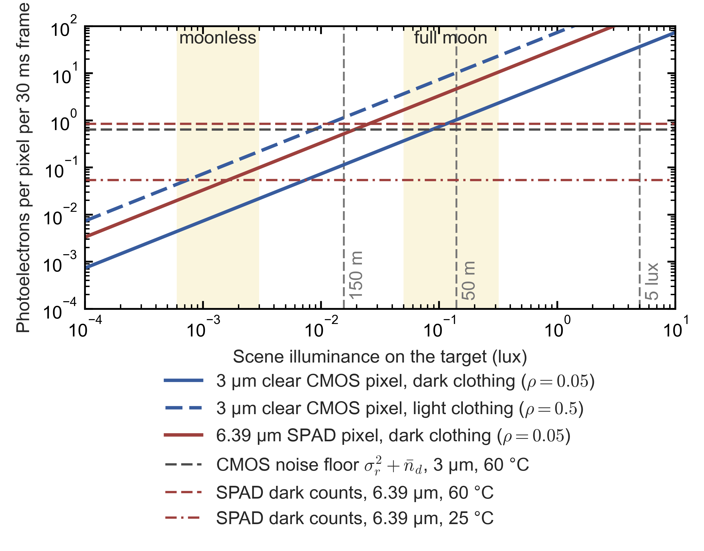

*Figure A7.1.* Photoelectrons per pixel per 30 ms frame (Eq. \eqref{eq:night-photoelectrons-per-pixel}) versus the scene illuminance on the target. The data curves are a 3 µm clear CMOS pixel on dark ($\rho=0.05$, solid blue) and light ($\rho=0.5$, dashed blue) clothing, and a 6.39 µm SPAD pixel of the same sensitivity on dark clothing (solid red), with $F_\#=1.6$ and $\tau_o=0.8$.
- *Shaded bands:* a moonless rural sky (0.6–3 mlux) and a full moon (50–320 mlux) (Hänel et al. 2018). *Vertical dashed lines:* the low beam's glare-limited zone (350 cd) at 150 m and 50 m, and the 5 lux hotspot criterion (§A6.1).
- *Horizontal lines:* the CMOS pixel's noise floor per readout at 60 °C, read-noise variance plus dark electrons (grey, dashed), and the SPAD pixel's dark counts per frame at 60 °C (red, dashed) and 25 °C (red, dash-dotted) (§A7.2).
- Where a data curve lies below its sensor's noise floor, one frame of one pixel cannot show the target; a detector must then add up many pixels or frames (Eq. \eqref{eq:snr-summed-readouts}).

*Code.* The numbers in §A7's tables and in Figure A7.1 are computed by `build/figures/night_photon_budget.py`, which also prints the calibration checks above and writes everything to `night_photon_budget_tables.txt`.

### A7.2 Noise: what photon counting removes and what it does not

This subsection compares the noise of an integrating CMOS pixel with that of a photon-counting pixel, and finds that photon counting gains most where each readout carries much less than one photoelectron and least at high chip temperature. An integrating pixel accumulates photoelectrons during the exposure and reads them out once through an amplifier, which adds read noise. A photon-counting pixel registers each detected photon as a digital event, so its readout adds no noise. A SPAD does this with an avalanche; a QIS does it with an amplifier quiet enough to resolve single electrons (§A7.6). The signal-to-noise ratio (SNR) of one readout is

$$\text{SNR}_1=\begin{cases}\dfrac{\bar n}{\sqrt{\bar n+\bar n_d+\sigma_r^2}} & \text{integrating pixel,}\\[8pt] \dfrac{\bar n}{\sqrt{\bar n+\bar n_{dc}}} & \text{photon-counting pixel,}\end{cases} \label{eq:snr-one-readout}$$

where $\bar n$ is the mean signal in photoelectrons (or detected photons), $\bar n_d$ the mean number of dark electrons of the integrating pixel (charge generated thermally, whose shot noise has variance $\bar n_d$), $\bar n_{dc}$ the mean number of dark counts of the counting pixel (avalanches that fire without a photon), and $\sigma_r$ the read noise in electrons rms. Fixed-pattern noise and afterpulsing (spurious avalanches that follow a real one) are left out.
- **Single-frame threshold.** For SNR = 1, the integrating pixel needs $\bar n=\tfrac12\big(1+\sqrt{1+4(\sigma_r^2+\bar n_d)}\big)$. For $\sigma_r=0.6$ electrons and no dark charge that is 1.28 photoelectrons, while the photon-counting pixel without dark counts needs 1.00.
- **The read noise used.** Three measurements support $\sigma_r=0.6$ electrons: Sony's automotive IMX490, 0.54 electrons rms in an EMVA 1288 test of a LUCID camera [P]; OmniVision's 2.8 µm split pixel, 0.83 electrons (IISW 2019) [I]; and onsemi's 2.1 µm, 8.3-megapixel automotive sensor (IISW 2023), which reaches SNR = 1 at about 1.3 photoelectrons from 60 to 80 °C, i.e. a noise floor of about 0.6 electrons [I; E, read from the paper's Figure 3]. EMVA 1288 is the machine-vision industry's standard for measuring camera noise and sensitivity.

**Adding up readouts.** A pedestrian covers many pixels, and a detector can add them up. For a uniform target on a black background, the sum of $M$ independent readouts of equal mean signal has

$$\text{SNR}_M=\sqrt{M}\;\text{SNR}_1 \label{eq:snr-summed-readouts}$$

because the signal grows as $M$ and the noise as $\sqrt{M}$. The same holds for $M$ frames of one pixel if the target does not move. The Rose criterion of visual detection asks for an SNR of about 5 over the target's area; it is applied to $\text{SNR}_M$ in §A7.3.

**The photon-counting gain.** At equal pixel area and sensitivity, the ratio of the two SNRs of Eq. \eqref{eq:snr-one-readout} is

$$G=\frac{\text{SNR}_1^{\rm count}}{\text{SNR}_1^{\rm int}}=\sqrt{\frac{\bar n+\bar n_d+\sigma_r^2}{\bar n+\bar n_{dc}}} \label{eq:photon-counting-gain}$$

and by Eq. \eqref{eq:snr-summed-readouts} the ratio is the same for any number of readouts added up. Two limits follow.
- **Large signals** ($\bar n\gg\sigma_r^2$): $G\to1$. Photon counting brings nothing in daylight or in the low-beam hotspot.
- **Small signals** ($\bar n\to0$): $G\to\sqrt{(\sigma_r^2+\bar n_d)/\bar n_{dc}}$. The gain is capped by the counting pixel's own dark counts.

The table gives $G$ for two pixels of the same 3 µm size and sensitivity, with $\sigma_r=0.6$ electrons and 30 ms readouts.

| Signal per readout $\bar n$ | No dark signal | Chip at 25 °C | Chip at 60 °C | Chip at 85 °C |
|---|---|---|---|---|
| 1 | 1.17 | 1.16 | 1.17 | 1.64 |
| 0.36 ($=\sigma_r^2$) | 1.41 | 1.40 | 1.35 | 1.82 |
| 0.1 | 2.14 | 2.04 | 1.60 | 1.94 |
| 0.03 | 3.61 | 3.07 | 1.75 | 1.97 |
| 0.01 | 6.08 | 4.14 | 1.81 | 1.99 |
| Small-signal cap | — | 5.5 | 1.85 | 1.99 |

*How the numbers are derived* [E]: each entry is Eq. \eqref{eq:photon-counting-gain} with the dark signals per 30 ms readout from the dark-signal table below: $\bar n_d=0.005$ and $\bar n_{dc}=0.012$ at 25 °C, 0.27 and 0.19 at 60 °C, and 4.8 and 1.3 at 85 °C. For $\bar n=0.1$ at 60 °C, $G=\sqrt{(0.1+0.27+0.36)/(0.1+0.19)}=\sqrt{0.73/0.29}\approx1.6$. The 85 °C column is the least certain, because it extrapolates the two doubling temperatures of Eq. \eqref{eq:dark-signal-temperature} furthest; it rises above the 60 °C column only because the CMOS dark current is taken to double faster (every 6 °C) than the SPAD's dark counts (every 7–12 °C).

**Bursts of short frames.** The case for photon counting is strongest when one exposure is split into many short ones. Splitting an exposure that collects $N$ photoelectrons into $K$ readouts leaves the signal unchanged but adds $K$ read noises. Without dark signal, Eq. \eqref{eq:photon-counting-gain} becomes

$$G_K=\sqrt{\frac{N+K\sigma_r^2}{N}}=\sqrt{1+\frac{K\sigma_r^2}{N}} \label{eq:burst-readout-gain}$$

where $N$ is the total signal per pixel and $K$ the number of readouts.
- For $N=1$ photoelectron per pixel over 30 ms, splitting into $K=30$ frames of 1 ms gives $G_{30}=\sqrt{1+30\times0.36/1}\approx3.4$; for $N=0.1$ it gives 10.4 [E].
- Short frames freeze motion, and a photon-counting camera can decide after capture how to combine them, for example by shifting each frame to follow a moving object before adding it. This is the basis of Ubicept's processing (§A7.6) and helps Canon's sensor handle very high dynamic range.
- The long-range night problem does not need bursts. A pedestrian 3 m to the side of the path, 100 m ahead of a car at 100 km/h, moves across the image at $3\times27.8/100^2\approx8.3$ mrad/s, i.e. 0.25 mrad in 30 ms, about one pixel of the reference camera of §A7.3 (0.27 mrad) [E].

**Temperature.** Both kinds of dark signal grow roughly exponentially with chip temperature:

$$D(T)=D(T_0)\,2^{(T-T_0)/T_2} \label{eq:dark-signal-temperature}$$

where $D$ is the dark rate (electrons or counts per second), $T$ the chip temperature, $T_0$ a reference temperature and $T_2$ the temperature rise that doubles the rate.
- **CMOS.** McGrath et al. (IISW 2017) report that the dark current of modern pixels at 60 °C doubles about every 6 °C, against 11 °C historically [I].
- **SPADs.** ST measured 8.6, 810 and 6,923 dark counts per second at −20, 60 and 80 °C in a 10.17 µm pixel at 2.5 V excess bias, a doubling every 7 °C at high temperature [I]. Panasonic's 6 µm avalanche pixel rose from 21 counts per second at room temperature to 10,000 at a chip temperature of 105 °C, a doubling about every 9 °C [I].

The table gives the resulting dark signal per 30 ms readout.

| Chip temperature | CMOS, 3 µm (electrons) | SPAD, 6.39 µm, Canon-class (counts) | SPAD scaled to 3 µm (counts) |
|---|---|---|---|
| 25 °C | 0.001–0.02 | 0.05 | 0.01 |
| 60 °C | 0.05–0.9 | 0.4–1.7 | 0.09–0.38 |
| 85 °C | 1–16 | 1.7–21 | 0.4–4.5 |
| 105 °C | 10–160 | 5–150 (Panasonic's 6 µm pixel, measured: 300) | 1.2–33 |

*How the numbers are derived* [E]:
- **CMOS:** dark-current densities at 60 °C of 0.2, 1.0 and 3.3 electrons per second per µm², times 9 µm² and 0.030 s, scaled with $T_2=6$ °C. The 3.3 is OmniVision's 2.8 µm photodiode, 25.6 electrons per second at 60 °C (IISW 2019) [I], and Gigajot's quanta image sensor measured 1.35 at 60 °C (Scientific Reports 2022) [I]. The 0.2 is inferred from onsemi's SNR = 1 points, which barely move between 60 and 100 °C (IISW 2023) [E]. The middle value, 1.0, is used in the gain table above and in §A7.3.
- **SPAD:** Canon's 1.8 counts per second at 25 °C for its 6.39 µm pixel (IEDM 2021, as tabulated by Sony at the 2024 International SPAD Sensor Workshop) [I], scaled with $T_2=12$ °C (a slow case) and 7 °C (ST's measured value). The gain table and §A7.3 use the geometric mean of the two.
- **Per unit area** at 60 °C, measured SPAD dark rates (ST 7.8, Sony's 6 µm pixel 8.3 and 10 µm pixel 2.2 counts per second per µm²) [I] span the same range as CMOS dark current (0.2–3.3 electrons per second per µm²), with Canon's pixel at the low end (0.3–1.4, extrapolated).

At 25 °C the photon-counting pixel's dark counts are negligible, and its gain on the weakest signals reaches 4–6. At 60 °C, a common specification temperature for automotive image sensors, the dark signals of both pixels are comparable to the CMOS read-noise variance, and the gain is capped near 1.8. AEC-Q100 Grade 2 image sensors such as the IMX490 are rated to 105 °C ambient [P]; how warm a windshield camera's chip runs at night, without the sun's load, has not been published (Appendix 1).

### A7.3 What a low-light camera sees of a pedestrian

This subsection turns Eqs. \eqref{eq:image-plane-illuminance}–\eqref{eq:photon-counting-gain} into detection ranges for the case that matters for automatic emergency braking (AEB) at night: a dark-clothed pedestrian on an unlit road, lit only by the glare-limited part of the low beam. It uses two bounds. The *ideal bound* adds up all of the pedestrian's pixels and asks for the Rose criterion, $\text{SNR}_M\ge5$ (Eq. \eqref{eq:snr-summed-readouts}). Real detectors, which need shape and texture, require more. The *pixel-level bound* asks every pixel for $\text{SNR}_1\ge1$, a frame in which the pedestrian can be seen pixel by pixel.
- **Visible camera:** 3 µm clear pixels, 1,920 columns over a 30° horizontal field. Its instantaneous field of view (IFOV, the angle seen by one pixel) is $\pi/6/1{,}920=0.273$ mrad, which takes an 11 mm focal length and, at f/1.6, a 6.9 mm aperture. The exposure is 30 ms and the chip is at 60 °C (dark signals from the table in §A7.2). The photon-counting pixel has the same area and sensitivity.
- **Scene:** the pedestrian of §A3 and §A5 (1.7 × 0.5 m, 0.85 m²) in dark clothing ($\rho=0.05$), on a black background, lit by 350 cd from the glare-limited zone (Eq. \eqref{eq:inverse-square-illuminance}) plus 1 mlux of moonless sky.
- **Thermal camera, for comparison:** 640 × 512 pixels over 24° (IFOV 0.654 mrad), with a noise-equivalent temperature difference (NETD, the temperature difference that gives an SNR of 1 in one pixel and frame) below 50 mK, as specified for Teledyne FLIR's automotive development kit [P]. Per pixel its SNR is

$$\text{SNR}_{\rm th}=\frac{\Delta T}{\rm NETD} \label{eq:thermal-snr}$$

  where $\Delta T$ is the difference in apparent temperature between the pedestrian and the background. Clothing shields body heat, so for a clothed pedestrian $\Delta T$ is a few kelvin: in cold weather clothing can hide all but the head and hands (Bertozzi et al., IEEE IV 2003) [I], and on hot nights the difference can vanish (§A3, item 5). $\Delta T=1$–5 K is assumed here [E].

The table gives the SNR of each camera on this pedestrian, moonless sky, chip at 60 °C.

| Range | $E_s$ (lux) | Visible pixels on the pedestrian | $\bar n$ per clear pixel | $\text{SNR}_1$, CMOS / counting | $\text{SNR}_M$, CMOS / counting | Thermal pixels on the pedestrian | $\text{SNR}_M$, thermal, $\Delta T=1$–5 K |
|---|---|---|---|---|---|---|---|
| 50 m | 0.141 | 4,572 | 1.02 | 0.80 / 0.93 | 54 / 63 | 794 | 560–2,800 |
| 75 m | 0.063 | 2,032 | 0.46 | 0.44 / 0.57 | 20 / 26 | 353 | 380–1,900 |
| 100 m | 0.036 | 1,143 | 0.26 | 0.28 / 0.39 | 9.3 / 13 | 198 | 280–1,400 |
| 150 m | 0.017 | 508 | 0.12 | 0.14 / 0.22 | 3.1 / 4.9 | 88 | 190–940 |
| 200 m | 0.010 | 286 | 0.07 | 0.08 / 0.14 | 1.4 / 2.4 | 50 | 140–700 |

*How the numbers are derived* [E]:
- Pixels on the pedestrian: $M=0.85/(R\cdot\text{IFOV})^2$, e.g. $0.85/(100\times2.73\times10^{-4})^2\approx1{,}143$ at 100 m.
- $\bar n$ from Eq. \eqref{eq:night-photoelectrons-per-pixel} as in the photon table of §A7.1, with the 1 mlux of sky light added to $E_s$; $\text{SNR}_1$ from Eq. \eqref{eq:snr-one-readout} with $\bar n_d=0.27$ and $\bar n_{dc}=0.19$; $\text{SNR}_M$ from Eq. \eqref{eq:snr-summed-readouts}. At 100 m, $\text{SNR}_1=0.26/\sqrt{0.26+0.27+0.36}\approx0.28$ and $\text{SNR}_M=\sqrt{1{,}143}\times0.28\approx9.3$.
- Thermal: $M=0.85/(100\times6.54\times10^{-4})^2\approx198$ at 100 m, and $\text{SNR}_M=\sqrt{198}\times(1\ {\rm K}/0.05\ {\rm K})\approx280$.
- The ranges at which the bounds are just met follow from the same equations on a 0.1 m grid of ranges. Ideal bound ($\text{SNR}_M=5$): CMOS 126 m and photon counting 149 m at 60 °C; 136 m and 182 m at 25 °C. Pixel-level bound ($\text{SNR}_1=1$): CMOS 42 m and photon counting 47 m at 60 °C; 44 m and 50 m at 25 °C.

**What the table shows** [E]:
- **An ideal detector loses the pedestrian at 125–180 m.** Even adding up all of a dark-clothed pedestrian's pixels against a black background, it loses the pedestrian beyond about 126 m with CMOS and 149 m with photon counting at 60 °C (136 m and 182 m at 25 °C).
- **Real classifiers work nearer the pixel-level bound.** A classifier needs the pedestrian's shape and texture, which puts it nearer the pixel-level bound of 42–50 m. That is inside the stopping distance at 80–100 km/h (69–98 m, Eq. \eqref{eq:stopping-distance}), and it matches the measured weakness of camera AEB on unlit roads (§A4, IIHS 2022; §A6.5).
- **Photon counting stretches both bounds only modestly.** It extends the ideal bound by 18–34% and the pixel-level bound by 12–14%; neither reaches past the stopping distance at the pixel level.
- **Moonlight helps less than it seems.** It raises the signal per pixel (0.72 photoelectrons at 0.1 lux, §A7.1) but lights the background as well, so the contrast of dark clothing against grass or asphalt falls, and the black-background bound no longer applies.
- **Thermal's SNR is far higher.** On the same pedestrian at 100 m, the thermal camera's SNR (280–1,400) is 20–150 times the visible camera's ideal-bound SNR (9–13). Thermal's range is set by resolution, its 1.5-pixel detection ceiling being 940 m for this camera (Eq. \eqref{eq:pixels-on-target-range}), and by contrast and weather, not by photons.

### A7.4 Passive low-light CMOS today

This subsection describes what is sold as a low-light ("starlight") CMOS camera, in security and in cars. These sensors already have sub-electron read noise, clear or near-infrared-enhanced pixels and high dynamic range. The photon table of §A7.1 therefore describes them already.
- **"Starlight" comes from security cameras.** Sony's STARVIS family (STARVIS, STARVIS 2, STARVIS 3) is defined by a sensitivity of at least 2,000 mV per µm² (colour, 706 cd/m² light source, f/5.6, 1 s accumulation equivalent) [P].
  - Its SNR1s index (§A7.1) is 0.17 lux for the 2.9 µm IMX585 and IMX664 colour sensors and 0.10–0.11 lux for their monochrome versions. It is 0.29–0.31 lux for the 2.0 µm IMX678 and 0.53–0.79 lux for 1.45 µm sensors [P].
  - Security-camera makers quote "minimum illumination" far lower, for example 0.0003 lux in colour at f/1.0 for Hikvision's DarkFighterS [P]. Axis, itself a security-camera maker, states that no standard defines how such minimum-illumination figures are measured [P], so they cannot be compared with each other or with SNR1s.
- **Automotive sensors.**
  - Sony's IMX490 (5.4 megapixels, 3.0 µm) delivers 120 dB of dynamic range together with LED-flicker mitigation (imaging pulsed LED lights without the flicker that short exposures produce) and is qualified to AEC-Q100 Grade 2 [P]. LUCID's EMVA 1288 test gives it 0.54 electrons of dark noise [P].
  - onsemi's 8.3-megapixel, 2.1 µm family (IISW 2023) offers 110 dB in a single exposure and 150 dB with two [I]. It reaches SNR = 1 at about 1.3 photoelectrons from 60 to 80 °C, about 1.7 at 100 °C and about 6 at 125 °C, where dark-signal non-uniformity at the floating diffusion (the pixel's charge-to-voltage node) takes over from read noise [I; E, read from the graph].
  - OmniVision's OX08B40 (8.3 megapixels, 2.1 µm) claims 140 dB with flicker mitigation [P].
  - The 8-megapixel front cameras now standard in ADAS use 2.1 µm pixels, half the area of a 3 µm pixel (the 2.1 µm column of the photon table).
- **Clear-pixel colour filters.** Replacing the green filters with clear ones raises the light collected by 1.85 times. In OmniVision's analysis it lowers the illuminance at which the luminance SNR reaches 10, under its test conditions, from 48 lux (RGGB) to 19 lux (RCCB) [I]. The cost is colour: the hue angle separating a yellow from a red traffic light collapses from 29° with RGGB to 1.8° with RCCB. RYYCy, with yellow instead of green filters, collects 1.31 times the green pixel's light and keeps 3.6° [I]. OmniVision proposes shifting the red filter's edge to restore the separation [I].
- **Near-infrared-enhanced pixels.** OmniVision's Nyxel pixels use thicker silicon, a scattering layer that lengthens the photons' path, and deep-trench isolation between pixels. For Nyxel 2 OmniVision claims a quantum efficiency of 70% at 850 nm and 50% at 940 nm on a 2.9 µm pixel (2020) [P]. These gains matter only with NIR illumination or without an infrared-cut filter. White-LED headlamps emit almost no light beyond 750 nm [E].

### A7.5 Active illumination: near-infrared lamps, gated imaging, SWIR and image intensifiers

This subsection covers the cameras that bring their own light, or amplify the scene's light before it is detected. Active systems escape the photon table of §A7.1 because their lamps are invisible, so the glare cap of §A6.1 does not limit them; eye safety and lamp power do.

**Near-infrared lamps with a silicon camera: shipped and dropped.**
- **Toyota.** Toyota fitted the first system in 2002 (Land Cruiser Cygnus; Lexus LX470) and added pedestrian detection on the Crown Hybrid in Feb 2008 [P].
- **Mercedes.** Night View Assist (S-Class W221, 2005) used two infrared high-beam lamps and an NIR camera behind the windshield [P].
  - In the developers' tests, test drivers saw dummies in light clothing from beyond 200 m, about 40 m earlier than with bi-xenon low beams, and pedestrians in dark clothing were detected at 160 m against 70 m [P, Deutscher Zukunftspreis 2006].
  - Pedestrian detection followed in 2009 and a spotlight function, which flashes the headlights at a detected pedestrian, in Dec 2010. Daimler then said that more than half of S-Class buyers worldwide ordered the system [P].
  - For the 2013 S-Class (W222), Night View Assist Plus was supplemented by a thermal camera, which also detects animals [P]. The 2021 S-Class (W223) does not offer night vision (§A1).
- **Lexus.** Lexus dropped Night View after the 2013 GS because few buyers chose it [T, AutoGuide, Sep 2013].
- **Cost and range.** In 2006 an NIR system cost carmakers about \$300 against more than \$1,200 for a thermal one, and the NIR systems of the S-Class and LX470 offered 150–200 m of viewing distance [T, IEEE Spectrum, Mar 2006, quoting Siemens VDO].
- **Why it works.** An NIR high beam puts high-beam-like illuminance on the pedestrian without dazzling anyone, so the camera works with the photon budget of the hotspot rather than of the glare-limited zone (§A7.1) [E].

**Gated imaging.**
- **The system.** BrightWay Vision's system (Grauer 2014) uses a gated CMOS sensor of 1,280 × 960 pixels whose exposure gates (0.5–2 µs) are synchronized to laser pulses at 800–860 nm. The average optical power is below 5 W, and the sensor's NIR quantum efficiency is above 50% [I].
- **Why gating helps in fog.** The camera records only light that returns within a chosen time window, i.e. from a chosen slice of range, so backscatter from fog, rain or snow nearer than that slice is rejected. Grauer computes 10–1,000 times less backscatter than with continuous illumination from haze to light fog, and shows a pedestrian at 50–120 m in falling snow at night [I].
- **Independent test.** In Daimler's fog-chamber benchmark the BrightWay camera outperformed a standard passive CMOS camera in fog (Bijelic, Gruber and Ritter, arXiv:1912.03238) [I].
- **Status.** BrightWay says its system is in serial production without naming a carmaker [P]. No car programme is public (Appendix 1).

**Short-wave infrared.**
- **TriEye's sensor.** TriEye's TES200 ("Raven") has 1,236 × 960 global-shutter pixels at 7 µm, sensitive from 700 to 1,650 nm, with a quantum efficiency of 60% at 1,245 nm and above 50% from 850 to 1,450 nm, at 500 mW [P].
- **Its dark current rules out passive night imaging.** The dark current is 100 pA per pixel at 25 °C [P], i.e. $10^{-10}/1.6\times10^{-19}=6.2\times10^{8}$ electrons per second, which fills the 440,000-electron full well in about 0.7 ms [E]. The sensor therefore works only with short exposures under its own illumination, and TriEye's SEDAR platform pairs it with Coherent's 1,375 nm edge-emitting laser (Jun 2023) [P].
- **How the pixels are made.** Tower Semiconductor, which develops and manufactures the sensor, describes a 1.3-megapixel array of 7 µm pixels made of back-illuminated (BSI) germanium photodiodes on silicon, with a pixel-level electrical connection made in a wafer-stacking process [P, Tower Semiconductor, 31 Aug 2023]. TriEye's patents describe two routes to such pixels.
  - *Germanium-on-insulator* (US 11,271,028 B2, priority Feb 2018). The photodiodes are formed in the single-crystal germanium layer of a germanium-on-insulator wafer, which is bonded face down to the silicon readout wafer by hybrid bonding. The handle is then removed, and the buried oxide, a quarter-wave thick at 1.5 µm, stays as an anti-reflection coating that cuts the reflection from over 30% to a few percent (claims 1 and 8; Figs. 4A–4C) [P]. The patent's case for this route is that germanium grown directly on silicon carries dislocations from the 4.2% lattice mismatch, which raise the leakage, and that germanium grown on a finished readout chip must be grown cold [P].
  - *Pyramid concentrator* (US 11,063,079 B2, priority Jan 2018). Each 10–20 µm pixel funnels the light through a silicon pyramid, which is transparent in the SWIR, onto a germanium diode only about 1 µm across on its truncated top. Dark current scales with the volume of absorbing germanium, so the small diode cuts it (claims 1–4; Fig. 1) [P].
  - Which route the TES200 uses is not public; Tower's description, back-illuminated diodes joined pixel by pixel in a wafer stack, matches the bonded route [E].
- **The dark current to beat.** 100 pA per 7 µm pixel is $10^{-10}\ {\rm A}/(7\times10^{-4}\ {\rm cm})^2=204\ \mu{\rm A\,cm^{-2}}$ [E]. TriEye's patents put the dark current of germanium photodiodes typically near 50 µA cm⁻² and claim systems for dark currents above that value [P, US 10,978,600 B1, summary; US 11,606,515 B2, claim 1].
- **First remedy: gate the exposure.** The patents open the pixels only while the echo of a laser pulse can arrive, and stop integrating while the accumulated dark-current noise is still below the readout (kTC) noise, which does not grow with time [P, US 10,978,600 B1, claim 1; US 11,606,515 B2, claims 1 and 11]. A gate of duration $\Delta t$ admits light from a slice of depth $c\Delta t/2$, 15 m for the 100 ns gate the patent calls typical, and a frame may accumulate 1 to 10,000 pulses [P, US 10,978,600 B1]. In 100 ns a TES200 pixel collects $10^{-10}\ {\rm A}\times10^{-7}\ {\rm s}/1.602\times10^{-19}\ {\rm C}=62$ dark electrons. Continuous integration over a 1/30 s frame would collect $2.1\times10^{7}$, i.e. 47 full wells, while even 1,000 gates of 100 ns collect only $6.2\times10^{4}$ [E].
- **Second remedy: subtract the dark current in the pixel.** In US 11,606,515 B2, a voltage-controlled current source in each pixel feeds in a current equal and opposite to the dark current. An amplifier sets the common control voltage from reference pixels kept dark under the same bias, averaged over several of them because nominally identical germanium diodes can differ in dark current by a factor of 1.5–4 (Figs. 12A–16B) [P]. The subtraction keeps a small pixel capacitance from filling, but it cannot remove the shot noise of the dark current, so gating is still needed [E].
- **The light: a solar absorption band, and no amplifier.**
  - The patents choose the wavelength to match a solar absorption band, between 1.3 and 1.4 µm. They use passively Q-switched ceramic Nd:YAG lasers, with V³⁺:YAG or cobalt-doped saturable absorbers, at 1.32, 1.34 or 1.44 µm, delivering in their examples 10–100 mJ pulses at 10–50 Hz. The reason given is that the peak power eye safety allows for ≈100 ns pulses, ≈300 kW, is beyond laser diodes [P, US 11,606,515 B2; US 10,978,600 B1].
  - The products use laser diodes instead. Coherent supplied the 1,375 nm edge-emitting laser above (Jun 2023), and TriEye's interview with Yole calls the region around 1,380 nm solar-blind [T, Yole, 25 Mar 2023]. VCSEL partners followed: Vertilas at 1.3 µm (Apr 2024), then HLJ (Oct 2024) and LITEON (Aug 2025) at 1,135 nm [P, TriEye news page; T, Semiconductor Today, 22 Aug 2025].
  - In ASTM G173 the sunlight at ground level averaged over 1,365–1,385 nm is $1.1\times10^{-4}\ {\rm W\,m^{-2}\,nm^{-1}}$, about 2,500 times less than the $0.27\ {\rm W\,m^{-2}\,nm^{-1}}$ at 1,550 nm, and every tabulated value from 1,360 to 1,390 nm stays below about $10^{-3}\ {\rm W\,m^{-2}\,nm^{-1}}$, so a diode whose wavelength drifts with temperature keeps the benefit [E]. The Nd:YAG lines at 1.32, 1.34 and 1.44 µm get 1.05, 0.50 and 0.16 times the 1,550 nm value. Near 1,135 nm the water absorption comes in narrow lines: the value tabulated at exactly 1,135 nm is $0.015\ {\rm W\,m^{-2}\,nm^{-1}}$, but the average is 0.10 over ±2 nm and 0.17 over ±10 nm, 0.63 times the 1,550 nm value [E].
  - The bet has costs. 1,375 nm lies outside the erbium gain band near 1,530–1,565 nm, so the erbium-fibre amplifiers of 1,550 nm lidars (§C4) cannot be used, and the pulse energy must come from the laser diodes themselves [E]. The water vapour that removes the sunlight also absorbs the laser's own light along its path, by an amount not found (Appendix 1).
- **Depth from gated slices (SEDAR).** The patents combine several gated time slices, each covering a range of distances, into one image with depth, citing Gated2Depth (Gruber et al. 2019) [P, US 10,978,600 B1]. Their claims cover slices wider than 2 m, for example from 20, 40 and 60 m, and detection of a 1 m × 1 m target of 20% reflectivity beyond 50 m with an uncooled germanium receiver, and of vehicles and pedestrians at 50–150 m with the receiver above 30 °C [P, US 11,606,515 B2, claims 4 and 13–16]. TriEye describes SEDAR as a high-definition gated imager combined with a flash-lidar concept that gives depth at every pixel, with at least 5 million points per second and object detection beyond 200 m [T, Yole interview, 25 Mar 2023].
- **Passive SWIR at night.** On moonless nights the sky's nightglow is about ten times brighter in the SWIR than in the visible. Even so, the SWIR sensors available in Europe performed worse than visible cameras at equal f-number, exposure and frame rate, and would need at least a tenfold improvement (Adomeit and Krieg, Fraunhofer IOSB, SPIE 2015) [I].
- **Fog.** SWIR did not improve pedestrian detection in fog; its authors judged thermal imagers the most effective option (Bertozzi et al., ICIAP 2013) [I].
- **Industry ties.** TriEye's automotive links are Porsche as an investor, an evaluation by Denso (Jul 2020) and a collaboration with Hitachi Astemo (Jan 2022); no series programme is public [P, TriEye news page]. TriEye is still active, though its press releases end in Oct 2024. Its news page lists the LITEON demonstrator, in which the TES200 was available in sample quantities only [T, Semiconductor Today, 22 Aug 2025], and AM General's MIMIC-V special-operations vehicle, shown at the US Army's AUSA exhibition on 13–15 Oct 2025 fitted with TriEye's SWIR cameras for imaging and 3D depth [P, AM General, 10 Oct 2025]. The last funding disclosed is a \$74 M round in Nov 2021, which brought the total to \$96 M and with which TriEye expected sales in 2022 [T, Calcalist, 10 Nov 2021]; no announcement from 2026 was found.

**Image intensifiers.**
- **How they work.** Military night-vision tubes multiply the photoelectrons from a photocathode in a microchannel plate before a phosphor screen turns them back into light. A Gen 3 gallium-arsenide photocathode reaches about 30% quantum efficiency at 370–920 nm, with a luminous gain of $4\times10^{4}$ (Hamamatsu V7090U-71) [P].
- **Use in a camera.** The phosphor image must be relayed to a CMOS sensor, or the photocathode built directly over one (electron-bombarded CMOS), so an intensified camera is a vacuum tube plus a camera.
- **Export controls.** Tubes are export-controlled: US ECCN 6A002.a.2 covers tubes with a microchannel-plate pitch of 12 µm or less and a gallium-arsenide or high-sensitivity multialkali photocathode, and goggles and similar viewers with an autogated third-generation or later tube fall under USML Category XII(c) [P].
- **Cars.** No production car has used one.

### A7.6 Photon-counting cameras: SPAD and QIS

This subsection reviews the photon-counting sensors and companies behind the automotive claims, and the limits that are specific to SPAD imagers.

**Canon.**
- **3.2-megapixel SPAD sensor** (Morimoto et al., IEDM 2021): 2,072 × 1,548 pixels at 6.39 µm, back-illuminated and 3D-stacked (90 nm). Its breakdown voltage is 30 V and its excess bias (the bias above breakdown) 2.5 V. Peak photon detection efficiency (PDE, the share of arriving photons that are counted) is 69.4%, and 24.4% at 940 nm. Dark count rate (DCR) is 1.8 counts per second at 25 °C and timing jitter 100 ps [I]. Canon showed monochrome video at 0.002 lux; that is 0.6–1.5 detected photons per pixel per frame (§A7.1).
- **Products.** Canon sells two security cameras with these sensors. The MS-500 (sold from Aug 2023) gives 0.001 lux minimum illumination in colour night mode at f/1.4 equivalent, 1/30 s and maximum gain, without adding frames together; it draws up to 23.7 W and weighs 2.2 kg [P]. The MS-510 (announced Apr 2026) has a new sensor with higher NIR sensitivity and reaches 0.0006 lux under the same conditions [P]; its estimated US retail price is \$22,800 [T].
- **2.1-megapixel automotive HDR sensor** (Ota et al., VLSI 2025): a 2/3-inch, 3D-stacked, back-illuminated sensor with 156 dB of dynamic range in one shot, which the abstract describes as being "for automotive applications" [P].
  - **Weighted photon counting.** In each time window the pixel measures how long the first photon takes to arrive and estimates from it how many photons arrive over the whole period, so in bright light it fires only a fraction of the avalanches that a counting pixel would and does not saturate [P].
  - **Power.** Canon's release says this cuts the power per pixel by roughly 75%, against a sensor whose dynamic range it raises about fivefold (Canon's ISSCC 2022 sensor: 143 dB, 0.37 W at about 1 megapixel [I]); at Canon's briefing a manager put the saving at about half [P/T]. Absolute power, pixel pitch, temperature range and AEC-Q status are not published (Appendix 1).
  - **Demonstrations.** Canon shows pedestrians detected 120 m ahead at 0.1 lux with a 25 mm f/1.4 lens, without giving exposure or reflectance [P]. The sensor keeps sampling through the frame, so it records Japanese traffic lights, which switch off four times per frame, as half on [T].
  - **Production.** Canon "aims to start mass production" [P], and Japanese trade press reported 2031 as the target for mass production [T, kuruma-news, Jun 2025].

**Other SPAD imagers.**
- **Sony.** All of Sony's SPAD products are depth sensors; its photon-counting image sensors remain research. One is 748 × 448 pixels at 3.36 µm, 120 dB and 104 mW at 60 frames per second (VLSI 2023); another is a 3.06 µm pixel with 57% PDE (Sensors 2023) [I].
- **Panasonic.** A 1,200 × 900-pixel sensor of 6 µm vertical avalanche photodiodes, aimed at time-of-flight, passed 1,000 h at 125 °C (2024) [I].
- **PolarisIC (北极芯微, China).** Its PCM7200 (Sep 2026) has 2,080 × 1,568 pixels at 8 µm in a 3D-stacked, back-illuminated design, runs at 1,000 frames per second at full resolution and claims up to 150 dB of dynamic range; PolarisIC shows images taken at about 0.001 lux indoors and on a moonless night with a 50 mm f/1.4 lens [P]. No automotive qualification is stated.
- **Pi Imaging (a ZEISS company).** It sells scientific SPAD cameras, for example the SPAD Alpha with 1,024 × 1,024 pixels [P].

**Quanta image sensors.**
- **What they are.** A QIS counts photoelectrons without avalanche gain, with an amplifier quiet enough to tell 0, 1 and 2 electrons apart.
- **Gigajot.** Its 163-megapixel sensor (Scientific Reports 2022) reaches 0.35 electrons rms of read noise at room temperature, 1.64 electrons per second of dark current per 1.1 µm pixel at 60 °C and a peak quantum efficiency of 87%, but only 10–20% in the NIR; it draws 3.86 W [I].
- **Why it matters here.** With $\sigma_r=0.35$ electrons, $\sigma_r^2=0.12$, a third of the CMOS value used above, so a QIS gets much of a SPAD's gain in Eq. \eqref{eq:photon-counting-gain} without avalanche power or a 20–30 V bias [E]. No automotive QIS has been announced.

**AUMOVIO and Ubicept.**
- **AUMOVIO** (Continental's automotive business since Sep 2025). Its Stefan Christmann presented "Cameras That Count – Single Photon Avalanche Diodes Reaching Automotive Imaging" at AutoSens Europe on 24 Sep 2026 [P, agenda]. No abstract, slides or AUMOVIO statement is public.
  - The claim that AUMOVIO has a SPAD camera at A-sample stage, the first functional prototypes of an automotive development, comes only from a LinkedIn post by Ubicept's chief executive [U]. No sensor supplier or carmaker is named.
  - At the same show Ubicept demonstrated AUMOVIO's "Far Sensing" camera running Ubicept's processing, but no source says that camera uses a SPAD [P].
- **Ubicept** (a 2021 spin-off of MIT and the University of Wisconsin–Madison; \$8 M seed round in 2023). It sells processing for SPAD cameras and for CMOS cameras with raw output, and a SPAD evaluation kit with a 1-megapixel sensor from an unnamed partner. It claims 0.05 lux and 140–160 dB with SPAD sensors [P]. It demonstrated Canon's 1-megapixel SPAD at CES 2026 [P].
- **Analysts.** Yole's principal analyst described SPAD cameras as limited to niche applications, with adoption in industrial, automotive and consumer markets held back by pixel size and by the processing load of their data (Jan 2025) [T].

**Limits specific to SPAD imagers.**
- **Power in daylight.** Every avalanche draws a charge $Q$ from the bias supply. An array of $N_{\rm px}$ pixels, each firing at rate $r$, therefore draws

$$P=N_{\rm px}\,Q\,(V_{bd}+V_{ex})\,r,\qquad r\le\frac{1}{e\,\tau_d} \label{eq:spad-array-avalanche-power}$$

  where $V_{bd}$ is the breakdown voltage, $V_{ex}$ the excess bias, $\tau_d$ the dead time after each avalanche, and $1/(e\,\tau_d)$ the highest count rate of a paralyzable pixel (one whose dead time restarts with every photon that arrives during it), reached at an arrival rate of $1/\tau_d$; $e$ is Euler's number.
  - **The count ceiling, checked.** ST's 10.17 µm pixel confirms the ceiling. Its dead time of 4.3 ns gives $1/(e\times4.3\times10^{-9})\approx86$ million counts per second, against a measured maximum count rate of 85 million [I].
  - **Energy per avalanche.** ST measured 68 fC per avalanche at $V_{bd}=18.6$ V and $V_{ex}=2.5$ V, i.e. $68\times10^{-15}\times21.1\approx1.4$ pJ [I].
  - **Daylight.** In 100 klux daylight a 6.39 µm pixel facing a scene of 20% reflectance receives $4.4\times10^{8}$ photons per second (Eqs. \eqref{eq:image-plane-illuminance}–\eqref{eq:night-photoelectrons-per-pixel}). That is above the ceiling of $6.1\times10^{7}$ for a 6 ns dead time, so a free-running 2.1-megapixel array would fire at the ceiling and draw $2.1\times10^{6}\times1.4\times10^{-12}\times6.1\times10^{7}\approx185$ W [E]. Canon's ISSCC 2022 abstract puts megapixel-scale passive recharging at "tens of watts" in bright light [I].
  - **Staying within 1 W.** The 2.1-megapixel array may then fire at most $1/(2.1\times10^{6}\times1.4\times10^{-12})\approx3.3\times10^{5}$ times per pixel per second. That is 0.5% of the ceiling and 1/1,300 of the daylight arrivals [E]. This is why automotive SPAD imagers count only the first photon of each sub-frame and infer the flux from its timing (Canon), recharge on a clock, or switch a pixel off once it has counted enough.
- **Dark counts and temperature.** They cap the low-light gain at automotive temperatures (§A7.2).
- **Pixel size.** Because a SPAD's guard ring and isolation do not shrink with the pixel, fill factor and detection probability fall as the pitch shrinks; for the device configuration that Morimoto and Charbon analysed, detection probability reaches zero at a pitch of about 10 µm unless process and design rules change (Sensors 2021) [I]. Canon's 6.39 µm "charge-focusing" pixel avoids this and claims a 100% fill factor [P]. Automotive CMOS pixels are 2.1–3 µm, so a SPAD camera of equal resolution needs a sensor and lens about 2–3 times larger in each dimension (at fixed field of view and f-number, aperture scales with pixel pitch, §A4) [E].
- **Export controls.** US ECCN 6A002.a.3.g controls focal-plane arrays of more than 32 elements that peak at 400–900 nm and are specially designed or modified to achieve "charge multiplication" (gain by impact ionization), with a radiant sensitivity above 10 mA/W beyond 760 nm [P]. No classification of a SPAD image sensor under it has been published (Appendix 1). A QIS has no charge multiplication [E].

### A7.7 Against thermal

This subsection sets all the routes side by side. In short, reflected-light cameras that rely on the scene's own light cannot close the low beam's night gap, active ones can, and thermal does not need light at all.

| Route | What it senses | Behind the windshield? | What limits it at night | Status in cars (2026) |
|---|---|---|---|---|
| Thermal (8–14 µm microbolometer) | Emitted heat | No: grille window of germanium or chalcogenide (§A3) | Resolution; contrast through clothing and on hot nights; window wetting (§A3, §A5) | Factory option since 2000; an AEB input on the Zeekr 9X (§A1, §A4) |
| Low-light CMOS | Reflected visible light | Yes | Photons and read noise: about 0.1–1 photoelectron per pixel per frame on dark clothing beyond the low beam (§A7.1) | Every ADAS camera; high dynamic range and flicker mitigation, no night-specific product |
| NIR lamps + silicon camera | Light reflected from its own invisible lamps | Yes | Lamp power, eye safety, fog backscatter | Toyota from 2002; Lexus until the 2013 GS; Mercedes 2005–2020 (thermal added in 2013) |
| Gated NIR | Light from its own laser pulses, in a range slice | Yes | Laser power, eye safety | Serial production claimed; no named car |
| Active SWIR | Light from its own 1,375 nm laser | Not established for coated windshields [U] | Dark current (needs short, illuminated exposures) | Evaluations only |
| Image intensifier | Reflected light, amplified | Yes | Export controls; an analog image that must be relayed to a camera | None |
| SPAD camera | Reflected light, counted | Yes | Same photons as CMOS; dark counts at temperature; daylight power; pixel size | Canon targets 2031 [T]; AUMOVIO talk; A-sample claim [U] |
| QIS | Reflected light, counted without avalanche | Yes | Same photons as CMOS; NIR efficiency; power at high pixel counts | No automotive product |

**What this means** [E]:
1. **The deciding quantity is photons, not detector technology.** A passive camera, photon-counting or not, sees a dark-clothed pedestrian beyond the low beam with a few tenths of a photoelectron per pixel per frame. Photon counting stretches an ideal detector's range by about a fifth to a third and a pixel-level image's by about an eighth (§A7.3). Neither brings dark-clothed pedestrians on unlit roads reliably within stopping distance at highway speed.
2. **What works adds light or does without it.** NIR lamps and gated lasers add invisible light; high beams and ADB add visible light where traffic allows (§A6.3); thermal needs no light. Of these, ADB and thermal are in production in 2026.
3. **SPAD cameras answer a different question first.** Their automotive case rests on dynamic range (156 dB in one shot), flicker immunity and motion handling by burst processing, i.e. on mixed-light and daytime problems as much as on darkness. With first-photon readout their daylight power can be managed, but no price, power or temperature figure has been published for an automotive part.
4. **For the sensor debate.** A low-light camera is not a substitute for thermal on an unlit road. It competes with better headlights, and complements them, rather than with thermal.

Sources: https://arxiv.org/abs/1709.09558 (Hänel et al. 2018, night illuminance) ; https://doi.org/10.2352/EI.2022.34.16.AVM-215 (Funatsu et al. 2022, CFA sensitivities) ; https://imagesensors.org/Past%20Workshops/2019%20Workshop/2019%20Papers/R32.pdf (OmniVision split pixel, IISW 2019) ; https://imagesensors.org/Past%20Workshops/2023%20Workshop/2023%20Papers/R42.pdf (onsemi 8.3 MP, IISW 2023) ; https://imagesensors.org/Past%20Workshops/2017%20Workshop/2017%20Papers/R07.pdf (McGrath et al., dark current, IISW 2017) ; https://thinklucid.com/product/triton-5-mp-imx490/ (IMX490 EMVA 1288 data) ; https://www.sony-semicon.com/en/products/is/security/security.html (STARVIS and SNR1s) ; https://whitepapers.axis.com/en-us/lightfinder (minimum-illumination figures) ; https://www.hikvision.com/ca-en/core-technologies/low-light-imaging/darkfighters/ (DarkFighterS) ; https://www.ovt.com/technologies/nyxel-technology/ (Nyxel) ; https://cdn.euroncap.com/cars/assets/ca_101_testing_at_low_ambient_light_conditions_v10_f491a0d293.pdf (Euro NCAP CA-101) ; https://www.deutscher-zukunftspreis.de/en/team-3-2006 (Mercedes Night View tests) ; http://web.archive.org/web/20160304034809/http://media.daimler.com/dcmedia/0-921-1549267-1-1597008-1-0-0-0-0-0-0-0-0-1-0-0-0-0-0.html (2013 S-Class thermal camera) ; https://www.toyota-global.com/company/history_of_toyota/75years/data/automotive_business/products_technology/technology_development/electronics_parts/index.html (Toyota Night View) ; https://www.autoguide.com/auto-news/2013/09/lexus-drops-night-vision-tech.html (Lexus) ; https://spectrum.ieee.org/safer-driving-in-the-dead-of-night-2650250122 (NIR and FIR costs) ; https://doi.org/10.1515/aot-2014-0001 (Grauer 2014, gated imaging) ; https://arxiv.org/abs/1912.03238 (Daimler fog-chamber benchmark) ; https://trieye.tech/wp-content/uploads/2024/08/Raven-TES200-Product-Overview.pdf (TriEye TES200) ; https://www.coherent.com/news/press-releases/coherent-and-trieye-demo-laser-illuminated-shortwave-infrared-imaging-system (TriEye SEDAR) ; https://trieye.tech/news/ (TriEye partners) ; https://patents.google.com/patent/US10978600B1/en (TriEye, active SWIR imaging with germanium receivers, priority 24 Oct 2019) ; https://patents.google.com/patent/US11606515B2/en (TriEye, germanium receivers, Q-switched laser and in-pixel dark-current compensation) ; https://patents.google.com/patent/US11063079B2/en (TriEye, germanium-on-silicon pyramid focal-plane array, priority 9 Jan 2018) ; https://patents.google.com/patent/US11271028B2/en (TriEye, germanium-on-insulator focal-plane array, priority 12 Feb 2018) ; https://www.sec.gov/Archives/edgar/data/928876/000117891323003038/zk2330246.htm (Tower Semiconductor and TriEye, 31 Aug 2023) ; https://www.edge-ai-vision.com/2023/03/a-swir-imaging-platform-for-automotive-and-beyond/ (Yole interview with TriEye, 25 Mar 2023) ; https://www.nlr.gov/grid/solar-resource/spectra-am1.5 (ASTM G173-03 reference spectra) ; https://semiconductor-today.com/news_items/2025/aug/trirye-liteon-220825.shtml (TriEye and LITEON, 1,135 nm VCSEL demonstrator, 22 Aug 2025) ; https://www.amgeneral.com/wp-content/uploads/2025/10/AM-General-Press-Release_AUSA-2025_Final.pdf (AM General at AUSA 2025, MIMIC-V with TriEye SWIR, 10 Oct 2025) ; https://www.calcalistech.com/ctech/articles/0,7340,L-3922225,00.html (TriEye's \$74 M round, Calcalist, 10 Nov 2021) ; https://doi.org/10.1117/12.2193738 (Adomeit and Krieg 2015) ; https://www.ce.unipr.it/people/bertozzi/pap/cr/iciap2013.pedSWIR.pdf (Bertozzi et al. 2013, SWIR in fog) ; https://www.ce.unipr.it/people/bertozzi/pap/cr/iv2003-ir-vw.pdf (Bertozzi et al. 2003, pedestrians in thermal images) ; https://www.hamamatsu.com/us/en/product/type/V7090U-71/index.html (Gen 3 tube) ; https://www.ecfr.gov/current/title-15/subtitle-B/chapter-VII/subchapter-C/part-774/appendix-Supplement%20No.%201%20to%20Part%20774 (ECCN 6A002) ; https://global.canon/en/news/2021/20211215.html (Canon 3.2 MP SPAD) ; https://imagesensors.org/Past%20Workshops/2024%20ISSW/Papers/R01.1.pdf (SPAD pixel comparison table) ; https://canon.jp/biz/product/camera/nvs/high-sensitivity-camera/ms500/spec (MS-500) ; https://canon.jp/biz/product/camera/nvs/high-sensitivity-camera/ms510/spec (MS-510) ; https://prtimes.jp/main/html/rd/p/000001189.000013980.html (MS-510 release) ; https://www.newsshooter.com/2026/04/15/canon-announces-1-inch-spad-sensor-ms-510-extreme-low-light-multi-purpose-camera/ (MS-510 price) ; https://global.canon/en/news/2025/20250612.html (Canon automotive HDR SPAD) ; https://archive.vlsisymposium.org/25web/wp-content/uploads/VLSI2025_Advanceprogram0611.pdf (VLSI 2025 paper C27-1) ; https://kuruma-news.jp/post/916461 (Canon briefing and 2031 target) ; https://imagesensors.org/Past%20Workshops/2023%20Workshop/2023%20Papers/R82.pdf (ST SPAD pixel, IISW 2023) ; https://www.mdpi.com/1424-8220/24/16/5414 (Panasonic VAPD at 125 °C) ; https://www.polarisic.com/news/detail/index252.html (PolarisIC PCM7200) ; https://doi.org/10.1038/s41598-022-17952-z (Gigajot 163 MP QIS) ; https://auto-sens.com/session/aseur26/cameras-that-count-single-photon-avalanche-diodes-reaching-automotive-imaging/ (AUMOVIO talk) ; https://auto-sens.com/blog/cutting-edge-technologies-on-display/ (Ubicept and AUMOVIO demo) ; https://www.ubicept.com/products/evaluation (Ubicept evaluation kit) ; https://interestingengineering.com/ces-2025/machine-vision-spad-sensor-dark (Yole on SPAD cameras) ; https://www.mdpi.com/1424-8220/21/10/3447 (SPAD pixel scaling) ; https://platformselect.autonomoustuff.com/wp-content/uploads/2019/05/flir-adk-datasheet-whitelabel.pdf (FLIR ADK)

---

# Part B — Lidar markets: China vs outside China

Part B asks who buys automotive lidar, in what numbers and at what prices, and how the answer differs between China and the rest of the world (§B1–§B7); §B8 then looks beyond cars. It needs nothing from Part A except the idea that a lidar measures distance with laser light, and the few physical arguments it uses (stopping distance and lidar range in §B4a; ultrasound, radar and lidar at parking range in §B7.1) define their symbols where they appear. The central finding is a split market: China fits millions of lidars a year to mass-market cars, while outside China automotive lidar lives mainly on robotaxis, trucks and a small number of premium car programmes. These volumes and prices are the market background for the technology comparison in Part C, the supply-chain and geopolitical analysis in Part D and the projections in Part F.

## B1. Global and China numbers

This section sizes the automotive lidar market in revenue and in units, names the suppliers, and separates China from the rest of the world. Revenue passed \$1 B in 2025, Chinese suppliers dominate, and China alone installed 3.21 M units. These totals are the denominators behind every later share and forecast in the report, so the section also explains how each number is counted and why two sources' unit counts cannot simply be subtracted.

A few terms recur. A *robotaxi* is a driverless ride-hailing car. *ADAS* (advanced driver-assistance systems) covers the driver-supervised functions in ordinary passenger cars, such as adaptive cruise and lane keeping; "long-range ADAS" lidar is the main forward-looking unit on such cars. *Yole* is a market-research firm.

**Global (Yole)** [MR, via optics.org and Hesai]

| Year | Market | Units | Leaders / notes |
|---|---|---|---|
| 2023 | \$538 M | — | Hesai 37%, RoboSense 21%, Seyond 19%, Valeo 10% (revenue) |
| 2024 | \$859 M | 1.6 M | Hesai 33%, RoboSense 24%, Huawei 19%; Chinese suppliers **93%** of passenger cars; passenger-car sales more than 4× robotaxi |
| 2025 | **>\$1 B (+60%)** | **3.7 M passenger-car units** (about 3.1 M long-range ADAS) | Chinese suppliers **about 95%**; Hesai 43% of long-range ADAS volume |
| Forecast | \$3.56–3.8 B by 2030 (24–28% CAGR) | — | Yole had **cut** earlier forecasts (\$4.5 B by 2028 → \$3.6 B by 2029) because prices fell faster than expected |

The 2023 shares are shares of revenue. The phrase "passenger-car sales more than 4× robotaxi" is read below as a comparison of the two segments' revenue. The forecast row uses the compound annual growth rate (CAGR), defined in Eq. \eqref{eq:revenue-cagr} below.

*How the numbers are derived* [E]:
- **2025 growth and the robotaxi split.** Yole's +60% for 2025 applied to 2024's \$859 M gives $0.859\times1.6\approx1.37$, i.e. \$1.37 B, the top of the ">\$1 B" range. If the \$859 M total includes Yole's \$166 M robotaxi lidar market (below), passenger cars account for \$693 M, and $693/166\approx4.2$, consistent with "more than 4×".
- **Forecast CAGR.** The compound annual growth rate is the constant yearly growth that takes a base-year revenue to a later revenue:

  $${\rm CAGR}=\left(\frac{{\rm Rev}_{2030}}{{\rm Rev}_0}\right)^{1/n}-1 \label{eq:revenue-cagr}$$

  where ${\rm Rev}_0$ is the market revenue in the base year, ${\rm Rev}_{2030}$ the forecast revenue in 2030, and $n$ the number of years between them. From 2024's \$859 M over $n=6$ years, \$3.56 B needs $(3.56/0.859)^{1/6}-1\approx27\%$ a year and \$3.8 B needs $(3.8/0.859)^{1/6}-1\approx28\%$. The lower 24% corresponds to a 2025 base of about \$1.2–1.3 B over five years ($3.56/1.24^{5}\approx1.21$ and $3.8/1.24^{5}\approx1.30$), inside the \$1.0–1.37 B range for 2025. So the 24–28% band spans the two possible base years: about 27–28% from 2024 and about 24% from 2025.

**Prices.**
- The average selling price (ASP) is the revenue per unit sold. Yole puts the 2024 ASP at \$450–500 in China against \$700–1,000 in the rest of the world.
- The implied 2025 blended ASP, averaged over all regions and customers, is about \$270–370 [E]. It is revenue divided by units, $\overline{\rm ASP}={\rm Rev}/N_{\rm units}$, where ${\rm Rev}$ is the year's revenue and $N_{\rm units}$ the units shipped. Yole's 2025 revenue lies between \$1.0 B (">\$1 B") and \$1.37 B (+60% on \$859 M), so over 3.7 M units the ASP is \$1.0 B / 3.7 M ≈ \$270 at the low end and \$1.37 B / 3.7 M ≈ \$370 at the high end. Yole's revenue may include robotaxi lidar, which would make these figures overestimates for passenger cars alone.
- Yole's 2024 robotaxi lidar market was \$166 M, with Hesai at 61% share [T].

**Denominator caution.** Yole's 3.7 M global figure counts **supplier shipments into passenger-vehicle programmes**; the 3.21 M China figure below counts **vehicle installations**. Their difference, about 0.5 M ($3.7-3.21=0.49$), is not a measured count of lidars in cars sold outside China: shipment timing, inventory, mounting-position scope and geography can differ.

**China installations** [MR/T]. *Penetration* here means the share of new passenger cars fitted with lidar. An NEV (new-energy vehicle) is China's category for battery-electric, plug-in hybrid and range-extended cars. A "main" lidar is the primary forward-looking unit, as opposed to auxiliary blind-spot units that cover the car's sides and corners. The ¥ sign denotes the Chinese yuan (RMB).
- In 2024 China installed 1.529 M lidars, a penetration of 6.0% [MR, [ResearchInChina](https://www.eefocus.com/article/1819136.html)].
- In 2025 installations reached **3.21 M** units in total [MR, ResearchInChina]. Gasgoo, which counts main lidars separately, puts 2025 at 2.756 M main units, 1.143 M of them Hesai's [T, [Gasgoo, 21 May 2026](https://m.gasgoo.com/news/70458750.html)]. Lidar was fitted to about **21% of NEVs**. Measured against all new cars, penetration was 18.5% in Dec 2025 and 21.4% in May 2026.
- In Q1 2026 (the first quarter) more than 985k lidars were installed, by Gasgoo's count, with Hesai at 34.9%, Huawei 32.3%, Seyond 16.8% and RoboSense 11.0% [T, Gasgoo].
- For full-year 2025, Gasgoo (a Chinese automotive news and data service) gives shares that include blind-spot units: Huawei 41.5%, Hesai 33.8%, RoboSense 17.0% and Seyond 7.7%.
- Lidar has reached cars priced at **¥80–90k**: the Leapmotor A05 at ¥85,900 and the BYD Seagull God's Eye B at ¥90,900.
- BYD made lidar optional on **every model for ¥12,000** from May 2026.

**Company volumes** [P unless noted]

| Company | 2024 | 2025 | H1 2026 | Other |
|---|---|---|---|---|
| Hesai | 501,889 | **1,620,406** (ADAS 1,381,133; robotics 239,273) | 1.10 M | FY25 revenue RMB 3.03 B; gross margin 41.8%; first profit (RMB 436 M). 2026 target 3.0–3.5 M. Q2 2026 revenue per unit about RMB 1.37k (about \$200) [E] |
| RoboSense | 544,200 | about 912k (ADAS about 609k) | 719,200 | Q1 2026 ASP RMB 1,336 (−52% year on year) [T]; first quarterly profit Q4 2025 |
| Seyond | about 230k | 332.5k (Robin 137.8k) | 450.9k | NIO about 86–92% of revenue; Falcon (1550 nm) ASP about \$704 (2024) [T] |
| Huawei | n/d | 41.5% China share | n/d | Also 3–5 blind-spot units per flagship car |

How to read the table: the columns are units shipped in 2024, 2025 and H1 2026 (the first half of 2026). "ADAS" units go into series-production passenger cars; "robotics" units go into robots, autonomous vehicles and other uses outside series-production passenger cars. n/d means not disclosed. FY25 is fiscal year 2025, and gross margin is revenue minus the direct cost of the goods sold, as a share of revenue. RMB amounts convert at the report's RMB 7.1 per dollar. Robin and Falcon are Seyond lidar models, and NIO is Seyond's main carmaker customer.

*How the numbers are derived* [E]:
- **Hesai 2025 split.** ADAS plus robotics units add up to the total: $1{,}381{,}133+239{,}273=1{,}620{,}406$.
- **RoboSense robotics units.** The non-ADAS remainder is $912\text{k}-609\text{k}\approx303\text{k}$, the 2025 robotics figure tabulated in §B8.
- **Hesai revenue per unit.** Revenue per unit is quarterly revenue divided by quarterly shipments. In Q2 2026 Hesai's net revenues were RMB 860.8 M on 628,275 lidars shipped, so revenue per unit was $860.8\text{ M}/628{,}275\approx\text{RMB }1{,}370$ [P, [Q2 2026 results](https://www1.hkexnews.hk/listedco/listconews/sehk/2026/0818/2026081800396.pdf); E]. At RMB 7.1 per dollar, RMB 1,370 is $1{,}370/7.1\approx193$ dollars, i.e. about \$200. For comparison, the 2025 average from this table is RMB 3.03 B / 1,620,406 ≈ RMB 1.87k per unit (§B8 gives ≈\$260 on lidar product revenue alone).

## B2. Western passenger-car programmes: status in September 2026

This section asks what became of Western carmakers' lidar programmes and what they plan next. Most early programmes were tied to one feature, eyes-off L3 driving, and were dropped or paused when demand for that feature proved low; a second wave is announced for 2026–28, often with the supplier undisclosed. The status matters because these programmes were the main route for lidar into Western passenger cars; §B5 sizes what is left.

**Terms used below.** The SAE driving-automation levels run from L2, where the car steers and brakes but the driver must supervise at all times, through L3 ("eyes-off"), where the car drives itself within a defined operational design domain (ODD: the roads, speeds and conditions it is approved for) and the driver must take over on request, to L4, where no driver is needed within the ODD. "L2++" is an industry label for supervised L2 systems with extended features such as hands-free or route-guided driving. An OEM (original equipment manufacturer) is the carmaker, and a Tier 1 is a supplier selling directly to carmakers. SOP is the start of production. The take rate is the share of buyers who choose an optional feature. A robotaxi is a driverless ride-hailing car.

**The pattern.** Lidar in Western cars was tied to **eyes-off L3**. That feature was narrow in operation: its ODD was limited to 60–95 km/h, daytime, dry conditions, a lead vehicle to follow and specific roads. It was also expensive (about €5–9k, or \$2.5k per year) and, by the carmakers' own accounts, met low demand. When L3 was cut, the lidar went with it. The retreat is **mainly commercial and regulatory, not a sensor-physics verdict**. It also suggests that carmakers do not see lidar as necessary for *supervised* L2++, where cameras and radar offer more visible features at lower cost [E] (§G4). The next wave, announced for 2026–28, often has an undisclosed supplier or customer.

**Early L3 and lidar programmes: dropped, paused or never scaled**

| OEM / programme | Lidar (supplier) | Status | Stated reason / notes |
|---|---|---|---|
| **Volvo EX90 / ES90** | Luminar Iris, roof, standard from 2024 | **Lidar functions never activated**; **permanently discontinued** Jul 2026 | Volvo cited "supply chain risk" and Luminar's failure to meet its obligations (note 1) |
| **Polestar 3** | Luminar option | Dropped [T] | — |
| **Mercedes Drive Pilot (L3)** | Valeo SCALA 2 | **Paused Jan 2026**; 2027 S-Class/EQS (US) have **no lidar** [P] | "Middling demand and high production costs"; uptake never published (note 2) |
| **BMW Personal Pilot L3** | Lidar (InnovizOne widely reported [U]) | **Dropped** with the 7 Series facelift (Apr 2026); a €6,000 (or €5,110) option | Not profitable at the demand seen [P]; the iX3 L2 system (€1,450) has no lidar |
| **Stellantis STLA AutoDrive L3** | Valeo SCALA 3 | **Shelved Aug 2025** [T] | Cost, technical hurdles, demand; switched to Wayve (note 3) |
| **Audi A8** | Valeo SCALA 1 (2017) | L3 never activated [U] | — |
| **Honda Legend** | Valeo | 100 lease units (2021) [T] | — |
| **Lexus LS / Mirai Advanced Drive** | Denso | Japan, small volume [T] | — |

Valeo SCALA is Valeo's family of automotive lidars, numbered by generation; Luminar Iris and InnovizOne are the Luminar and Innoviz products.

*Notes to the table:*
1. **Volvo.** Lidar stopped being standard from Apr 2026, and the Luminar contract was terminated on 14 Nov 2025. Volvo cited "supply chain risk" and Luminar's failure to meet its obligations, and said its cars are safe "with or without a lidar" [P/T]. Owners were compensated with packages worth NOK 18k / SEK 16k / €1.5k / C\$2k / about \$1.5k, depending on the market. For the fleet size, see "Volvo's lidar fleet" below.
2. **Mercedes Drive Pilot.** The US releases for the 2027 S-Class and EQS list 10 cameras, 5 radars and 12 ultrasonic sensors, and no lidar. Mercedes gave "middling demand and high production costs" as the reason, adding that "the unit numbers do not match the system costs". Its spokesperson said lidar had been needed to compensate for camera limits in glare and low light [T]. The feature cost €5,950–9,000 in Europe or \$2,500 per year in the US. **No uptake figure was ever published.** The one data point: in Apr 2024, 65 L3-equipped Mercedes were for sale in California and 1 had been sold (Fortune) [T].
3. **BMW and Stellantis.** BMW's Joachim Post explained the BMW decision: "Demand … was not at a stage where we could be profitable". After shelving its L3, Stellantis also shelved its internal rules-based programme (hand-written driving logic) and chose Wayve's "AI driver", a learned driving model, for its brands from 2028. The consumer version uses 10 cameras and 5 radars, with no lidar mentioned; lidar appears only on the Wayve-based robotaxis Stellantis and Nissan are developing [T, WSJ, 28 Jun 2026].

**Volvo's lidar fleet.** EX90 US sales in 2025 were 3,913 [P]. Global EX90 production was 1,806 (2024) + 16,311 (2025), about 18.1k in total, per Volvo data compiled by the Volvo Owners Club [I]. So roughly **15–20k EX90s carry lidar hardware** [E]. The central value is the $1{,}806+16{,}311=18{,}117$ cars built through 2025, all with lidar as standard. The range is an assumed allowance of about −15% to +10% around it ($18.1\text{k}\times0.85\approx15\text{k}$ and $18.1\text{k}\times1.1\approx20\text{k}$): upward for early-2026 builds made before lidar stopped being standard in Apr 2026, downward for the unofficial status of the compiled production figures. Luminar's filings (its reports to the US Securities and Exchange Commission) say Volvo, which had once agreed to 1.1 M lifetime sensors, bought fewer than 10k. The two figures don't reconcile cleanly, possibly because of different cut-off dates [P/E].

**Programmes in production or announced (with and without lidar)**

| OEM / programme | Lidar (supplier) | Status | Stated reason / notes |
|---|---|---|---|
| **Lucid Air / Gravity** | 1 forward lidar (DreamDrive Pro, a \$6,750 option); **supplier undisclosed by Lucid**; RoboSense reported for the Air [T] | In production; take rate undisclosed | Robotaxi version with Nuro and Uber (note 4) |
| **Mercedes MB.DRIVE ASSIST PRO** (L2++) | none | CLA/C/GLA/S: 10 cameras, 5 radars, 12 ultrasonics; NVIDIA (Momenta in China) [P] | Cheaper, broader use |
| **GM Super Cruise** | none onboard (lidar-mapped high-definition (HD) maps) | 1 B hands-free miles; about 750k equipped [P] | — |
| **Mercedes next L3** (≤130 km/h) | **Hesai** (Picasso family), built in the Thailand plant | Supplier confirmed May 2026; SOP "within 2–3 years" [P/T] | Needs redundant steering, braking and power (note 5) |
| **Rivian R2 Gen 3** | 1 forward lidar, about 900 ft; **supplier undisclosed**; RoboSense reported; Rivian's denial addressed a different RoboSense customer (note 6) [T/E] | From end-2026; launch R2s have no lidar and cannot be retrofitted [P/T] | CEO backs lidar; Uber robotaxi deal (note 6) |
| **Nissan next-gen ProPILOT** (with Wayve) | **1 roof-mounted** lidar, 11 cameras, 5 radars; **supplier undisclosed** (Luminar in the 2022 demo) [P/T] | FY2027, Japan first [P] | Range at high speed and at night (note 7) |
| **GM eyes-off, Escalade IQ** | Lidar + radar + cameras; **supplier, count and placement undisclosed**. No published report names a vendor [P/T] | "As early as 2028"; more than 200 development vehicles [P] | "Better with multiple modes of sensing, period" (Sterling Anderson) [T] |
| **Ford BlueCruise; 2028 eyes-off** | None on current BlueCruise; **lidar planned for L3** [T]; supplier undisclosed | 1.2 M equipped [P]; L3 targeted for 2028 | L3 at extra cost (note 8) |
| **Aeva: top-10 European OEM, L3** | Aeva Atlas Ultra (**FMCW**) | SOP 2028, running into the mid-2030s; OEM unnamed. Aeva's FY2025 10-K calls it a selection, with no definitive volume production agreement signed [P] | Exclusive outside China |
| **Hesai: "another top European OEM"** | ATX, more than 1 M units, 10+ models | **Chinese joint-venture (JV) brands** (OEM unnamed; VW Group is the likely candidate [E]), so China-built [P] | See §B6 |

FMCW (frequency-modulated continuous-wave) lidar measures range, and velocity along the beam, from the beat frequency between outgoing and returning chirped laser light, instead of timing a short pulse as time-of-flight (ToF) lidar does. A JV (joint venture) here is a carmaking company in China co-owned by a foreign carmaker and a Chinese partner. NVIDIA and Momenta are suppliers of driving software (NVIDIA also of the computer that runs it).

*Notes to the table:*
4. **Lucid.** The Gravity carries 14 cameras, 1 lidar, 5 radars and 12 ultrasonic sensors (NVIDIA blog). The unit reported for the Air is a RoboSense M1-class lidar at 905 nm. The Lucid–Nuro–Uber robotaxi uses "solid-state lidar sensors" in the body and roof halo, with count and supplier undisclosed. About 100 test vehicles are running, and at least 20k are planned over 6 years [P].
5. **Mercedes next L3.** Hesai is confirmed as supplier for Europe and China (May 2026); the Picasso family attribution is from optics.org. The model and SOP are not disclosed beyond "within 2–3 years". Reuters (Mar 2025) reported an exclusive multi-year deal through 2030. The system allows up to 130 km/h and needs fully redundant steering, braking and power on top of the L2++ hardware. L4 is planned for the next-generation S-Class from about 2028. **The facelifted S-Class (premiere 29 Jan 2026) has no lidar and no DRIVE PILOT in any market**: every car carries 10 cameras, 5 radars and 12 ultrasonic sensors for the Level 2++ MB.DRIVE ASSIST PRO [P, [press kit](https://media.mercedes-benz.com/en/press-kit/71dc2a9c-34c7-47e0-a264-d39d89b85d4c/article/8e671658-cf56-45c3-8ba7-15e997dee179)]. The roof-lidar S-Class cars shown are robotaxi prototypes [T].
6. **Rivian.** EV (eletric-vehicles.com) reported RoboSense as the lidar supplier, which Rivian denies. The denial answered RoboSense's description of "a leading global manufacturer of SUVs and trucks", which RoboSense's 9M 2025 results place among its wins in the Chinese domestic market (most likely Great Wall Motor), so it does not exclude RoboSense [P/E]. RoboSense separately reports unnamed North American wins: an electric-pickup start-up brand, for its EM4 of more than 500 beams, and a repeat exclusive win of more than 500,000 lidars at an EV maker that began deliveries in 2021. The first fits Rivian and the second Lucid most closely [P/E]. Rivian's chief executive, Scaringe, calls lidar "a really great sensor that can do things that cameras can't". In his view, all realistic options at low hundreds of dollars come from China. He told Reuters that Rivian is weighing building lidar in the US with Chinese technology, possibly via a joint venture; the CFO later said there are "no plans today" to bring lidar in-house [T]. Lidar cars also serve as ground truth (a reference measurement) for training the camera system. Uber agreed in Mar 2026 to invest up to \$1.25 B, tied to milestones, for an initial 10,000 R2 robotaxis from 2028 [T, WSJ, 22 Mar 2026].
7. **Nissan.** The lidar is part of what Nissan calls "Ground Truth Perception". The 2022 demonstration used **Luminar**, whose lidar business is now MicroVision's. MicroVision's CEO would not comment on individual customers and said "every Luminar customer is engaged with us". Nissan, Uber and Wayve also agreed (Mar 2026) to launch Leaf robotaxis in Tokyo later in 2026; a senior Nissan executive privately doubted Wayve's "black box" AI for full autonomy on liability grounds [T, FT, 25 Mar 2026].
8. **Ford.** Doug Field said in a Jan 2026 interview with Reuters that lidar is planned for L3; the supplier, count, implementation and production configuration remain undisclosed. Ford says L3 will be road-ready in 2028 on its Universal EV platform; this is a target, not a shipped feature [P]. Ford created the wholly owned Latitude AI in 2023, hiring about 550 former Argo AI staff [P]. The roughly \$30,000 starting target for the first EV is **not** the price of an L3-equipped vehicle; Field said L3 would cost extra [T]. The NTSB (US National Transportation Safety Board) found in Mar 2026 that stationary vehicles at night are "likely outside the capabilities" of the system [I].

## B3. Western supplier health

This section asks whether the Western (non-Chinese) lidar suppliers are financially healthy, because a carmaker that picks a lidar is also betting that its supplier survives the car's production life. Western lidar suppliers are shrinking, consolidating or exiting: Luminar went bankrupt, several Tier 1s (suppliers selling directly to carmakers) left, and most survivors earn tens of millions of dollars a year or less, much of it outside cars.

The "Route" column names each company's technology. dToF (direct time of flight) times individual laser pulses; InGaAs (indium gallium arsenide) is the detector material needed at 1550 nm, where silicon is blind; MEMS (micro-electro-mechanical systems) here means a millimetre-scale tilting mirror that scans the beam; a VCSEL is a vertical-cavity surface-emitting laser; a SPAD-SoC is an array of single-photon avalanche diodes with its timing and processing electronics on one chip; FMCW lidar is the continuous-wave alternative to pulsed ToF (§B2). An OEM is a carmaker.

| Company | Route | Status (Sep 2026) |
|---|---|---|
| **Luminar** | 1550 nm dToF, fiber laser, InGaAs, 2-axis mirror | Chapter 11 on 15 Dec 2025; **lidar business to MicroVision (\$33 M)**; equity cancelled Apr 2026 [P] (note 1) |
| **Valeo SCALA** | 905 nm, rotating mirror | More than 220,000 on the road per Valeo's SCALA Gen 3 page (an older Valeo SCALA page says >150,000 produced) [P]. >€1 B in SCALA 3 orders, but the Stellantis L3 was shelved and the Mercedes next L3 went to Hesai [P/T] |
| **Innoviz** | 905 nm, MEMS | FY25 revenue \$55.1 M; FY26 guidance \$67–73 M; VW ID. Buzz AD and Daimler Truck/Torc programmes; reverse split authorized [P] (note 2) |
| **Ouster** (+Velodyne) | 865 nm, VCSEL + SPAD-SoC, spinning | FY25 revenue \$169 M, more than 25k sensors; mostly industrial and infrastructure. Lost its arbitration with Hesai (paid about \$6.4 M in costs) [P] |
| **Aeva** | FMCW (silicon photonics) | FY25 revenue \$18.1 M; H1 2026 \$12.4 M; cash \$177.9 M; Daimler C-samples; LG Innotek stake of about 6% [P] |
| **MicroVision** | Acquired technologies: MEMS 905, Ibeo flash (MOVIA), Luminar 1550, Scantinel FMCW | Q1 2026 revenue \$0.9 M; cash about \$46 M; industrial and defense focus [P] |
| **Cepton → Koito** | 905 nm | Taken private Jan 2025; GM Ultra Cruise orders cancelled 2023 [P] |
| **AEye** | 1550 nm adaptive MEMS | FY25 revenue \$233k; defense [P] |
| **Tier-1 exits** | — | Bosch (2023); Continental HRL131 (2023; Aumovio now builds Aurora hardware); ZF via Ibeo insolvency (2022); Mobileye in-house FMCW (Sep 2024) [P/T] |

FY is the fiscal year and H1 its first half; guidance is a company's own forecast. Chapter 11 is US bankruptcy reorganization. C-samples are near-production prototype parts supplied for a carmaker's vehicle validation. A roll-up is a company built by buying others, and "taken private" means bought out and removed from the stock market.

*Notes to the table:*
1. **Luminar.** In the bankruptcy, the semiconductor unit went to Quantum Computing Inc. for \$110 M. The stated rationale for 1550 nm was about 16–17× the eye-safe photon flux of 905 nm (16.4× from the 9.6 mW long-exposure limit, 17.1× from its rounded 10 mW table entry; derived in §C4 from the IEC 60825-1 laser-safety standard). Luminar's difficulties arose mainly from OEM programme economics and the unmet obligations Volvo cited, with its 1550 nm cost structure contributing; sensor performance was not the main factor [E] (§G3).
2. **Innoviz.** Each VW ID. Buzz AD (driven by Mobileye Drive) carries 9 InnovizTwo units, and a programme life of about 150k units is reported; Innoviz also supplies short-range units to Daimler Truck/Torc. Authority for a 1:5–1:20 reverse split (combining shares to raise the price per share) was approved on 16 Sep 2026, and the deadline for meeting Nasdaq's minimum bid-price requirement was extended to 22 Mar 2027.

## B4. Robotaxis and trucks outside China

This section counts the lidars on robotaxis and autonomous trucks outside China and asks who supplies them. Outside China, robotaxis and trucks use only tens of thousands of lidars: about half of 2026 demand is Waymo's in-house supply, and most US merchant units are Hesai's. The segment matters more than its unit count suggests, because its lidars cost several times more than passenger-car units (see "Annual consumption" below). China's driverless delivery vans and autonomous trucks, and delivery robots elsewhere, are covered in §B4a.

**Terms used below.** A robotaxi is a driverless ride-hailing car, an AV is an autonomous vehicle, and an OEM is a vehicle maker (here a truck maker). L4 is the SAE level at which no driver is needed within the vehicle's approved operating area. *Captive* supply is built in-house for the operator's own fleet; *merchant* supply is sold on the open market by independent lidar makers. FMCW lidar measures range from the beat between outgoing and returning chirped light, while ToF (time-of-flight) lidar times short pulses; FirstLight is Aurora's in-house FMCW lidar.

**Installed base (late Sep 2026)** [E, built from P/I counts]: about **27–40k lidars on about 6–7.5k vehicles**. The lidar count is built up fleet by fleet, as vehicles × lidars per vehicle:
- The Waymo fleet dominates: about 4,000 vehicles at 4–5 lidars each give $4{,}000\times(4\text{–}5)=16\text{–}20\text{k}$.
- Zoox, Motional and Avride add $100\times8+109\times5+200\times5\approx2.3\text{k}$, and trucks add 1–2.5k (below).
- Subtracting these from the total, low end from low end and high end from high end, leaves ≈8–15k ($27-16-2.3-1\approx8$ and $40-20-2.3-2.5\approx15$, in thousands) for fleets without a published current lidar count. These are VW/Mobileye (at most $500\times9=4.5\text{k}$ at the end-2026 target), the Chinese operators abroad and smaller test fleets.
- On the vehicle side, the fleets with published numbers (Waymo 4,000; Tesla 300–546, with no lidar; Zoox 100; Motional 109; Avride 200; WeRide ≈400) sum to ≈5.1–5.4k. VW/Mobileye, Pony, Baidu and the trucks make up the rest.

The fleets one by one:
- **Waymo:** about 4,000 vehicles, with 5 lidars on the 5th generation and 4 on the 6th. **All in-house and captive.**
- **Tesla:** 0 lidars in production. TexasAVTracker counted 546 registered in Texas (420 Model Y, 126 Cybercab) on 26 Sep 2026, an upper bound on active vehicles [T]; the WSJ counted **420 vehicles registered to its Texas ride-hailing service, including 45 Cybercabs, on 3 Sep 2026** [T]. Community trackers counted about 85–200 active unsupervised vehicles in late Aug 2026; by 22 Sep a tracker had seen 179 of the Texas vehicles on the road within 30 days, and 8 carrying Austin riders in the previous week [T, robotaxitracker via Electrek]; Tesla discloses no fleet number. Installed Cybercab capacity is >125,000 a year [T, WSJ].
- **Zoox:** about 100 robotaxis; Hesai supplies lidar, and Hesai's 2023 prospectus names Zoox as a customer for its flagship Pandar series [P]. Zoox's exemption filings with NHTSA (the US National Highway Traffic Safety Administration) list the sensor types (lidar, radar, cameras, thermal cameras and microphones) in four corner pods, the drive module and the A-pillars, but file the sensor layout and per-sensor coverage as confidential business information [P, [petition](https://downloads.regulations.gov/NHTSA-2025-0523-0002/attachment_3.pdf)]. The only public count is a 2025 *Forbes* report: **8 lidars, 18 cameras, 10 radars, 4 thermal cameras and 8 microphones** [T]. Zoox has offered paid rides in Las Vegas since 10 Aug 2026 and holds an NHTSA exemption for up to 2,500 vehicles per year.
- **Motional:** 109 vehicles, each with 4 Hesai lidars and 1 Ouster.
- **Avride:** about 200 vehicles with 5 lidars each.
- **VW ID. Buzz AD / Mobileye:** 9 Innoviz lidars per vehicle; about 500 vehicles are targeted by end-2026.
- **Chinese operators abroad** (WeRide about 400 in the Middle East; Pony and Baidu in Doha, Zagreb, Dubai and Switzerland) use Hesai or RoboSense lidars.
- **Trucks:** only about 1–2.5k lidars in total. The disclosed driverless fleets carry only a few hundred of these (Aurora $20\text{–}25\times9\approx180\text{–}225$ at the 2022 count of 9 per truck; Kodiak $35\times4=140$), so the rest of the range must sit on development and safety-driver fleets, whose sizes are not published [E].
  - **Aurora:** FirstLight FMCW plus short-range units. About 20–25 driverless trucks (the 23 Sep 2026 release gives no count; a trade report says about 20 [T]); more than 500k driverless miles by the late-September release (the Q2 letter gave ≈440k at end-June, table below); 200 trucks "fully allocated" for year-end [P]. **Caveat:** an Aurora observer (a non-driving occupant) has ridden in the cab since May 2025, when truck maker Paccar asked for a person back on board less than three weeks after the first driverless runs; Aurora counts these as driverless miles [T, NYT, 17 Mar 2026]. In Mar 2026 Aurora's CEO described the fleet as "a handful" of trucks, growing to >200 by end-2026 and "thousands" by end-2027, with next-generation hardware at half the cost [T, NYT]. Its 2022 business update listed **9 lidars per truck**: 3 long-range and 2 mid-range in the main pod, plus 4 near-range. Hesai is reported as the near-range supplier [P/T]. Aurora has published no lidar count for its 2025–26 hardware (Appendix 1).
  - **Kodiak:** 2 Luminar + 2 Hesai per truck. In Mar 2026 it ran 15 interstate trucks with safety drivers from a Texas hub, plus 10 driverless trucks hauling sand on rural Permian Basin routes for Atlas Energy Solutions [T, NYT]. Kodiak's CEO said in 2023 that US lidars "work fine" at low speed but Hesai was the only option meeting its highway-speed safety requirements; it switched to a US lidar only for Army work [T, WSJ, 31 Oct 2023].
  - **Torc/Daimler:** Aeva long-range lidar plus Innoviz short-range units.

**Autonomous trucking traction (late Sep 2026)** [E verdict; facts tagged]
- **Yes, but in three small pockets, all in Texas and the Sun Belt:**
  - Aurora's paid driverless interstate freight;
  - Kodiak's customer-owned driverless trucks in the Permian Basin oil field, hauling frac sand (sand used in hydraulic fracturing);
  - Gatik's driverless middle-mile box trucks, which run from warehouse to store.
- **Everything else is a pilot or a 2027 plan.** Well under 100 Class 8 trucks (the heaviest US weight class, which includes long-haul tractor-trailers) run driverless on US public roads [E: Aurora's ≈20–25 plus Kodiak's 35, many of which run on private lease roads, give at most $25+35=60$, and Bot Auto adds a handful].

| Operator | Driverless today | Money | Next step | Lidar |
|---|---|---|---|---|
| **Aurora** | 20–25 International LT trucks without an observer targeted by end-Q3 2026; ≈440k driverless miles by end-June; 12 routes [P]. PACCAR trucks still carry an observer [T/U] | Q2 2026 revenue \$2 M against \$7 M cost of revenue; FY2026 guidance \$14–16 M; ≈\$1.2 B cash [P] | 200 trucks "fully allocated" for year-end; Q4 builds capped near 250 [P/E]; Hirschbach 500 trucks (2027–28) [P]; breakeven at ≈500 trucks [T] | FirstLight FMCW, in-house |
| **Kodiak** (Nasdaq: KDK) | **35 customer-owned driverless trucks** at end-Q2 2026; >40,000 paid driverless hours; >20,000 loads. Mainly frac-sand haulage for Atlas Energy, largely on private lease roads [P/U] | Q2 revenue \$3.5 M (+91% on Q1), 56% from Atlas; \$151 M cash against \$34 M quarterly operating burn [P] | Driverless long-haul highway operation "by year-end" [P] | ToF (Luminar + Hesai historically, above) |
| **Gatik** | 60,000 fully driverless orders since mid-2025; "dozens" of driverless box trucks, 41 of them for PepsiCo [P/T] | \$200 M raised (Aug 2026); \$600 M contracted revenue reported [T] | "Hundreds" by end-2026 [T] | Not disclosed |
| **Bot Auto** | First "humanless" commercial load, Houston to Hutchins (231 miles), 29 Apr 2026: no safety driver, remote operator or observer [P]; 12 tractors [T] | \$40 M raised [T] | Scaling not disclosed | Not disclosed (Appendix 1) |
| **Waabi / Volvo** | None | \$750 M Series C plus up to \$250 M (Uber); part-pivot to robotaxis [T] | Volvo Autonomous Solutions driverless from Q1 2027, ">300 driverless trucks" by end-2027 [P, via Aurora's letter, which does not split the trucks between Aurora and Waabi] | Not disclosed |
| **Torc / Daimler Truck** | Driver-out validation on a closed course only (Oct 2024) [P] | Daimler | Launch 2027 on I-35, Dallas–Laredo [T] | **Aeva FMCW** long-range + Innoviz short-range [P] |
| **PlusAI** | None | SPAC merger with Churchill Capital IX terminated 20 Apr 2026, citing market conditions; a new SPAC deal with Texas Ventures Acquisition III followed in Sep 2026 [P] | OEM-built trucks around 2027 [U] | Chosen and bought by the truck makers (TRATON, IVECO, Hyundai); none names a vendor for its 2025–26 trucks [P] |
| **Einride / Lidl** (Germany) | First KBA Level 4 permit for a cab-less truck on a German public road (announced 15 Sep 2026). One vehicle type on one route, reportedly a quarter-mile link [P/T] | Nasdaq listing Jun 2026 (below) | Route-by-route permits | Not disclosed |

How to read the table:
- **Aurora.** The trucks are second-generation International LT tractors, and customers include Werner, Hirschbach, Uber Freight, Schneider, FedEx and McLane. An observer is a person riding in the cab who does not drive. The Q4 cap arises because Roush, Aurora's build partner, reaches a 1,000-a-year run-rate (production rate expressed per year) only in October; the arithmetic is below. The ≈500-truck figure is the fleet size at which Aurora targets gross-margin breakeven, i.e. revenue covering the direct cost of running the trucks.
- **Money terms.** Cost of revenue is the direct cost of delivering the service. Operating burn is the cash spent on operations per quarter. Guidance is a company's own forecast, and FY is its fiscal year. A Series C is a third major round of venture funding.
- **Other terms.** Lease roads are private roads on oil-field leases. A SPAC (special-purpose acquisition company) is a listed shell company that merges with a private firm to take it public. The KBA is Germany's Federal Motor Transport Authority.

*How the numbers are derived* [E]:
- **Aurora's Q4 build cap.** A run-rate of 1,000 trucks a year is $1{,}000\times3/12=250$ trucks a quarter. If Roush reaches that rate only in October, Q4 can add at most about 250 trucks.

China (platoons with a human-driven lead truck; Inceptio supervised) and Japan (Level 2 commercially, Level 4 demonstrations on the Shin-Tomei) are covered in §B4a.

**Rules and friction:**
- **California:** rules adopted 28 Apr 2026 lift the ban on autonomous vehicles of 10,001 lb and above. Heavy-truck testing with safety drivers began in Aug 2026, and each level of driverless authorization needs 500k test miles [T]. Driverless trucking in California therefore appears to be several years off [E].
- **FMCSA warning devices:** the FMCSA (US Federal Motor Carrier Safety Administration) requires reflective warning triangles to be set out behind a stopped truck, which a truck with no one aboard cannot do. The rule is handled by rolling three-month waivers (the current one runs to 9 Oct 2026). Aurora has applied for a five-year exemption, and a petition in the 7th Circuit (a US federal appeals court, Sep 2026) challenges the waiver [T/S].

**Economics:** Aurora quotes \$2+ per mile for trucking-as-a-service, in which it supplies the truck as well as the driving system, and \$0.85+ per mile for driver-as-a-service, in which the carrier owns the truck and pays only for the driving system. That is ≈\$0.4 M of revenue per truck-year [T]. At \$2 per mile it corresponds to $4\times10^{5}/2=2\times10^{5}$ miles per truck-year, about 550 miles a day [E] ($2\times10^{5}/365\approx550$, assuming the truck runs every day of the year). Analysts expect autonomous trucks to undercut human-driven ones around 2028; Goldman Sachs projects ≈25,000 autonomous trucks by 2030 [MR]. These are forecasts, not results.

**What it means for FMCW** [E]:
- **Demand is small and mostly captive.** Assuming 1–2 FirstLight units per Aurora truck (the real number is undisclosed), plus Aeva's Daimler programme, annual FMCW truck-lidar demand is:
  - 2026: a few hundred units;
  - 2027: ≈1–5k;
  - 2028: ≈3–20k.
  - These follow from units = new FMCW-equipped trucks × units per truck. For 2026, Aurora's ≈200 year-end trucks at 1–2 units give $200\times(1\text{–}2)=200\text{–}400$. The 2027 and 2028 ranges correspond to assuming roughly 1,000–2,500 and 3,000–10,000 new FMCW trucks (Aurora's "thousands" by end-2027, Hirschbach's 500, Volvo's ">300" and the Torc/Daimler launch in 2027): $1{,}000\times1=1\text{k}$ to $2{,}500\times2=5\text{k}$, and $3{,}000\times1=3\text{k}$ to $10{,}000\times2=20\text{k}$.
- **Against the ToF (pulsed time-of-flight) market** that is under 1% of lidar units even on the upside (Hesai alone targets 3.0–3.5 M units in 2026, §B1) [E: the 2028 upper end of ≈20k is $2\times10^{4}/(3.5\times10^{6})\approx0.6\%$ to $2\times10^{4}/(3.0\times10^{6})\approx0.7\%$ of that], and much of it is Aurora's in-house FirstLight, not merchant sales.
- **The near-term test** is whether Aurora goes from ≈25 to 200 driverless trucks in Q4 2026.
- **The structural test** is whether any operator shows positive unit economics (each truck earning more than it costs to build and run) at hundreds of trucks. Only then do the 2030 truck counts that would make FMCW a business become plausible (§C7b).

Sources: https://www.sec.gov/Archives/edgar/data/1828108/000182810826000075/aurora26q2shareholderlet.htm ; https://www.sec.gov/Archives/edgar/data/0001853138/000162828026054331/kodiakai-q2202663026xearni.htm ; https://www.prnewswire.com/news-releases/houston-we-dont-have-a-problem-bot-auto-delivers-americas-first-fully-humanless-commercial-truckload-302757935.html ; https://www.freightwaves.com/news/bot-auto-first-humanless-commercial-truckload ; https://www.einride.tech/press/einride-and-lidl-launch-first-autonomous-cab-less-truck-on-german-public-road ; https://eletric-vehicles.com/general/lidl-runs-germanys-first-cab-less-truck-on-a-quarter-mile-of-road/ ; https://www.plus.ai/news-and-insights/2026-04-21-plusai-churchill-termination/ ; https://techcrunch.com/2026/01/28/waabi-raises-1b-and-expands-into-robotaxis-with-uber/ ; https://techcrunch.com/2026/08/25/self-driving-truck-startup-gatik-raises-200m-following-pepsico-deal/ ; https://www.daimlertruck.com/en/newsroom/pressrelease/autonomous-driving-daimler-truck-subsidiary-torc-robotics-achieves-driver-out-validation-milestone-52897342 ; https://torc.ai/torc-innoviz-technologies-lidar-partner-daimler-truck/ ; https://www.dmv.ca.gov/portal/news-and-media/new-autonomous-vehicle-regulations-strengthen-oversight-and-enforcement-authorize-trucks-and-transit/ ; https://techcrunch.com/2026/08/14/self-driving-trucks-are-officially-testing-on-california-highways/ ; https://www.federalregister.gov/documents/2026/04/15/2026-07288/ ; https://www.freightwaves.com/news/aurora-q2-earnings-driverless-truck-rates ; https://www.goldmansachs.com/insights/articles/autonomous-vehicle-market-forecast-to-grow-ridesharing-presence

**Other merchant-supplier agreements (programme and date matter).**
- **May Mobility**'s Toyota Sienna, as configured at the end of 2025, carries a primary roof lidar, a forward lidar and secondary lidars at the front fender and rear, all off the shelf; May's 2026 [investor deck](https://www.sec.gov/Archives/edgar/data/2111542/000121390026100367/ea030470201ex99-2.htm) names no suppliers [P]. The supplier record dates from 2023: Ouster then supplied four OS1 short/mid-range units and one Alpha Prime long-range unit per vehicle, with more than 1,000 sensors committed through 2024, and Aeva became May's **exclusive production supplier of long-range lidar**, with volume commitments through 2028 and Aeries II ramping from 2025 [P]. Neither company's later filings mention May (Appendix 1).
- **Plus** signed lidar agreements with Ouster (Feb 2021: a customer agreement with an initial order of 2,000 sensors), Aeva (Nov 2021: a multi-year supply agreement for long-range FMCW lidar, shown with Aeries II in 2023) and Luminar [P]. The Luminar arrangement had two parts: in Jun 2023 Luminar became the exclusive mid- to long-range lidar for *PlusDrive*, and in Aug 2023 it made a separate \$10 M investment in Plus (a SAFE, a simple agreement for future equity), paid in Luminar shares [P]. None is disclosed as a binding volume contract; PlusAI's 2026 prospectus says the truck makers buy the sensors, and Luminar sold its lidar business to MicroVision in Feb 2026 [P].
- These are dated programme wins, not an additive sensor list [P].
- **Einride** (Sweden; listed on Nasdaq in summer 2026 through a SPAC merger that valued its equity at \$1.35 B) operates "hundreds" of electric trucks in the US, Europe and the Middle East and expects demand for 1,500–2,000 vehicles by 2028, about 80% of it suitable for automation. Its next "Einride Driver" will be built on NVIDIA's Hyperion platform [T, WSJ, 21 Sep 2026].

**Annual consumption in 2026:** about **20–47k lidars, central estimate about 30k**, of which about half is Waymo's captive supply. The merchant market is only about **10–25k units**: it is the total less Waymo's captive half, $(20\text{–}47\text{k})/2\approx10\text{–}24\text{k}$, rounded [E]. Waymo's central ≈15k corresponds to adding roughly 3,000–3,750 vehicles in 2026 at 4–5 lidars each ($15{,}000/5$ to $15{,}000/4$).
- A plan-based 2027 scenario gives about 70–225k (built from operator plans at 4–9 lidars per vehicle in §F4, Call 1), but past AV deployment plans have often been delayed [E].
- **By value**, AV lidar outside China is a much larger share, because robotaxi and truck lidars cost several times more than \$200 ADAS (driver-assistance) units for passenger cars.

**Supplier concentration.** Most merchant AV lidar in the US is **Hesai**, which supplies Zoox, Motional, Kodiak, Waabi and Aurora's short-range units.
- Hesai signed a **\$40 M order from an unnamed "leading U.S. robotaxi company"** as sole supplier, for delivery by end-2026. That is most likely Zoox [E].
- Idaho National Laboratory is testing Chinese lidar for security vulnerabilities (Aug 2026) [T].

## B4a. China: driverless delivery vans and autonomous trucks; delivery robots elsewhere

This section asks which driverless road vehicles operate at scale in China, how many lidars they carry, and why delivery automation took a different form elsewhere. It matters for lidar makers because this fleet very likely carries more lidars than all robotaxis and trucks outside China combined.

**Short answer.** China's large driverless road fleet is made up of small electric delivery vans ("robovans") on city and county roads, not robotaxis (driverless ride-hailing cars) or heavy trucks.
- **Scale:** about **47,000** vans were in operation in Q1 2026, up from about 6,000 at the end of 2024 [T]. That is six to eight times the robotaxi fleets outside China (about 6–7.5k vehicles, §B4) [E: $47{,}000/7{,}500\approx6.3$ and $47{,}000/6{,}000\approx7.8$].
- **Lidar:** at 1–4 lidars per van, the vans very likely carry more lidars than all robotaxis and trucks outside China combined [E: ≈50–190k against ≈27–40k, subsection 2]. Because each van lidar is cheap, they are a small market by value.
- **Heavy trucks:** most still run with a driver on board, or in platoons, convoys in which automated trucks follow a human-driven lead truck. Fully driverless heavy trucks run at scale only in closed mines [D]; on public roads they are in pilots [NT].
- **Outside China** (subsection 4): delivery automation went to sidewalk robots and middle-mile trucks (warehouse to store), and adds only ≈1–5k lidars a year [E].

### 1. Delivery vans: what runs, where, and at what scale

This subsection describes the vans, how they get onto public roads, how many there are, and what they cost to buy and run. In short, they are low-cost, low-speed, remotely supervised vehicles on fixed routes, admitted city by city, and their fleet grew from about 6,000 to about 47,000 in roughly 15 months.

**What they are** [D]:
- **Vehicle:** a battery-electric van with no cab or seats. Load is about 5–6 m³ and up to about 1 t, top speed about 40–45 km/h and range 140–200 km [T, Xinhua, 7 Apr 2026; P, Cainiao, 6 Jan 2025].
- **Routes:** fixed, repeatable runs of about 5–50 km between depots, parcel stations and shops, typically two to four dispatches a day [T, TechBuzz China, 8 Nov 2025].
- **Supervision:** no one is on board. Remote staff monitor the vans and take over when needed. No company publishes its vehicles-per-operator ratio [U].

**Road access:**
- **City by city:** access comes through municipal pilot zones on designated roads, not through national vehicle type approval (the certification that a vehicle model meets national rules before sale).
  - More than 100 cities had opened roads to the vans by mid-2025 [T, People's Daily, 17 Oct 2025; Xinhua].
  - Beijing's autonomous-driving pilot zone grew from 160 to 600 km² [T, Seoul Economic Daily, 6 Apr 2026].
- **Uneven rules:** rules and their enforcement differ between cities. In Apr 2025 regulators in Huangshi (Hubei) stopped vans run by ZTO and Neolix because the operators had not reported the service in advance [T, 36Kr].
- **National standard:** GB 44721-2026, the national L3/L4 safety standard in force from 1 Jul 2027 (§B6), covers M- and N-category vehicles (M vehicles carry passengers, N vehicles carry goods). L3 and L4 are the SAE levels at which the car drives itself within its approved domain, with a driver on call at L3 and none needed at L4. It applies to vehicles fitted with L3 or L4 systems, and not to automated parking [P, SAMR record; T, CNR citing MIIT]. The vans reach roads through municipal pilot rules, so the standard would bind them only if they entered national type approval as N-category vehicles [E]; no published text addresses low-speed vans [U].

**Scale** (company claims marked; the bases differ):

| Measure | Figure | Source |
|---|---|---|
| Industry fleet | ≈6,000 (end-2024) → ≈47,000 (Q1 2026) | People's Daily, Oct 2025; China Communications and Transportation Association, via China Daily HK, 15 Jun 2026 [T] |
| Zelos (九识) | 25,000 in operation, 53.2% share (Q1 2026, same association). Alibaba merged Cainiao's autonomous-van unit into Zelos (≈\$2 B deal, Jan 2026), giving "over 20,000" vans | [T]; WSJ via Yahoo Finance, 29 Jan 2026 [T]; KrASIA [T] |
| Neolix (新石器) | 17,000 in operation, 36.2% share (Q1 2026, same association). Company claims: more than 16,000 cumulative deliveries by Jan 2026, 60% of cumulative share and 70% of monthly shipments | [T]; Neolix via The Robot Report (Oct 2025) and Gasgoo (Mar 2026) [P/T] |
| Couriers and posts | ZTO: more than 2,000 vans carrying over 200,000 parcels a day in 200-plus cities (Oct 2025). China Post: 7,000 vans ordered from Zelos (Oct 2025) | People's Daily [T]; KrASIA [T] |
| Forecasts and plans | More than 100,000 vans by end-2026 (Soochow Securities). JD Logistics plans to buy one million autonomous vehicles over five years (Oct 2025) | China Daily HK [T]; TechNode [NT] |

- **Share claims conflict.** Neolix's share claim contradicts the association's split. The association is the more neutral source, but it publishes no method [U].
- **Concentration.** The two leaders together hold 89% of the fleet [E: $(25{,}000 + 17{,}000)/47{,}000$]. That is consistent with "two manufacturers" at about 90% [T, TechBuzz China].
- **New entrants** [T, China Daily HK; CleanTechnica; TechTimes]:
  - carmakers: Dongfeng (Open-VAN brand), GAC Commercial Vehicle (with Neolix), Changan LCV (its light-commercial-vehicle arm, with JD Logistics) and Wuling (mass production from end-May 2026);
  - driving-software firms: Momenta (map-free vans, Jul 2026), MINIEYE (vans in 18 cities) and QCraft.

**Prices and economics** [T unless tagged]. Prices are in RMB (Chinese yuan), which the report converts at RMB 7.1 per dollar.
- **Price history.** A van with service fees could cost more than RMB 1 M in 2018, RMB 200–300k in 2019–21, and under RMB 100k, sometimes RMB 50k, in 2025 [36Kr]. Hardware cost per van fell from RMB 300–500k five years earlier to under RMB 100k [People's Daily, Oct 2025].
- **2025 list prices:**
  - Neolix X3 about RMB 70,000, down from 200,000 [36Kr];
  - Zelos E6 RMB 19,800 for the bare vehicle plus RMB 1,800 a month for the driving-software subscription [36Kr];
  - Cainiao from RMB 16,800 after promotions [T, secondary];
  - Neolix also leases vans ("RoboVan-as-a-Service") [P].
- **Operating costs** (company claims):
  - Zelos puts running costs at RMB 2,000–3,000 a month per vehicle and says cost per parcel fell from RMB 0.2 to 0.1. It claims breakeven (revenue covering costs) excluding R&D (research and development), with full breakeven at about 50,000 vehicles [KrASIA].
  - TechBuzz China compares ≈RMB 9,600 a month for a human-driven van with ≈RMB 3,766 for a robovan subscription, giving a ≈15-month payback on dense routes. The monthly saving is $9{,}600-3{,}766=5{,}834$ RMB. If the payback period is the up-front outlay divided by that saving, the ≈15-month figure implies an outlay of about $15\times5{,}834\approx88{,}000$ RMB per van, in the range of the under-RMB 100k hardware cost above [E].
  - Yunda Express says the vans cut operating costs by "nearly half" (Xinhua).
- **Safety record.** 36Kr lists five collisions between Dec 2024 and Apr 2025, in Hangzhou, Shenzhen, Xi'an (two) and Beijing.
  - In Xi'an a Zelos van dragged another vehicle about 10 m after a collision.
  - In Beijing a Zelos van hit a parked car and drove on without stopping.
  - No collision rate per kilometre is published [U].

### 2. Lidar content, and what it adds up to

This subsection lists the lidars fitted to the main van models and multiplies them out into an installed base, an annual flow and a revenue. The vans carry one to four lidars each, which makes them a large market in units but a small one in money.

| Vehicle | Lidar | Other sensors | Source |
|---|---|---|---|
| Zelos Z5 (Jun 2024) | 4 Hesai AT128 (automotive, 128 channels, 1.53 M pts/s each) | Not stated | Hesai, Jul 2024 [P] |
| Zelos Z5-2026 | 2 semi-solid-state lidars (supplier not named) | 2 radars, 12 ultrasonic sensors, 8 cameras | China.com, Jul 2025 [T] |
| Zelos E6 | 2 Seyond Lingque W, front and rear | — | Seyond, 5 Jun 2025 [P] |
| Zelos Z20 light truck (with Yutong) | 4 lidars (models not stated) | — | QbitAI, Aug 2026 [T] |
| Neolix X3 (Nov 2025) | 1 RoboSense Fairy at the front of the roof: 96 beams, 360° × 32°, 150 m at **50%** reflectivity, ≈1.37 M pts/s, <350 g; ≈120 m effective on the X3 | Cameras (count not stated) | RoboSense datasheet [P]; X3 figure via a reseller [T] |
| Neolix RoboVan lineup (2026) | A RoboSense "digital main LiDAR" plus solid-state blind-spot units, as standard | — | Gasgoo, Mar 2026 [T] |
| Cainiao GT Pro (Jan 2025) | 1 lidar (model not stated) | 11 HD cameras | Cainiao [P] |

Channels (or beams) are the separate laser-and-detector lines a lidar scans at once; pts/s (points per second) is the rate of range measurements. Reflectivity is the fraction of light a diffuse target reflects, so a range quoted at 50% applies to a light-coloured target and one at 10% to a dark one.

**The suppliers' claims conflict** [P]. A *design win* is a supplier's selection for a vehicle programme, before volume deliveries.
- **Hesai** (Q1 2026 results): an "exclusive design win with Zelos to supply 200,000 lidar units", and Hesai is Neolix's "largest lidar supplier".
- **RoboSense** (Mar 2026): Neolix's new RoboVans come standard with RoboSense lidar, with more than 300,000 units expected over the product lifecycle. RoboSense also says it "ranks first in the industry for LiDAR installations on autonomous delivery vehicles" [T, Gasgoo].
- **Reconciling them.** Both can be true if they refer to different periods or vehicle lines, for example Hesai on the installed Neolix fleet and RoboSense on the new line [E]. Neither company publishes delivery-van units. Hesai's 200,000-unit Zelos award is a nomination for 2026 and later models, not shipments [T]; RoboSense guides 100,000–150,000 delivery-vehicle lidars for 2026 [T, results call]; and trade press puts van lidar prices at RMB 1,000–1,500, down more than 60% from early 2024 [T, OFweek].

**What it adds up to** [E]:
- **Lidars per van:** 1 (Cainiao GT Pro, Neolix X3) to 4 (Zelos Z5 of 2024, Zelos Z20). The market leader is cutting content: two lidars on the Z5-2026 and on the E6 [T/P], and Zelos describes its map-free L4 system as vision-led, with lidar as an aid [T]. The suppliers give two to four (RoboSense) and two to six (Hesai) lidars per van [T, results calls].
- **Installed base:** $47{,}000 \times (1\text{–}4) \approx$ **50–190k lidars** in Q1 2026 (≈70–150k when split by operator: $25{,}000\times(2\text{–}4)+17{,}000\times(1\text{–}2)+5{,}000\times(1\text{–}4)=72\text{–}154$k for ≈25,000 Zelos, ≈17,000 Neolix and ≈5,000 other vans), against about 27–40k on robotaxis and trucks outside China (§B4).
- **Annual flow:**
  - About 41,000 vans were added between end-2024 and Q1 2026 ($47{,}000-6{,}000$), roughly 15 months, which is ≈40–160k lidars [E: $41{,}000\times(1\text{–}4)=41\text{–}164\text{k}$]. Scaled to 12 months that is $41{,}000\times12/15\approx33{,}000$ vans, or ≈33–130k lidars a year.
  - If the fleet passes 100,000 by end-2026 (the Soochow forecast), 2026 adds ≈55,000 vans and ≈55–220k lidars [E: assuming an end-2025 fleet of about 45,000, a little below the Q1 2026 count, $100{,}000-45{,}000=55{,}000$ vans, and $55{,}000\times(1\text{–}4)=55\text{–}220\text{k}$ lidars].
  - For comparison, Hesai and RoboSense together shipped ≈542k robotics lidars in 2025 (§B8: $239{,}273+303{,}000\approx542\text{k}$), so the vans are a meaningful but minority share [E: $55\text{k}/542\text{k}\approx10\%$ to $220\text{k}/542\text{k}\approx41\%$]. The AT128s on the Zelos Z5 may be counted as ADAS (passenger-car driver-assistance) rather than robotics units [U].
- **Value:** at ≈RMB 1.3–1.7k of robotics revenue per unit (§B8), 55–220k lidars are worth ≈RMB 0.07–0.37 B a year [E: $55{,}000\times1{,}300\approx0.07\times10^{9}$ and $220{,}000\times1{,}700\approx0.37\times10^{9}$ RMB]. That is small next to Hesai's RMB 3.0 B of 2025 revenue, about 2–12% of it [E: $0.07/3.03$ and $0.37/3.03$].

**Why vans came first** [E]. The first two reasons are physical: how far ahead a vehicle must see, and how far a low-cost lidar sees. The others are operational and commercial.
- **Stopping distance scales with speed squared.** A vehicle that reacts and then brakes at a constant rate stops within the distance of Eq. \eqref{eq:stopping-distance} (§A6.1), $d=v\,t_{\rm r}+v^2/(2a_{\rm b})$, where $d$ is the stopping distance (m), $v$ the initial speed (m/s; km/h divided by 3.6), $t_{\rm r}$ the reaction time before braking begins (s), and $a_{\rm b}$ the braking deceleration (m/s²). The first term is the distance covered while reacting, the second the braking distance. The equation assumes a level road and constant deceleration. Here the reaction time is taken as 1 s and the deceleration as 5 m/s²; both are assumed round values.
  - At 45 km/h (12.5 m/s) the van stops in ≈28 m [E: $12.5 + 12.5^2/(2\times5)$].
  - At 120 km/h (33.3 m/s) the stop takes ≈144 m [E: $33.3 + 33.3^2/(2\times5)$] (compare §E12).
- **Robotics-class sensing is enough.** Consider an extended target, one larger than the laser footprint so that it intercepts the whole beam, which scatters diffusely (a Lambertian target). The received signal then scales as $\rho/R^2$, where $\rho$ is the target's diffuse reflectance and $R$ the range. For a fixed detection threshold, the maximum range therefore scales as $\sqrt{\rho}$:

  $$R_2 = R_1\sqrt{\frac{\rho_2}{\rho_1}} \label{eq:range-reflectance-scaling}$$

  where $R_1$ is the range specified at reflectance $\rho_1$ and $R_2$ the range at reflectance $\rho_2$. By Eq. \eqref{eq:range-reflectance-scaling}, the Fairy's 150 m at 50% becomes ≈67 m at 10% [E: $150\sqrt{0.1/0.5}$]. That is still more than twice a van's stopping distance, but under half of the 120 km/h figure [E: $67/28\approx2.4$ and $67/144\approx0.47$]. The estimate assumes signal-limited detection (range set by the returned signal, not by background light) and ignores atmospheric loss. It fails for targets smaller than the footprint, such as thin poles, whose return falls faster with range, and for glossy or retroreflective surfaces, which return more or less light than a diffuse one depending on angle.
- **A stop is an acceptable failure.** The van can pull over at the kerb and wait for remote help. No passenger is at risk, and parcels tolerate delay.
- **The vehicle is cheap.** A van costs RMB 20–70k plus a subscription and takes over a courier's driving on a fixed route. As with robotaxis, the economics turn on the remote-supervision ratio (vehicles per remote operator) and utilization (§G7.5), but the vehicle costs about 7–60 times less [E: RMB 20–70k at RMB 7.1 per dollar is $20{,}000/7.1\approx2{,}800$ to $70{,}000/7.1\approx9{,}900$ dollars, against \$70–165k in the §G7.5 toy model of robotaxi costs; the ratios run from $70\text{k}/9.9\text{k}\approx7$ to $165\text{k}/2.8\text{k}\approx59$].
- **Limits that remain:** city-by-city access, fixed routes and depots, and a collision record that is reported case by case but not measured [U].

### 3. Heavy trucks in China: mostly with a driver, in platoons, or in closed sites

Unlike the vans, China's automated heavy trucks mostly still carry a driver. This subsection lists the main operators and shows that fully driverless operation at scale is confined to closed mine sites.

| Operator | What runs | Scale | Driver status |
|---|---|---|---|
| **Inceptio** | L2+ line-haul trucks built with Chinese truck makers since late 2021, for express, less-than-truckload, cold-chain and general freight | 1 billion commercial km (Sep 2026). Claims more than 90% of China's autonomous-trucking market. L4 *testing* permits in Zhejiang, Beijing and Hainan [P] | Driver on board for line haul. An L4 driverless pilot with SF Express in light-duty trucks began in May 2026, and an L4 demonstration runs with JD Logistics [P] |
| **Pony.ai** | Gen-4 heavy truck built with Sany. A "1+4" platoon with Sinotrans: a human-driven lead truck and four autonomous followers. Dozens of Gen-4 trucks are due to enter commercial service at Shenzhen's Mawan port | About 200 trucks (Nov 2025). Target of 500–1,000 Gen-4 trucks within two to three years (Aug 2026). The Gen-4 driving hardware is about 70% cheaper than the previous generation [T, CnEVPost; trans.info] | Whether the followers carry safety staff is not stated [U] |
| **KargoBot** (DiDi-backed) | Hybrid platoons led by a human-driven truck. A cabless "Space" truck, developed with Horizon Robotics, is in testing | "Hundreds" of trucks (Sep 2026). Claims the most L4 commercial unmanned-operation licences in China and the first cross-city commercial pilot [T, Gasgoo] | "A single operator can manage two to three vehicles." Claims routine operation without safety drivers with Ordos Group; the road type is not stated [U] |
| **Mining (off-road)** | Driverless haul trucks in open-pit coal mines: CiDi, EACON, Huaneng with XCMG, Waytous, Tage Idriver, Boonray | CiDi: 630 delivered in 2025 and more than 1,500 cumulative by Feb 2026; one operator oversees 100 trucks. EACON: 400 planned at one Guanghui Energy mine (about 200 running, Jun 2025) and 120 at Zhundong. Yimin mine: 100 (May 2025) [T, International Mining; electrive] | Driverless, but on closed sites [D] |

How to read the table. "L2+" denotes supervised driver assistance with extended features: the driver stays responsible. Line haul is long-distance trucking between hubs; less-than-truckload freight combines shipments from several customers in one trailer. In a platoon, automated trucks follow a lead truck closely; here the lead truck always has a human driver. L4 is the SAE level at which no driver is needed within the approved domain, so an "L4 testing permit" allows trials, not commercial driverless service. DiDi is a Chinese ride-hailing company, and Horizon Robotics a Chinese maker of driving chips.

**What this shows** [E]:
- **Driverless public-highway trucking.** China's driverless public-highway operations are not clearly larger than those in the US. Its scale is in assisted line haul (Inceptio's billion km, with drivers) and in driverless mining on closed sites. On public highways the leading pattern is a platoon led by a human driver.
- **The US comparison.** The US has a handful of trucks with no driver at the controls: Aurora's ≈20–25 on public highways, which carry an observer, and Kodiak's 35 at end-Q2 2026 (10 in Mar 2026), mostly hauling frac sand on Permian Basin lease roads (§B4).
- **Driverless freight on China's roads** is therefore overwhelmingly small, low-speed urban and county delivery vans.
- **Lidar on Chinese heavy trucks.** Counts and suppliers are not published [U].

Sources: https://www.chinadailyhk.com/hk/article/634978 ; https://en.people.cn/n3/2025/1017/c90000-20378663.html ; https://english.news.cn/20260407/b699550903f041e59608f4447e3e5a75/c.html ; https://en.sedaily.com/international/2026/04/06/chinas-autonomous-delivery-vehicles-surge-ninefold-in-one ; https://techbuzzchina.substack.com/p/the-vans-that-beat-the-robotaxis ; https://eu.36kr.com/en/p/3572430363425929 ; https://kr-asia.com/zelos-achieves-rmb-10-billion-valuation-after-new-fundraise-and-cainiao-fleet-merger ; https://finance.yahoo.com/news/alibaba-merge-driverless-unit-chinas-161427391.html ; https://www.therobotreport.com/neolix-raises-600m-to-continue-scaling-autonomous-robovan-fleet/ ; https://www.prnewswire.com/news-releases/neolix-makes-ces-debut-with-next-generation-ai-powered-autonomous-logistics-solutions-and-comprehensive-robovan-portfolio-302655119.html ; https://www.prnewswire.com/news-releases/cainiao-deploys-latest-l4-autonomous-delivery-vehicle-for-public-roads-302342770.html ; https://chinabizinsider.com/chinas-delivery-robots-hit-the-streets-as-90-price-drop-ignites-mass-adoption/ ; https://technode.com/2025/10/27/jd-logistics-unveils-five-year-plan-to-deploy-millions-of-robots-autonomous-vehicles-and-drones/ ; https://cleantechnica.com/2026/05/08/autonomous-logistics-scaling-rapidly-in-china/ ; https://www.techtimes.com/articles/322036/20260729/momenta-launches-map-free-delivery-vans-chinas-driverless-delivery-race.htm ; https://www.hesaitech.com/hesai-partners-with-zelos-to-accelerate-mass-production-of-autonomous-logistics-vehicles/ ; https://www.globenewswire.com/news-release/2026/05/19/3297198/0/en/Hesai-Group-Reports-First-Quarter-2026-Unaudited-Financial-Results.html ; https://autonews.gasgoo.com/articles/news/robosense-secures-exclusive-300000-unit-order-from-neolix-2033480123796320257 ; https://www.robosense.ai/en/IncrementalComponents/Fairy ; https://openelab.io/blogs/learn/robosense-fairys-0-5cm-precision-digital-lidar-powers-neolix-x3-l4-autonomous-logistics-vehicle ; https://www.electrive.com/2026/02/26/china-introduces-new-regulations-for-autonomous-driving/ ; https://www.prnewswire.com/news-releases/inceptio-technology-surpasses-1-billion-kilometers-in-commercial-autonomous-trucking-accelerating-the-development-of-freight-physical-ai-302872025.html ; https://cnevpost.com/2026/08/06/pony-ai-1000-autonomous-heavy-trucks-2-3-years/ ; https://trans.info/en/china-autonomous-convoy-475368 ; https://autonews.gasgoo.com/articles/news/kargobot-announces-launch-of-large-scale-ai-transport-network-and-unveils-three-product-lines-2103057224712007681 ; https://im-mining.com/2026/04/24/cidi-2025-report-brings-insights-into-mining-truck-autonomy-growth-challenges/ ; https://im-mining.com/2025/06/03/eacon-to-deploy-400-autonomous-trucks-at-single-guanghui-energy-mine/ ; https://im-mining.com/2026/03/27/eacons-autonomy-deployed-on-120-battery-electric-trucks-at-zhundong-mine/ ; https://www.electrive.com/2025/05/20/china-launches-worlds-largest-fleet-of-autonomous-electric-mining-trucks/

### 4. Outside China: sidewalk robots, middle-mile trucks and a few vans

**Short answer.** Western, Japanese and Korean firms automated the two ends of the Chinese van's job rather than the van itself.
- **Sidewalk robots** carry food and groceries over short trips.
- **Driverless box trucks** run from warehouse to store.
- **Road-going delivery vans are few.**
- **Lidar:** most sidewalk robots carry no lidar product, so delivery adds only about 1–5k lidars a year outside China [E], mostly on Serve's robots.

| Form | Main players | Scale (2026) | Lidar |
|---|---|---|---|
| **Road-going delivery van** | Nuro (US) | Stopped building its own vehicles in Sep 2024 and now licenses its driving software, mainly for the Lucid/Uber robotaxi (§F4) [T] | Yes; supplier not public [U] |
| | Loxo with Planzer (Switzerland) | A converted VW ID. Buzz delivering parcels in Bern with no one at the wheel [T]; a handful of vehicles | Yes. Letter of intent for InnovizTwo long-range lidar, 6 May 2026 [P] |
| | Clevon (Estonia) | Taken over by the US firm indiGO in Jun 2025 [T] | — |
| | Chinese vans abroad | Neolix: a UAE licence, a target of 10,000 vans abroad in 2026, and closed-course testing only in Tokyo (3 of 10 vans arrived on 31 Aug 2026). Zelos: Singapore, Linz (Austria), Malaysia [P/T] | Yes, **Chinese lidar** (subsection 2) |
| **Middle-mile box truck** | Gatik (US and Canada; Isuzu trucks) | "Dozens" of fully driverless trucks on surface streets and highways, including 41 for PepsiCo; \$200 M raised in Aug 2026; \$600 M in contracted revenue reported [T, TechCrunch] | Yes. Velodyne multi-year agreement (2021) [P]; current supplier not disclosed [U] |
| **Sidewalk robot** (walking pace to ≈10 km/h) | Starship (Estonia/US) | More than 3,000 robots, with a target of ≈12,000 by 2027; \$50 M raised in Oct 2025 [T] | **No lidar product.** "Radars, ultrasonic sensors, neural networks and 12 cameras, including time-of-flight" [P]: that is, ToF cameras (§C0 subsection 1.2) |
| | Serve Robotics (US; Uber Eats) | More than 2,000 robots at end-2025, in 20 cities across six metro areas; 2026 revenue guidance cut to \$9–10 M (6 Aug 2026) [P] | **Yes: Ouster**, one per robot: an OS1 on the second generation and a single REV7 on the third, under a multi-year supply agreement [P] |
| | Avride (US; Rakuten in Tokyo) | Uber Eats and Grubhub in the US; a fleet of about ten at Rakuten in Tokyo's Harumi district [P] | **Yes**, detecting to about 60 m [P] |
| | Cartken; Coco (formerly Kiwibot) | Hundreds [U] | **Cartken: no**, camera-first, "without costly LiDAR" [P]. **Coco: some.** RoboSense's FY2025 results list Coco Robotics among its delivery customers for digital lidar [P] |
| | Japan: Panasonic Hakobo, ZMP DeliRo, Rakuten | Small: since Jan 2025 one Panasonic operator has run 10 Hakobo robots at once across Fujisawa, Kadoma and Saga under a special road-use permit; the certified ratio for ordinary operation is one operator to four robots, as for DeliRo [P] | Hakobo: 3D and 2D lidar plus remote-operation cameras ([Panasonic's 2020 filing](https://www.npa.go.jp/bureau/traffic/council/mobility/1210-4.pdf) to the National Police Agency) [P]. DeliRo (ZMP, now ROBO-HI): cameras and "laser sensors" for 360° sensing [P] |
| | Korea: Woowa Brothers (Dilly), Neubility | Pilots in Seoul [T] | Dilly: cameras, radar and GPS [T] |

A ToF (time-of-flight) camera is a depth camera whose pixels time the return of the camera's own modulated infrared light; it measures short distances without a scanning laser. A letter of intent is a non-binding agreement to negotiate a supply contract.

**Retreats:**
- **Amazon** ended field tests of its Scout sidewalk robot in Oct 2022 [T].
- **FedEx** ended Roxo the same month because it "did not meet necessary near-term value requirements" [T].
- **Nuro**, a heavily funded Western delivery-vehicle company, then stopped building its own vehicles (above).

**Rules opened in Asia:**
- **Japan (Apr 2023):** remotely monitored small robots may run on sidewalks at up to 6 km/h under a notification system, and Level 4 permits exist for road vehicles [T].
- **Korea (Nov 2023):** certified robots of up to 500 kg may use sidewalks at up to 15 km/h [T].

**Japan has the strongest pull, and spends it on highway trucks first.**
- **The pull:** since Apr 2024, truck drivers' overtime is capped at 960 hours a year. The government's study group expects a 14% shortfall in trucking capacity in 2024 and 34% by 2030 if nothing is done [T, Japan Times].
- **The response so far:**
  - T2 began commercial Level 2 (driver-supervised) trunk-line trucking, i.e. long-distance runs between hubs, in Jul 2025 and plans Level 4 (no driver needed on approved routes) from 2027, with priority lanes planned on the Shin-Tomei expressway [T].
  - Yamato, TIER IV and Mitsubishi Fuso ran Level 2+ trucks between Tokyo and Osaka in Feb 2026 [T].

**Why the Chinese van did not travel** [E unless tagged]:
1. **Parcel density.** China handled 199 B parcels in 2025 (≈141 per person) [T, State Post Bureau]. The US handled 23.1 B (67 per person) [P, Pitney Bowes]. Japan handles about 5 B home-delivery parcels a year (≈40 per person) [U]. The per-person figures divide volume by population [E, assuming ≈1.408 B, ≈0.342 B and ≈0.124 B people]: $199/1.408\approx141$, $23.1/0.342\approx67.5$ and $5/0.124\approx40$. A Chinese van carries 600–800 parcels a trip on a fixed hub-to-station route, which pays only at very high volume per route.
2. **Where the parcel ends up.** Chinese vans mostly run from depots to parcel stations, lockers and shops, and a person or the customer covers the last few metres. Western and Japanese delivery goes to the door, and Japan adds time slots and redelivery. The costly part, the courier's walk to the door, is exactly what a van with no one aboard cannot do.
3. **Price pressure.** Chinese express revenue is about RMB 1.5 trillion for 199 B parcels, ≈RMB 7.5 (≈\$1.05) a parcel [E: $1.5\times10^{12}/(1.99\times10^{11})\approx7.5$ RMB, which at RMB 7.1–7.2 per dollar is ≈\$1.05]. US revenue per parcel is \$9.34 [P, Pitney Bowes]. A saving of RMB 0.1–0.2 a parcel (subsection 1) is decisive in China. In the US the doorstep driver-hour dominates, and a van does not remove it.
4. **Vehicle cost.** A Chinese van costs RMB 20–70k. Western road vehicles are robotaxi-style conversions: the VW ID. Buzz AD carries nine InnovizTwo lidars (§B4). Their price is not published.
5. **Streets.** Dense older city centres have narrow streets, parked cars and loading limits. They favour a 6 km/h sidewalk robot, which makes many short trips per km², over a 45 km/h van.

**What it means for lidar** [E]:
**The sensing need scales with speed squared.** The stopping distance of Eq. \eqref{eq:stopping-distance} (§A6.1), $d=v\,t_{\rm r}+v^2/(2a_{\rm b})$, sets how far ahead each kind of delivery vehicle must detect an obstacle. The reaction times and decelerations in the table are assumed round values for each vehicle class, not measurements:

| Vehicle | Speed | Reaction time | Deceleration | Stopping distance |
|---|---|---|---|---|
| Sidewalk robot | 6 km/h | 0.3 s | 2 m/s² | ≈1.2 m |
| Delivery van | 45 km/h | 1 s | 5 m/s² | ≈28 m |
| Middle-mile truck | 100 km/h | 1 s | 4 m/s² | ≈124 m |

*How the numbers are derived* [E]:
- **Stopping distance** is reaction distance plus braking distance, Eq. \eqref{eq:stopping-distance}, with $v$ the speed, $t_{\rm r}$ the reaction time and $a_{\rm b}$ the deceleration; the speed is converted from km/h to m/s by dividing by 3.6.
- **Worked row (sidewalk robot).** $v=6/3.6\approx1.67$ m/s, so $d=1.67\times0.3+1.67^2/(2\times2)\approx0.50+0.69\approx1.2$ m.
- **Other rows.** The van at $v=45/3.6=12.5$ m/s gives $d=12.5\times1+12.5^2/(2\times5)\approx12.5+15.6\approx28$ m; the truck at $v=100/3.6\approx27.8$ m/s gives $d=27.8\times1+27.8^2/(2\times4)\approx27.8+96.5\approx124$ m.

- **Sidewalk robots:** ToF cameras (0.1–10 m), radar and ultrasonics cover the need at a small fraction of a lidar's price (§C0 subsection 1.2, §B8). Serve and Avride buy lidar mainly for robustness at night and in bad weather.
- **Vans and middle-mile trucks** need robotaxi-style lidar, several units per vehicle, but their fleets outside China number dozens to about a hundred.
- **Units per year:** roughly 1–5k delivery lidars outside China, mostly Ouster units on Serve's robots, plus Avride's and Gatik's. The range corresponds to assuming that Serve adds roughly 1,000–3,000 robots a year at one Ouster unit each (its fleet is about 2,000 today), and that Avride's robots and Gatik's trucks add from a few hundred to about 2,000 lidars more: about $1{,}000+300\approx1.3\text{k}$ at the low end and $3{,}000+2{,}000=5\text{k}$ at the high end [E]. That compares with ≈55–220k a year on Chinese vans (subsection 2).
- **Exports carry Chinese lidar.** Chinese vans sold abroad fit RoboSense or Hesai units. In the US the barrier is the van, not its lidar. The Commerce Department's [connected-vehicle rule](https://www.govinfo.gov/content/pkg/FR-2025-01-16/pdf/2025-00592.pdf) (15 CFR 791 subpart D, §D3) covers road vehicles of up to 10,000 lb gross vehicle weight; for vans in that class it bars China-controlled makers such as Neolix or Zelos, from model year 2027, from selling them in the US or running a commercial driverless service with them, and bars any importer from selling vans that run Chinese driving software [P]. The rule exempts lidar as automotive sensing and excludes sidewalk delivery robots [P]. Since 28 Jul 2026, however, foreign-made autonomous mobile robots are on the FCC's Covered List, which blocks equipment authorization for new models, delivery robots included [P, FCC DA 26-786; I for delivery robots]. The Pentagon's lidar bans reach only what the Defense Department buys and operates (§D3), and a van without manual controls also needs an NHTSA exemption from the federal safety standards, as Nuro's R2 received in 2020 [P, 85 FR 7826].
- **For lidar makers:**
  - Western suppliers have small footholds: Ouster at Serve, and Innoviz at Loxo (a letter of intent only).
  - Chinese suppliers provide the lidars for this van market, at home and wherever Chinese vans are sold.
  - A larger Western market needs carriers to adopt road-going vans. The 2022–26 record points the other way, with the money going to middle-mile trucks, highway trucking and robotaxis.

Sources: https://foodondemand.com/09192024/nuro-shifts-focus-from-delivery-robots-to-licensing-its-autonomous-tech/ ; https://www.autonomousvehicleinternational.com/news/last-mile-delivery/loxo-and-planzer-begin-commercial-autonomous-delivery-in-europe.html ; https://www.prnewswire.com/news-releases/innoviz-technologies-and-loxo-sign-letter-of-intent-to-power-next-generation-autonomous-delivery-vehicles-with-innoviztwo-long-range-lidar-302763967.html ; https://indigotech.com/u-s-mobility-tech-oem-indigo-tech-acquires-unmanned-delivery-innovator-clevon-to-accelerate-its-ev-av-transport-service-offerings/ ; https://www.manilatimes.net/2026/09/10/tmt-newswire/pr-newswire/neolix-worlds-leading-autonomous-delivery-fleet-operator-begins-first-l4-testing-in-tokyo/2422465 ; https://www.automotiveworld.com/news/neolix-targets-european-retail-with-autonomous-delivery/ ; https://techcrunch.com/2026/08/25/self-driving-truck-startup-gatik-raises-200m-following-pepsico-deal/ ; https://www.businesswire.com/news/home/20210420005317/en/Velodyne-Lidar-Signs-Multi-Year-Sales-Agreement-with-Gatik ; https://www.starship.xyz/our-robots/ ; https://www.restaurantdive.com/news/starship-technologies-raises-50-million-us-robotics-delivery/802863/ ; https://investors.serverobotics.com/news-releases/news-release-details/serve-robotics-announces-expanded-los-angeles-delivery-extended ; https://seekingalpha.com/news/4563414-serve-robotics-raises-2026-revenue-guidance-to-26m-as-fleet-and-platform-scale-accelerate ; https://www.avride.ai/robot ; https://global.rakuten.com/corp/news/press/2025/0226_01.html ; https://www.cartken.com/ ; https://news.panasonic.com/global/stories/949 ; https://www.zmp.co.jp/en/products/lrb/deliro ; https://kr-asia.com/allowed-on-sidewalks-south-korean-delivery-robots-poised-to-take-off ; https://www.upi.com/Top_News/World-News/2023/11/17/South-Korea-autonomous-robots-sidewalks/5241700244789/ ; https://www.lexology.com/library/detail.aspx?g=fa274056-aa09-4dec-ba86-7752757f9a51 ; https://www.therobotreport.com/amazon-ends-testing-of-scout-delivery-robots/ ; https://www.robotics247.com/article/fedex_shuts_down_robotic_same_day_delivery_service_amazon_scales_back_scout_program ; https://www.japantimes.co.jp/business/2024/06/03/companies/japan-logistics-new-regulations/ ; https://roboticsandautomationnews.com/2025/10/14/t2-emerges-as-japans-leading-autonomous-trucking-contender/95506/ ; https://autotechinsight.spglobal.com/news/5284529/yamato-transport-mitsubishi-fuso-and-tier-iv-join-japanese-government-autonomous-trucking-project ; https://en.people.cn/n3/2026/0107/c90000-20411262.html ; https://www.pitneybowes.com/content/dam/pitneybowes/us/en/shipping-index/dmr-5127-parcel-shipping-index-report-2026-ebook.pdf

## B5. Lidar's share of new cars outside China (estimate)

This section asks how rare lidar-equipped passenger cars are outside China, using thermal night vision as the yardstick. Thermal night vision here means a factory-fitted (OEM) far-infrared camera that shows pedestrians and animals at night by their heat; §A2 gives its adoption history. The comparison matters because it tests the report's claim that lidar outside China is almost as much of a niche as thermal.

**Short answer.** Outside China, both passenger-car lidar and OEM thermal night vision are **well below 1% of new vehicles** [E]. Neither has a complete published installation series, so their exact order is unknown, and lidar may dip below thermal in 2026. In China, lidar installations exceed thermal by roughly two orders of magnitude [E: 3.21 M lidars against ≈25–30k thermal units in 2025 (table below), $3.21\times10^{6}/(3.0\times10^{4})\approx107$ to $3.21\times10^{6}/(2.5\times10^{4})\approx128$]. The claim "outside China, lidar is nearly as niche as thermal" is therefore an **order-of-magnitude comparison**, with wide error bars on Chinese exports and on thermal take rates (the share of buyers who choose the option).

| Segment | Estimate | Basis |
|---|---|---|
| Non-Chinese-OEM passenger cars sold outside China with lidar (2025) | **about 30–80k** [E] | Volvo EX90 (about 16k built in 2025); small or undisclosed volumes elsewhere (note 1) |
| Chinese-brand exports with lidar (2025) | **about 20–75k, central about 40k** (about 20–95k lidar units) [E, low confidence] | Li Auto cars exported by independent traders (parallel exports, note 2) and, from Q4 2025, official exports to Russia, Central Asia and the Middle East are about half; official lidar exports of other brands are small (note 2) |
| **Total passenger-car lidar outside China (2025)** | **about 50–155k** [E] | About **0.08–0.26%** of an assumed 60 M non-China light vehicles (note 3) |
| 2026 | **likely lower** [E] | Mercedes and BMW L3 exits and Volvo's lidar exit; new programmes are announced for 2027–28 |
| Robotaxi and truck lidar outside China (2026) | about 20–47k (central 30k) [E] | §B4 |
| OEM thermal night vision, global | about 50–100k per year (mostly outside China) plus China about 25–30k (2025) [E] | Supplier milestones imply about **60–70k per year in 2021–24** [P] (note 4) |

*Notes to the table.* An OEM is a carmaker; a trim is a version of a model with a given equipment level; light vehicles are cars and light vans and trucks. L3 is "eyes-off" driving within a defined operating domain, with the driver on call; a robotaxi is a driverless ride-hailing car.
1. **Non-Chinese carmakers.** Volvo's EX90 had lidar as standard until the Luminar contract ended. Mercedes Drive Pilot uptake is undisclosed, and Mercedes described demand as "middling" (§B2). BMW's 7 Series L3 volume is undisclosed, and BMW said it was not profitable (§B2). Lucid's DreamDrive Pro adds a few thousand, and Lexus and Honda hundreds. Valeo's historic average of about 20–24k per year (derived below) is a cross-check.
2. **Chinese-brand exports.** The estimate works channel by channel: cars sold outside China, times the share fitted with lidar, times lidars per fitted car [E]. Measured inputs are Russian 2025 registrations of Li Auto 13,088, Zeekr 3,811, Lynk & Co 2,395, Aito 2,380, Avatr 1,261, Denza 733, Xiaomi 705 and NIO 66 [MR, Autostat data via a republisher]; NIO's 1,129 registrations in five European markets [T], every one with lidar [P]; Lotus's 1,592 Eletre and Emeya deliveries outside China (4,552 less 2,960 in China), on which lidar is an option [P/T]; and Dutch registrations (Zeekr 7X 892, 001 415, X 346; Li Auto 0) [I, RDW open data]. Li Auto, whose L series has carried lidar on every trim since its May 2025 refresh [T], is about half of the central value. Most of its volume is **"parallel exports"**, zero-mileage cars shipped by independent traders rather than the carmaker to Russia, Central Asia and the Middle East; Li Auto has sold officially in several of these markets since Q4 2025 [S]. Zeekr's lidar trims are a fraction of its ≈20k overseas sales (its EU 7X page mentions no lidar [P]), Xpeng exports are mostly vision-only (cameras, no lidar), and BYD's God's Eye trims are rare abroad [E]. Fitment shares other than those of NIO, Li Auto and the Lynk & Co 900 are judgements. From 1 Jan 2026, exporting a car registered for 180 days or less needs the carmaker's after-sales confirmation [P, MOFCOM], which curbs the trader channel, so 2026 is probably lower, at very roughly 15–50k [E, very low confidence].
3. **Total.** The share is rounded elsewhere in the report to 0.1–0.3%. The non-Chinese-supplier share of global shipments is **not a geographic upper bound**: Chinese suppliers sell outside China, and non-Chinese suppliers can sell inside China.
4. **Thermal.** The FLIR/Veoneer/Magna cumulative milestones were more than 500k (Sep 2019), more than 700k (Jan 2020), "nearly 1 M" (Feb 2021) and "over 1.2 M" (May 2024). China's Jan–Sep 2025 figure was 19k.

*How the numbers are derived* [E]:
- **Row 1** is a judgement over the programmes listed in note 1, not a sum of disclosed counts; its only firm input is Volvo's 16,311 EX90s built in 2025. **Row 2** sums twelve export channels. Channel $i$ contributes $V_is_i$ lidar cars and $V_is_iu_i$ lidar units, where $V_i$ is the number of cars it sold outside China, $s_i$ the share fitted with lidar and $u_i$ the lidars per fitted car. The low, central and high totals add all the low, central and high inputs: 19.6k, 37.7k and 75.0k lidar cars, carrying 19.9k, 41.7k and 96.3k lidars. Li Auto's central term is $23{,}088\times0.85\times1\approx19.6$k. A Monte Carlo draw with independent inputs gives a far narrower band (36.8–46.2k cars between the 10th and 90th percentiles), but the channel errors are correlated, so the sums are quoted. Valeo's historic average follows from its SCALA totals: >220,000 units over the ≈9 years since the 2017 Audi A8 is $220{,}000/9\approx24\text{k}$ a year, and the older page's >150,000 gives $150{,}000/7.5=20\text{k}$ a year if it dates from about 2024 (assumed).
- **Total and share.** The total adds rows 1 and 2: $30+20=50\text{k}$ and $80+75=155\text{k}$. As a share of an assumed 60 M light vehicles sold outside China, that is $5.0\times10^{4}/(6\times10^{7})\approx0.08\%$ to $1.55\times10^{5}/(6\times10^{7})\approx0.26\%$. Thermal's 50–100k a year is likewise $\approx0.08\text{–}0.17\%$ of 60 M.
- **Thermal run rate.** Between "nearly 1 M" (Feb 2021) and "over 1.2 M" (May 2024), about 3.25 years apart, the cumulative count rose by a little over 0.2 M, i.e. at least $2\times10^{5}/3.25\approx62\text{k}$ a year; 70k a year corresponds to a rise of $7\times10^{4}\times3.25\approx0.23$ M. China's 19k for Jan–Sep 2025 scales to $19\text{k}\times12/9\approx25\text{k}$ for the full year; the upper 30k allows for a stronger fourth quarter (assumed).

## B6. Western brands in China: pressure to adopt lidar

This section asks whether Western carmakers selling in China are being pushed to fit lidar there, even as they drop it at home (§B2), and how they are responding. It matters because it could make Western brands large lidar buyers in China, from Chinese suppliers, while their home-market programmes shrink.

**Short answer.** The pressure appears strong for Western brands competing in Chinese new-energy vehicles (NEVs: battery-electric, plug-in hybrid and range-extended cars) priced above about ¥150k (¥ is the Chinese yuan, RMB). Several JVs, the Chinese joint ventures through which foreign carmakers build cars in China, have announced Chinese ADAS (driver-assistance) and lidar sourcing. Their **announced order books** could make them large lidar buyers for China-built cars, even while some home-market programmes retreat (§B2). Model-level installation and option take rates (the share of buyers choosing the lidar version) are needed to establish the realized volume.

**Market context** [T]:
- **VW** (FAW-VW + SAIC-VW) held **10.9% of China retail sales in 2025**, down from 12.2% in 2024. That put it third, behind BYD (14.7%) and Geely (about 11%).
  - In Jan–Feb 2026 VW was back at #1 with 13.9%, as EV purchase-tax exemptions changed. Toyota (GAC + FAW JVs) was #3 at 7.8%.
  - VW's share was roughly 19–20% before about 2020 [U]. The decline since then is one likely reason its JVs now adopt Chinese technology widely [E].
  - VW's battery-EV deliveries in China fell 44% in 2025.
- **JV NEV penetration** rose from 16.5% to 25.1% (Jan–Jul 2026, Gasgoo). This is described as a breakthrough by a few brands, not a collective reversal.

**Why the pressure exists:**
- Lidar is in about **21–25% of new NEVs**. It is available from about ¥80–90k, standard at Li Auto and Xiaomi, and a ¥12k option across BYD's range.
- Buyers compare urban NOA (navigation-assisted driving on city streets) directly, and the lidar "hump", the roof-mounted bulge above the windscreen, has become a visible technology and safety signal.
  - **The Xiaomi crash sharpened it.** In Mar 2025 a standard Xiaomi SU7 on Navigate on Autopilot (Xiaomi's NOA) hit a construction barrier at ≈60 mph (≈97 km/h), killing three. Xiaomi noted the car had no lidar, and a consumer-council expert told state media that stationary objects are harder to detect without it [T, NYT, 1 Apr 2025]. The system warned of the obstacle and the driver took over seconds before impact. In Sep 2025 regulators made Xiaomi fix 117,000 SU7s by over-the-air update (software sent to the car over the mobile network), because the system "may not be able to adequately recognise, warn against, or handle extreme scenarios" [T, Economist, 16 Oct 2025].
  - **Regulators then curbed the marketing, not the sensors.** MIIT (the Ministry of Industry and Information Technology, China's vehicle regulator) summoned about 60 carmakers and warned against exaggerating assisted-driving capability. FAW-Audi and Huawei renamed features "combination assisted driving", and BYD asked media to stop saying "God's Eye", its driver-assistance brand [T, FT, 24 Apr 2025]. At L2 (driver supervises) drivers bear full liability; at L3 (car drives in a defined domain, driver takes over on request) liability is shared [T, FT].
    - Other tightening [T, Economist, 16 Oct 2025]:
      - from Feb 2025, over-the-air updates to deployed driver-assistance systems need more testing and prior approval;
      - the Sep 2025 draft national L2 standard may require the system to switch off when the driver disengages.
    - Pilot rules remain broad: >32,000 km of test roads by 2024, and >50 cities with their own rules on liability and testing. Volkswagen calls it a "test first, regulate later" model.
  - **Liability is becoming a selling point.** BYD said on 28 May 2026 that it would cover losses from accidents in its autonomous-driving mode [T, Economist, 3 Jun 2026].
- China's rules raise the bar without naming sensors (GB denotes a Chinese national standard):
  - GB 47955 (mandatory L2 standard) takes effect Jan 2027;
  - GB 44721 (L3/L4 safety baseline) takes effect Jul 2027. Until then L3 runs only as pilots: the first two permits (15 Dec 2025) allow Changan's Deepal SL03 (congestion, ≤50 km/h, Chongqing) and BAIC's Arcfox Alpha S (≤80 km/h, Beijing) on designated roads [T, CnEVPost];
  - C-NCAP 2027 (the China New Car Assessment Programme, a safety-rating scheme) adds night, rain and fog scenarios.
- Chinese competitors refresh ADAS every 12–18 months, so a JV product without competitive assisted driving is likely to lose share quickly [E].

**How Western brands are responding** (model-level evidence as of late Sep 2026). Launch coverage rarely names the lidar supplier, and no carmaker publishes the share of lidar trims in its sales.

| Brand / JV | Model | Lidar (fitment; supplier) | ADAS stack | Price and date | Volume evidence | Sources |
|---|---|---|---|---|---|---|
| **Toyota** (GAC-Toyota) | bZ3X | Roof lidar on **2 of 7 trims** [T]; **2025 cars: RoboSense** [P]; **2026 model year: Hesai ATX** [P] (note 1) | Momenta 5.0 (R6) [T] | From ¥109,800; launched Mar 2025 [T] | >80,000 delivered in its first year; 10,027 in Apr 2026; top-selling JV EV for seven consecutive months [T, GAC-Toyota via Electrek]. Lidar-trim share not published | [Hesai Q1 2026](https://www.sec.gov/Archives/edgar/data/0001861737/000110465926063803/tm2615071d1_ex99-1.htm); [RoboSense](https://www.robosense.ai/en/news-show-1894); [Electrek](https://electrek.co/2026/05/07/toyotas-15k-electric-suv-chinas-top-selling-joint-venture-ev-7-months/) |
| **Toyota** (GAC-Toyota) | bZ7 | Roof lidar in launch coverage [T]; **Hesai** design win, lidar model not named [P] (note 2) | Momenta R6; Huawei drivetrain [T] | From ¥147,800 limited-time (list ¥169,800–229,800); launched 29 Mar 2026 [T] | >10,000 pre-orders at launch [T] | [CnEVPost](https://cnevpost.com/2026/03/29/gac-toyota-launches-bz7-electric-sedan/) |
| **Toyota** (FAW-Toyota) | Unnamed new NEVs | **RoboSense** digital lidar: orders of nearly 1 M units (Dec 2025) and more than 500k (Jun 2026) [P, RoboSense titles; T] | — | Deliveries from 2026 [T] | Orders, not deliveries | [CnEVPost](https://cnevpost.com/2026/06/03/robosense-wins-another-lidar-order-faw-toyota/) |
| **Nissan** (Dongfeng-Nissan) | N7 (facelift launched 22 Sep 2026); NX7 (shown Aug 2026) | N7: lidar on the Max trims; NX7: roof lidar [T]; **RoboSense** order of nearly 1 M units [T, citing RoboSense] (note 3) | Momenta with Dongfeng-Nissan; Snapdragon 8650P [T] | N7 ¥109,900–146,900 limited-time [T] | N7: 100,000th car built Jun 2026; 928 retail sales in Aug 2026 [T] | [CnEVPost N7](https://cnevpost.com/2026/09/22/nissan-launches-updated-n7-sedan-china/); [CarNewsChina NX7](https://carnewschina.com/2026/08/06/dongfeng-nissan-unveils-new-nx7-suv-with-lidar/); [CnEVPost order](https://cnevpost.com/2025/12/15/robosense-secures-order-1-million-lidars-dongfeng-nissan/) |
| **VW** (SAIC-VW) | ID. ERA 9X (EREV SUV) | **192-line lidar standard** on all three trims; **RoboSense** [T, relaying RoboSense]; EMX likely [E] (note 4) | Momenta R7 (debut) [T] | ¥329,800–379,800; pre-sale 30 Mar 2026 [T] | — | [Gasgoo](https://autonews.gasgoo.com/articles/news/joint-venture-counterattack-saic-volkswagen-id-era-9x-starts-pre-sales-2038992326863532033) |
| **VW** (FAW-VW) | ID. AURA T6 | **192-channel lidar on the 2 top trims** (660 Max ¥149,900; 660 Ultra ¥166,900); "Volkswagen's first all-electric SUV to offer LiDAR" [T]; supplier not named | Carizon (VW–Horizon Robotics JV), Journey 6H [T] | ¥129,900–166,900; launched 20 Sep 2026 [T] | — | [CnEVPost](https://cnevpost.com/2026/09/20/vw-launches-id-aura-t6-china/) |
| **VW** (VW Anhui, with Xpeng) | ID. UNYX 08 | No lidar in launch coverage [T]; Xpeng's stack is vision-only | Xpeng [T] | ¥229,900–289,900 (Apr 2026) [T] | — | [CnEVPost](https://cnevpost.com/2026/04/16/vw-launches-id-unyx-08-china-xpeng-partnership/) |
| **European OEM, unnamed** (China JV brands) | >10 models | **Hesai ATX, order >1 M units** (20 May 2026) [P]; VW Group the likely candidate [E] (note 5) | — | SOP not stated [P] | Order, not deliveries | [Hesai](https://www.prnewswire.com/news-releases/hesai-secures-design-win-from-another-top-european-oem-adding-1-million-unit-order-302777712.html) |
| **Audi** (FAW Audi) | Q6L e-tron family | Huawei Qiankun standard on the higher-priced Pioneer variants (¥378,800 / ¥398,800) [T]; **two lidars** reported [T] | Huawei Qiankun (Audi-customized) [T] | ¥348,800–398,800; launched 7 Aug 2025 [T] | — | [CnEVPost](https://cnevpost.com/2025/08/07/faw-audi-launches-q6l-e-tron-family); [ArenaEV](https://www.arenaev.com/chinaonly_audi_q6l_etron_launched_with_huawei_tech_onboard-news-4770.php) |
| **Audi** (SAIC Audi, "AUDI" brand) | E5 Sportback | Roof lidar [T]; Hesai named by one report [T]; Hesai lists Audi among brands showing its lidar at Auto China 2026 [P] | Momenta [T] | ¥235,900–319,900; launched 17 Sep 2025 [T] | 10,153 orders in the first 30 minutes [T] | [CnEVPost](https://cnevpost.com/2025/09/17/audi-launches-e5-sportback-china/); [Hesai Q1 2026](https://www.sec.gov/Archives/edgar/data/0001861737/000110465926063803/tm2615071d1_ex99-1.htm) |
| **GM** (SAIC-GM) | Cadillac VISTIQ (China, 2026) | **Hesai in-cabin (behind-windshield) lidar**, "the industry's first mass-produced in-cabin lidar" [P] | Super Cruise Pro, developed with Momenta for China [T] | Launched Apr 2026 [T] | — | [Hesai Q1 2026](https://www.sec.gov/Archives/edgar/data/0001861737/000110465926063803/tm2615071d1_ex99-1.htm); [GM Authority](https://gmauthority.com/blog/2026/04/2026-cadillac-vistiq-officially-launched-in-china/) |
| **GM** (SAIC-GM) | Buick Electra E7 PHEV (2026) | Roof lidar [T]; supplier not named (Hesai lists SAIC-GM among its customers [S]) | Momenta R6 ("Xiaoyao Zhixing") [T] | Launched Apr 2026 [T] | — | [GM Authority](https://gmauthority.com/blog/2026/04/brand-new-2026-buick-electra-e7-phev-launched-in-china/) |
| **Mazda** (Changan Mazda) | EZ-60 (refreshed 26 Sep 2026); CX-6e (refreshed Sep 2026) | EZ-60: **Hesai ATX** roof lidar on 4 new variants, **+¥12,000** over the equivalent non-lidar trim [T]. CX-6e: lidar added [T] | Supplier not named [T] | EZ-60 lidar trims ¥151,900–172,900 [T] | — | [CnEVPost](https://cnevpost.com/2026/09/26/mazda-launches-updated-ez-60-china-adds-lidar/); [Electrek CX-6e](https://electrek.co/2026/09/27/mazda-adds-lidar-to-cx-6e-rolls-out-self-driving-tech-in-china/) |
| **Mercedes** (Beijing Benz) | GLC EV (China, Jul 2026); CLA (China) | GLC: no lidar in launch coverage [T]. CLA: not standard on the L2++ system [T]. Next L3: **Hesai** for Europe and China [P] | Momenta [T] | GLC from ¥338,000 [T] | — | [CnEVPost](https://cnevpost.com/2026/07/08/mercedes-launches-all-new-electric-glc-suv-china/); §B2 |
| **BMW** (BMW Brilliance) | iX3 long-wheelbase (Neue Klasse) | No lidar in pre-sale coverage [T] | BMW–Momenta end-to-end stack [T] | ¥269,900–339,900; deliveries from Nov 2026 [T] | — | [CnEVPost](https://cnevpost.com/2026/08/21/bmw-pre-sales-china-only-long-wheelbase-neue-klasse-ix3/) |
| **Honda** (GAC Honda, Dongfeng Honda) | GT (Ye series, 2026) | Not established [U] | Momenta [P, Honda] | Production 2026 [P] | — | [Honda](https://global.honda/en/newsroom/news/2025/4250423eng.html) |
| **Hyundai** (Beijing Hyundai) | Elexio; Ioniq V | Not established [U] | Huawei (Elexio) and Momenta (Ioniq V) reported [T] | 2026 [T] | — | [Hyundai](https://www.hyundai.com/worldwide/en/newsroom/detail/hyundai-motor-launches-all-new-elexio-suv-and-unveils-new-energy-vehicle-strategy-for-china-0000001035) |
| **Ford** | — | No lidar programme found | — | — | Ford's China passenger presence is small | — |

*How to read the table.* An OEM is a carmaker, and a trim is a version of a model with a given equipment level. The "ADAS stack" is the driver-assistance software and chips. Momenta is a Chinese driving-software company; Qiankun is Huawei's driving system; Carizon is a VW–Horizon Robotics JV, and Journey 6H a Horizon chip; Snapdragon 8650P is a Qualcomm chip. "192-line" or "192-channel" means 192 laser scan lines. EREV is an extended-range electric vehicle and PHEV a plug-in hybrid. SOP is the start of production. "Limited-time" prices are temporary launch discounts.

*Notes to the table:*
1. **bZ3X.** The lidar trims are the 520 Pro/Pro+ lidar versions, and lidar is optional on the 610 Max. RoboSense lists the bZ3X among its Q1 2025 launches. Hesai calls the 2026 model-year win "Hesai's first entry into the Japanese automotive ecosystem".
2. **bZ7.** Hesai's Q2 2026 results name it: following the bZ3X, Hesai "secured another design win for the bZ7 model" at GAC Toyota [P]. The lidar model is not named; the ATX is likely, given Hesai's Aug 2025 ATX win for a new-energy model of "a joint venture of Toyota based in China" [E]. The win was announced after the bZ7's 29 Mar 2026 launch, so whether every car built since launch carries Hesai is unconfirmed.
3. **Dongfeng-Nissan.** The N7 Max trims start from ¥129,900 (limited-time price), and their lidar supplier is not named. The NX7's roof lidar is visible in official images. The RoboSense order of nearly 1 M units covers several Dongfeng-Nissan models, with deliveries from 2026.
4. **ID. ERA 9X.** RoboSense is the supplier: a financial wire relaying RoboSense calls the ID. ERA 9X the first production model under the SAIC-VW–RoboSense partnership of Apr 2025, with RoboSense lidar standard on every trim [T]. RoboSense's 192-beam EMX had been chosen by "a China-based joint venture vehicle brand of the largest Europe OEM" (Apr 2025) [P], so the EMX is the likely unit [E]. FAW-VW's ID. AURA T6 (Sep 2026) carries RoboSense's 192-line lidar on both lidar trims [T]. RoboSense reports orders of more than 500,000 lidars from several China JV brands of the largest European car group, with models from 2026 [P, 9M 2025 results].
5. **Unnamed European OEM.** The order came from "another top-tier European automaker" (20 May 2026). Hesai's Q2 2026 results report "a major global design win with Volkswagen, covering multiple vehicle models under its China joint ventures" [P], so the OEM is almost certainly VW Group [E]; the results do not restate the order's size or the ATX. VW's 192-line units are RoboSense's (note 4), so VW's China JVs buy from both Chinese leaders, and which models take Hesai units is undisclosed.

**What the model-level evidence shows** [E]:
- **On sale with lidar (Sep 2026):**
  - Toyota: bZ3X, bZ7;
  - Nissan: N7 Max;
  - VW: ID. ERA 9X, ID. AURA T6;
  - Audi: Q6L e-tron, E5 Sportback;
  - GM: Cadillac VISTIQ, Buick Electra E7;
  - Mazda: EZ-60, CX-6e.
- **Orders without named models:** FAW-Toyota (RoboSense, ≈1.5 M units: nearly 1 M in Dec 2025 plus more than 500k in Jun 2026), Dongfeng-Nissan (RoboSense, ≈1 M) and an unnamed European OEM's JV brands, almost certainly VW Group's (Hesai ATX, >1 M; note 5).
- **No lidar on current China models:** BMW iX3 LWB (long-wheelbase), the Mercedes GLC EV and CLA, VW's Xpeng-based ID. UNYX 08, and Beijing Hyundai's IONIQ V [S]. Honda's China models are covered in Appendix 1.
- **The pattern:**
  - Lidar sits on upper trims or as a priced option (+¥12,000 at Mazda, the same as BYD's option price, §B1). It is standard only on a few flagships (ID. ERA 9X).
  - The stack is Chinese. Momenta appears at Toyota, Nissan, VW, Audi, GM, Mercedes, BMW and Honda; Huawei at Audi and Hyundai; Horizon/Carizon at VW.
- **Volume remains unmeasured.** Only the bZ3X has public monthly sales, and its lidar-trim share is not published.

**My judgement:**
- **The pressure is strong, and the response is under way.** In the ¥150k+ NEV segment, lidar-equipped urban NOA is close to table stakes, a feature buyers take for granted. The JVs meet it through Chinese stacks (Momenta, Horizon/Carizon, Huawei, Xpeng) and Chinese lidar (RoboSense, Hesai). **Probability that by 2028 most Western-brand NEV models above ¥150k in China offer lidar, at least as an option: about 70%** [E].
- **It is not universal.** Vision-only stacks remain viable (VW's Xpeng-based models, BYD God's Eye C, Tesla), so lidar is "expected on upper trims" rather than mandatory. Western brands in cheaper segments, or with a small China presence like Ford, feel much less pressure.
- **Consequences:**
  1. **Why Momenta supplies most foreign JV brands.** Toyota signed a tie-up with Momenta in Mar 2020 and invested in its \$500 M round in 2021; Daimler, Bosch, SAIC and Temasek are also backers [T, Nikkei Asia, 20 Mar 2021]. Its foreign shareholders help explain why it supplies most foreign JV brands (table above).
  2. **The potential volume paradox.** Western brands' largest *announced lidar orders* are in China (Hesai's 1 M+ ATX order; RoboSense's Toyota and Nissan JV orders). Their home-market programmes, by contrast, were cut (§B2). These are programme orders, not delivered units.
  3. **Two-track products.** China versions get Chinese ADAS and lidar; Western versions get cameras and radar with Western or NVIDIA software. Examples: Mercedes CLA (Momenta in China, NVIDIA in the US) and BMW iX3 (Momenta in China).
  4. **Localization goes past software.** The bZ3X is "believed to use many Chinese-made components". Toyota will build a Lexus EV SUV in China from autumn 2027 with mainly Chinese suppliers, which Nikkei Asia reports has concerned its Japanese keiretsu suppliers, the affiliated supplier group long tied to Toyota [T, Nikkei Asia]. Chinese parts makers held 14% of the global parts market in 2025, about triple their share a decade earlier (Strategy&) [T].
  5. **Know-how flows back.** China programmes teach Western carmakers lidar integration at scale. Mercedes then picked Hesai for its next global L3, and China-built JV EVs such as the bZ3X have been spotted testing in right-hand-drive form overseas [T]. That is a possible export route for lidar-equipped Western-brand cars.
  6. **Geopolitics splits the tracks.** US rules (Chinese automated-driving-system (ADS) software banned from model year 2027; a possible lidar ban, §F3) stop these China stacks moving into US models. Europe can take them (the "Hesai-in-Mercedes template", §F3).

## B7. Parking and low-speed sensing: a large function, a difficult lidar sale

This section asks whether lidar can win a share of parking and other low-speed sensing, a function that nearly every new car has in some form. It is a difficult sale. Ultrasound plus cameras is a cheap, already-qualified parking incumbent (it has passed automotive qualification testing and is in volume production), and radar re-use is the nearer challenger. Lidar's stronger case is unattended low-speed automation, where no driver is watching (numbers in §B7.1). The question matters because a large forecast share for short-range lidar (§F5) is easily misread as a large parking market.

**The denominator matters.** Parking beeps, rear/360° views, automatic parking, low-speed emergency braking, remote parking and driverless valet/robotaxi docking are related but different products. The first two are familiar, cost-sensitive passenger-car functions; the last two can demand a fuller, safety-critical 3D surround view. A forecast that short-range flash/e-scan (electronically scanned) units become a large *share of automotive lidar units* (§F5) says nothing by itself about their share of **all parking sensors**. Parking lidar has no published global installation series or matched system-price series, so it gets no market-size number (Appendix 1).

| Sensor route | What it already offers around a parked car | Limits and integration cost relevant to a purchase decision |
|---|---|---|
| **Ultrasonic transducers** | Direct proximity echoes from roughly centimeters to 5–5.5 m; small paintable bumper units and established software [P] (note 1) | Sparse angular and height information; many bumper positions and their wiring; acoustic interference (note 1) |
| **Rear/surround cameras, with learned depth** | Image detail, markings, curbs, people and the view already shown to the driver; small extra hardware cost if already fitted [E] (note 2) | Distance must be inferred; darkness, glare, obscuration and camera placement matter (note 2) |
| **Ultra-short-range 77–81 GHz radar** | Direct range and radial velocity; possible re-use across corner, door and parking functions; a plausible low-cost challenger (note 3) | Vendor claims are not in-vehicle proof; the installation must be validated [E] (note 3) |
| **Short-range lidar, including wide-view flash/e-scan** | A dense 3D surface map without relying on ambient light; possible re-use for blind-spot and automated-driving perception [E] (note 4) | More range and points do not by themselves help a 10–30 cm bumper-clearance task; no matched cost and miss-rate comparison [E] (note 4) |

*Notes to the table:*
1. **Ultrasound.** An ultrasonic transducer emits a short burst of sound above the audible range and times its echo. [Bosch's current unit](https://www.bosch-mobility.com/en/solutions/sensors/ultrasonic-sensor/) specifies exact distance from 15 cm, object *presence* at 3–15 cm and detection to 5.5 m; [Continental's CUS320](https://www.continental-automotive.com/en/components/sensors/parking-sensors/ultrasonic-parking-sensor.html) specifies 16 cm–5.5 m at room temperature. Small paintable bumper units and established software make ultrasound a well-established incumbent. Its limits are sparse angular and height information, multiple bumper positions and wiring, acoustic interference and target-dependent echoes; exact performance depends on target shape, mounting and environment. Eight to twelve units for surround coverage is [TI's representative architecture](https://www.ti.com/document-viewer/lit/html/SSZTD01/GUID-C911136E-F594-4676-948F-5051BDA0E5A8), not a count for every car [P].
2. **Cameras.** [Bosch describes](https://www.bosch-mobility.com/en/solutions/sensors/sensor-data-fusion/) camera-plus-ultrasound parking, and [Tesla documents](https://www.tesla.com/ownersmanual/modelx/en_us/GUID-005E1645-B0F5-49A0-9C59-44828B60D184.html) a camera-based Vision Park Assist variant [P]. If cameras and compute are already installed for other features, their incremental hardware cost may be small. A camera does not measure distance directly: geometric distance must be inferred by a learned model or triangulated, and darkness, glare, obscuration and camera placement matter. Tesla's product shows that a camera-based parking feature can be offered; it is **not** a controlled demonstration that it matches ultrasound or lidar on near-contact hazards. Its manual warns that some objects, including moving people and low/high protrusions, may be missed [P].
3. **Radar.** A 77–81 GHz radar measures range and radial velocity (speed along the line of sight) directly. It may share hardware with corner, door and parking functions, sometimes behind a nonmetallic bumper. [TI's AWRL1432 article](https://www.ti.com/document-viewer/lit/html/SSZTD01/GUID-C911136E-F594-4676-948F-5051BDA0E5A8) claims detection from about 4 cm to at least 10 m depending on antenna configuration; its [AWR1843AOP reference discussion](https://www.ti.com/document-viewer/lit/html/SSZT112/GUID-27F429E3-532F-4145-80D6-58FB17CAFB3B) describes a 4 cm range-resolution configuration [P]. Radar is a **plausible low-cost challenger to ultrasound and lidar**, especially if an existing radar can be re-used. These are chip/vendor and reference-design claims, not evidence that every production corner radar sees every near-contact, low-reflectivity or oddly shaped obstacle. Range resolution (the ability to separate two targets in distance) is not angular resolution, object recognition or miss probability. Bumper materials, multipath (echoes arriving by more than one path), static clutter (echoes from fixed surroundings) and near-field calibration must be validated in the installed vehicle. Corner-radar placement and field of view may leave parking gaps.
4. **Short-range lidar.** A flash lidar illuminates its whole field of view at once and images it onto a detector array; an e-scan lidar steers its measurement electronically, with no moving parts. A denser 3D surface map can locate curbs, poles, walls, overhangs and free space without relying on ambient light. [Hesai's FTX](https://www.hesaitech.com/product/ftx/) and [RoboSense's E1](https://www.robosense.ai/en/tech-show-114) are automotive-grade wide-view products advertised for blind spots, with around 30 m detection at 10% reflectivity for specified variants/conditions [P]. The same sensor may serve low-speed maneuvering *and* blind-spot or automated-driving perception. But more range and points do not automatically improve a 10–30 cm bumper-clearance task. What matters is the minimum measurable distance; field coverage at curb and bumper height; sensitivity to dark or wet surfaces, sunlight, spray and fouling; window cleaning; packaging; processing; and installed price. Full surround coverage may need optical modules in several placements. Neither example has a public, matched comparison of total-system cost and parking miss rate against camera/ultrasound/radar.

**The low-end market opening.** A basic warning-and-display product has little room to pay for a dedicated 3D lidar unless the lidar *removes enough other hardware and integration cost* or sharply reduces damage and injuries. Its competitor is the already-qualified camera/ultrasound system, in some designs camera-only, and radar chip vendors are pursuing the same replacement opportunity. A wide-view lidar's description as fully solid-state (without moving parts), or its quoted maximum range, does not by itself establish its price or its near-contact performance.

A lower-cost, shorter-range lidar could still make sense in an automated-parking package that already needs reliable 3D free-space mapping, particularly if it replaces multiple near-field sensors or also supports ADAS (the car's driver-assistance functions). Driverless valet, robotaxi docking and commercial vehicles have a stronger case, because the machine, rather than a watching driver, must resolve small obstacles and blind zones [E]. These are **product hypotheses**, not adoption forecasts.

**The comparison I would ask an OEM (carmaker) to run.** On the *same vehicle* and bumper geometry, compare camera+ultrasound, camera+near-field radar, camera-only and camera+short-range lidar at equal feature scope.
- **Report** detection and false braking for children, small animals, thin poles, wheel stops, curbs, overhangs and glass/dark surfaces, from near-contact to 10 m, across night, sunlight, rain/spray, dirt and snow.
- **Include** usable coverage at all vehicle corners, latency, parked/awake power, sensor cleaning, repair/calibration and full installed lifetime cost.
- **Interpret** with care: if lidar wins only on a small set of scenarios, that could still justify it for unattended parking or a premium safety case. Whether it pays in a low-price parking aid would remain a separate commercial question [E].

### B7.1 Numbers and physics behind the parking comparison

This subsection supplies the numbers behind §B7: how many ultrasonic sensors are fitted, what they cost, and how the physics of sound, millimetre-wave radar and near-infrared light sets range resolution, lateral sampling and the near-field limit at parking distances. Ultrasound is a high-volume commodity, on the order of $10^8$ units a year in China alone. Short-range lidar is far smaller and so far sits alongside ultrasound; radar re-use is the more concrete replacement path.

**How to read the numbers.** The figures below are indicative. Market-research figures are tagged [MR]. Supplier shipments count parts sold to carmakers, installation estimates count parts in new vehicles, and vehicle take rates count cars with a *feature*; they cannot be interchanged. No audited global series of parking-sensor installations or prices is published.

**Scale of the low-cost incumbent.**
- **Sensors per car:** four for a rear-only aid, commonly eight to twelve for broader coverage, and sometimes more. These are configurations, not an average for every new car. [Valeo reports](https://www.valeoservice.fr/fr/voiture-de-tourisme/commutation-et-systemes-de-detection/la-technologie-ultrason-de-premiere-monte) producing **over 92 M ultrasonic parking sensors in 2016**, averaging **7.5 per vehicle equipped with its system** [P]. This is one supplier's historical production, not a global annual total.
- **Chip volume:** [Elmos reports](https://www.elmos.com/english/about-elmos/newsroom/press-releases/news/elmos-2-milliarden-ausgelieferte-elmos-ultraschall-ics-weltmarktfuehrer-setzt-neuen-meilenstein.html) **over 2 B ultrasonic ICs** (integrated circuits: the chips that drive a transducer and process its echo) **shipped cumulatively from 1998 to November 2025**, with the first billion reached in 2019 [P]. Elmos gives that date only as "2019", so the roughly **1 B added since then** took 5.9–6.9 years, an average of about **145–170 M ICs/year** over that interval [E: $10^{9}/6.9\ {\rm yr}\approx145$ M a year if the first billion came at the start of 2019, and $10^{9}/5.9\ {\rm yr}\approx170$ M a year if at the end of 2019]. This is **not** Elmos's disclosed 2025 run rate (its current annual shipment rate), the number of finished sensors, or the global market total.
- **China installations:** [ResearchInChina](https://www.researchinchina.com/Report/ReportInfo.aspx?id=74960) estimates **121.955 M** ultrasonic units fitted to new passenger cars in 2023 [MR]; its figure of **over 140 M in 2025** was a *forecast*. A separate [2026 market-research estimate](https://www.chinabaogao.com/market/202608/813554.html) puts 2025 at **about 162 M** [MR], and a [Chinese issuer filing citing Gaogong](https://www.bse.cn/disclosure/2025/2025-08-26/2af7ab12c77f47a790368042d869a694.pdf) reports **71.07 M in H1 2025** [T]. These are different analysts and periods, not a reconciled time series. The robust inference is a Chinese annual volume on the order of $10^8$ units, far above short-range lidar.
- **Automated-parking features:** [ResearchInChina](https://www.researchinchina.com/Report/ReportInfo.aspx?id=74960) estimates that **8.2%** of Chinese new passenger cars had *integrated automated parking assist* in 2023, versus **0.7%** in its higher-level valet-parking category (HVP/AVP, in which the car drives itself through a car park to a space rather than only manoeuvring into a space beside it) [MR]. The issuer filing above quotes Gaogong's **3.276 M cars with factory-standard automated parking assist (APA) in H1 2025**, over **30%** of its covered China market [T]. APA definitions and coverage differ between the two sources, so 8.2% (2023) and 30% (H1 2025) are not a like-for-like series.
- **Cost:** a [2022 Munro Live teardown estimate relayed by trade press](https://www.teslarati.com/tesla-114-removing-uss/) was **\$8 per ultrasonic unit, or \$114 for Tesla's 12-unit installation including estimated brackets, harnesses and ICs** [T]. This is one analyst's historical estimate, **not** a current industry price or a matched system-cost comparison with radar or lidar.
- **Suppliers:**
  - The Tier 1s (suppliers selling complete sensors directly to carmakers) are Bosch (Gen 6) and Valeo, plus Continental (whose automotive business has traded as Aumovio since the September 2025 spin-off) and Aptiv. Bosch's aftermarket fitment list names BMW, GM, Daimler/Mercedes-Benz, Stellantis, Renault, VW, Honda, JLR, Volvo and others; a fitment list shows which cars a replacement part fits, not who supplied the factory-fitted (original-equipment, OE) sensors.
  - Transducers come from Murata and, in China, Audiowell (奥迪威), which holds >21% of Chinese automotive transducers [MR].
  - Tung Thih (同致电子) is a Chinese module maker.
  - The chips come from Elmos and TI (its PGA460-Q1).
- **Camera-only deployment:** Tesla removed the 12 ultrasonic sensors from newly built **Model 3/Y in affected markets beginning around October 2022**; its [owner manual](https://www.tesla.com/ownersmanual/2017_2023_model3/en_gb/GUID-005E1645-B0F5-49A0-9C59-44828B60D184.html) documents the transition and camera-based Vision Park Assist [P]. As §B7 notes, this shows that a parking feature can ship without ultrasound, not that it matches ultrasound. An early [Forbes test](https://www.forbes.com/sites/johnkoetsier/2023/04/18/teslas-vision-park-assist-surprisingly-bad-exceptionally-inaccurate/) (April 2023) found it inaccurate [T].
- **Radar replacing ultrasound:** at Rivian's [December 2025 Autonomy & AI Day](https://rivian.com/stories/rivian-autonomy-ai-day), its engineers said **R2's four dual-mode corner radars (radars at the car's corners, each able to run in two modes) provide a short-range mode that let Rivian delete ultrasonic sensors** [P, company presentation; [transcript](https://earningscalls.dev/transcripts/rivian-automotive-inc_rivn_earnings_call_transcript_2025-12-11)]. [Rivian reported R2 deliveries from 9 June 2026](https://www.sec.gov/Archives/edgar/data/1874178/000187417826000053/ex-9922q26rivianearnings.htm) [P], and the June 2026 [R2 owner's guide](https://documents.cdn.ifixit.com/vx2RolDBvXboBYLs.pdf) shows no ultrasonic sensors and gives radar-and-camera parking warnings up to 1.45 m front and rear and 0.75 m at the sides [P]. Li Auto's new L9 (15 May 2026) is the second case: it [replaces its 12 ultrasonic sensors with UWB (ultra-wideband) near-field radar](https://www.lixiang.com/news/159.html) [P]. These are deployments in production cars, not supplier reference designs; no component teardown or matched parking-performance study of either has been published.
  - [Continental's Radar Vision Parking](https://www.continental.com/en/press/press-releases/20231116-radar-vision-parking/), now an Aumovio product, was shown at CES 2024 and 2025 as a surround-radar-plus-camera substitute for ultrasound [P]. No customer, award or production start for it has been announced, and Aumovio's production parking system, [Xelve Park](https://www.aumovio.com/en/solutions/driver-assistance/automated-assisted-driving/xelve-a-scalable-adas-and-ad-system-setup.html), uses cameras and ultrasonic sensors [P]. [Aptiv's PULSE](https://www.aptiv.com/docs/default-source/ces-2026/2026-aptiv-ces-knowbeforeyougo.pdf) puts a surround-view camera and a 76–81 GHz ultra-short-range radar in one camera-sized housing; Aptiv says one unit front and one rear can replace a 12-sensor ultrasonic system [P]. PULSE is at A-sample stage, with production targeted for 2027 [I, [Frost & Sullivan](https://www.frost.com/wp-content/uploads/2025/10/Aptiv-Final-Report.pdf)], and its only announced customer is a warehouse-robot maker [P].
- **Ultrasound remains in new programmes:** [Valeo's June 2025 nomination](https://www.valeo.com/en/european-premium-global-automaker-selects-valeo-smart-safety-360-for-l2-driving-and-parking-system/) for an unnamed European premium OEM specifies **12 ultrasonics and up to four surround cameras**, with production *planned* for 2026 [P]. A nomination is a carmaker's award of a supply contract for a vehicle programme, also called a design win; this one is current, and it records an award, not delivered volume.

**Physics at parking range** [E, computed; vendor figures tagged]. All three active sensors (ultrasound, radar and lidar) send out a wave and analyse its echo, so a few textbook relations set their range resolution, echo timing and near-field behaviour. The symbols are used throughout the table and the derivations below it:
- $c\approx3\times10^{8}$ m/s is the speed of light;
- $c_\mathrm{s} = 343$ m/s is the speed of sound in air, the value at about 20 °C (its temperature dependence is Eq. \eqref{eq:sound-speed-temperature});
- $\tau$ is the duration of an ultrasonic pulse (s);
- $B$ is the radar's swept (chirp) bandwidth (Hz), the range of frequencies each radar chirp covers;
- $D$ is the width of a transmitting or receiving aperture (m), i.e. a transducer membrane or a radar antenna array;
- $\lambda$ is the wavelength and $f$ the carrier frequency;
- $R$ is the range to the target (m).

| | Ultrasound | 77–81 GHz short-range radar | Short-range e-scan/flash lidar | Surround camera |
|---|---|---|---|---|
| Wavelength | ≈5.7–8.6 mm (40–60 kHz in air; Bosch Gen 6: 43–60 kHz) | 3.8 mm | 0.9 µm | visible/NIR |
| Nominal range resolution or sampling | $c_\mathrm{s}\tau/2 \approx$ 5–17 cm for a 0.3–1 ms pulse; coding can do better | $c/2B$ = 3.8 cm (4 GHz) or 7.5 cm (2 GHz): ideal *separation* of two targets, not accuracy | Set by timing, photon counts and processing; no common centimetre specification | No direct active range; depth is inferred |
| Lateral sampling / ability to separate objects | Wide beam, little angle information; several sensors and motion help | Set by aperture, angular processing, multipath and near-field calibration; no one 12- or 48-channel figure fits all | FT120: rays ≈1.1 cm apart at 1 m, ≈5.5 cm at 5 m; FTX ≈0.55°–0.7° [E]. *Sample spacing is not guaranteed object resolution* | Pixel spacing can be millimetres at 1 m; not a depth accuracy |
| Near-field limit | 15 cm minimum measuring range; presence from 3 or 6 cm (Bosch Gen 6) [P]; set by ring-down, not beam formation [E] | Detection from about 4 cm claimed [P]; Fraunhofer distance ≈0.12–5.3 m for 1.5–10 cm apertures [E] | RoboSense E1R: 0.1 m blind area; automotive E1: ground blind area ≤15 cm [P]. Hesai gives no minimum range for FTX, though it does for other models (QT128: 0.05 m) [P]; FT120's 0.1 m comes from a withdrawn Hesai page [T] | Close-range occlusion, distortion or defocus depends on camera placement and processing |
| Main environmental sensitivities | Speed of sound drifts 0.18%/K (compensated); ice, mud, wind | Multipath, static clutter, bumper material; robust to dirt and light | Sunlight, spray, fouling; needs a window or cleaning | Darkness, glare, lens dirt |
| Update rate | Echo from 5.5 m returns in ≈32 ms; some AK2 designs claim <40 ms with six sensors transmitting together [MR] | Chirp repetition alone is not the vehicle's delivered object-update rate | FTX product sheet specifies 10 Hz; other designs vary | Frame rate and end-to-end latency vary by camera and software stack |

*Notes to the table.* NIR is near-infrared. Range resolution is the smallest difference in distance at which two targets still appear as separate echoes; measured distance accuracy, how close one target's reported distance is to the truth, is a different quantity. Lateral sampling is how finely the sensor divides the scene across its field of view.
- **Range resolution, row by row.** For ultrasound, the estimate is the length in range of a simple 0.3–1 ms pulse; coded echoes and processing can beat this simple pulse-length estimate. For radar, $c/2B$ is the ideal bandwidth-limited separation of two targets. For lidar, pixel distance precision depends on timing, photon counts and processing, and the products below share no established centimetre specification. A camera has no direct active range: geometric depth and its uncertainty depend on optics, calibration, scene and model.
- **Lateral sampling.** A single wide acoustic beam has little angle information, although multiple sensors and vehicle motion can help localization. Radar lateral performance depends strongly on antenna aperture, angular processing, multipath (echoes arriving by more than one path) and near-field calibration, so no one 12- or 48-channel figure represents all parking radars. The FT120 figures follow from its 0.625° grid (160 × 120 over 100° × 75°); the FTX's 492k pts/s at 10 Hz fits a 256 × 192 grid, i.e. ≈0.55° (140° × 105°) to ≈0.7° (180° × 140°). In a high-resolution fisheye camera image, millimetre pixel spacing at 1 m does not by itself give metric depth accuracy or coverage at the bumper.
- **Ultrasonic near field.** Bosch's [Gen 6 fact sheet](https://www.boschaftermarket.com/xrm/media/images/services/news_3/23_1_ultrasonic_sensors_generation_6/factsheet_bosch_uss6_en.pdf) gives a 15 cm minimum measuring range, presence detection from 3 cm (Gen 6.5) or 6 cm (6.0/6.1), and a maximum of 2.5/4.5/5.5 m by variant, for a 75 mm reference pole. The 15 cm limit comes mainly from membrane ring-down, the membrane's continued vibration after its transmit burst, during which it cannot register a weak echo: an echo from 15 cm returns after ≈0.87 ms (Eq. \eqref{eq:ultrasonic-echo-time}), while the transducer is still settling from its burst. Beam formation is not the limit: the Fraunhofer distance (Eq. \eqref{eq:far-field-distance}) of a ≈15 mm membrane at 48 kHz is only ≈6 cm.
- **Radar near field.** [TI claims](https://www.ti.com/document-viewer/lit/html/SSZTD01/GUID-C911136E-F594-4676-948F-5051BDA0E5A8) detection from about 4 cm and [a 4 cm *range-resolution* configuration](https://www.ti.com/document-viewer/lit/html/SSZT112/GUID-27F429E3-532F-4145-80D6-58FB17CAFB3B) (§B7). At 3.8 mm the Fraunhofer distance $2D^2/\lambda$ of Eq. \eqref{eq:far-field-distance} is ≈0.12 m for a 1.5 cm aperture, ≈1.3 m for 5 cm and ≈5.3 m for 10 cm, so larger arrays work in their near field across much of the parking envelope.
- **Update rate.** For ultrasound, sequencing, coding and processing, not only the echo time, affect the usable update rate. AK2 refers to a common automotive ultrasonic-sensor specification. For radar, configuration and processing matter as well as chirp repetition.

*How the numbers are derived* [E]:
- **Wavelengths.** For sound $\lambda=c_\mathrm{s}/f$: $343/60{,}000\approx5.7$ mm and $343/40{,}000\approx8.6$ mm. For radar $\lambda=c/f=3\times10^{8}/(79\times10^{9})\approx3.8$ mm at the centre of the 77–81 GHz band (3.7–3.9 mm across it).
- **Range resolution.** An ultrasonic pulse of duration $\tau$ occupies a range interval $\Delta R_{\rm us}$, and a radar sweeping bandwidth $B$ separates two targets $\Delta R_{\rm radar}$ apart:

  $$\Delta R_{\rm us}=\frac{c_\mathrm{s}\tau}{2},\qquad \Delta R_{\rm radar}=\frac{c}{2B} \label{eq:parking-range-resolution}$$

  The factor 2 appears because the wave travels to the target and back. The ultrasonic expression assumes a simple uncoded pulse; the radar expression is the ideal limit for a clean chirp and ideal processing, and real processing usually makes it somewhat coarser. By Eq. \eqref{eq:parking-range-resolution}, $343\times0.3\times10^{-3}/2\approx5.1$ cm and $343\times1\times10^{-3}/2\approx17$ cm for the pulse. For radar $c/2B=3\times10^{8}/(2\times4\times10^{9})=3.75$ cm at 4 GHz and 7.5 cm at 2 GHz.
- **Lidar sample spacing.** Two adjacent rays separated by an angular step $\delta\theta$ land a distance $s$ apart on a surface at range $R$:

  $$s = R\tan\delta\theta \label{eq:parking-lidar-sample-spacing}$$

  The FT120 grid is $100^\circ/160=75^\circ/120=0.625^\circ$. By Eq. \eqref{eq:parking-lidar-sample-spacing}, adjacent rays are $R\tan0.625^\circ$ apart: ≈1.1 cm at 1 m and ≈5.5 cm at 5 m, for a surface facing the sensor. For the FTX, $492{,}000/10=49{,}200$ points per frame, which matches $256\times192=49{,}152$; the spacing is then $140^\circ/256=105^\circ/192\approx0.55^\circ$, or $180^\circ/256\approx0.70^\circ$ and $140^\circ/192\approx0.73^\circ$ for the wider variant. This assumes the points are spread uniformly over the stated field of view.
- **Echo times.** The round-trip time $t_{\rm rt}$ of a sound echo from a target at range $R$ is

  $$t_{\rm rt}=\frac{2R}{c_\mathrm{s}} \label{eq:ultrasonic-echo-time}$$

  which gives $2\times0.15/343\approx0.87$ ms at 15 cm and $2\times5.5/343\approx32$ ms at 5.5 m.
- **Fraunhofer distances.** The Fraunhofer distance $d_{\rm F}$ is the conventional boundary beyond which an aperture of width $D$ radiates its far-field pattern, a beam of fixed angular shape. Closer in, in the near field, the beam is still roughly the size of the aperture, and angle-based resolution formulas do not apply:

  $$d_{\rm F}=\frac{2D^2}{\lambda} \label{eq:far-field-distance}$$

  For a 15 mm membrane at 48 kHz, $\lambda=343/48{,}000\approx7.1$ mm and Eq. \eqref{eq:far-field-distance} gives $2\times(0.015)^2/0.0071\approx0.063$ m. For radar at 3.8 mm, $2\times(0.015)^2/0.0038\approx0.12$ m, $2\times(0.05)^2/0.0038\approx1.3$ m and $2\times(0.10)^2/0.0038\approx5.3$ m.
- **Sound-speed drift.** For an ideal gas the speed of sound grows as the square root of the absolute temperature, $c_\mathrm{s}\propto\sqrt{T_{\rm air}}$, where $T_{\rm air}$ is the air temperature in kelvin. A small change $\Delta T_{\rm air}$ therefore changes the sound speed by the fraction

  $$\frac{\Delta c_\mathrm{s}}{c_\mathrm{s}}=\frac{\Delta T_{\rm air}}{2T_{\rm air}} \label{eq:sound-speed-temperature}$$

  which is $1/(2\times273\ {\rm K})\approx0.18\%$ per kelvin at 0 °C (≈0.17% at 20 °C). Because an ultrasonic sensor converts echo time to distance with an assumed $c_\mathrm{s}$, an uncompensated temperature error scales every distance reading by this fraction; "compensated" in the table means production sensors correct for it.

What the physics means for the purchase decision:
- **Ultrasound's structural advantage** is a mature, low-cost direct range measurement at about 0.15–5.5 m. Its weakness is limited angular and height information per unit. Echo strength and coverage still depend on shape, angle, material, weather and mounting.
- **Radar's case is re-use.** Dual-mode corner radar can serve parking as well as other ADAS functions, as Rivian says it does on R2. Behind-bumper packaging removes visible sensor apertures, but performance through a particular bumper, around curbs and very near the body requires vehicle-level validation. Both production cases use radars built for the near field, Rivian's dual-mode corner radars and Li Auto's UWB units, and Aptiv's PULSE adds a dedicated ultra-short-range radar [P]; none relies on a software update to an ordinary corner radar [E].
- **Short-range lidar's case** is a dense 3D map and possible re-use for blind-spot perception. Its advantage over a given imaging radar or camera at parking distance must be measured under matched resolution, coverage, target and weather conditions, not inferred from point density alone.

**What the market shows for short-range lidar** [P/T]:

| Product | Field of view | Range at 10% reflectivity | Points/s | Other |
|---|---|---|---|---|
| Hesai FT120 | 100° × 75° | ≈22 m | 192k | — |
| Hesai FTX | 180° × 140° or 140° × 105° variants | 20 or 30 m, respectively | 492k | <6 W, vendor specified; first mass-production use in 2026 (note 5) |
| RoboSense E1R (robotics derivative of the automotive E1 cited in §B7) | 120° × 90° | 30 m | 260k | \$999 retail, **robotics** product; not a parking-lidar price (note 6) |

*Notes to the table:*
5. **FTX.** [Hesai calls Li Auto L9 Livis its first mass-production FTX use](https://investor.hesaitech.com/node/8381/pdf) in 2026. The April 2026 SOP (start-of-production) statement concerned **ATX**, not FTX. Hesai does not disclose FTX installations by model or trim.
6. **E1R.** The [\$999 retail listing](https://store.robosense.ai/products/e1r) is for a **robotics** product; availability and automotive OEM (carmaker) transaction prices are unknown, so this is not a parking-lidar price. The automotive E1 is specified at 120° × 90°, 30 m at 10% and 10–30 Hz, without a published point rate [P, [product page](https://www.robosense.ai/en/rslidar/E1)]; RoboSense names Baidu's next-generation Apollo Go robotaxi as an E1 design win [P].

- **Chinese blind-spot lidar is visible, but much smaller than the ultrasonic incumbent.** [NE Times estimates](https://www.ne-time.cn/web/article/37913) nearly **3.32 M lidar units installed in Chinese domestic vehicle sales in 2025** (excluding import/export sales), including **538,707 Huawei blind-spot units**, **746,198 Huawei main units** and **17,568 Zeekr blind-spot units** [T]. The two named blind-spot figures alone sum to roughly 17% of that lidar total [E: $(538{,}707+17{,}568)/(3.32\times10^{6})\approx0.168$]; **they are not a complete blind-spot market count**. A separate [H1 2026 report citing Gasgoo](https://m.sohu.com/a/1062175868_236796) puts the *blind-spot share of lidar units* near 11%, versus about 16% in 2025 [T, different tracker]. Because the two trackers count differently, the fall from about 16% to 11% is not a reconciled trend.
- **Lidar is being added alongside ultrasound, not replacing it.**
  - [Zeekr says the 9X H9 has five lidars](https://www.zeekrgroup.com/news/202507091) [P]: a custom RoboSense 520-line main lidar ([RoboSense via tgbus](https://tech.tgbus.com/news/234712)) and four blind-spot lidars of Zeekr's own design, **alongside 12 ultrasonic sensors**, 5 4D radars and 13 cameras ([launch report](https://finance.sina.com.cn/tech/discovery/2025-09-29/doc-infseqec8172233.shtml)) [T]. The NE Times 'Zeekr' blind-spot count above is therefore of Zeekr's in-house units; at four per car its 17,568 units correspond to about 4,400 9X H9 cars if all went into that model [E: $17{,}568/4\approx4{,}390$]. Their receiver chip is Fortsense's FL6031 SPAD-SoC, one per unit (§C5). Fortsense says so and relays Zeekr's requirement of a 150° × 112° field of view and 15 m of range [P, company], and an Aug 2026 regulatory filing by its new investor, Shandong Xintong Electronics, confirms that Fortsense's vehicle-grade SPAD-SoC is in volume production on Zeekr and other brands [P]. Zeekr has not published the units' other specifications (Appendix 1).
  - No carmaker or lidar supplier has announced lidar as a replacement for ultrasonic sensors. Blind-spot lidar sits alongside 12–15 ultrasonic sensors on the Zeekr 9X, Aito M9, Maextro S800, NIO ES8 and Xiaomi SkyNomad N90 Max [T, Autohome configurations]. The new Li Auto L9 dropped its ultrasonic sensors for UWB radar, not lidar: its Ultra trim, which has no blind-spot lidar, has no ultrasonic sensors either [P/T].

**Judgement** [E]:
- **Low-end parking assistance is likely to remain mainly ultrasound plus cameras in the near term.** A single historical teardown's roughly \$100-per-car ultrasonic estimate is indicative, not a universal cost hurdle. Radar has replaced ultrasound in two production cars, the Rivian R2 and the 2026 Li Auto L9 (UWB); no carmaker has replaced ultrasound with lidar.
- **Lidar's parking role is currently mostly shared with other perception tasks.** If blind-spot lidar is already installed for ADAS, its 3D returns could also help parking, subject to near-field coverage and software validation. Its hardware is not literally free, but the incremental *parking* sensor cost may be lower on such a vehicle.
- **What would change this:** several high-volume radar-for-ultrasound programmes with disclosed cost and near-field performance, or a production car that *removes* ultrasound specifically in favour of short-range lidar. The Rivian R2 and the Li Auto L9 are two radar data points, neither with a published matched miss-rate comparison.

Sources for §B7.1:
- Bosch USS Gen 6 fact sheet: https://www.boschaftermarket.com/xrm/media/images/services/news_3/23_1_ultrasonic_sensors_generation_6/factsheet_bosch_uss6_en.pdf
- TI SPRY331: https://www.ti.com/lit/pdf/spry331 ; TI SNVA784: https://www.ti.com/lit/pdf/snva784 ; TI PGA460-Q1: https://www.ti.com/lit/ds/symlink/pga460-q1.pdf
- Elmos, 2 billion ultrasonic ICs: https://www.elmos.com/english/about-elmos/newsroom/press-releases/news/elmos-2-milliarden-ausgelieferte-elmos-ultraschall-ics-weltmarktfuehrer-setzt-neuen-meilenstein.html
- ResearchInChina on ultrasonic sensors: http://www.researchinchina.com/Htmls/Report/2024/74960.html
- Tesla ultrasonic removal (TechCrunch): https://techcrunch.com/2022/10/04/tesla-is-now-building-model-3-and-model-y-vehicles-without-ultrasonic-sensors ; teardown cost: https://www.teslarati.com/tesla-114-removing-uss/ ; Vision Park Assist reviews: https://www.forbes.com/sites/johnkoetsier/2023/04/18/teslas-vision-park-assist-surprisingly-bad-exceptionally-inaccurate/
- Continental Radar Vision Parking: https://www.continental.com/en/press/press-releases/20231116-radar-vision-parking/
- Hesai FT120: https://www.hesaitech.com/hesai-releases-fully-solid-state-lidar-ft120/ ; Hesai FTX: https://www.hesaitech.com/product/ftx/ ; RoboSense E1R store: https://store.robosense.ai/products/e1r
- NE时代, 2025 lidar installations: https://ne-time.cn/web/article/37913 ; OFweek, H1 2026: https://mp.ofweek.com/laser/a856714695677
- Zeekr 9X sensor suite: https://finance.sina.com.cn/tech/discovery/2025-09-29/doc-infseqec8172233.shtml
- Valeo 2026 ultrasonic programme: https://www.valeo.com/en/european-premium-global-automaker-selects-valeo-smart-safety-360-for-l2-driving-and-parking-system/ ; Rivian radar-for-ultrasound explanation: https://rivian.com/stories/rivian-autonomy-ai-day ; China 2025 ultrasonic estimate: https://www.chinabaogao.com/market/202608/813554.html
- Also cited in the body: BSE issuer filing citing Gaogong (H1 2025 ultrasonic and APA figures): https://www.bse.cn/disclosure/2025/2025-08-26/2af7ab12c77f47a790368042d869a694.pdf ; Rivian Q2 2026 results exhibit: https://www.sec.gov/Archives/edgar/data/1874178/000187417826000053/ex-9922q26rivianearnings.htm ; Aptiv CES 2026 brief: https://www.aptiv.com/docs/default-source/ces-2026/2026-aptiv-ces-knowbeforeyougo.pdf ; Hesai investor PDF (FTX on Li Auto L9 Livis): https://investor.hesaitech.com/node/8381/pdf ; Zeekr 9X H9 five-lidar announcement: https://www.zeekrgroup.com/news/202507091 ; H1 2026 blind-spot share report citing Gasgoo: https://m.sohu.com/a/1062175868_236796 ; TI AWRL1432 article: https://www.ti.com/document-viewer/lit/html/SSZTD01/GUID-C911136E-F594-4676-948F-5051BDA0E5A8

## B8. Beyond cars: industrial, robotics, infrastructure and consumer depth sensing

This section asks what lidar and related depth sensors sell outside cars, and why that matters for automotive lidar. In short: robots, notably robot lawn mowers, already take a large but variable share of the units shipped by the two leading Chinese lidar makers (subsection 1). Industrial metrology gives the coherent lidar firms, which use FMCW (frequency-modulated continuous-wave) ranging, a real but small business (subsection 2). Consumer electronics ships the underlying detector and laser chips by the billions, and that volume paid for the chip processes automotive lidar now uses (subsection 3).

Two chip types recur throughout. A **SPAD** (single-photon avalanche diode) is a photodiode biased above its breakdown voltage, so that a single photon triggers a large, easily timed current pulse; SPAD arrays are the receivers in many time-of-flight lidars and in phone depth sensors. A **VCSEL** (vertical-cavity surface-emitting laser) is a laser diode that emits from its top surface, so thousands can be made and tested side by side on one wafer; VCSEL arrays are the usual emitters of short-range lidars and depth cameras.

Industrial and consumer markets matter to the automotive story for three reasons:
- **Refuge.** Automotive lidar firms that exited the car market, or are struggling in it, moved into these markets (§C3a).
- **Revenue while cars wait.** These markets fund the surviving firms through automotive design cycles, the long gap between a carmaker selecting a sensor and cars carrying it in volume.
- **Shared supply chain.** The same suppliers (Sony, ST, Lumentum, ams OSRAM, Vertilite) ship SPADs and VCSELs into consumer devices by the **billions** of units, against millions for cars (subsection 3).

**Scope.** This section is an overview. **Robotics lidar demand has only recently begun to take off.** A few products and customers dominate unit counts, which can swing sharply from quarter to quarter, so market numbers here are indicative. Company-reported units are preferred to analyst market sizes, and no growth rates are extrapolated. Segment-level market sizes are open items (Appendix 1). Evidence tags are as elsewhere in the report: [P] a primary document (company filing, datasheet or press release); [I] an independent source (academic paper, independent analyst or teardown); [T] trade press, or an analyst figure relayed by press; [E] the report's own estimate or calculation; [U] unverified; [MR] a market-research estimate, indicative only.

### 1. Robotics, industrial and infrastructure lidar

This subsection asks how much lidar already goes into robots and fixed installations, and who buys it. At Hesai and RoboSense, the two leading Chinese lidar makers, robotics took about a quarter and two-fifths of first-half 2026 units respectively, for robot lawn mowers, humanoids, delivery vehicles and other robots, but the share swings sharply between quarters. In the West, Ouster has built its business on industrial and smart-infrastructure customers (fixed sensors at road intersections and other public sites). For automotive lidar this volume helps pay for factories and lowers component costs, but it rests on a few customers, each of whom can switch to cameras.

**Robotics is a large but volatile share of volume at the two leading Chinese suppliers** (company-reported units). Both companies split their lidar shipments into ADAS units (lidars for advanced driver-assistance systems in production cars) and robotics units; the table gives the robotics units. H1 is the first half of the year, and RMB is the Chinese renminbi (yuan).

| Company | 2025 | Q1 2026 | Q2 2026 | H1 2026 | Share of H1 2026 units [E] | Revenue disclosure |
|---|---|---|---|---|---|---|
| **Hesai** | 239,273 (2024: 45,503) | 118,282 | 142,371 | 260,653 | 23.7% | None by application. One reporting segment until Q1 2026; from Q2 2026 a Lidar segment (ADAS and robotics combined, RMB 815.9 M in Q2) and a Strategic Growth Initiatives segment (actuators and the Kosmo spatial-data platform, RMB 44.9 M) [P]. Market researcher CIC puts its 2024 robotics-lidar revenue at ≈\$90 M, 16.2% of that market [MR, in Hesai's Hong Kong prospectus]. 2025 lidar product revenue RMB 2,973.3 M at a blended average selling price (ASP) of ≈US\$260 [P] |
| **RoboSense** | 303,000 | 185,500 | 97,100 | 282,600 | 39.3% | Robotics and other products earned RMB 709.8 M in 2025 (RMB 198.5 M in 2024), 39.1% of product revenue, at ≈RMB 2,300 a unit and a 39.7% gross margin [P]. Its 2026 filings no longer split product revenue, but robotics was "nearly half" of H1 2026 product revenue (RMB 958 M) and "a primary source" of product gross profit [P, H1 2026 results announcement]. Q4 2025 "robotics and other" revenue was RMB 347 M, 49.0% of product revenue [P] |

- *How the numbers are derived* [E]:
  - **Share of H1 2026 units** is robotics units divided by the company's total H1 2026 units. The H1 robotics figures are the sums of the two quarters: Hesai $118{,}282+142{,}371=260{,}653$ and RoboSense $185{,}500+97{,}100=282{,}600$. With total H1 2026 units of ≈1.10 M at Hesai and 719,200 at RoboSense (§B1), the shares are $260{,}653/1.10\ {\rm M}\approx23.7\%$ and $282{,}600/719{,}200\approx39.3\%$.
  - **Hesai's blended ASP** of ≈US\$260 matches 2025 lidar product revenue divided by 2025 units (1,620,406, §B1), converted at RMB 7.1 per dollar (the rate used in §B4a): $\text{RMB } 2{,}973.3\text{ M}/1{,}620{,}406\approx\text{RMB } 1{,}835$ per unit, and RMB 1,835 ÷ 7.1 ≈ \$258.
- **Volatility.** RoboSense's quarterly figures show how quickly the robotics share can move.
  - Its robotics units fell ≈48% from Q1 to Q2 2026 [E: $97.1\text{k}/185.5\text{k} - 1 = -0.48$], while its ADAS units rose from ≈144.8k to 291.8k. RoboSense does not publish the Q1 ADAS figure, so it is the H1 ADAS total less Q2 [E]. H1 ADAS units are all H1 units less robotics units, $719.2\text{k} - 282.6\text{k} = 436.6\text{k}$, so Q1 had $436.6\text{k} - 291.8\text{k} = 144.8\text{k}$.
  - Robotics therefore outsold ADAS only in Q1. RoboSense attributes this to mower lidars, which ship mainly in Q1 and Q4, ahead of the mowing season, leaving Q2 with "very little contribution from lawnmowers" [T, Q1 2026 results call].
  - Q1 robotics units were up ≈1,460% year on year, but from a small base [T]. One or two quarters of fast growth from a low base say little about the size of the market once it settles.
- **Implied RoboSense robotics revenue per unit.** If "nearly half" means 45–50% of H1 product revenue, each robotics lidar brought in ≈RMB 1.5–1.7k [E: $(0.45\text{–}0.50) \times \text{RMB } 958\text{ M} / 282{,}600 = \text{RMB } 1{,}525\text{–}1{,}695$]. Across all 719,200 H1 units, revenue per unit was ≈RMB 1.33k [E: $\text{RMB } 958\text{ M} / 719{,}200 = \text{RMB } 1{,}332$], so the robotics figure sits above the all-product average.
- **By robot type.** Neither company reports units by robot type in its filings, but both managements have given rounded splits on results calls [T, call transcripts, which are machine-made and contain errors]:
  - RoboSense said about 200,000 of its 303,000 robotics lidars in 2025 went into robot lawn mowers ($200/303\approx66\%$), put its share of mower lidar at about 70%, and guided 800,000–1,000,000 robotics lidars for 2026: 450,000–600,000 for mowers, 100,000–150,000 for delivery vehicles at two to four lidars each, and about 150,000 for industrial safety, cleaning and other robots [T].
  - Hesai said its JT series had shipped more than 200,000 units by end-2025, mainly to the mower brands Dreame, MOVA and Nexlawn, and that humanoid and quadruped lidars would reach five-digit annual volumes only in 2026. Most of its 2026 robotics volume, guided at more than 500,000 units, is mower lidar, and lidar mowers are 1–2% of the ≈20 M mowers sold each year [T].
  - Mowers therefore took roughly 350–400k of the two leaders' ≈542k robotics lidars in 2025, about two-thirds to three-quarters [E: RoboSense ≈200k plus Hesai ≈150–200k, i.e. most of its >200k JT units less fewer than 10k humanoid and quadruped units; $350/542\approx65\%$ and $400/542\approx74\%$]. That agrees with Hesai's 1–2% of 20 M, i.e. 200–400k lidar mowers. If both 200k figures hold, RoboSense had about half of the two leaders' mower lidars, not 70% [E].
- **Second-tier Chinese makers** (Zvision, Tanway, Vanjee, LeiShen, Benewake, Livox) sell mainly into robotics and industrial markets (§C3). Teardowns show that Livox's Mid-360 robotics lidar uses EPC GaN FETs (fast gallium-nitride transistor switches from Efficient Power Conversion, which fire the laser pulses) and TI (Texas Instruments) drivers (§D1a).
- **Cost curve.** Robotics volume also feeds the automotive supply chain’s cost curve, the fall in unit cost as cumulative volume grows (§D1a, §F2). Robot and car lidars draw on the same suppliers of lasers, detectors and drivers, so robot units add to that volume.

**Segments.** No supplier publishes units by robot type. The table lists what is on record; orders, backlogs and analyst counts are indicative only. Terms used in the table are explained below it.

| Segment | Lidars and customers | Volumes and prices | Caveats |
|---|---|---|---|
| **Robot lawn mowers** | RoboSense E1R (solid-state, 120° × 90°, 144 channels) in Segway Navimow H2, i2 LiDAR and i2 LiDAR Pro, and at Mammotion [P]. Hesai JT16 (a lower-channel JT128) "has commenced delivery" for mowers [P]; customers include Dreame (via Keting) and MOVA [P/T] | RoboSense ranked No. 1 in 2025 mower 3D-lidar volume (OFweek) and put its 2025 mower lidars at about 200,000 on a results call [P/T]. Mammotion's first order: 1.2 M lidars (May 2025) [T]. Hesai says Dreame and MOVA orders form "a backlog of over 10 million lidar units" [P]. Keting: 300k JT units over one year from Apr 2025 [T]. Mower-lidar prices are not published | Orders and backlogs are not shipments. Each supplier depends on a few mower brands. Mower counts disagree: IDC 2.343 M mowers in H1 2025; GGII 1.992 M for a full year, 1.318 M of them boundary-free [T] |
| **Humanoids and legged robots** | Hesai JT128 (360° × 189°, 40 m at 10%) [P]: on all Unitree humanoids at the 2026 Spring Festival Gala; >50 embodied-AI customers, including Unitree, Robbyant, Galbot, Galaxea and Dexmal [P]. RoboSense Airy and E1R [P]. Unitree G1: Livox Mid-360 plus RealSense D435i in the head [T]. Unitree sells its own L1 (from \$249) and L2 (\$419) [P] | No company publishes humanoid or quadruped lidar units. GGII (2025): ≈18.8k humanoids shipped worldwide and ≈57.6k quadrupeds sold in China; 1–2 lidars per humanoid and 1 per quadruped [T]. That implies ≈19–38k humanoid lidars [E: $18.8\text{k} \times (1\text{–}2)$] | Small in units next to mowers. Galbot S1 carries 4 lidars [T] |
| **Autonomous delivery vans** (§B4a) | Hesai: 4 AT128 on the Zelos Z5 (2024), and an exclusive 200,000-unit design win with Zelos (Q1 2026) [P]. RoboSense: a Fairy on the Neolix X3, and standard fit on the new Neolix RoboVans, with more than 300,000 units expected over the lifecycle [P/T] | About 47k vans in Q1 2026 at 1–4 lidars each, i.e. ≈50–190k installed [E]. No supplier publishes delivery-van units | Both suppliers claim to lead the segment. The AT128s may be booked as ADAS rather than robotics units [U] |
| **Sidewalk delivery robots** (§B4a subsection 4) | Serve: one Ouster lidar per robot under a multi-year agreement [P]. Avride: lidar to about 60 m [P]. RoboSense lists Coco Robotics among its digital-lidar customers [P]. Starship, Cartken and Woowa's Dilly carry no lidar product; they use cameras (Starship's include ToF cameras), radar and ultrasonics [P/T] | Serve more than 2,000 robots; Starship more than 3,000 [T]. Delivery lidar outside China is ≈1–5k units a year [E] | ToF cameras compete from below at ≤10 m (§C0 subsection 1.2) |

*Terms in the table:*
- **Field of view and channels.** "120° × 90°" is the horizontal × vertical field of view. "Channels" are the laser and detector lines measured in parallel; fewer channels mean a coarser, cheaper sensor (the JT16 against the JT128). "Solid-state" means the lidar steers or selects its beams electronically, with no spinning parts.
- **Range quotes.** "40 m at 10%" is the detection range on a diffuse target of 10% reflectance, a dark surface; ranges on brighter targets are longer.
- **Boundary-free mowers** navigate the lawn without a buried perimeter wire, using lidar, satellite positioning or cameras instead.
- **Humanoids** are robots with a human-like body (a torso, two arms and usually two legs); **quadrupeds** are four-legged "robot dogs". **Embodied AI** is the industry term for robots controlled by learned AI models.
- **Orders, backlogs and design wins.** A design win is a customer's choice of a supplier for a future product; an order or backlog is a commitment to buy. None of them is a shipment.
- **Analyst sources.** IDC, GGII and OFweek are market-research and trade-media firms (GGII and OFweek are Chinese).
- **Other names.** The Spring Festival Gala is China's national New Year television show; the RealSense D435i is a stereo depth camera; ToF cameras are the short-range depth cameras of subsection 3.

*How the numbers are derived* [E]:
- **Delivery-van lidars** are the fleet times the lidars per van. About 47,000 vans ran in Q1 2026, carrying 1 lidar (Neolix X3, Cainiao GT Pro) to 4 (Zelos Z5). The installed base is therefore $47{,}000\times1=47{,}000$, or ≈50k, to $47{,}000\times4=188{,}000$, or ≈190k, lidars (§B4a subsection 2).
- **Delivery lidar outside China (≈1–5k a year)** is carried over from §B4a (subsection 4). It rests on Serve's fleet of about 2,000 robots, with one Ouster lidar per robot as press reports imply (Appendix 1), plus the much smaller fleets of Avride's sidewalk robots and Gatik's middle-mile trucks (Gatik's are road trucks, not sidewalk robots, but they are counted here as delivery lidars outside China). No annual build rate is published, so the range is an order-of-magnitude judgement rather than a product of stated inputs.

GGII puts the indicative 2025 value of the robotics 3D-lidar market at RMB 1.274 B. The figure covers six robot types (mowers, humanoids, quadrupeds, delivery vehicles, mobile robots, commercial service robots) and excludes industrial safety scanners [T], the certified laser scanners that stop machines and factory vehicles when a person comes too close.

**Humanoids are still pre-commercial** [T, NYT, 11 Jun 2026]:
- **Price and buyers.** Unitree sells humanoids for under \$5,000, and most of those sold in the past two years went to universities and laboratories; "few are performing actual labor".
- **Productivity.** UBTech built 1,000 humanoids in 2025 and plans ten times as many in 2026. Its robots doing factory tasks are about 30% as efficient as human workers.
- **Money.** Chinese investors put more than \$5 B into humanoid start-ups in 2025, equal to the previous five years combined.
- **Supply chain.** RoboSense, which started a robotics business in 2024, says it once needed Japanese suppliers for its own production lines, and that "Chinese suppliers now offer far more choices".

These points reinforce the caution above: humanoid lidar demand is real but small, and it rests on research and demonstration fleets rather than paid work. Industrial lidar and safety scanners have no consistent published market size (Appendix 1). SICK, the largest safety-scanner maker, reported 2025 sales of €1.85 B (+6.5%) with no product split [P]; Vanjee's lidar business, mostly for AGVs and service robots, earned RMB 141 M on 73,801 units, about RMB 1,900 each [P; E]; and market-research figures for safety laser scanners span \$0.32–1.04 B for 2025 [S].

- **Western industrial and infrastructure positioning.** Outside China, the lidar firms active in these markets sell to industry, infrastructure operators, and security and defence customers.
  - **Ouster** earns industrial, smart-infrastructure and robotics revenue, and has more than 700 contracted smart-infrastructure sites (fixed sensors at intersections and other public sites that monitor traffic and people). In Jun 2025 its OS1 became the first high-resolution 3D lidar cleared under the DoD Blue UAS framework, the US Department of Defense's list of vetted drone (uncrewed aircraft system) hardware. It is NDAA-compliant (National Defense Authorization Act), and FY2025 NDAA §164 bars Chinese lidar from DoD use (§D3). Ouster bought Stereolabs (stereo cameras) in Feb 2026 [T]. Its Q2 2026 results [P]:
    - revenue was \$55 M (+56% year on year), at a GAAP gross margin (under US generally accepted accounting principles) of 49%;
    - it shipped >17,000 lidar and camera sensors, ≈53% of them lidar (≈9,000 lidars [E: $0.53\times17{,}000\approx9{,}000$]);
    - product-revenue growth was "primarily driven by" industrial and smart-infrastructure customers.
  - **The "second act" in press accounts** [T, NYT, 7 May 2026]. Press reports describe lidar's growing non-automotive uses:
    - Ouster sensors run at "hundreds of intersections" (e.g. Chattanooga) and at John Deere;
    - Outsight monitors pedestrian flows with lidar at Dallas Fort Worth airport, a setting where video raises privacy concerns;
    - Innoviz is pitching lidar that measures vehicle size for toll charging;
    - lidar provides perimeter security at remote data centres and military sites;
    - Bosch points to lidar in robot mowers and vacuums.
  - **Opsys** makes addressable solid-state lidar, in which individual emitters and pixels are switched on electronically instead of scanned mechanically, for intelligent transport systems (ITS) and security (§C3).
  - **Quanergy** survives in security lidar after its bankruptcy (§C3a).
  - **AEye** pivoted to licensing, defence and infrastructure (§C3a).
- **Solid-state steering for industry.** Lumotive's liquid-crystal (LC) metasurface chip, a surface patterned with sub-wavelength structures whose optical phase is tuned by liquid crystal so that it steers the beam with no moving parts, ships in Hokuyo's YLM-10LX industrial ToF (time-of-flight) sensor, rated 10 m at 10% reflectance (§C10.5). Industrial ranges and eye-safety budgets suit solid-state steering far better than automotive 200 m requirements do, because a 10 m sensor needs far less laser energy per point than a 200 m one (the signal falls as the square of range; see Eq. \eqref{eq:signal-range-scaling} in subsection 3).

### 2. FMCW in industrial markets: where coherent detection is a genuine advantage

This subsection asks where FMCW (frequency-modulated continuous-wave) lidar already earns money outside cars. An FMCW lidar sweeps its laser's optical frequency in a linear ramp (a chirp) and mixes the echo on the detector with a copy of the outgoing light, the local oscillator (LO). The frequency difference between the two (the beat frequency) encodes the range, and the Doppler shift adds the target's velocity along the beam; this mixing is called coherent detection. The answer is that industrial metrology and inspection form a real but small market, worth tens of millions of dollars a year. It keeps FMCW teams alive, but it does not solve their automotive cost problem.

Coherent detection wins where its strengths matter and where automotive lidar's very high point rates (§C7a) are not needed:
- sub-millimetre to micrometre ranging precision;
- per-point velocity for vibration and motion;
- immunity to ambient light and to other lidars, because only light close to the LO's frequency produces a beat signal;
- shot-noise-limited sensitivity on dark or specular targets at modest point rates.

*Shot-noise-limited* means that the strong LO lifts the weak echo above the receiver's electronic noise, so the only noise left is the quantum (shot) noise of the light itself; this is why a coherent receiver can range on dark targets and on mirror-like (specular) surfaces that send little light back.

| Company | Industrial product | Specs / price | Status |
|---|---|---|---|
| **Aeva** | Eve 1 precision metrology sensor. Its FMCW "Eve" engine is inside **Nikon's APDIS MV5X laser radar** (commercial deployment from 29 Apr 2026, under a "multi-year production agreement for high-volume automated robotic inspection and metrology applications") and SICK's first FMCW distance sensor (2 Jun 2026) [P] | Sub-micron accuracy; customers include SICK and LMI Technologies [T]. Nikon claims "micron-level precision" for the MV5X; no specifications, prices or volumes were published [P] | Q2 2026 revenue \$6.1 M, of which \$3.6 M professional services [P]. Also diversifying into data-centre optics: a >28 dBm semiconductor optical amplifier (SOA) and an Optical Connectivity business (§C3a) |
| **SiLC** | Eyeonic Mini (4 channels), Vista (8 channels, long-range drone and security detection), Edge (1 M pts/s, ≤10 m, sub-mm precision), Trace (laser line scanner, May 2025) | Mini >10 m; Vista >1 km "instrumented" [P/T] | \$56 M raised by Nov 2023 [P] |
| **Voyant** | Carbon (1550 nm FMCW, on-chip steering in one axis) | Carbon 30: 30° × 120°, 150 m max; Carbon 60: 60° × 90°, 75 m max; 32/64/128 lines; "up to" 977k pts/s; "sub-cm precision in specific operating modes"; 250 g, IP67; **\$1,490 single-unit** [P]; caveats below | Shipping; Helium focal-plane array (FPA) "coming soon" |
| **LightIC / 摩尔芯光** | FR60 (robotics), FM1 (industrial) | FR60: 60 m max, 40–200 lines, ≈10 W [P] | Batch deliveries (§D7) |
| **Pointcloud** | Coherent FPA | 65 m at ≈30% (*Nature* 2026) [P] | Research stage |

*Terms in the table.* A **laser radar** in metrology is a scanning coherent rangefinder that measures large parts (car bodies, airframes) to accuracies of tens of micrometres. "Channels" and "lines" are the beams measured in parallel or the scan lines in the image, and "pts/s" is points per second. "X m at Y%" is range on a diffuse target of Y% reflectance. **IP67** is an ingress-protection rating: dust-tight and protected against temporary immersion in water. An **FPA** (focal-plane array) here is a two-dimensional array of coherent pixels on one chip, addressed electronically rather than scanned mechanically. **Professional services** revenue is paid engineering work for customers, not product sales.

**Voyant caveats** [E]. Voyant's specification sheet needs care on four points.
- Range is quoted without a target reflectivity (the Jan 2025 launch claim was 200 m over 45° × 90°), so it cannot be compared directly with the "X m at 10%" figures elsewhere.
- Power is not published.
- Peak rate, maximum range and best precision are separate operating modes, so they are not available at the same time.
- Angular spacing is ≈0.2–0.5°, if the maximum of 128 lines spans the 30° or 60° axis: $30^\circ/128\approx0.23^\circ$ (Carbon 30) and $60^\circ/128\approx0.47^\circ$ (Carbon 60). At 64 or 32 lines the spacing is two or four times coarser.

**Assessment** [E]:
- **Industrial FMCW is real but small in value.** Aeva's services-heavy revenue and the funding scale of SiLC and Voyant (§C3a) point to a business worth tens of millions of dollars a year, not the hundreds of millions an automotive programme needs. For scale, Aeva's FY2025 revenue was \$18.1 M (§B3), and its Q2 2026 revenue of \$6.1 M corresponds to an annual run rate of about 4 × \$6.1 M ≈ \$24 M.
- **Coherent metrology is not new, but the supplier is.** Nikon's laser radar (MetricVision lineage) has measured bare car bodies and airframes without targets (reflectors placed on the part, which other instruments need) since the early 2000s. The MV4x0 has an MPE of 20 µm + 5 µm/m [P]; MPE here is the maximum permissible error, the specified accuracy limit of a coordinate-measuring instrument, made of a fixed 20 µm plus 5 µm for every metre of distance. The MV5X is the first documented case of an automotive-lidar start-up's photonic engine inside an established metrology instrument [E]. It gives Aeva a production customer outside cars, but Nikon Metrology does not report revenue separately, so its size is unknown [U]. The companion precision-ranging report covers this market (its Part B3 and F2).
- **It keeps teams, fabs and supply chains alive** until the automotive openings that §C7a expects arrive: trucks (2027) and L3 (2028). L3 is SAE Level 3 automation, in which the car drives itself within a defined domain and the driver takes over on request.
- **It does not by itself close the ToF cost gap**, the cost disadvantage of FMCW against pulsed time-of-flight (ToF) lidar analysed in §C7a; industrial volumes are too small for that.

### 3. Consumer electronics: the volume engine for SPADs and VCSELs

This subsection asks how large consumer depth sensing is, which chips it uses, what a complete module costs, and where it overlaps with lidar. Consumer devices ship SPADs and VCSELs by the billions, and that volume underwrites the process platforms automotive lidar now uses. Consumer modules, however, are built for a few metres indoors. The emitter and optics needed grow roughly as the square of range, so a phone module cannot simply be scaled up into a robot or car lidar.

Two ranging principles run through the tables below.
- **dToF (direct time of flight)** fires short laser pulses and times each echo: the range is $R=c\,\tau/2$, where $c$ is the speed of light and $\tau$ the round-trip time of the pulse. A dToF chip measures distance per pixel by timing single photons: each SPAD detection is time-stamped, and the time stamps from many pulses are collected into a histogram in which the echo stands out as a peak.
- **iToF (indirect time of flight)** floods the scene with light whose intensity is modulated at tens to hundreds of MHz: the range is $R=c\,\varphi/(4\pi f_m)$, where $\varphi$ is the phase delay of the returning modulation (rad) and $f_m$ the modulation frequency (Hz). An iToF chip measures distance per pixel from that phase: each pixel sorts its photo-charge into two or more storage "taps" in step with the modulation and compares them, like a camera with a lock-in amplifier in every pixel. iToF chips are dense (VGA, 640 × 480 pixels, to about 1 MP), but sunlight adds shot noise to every pixel for the whole exposure, so they work best indoors and at short range (§C0 subsection 1.2).

MP is megapixels (millions of pixels). A module is the complete sensor: emitter, receiver chip, optics and housing.

| Segment | Technology | Scale | Suppliers | Sources |
|---|---|---|---|---|
| **Smartphone / tablet dToF** (Apple "LiDAR Scanner", iPad Pro 2020 onward, iPhone Pro) | 2020 iPad Pro: Sony 150 × 200 SPAD array (0.03 MP, 10 µm pitch) hybrid-bonded to logic; Lumentum VCSEL; TI VCSEL driver [I]. iPhone 15 Pro: all active dies from Sony; 116 × 92 SPADs at 10.1 µm (90 nm SPAD wafer on 28 nm logic); a VCSEL with 112 individually addressed cavities, bumped to its driver ASIC, projecting an 8 × 14 dot pattern; ≈\$6.60 manufacturing cost (module-cost table below) [I, Bonanno 2024] | Annual Pro-model volumes, tens of millions [U] | Sony, Lumentum, TI (2020); all-Sony dies (iPhone 15 Pro) [I, System Plus/Yole teardowns] | [Yole](https://www.yolegroup.com/strategy-insights/with-the-apple-ipad-lidar-chip-sony-landed-on-the-moon-without-us-knowing/); [EE Times](https://www.eetimes.com/breaking-down-ipad-pro-11s-lidar-scanner/) |
| **Android dToF** | Sony IMX611: 140 × 170 SPADs at 10.08 µm, 28% PDE at 940 nm; 110 mW at 8 m (30 fps); sample price ¥1,000 for the **receiver chip only** (a module adds the VCSEL, its driver and the optics) | — | Sony (§C5a) | [Sony](https://www.sony-semicon.com/en/news/2023/2023030601.html) |
| **Proximity and autofocus ToF** | Single- and multi-zone SPAD dToF modules (ST FlightSense VL53 series; ams OSRAM TMF88xx) | **ST: 1 billion shipped by Nov 2019; >2 billion cumulative since** [P/T] | ST (Crolles), ams OSRAM | [ST 2019](https://www.globenewswire.com/news-release/2019/11/26/1952401/0/en/STMicroelectronics-Ships-1-Billionth-Time-of-Flight-Module.html); [ST ToF](https://www.st.com/en/imaging-and-photonics-solutions/time-of-flight-sensors.html) |
| **Robot vacuums** | Spinning laser distance sensors (LDS), triangulation or dToF, for mapping: triangulation units in every price tier, mostly entry-level and mid-range, and dToF units mostly in mid-range and high-end models [P, Camsense]; camera/visual-SLAM (VSLAM) and solid-state ToF in others | **32.72 M home cleaning robots shipped in 2025 (+20.1%), of which 24.12 M robot vacuums (+17.1%)**; the other 8.60 M are window cleaners (2.37 M), lawn mowers (1.99 M) and pool cleaners; Chinese brands (Roborock, Ecovacs, Dreame, Xiaomi, Narwal) lead [T, IDC]. Camsense's prospectus, whose market data come from a report it commissioned from CIC (China Insights Industry Consultancy), states that about 80% of robot vacuums produced worldwide in 2025 carried lidar, triangulation units included, and puts the global robot-vacuum lidar market at RMB 1.7 B within RMB 3.1 B for all vacuum spatial sensors [MR]. Against IDC's 24.12 M vacuums that is about 19 M lidar-equipped robot vacuums in 2025 [E: $0.80\times24.12\text{ M}=19.3\text{ M}$, taking 2025 production equal to shipments]. Camsense: see below | Camsense: >50% of 2024 vacuum-lidar shipments (CIC, indicative) [T]; its 10.47 M lidar units of 2025 are ≈54% of the 19.3 M above [E: $10.47/19.3=0.54$]. LDROBOT shipped more than 720,000 dToF lidars in 2024 and more than 4 M in 2025, within 10.29 M sensors of all kinds; its filings give units by product, not by robot type, and by revenue household robots took 97% of its 2025 sensor and module sales (RMB 589.6 M of 606.5 M) [P]. By 2025 revenue, Camsense leads vacuum spatial sensing with ≈20%, ahead of a Hong Kong-listed peer matching LDROBOT with ≈14% [MR; E for the peer's identity]. Slamtec (factory capacity 200,000 lidars a year [P]), 3irobotix and in-house designs are not quantified [U] | [IDC](https://www.idc.com/resource-center/blog/global-home-cleaning-robot-market-2025/); [Camsense prospectus](https://www.hkexnews.hk/listedco/listconews/sehk/2026/0922/2026092200005.pdf); [LDROBOT application proof](https://www1.hkexnews.hk/listedco/listconews/sehk/2026/0511/sehk25120104096.pdf); [LDROBOT prospectus](https://www1.hkexnews.hk/listedco/listconews/sehk/2026/0430/2026043000099.pdf); [LDROBOT interim results](https://www1.hkexnews.hk/listedco/listconews/sehk/2026/0824/2026082400450.pdf); [Gelonghui/NetEase](https://www.163.com/dy/article/L6S51LHJ05198ETO.html); [Tencent](https://news.qq.com/rain/a/20260914A0CG1P00) |
| **AR/VR headsets** | Apple Vision Pro lists both a LiDAR Scanner and a TrueDepth camera [P]. The LiDAR reuses the iPad Pro 11 module: Sony SPAD array, TI VCSEL driver, 940 nm dToF [I]. TrueDepth is Face ID-type structured light [T]. Meta Quest 3's "depth sensor" is a patterned IR projector read by the front IR tracking cameras, i.e. active triangulation, not ToF [T, Road to VR on iFixit's teardown]; the Quest 3S drops the projector for IR floodlights [T] | Not quantified here [U] | Sony, TI (Vision Pro) [I] | [Apple](https://support.apple.com/en-us/117810); [TechInsights](https://www.techinsights.com/blog/lidar-technology-apple-vision-pro); [Lumafield](https://www.lumafield.com/article/apple-vision-pro-meta-quest-pro-3-non-destructive-teardown); [Wikipedia](https://en.wikipedia.org/wiki/Meta_Quest_3) |
| **Drones, laptops, projectors, smart home** | dToF and structured light; drone obstacle sensing | Not quantified here [U] | Sony, ST, ams OSRAM, others | — |

*Terms in the table:*
- **Chip construction.** *Hybrid bonding* joins the SPAD wafer face to face with a logic wafer through direct copper-to-copper contacts, so each pixel connects straight to its own timing circuit. A VCSEL *bumped to its driver ASIC* is joined to its driver chip (an application-specific integrated circuit) by solder bumps, which keeps the drive path short. Each VCSEL *cavity* is one emitter; individually addressed cavities can be fired separately, lighting one part of the scene at a time.
- **PDE** (photon detection efficiency) is the fraction of incoming photons that trigger a count. The ¥ price for the IMX611 is Sony's sample price in Japanese yen.
- **Zones.** A *single-zone* sensor returns one distance for its whole field of view. A *multizone* sensor divides the field into a coarse grid, such as 8 × 8 = 64 zones, and pools each zone's SPADs into one histogram, giving one distance (or a few echoes) per zone. *Proximity* sensing tells a phone that something is close (for example, turning the screen off at the ear); *laser autofocus* focuses the camera on the measured distance.
- **Robot-vacuum sensors.** A *laser distance sensor* (LDS) is the small spinning turret on a robot vacuum, which maps the room in a 2D plane. *Triangulation* LDS units view the laser spot with an offset detector and infer distance from the spot's position; Camsense's D series pairs a VCSEL with a CMOS image sensor for this. *dToF* LDS units time each laser pulse's round trip instead: LDROBOT's filings define dToF this way, and Camsense's P series pairs a VCSEL with a SPAD receiver [P]. Both kinds are motor-driven 360° scanners, so the housing does not show which principle is inside; LDROBOT's Series 26 and Camsense's PXA are dToF units built to replace a triangulation unit without changes to the robot [P]. *SLAM* (simultaneous localization and mapping) builds a map while tracking the robot in it; *VSLAM* does so from camera images.
- **Structured light** projects a known dot or line pattern and computes depth by triangulation from how the pattern shifts on a camera; Face ID works this way.
- **Company sources.** HKEX is the Hong Kong Stock Exchange; a prospectus or filing there is the disclosure document a company publishes to list its shares, and an *application proof* is the draft prospectus filed with the listing application. CIC and IDC are market-research firms.

**Camsense (欢创科技) HKEX prospectus** [P, prospectus of 22 Sep 2026, linked in the robot-vacuum row]. Camsense had more than half of 2024 vacuum-lidar shipments by CIC's indicative count (table above), so its prospectus shows much of the robot-vacuum sensor market:
- Triangulation LDS shipments rose from 4.76 M (2023) to 9.31 M (2025) as ASP fell from RMB 68.6 to 43.3.
- 2025 revenue was RMB 614 M at a 0.4% net margin; the top five customers took 80.4% of it.
- Triangulation fell from 98.3% of revenue in 2023 to 65.7% in 2025 (RMB 403.3 M) and 47.1% in Q1 2026, as dToF lidar rose to 27.9% and line lasers (obstacle sensors that project a laser line and triangulate it) to 23%. Camsense's dToF lidars are motor-driven 360° scanners in retractable, top-mounted and in-body versions, not solid-state units.
- In 2025 Camsense also shipped 1.16 M dToF units at RMB 56.2 and 5.66 M line lasers at RMB 23.6; in Q1 2026 its dToF shipments (1.26 M) passed half its triangulation volume (2.28 M) [P]. CIC's 2025 average prices for the whole market are RMB 45.5 (triangulation), 52.2 (dToF) and 23.3 (line laser) [MR].

**What the consumer market means for automotive lidar** [E]:
1. **Volume and value are inverted.** Consumer ToF ships billions of units at a few dollars each; automotive lidar ships millions at \$200–500. Consumer volume, not automotive, paid for the learning curve (the fall in cost with cumulative production) of SPAD process technology and of VCSEL arrays. The SPAD process steps in question are 3D stacking (a sensor wafer bonded on a logic wafer), backside illumination or BSI (light enters through the thinned back of the chip, away from the wiring) and light trapping (surface structures that lengthen the light's path in silicon so that more near-infrared photons are absorbed).
2. **Sony's automotive SPAD edge was built on consumer SPADs.** The iPad Pro SPAD (2020) was the first consumer CMOS image sensor (CIS) with in-pixel hybrid bonding and a SPAD array [I, Yole]. The automotive IMX459/IMX479 use the same 10 µm-class stacked BSI platform (§C5a). ST's FlightSense volume similarly underwrites its SPAD process technology.
3. **Chinese SPAD start-ups follow the same path.** Adaps, VisionICs and Fortsense pursue automotive SPAD-SoCs (§C5, §D1a), single chips that combine a SPAD array with its timing and processing logic (SoC is system on chip). They do so alongside consumer and robotics dToF [U on their consumer volumes], which gives them a volume base. Fortsense, for example, began with under-display fingerprint and 3D face-recognition chips; its SPAD-SoCs, in production for Zeekr's blind-spot lidars, made 4% of its revenue in 2025 and 22% in H1 2026 [P, investor's filing] (§C5).
4. **The Western coherent firms have no consumer-scale volume engine.** Aeva's move into data-centre optics could give it access to one: telecom and data-centre lasers, SOAs (semiconductor optical amplifiers) and silicon photonics ship at scale.

**ToF cameras and sensors: an older market led by Japanese, European and US chipmakers.** Physically, ToF cameras are flash iToF lidars (§C1a): they light the whole scene at once and image it onto a pixel array, with no scanning. They nevertheless form a separate market with its own suppliers.

| Supplier (home) | ToF technology | Main uses | Notes |
|---|---|---|---|
| **Sony** (JP) | iToF "DepthSense" with current-assisted demodulating (CAPD) pixels, from Belgium's SoftKinetic, acquired Oct 2015 [T]; back-illuminated VGA IMX556 [P]. SPAD dToF: IMX611 (phones), IMX459/479 (cars, §C5a) | Phones, industrial ToF cameras; the SPAD in Apple's LiDAR (table above) | DepthSense pixels also sit in Melexis's MLX75023 [T] |
| **Infineon with pmdtechnologies** (DE) | iToF "REAL3", co-developed since 2013 over five generations; a "hybrid ToF" for robots [P] | Phones, AR headsets, smart home, industrial cameras; car cabins (driver monitoring, occupant detection, smart airbags) [P] | — |
| **Melexis** (BE) | Automotive-grade iToF: MLX75023 (QVGA, DepthSense pixels, modulation up to 40 MHz) and MLX75027 (VGA, "industry's first single-chip VGA ToF sensor") [P] | In-cabin gesture control and monitoring: BMW gesture control [T]; Li Auto L7, L8, L9 and One [T] | — |
| **ADI** (US), with Microsoft | 1 MP iToF under Microsoft's pixel licence; ADTF3175 module [T] | Industrial vision | Microsoft stopped making Azure Kinect in Aug 2023 and moved the technology to ADI and Orbbec [T] |
| **STMicroelectronics** (FR/IT) | Both architectures. SPAD dToF from single zone to multizone (FlightSense; the complete 8 × 8-zone VL53L8CX sells for \$3.60 in 1,000-unit trays [T]). Demodulating iToF: **VD55H1**, 672 × 804 (0.54 MP) back-illuminated pixels at 4.6 µm on ST's 40 nm stacked wafers, 200 MHz modulation with >85% demodulation contrast at 940 nm, ≈5 m at full resolution, up to 120 fps, <100 mW in some modes; sampling from Feb 2022 [T] | Phones (proximity, autofocus), PCs, robots; VD55H1 for AR/VR room mapping, face authentication and robotics [T] | More than 2 billion FlightSense devices shipped (table above) |
| **ams OSRAM** (AT/DE) | Multizone SPAD dToF (TMF88xx); VCSELs | Phones and consumer devices | — |
| **Others** | iToF sensors from Samsung, onsemi, Toppan and Brookman; TI (early ToF chipsets) [U on volumes] | — | TI's 2013–14 ToF design guide is the reference in §C0 |
| **Chinese firms** | Modules: Orbbec (Microsoft licence; Femto cameras), Sunny Optical, O-film, Q Technology. Sensors: Opnous (iToF); Adaps, VisionICs and Fortsense (SPAD dToF, §C5) [T] | Robots, consumer devices | Stronger in modules than in sensor chips [E] |

*Terms in the table:*
- **CAPD** (current-assisted photonic demodulator) is an iToF pixel in which an alternating electric drift field sweeps each photoelectron to one of two collection junctions, switched in step with the light modulation; comparing the two charges gives the phase delay and hence the distance.
- **Demodulation contrast** is the fraction of the modulated signal that the pixel sorts into the correct tap: 100% would be perfect separation. Range noise scales inversely with it (§C0 subsection 1.2), so ">85% at 200 MHz" means the VD55H1 keeps most of its precision at a high modulation frequency.
- **Resolutions.** VGA is 640 × 480 pixels (0.31 MP) and QVGA 320 × 240 pixels. Back-illuminated pixels receive light through the thinned back of the chip, as in BSI above.
- **Modules and platforms.** REAL3 is the Infineon and pmdtechnologies (pmd) iToF product line. Azure Kinect was Microsoft's developer depth camera. The ADTF3175 is an Analog Devices (ADI) depth module built on the Microsoft 1 MP pixel.

**Market size** [MR, indicative only]:
- **Mordor Intelligence** puts the ToF sensor market at \$6.68 B in 2025. Sony, ST, onsemi, Infineon and ams OSRAM "control just above two-thirds of revenue". iToF is 62.4% of revenue and consumer electronics 54.3%.
- **Yole (2022)** forecast 3D sensing at \$16.7 B by 2027. That figure includes structured light and lidar, not just ToF. It projected automotive 3D sensing to grow from \$530 M (2021) to over \$3 B (2027).

**What a complete phone dToF module costs** [I, Bonanno (Yole), ISSW 2024: reverse costing with stated inputs]. *Reverse costing* estimates what a product costs to make from a teardown: each part's die area, process, wafer cost, yield, assembly and test are modelled and summed. The costs below are therefore manufacturing costs, not prices. A SPAD chip is only the receiver. A working module adds a VCSEL and its driver, transmit and receive optics with a bandpass filter (which passes only the laser wavelength and blocks most ambient light), a PCB (printed circuit board) and housing, assembly, and a final test that scraps failing modules.

| | iPhone 15 Pro LiDAR (all-Sony dies) | ST VL53L5 (multizone) | ams TMF8821 (multizone) |
|---|---|---|---|
| **Estimated manufacturing cost** | **\$6.60** | **\$0.60** | **\$0.50** |
| **Emitter** | VCSEL with 112 independently addressed cavities (12,650 µm²), an 8 × 14 dot pattern | 5-cavity VCSEL (1,150 µm²) | 33-cavity VCSEL (5,400 µm²) |
| **Receiver** | 116 × 92 SPADs at 10.1 µm; 90 nm SPAD wafer on 28 nm logic | 14 × 10 macro-pixels; 40 nm | 34 × 18; 55 nm high-voltage CMOS |
| **Module volume** | 235 mm³ | 29 mm³ | 13 mm³ |

In the receiver row, a *macro-pixel* is a group of SPADs whose counts are pooled and read out as one pixel (the VL53L5's 14 × 10 macro-pixels of 4 × 4 SPADs, of which an 8 × 8 block is read out as its zones [P, Rae and Mellot 2018]), and "40 nm" or "55 nm" is the CMOS process node of the chip.

- **Where the iPhone module's cost goes** [E, from the paper's inputs]:
  - SPAD die ≈\$0.69 (≈12% before test yield);
  - VCSEL plus driver ASIC ≈\$1.22 (≈21%);
  - other parts (lenses, filter, PCB, housing) \$3.00 (≈51%);
  - assembly \$1.00 (≈17%).

  The four items sum to \$0.69 + \$1.22 + \$3.00 + \$1.00 = \$5.91 before test, and the percentages above are shares of that sum (for example, \$0.69 / \$5.91 ≈ 12%). A 90% final-test yield spreads the cost of the scrapped modules over the good ones, so the total becomes \$5.91 / 0.90 ≈ \$6.57, which rounds to the paper's \$6.60. **The SPAD chip is about a tenth of the module** (\$0.69 / \$6.60 ≈ 10%).
- **Cost is not price.** The paper notes that supplier margins "can more than double" effective costs. ST's complete VL53L8CX (8 × 8 zones, with VCSEL, SPAD array and diffractive optics in one package) sells for \$3.60 in 1,000-unit trays [T, via Hackster].
- **Why range is expensive** [E]. The question is how much more emitter and optics a sensor needs to keep working at a longer range. Take an extended target: a diffuse (Lambertian) surface that fills the patch of scene each pixel sees. The light energy landing on that patch does not depend on range: the patch and the illuminated area both grow as $R^2$, so each patch always receives the same fraction of the emitted light. The share of the reflected light that the receiving lens catches, however, falls as $A_{\rm rx}/R^2$. The signal per pixel therefore scales as

  $$N_s\propto\frac{E\,A_{\rm rx}\,\rho}{R^2}, \label{eq:signal-range-scaling}$$

  where $N_s$ is the number of signal photoelectrons per pixel per measurement, $E$ the optical energy the emitter sends into the field of view per measurement (J), $A_{\rm rx}$ the receive-aperture (lens) area (m²), $\rho$ the target's diffuse reflectance (0 to 1) and $R$ the range (m). Sunlight reflected from the same patch does not fall with range: the patch's area grows as $R^2$, which exactly offsets the $A_{\rm rx}/R^2$ collection, so the background per pixel depends on $A_{\rm rx}$ but not on $R$. When the shot noise of that sunlight dominates, the signal-to-noise ratio (SNR) is

  $$\mathrm{SNR}_{\rm sun}=\frac{N_s}{\sqrt{N_{\rm bg}}}\propto\frac{E\sqrt{A_{\rm rx}}}{R^2}, \label{eq:sunlit-snr-scaling}$$

  where $N_{\rm bg}$ is the number of background (sunlight) photoelectrons per pixel per measurement, proportional to $A_{\rm rx}$ and independent of $R$. Both relations assume clear air; the same detector, pixel field of view and exposure at every range; and a target that fills each pixel's patch. If the target is smaller than the patch, or fog or rain add a loss that grows with distance, the signal falls faster than $1/R^2$ and the factors below become lower bounds. A glossy or retroreflective surface is not Lambertian: it sends more or less light back toward the sensor depending on angle, which changes the effective $\rho$ but not the range scaling.
  - Holding SNR from 8 m to 40 m needs ≈$25\times$ more energy-times-aperture; to 200 m it needs ≈$625\times$. The three ranges stand for a phone sensor (8 m matches the specification point of Sony's IMX611, table above), a robotics lidar (40 m, the 10%-reflectance range of the JT128 and Mid-360 in the low-end ladder below) and an automotive forward lidar (200 m). Keeping the signal per pixel of Eq. \eqref{eq:signal-range-scaling} constant requires $E\,A_{\rm rx}\propto R^2$, so the factors are $(40/8)^2=25$ and $(200/8)^2=625$.
  - At a fixed aperture the same factors also hold the SNR when sunlight dominates, because the background per pixel is then unchanged. Enlarging the aperture helps less in that case, since it collects more sunlight too: by Eq. \eqref{eq:sunlit-snr-scaling}, doubling $A_{\rm rx}$ raises $\mathrm{SNR}_{\rm sun}$ only by $\sqrt2$, whereas doubling $E$ doubles it.
  - That growth lands on the emitter (multi-junction VCSEL arrays, with several light-emitting layers stacked in series for more peak power, at tens to hundreds of watts peak, driven by GaN drivers) and on the optics, the parts that already dominate the phone module's cost. Class 1 eye-safety limits (the laser class that is safe under all conditions of normal use) also cap the energy that may leave the aperture, which forces scanning or zoned illumination, lighting one part of the field at a time (§C4c, §C6).
- **Why a better chip does not close the gap** [E]. A consumer depth module costing a few dollars (\$0.50–6.60 in the module-cost table above) cannot reach a robotics lidar's 30–60 m in sunlight by swapping in a better chip. Eqs. \eqref{eq:signal-range-scaling} and \eqref{eq:sunlit-snr-scaling} held the detector, the pixel's field of view, the illuminated field and the exposure fixed; letting them vary shows how much range each part of the module can supply. When the laser energy $E$ is spread over a solid angle $\Omega_{\rm FOV}$, as a flood or a dot pattern spreads it, the patch that one pixel sees receives the share $E\,\Omega_{\rm pix}/\Omega_{\rm FOV}$. That share takes the place of the energy per point in the Lambertian link of §C0 subsection 3.1 (Eqs. \eqref{eq:mean-signal-per-point} and \eqref{eq:lambertian-link}, in clear air), so the signal per pixel is

  $$N_s=\frac{\eta\,\rho}{\pi\,E_{\rm ph}}\,\frac{E}{\Omega_{\rm FOV}}\,\frac{G}{R^2},\qquad G=A_{\rm rx}\,\Omega_{\rm pix}, \label{eq:flood-signal-per-pixel}$$

  where $\eta$ is the fraction of the photons reaching the lens that the receiver detects (the optics transmission times the PDE), $E_{\rm ph}$ the photon energy (J), $\Omega_{\rm FOV}$ the solid angle the laser lights during one measurement (sr), $\Omega_{\rm pix}$ the solid angle one pixel sees (sr), and $G$ the pixel's étendue (m² sr): its collecting area times the solid angle it accepts, which passive optics cannot increase (§C0 subsection 2.1). $N_s$, $E$, $A_{\rm rx}$, $\rho$ and $R$ are as in Eq. \eqref{eq:signal-range-scaling}. The sunlight that the same patch reflects follows from the background rate of Eq. \eqref{eq:solar-background-rate}, with the target filling the pixel ($\rho_{\rm scene}=\rho$):

  $$N_{\rm bg}=\frac{\eta\,\rho}{\pi\,E_{\rm ph}}\,E_\odot\,\Delta\lambda\,G\,t, \label{eq:flood-background-per-pixel}$$

  where $E_\odot$ is the solar spectral irradiance on the target at the laser wavelength (W m⁻² nm⁻¹), $\Delta\lambda$ the pass band of the receive filter (nm), and $t$ the time per measurement during which background counts land in the same range bin as the echo (s): the bin width times the number of laser shots for dToF, and the whole exposure for iToF. When the background dominates ($N_{\rm bg}\gg N_s$), the photon-counting SNR of §C0 subsection 4.2 becomes

  $$\mathrm{SNR}_{\rm sun}=\frac{N_s}{\sqrt{N_{\rm bg}}}=\sqrt{\frac{\eta\,\rho}{\pi\,E_{\rm ph}\,E_\odot\,\Delta\lambda}}\;\frac{E}{\Omega_{\rm FOV}}\;\sqrt{\frac{G}{t}}\;\frac{1}{R^2}, \label{eq:flood-sunlit-snr}$$

  and setting it equal to the value $\mathrm{SNR}_{\min}$ that detection needs gives the sunlit range

  $$R_{\rm sun}=\left(\frac{\eta\,\rho}{\pi\,E_{\rm ph}\,E_\odot\,\Delta\lambda}\right)^{1/4}\left(\frac{E}{\Omega_{\rm FOV}}\right)^{1/2}\left(\frac{G}{t}\right)^{1/4}\mathrm{SNR}_{\min}^{-1/2}. \label{eq:sunlit-range}$$

  Eq. \eqref{eq:sunlit-range} is the daylight law of §C0 subsection 5.2 ($R\propto A_{\rm rx}^{1/4}$ and $R\propto\rho^{1/4}$), with the detector, the emitter and the time base written out. Going from 8 m to 40 m in sunlight multiplies $R_{\rm sun}$ by 5, so by Eq. \eqref{eq:sunlit-range} the product $\eta\,(E/\Omega_{\rm FOV})^2\,G/t$ must grow by $5^4=625$. This is a different quantity from the factor of 625 for 200 m above, which is $(200/8)^2$ in the energy-times-aperture of Eq. \eqref{eq:signal-range-scaling}.
  - **The chip moves one factor, and only weakly.** The detector enters through $\eta$, and in sunlight the range grows only as $\eta^{1/4}$, because the detector counts sunlight photons with the same efficiency as laser photons. Raising the PDE from the 28% of Sony's phone SPAD (IMX611 at 940 nm, table above) to the 45% that RoboSense reports for its third-generation SPAD (§C4b; the two figures are not measured on a matched basis) multiplies the signal by $0.45/0.28=1.61$ but the sunlit range only by $1.61^{1/4}=1.13$. A perfect detector, with a PDE of 100% behind the same optics, raises $\eta$ by $1/0.28=3.6$; that supplies 3.6 of the required 625 and lengthens the sunlit range by $3.6^{1/4}=1.37$. Without sunlight, where the signal itself must reach a fixed count, Eq. \eqref{eq:flood-signal-per-pixel} gives $R\propto\eta^{1/2}$, so the same two steps give $1.61^{1/2}=1.27$ and $3.6^{1/2}=1.89$. The chip's other properties do not change this picture. Narrower range bins shorten $t$ only down to the laser pulse width, which the emitter sets; a lower dark count rate matters only without sunlight; and larger pixels raise $G$ only together with a larger lens, as the next point shows.
  - **The receive aperture sets the étendue.** For a lens of focal length $f$ and f-number $F_\#$ (aperture diameter $D=f/F_\#$), a square pixel of pitch $p$ sees $\Omega_{\rm pix}=(p/f)^2$ through the aperture area $A_{\rm rx}=\pi D^2/4$, so

    $$G=A_{\rm rx}\,\Omega_{\rm pix}=\frac{\pi}{4}\left(\frac{p}{F_\#}\right)^2. \label{eq:pixel-etendue}$$

    The focal length cancels: a pixel's étendue is set by its pitch and the f-number alone, which is the relation $D\,\theta_{\rm pix}=p/F_\#$ of §C0 subsection 2.1. Compact lenses rarely go below f/1, and f/0.5 is the limit in air. At a fixed angular resolution $\theta_{\rm pix}=p/f$, more étendue therefore needs a larger pitch, a proportionally longer focal length and, at the same f-number, a proportionally wider lens, so the étendue per resolved pixel grows only with the lens area, $G=A_{\rm rx}\,\theta_{\rm pix}^2$. Supplying the whole factor of 625 from the receiver would take a lens $\sqrt{625}=25$ times wider. For an assumed phone-class receiver (10.1 µm SPADs, 170 pixels across a 60° field, f/1.5), the focal length is $170\times10.1\ \mu{\rm m}/(2\tan 30^\circ)=1.49$ mm and the aperture $1.49\ {\rm mm}/1.5=0.99$ mm. Twenty-five times that is a lens about 25 mm across with a 37 mm focal length, the aperture class of the automotive receiver model in §C0 subsection 4.2. The cylinder from such a lens to its sensor holds about $\pi\times(12.4\ {\rm mm})^2\times37\ {\rm mm}\approx18{,}000\ {\rm mm^3}$, about 75 times the 235 mm³ of the whole iPhone LiDAR module (module-cost table above). The sensor behind it would grow from 1.4 × 1.7 mm (the IMX611's 140 × 170 SPADs at 10.08 µm) to 35 × 43 mm at the same pixel count, larger than a full-frame camera sensor (36 × 24 mm). A flat lens (a metasurface) makes the lens thinner but changes neither its area nor its focal length, because Eq. \eqref{eq:pixel-etendue} involves only the pitch and the f-number, and $f=p/\theta_{\rm pix}$. A sensor with that range in sunlight therefore needs discrete optics of lidar size, whatever chip sits behind them. Scanning lidars avoid the giant sensor by sweeping a short column of pixels across the field (§C6).
  - **The emitter has to supply most of the rest, and the ways to do it belong to the module.** By Eq. \eqref{eq:sunlit-range}, the sunlit range grows as $(E/\Omega_{\rm FOV})^{1/2}$, so five times the range from the emitter alone needs 25 times the energy per illuminated steradian. One way is more energy per measurement: 25 times the average optical power, which strains a phone's battery and heat budget and is capped by the Class 1 limit on the light leaving the aperture (point above). The other way is to light a smaller solid angle per measurement. Fewer points per frame do this, as in the iPhone's dot pattern (table above) and the AS-DT1's 576 points (§C5a); this is the $N_{\rm points}R^2$ budget of Eq. \eqref{eq:points-range-budget}, which holds in sunlight as well, because $R_{\rm sun}\propto\Omega_{\rm FOV}^{-1/2}$. Scanning and zoned illumination keep the points and shorten $t$ instead. Lighting $1/K$ of the field at a time puts each shot's energy into a $K$ times smaller solid angle, so each pixel receives the same energy per frame in $K$ times fewer shots. Provided each pixel counts only while its part of the field is lit, it then collects sunlight for $K$ times less time, and at a fixed average power the sunlit range rises by $K^{1/4}$ (Eq. \eqref{eq:sunlit-range}). Both need an addressable emitter or a scanner, which belong to the module, not to the SPAD chip.
  - **Real lidars combine the levers.** The 25 mm aperture and 0.05° × 0.05° macro-pixel of the automotive model in §C0 subsection 4.2 give $G=4.91\times10^{-4}\ {\rm m^2}\times7.62\times10^{-7}\ {\rm sr}=3.74\times10^{-10}$ m² sr. That is only 10.5 times the $(\pi/4)\times(10.1\ \mu{\rm m}/1.5)^2=3.56\times10^{-11}$ m² sr of one phone SPAD at f/1.5 (Eq. \eqref{eq:pixel-etendue}), because the finer pixel angle uses up most of the wider lens: the lens area is about $(25/0.99)^2=640$ times larger, but the pixel solid angle is about 60 times smaller. By Eq. \eqref{eq:sunlit-range}, the factor 10.5 is worth $10.5^{1/4}=1.8$ in sunlit range. The rest of a lidar's reach comes from concentrating the laser in angle and time: peak powers of tens to hundreds of watts (point above), delivered to one part of the field at a time.
  - **Where the products sit.** ST's VL53L9, a complete 940 nm module, ranges to 8.5 m on a grey target of 12% infrared reflectance, and to 6.0 m when 940 nm illumination of 10 W/m², which ST equates to 40 klx of daylight, falls on the target (§C1a). Reaching 40 m in that light would need $(40/6.0)^2=44$ times its energy per illuminated steradian at a fixed receiver, or $(40/6.0)^4\approx2{,}000$ times its étendue at a fixed emitter (Eq. \eqref{eq:sunlit-range}). Sony's AS-DT1 (§C5a), a 576-point SPAD module of ≈46 g and ≤2.5 W, reaches 20 m outdoors at 50% reflectance and about 9–13 m at 10%. The robotics lidars that reach 40 m at 10%, such as the Livox Mid-360 and the Hesai JT128, sell for about \$480–1,120 as single units, and Chinese robotics lidars bring in about \$210–240 per unit at volume (low-end ladder below).
  - **The cost of range therefore lands outside the chip.** The VCSEL and its driver, together with the lenses, filter, board and housing, were about 71% of the iPhone module's \$5.91 pre-test cost, $(1.22+3.00)/5.91=0.71$, against 12% for the SPAD die (cost split above), and the factor of 625 falls on those parts. The chip platform transfers between markets, as Sony's automotive SPADs grew from its phone SPAD (§C5a); the module economics do not.

**Signs of maturity.** In Android phones and in gaming, consumer depth cameras were scaled back after an early peak.
- **Android phones dropped rear depth cameras.** Android flagships added rear iToF cameras in 2019–20 (Samsung Galaxy S10 5G, Note10+, S20) and then dropped them from the Note20 and S21. Samsung reportedly found laser autofocus sufficient [T].
  - Yole reported that in 2021 "the Android smartphone camp saw no progress in mobile 3D sensing", for lack of a daily-use "killer application" [MR, via optics.org].
  - Apple's dToF LiDAR and structured-light Face ID remain the anchor customers.
  - Yole's teardown team puts Apple's LiDAR module at more than ten times the cost of a multizone ranger, which "helps explain the abandoning of 3D imaging by Android smartphones" [I, Bonanno 2024]. The module-cost table above gives \$6.60 / \$0.60 = 11 against ST's VL53L5 and \$6.60 / \$0.50 ≈ 13 against ams's TMF8821.
- **Gaming and PC depth cameras ended as first-party products,** that is, products made by the platform owner itself. Microsoft discontinued Azure Kinect in Aug 2023 [T].
- **Cars use ToF cameras only inside the cabin** (gesture, driver and occupant monitoring). Exterior sensing needs pulsed dToF or FMCW (§C0 subsection 1.2).

**What this means for lidar** [E]:
1. **The roles are reversed.** Japanese, European and US chipmakers hold the ToF-sensor IP (intellectual property: patents and pixel designs), while Chinese firms lead in modules and are entering sensors. In automotive lidar, Chinese system makers lead and increasingly design their own SPAD-SoCs (§C5).
2. **Robots sit on the border** between the two markets.
   - ToF cameras cover about 0.1–10 m cheaply, which suits sidewalk delivery robots (§B4a subsection 4), AMRs (autonomous mobile robots: factory and warehouse robots that find their own way) and vacuums.
   - Robotics lidars (Hesai JT, RoboSense E1R and Fairy, Livox) start where range, sunlight or multiple returns matter. Multiple returns are the several echoes one laser shot can produce, for example from glass, rain or an object's edge; dToF separates them, while iToF blends them into one biased depth (§C0 subsection 1.2).
   - Hybrid iToF (such as the Infineon and pmd "hybrid ToF" for robots) and phone dToF push up from below, but only within about 10 m (module costs above; next block).
3. **Another volume base.** The ToF business gives the same chipmakers more volume in the SPAD, VCSEL and back-illuminated CMOS processes that automotive lidar uses (points 1–2 above).

**Where ToF cameras and robotics lidars meet** [E unless tagged]. The overlap is limited to robots; in cars the two do not compete.
- **Not in cars.** iToF does not compete with automotive lidar. A \$200 forward lidar such as the Hesai ATX (§C3c) must see ≈200 m in sunlight, which §C0 subsection 1.2 rules out for flood-lit iToF. The lidar's rivals are cameras, 4D radar (imaging radar that measures range, velocity, azimuth and elevation; §E2) and lidar-free trims (versions of a car model sold without lidar).
- **At the robotics end.** Chinese robotics lidars also sell at about \$200 at volume: RoboSense's robotics revenue per unit is ≈RMB 1.5–1.7k (above), about \$210–240 [E: at RMB 7.1 per dollar (§B4a), RMB 1,525 ÷ 7.1 ≈ \$215 and RMB 1,695 ÷ 7.1 ≈ \$239].

**The low-end ladder.** The table lists depth sensors from consumer modules with manufacturing costs under a dollar up to robotics lidars priced at hundreds of dollars or more. Costs and prices are not comparable, and single-unit retail prices run several times above OEM volume prices (what a device maker, the original equipment manufacturer, pays for large orders).

| Item | What it is | Principle | Useful range | Price or cost | Tag |
|---|---|---|---|---|---|
| ams TMF8821 / ST VL53L5 | Complete multizone module | SPAD dToF | ≈4 m | \$0.50 / \$0.60 manufacturing cost | [I] |
| ST VL53L8CX | Complete module, 8 × 8 zones | SPAD dToF | ≈4 m | \$3.60 in 1,000-unit trays | [T] |
| iPhone 15 Pro LiDAR | Complete dot-pattern module | SPAD dToF | ≈5 m | \$6.60 manufacturing cost | [I] |
| Sony IMX611 | Receiver chip only | SPAD dToF | 8 m specification point | ¥1,000 sample | [P] |
| Sony AS-DT1 | Complete lidar module (≈46 g, ≤2.5 W) | SPAD dToF, 576 points, 940 nm | 40 m indoors / 20 m outdoors at 50% (§C5a) | Open price through distributors; no list price [P] | [P/T] |
| ST VD55H1 | Receiver chip only | iToF, 0.54 MP | ≈5 m at full resolution | ≈\$10.5 in 500-unit lots at one distributor [S] | [T/S] |
| Arducam ToF camera | Complete camera | iToF, 940 nm | A few metres | \$29.99 (Kickstarter) | [T] |
| Orbbec Femto Bolt | Complete camera | iToF, 1 MP (Microsoft pixel) | "Optimized for indoor" | Not found | [T] |
| Robot-vacuum laser distance sensor (Camsense) | Complete spinning sensor | Mostly triangulation, with a rising dToF share | ≈8 m indoors | ASP RMB 43 (≈\$6) | [T] |
| Unitree L1 / L2 | Complete lidar | Spinning dToF | Tens of metres [U] | From \$249 / \$419 | [P] |
| Livox Mid-360 | Complete lidar | Non-repetitive-scan dToF | 40 m at 10% | ≈\$480–550 (resellers) | [T] |
| Hesai JT16 / JT128 | Complete lidar | Spinning dome dToF | JT128: 40 m at 10% | ≈\$745 / ≈\$1,120 single unit | [T] |
| RoboSense E1R | Complete lidar | Flash-type SPAD dToF (electronic scan) | 30 m at 10% | \$999 retail | [P] |
| Chinese robotics lidar at volume | — | dToF | — | ≈\$210–240 revenue per unit (RoboSense robotics) | [E] |

*Terms in the table.* "At 50%" or "at 10%" is range on a diffuse target of that reflectance. The Sony AS-DT1's "576 points" are its measurement points per frame. A *non-repetitive* scan (Livox) traces a rosette pattern that never repeats, so coverage fills in the longer the sensor looks. A *spinning dome* lidar rotates its optics under a dome-shaped window, and a *flash-type* lidar lights the whole field at once or zone by zone, selecting zones electronically.

*How the numbers are derived* [E]:
- **Dollar values converted from RMB** use RMB 7.1 per dollar (§B4a). The Camsense sensor's 2025 ASP of RMB 43.3 (subsection 3) becomes RMB 43.3 ÷ 7.1 ≈ \$6.1, shown as ≈\$6.
- **Chinese robotics lidar at volume** is RoboSense's implied H1 2026 robotics revenue per unit, RMB 1,525–1,695 (subsection 1), converted the same way to ≈\$215–239 and shown as ≈\$210–240.

**By application.** The table asks, for each kind of robot and for the car's exterior, what the sensor must do, which technologies win in 2026, and whether iToF is the rival lidar must beat.

| Application | Need | What wins in 2026 | Is iToF the rival? |
|---|---|---|---|
| **Robot vacuums** | Indoors, <8 m, a 2D map | ≈\$6 spinning laser distance sensors; camera SLAM at the low end; structured light or ToF for front obstacles | Only for front obstacles |
| **Indoor AMRs and warehouses** | Safety-rated 2D scanning, 3D obstacles near the floor, SLAM in large halls | Certified 2D safety scanners; ToF or stereo cameras for obstacles; 3D lidar (Mid-360, JT128) for mapping | Yes, for obstacles within a few metres |
| **Humanoids** | 360° navigation plus close-range manipulation | Lidar domes for navigation (JT128, Mid-360); stereo or ToF cameras for the hands (Unitree G1: Mid-360 plus RealSense D435i) | Complementary |
| **Robot mowers** | Outdoors, full sun, 20–100 m | Lidar (E1R, JT16) versus RTK plus vision versus vision-only (Husqvarna AI Vision; Lymow, NexLawn) [T] | No: sunlight excludes iToF, and the rival is camera AI |
| **Sidewalk delivery robots** | Outdoors, ≈1–10 m at walking pace | Starship: ToF cameras and radar; Serve and Avride: lidar (§B4a subsection 4) | Yes |
| **Car exterior** | 200 m forward; parking at 0–5 m | dToF or FMCW against camera plus radar; for parking, ultrasonics and cameras against FTX/E1-class units (§B7) | No |

In the table, *RTK* (real-time kinematic) positioning is satellite navigation that reaches centimetre accuracy with help from a nearby base station; *SLAM* (simultaneous localization and mapping) builds a map while locating the robot in it, and camera SLAM does so from images alone. *Safety-rated* scanners are certified to stop a machine when a person comes near. FTX/E1-class units are the short-range lidars discussed in §B7.

**Verdict** [E]:
- **iToF caps lidar prices from below, but not automotive lidar's.** A cheaper depth sensor limits what a lidar can charge only where it can do the same job. In robotics iToF is one of several cheaper depth options, and it wins mostly indoors within a few metres.
- **Camera AI is the biggest rival to low-end lidar.** It takes the form of stereo depth, or learned monocular depth (a neural network estimating distance from a single camera image), in camera-SLAM vacuums, vision-only mowers and camera-first delivery robots.
  - Machine-vision companies are buying into depth cameras. Cognex agreed on 22 Sep 2026 to buy RealSense, the depth-camera business that Intel founded in 2014 and spun out in 2025, for about \$500 M. Cognex expects RealSense revenue of \$80–90 M in 2026 and puts the robotic-perception market at \$600 M, growing more than 25% a year to about \$1.6 bn by 2030 [P, Cognex press release].
- **Consumer SPAD dToF is a narrower threat than it looks.** Sony's and ST's parts share lidar's physics (time gating, which counts only photons arriving in a window around the expected echo, and separation of multiple echoes), but their module economics stop near 10 m.
  - Beyond that, the emitter and optics must grow roughly as $R^2$ (Eq. \eqref{eq:signal-range-scaling} above). That is where lidar makers carry their automotive VCSEL and driver volume.
  - Consumer dToF therefore threatens lidar only in short-range indoor slots, where lidar is weak anyway.
- **Where Hesai's and RoboSense's robotics demand is more secure, and where it is less so.** Robotics demand holds where range, sunlight or 360° coverage matter: mowers, outdoor delivery and humanoid navigation. The quarter-to-quarter volatility above, which RoboSense attributes to seasonal mower shipments, shows how concentrated this demand is; a customer switching to vision could move it as quickly.

Sources (ToF cameras): https://www.mordorintelligence.com/industry-reports/time-of-flight-sensor-market ; https://optics.org/news/13/7/13 ; https://techcrunch.com/2015/10/08/sony-buys-gesture-tracker-and-3d-sensor-maker-softkinetic ; https://thinklucid.com/tech-briefs/sony-depthsense-how-it-works/ ; https://www.infineon.com/products/sensor/tof-3d-image-sensors/automotive ; https://pmdtec.com/en/company/news/infineon-and-pmd-present-hybrid-time-of-flight-htof-advanced-technology-for-next-generation-smart-robots/ ; https://www.melexis.com/en/product/MLX75027/Automotive-VGA-Time-Of-Flight-Sensor ; https://rutronik-tec.com/melexis-mlx75023-mlx75123-real-time-3d-imaging-with-time-of-flight-sensor/ ; https://www.powersystemsdesign.com/articles/li-auto-inc-selected-melexis-tof-for-in-car-gesture-control/35/19404 ; https://techcommunity.microsoft.com/t5/mixed-reality-blog/microsoft-s-azure-kinect-developer-kit-technology-transfers-to/ba-p/3899122 ; https://techcrunch.com/2023/08/22/microsoft-cant-stop-discontinuing-kinect/ ; https://www.analog.com/en/products/adtf3175.html ; https://www.gsmarena.com/report_samsung_considered_bringing_back_the_3d_tof_sensor_for_the_galaxy_s22_decided_against_it-news-48719.php ; http://image-sensors-world.blogspot.com/2021/05/opnous-raises-15m-investment.html ; https://www.imagesensors.org/Past%20Workshops/2024%20ISSW/Papers/R06.1.pdf ; https://www.hackster.io/news/daylight-is-no-barrier-for-stmicro-s-new-flightsense-vl53l8cx-multi-zone-time-of-flight-sensor-8536d98c8010 ; https://www.eenewseurope.com/en/time-of-flight-depth-image-sensor-has-0-5-megapixels/ ; https://www.electronicsonline.net.au/content/sensors/microsite-product/stmicroelectronics-vd55h1-time-of-flight-sensor-721933645 ; https://blog.arducam.com/time-of-flight-camera-raspberry-pi/ ; https://openelab.io/blogs/news/orbbec-femto-bolt-applications-comprehensive-guide ; https://www.aliexpress.com/s/wiki-ssr/article/livox-mid-360-price-usd-2025 ; https://aifitlab.com/products/hesai-jt16-lidar ; https://www.alibaba.com/product-detail/HESAI-JT128-Hyper-Hemispherical-360-X_1601618900874.html ; https://mowscout.com/guides/rtk-vs-lidar-vs-vision ; https://www.gminsights.com/industry-analysis/robotic-lawn-mower-market

Sources: https://www.barchart.com/story/news/1211271/robosense-announced-q1-2026-lidar-sales-robotics-segment-grows-1-458-8-yoy-to-over-185-500-units ; https://investor.cognex.com/news/news-details/2026/Cognex-to-Acquire-RealSense-Expanding-Machine-Vision-Leadership-into-High-Growth-Robotic-Perception-Market/default.aspx (Cognex to acquire RealSense, 22 Sep 2026) ; https://ouster.com/insights/blog/ouster-os1-lidar-dod-approved-for-unmanned-aircraft-and-secure-government-operations ; https://10xdisruptivestocks.substack.com/p/ouster-oust-stock-analysis-2026 ; https://www.nasdaq.com/articles/aeva-stock-surges-431-one-year-and-its-still-buy ; https://www.sec.gov/Archives/edgar/data/1789029/000119312526338179/aeva-20260630.htm ; https://silc.com/silc-technologies-debuts-eyeonic-edge-for-high-precision-4d-inspection-of-large-objects/ ; https://www.businesswire.com/news/home/20231115588403/en/SiLC-Secures-%2425-Million-in-Additional-Funding-to-Advance-Machine-Vision-for-AI-Applications ; https://voyantphotonics.com/products/ ; https://optics.org/news/15/12/36 ; https://en.lightic.tech/fr60.html ; https://www.sec.gov/Archives/edgar/data/1861737/000110465926098050/tm2623467d1_ex99-1.htm ; https://www.sec.gov/Archives/edgar/data/1861737/000110465926063803/tm2615071d1_ex99-1.htm ; https://www.sec.gov/Archives/edgar/data/1861737/000110465926033591/tm269592d1_ex99-1.htm ; https://www.sec.gov/Archives/edgar/data/1861737/000110465926048025/hsai-20251231x20f.htm ; https://www.robosense.ai/en/news-show-1996 ; https://www.prnewswire.com/news-releases/robosense-ranked-no1-in-global-3d-lidar-sales-volume-for-robotic-lawn-mowers-302663374.html ; https://www.36kr.com/p/3957259026742401 ; https://news.qq.com/rain/a/20260827A07GH900 ; https://www.robosense.ai/en/tech-show-209 ; https://news.qq.com/rain/a/20260522A0424T00 ; https://www.21jingji.com/article/20250515/herald/56416e3880b1c744dce1fda2bc383953.html ; https://www.hesaitech.com/no-wires-no-hassle-how-lidar-unlocks-true-intelligence-in-robotic-lawn-mowers/ ; https://shop.unitree.com/products/unitree-4d-lidar-l2 ; https://docs.quadruped.de/projects/g1/html/g1_overview.html ; https://www.sec.gov/Archives/edgar/data/1816581/000162828026054297/exhibit991-6302026.htm ; plus the links in the subsection 3 table ; https://www.aeva.com/press/nikon-begins-commercial-deployment-of-its-next-generation-apdis-mv5x-laser-radar-system-powered-by-aeva/ ; https://www.stocktitan.net/news/AEVA/sick-integrates-aeva-s-high-precision-technology-into-industrial-entq24khhva7.html ; https://industry.nikon.com/en-us/products/laser-radar/apdis-mv4x0/

---

# Part C — Technology routes and physics

Part C moves from market analysis to physics. Parts A and B asked who sells which sensors, in which markets and in what volumes. Part C asks why the technology routes behind those sales succeeded or stalled, and where their physical limits lie. It begins with a physics primer (§C0) that collects the basic relations used throughout. It then covers the taxonomy and market share of lidar technologies and the companies behind them (§C1–§C3c), why 905/940 nm silicon receivers with one mechanical scan axis won (§C4–§C6), FMCW coherent lidar (§C7–§C7b), and chip-size limits, interference and optical phased arrays (§C8–§C10). The physics needs nothing from Parts A and B, while §C2–§C3c draw on the company and unit data of Part B; the conclusions feed the supply-chain, camera-only and projection Parts that follow (D, E and F).

How to read it: each section opens with a plain-language short answer, and display equations are numbered. Every symbol is defined where it is used, even when an earlier section has already defined it. The "How the numbers are derived" blocks can be skipped; the conclusions stand on their own.

## C0. Physics of lidar ranging

A lidar measures range by sending light to a target and analysing what comes back. Every number in Part C rests on one chain of physics: how the echo encodes range and velocity, how finely beams and pixels sample the scene, how much of the transmitted light returns, how much a reliable detection needs, and how those two amounts set range, robustness and dynamic range. This chapter follows that chain in order, from the measurement of a single point to a link budget tested against published systems:
1. **Measuring one point** (subsections 1.1–1.4): pulsed time of flight, phase ranging with modulated light, and frequency-modulated coherent ranging, which also measures velocity.
2. **From points to images** (2.1): beam divergence, pixel field of view, scan rates and étendue.
3. **How much light comes back** (3.1–3.3): the link loss of direct and coherent detection, and the losses of air, fog, rain and wet windows.
4. **How much light is needed** (4.1–4.3): detector gain and noise, background light, and detection statistics under one false-alarm rule.
5. **Range, its limits and its robustness** (5.1–5.5): maximum range and how it scales, the eye-safety cap on energy, the margin left for dark targets and bad weather, and the dynamic range of strong returns.
6. **Testing the model** (6.1–6.2): a benchmark against published systems, and what the model leaves out.

Each subsection states its relations, evaluates them for typical automotive numbers with a worked substitution, and says what they mean for the sensor. Numbers are illustrative engineering estimates [E] unless tagged otherwise, and $c=3.0\times10^8$ m/s is the speed of light throughout. Later sections apply these relations, some restating them in their own notation and numbering; the table at the end of the chapter lists where. The script `build/figures/link_budget_scaling.py` draws Figures C0.1–C0.4 and writes the link-budget numbers of subsections 3.1–6.1 to `link_budget_scaling_tables.txt`. Those numbers are for a Lambertian target that fills the illuminated spot, at normal incidence and in clear air unless stated otherwise.

**Main results** [E]:
- **Direct detection collects a fraction proportional to $D^2/R^2$ at every range** (subsections 3.1–3.2), with $D$ the aperture diameter and $R$ the range. A coherent (FMCW) receiver collects only the light in one spatial mode, so its collected fraction is flat out to the beam's Rayleigh range and falls beyond it.
- **Equal apertures, constant gap** (subsection 5.2). When each of the FMCW receiver's two apertures (its four looks are two polarizations on each of two spatial modes, §C7a) is as large as the ToF lens and sized optimally for the coherent beam at each range, FMCW needs about 3.2 times the energy per point of SPAD ToF, whatever the range. Against the fixed 25 mm ToF lens of §C7a the factor is 4.1 at 200 m (subsection 5.2), close to the ≈4.2× of §C7a ($0.303/0.072$ µJ, for a 20 mm FMCW beam and without clear-air loss). An ungated FMCW transmitter also emits during the two round trips of each point, 1.27 times its useful light at 200 m (subsection 3.1), so in emitted light §C7a's ratio is 5.3× ($0.384/0.072$).
- **The flat near field leaves FMCW little margin at short range** (subsection 5.4). A direct-detection design that just reaches 200 m on a 10% target has 26 dB to spare at 10 m, while the best FMCW design has 3 dB. An extra 3 dB of loss, from a dirty window or a 5% target, therefore cuts that FMCW design's reach to 27 m, and anything beyond 3.1 dB blinds it at every range. In fog of 200 m visibility its reach falls to 18 m, against 61 m for ToF. In heavy rain behind a wet window it falls to 50 m, against 147 m.
- **A smaller aperture buys the margin back with energy** (subsection 5.4). An FMCW design that tolerates dark targets and fog as well as ToF does (a 7 mm aperture) needs five times the energy of the best FMCW design: 1.5 µJ per point against 303 nJ, or about twenty times the 74 nJ of the 25 mm ToF design ($1{,}522/74=20.6$). The best FMCW design already needs 4.1 times ToF's energy here ($303/74$), not 3.2 times, because the ToF lens (25 mm) is larger than FMCW's 22 mm optimum. A wet window still costs it range, because water absorbs at 1,550 nm. What FMCW keeps in fog is its rejection of the backscatter from droplets near the sensor.
- **The same flat near field shrinks FMCW's dynamic-range burden** (subsection 5.5). Between a 10% target at 200 m and a retroreflective sign or white target at short range, the ToF design must span 56–82 dB of optical signal; a linear ToF receiver, whose photocurrent is proportional to optical power, would see twice that in dB at its amplifier. The best FMCW design must span about 45 dB, and because its beat current is proportional to the optical field, the square root of power, the electrical span stays 45 dB. This is why ToF vendors publish fixes for retroreflector blooming, ghosts and range bias, and why China's lidar standard tests high-reflectivity ghosts.
- **The model agrees with published systems** (subsection 6.1). Its coherent link equation reproduces Waymo's design point to 0.1 dB and Pointcloud's measured SNR to about 1 dB, and three measured systems show its flat near field. Its weakest input is efficiency: measured coherent chains reach 0.06–0.17, against the 0.25 used. For ToF no product publishes both laser energy and aperture; the published research sensors are consistent with the model given f/1-class lenses of 10–30 mm.

### 1. Measuring one point

A lidar can encode range in three ways: in the delay of a pulse, in the phase of an intensity modulation, or in the frequency difference between a swept laser and its echo. The three principles differ in what limits their precision and their unambiguous range, in how they reject ambient light, and in whether they measure velocity directly. Subsections 1.1–1.3 take them in turn, and subsection 1.4 compares the velocity each can deliver.

#### 1.1 Pulsed time of flight (dToF)

A pulsed direct time-of-flight (dToF) lidar fires a short laser pulse and times its echo; the range is half the round-trip delay times the speed of light. The timing relations below set its range resolution, precision, unambiguous range and point rate. How many photons the echo carries, which decides whether it is detected at all, is the subject of subsections 3.1 and 4.3.

**Symbols in the table.**
- $R$ is the range to the target (m), and $\tau=2R/c$ the measured round-trip delay (s).
- $\tau_p$ is the laser pulse length (s), and $\Delta t_{\rm bin}$ the width of one time bin of the receiver's histogram (s).
- $\sigma_t$ is the rms timing spread of a single detected photon (s). It combines the pulse shape, the detector's timing jitter and the step of the time-to-digital converter (TDC, the on-chip stopwatch that time-stamps each detection).
- $N_s$ is the number of detected signal photons averaged into one range estimate (one point), summed over all the pulses fired at that point.
- $\Delta R$ is the two-target range resolution (m), $\sigma_R$ the rms error of one range estimate (m), and $R_{\rm amb}$ the unambiguous range (m), with the same meaning in subsection 1.2. Elsewhere in the report $R_{\max}$ means the maximum detection range.
- PRF is the pulse repetition frequency (pulses per second); $\text{PRF}_{\rm ch}$ is that of one channel.
- $N_{\rm ch}$ is the number of channels (laser–detector pairs) firing in parallel, and $\dot N$ the resulting point rate (points per second).

| Quantity | Relation | Typical numbers |
|---|---|---|
| Range from delay | $R=c\,\tau/2$ | 6.67 ns of round trip per metre; 1.33 µs to 200 m |
| Two-target range resolution | $\Delta R\approx c\,\tau_p/2$ for pulse length $\tau_p$ | 5 ns → 0.75 m; 1 ns → 15 cm |
| Histogram quantization | $c\,\Delta t_{\rm bin}/2$ | 297 ps bins (Adaps ADS6311 [P]) → 4.5 cm; 3 GHz equivalent-time sampling (Sony IMX479 [P]), i.e. 333 ps bins → 5.0 cm |
| Single-target precision | $\sigma_R\approx(c/2)\,\sigma_t/\sqrt{N_s}$: timing spread $\sigma_t$ (pulse, detector jitter, TDC) averaged over $N_s$ detected signal photons | $\sigma_t=100$ ps and $N_s=20$ → ≈0.3 cm (ideal; amplitude walk and background add) |
| Unambiguous range per channel | $R_{\rm amb}=c/(2\,\text{PRF}_{\rm ch})$ | 750 kHz ↔ 200 m; 300 kHz ↔ 500 m |
| Point rate | $\dot N=N_{\rm ch}\times\text{PRF}_{\rm ch}$ (per return) | 128 channels × 12 kHz ≈ 1.5 Mpts/s (Hesai AT128) |

The precision row divides by $\sqrt{N_s}$ because averaging $N_s$ independent photon arrival times reduces their scatter by that factor. The gain assumes that every detected photon is time-stamped independently. A macro-pixel of 3×3 single-photon avalanche diodes (SPADs, subsection 4.1), read out as one pixel, registers at most nine photons per shot, and only ≈8 of 20 (§C4b, Eq. \eqref{eq:sipm-cells-fired}), so $N_s=20$ must be accumulated over several shots. "Amplitude walk" is the shift of the apparent arrival time with echo strength. The unambiguous range is the distance light can go out and back before the next pulse leaves: an echo arriving later is mistaken for an echo of that next pulse.

*How the numbers are derived* [E], with $c=3.0\times10^8$ m/s:
- **Range from delay:** inverting $R=c\,\tau/2$ gives $\tau=2R/c$. One metre takes $2\times1/(3.0\times10^8)\ {\rm s}=6.67$ ns, and 200 m takes $2\times200/(3.0\times10^8)\ {\rm s}=1.33$ µs.
- **Two-target resolution:** $\Delta R=c\,\tau_p/2=3.0\times10^8\times5\times10^{-9}/2=0.75$ m for a 5 ns pulse, and $3.0\times10^8\times1\times10^{-9}/2=0.15$ m for 1 ns.
- **Histogram quantization:** one 297 ps bin spans $3.0\times10^8\times297\times10^{-12}/2=0.0446$ m of range, shown as 4.5 cm. Equivalent-time sampling at 3 GHz gives bins of $1/(3\times10^9\ {\rm s^{-1}})=333$ ps, which span $3.0\times10^8\times333\times10^{-12}/2=0.050$ m.
- **Single-target precision:** $\sigma_R=(c/2)\,\sigma_t/\sqrt{N_s}=1.5\times10^8\times100\times10^{-12}/\sqrt{20}\ {\rm m}=1.5\ {\rm cm}/4.47\approx0.34$ cm, shown as ≈0.3 cm.
- **Unambiguous range:** $R_{\rm amb}=c/(2\,\text{PRF}_{\rm ch})=3.0\times10^8/(2\times750\times10^3)=200$ m at 750 kHz, and $3.0\times10^8/(2\times300\times10^3)=500$ m at 300 kHz.
- **Point rate:** $\dot N=128\times12\times10^3\ {\rm s^{-1}}=1.536\times10^6$ pts/s, shown as ≈1.5 Mpts/s.

#### 1.2 Phase ranging with modulated light (AMCW, iToF)

A pulse is not the only way to time light: the delay can also be read from the phase shift of an intensity modulation. That principle runs ToF cameras, surveying rangefinders and phase-based laser scanners, yet it gives millimetre precision at hundreds of metres in a surveying scanner and stops near 10 m in a camera; the difference lies in the photon budget, not in the principle. The products, the chips inside them and where usage draws the boundary of "lidar" are surveyed in §C1a. For cars, phase ranging (indirect ToF, iToF) suits the cabin, while exterior sensing uses pulsed dToF or FMCW.

**Principle.** An amplitude-modulated continuous-wave (AMCW) ranger modulates the *intensity* of its light at a radio frequency $f_m$ (Hz). It then measures the phase $\varphi$ (rad) of the modulation envelope that comes back. This is indirect ToF (iToF), "indirect" because the delay is inferred from a phase rather than timed. The round trip $2R$ takes $2R/c$, during which the modulation advances by a phase $\varphi=2\pi f_m\,(2R/c)$. Solving for $R$ gives the first relation in Eq. \eqref{eq:itof-phase-range}:

$$R=\frac{c\,\varphi}{4\pi f_m},\qquad R_{\rm amb}=\frac{c}{2f_m},\qquad \sigma_R=\frac{c}{4\pi f_m}\,\sigma_\varphi . \label{eq:itof-phase-range}$$

Here $R_{\rm amb}$ is the unambiguous range, the range at which $\varphi$ reaches $2\pi$ and the phase starts to repeat, and $\sigma_R$ is the range noise produced by an rms phase noise $\sigma_\varphi$ (rad).

- **Detection is incoherent.** The phase of the optical carrier is thrown away, so laser linewidth does not matter, but every ambient photon adds shot noise.
- **FMCW, the subject of subsection 1.3, is the coherent counterpart.** It sweeps the optical frequency and mixes the return with a local oscillator, which gives velocity directly and near-immunity to sunlight.
- **The phase repeats every $R_{\rm amb}$.** Instruments therefore combine frequencies: a high one sets precision, and low ones count whole cycles.
- **Shot-noise scaling.** Texas Instruments' ToF design guide gives $\sigma_R\propto c\sqrt{n_e+n_T^2}/(n_m f_m C_d)$ [P, TI SBAU219D], i.e. by Eq. \eqref{eq:itof-phase-range} a phase noise $\sigma_\varphi\propto\sqrt{n_e+n_T^2}/(C_d\,n_m)$. Here:
  - $n_m$ is the number of modulated signal electrons;
  - $n_e$ is *all* electrons, including those from ambient light;
  - $n_T$ is the pixel's read noise (rms electrons);
  - $C_d$ is the demodulation contrast, the fraction of the signal that the pixel actually separates by phase (between 0 and 1).

  The numerator is the noise: shot noise $\sqrt{n_e}$ from every electron collected, plus read noise. The denominator is the useful phase signal. Ambient light therefore raises the noise without adding signal, and a higher $f_m$ or contrast lowers the range noise directly.

The table evaluates Eq. \eqref{eq:itof-phase-range} for typical modulation frequencies, at an assumed phase noise of 0.02 rad [E], i.e. a phase signal-to-noise ratio of $1/0.02=50$.

| $f_m$ | $R_{\rm amb}$ | $c/(4\pi f_m)$ | $\sigma_R$ at $\sigma_\varphi=0.02$ rad [E] |
|---|---|---|---|
| ≈500 MHz (Kern Mekometer class) | 0.3 m | 0.048 m/rad | ≈1 mm |
| 100 MHz | 1.5 m | 0.24 m/rad | ≈5 mm |
| 20 MHz | 7.5 m | 1.2 m/rad | ≈2.4 cm |
| 3 MHz | 50 m | 8.0 m/rad | ≈16 cm |
| ≈0.41 MHz (implied by Z+F's 365 m unambiguous range) | 365 m | 58 m/rad | used only to count cycles |

*How the numbers are derived* [E]:
- **Unambiguous range:** $R_{\rm amb}=c/(2f_m)$, e.g. $3.0\times10^8/(2\times100\times10^6)=1.5$ m at 100 MHz; the same gives 0.3 m at 500 MHz, 7.5 m at 20 MHz and 50 m at 3 MHz.
- **Range per radian:** $c/(4\pi f_m)$, e.g. $3.0\times10^8/(4\pi\times100\times10^6)=0.24$ m/rad at 100 MHz, and likewise 0.048, 1.2 and 8.0 m/rad at 500, 20 and 3 MHz.
- **Precision:** $\sigma_R=[c/(4\pi f_m)]\,\sigma_\varphi$ with an assumed phase noise of $\sigma_\varphi=0.02$ rad, e.g. $0.24\ {\rm m/rad}\times0.02\ {\rm rad}=4.8$ mm ≈ 5 mm at 100 MHz; the other rows give $0.048\times0.02=0.96$ mm, $1.2\times0.02=2.4$ cm and $8.0\times0.02=0.16$ m.
- **Z+F's lowest frequency:** Z+F's datasheet calls its 365 m unambiguous range the "ambiguity interval". Setting $R_{\rm amb}=365$ m in $R_{\rm amb}=c/(2f_m)$ gives $f_m=3.0\times10^8/(2\times365)\ {\rm Hz}=0.41$ MHz, and $c/(4\pi f_m)=R_{\rm amb}/(2\pi)=365/(2\pi)=58$ m/rad.

**Products.** Surveying rangefinders (electronic distance meters, EDMs), phase-based laser scanners and iToF cameras all use this principle. §C1a compares them, describes the two pixel architectures of ToF chips (iToF and dToF) and sets out where usage draws the line of "lidar".

**Same physics, different photon budgets** [E]. A phase scanner ranges to 365 m, with 0.3–3.7 mm noise at 50–100 m, while a ToF camera stops near 10 m. Three differences account for most of the gap.

1. **Ambient light per unit signal.** Let $\Omega$ be the solid angle one detector or pixel sees (sr). Take a scanner at 10 mW average power that dwells 7.3 µs per point, the inverse of Z+F's 136,719 pts/s: $10^{-2}\ {\rm W}\times7.3\times10^{-6}\ {\rm s}=73$ nJ per point. Its detector sees a matched 0.6 mrad full angle, twice the Z+F beam's 0.3 mrad half-angle, so $\Omega=\pi\times(0.3\times10^{-3})^2\approx2.8\times10^{-7}$ sr. Take a VGA camera flooding 70° × 55° with 1 W for a 10 ms exposure: $1\ {\rm W}\times0.01\ {\rm s}/307{,}200=33$ nJ per pixel, with $\Omega\approx(1.222\times0.960)/307{,}200\approx3.8\times10^{-6}$ sr per pixel. Here 70° and 55° are 1.222 and 0.960 rad, and their product, 1.17 sr, approximates the field's solid angle; the exact solid angle of a 70° × 55° rectangular field, 1.07 sr, would give $3.5\times10^{-6}$ sr and lower the ratio below by about 9%.
   - The laser energy per point is similar.
   - Ambient light collected per unit signal scales as $\Omega\,T_{\rm exp}/E_{\rm pt}$, where $T_{\rm exp}$ is the time the detector integrates light for that point (the dwell of the scanner or the exposure of the camera; s) and $E_{\rm pt}$ the laser energy spent on that point (J). That is $3.8\times10^{-6}\times0.01/(33\times10^{-9})\approx1.2$ sr·s/J for the camera against $2.8\times10^{-7}\times7.3\times10^{-6}/(73\times10^{-9})\approx2.8\times10^{-5}$ sr·s/J for the scanner. $T_{\rm exp}$ cancels, because $E_{\rm pt}$ is the laser power times $T_{\rm exp}$ (shared among the pixels, for the camera), so each figure is the solid angle over which the laser's power is spread, divided by that power: $1.17\ {\rm sr}/1\ {\rm W}=1.17$ sr·s/J for the camera and $2.83\times10^{-7}\ {\rm sr}/0.01\ {\rm W}=2.83\times10^{-5}$ sr·s/J for the scanner. The camera therefore collects about **$4\times10^4$ times more sunlight per unit signal** ($1.17/(2.83\times10^{-5})\approx4.1\times10^4$).
   - The cause is parallelism. The flood divides the laser energy among the pixels, but each pixel collects its own background for the whole exposure. A scanner's detector looks at each direction only while the beam is there.
   - Steering the light recovers part of this. Leopard Imaging's Sirius Max (announced Sep 2026) points the illumination of onsemi's AF0130 iToF sensor with Lumotive's beam-steering transmitter, and its makers claim iToF ranging beyond 20 m indoors and outdoors at 1 MP depth resolution, against the ≈10 m at which flood-lit ToF cameras stop [P, press release].
2. **Receiver aperture.** Signal and background both scale with the receive-aperture area $A_{\rm rx}$, so when background dominates, SNR scales as $\sqrt{A_{\rm rx}}$ (signal $\propto A_{\rm rx}$ over noise $\propto\sqrt{A_{\rm rx}}$; subsection 5.2). A scanner's receiver is tens of millimetres across; a camera lens is a few millimetres [U].
3. **Modulation frequency and gain.** Noise per radian scales as $1/f_m$. A discrete APD can work at hundreds of MHz with near-full contrast, and it can be its own mixer: a local oscillator on its bias modulates its gain, so the phase comes out at a 10–100 kHz intermediate frequency that a low-frequency amplifier handles (§C1a). In-pixel demodulators run at tens of MHz up to about 200 MHz, with contrast below one; ST's VD55H1 claims more than 85% at 200 MHz [T].

The scanner pays for all this in time: its scene must stay still for minutes. A camera must image a live scene in milliseconds, so it parallelizes and accepts the sunlight penalty.

**Why long-range sensing uses pulses.** Pulsed dToF (subsection 1.1) gates out ambient light the way a scanner's short dwell does. Its precision is set by the pulse width and timing jitter, averaged over the detected photons, rather than by a modulation frequency that also fixes the unambiguous range. A histogram also separates multiple returns.
- **iToF's own limits:** it adds all paths into one phasor per pixel (a single amplitude and phase), so light bouncing off a floor or into a corner biases the depth instead of producing a second echo. The four or more sub-frames it needs also smear fast motion.
- **The split is the same everywhere.** Precision surveying keeps phase ranging for millimetre accuracy at tens to hundreds of metres, and long-range scanners mostly use pulsed or waveform-digitizing ToF [U]. In cars, iToF works inside the cabin (gesture, driver and occupant monitoring; §B8), and exterior sensing is pulsed dToF or FMCW.

Sources: https://www.ti.com/lit/ug/sbau219d/sbau219d.pdf ; https://www.eenewseurope.com/en/time-of-flight-depth-image-sensor-has-0-5-megapixels/ ; https://www.imagesensors.org/Past%20Workshops/2024%20ISSW/Papers/R06.1.pdf ; https://geo3d.hr/sites/default/files/2018-06/Z+F%20IMAGER%205016_Datasheet.pdf ; https://www.zofre.de/en/laser-scanners/3d-laser-scanner ; https://www.slac.stanford.edu/econf/C8907312/papers/013.PDF ; https://www.prnewswire.com/news-releases/leopard-imaging-and-lumotive-introduce-sirius-max--a-long-range-software-defined-3d-perception-platform-for-robotics-and-ai-302889658.html (Leopard Imaging and Lumotive, Sirius Max, 24 Sep 2026)

#### 1.3 Frequency-modulated coherent ranging (FMCW)

A frequency-modulated continuous-wave (FMCW) lidar does not time its light at all. It sweeps the laser's optical frequency and measures the frequency difference between the echo and the light being sent at that moment. That difference encodes range, and its Doppler part gives each point's radial velocity directly. The relations below set FMCW's resolution, precision, receiver bandwidth and point rate. Their practical consequence is that each coherent channel must dwell for microseconds per point and digitize hundreds of megahertz, so per-channel throughput is one of the hard limits on FMCW point rates.

**Principle and symbols.** The laser's optical frequency is swept linearly over a bandwidth $B$ (Hz) in one ramp of duration $T$ (s); a triangular chirp is a rising (up) ramp followed by a falling (down) ramp. The sweep speed is the chirp rate $\kappa=B/T$, in Hz/s. The return, delayed by $\tau=2R/c$, is mixed with a local-oscillator (LO) copy of the outgoing light, i.e. a sample of the transmitted laser kept inside the sensor. Because the laser frequency has moved on by $\kappa\tau$ during the delay, the mixed signal oscillates at that difference, the beat frequency, and the beat frequency encodes range. The table uses:
- $f_b$: the beat frequency (Hz) produced by range alone;
- $f_D$: the Doppler shift (Hz) of the return, and $v_r$ the target's radial velocity (m/s), the component along the line of sight, positive for an approaching target;
- $f_{\rm up}$, $f_{\rm down}$: the measured beat frequencies during the up- and down-ramps, each of duration $T$;
- $\Delta R$: range resolution (the smallest separation at which two targets appear as two peaks); $\sigma_R$: range precision (rms error for one target); $\Delta v$: velocity resolution;
- SNR: the signal-to-noise ratio of the beat tone after the Fourier transform (FFT, fast Fourier transform) over one ramp;
- $\Delta\nu$: the laser's linewidth (Hz), the full width at half maximum of its optical spectrum, taken as Lorentzian; $L_c$: the resulting coherence length (m), the path difference over which the LO and the echo stay phase-correlated;
- $\varepsilon$: the fractional error in the chirp rate;
- $T_{\rm dwell}$: the time spent per point (s), and $N_{\rm ch}$ the number of parallel coherent channels. Only the last $T_u=T-\tau$ of each ramp, its useful part, yields a clean beat, because the echo arrives $\tau$ after the ramp starts. A point therefore integrates for $T_{\rm int}=2T_u$ over its up- and down-ramp, and its dwell is $T_{\rm dwell}=T_{\rm int}+2\tau=2T$. This is the dwell of §C7b subsection 2(b), Eq. \eqref{eq:fmcw-dwell}, written there as $E_{\rm pt}/P_{\rm ch}+2\tau$, with $E_{\rm pt}$ the optical energy a point needs and $P_{\rm ch}$ the channel's constant optical power; the report uses it throughout. The §C7a model integrates $T_{\rm int}=2\times5$ µs, so at its 200 m design range ($\tau=1.33$ µs) its dwell is $T_{\rm dwell}=10+2\times1.33=12.67$ µs;
- $N_{\rm mode}$: the number of signal photons that arrive in the LO's spatial mode and polarization during one ramp, and $\eta$ the overall detection efficiency, the fraction of those photons converted into signal photoelectrons. Then $\bar n=\eta N_{\rm mode}$ is the number of signal photoelectrons; subsection 4.3 uses $\bar n$ for the total over both ramps of a point.

| Quantity | Relation | Typical numbers (1,550 nm; $B=1$ GHz, $T=10$ µs) |
|---|---|---|
| Beat frequency | $f_b=\kappa\tau=2BR/(cT)$ | 133 MHz at 200 m; 200 MHz at 300 m |
| Range resolution | $\Delta R=c/(2B)$. It is set by the sweep bandwidth, not the ramp duration: the FFT bin $1/T$ maps to $c/(2B)$ | 1 GHz → 15 cm; 4 GHz → 3.75 cm |
| Range precision | $\sigma_R\approx\Delta R/\sqrt{\rm SNR}$, within a factor of order one (frequency estimation of a tone in noise) | 15 cm resolution at 20 dB SNR → 1.5 cm by this relation; 0.6–0.8 cm at the Cramér–Rao bound |
| Doppler shift | $f_D=2v_r/\lambda$, radial velocity only | 1.29 MHz per m/s; 50 m/s → 65 MHz |
| Separating range and velocity | Up and down ramps give $f_{\rm up}=f_b-f_D$ and $f_{\rm down}=f_b+f_D$ (approaching target); then $R=cT(f_{\rm up}+f_{\rm down})/(4B)$ and $v_r=\lambda(f_{\rm down}-f_{\rm up})/4$ | An unseparated 10 m/s would shift range by $c f_D/(2\kappa)\approx19$ m |
| Velocity resolution | $\Delta v\approx\lambda/(2T)$ per ramp | 10 µs → 7.8 cm/s; 2 µs → 39 cm/s |
| Receiver bandwidth | $f_b+\lvert f_D\rvert$ must fit the digitizer: at least that sample rate with complex in-phase/quadrature (I/Q) sampling, twice it with real sampling | 300 m and ±50 m/s → 265 MHz |
| Coherence | Coherent share of the beat power $\eta_{\rm coh}=e^{-2\pi\Delta\nu\cdot2R/c}$; Lorentzian coherence length $L_c=c/(\pi\Delta\nu)$ | 100 kHz: $L_c\approx950$ m, but $\eta_{\rm coh}=e^{-4R/L_c}$ is only 28% at 300 m (43% at 200 m) |
| Chirp linearity | A fractional chirp-rate error $\varepsilon$ smears the beat by $\approx\varepsilon f_b$, a range blur of $\approx\varepsilon R$ [E] | $10^{-4}$ at 250 m → 2.5 cm; 1% → 2.5 m, so pre-distortion or resampling is needed |
| Dwell and point rate | One point per channel per up–down ramp pair, $T_{\rm dwell}=T_{\rm int}+2\tau=2T$, so $\dot N\approx N_{\rm ch}/T_{\rm dwell}$ | 20 µs dwell → 50 kpts/s per channel; the §C7a model's 12.67 µs → 79 kpts/s |
| Shot-noise-limited SNR | With a strong LO, the SNR of one ramp is $\text{SNR}\approx\bar n=\eta N_{\rm mode}$, the signal photoelectrons collected in that ramp | A few signal photoelectrons per ramp suffice in principle. Speckle fading, the search over thousands of bins and a peak needed in both ramps raise the practical need to ≈260 photoelectrons per point with one look and ≈90 with four looks, counted over both ramps and all looks (subsection 4.3) |

- *How the numbers are derived* [E], for 1,550 nm, $B=1$ GHz and $T_c=10$ µs, so that $\kappa=B/T_c=10^{14}$ Hz/s. These are illustrative values, as in §C7 Eq. \eqref{eq:fmcw-beat-frequency}; the §C7a model and subsection 4.3 integrate 5 µs in each ramp ($T_{\rm int}=10$ µs):
  - **Beat frequency:** $f_b=2BR/(cT)=2\times10^9\times200/(3.0\times10^8\times10^{-5})\ {\rm Hz}=133$ MHz at 200 m; the same expression gives 200 MHz at 300 m.
  - **Range resolution:** $\Delta R=c/(2B)=3.0\times10^8/(2\times10^9)=0.15$ m, and $3.0\times10^8/(2\times4\times10^9)=0.0375$ m at 4 GHz.
  - **Range precision:** 20 dB is an SNR of 100, so $\Delta R/\sqrt{\rm SNR}=15\ {\rm cm}/10=1.5$ cm. The Cramér–Rao bound, the smallest rms error any unbiased estimator can reach, gives for the frequency of a tone $\sigma_f=a/(T\sqrt{\rm SNR})$, with $a=\sqrt6/(2\pi)\approx0.39$ for complex I/Q samples or $\sqrt{12}/(2\pi)\approx0.55$ for real samples. Since $R=c\,f_b/(2\kappa)$, a beat-frequency error $\sigma_f$ is a range error $\sigma_R=c\,\sigma_f/(2\kappa)=a\,c/(2\kappa T\sqrt{\rm SNR})=a\,\Delta R/\sqrt{\rm SNR}$, using $\kappa T=B$ and $\Delta R=c/(2B)$. That is $0.39\times1.5=0.59$ cm to $0.55\times1.5=0.83$ cm, i.e. 0.6–0.8 cm.
  - **Doppler shift:** $f_D=2v_r/\lambda=2\times1\ {\rm m/s}/(1.55\times10^{-6}\ {\rm m})=1.29$ MHz per m/s, so 50 m/s gives $50\times1.29=64.5\approx65$ MHz.
  - **Unseparated Doppler:** 10 m/s gives $f_D=12.9$ MHz. Read as part of the beat, it shifts the range by $c\,f_D/(2\kappa)=3.0\times10^8\times12.9\times10^6/(2\times10^{14})\approx19$ m.
  - **Velocity resolution:** $\Delta v=\lambda/(2T)=1.55\times10^{-6}/(2\times10\times10^{-6})=0.078$ m/s for a 10 µs ramp, and $1.55\times10^{-6}/(2\times2\times10^{-6})=0.39$ m/s for 2 µs.
  - **Receiver bandwidth:** at 300 m and 50 m/s, $f_b+\lvert f_D\rvert=200+64.5\approx265$ MHz.
  - **Coherence length:** $L_c=c/(\pi\Delta\nu)=3.0\times10^8/(\pi\times10^5)\approx955$ m for a 100 kHz linewidth, shown as ≈950 m. **Coherent share:** $2\pi\times10^{5}\times2.0\times10^{-6}=1.26$, so $e^{-1.26}=0.28$ at 300 m; $2\pi\times10^{5}\times1.33\times10^{-6}=0.84$, so $e^{-0.84}=0.43$ at 200 m. Here $2.0\times10^{-6}$ s and $1.33\times10^{-6}$ s are the round-trip delays $\tau=2R/c$ at 300 and 200 m. The two relations are linked: since $\pi\Delta\nu=c/L_c$, $\eta_{\rm coh}=e^{-2\pi\Delta\nu(2R/c)}=e^{-4R/L_c}$, so the coherent share falls to $1/e$ already at $R=L_c/4\approx240$ m, and the rule of thumb $L_c\ge2R$ keeps only $e^{-2}=14\%$ at its limit (§C7b subsection 2(e)).
  - **Chirp linearity:** the range blur $\varepsilon R$ is $10^{-4}\times250\ {\rm m}=2.5$ cm, and $10^{-2}\times250\ {\rm m}=2.5$ m.
  - **Dwell:** $T_{\rm dwell}=2T=2\times10\ \mu{\rm s}=20\ \mu{\rm s}$, of which $T_{\rm int}=2\times(10-1.33)\ \mu{\rm s}=17.3\ \mu{\rm s}$ integrates signal from 200 m, so one channel delivers $1/(20\times10^{-6}\ {\rm s})=5\times10^4$ pts/s. The §C7a model's dwell, $T_{\rm dwell}=10+2\times1.33=12.67$ µs, gives $1/(12.67\times10^{-6}\ {\rm s})=7.9\times10^4$ pts/s per channel.
- **What the LO does, and does not do.** It lifts a weak signal above electronic noise and rejects broadband light (sunlight, other lidars) outside the IF band, the intermediate-frequency band of beat frequencies the receiver digitizes. It cannot recover photons that fall outside its single spatial mode (the antenna theorem, subsection 3.2) or that speckle fading removes (subsection 4.3).
- **Mechanical scanning adds two coherent-specific errors.** Here $\dot\theta$ is the optical scan rate, the angular speed of the beam (rad/s), and $D$ the beam diameter on the scanner.
  - *Walk-off*, $\Delta\theta=2R\dot\theta/c$: during the round trip $\tau=2R/c$ the beam direction moves on, so the echo comes back at an angle $\Delta\theta$ away from the LO's direction. For example [E], a polygon sweeping 45,600°/s (796 rad/s) gives $\Delta\theta=2\times200\times796/(3.0\times10^8)=1.06\times10^{-3}$ rad (0.061°) at 200 m (§C4d, Eq. \eqref{eq:scan-walk-off}), about 3.4 times the divergence $\lambda/D=0.31$ mrad of a 5 mm beam at 1,550 nm.
  - *Scanner-induced Doppler*, $\Delta f_{\rm scan}\approx\dot\theta D/\lambda$ (Eq. \eqref{eq:scanner-doppler-spread} of §C7): the moving mirror spreads the return's optical frequency by about $\Delta f_{\rm scan}$. The same polygon with a 5 mm beam gives $796\times5\times10^{-3}/(1.55\times10^{-6})=2.6$ MHz, about 26 FFT bins of a 10 µs ramp (§C7).

In short, FMCW trades the timing electronics of ToF for a narrow-linewidth laser, a linear chirp and a fast digitizer per channel. In return it gets per-point velocity and near-immunity to sunlight.

#### 1.4 Velocity: measured or differenced

Knowing how fast an object moves matters as much as knowing where it is. An FMCW lidar measures velocity in a single look, while a ToF lidar must infer it by comparing positions in successive frames, which is noisier and slower.
- **FMCW** measures each point's radial velocity from its Doppler shift in one look. Its resolution is $\Delta v=\lambda/(2T)=7.8$ cm/s for a 10 µs ramp (subsection 1.3), and its precision is finer, of order $\Delta v/\sqrt{\rm SNR}=7.8/10\approx0.8$ cm/s at 20 dB SNR [E].
- **ToF** infers velocity by tracking across frames: $\sigma_v\approx\sqrt2\,\sigma_R/\Delta t_{\rm frame}$. Here $\sigma_v$ is the rms velocity error, $\sigma_R$ the range precision of one measurement and $\Delta t_{\rm frame}=1/f_{\rm frame}$ the time between frames. The factor $\sqrt2$ appears because the velocity is the difference of two independent range measurements, each with error $\sigma_R$. Take an assumed range precision of 3 cm [E], ten times the ideal 0.3 cm of subsection 1.1 to allow for amplitude walk and background, and comparable with the 2–4 cm the Sony AS-DT1 measures outdoors at 10 m (§C5a). At 10 Hz ($\Delta t_{\rm frame}=0.1$ s) that gives $\sqrt2\times0.03\ {\rm m}/0.1\ {\rm s}\approx0.42$ m/s, i.e. ≈0.4 m/s from two frames, about fifty times FMCW's single-look precision. It also needs points to be associated between frames. Tracking over more frames lowers the noise but adds latency.
- **Neither measures the tangential component directly.** FMCW gives the radial part at once; the full vector needs several points or tracking.

### 2. From points to images

A single range measurement becomes an image only when the sensor repeats it across a field of view. How finely the scene is sampled, and how fast, is set by geometry: the divergence of the beam, the angle each receiver pixel sees, the number of points per frame and the rate at which a scanner can sweep. The same relations tie the size of the optics to the field of view, which is why resolution, range and scan speed cannot all be improved at once.

#### 2.1 Beams, pixels and sampling

**Symbols.**
- $\theta_b$ is the full divergence angle of the transmitted beam (rad), $\lambda$ the wavelength and $D$ the beam or aperture diameter.
- $\theta_{\rm pix}$ is the angle one receiver pixel sees, its instantaneous field of view (IFOV). $p$ is the pixel pitch, $f$ the lens focal length, and $F_\#=f/D$ the f-number, so the aperture diameter is $D=f/F_\#$.
- $R\,\theta$ is the width of the footprint, the patch a beam or pixel of angular width $\theta$ covers at range $R$; likewise $R\,\delta\theta$ is the spacing at range $R$ of points an angular step $\delta\theta$ apart.
- $\Theta_H$, $\Theta_V$ are the horizontal and vertical fields of view, and $\delta\theta_H$, $\delta\theta_V$ the angular spacing of points along each (degrees), as in §C3b Eq. \eqref{eq:spec-triplet}.
- $S$ is the mechanical sweep rate: the number of times per second the scanner must sweep the beam across the field.
- $N_{\rm lines}$ is the number of scan lines per frame, $f_{\rm frame}$ the frame rate (frames per second), and $N_{\rm par}$ the number of lines read in parallel (parallel channels; $N_{\rm par}=N_{\rm ch}$ of subsection 1.1 when each channel draws its own line).
- $f_{\rm mirror}$ is the oscillation frequency of a resonant mirror.
- Étendue is $A\,\Omega$: the area $A$ through which light passes times the solid angle $\Omega$ it fills (m² sr).

| Quantity | Relation | Typical numbers |
|---|---|---|
| Diffraction-limited divergence | $\theta_b\approx\lambda/D$, within a factor of ≈1.3 for Gaussian beams | 905 nm, 1 mm → 0.9 mrad (0.05°); 1,550 nm, 20 mm → 0.08 mrad (0.0044°) |
| Pixel field of view and aperture | $\theta_{\rm pix}=p/f$ (pixel pitch over focal length); aperture $D=f/F_\#$ | 30 µm at $f=34$ mm → 0.05°; $D=28$ mm at f/1.2 |
| Footprint or point spacing at range | $R\,\theta$ for a beam or pixel of width $\theta$; $R\,\delta\theta$ for points $\delta\theta$ apart | 0.1° at 200 m → 35 cm; 0.05° → 17 cm |
| Points per frame | $(\Theta_H/\delta\theta_H)(\Theta_V/\delta\theta_V)$; times $f_{\rm frame}$ this is the point rate, Eq. \eqref{eq:spec-triplet} | 1,200 × 128 = 153,600 (the Hesai AT128 grid, 0.1° × ≈0.2° over 120° × 25.4°, §C3b); at 10 Hz, 1.536 Mpts/s, the point rate of subsection 1.1 |
| Mechanical sweep rate | $S=N_{\rm lines}f_{\rm frame}/N_{\rm par}$; a bidirectional resonant mirror needs $f_{\rm mirror}=S/2$ | 128 lines at 10 Hz: 10 sweeps/s with 128 channels, 1,280 with one |
| Étendue (optical invariant) | $A\,\Omega$ is conserved through passive optics. With $\theta_{\rm pix}=p/f$ and $D=f/F_\#$, a pixel fixes $D\,\theta_{\rm pix}=p/F_\#$. At a fixed f-number a smaller pitch at the same pixel angle therefore means a smaller aperture, and a smaller pixel angle at the same pitch a larger one | $p/F_\#=30\ \mu{\rm m}/1.2=25\ \mu{\rm m}$; at 0.88 mrad, $D=25\ \mu{\rm m}/0.88\ {\rm mrad}=28$ mm |

The factor ≈1.3 in the divergence row is $4/\pi\approx1.27$: a Gaussian beam of 1/e² diameter $D$ spreads with a full far-field angle of $4\lambda/(\pi D)$. The sweep-rate row counts how often the scanner must cross the field: each sweep draws $N_{\rm par}$ lines at once, so a frame of $N_{\rm lines}$ lines needs $N_{\rm lines}/N_{\rm par}$ sweeps, repeated $f_{\rm frame}$ times a second. A bidirectional resonant mirror draws one sweep on each half of its oscillation, which is why it needs only $S/2$. Étendue is conserved because passive optics can trade area for angle but cannot shrink both.

*How the numbers are derived* [E]:
- **Divergence:** $\theta_b\approx\lambda/D=905\times10^{-9}/10^{-3}=0.9$ mrad, which is $0.905\times10^{-3}\times180^\circ/\pi=0.052^\circ$; and $1.55\times10^{-6}/0.020=0.078$ mrad, or $0.0044^\circ$.
- **Pixel field of view and aperture:** $\theta_{\rm pix}=p/f=(30\times10^{-6}\ {\rm m})/(34\times10^{-3}\ {\rm m})=0.88$ mrad, or $0.051^\circ$; and $D=f/F_\#=34\ {\rm mm}/1.2=28$ mm.
- **Footprint:** $R\,\theta=200\ {\rm m}\times(0.1\times\pi/180)=0.35$ m, and $200\ {\rm m}\times(0.05\times\pi/180)=0.17$ m.
- **Points per frame:** for the Hesai AT128 grid, $\delta\theta_V=25.4^\circ/128=0.198^\circ$, so $(\Theta_H/\delta\theta_H)(\Theta_V/\delta\theta_V)=(120^\circ/0.1^\circ)\times(25.4^\circ/0.198^\circ)=1{,}200\times128=153{,}600$; at 10 frames/s that is $1.536\times10^6$ pts/s.
- **Sweep rate:** $S=N_{\rm lines}f_{\rm frame}/N_{\rm par}=128\times10\ {\rm s^{-1}}/128=10$ sweeps/s with 128 parallel channels, and $128\times10/1=1{,}280$ with one. With 128 channels, 10 sweeps/s is one facet per frame of the Hesai AT128's three-facet mirror turning at 200 rpm (§C4d); with one channel, a bidirectional resonant mirror would run at $f_{\rm mirror}=S/2=1{,}280/2=640$ Hz.

The practical consequence is that parallel channels relieve the scanner: with 128 channels a slow, robust mirror suffices, while a single beam needs a mirror more than a hundred times faster (§C4d). Taken together, the relations of this subsection set the trade-off named at its start. Halving the point spacing on both axes quadruples the points per frame, so it either quarters the frame rate at a fixed point rate or, at a fixed frame rate, needs four times the point rate, for example four times the channels. At a fixed average laser power it also leaves a quarter of the energy per point, which halves the signal-limited range, since that range scales as the square root of the energy per point (subsection 5.2). At a fixed pitch and f-number, a finer pixel angle also needs a longer focal length and so a larger aperture, which means larger optics and, for the same field, a larger sensor (§C6).

### 3. How much light comes back

Whether an echo is detected depends on two amounts: how much of the transmitted light the receiver can use, and how much it needs. Subsections 3.1–3.3 derive the first, the link loss, for the two kinds of receiver compared throughout the report: direct detection, which counts every photon its lens collects (ToF), and coherent detection, which responds only to light in the spatial mode of its local oscillator (FMCW). Subsection 3.3 adds the losses of the atmosphere, fog, rain and wet windows. Subsections 4.1–4.3 derive the second amount, and subsection 5.1 sets the two against each other.

**Assumptions.** The link model of subsections 3.1–6.1 rests on the following conditions; subsection 6.2 notes what changes when they fail.

- **Lambertian target.** The target is perfectly diffuse, with a bidirectional reflectance distribution function (BRDF, the ratio of reflected radiance to incident irradiance) of $\rho/\pi$ in every direction. This is invalid for glossy paint and for retroreflectors (signs, number plates), which return far more or far less toward the sensor, depending on angle.
- **Exponential (Rayleigh) speckle statistics.** For coherent detection, the power in a single spatial mode is exponentially distributed from one look to the next (Rayleigh amplitude). Summing $N_{\rm sp}$ independent speckles narrows the distribution (subsection 4.3).
- **Shot-noise-limited LO receiver.** The coherent receiver's noise is the shot noise of its local oscillator, with thermal (amplifier) noise and dark current neglected. This holds only approximately at the 105–125 °C of automotive temperature ratings; §C4c gives 82–94% of the shot-noise limit for Ge photodiodes at 125 °C. A receiver below the limit needs correspondingly more signal photoelectrons, which subsection 5.4 treats as a fixed extra loss.
- **Ideal Gaussian beams.** Transmit beam and LO are ideal TEM00 Gaussians (the fundamental, single-lobed transverse mode; $M^2=1$, where $M^2$ is the beam-quality factor, not the APD gain), with perfect mode matching and alignment between them. Real beams and misalignment lower the coherent signal below the computed value (subsection 6.2).
- **No turbulence.** Atmospheric turbulence would distort the wavefront and lower heterodyne efficiency at long range (Frehlich and Kavaya 1991) [I].
- **Depolarizing target.** The factor ½ in the coherent result assumes the target scrambles polarization, so only half its return lies in the LO's polarization. A retroreflector largely preserves polarization, so the factor then differs.
- **Clear air and normal incidence.** The target faces the sensor and fills the illuminated spot. The air is clear, except where subsection 3.3 adds fog and rain.

#### 3.1 Direct detection: the Lambertian link

A diffuse target scatters the light it intercepts into the whole hemisphere, so a receiver at range $R$ collects only the small fraction that falls on its lens. That fraction, the link loss, is where every range calculation starts. It is defined below for any receiver, evaluated for direct detection, and finally counted in photons for a single pulse.

**Definition of the link loss.** The link loss $\mathcal{L}$ is the fraction of the transmitted energy that reaches the receiver in a form it can use, before the detector efficiency. The mean signal per point is then
$$\bar n=\frac{\eta\,E_{\rm pt}}{E_{\rm ph}}\,\mathcal{L}(R), \label{eq:mean-signal-per-point}$$
where $E_{\rm pt}/E_{\rm ph}$ is the number of photons transmitted per point, $\mathcal{L}(R)$ the share of them the receiver can use and $\eta$ the share of those that become photoelectrons. The link loss in dB is $-10\log_{10}\mathcal{L}$, so a larger number of dB means less light. Where the text says that a loss rises or falls, it means this dB value.

The photon energy is $E_{\rm ph}=h\nu=hc/\lambda$, with $h=6.63\times10^{-34}$ J s Planck's constant and $\nu$ the optical frequency: $2.20\times10^{-19}$ J at 905 nm, $2.11\times10^{-19}$ J at 940 nm and $1.28\times10^{-19}$ J at 1,550 nm. Two other quantities in Eq. \eqref{eq:mean-signal-per-point} need care:
- $E_{\rm pt}$: optical energy transmitted toward one point, summed over all shots of a point (ToF) or over the integration time $T_{\rm int}$ of the up–down chirp pair (FMCW; subsection 1.3), i.e. $E_{\rm pt}=P_{\rm ch}T_{\rm int}$ for a channel of constant optical power $P_{\rm ch}$. An ungated FMCW transmitter also emits during the two round trips, $E_{\rm pt}T_{\rm dwell}/T_{\rm int}$ in all: for the §C7a central case at 200 m, 30 mW for $T_{\rm dwell}=12.67$ µs, i.e. $0.30\ \mu{\rm J}\times12.67/10=0.38$ µJ. The link budget counts only $E_{\rm pt}$, the light that falls within the integration windows.
- $\eta$: end-to-end efficiency from photons at the aperture to signal photoelectrons: optics × detector, and for coherent detection also × mixing. For a SPAD in sunlight the detector term includes the dead-time live fraction: $\eta=0.5\times0.37\times0.885=0.164$ in the bright sun of subsection 4.2. The coherent receiver's mode and polarization factors are kept out of $\eta$ and put into $A_{\rm mode}$.
  - **The FMCW value, 0.25, is a design value about 1.5× above the best coherent chain measured so far.** Waymo's lab chain measured 0.112 end to end, or 0.168 without its Hann window (Piggott et al. 2025, App. A) [P], and Pointcloud's integrated array 0.057 once its amplifier noise is counted (Settembrini et al. 2026) [P]. With those values FMCW needs 1.5–2.2× (discrete fibre chain) or about 4.4× (integrated array) the energy per point quoted in this report.

A Lambertian surface is perfectly diffuse: it scatters the light it intercepts so that its radiance is the same in every direction, and a fraction $\rho/\pi$ of the intercepted power leaves per steradian along its normal, where $\rho$ is its reflectance. The "10% target" of range specifications has $\rho=0.1$. The receiver's aperture has diameter $D$ and area $A_{\rm rx}=\pi D^2/4$: the receive lens of a direct-detection sensor, or the aperture that the monostatic coherent receiver of subsection 3.2 shares with its transmitter.

**Direct detection: the lens collects the whole spot.** The lit spot intercepts all the transmitted light and radiates $\rho E_{\rm pt}/\pi$ per steradian toward the sensor. A lens of area $A_{\rm rx}$ subtends $A_{\rm rx}/R^2$ sr, so
$$\mathcal{L}_{\rm DD}(R)=\frac{\rho\,A_{\rm rx}}{\pi R^2}\,T_{\rm atm}^2=\frac{\rho\,D^2}{4R^2}\,T_{\rm atm}^2 . \label{eq:lambertian-link}$$
Here $T_{\rm atm}$ is the one-way atmospheric transmission (subsection 3.3).
- **Scope.** This holds whatever the spot size, as long as the pixel sees the whole spot. It depends on wavelength only through $T_{\rm atm}$.
- **Worked example:** $D=25$ mm and $R=200$ m give $0.1\times0.025^2/(4\times200^2)=3.9\times10^{-10}$, i.e. 94.1 dB. Clear air at 940 nm adds 0.15 dB, for 94.2 dB.

**The photon budget of one pulse.** For a pulsed ToF lidar it is convenient to count the detected photons of a single pulse. Multiplying the link loss of Eq. \eqref{eq:lambertian-link} by the number of photons in the pulse and by the receiver's efficiencies gives

$$N_{s,1}=\frac{E_{\rm p}}{E_{\rm ph}}\,\rho\,\frac{A_{\rm rx}}{\pi R^2}\,\eta_{\rm opt}\,\text{PDE}\,T_{\rm atm}^2 \label{eq:photons-per-pulse}$$

where:
- $N_{s,1}$ is the mean number of signal photons detected per pulse (dimensionless). Summed over the $N_{\rm pulse}$ pulses fired at one point, it gives the $N_s=N_{\rm pulse}N_{s,1}$ of the precision row of subsection 1.1; equivalently, Eq. \eqref{eq:photons-per-pulse} with the energy per point $E_{\rm pt}=N_{\rm pulse}E_{\rm p}$ in place of $E_{\rm p}$ gives $N_s$ directly (§C6, Eq. \eqref{eq:spad-signal-per-point});
- $E_{\rm p}$ is the optical energy of one transmitted pulse (J);
- $E_{\rm ph}=h\nu=hc/\lambda$ is the energy of one photon (J), with $h=6.63\times10^{-34}$ J s Planck's constant, $\nu$ the optical frequency and $\lambda$ the wavelength, so $E_{\rm p}/E_{\rm ph}$ is the number of photons in the pulse;
- $\rho$ is the target's diffuse (Lambertian) reflectance, e.g. 0.1 for the "10% target" of range specifications;
- $A_{\rm rx}$ is the area of the receive aperture (m²), $\pi D^2/4$ for a lens of diameter $D$;
- $R$ is the range to the target (m);
- $\eta_{\rm opt}$ is the transmission of the receive optics, including the filter;
- PDE is the detector's photon detection efficiency, the probability that a photon reaching it is counted;
- $T_{\rm atm}$ is the one-way atmospheric transmission, squared because the light crosses the air twice.

Eq. \eqref{eq:photons-per-pulse} assumes a Lambertian target at normal incidence that fills the beam, and a receiver whose field of view covers the whole lit spot. It is Part A's Eq. \eqref{eq:lambertian-return-proportional} with the constants written out and the energy counted in photons. Glossy paint or a retroreflector is not Lambertian and can return far more or far less toward the sensor, depending on angle.
- **Example:** $E_{\rm p}=100$ nJ at 905 nm ($4.6\times10^{11}$ photons; between the 905 nm Class 1 limits of 198 nJ for an isolated pulse and 79 nJ per pulse in long trains, subsection 5.3 and §C4c), $\rho=0.1$, a 25 mm aperture ($A_{\rm rx}=4.9$ cm²), $R=200$ m, $\eta_{\rm opt}=0.5$ and PDE 0.25 give **$N_{s,1}\approx22$ photons** per pulse before atmospheric loss. Several pulses are usually accumulated per point.
  - *Substitution.* One 905 nm photon carries $E_{\rm ph}=h\nu=hc/\lambda=6.63\times10^{-34}\times3.0\times10^8/(905\times10^{-9})=2.20\times10^{-19}$ J, so 100 nJ is $10^{-7}/(2.20\times10^{-19})=4.6\times10^{11}$ photons. A 25 mm aperture has $A_{\rm rx}=\pi\times(1.25\ {\rm cm})^2=4.9$ cm², so the collected fraction of the Lambertian return is $A_{\rm rx}/(\pi R^2)=4.9\times10^{-4}/(\pi\times200^2)=3.9\times10^{-9}$. Then $N_{s,1}=4.6\times10^{11}\times0.1\times3.9\times10^{-9}\times0.5\times0.25\approx22$ photons.
- **Small targets.** A target smaller than the beam (debris, a tyre) intercepts a fraction of it that falls as $1/R^2$, so its return falls as $1/R^4$ (§E11.3, Eq. \eqref{eq:range-energy-target-size}).

#### 3.2 Coherent detection: one spatial mode

A coherent receiver is selective: it responds only to light that arrives in the spatial mode and polarization of its local oscillator (LO). Its collecting power is therefore not its lens area but a smaller, range-dependent *mode-equivalent area*, and its link loss behaves quite differently from that of direct detection: flat in the near field and falling as $1/R^2$ beyond the beam's Rayleigh range. Three quantities describe it:
- $P_{\rm tx}$: transmitted optical power. $P_{\rm het}$: the signal a coherent receiver collects in its local oscillator's (LO's) spatial mode and polarization, expressed as an equivalent optical power.
- $A_{\rm mode}$: the *mode-equivalent collecting area* of a coherent receiver (m²).
  - **Definition.** It is the area of an ideal direct-detection lens that would collect, from the same Lambertian target, the same signal power as the coherent receiver collects in its single LO mode. It takes the place of $A_{\rm rx}$ in the link budget: $P_{\rm het}=P_{\rm tx}\,\rho A_{\rm mode}/(\pi R^2)$ before atmospheric loss.
  - **Not a physical area.** It depends on the range and on the beam, and is usually much smaller than the aperture: 63 mm² at 1,550 nm against the 491 mm² of a 25 mm aperture at 200 m. The derivation follows (Eqs. \eqref{eq:heterodyne-power-overlap}–\eqref{eq:coherent-link}).

**Derivation of the mode-equivalent area.** Three standard results give the effective collecting area of a heterodyne receiver.
1. **Antenna theorem** [I: A. E. Siegman, *Appl. Opt.* 5, 1588 (1966)]. A single-mode receiver has an effective area $A_{\rm eff}(\Omega)$ for light arriving from direction $\Omega$, with $d\Omega$ an element of solid angle (sr). It obeys $\int A_{\rm eff}\,d\Omega=\lambda^2$ per polarization: a single-mode receiver can have a large area or a wide field of view, but not both. This is the $A\Omega\approx\lambda^2$ rule of §C7.
2. **Back-propagated LO** [I: Siegman 1966; B. J. Rye, *Appl. Opt.* 18, 1390 (1979); R. G. Frehlich and M. J. Kavaya, *Appl. Opt.* 30, 5325 (1991)]. The angular pattern of $A_{\rm eff}$ is the LO mode propagated backwards from the detector, through the optics, to the target.
   - Let $\tilde I_B(\mathbf r)$ be that back-propagated irradiance in the target plane, normalized so that $\int\tilde I_B\,d^2r=1$ (units m⁻²). Here $\mathbf r$ is the position in the target plane, measured from the beam axis, and $d^2r$ an element of target area.
   - Light from target point $\mathbf r$ arrives within a solid angle $d\Omega=d^2r/R^2$ and sees $A_{\rm eff}(\mathbf r)=\lambda^2R^2\,\tilde I_B(\mathbf r)$.
   - This is consistent with result 1: $\int A_{\rm eff}\,d\Omega=\lambda^2\int\tilde I_B\,d^2r=\lambda^2$.
3. **Diffuse target: patches add in power.** A rough surface randomizes the optical phase from patch to patch, so on average over speckle their heterodyne powers add.
   - A patch $d^2r$ lit by irradiance $I_T(\mathbf r)$ (the transmitted power per unit area arriving at the target, W/m²) radiates $(\rho/\pi)\,I_T\,d^2r$ per steradian.
   - The receiver collects this over the area $A_{\rm eff}(\mathbf r)$ at distance $R$, i.e. over $A_{\rm eff}/R^2$ steradians.
   - Summing all patches, with $A_{\rm eff}/R^2=\lambda^2\tilde I_B$ from result 2:
$$P_{\rm het}=\frac{\rho}{\pi}\,\lambda^2\int I_T(\mathbf r)\,\tilde I_B(\mathbf r)\,d^2r . \label{eq:heterodyne-power-overlap}$$

Eq. \eqref{eq:heterodyne-power-overlap} says that the coherent signal is the overlap of the transmitted spot with the receiver's back-propagated mode. Writing the result in the direct-detection form, $P_{\rm het}=P_{\rm tx}\,\rho A_{\rm mode}/(\pi R^2)$, defines the mode-equivalent collecting area
$$A_{\rm mode}=\lambda^2R^2\int\frac{I_T(\mathbf r)}{P_{\rm tx}}\,\tilde I_B(\mathbf r)\,d^2r . \label{eq:mode-area-integral}$$

**The beam.** The transmitter launches a Gaussian beam, described by:
- $w_0$: the 1/e² intensity radius of the Gaussian beam at the aperture, its waist for a collimated beam; here $w_0=0.45D$ (the choice is explained below).
- $w(R)$: the 1/e² radius at the target.
- $z_R=\pi w_0^2/\lambda$: the Rayleigh range, the distance over which a collimated Gaussian beam stays roughly its launched size before spreading.
- $t=1-e^{-2(D/2)^2/w_0^2}=1-e^{-2\times1.235}=0.915$: the aperture-truncation factor, the fraction of the Gaussian's power that passes a hard aperture of diameter $D$. With $w_0=0.45D$, $(D/2)^2/w_0^2=0.25/0.2025=1.235$. §C10.3b uses the same factor.

**Why the beam is launched with $w_0=0.45D$.** A Gaussian beam launched through a circular aperture of radius $a=D/2$ faces a trade-off. A wide beam fills the aperture and diffracts least, but its edges are clipped; a narrow beam passes whole but spreads faster. The standard way to settle this is to maximize the far-field on-axis intensity at a fixed launched power. The launched field is $E_0e^{-r^2/w_0^2}$, where $r$ is the distance from the beam axis and $E_0\propto\sqrt{P}/w_0$ for a beam of power $P$. The far-field on-axis amplitude is the integral of this field over the aperture: $\int_0^aE_0e^{-r^2/w_0^2}\,2\pi r\,dr=\pi w_0^2E_0\,(1-e^{-a^2/w_0^2})$. At fixed $P$ it therefore scales as $w_0\,(1-e^{-a^2/w_0^2})$. Setting its derivative with respect to $w_0$ to zero gives $e^{x^2}=1+2x^2$ with $x=a/w_0$. The solution is $a/w_0=1.12$, i.e. $w_0=0.89a\approx0.45D$. At the optimum the aperture passes $1-e^{-2(a/w_0)^2}\approx92\%$ of the power, or 91.5% ($t=0.915$) at exactly $0.45D$. By reciprocity the same choice maximizes the on-axis response of the matched single-mode receiver, so one value serves transmit and receive.

In a monostatic system (one aperture shared by transmitter and receiver) the transmitted beam and the back-propagated LO are the same Gaussian at the target, $g(r)=\frac{2}{\pi w^2}e^{-2r^2/w^2}$ (normalized to unit power), where $r=\lvert\mathbf r\rvert$ and $w=w(R)$ is the beam's 1/e² radius at the target. Then $\int g^2\,d^2r=\frac{4}{\pi^2w^4}\cdot\frac{\pi w^2}{4}=\frac{1}{\pi w^2}$. Two further factors complete the result:
- the aperture passes a fraction $t$ of the Gaussian on transmit and again on receive, $t^2$ in all;
- a depolarizing target sends only half its light into the LO's polarization, a factor ½.

$$\boxed{A_{\rm mode}(R)=\frac{t^2\,\lambda^2R^2}{2\pi\,w(R)^2}},\qquad \mathcal{L}_{\rm coh}(R)=\frac{\rho\,A_{\rm mode}}{\pi R^2}\,T_{\rm atm}^2=\frac{\rho\,t^2\lambda^2}{2\pi^2\,w(R)^2}\,T_{\rm atm}^2 . \label{eq:coherent-link}$$

This is the monostatic link equation of Piggott et al. (Waymo) [P], written as an area.
- **What it assumes** (see the assumptions at the start of subsection 3): perfect alignment and mode matching, truncation treated to first order as a power factor on each pass, no atmospheric turbulence (which reduces heterodyne efficiency at long range; Frehlich and Kavaya 1991 [I]), and a fully depolarizing Lambertian target.
- **Physical reading.** The single-mode receiver collects the target's radiance times $\lambda^2$. Concentrating the light on a smaller spot raises the radiance, and with it the signal.

**A collimated beam: flat near field, $D^2/R^2$ far field and a best aperture.** A collimated beam (waist at the aperture) spreads as
$$w(R)^2=w_0^2\,[1+(R/z_R)^2] . \label{eq:gaussian-beam-radius}$$
With Eq. \eqref{eq:gaussian-beam-radius}, $\mathcal{L}_{\rm coh}$ in Eq. \eqref{eq:coherent-link} has three regimes:
- **Near field** ($R\ll z_R$): $w\approx w_0$, so $\mathcal{L}_{\rm coh}\to\rho t^2\lambda^2/(2\pi^2w_0^2)$, *independent of range*. The spot does not grow, so its radiance, and what one mode collects, stays constant. Here a larger aperture is worse ($\propto1/D^2$) and a longer wavelength better ($\propto\lambda^2$).
- **Far field** ($R\gg z_R$): $w\to\lambda R/(\pi w_0)$, so $\mathcal{L}_{\rm coh}\to\rho t^2w_0^2/(2R^2)$. This is the direct-detection $D^2/R^2$ law, reduced by a factor $2t^2(0.45)^2=0.34$ (−4.7 dB). The factor is the ratio of $\rho t^2w_0^2/(2R^2)$ to $\rho D^2/(4R^2)$ from Eq. \eqref{eq:lambertian-link}, with $w_0=0.45D$.
- **Best collimated aperture at each range.** $w^2=w_0^2+(\lambda R/\pi w_0)^2$ is smallest, at $2\lambda R/\pi$, when $w_0^2=\lambda R/\pi$, i.e. when the Rayleigh range equals the target range. Hence
$$\mathcal{L}_{\rm env}(R)=\frac{\rho\,t^2\lambda}{4\pi R}\,T_{\rm atm}^2,\qquad D_{\rm opt}(R)=\frac{\sqrt{\lambda R/\pi}}{0.45}. \label{eq:coherent-best-aperture}$$
  Here $\mathcal{L}_{\rm env}$ is the envelope, the best link loss any collimated aperture can reach at range $R$, and $D_{\rm opt}$ the aperture that reaches it; dividing the optimal waist $\sqrt{\lambda R/\pi}$ by 0.45 converts it into a diameter, because $w_0=0.45D$.
  - This envelope falls only as $1/R$.
  - At the optimum, $A_{\rm mode}=t^2\lambda R/4=t^2(0.45)^2A_{\rm rx}=0.17\,A_{\rm rx}$.

**Worked numbers at 1,550 nm, $D=25$ mm:**
- $w_0=0.45\times25\ {\rm mm}=11.25$ mm and $z_R=\pi(0.01125)^2/1.55\times10^{-6}=257$ m. The factor 0.838 below is $t^2=0.9153^2$.
- The near-field level is $0.1\times0.838\times(1.55\times10^{-6})^2/(2\pi^2\times0.01125^2)=8.1\times10^{-11}$, i.e. 100.9 dB.
- At 200 m, $w=11.25\sqrt{1+(200/257)^2}=14.3$ mm, so $A_{\rm mode}=63$ mm² and $\mathcal{L}_{\rm coh}=0.1\times6.3\times10^{-5}/(\pi\times200^2)=5.0\times10^{-11}$: 103.0 dB, or 103.1 dB with clear air.
- **Envelope at 200 m:** $0.1\times0.838\times1.55\times10^{-6}/(4\pi\times200)=5.2\times10^{-11}$ (102.9 dB), with $D_{\rm opt}=\sqrt{1.55\times10^{-6}\times200/\pi}/0.45=22$ mm.

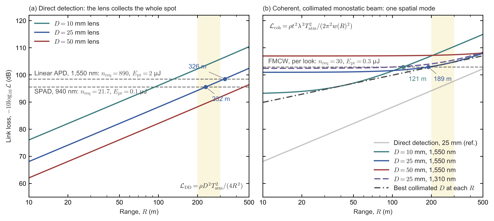

*Figure C0.1.* Link loss versus range for a 10% Lambertian target in clear air; a larger number of dB means less light. The shaded band marks 200–300 m, the long-range window that §C7a examines.
- *(a)* Direct detection with 10, 25 and 50 mm lenses.
- *(b)* Coherent detection with collimated monostatic beams of 10, 25 and 50 mm at 1,550 nm, and 25 mm at 1,310 nm. The dash-dot curve is the best collimated aperture at each range, and the grey line the 25 mm direct-detection reference.
- In both panels the dashed horizontal lines are the detection levels derived in subsection 5.1 (Eq. \eqref{eq:detection-level}), and the dots mark where the curves cross them, i.e. the maximum ranges, which subsection 5.1 reads.

**Reading Figure C0.1: the shapes of the curves** [E]:
- **Direct detection is a straight line** on these axes, rising 20 dB per decade of range for every lens. Doubling the lens diameter lowers the loss by 6 dB at every range; going from 10 to 25 mm gains $20\log_{10}2.5=8.0$ dB (at 10 m, 76.0 against 68.1 dB).
- **Coherent detection is flat, then rises.** Each curve is level out to about its Rayleigh range (41, 257 and 1,026 m for 10, 25 and 50 mm) and rises 20 dB per decade beyond it, 4.7 dB above (worse than) the direct-detection line of the same aperture.
- **In the near field a smaller aperture collects more.** The plateaus lie at 93.0, 100.9 and 107.0 dB for 10, 25 and 50 mm: the loss grows as $D^2$. Two collimated apertures collect equally where their beams have the same radius, which by Eq. \eqref{eq:gaussian-beam-radius} happens at $R=\pi w_{0,1}w_{0,2}/\lambda=\sqrt{z_{R,1}z_{R,2}}$. That is 103 m for 10 and 25 mm, and 513 m for 25 and 50 mm, just beyond the plot. Below that range the smaller aperture wins.
- **The envelope touches each curve at that aperture's Rayleigh range,** where the aperture is optimal. Its loss rises only 10 dB per decade ($1/R$), because the best aperture grows as $\sqrt R$.
- **At 1,310 nm** the 25 mm plateau is 1.5 dB higher (102.4 dB), because the near-field level scales as $\lambda^2$.

#### 3.3 Losses on the way: air, fog, rain, snow and water films

Between sensor and target the light crosses air and, in bad weather, fog, rain or snow; on the way out and back it also crosses the sensor's window, which may be wet or dirty. Each multiplies the link loss by a transmission factor below one. Clear air costs a fraction of a decibel at automotive ranges and dense fog tens of decibels, while rain costs less through the air than through water on the window and through spray. Water on the window costs far more at 1,550 nm than at 905 or 940 nm. What these losses do to each receiver's range is the subject of subsection 5.4.

- **Beer–Lambert, both ways.** Light travelling a distance $x$ through a scattering medium keeps a fraction $e^{-\alpha x}$ of its power, where $\alpha$ is the extinction coefficient (per unit length; absorption plus scattering). The light crosses the range $R$ twice, so the return is multiplied by $e^{-2\alpha R}$. Visibility $V$ is conventionally the distance at which contrast falls to 2%, so $e^{-\alpha V}=0.02$ and $\alpha=\ln(1/0.02)/V\approx3.912/V$ in fog (some standards use 5%, giving $\alpha=\ln(1/0.05)/V\approx3.0/V$). Visibility is defined for visible light, near 550 nm.
- **Fog.** Kim's model scales $\alpha$ as $(\lambda/550\ {\rm nm})^{-q_{\rm K}}$, with an exponent $q_{\rm K}$ that describes the droplet size distribution: it is 1.6 above 50 km visibility, 1.3 for 6–50 km (clear air), and falls to 0 below 500 m visibility. When $q_{\rm K}=0$, $\alpha$ no longer depends on wavelength, because fog droplets are much larger than the wavelength. Dense fog (visibility below 500 m, where $q_{\rm K}=0$) therefore attenuates 905 and 1,550 nm about equally [I, Kim, McArthur and Korevaar 2001], consistent with the <10% difference measured by Duthon et al. (§C4c). In light fog the model still favours 1,550 nm slightly: at 1 km visibility $\alpha=3.05$ /km at 905 nm against 2.33 /km at 1,550 nm. The table gives the extinction coefficient and the two-way loss over 50 m for four visibilities [E]:

| Visibility $V$ | $\alpha$ at 905 nm | Two-way loss at 50 m |
|---|---|---|
| 1,000 m (fog, at the haze boundary; $q_{\rm K}=0.5$) | 3.0 /km | 1.3 dB |
| 200 m (fog) | 19.6 /km | 8.5 dB |
| 50 m (thick fog) | 78 /km | 34 dB |
| 20 m (very thick fog) | 196 /km | 85 dB |

- *How the numbers are derived* [E]:
  - **Extinction:** Kim's model gives $\alpha=(3.912/V)\,(\lambda/550\ {\rm nm})^{-q_{\rm K}}$, evaluated here at 905 nm. Between 0.5 and 1 km visibility the model sets $q_{\rm K}=V-0.5$ (with $V$ in km), which is 0.5 at 1 km. For $V=1{,}000$ m with $q_{\rm K}=0.5$, $\alpha=(3.912/{\rm km})\times(905/550)^{-0.5}=3.912\times0.78=3.05$ /km at 905 nm, and $3.912\times(1{,}550/550)^{-0.5}=3.912\times0.596=2.33$ /km at 1,550 nm. Below 500 m visibility $q_{\rm K}=0$, so $\alpha=3.912/V$: 19.6 /km at 200 m, 78 /km at 50 m and 196 /km at 20 m.
  - **Two-way loss at 50 m:** $10\log_{10}e^{2\alpha R}=4.343\times2\alpha R$ dB, where $4.343=10/\ln10=10\log_{10}e$ converts natural-log units into decibels. For 200 m visibility this is $4.343\times2\times0.0196\ {\rm m^{-1}}\times50\ {\rm m}=8.5$ dB; the other rows scale with $\alpha$ (1.3, 34 and 85 dB).

- **Clear air.** With the clear-air exponent $q_{\rm K}=1.3$ (visibility 23 km), the Kim model gives $\alpha=0.085$ /km at 940 nm and 0.044 /km at 1,550 nm, so the two-way transmission $T_{\rm atm}^2$ costs only 0.15 and 0.08 dB at 200 m.
- **Clutter and multiple scattering.** Backscatter from droplets near the sensor adds clutter and can saturate SPADs (quantified in subsection 5.4). Multiple scattering returns some forward-scattered light and slightly extends real reach beyond the single-scattering estimates of subsection 5.4.
- **Rain.** The empirical free-space-optics law $\gamma_{\rm rain}\approx1.076\,R_r^{0.67}$ dB/km gives the specific attenuation $\gamma_{\rm rain}$, the loss per kilometre of path, for a rain rate $R_r$ in mm/h; 1.076 and 0.67 are Carbonneau's fitted coefficients, as used with ITU-R P.1814, a recommendation of the International Telecommunication Union's radiocommunication sector (ITU-R). The law yields 3.2, 9.3 and 23.5 dB/km at 5, 25 and 100 mm/h (for example, $1.076\times5^{0.67}=1.076\times2.94=3.2$ dB/km). At 200 m range the light travels 0.4 km out and back, so the loss is only $3.2\times0.4=1.3$, $9.3\times0.4=3.7$ and $23.5\times0.4=9.4$ dB [P, ITU-R P.1814; E for the 200 m losses]. Raindrops are far larger than the wavelength, so in this law the loss barely depends on it; one comparison cited in §C4c nevertheless found 905 nm reaching ≈2× farther than 1,550 nm at 25 mm/h [S, Wojtanowski et al. 2014, relayed by a survey]. In practice rain hurts more through:
  - water films on the window, which cost 9.4 dB round trip per millimetre at 1,550 nm but almost nothing at 905 nm (§C4c);
  - spray from other vehicles and splash near the sensor, which produce spurious near points;
  - wet roads, which turn specular, return little from the road surface and create mirrored ghosts.
- **Snow and sleet** scatter strongly and unevenly. On K-Radar's heavy-snow split (the heavy-snow subset of the K-Radar driving dataset), lidar-only 3D detection fell from 52.3 to 29.7 AP (average precision, a 0–100 score of object-detection accuracy), while radar-only detection fell only from 49.9 to 44.5 [I, K-Radar, NeurIPS 2022; §E4].
- **Water films and dirt on the window.** Liquid water absorbs strongly at 1,550 nm: a film on the window, crossed on the way out and again on the way back, costs 9.4 dB per millimetre round trip (§C4c), so a 0.2 mm film costs $0.2\times9.4=1.88\approx1.9$ dB. At 940 nm water absorbs tens of times more weakly, and the film can be neglected. Dust, mud, salt and droplets on the window scatter light out of the beam at every wavelength.

### 4. How much light is needed

A receiver needs a minimum number of signal photoelectrons per point to detect an echo reliably without reporting points where there are none. That number depends on how the detector turns light into a signal and what noise comes with it (subsection 4.1), on the background light that competes with the echo (4.2), and on the statistics of deciding, among thousands of range or frequency cells, which one holds the target (4.3).

#### 4.1 Detectors: gain, excess noise, Geiger mode and the local oscillator

A single returning photon produces one photoelectron, far too little charge for an amplifier to see. Lidar detectors therefore multiply it: in a controlled avalanche (a linear avalanche photodiode, APD), in a runaway one (a single-photon avalanche diode, SPAD, operated in Geiger mode), or, in a coherent receiver, by mixing it with a strong local oscillator. Linear gain helps only up to a point set by the detector material, which underlies the choice of silicon at 905/940 nm and the difficulty of InGaAs at 1,550 nm.

- **Linear APD.** An APD is a photodiode biased just below breakdown. Each photoelectron is accelerated until it knocks loose further carriers by impact ionization, so the avalanche multiplies it by a random gain of mean $M$ (dimensionless). The randomness adds noise, expressed by McIntyre's excess noise factor

  $$F(M)=kM+(1-k)\left(2-\frac{1}{M}\right) \label{eq:mcintyre-excess-noise}$$

  for multiplication started by the more strongly ionizing carrier. Here $F(M)$ is the excess-noise factor, the factor by which the gain's randomness raises the shot-noise power above that of a noiseless amplifier with the same mean gain ($F=1$ would be noiseless). $k$ is the ionization coefficient (ionizations per unit length) of the weaker-ionizing carrier divided by that of the stronger one: holes over electrons in silicon, where electrons start the avalanche, and electrons over holes in the InP multiplication layer of an InGaAs/InP APD, where holes start it. A small $k$ means an avalanche driven by one carrier type, which is quieter. The multiplied shot noise is

  $$\langle i_n^2\rangle=2qI_{\rm ph}M^2F(M)\,\Delta f \label{eq:apd-multiplied-shot-noise}$$

  where $\langle i_n^2\rangle$ is the mean-square noise current (A²), $q=1.60\times10^{-19}$ C the elementary charge, $I_{\rm ph}$ the primary photocurrent (the unmultiplied current, before gain; A) and $\Delta f$ the electrical bandwidth of the receiver (Hz). The signal current $MI_{\rm ph}$ grows only as $M$, so its power grows as $M^2$, while the noise power in Eq. \eqref{eq:apd-multiplied-shot-noise} grows as $M^2F(M)$.
- **Consequence.** Gain helps only until the multiplied shot noise $2qI_{\rm ph}M^2F(M)\,\Delta f$ of Eq. \eqref{eq:apd-multiplied-shot-noise} grows to match the noise of the amplifier that follows the detector (a transimpedance amplifier, TIA, which converts current into voltage). That is roughly the best gain; beyond it, more gain lowers the SNR. Because $F$ rises with slope $k$ ($F\approx kM+2(1-k)$ for $M\gg1$), a material with a large $k$ reaches that point at a much lower $M$. Substituting the $k$ of each material into Eq. \eqref{eq:mcintyre-excess-noise} gives:

| Detector | $k$ | $F$ at typical gain | Practical gain |
|---|---|---|---|
| Silicon APD (905/940 nm) | ≈0.02 [P, Excelitas C30902EH datasheet; I: 0.01–0.06 for the best commercial Si APDs, Martyniuk et al. 2023] | 2.9 at $M=50$; 4.0 at $M=100$ | ≈50–200 [P: 150 recommended for the C30902EH; I: 20–400 across Si APDs, Martyniuk et al. 2023, Table 3] |
| InGaAs/InP APD (1,550 nm) | ≈0.4–0.5 [I, Campbell et al. 2004; Martyniuk et al. 2023] (§C4) | 5.5 at $M=10$; 10 at $M=20$ | ≈10–20 [P: maximum usable gain 10 minimum and 20 typical, Excelitas C30645/C30662 datasheet; I: 10–40, Martyniuk et al. 2023] (§C4) |

- *How the numbers are derived* [E], by substituting into Eq. \eqref{eq:mcintyre-excess-noise}, $F(M)=kM+(1-k)(2-1/M)$:
  - **Silicon APD, $k=0.02$:** $F(50)=0.02\times50+0.98\times(2-0.02)=1.00+1.94=2.94$, and $F(100)=2.00+0.98\times1.99=3.95$.
  - **InGaAs/InP APD, at the mid-range $k=0.45$:** $F(10)=4.5+0.55\times1.9=5.5$, and $F(20)=9.0+0.55\times1.95=10.1$. The ends of the range, $k=0.4$ and 0.5, give 5.1 and 6.0 at $M=10$, and 9.2 and 11.0 at $M=20$.
- **What the table means.** Silicon's small $k$ keeps $F$ near 3–4 even at a gain of 100, whereas InGaAs/InP with $k=0.45$ already reaches $F=4$ at $M\approx6.6$ and $F=5.5$ at $M=10$ [E: setting $F=4$ in Eq. \eqref{eq:mcintyre-excess-noise} gives $0.45M+0.55(2-1/M)=4$, i.e. $0.45M^2-2.9M-0.55=0$, so $M=(2.9+\sqrt{2.9^2+4\times0.45\times0.55})/(2\times0.45)=6.6$]. A 1,550 nm linear APD receiver therefore gets far less useful gain, and needs more signal photons per point.
- **Geiger mode (SPAD, SiPM).** A SPAD is biased above breakdown; a silicon photomultiplier (SiPM) is an array of SPAD cells whose outputs are summed. Each detected photon produces a saturated, digital avalanche with a gain of order $10^5$–$10^6$, so the count carries no analog excess noise. The costs move elsewhere: the photon detection efficiency (PDE), dead time and pile-up, afterpulsing (false counts from charge trapped in an earlier avalanche) and, in SiPMs, optical crosstalk between cells. Dead time and pile-up are treated in subsection 4.2.
- **Coherent receivers need no avalanche gain.** The LO supplies it: the beat signal scales with the square root of the LO power. A balanced pair of PIN photodiodes (ordinary p–i–n diodes with unity gain, whose outputs are subtracted to cancel the LO's own intensity noise) becomes shot-noise-limited once the LO's shot noise exceeds the TIA's input noise. With a TIA of input noise $i_{\rm th}=3\ {\rm pA\,Hz^{-1/2}}$, parity ($2qI_{\rm LO}=i_{\rm th}^2$) needs an LO photocurrent $I_{\rm LO}=i_{\rm th}^2/(2q)=(3\times10^{-12})^2/(2\times1.60\times10^{-19})=28\ \mu{\rm A}$, about 30 µW of LO light. A balanced Ge pair with 0.3–1 mW of LO stays at 82–94% of the shot-noise limit even at 125 °C, and Rogers et al. (2021) reached parity at 5 µW of LO per pixel with a TIA integrated on the same chip (§C4c).

**Linear APD and SPAD compared.** Both are avalanche photodiodes, often of the same material, and the decisive difference is the bias. Below breakdown the avalanche dies out by itself and its size follows the light, so the output is an analog current. Above breakdown it runs away until a circuit quenches it, so every detection gives the same pulse. That one difference decides the electronics behind the detector, the noise that limits it and how far it scales:

| | Linear APD | SPAD (Geiger mode); a SiPM sums many SPAD cells |
|---|---|---|
| Bias | Below breakdown | Above breakdown, by an excess bias of several volts (8 V recommended for onsemi's ArrayRDM-0112 SiPM [P]) |
| Gain per photoelectron | Mean $M\approx50$–200 in silicon and 10–20 in InGaAs/InP (table above); random, with the excess noise $F(M)$ of Eq. \eqref{eq:mcintyre-excess-noise} | Of order $10^5$–$10^6$ ($1.1\times10^{6}$ for the ArrayRDM-0112 [P]); saturated, so every detection gives about the same charge |
| Output of one shot | A current proportional to the photon flux, which records the echo's amplitude and shape | One standard pulse per detection, whatever the number of photons: a SPAD reports "at least one photon", a SiPM how many of its cells fired (Eq. \eqref{eq:sipm-cells-fired}, §C4b) |
| Electronics behind it | A transimpedance amplifier (TIA), then a comparator for timing or an ADC for the waveform | A quench-and-recharge circuit and a logic gate feeding a TDC, with no amplifier (SPAD-SoC); a SiPM's summed output needs only a low-impedance stage (§C4b, receive front ends) |
| What limits sensitivity | Amplifier noise plus the multiplied shot noise of Eq. \eqref{eq:apd-multiplied-shot-noise}: a 1,550 nm InGaAs receiver needs about 890 photoelectrons per pulse for a single-shot SNR of 7 (§C7b subsection 1) | Background counts, dark counts and afterpulsing, but no amplifier noise: the SPAD design of this chapter needs 21.7 counts per point (subsections 4.3 and 5.1) |
| After a detection | Ready at once; only an overload needs time to recover (subsection 5.5) | Dead for the dead time, about 6 ns in Sony's automotive SPADs, which causes pile-up in sunlight (subsection 4.2) |
| Span of one shot | Linear up to the amplifier's output swing: 64 dB in current for TI's LMH32401 at 20 kΩ (subsection 5.5) | At most one count per SPAD per dead time, so a 3×3 macro-pixel saturates at nine counts (subsection 5.5); a wide span needs many shots or many cells |
| Scaling | One analog channel per detector; InGaAs arrays cost 10–100× more than silicon per mm² (§C4c subsection 3) | Monolithic silicon arrays with the timing under each pixel (SPAD-SoC); beyond silicon's absorption edge, an InGaAs/InP SPAD chip bonded to a separate readout chip (below) |
| In lidars today | 1,550 nm ToF (Seyond Falcon, Luminar Iris) and few-channel 905 nm units (Valeo SCALA 1 and 2, Livox Mid-360) | 905/940 nm volume lidars: SPAD-SoCs (Huawei, RoboSense EM and E, Hesai ETX and FTX, Ouster) and SiPMs (Hesai AT128 and ATX, Innoviz) (§C2); in the short-wave infrared, only Argo AI's fleet lidar (below) |

**Why a SPAD is harder at 1,550 nm, especially at room temperature.** A SPAD is harder to make at 1,550 nm for three physical reasons, and the dark counts behind the first two rise steeply with temperature.
1. *Silicon is transparent at 1,550 nm, and the absorbers that are not generate more dark carriers.* A 1,550 nm photon carries $E_{\rm ph}=hc/\lambda=1{,}239.8\ {\rm eV\,nm}/1{,}550\ {\rm nm}=0.80$ eV, less than silicon's band gap of 1.12 eV, so the absorber must be $\mathrm{In_{0.53}Ga_{0.47}As}$ (band gap 0.74 eV) grown on InP, or germanium (0.66 eV) [I, Ioffe NSM archive]. Heat creates electron–hole pairs across a band gap at a rate set by the intrinsic carrier density $n_i\propto\exp(-E_g/2k_BT)$, where $E_g$ is the band gap, $k_B$ Boltzmann's constant and $T$ the absolute temperature: generation through defect levels near mid-gap in a depleted layer scales with $n_i$, and diffusion from undepleted layers with $n_i^2$. At 300 K, $n_i$ is $1.0\times10^{10}$ cm⁻³ in silicon, $6.3\times10^{11}$ cm⁻³ in InGaAs and $2.0\times10^{13}$ cm⁻³ in germanium [I, Ioffe NSM archive], i.e. 63 and 2,000 times silicon's, and $63^2\approx4\times10^{3}$ for diffusion in InGaAs [E]. Germanium-on-silicon SPADs, which silicon foundries can make, are further from use: the room-temperature device of Na et al. (Artilux) counts 19 kcps/µm² at 12% PDE at 1,310 nm (§C4c subsection 4).
   - *Datasheet values show that InGaAs generates about $10^{4}$ times more dark carriers per µm² than silicon* [P/E]. Excelitas's linear-APD datasheets give the dark current $i_D$ and the dark noise $i_N$ of both materials at 22 °C. Its model splits the dark current into a surface part $i_{DS}$, which is not multiplied, and a bulk part $i_{DB}$, which is: $i_D=i_{DS}+i_{DB}M$ and $i_N=\sqrt{2q\,(i_{DS}+i_{DB}M^2F)}$ [P, C30902EH datasheet, Notes 2 and 3, p. 3]. The two specifications therefore fix $i_{DB}=(i_N^2/2q-i_D)/(M^2F-M)$, and $i_{DB}/q$ is the rate at which dark carriers enter the multiplication region.
     - *Silicon.* The C30902EH, a reach-through APD with a 0.5 mm useful diameter ($1.96\times10^{5}$ µm²), specifies $i_D=7$ nA and $i_N=0.1$ pA/√Hz at $M=150$, and $k_{\rm eff}=0.02$, so $F=4.95$ by Eq. \eqref{eq:mcintyre-excess-noise} [P, Tables 2 and 4 and Note 3, pp. 2–3]. Then $i_{DB}=(3.12\times10^{-8}-7\times10^{-9})\ {\rm A}/(150^2\times4.95-150)=0.22$ pA: 99.5% of the dark current is surface current, and the bulk generates $0.22\ {\rm pA}/(1.602\times10^{-19}\ {\rm C}\times1.96\times10^{5}\ \mu{\rm m^2})=7$ dark carriers s⁻¹ µm⁻². Dividing the whole dark current by $M$ instead would credit silicon with about 1,500, some 200 times too many. The datasheet's dark-current curve agrees: from 140 to 216 V the gain rises from about 12 to 100 while the dark current rises only from about 6.3 to 7.1 nA, as much as it rose from 100 to 140 V, where the gain stays below about 12 [P, Fig. 8, p. 7].
     - *InGaAs.* Excelitas specifies the C30645 (80 µm) and C30662 (200 µm) and their low-noise versions at $M=10$, where $F=5.5$ for $k=0.45$ [P, Tables 1 and 2, p. 2]. Between 55 and 92% of their dark current is multiplied, and their bulk generates $0.7$–$2.8\times10^{5}$ dark carriers s⁻¹ µm⁻². For the 200 µm C30662 the noise specification exceeds what its whole dark current could produce, so all of it is counted as multiplied: $1.3\ {\rm nA}/(1.602\times10^{-19}\ {\rm C}\times3.14\times10^{4}\ \mu{\rm m^2})=2.6\times10^{5}$. The dark current grows 5.2–7.5 times from 80 to 200 µm, close to the 6.25-fold area and far from the 2.5-fold perimeter, so it is bulk generation, not edge leakage.
     - *Result.* At the same temperature, catalogue InGaAs generates $1$–$4\times10^{4}$ times more dark carriers per µm² than catalogue silicon [$6.9\times10^{4}/6.9$ and $2.8\times10^{5}/6.9$; taking $k$ between 0.40 and 0.50 changes this by less than 10%]. That exceeds the factor of 63 in $n_i$ and even the 4,000 in $n_i^2$: the narrow gap sets the scale, and material quality and device design add the rest. Even SPAD-grade InGaAs(P), Argo's pixels at 25 °C with 320–2,230 dark carriers s⁻¹ µm⁻² (point 2), generates 50–300 times more than this silicon. A 10 µm pixel (78.5 µm²) of this silicon would register 110–540 dark counts per second, one of catalogue InGaAs $1\times10^{6}$ to $2\times10^{7}$ (for a trigger probability between 0.2 and 1, point 2).
2. *Geiger mode turns every dark carrier into a full count; linear mode only adds noise.*
   - In a linear APD the dark current adds its own shot noise, multiplied by $M^2F$ like the signal's (Eq. \eqref{eq:apd-multiplied-shot-noise}). Excelitas's 80 and 200 µm InGaAs APDs specify 0.2 and 0.7 pA/√Hz of noise at $M=10$ and 22 °C [P, C30645/C30662 datasheet, Table 1, p. 2], 15 and 4.4 times below the 3.1 pA/√Hz that TI's LMH32401 averages (49 nA rms over 250 MHz, subsection 5.5) [E]. Room temperature therefore costs a linear InGaAs receiver little.
   - In a SPAD, a thermally generated carrier that reaches the multiplication layer triggers the same avalanche as a photon, so the dark count rate adds directly to the background counts of subsection 4.2.
   - *Measured at room temperature* [P, Itzler, ISSW 2024]. An InGaAs/InP SPAD array built for automotive lidar at Argo AI (512 × 2 pixels at 25 µm pitch, active diameters below 10 µm) had mean dark count rates of 25–35 kHz per pixel at 25 °C and 60–75 kHz at 40 °C, both at a mean PDE of about 20% (slides 16, 17 and 19). Per area, taking a 10 µm diameter (78.5 µm²), that is at least $25{,}000/78.5\approx320$ to $35{,}000/78.5\approx450$ counts s⁻¹ µm⁻² at 25 °C [E]. Sony's silicon SPADs reach about 20 counts s⁻¹ µm⁻² at 60 °C, with 22–37% PDE at 905/940 nm (§C4c subsection 3). The InGaAs SPAD thus has at least 16–22 times the dark counts per area of a silicon SPAD 35 K hotter, at a lower PDE [E]. A research array is noisier still: the 96 × 96 InGaAs/InP SPAD array of Yildirim et al. (EPFL, Fraunhofer HHI and FBH, 2026), with 15 µm active diameters, has a median dark count rate of 617 kHz per pixel at 2 V of excess bias and room temperature, i.e. $6.17\times10^{5}/176.7\ \mu{\rm m^2}\approx3{,}500$ counts s⁻¹ µm⁻², at a median PDE of 15% [P, §3.1, Fig. 4 and Table 1, pp. 5068 and 5074; E].
   - *The same dark carriers in both modes* [E]. A linear APD's bulk dark current $i_{DB}$ (point 1) is the current of dark carriers that enter the multiplication region, the carriers that trigger a SPAD's dark counts. Both devices can therefore be compared by the rate of such carriers per µm² of active area.
     - *Argo's SPAD pixel.* Its 320–450 counts s⁻¹ µm⁻² at 25 °C must be divided by the probability $P_t$ that a carrier entering the multiplication region triggers an avalanche. $P_t$ lies between the PDE, 0.20, and 1, because the PDE is the absorption efficiency times $P_t$, so the pixel generates 320–2,230 dark carriers s⁻¹ µm⁻² [$35{,}000/(0.20\times78.5)=2{,}230$].
     - *Result.* The catalogue InGaAs APDs of point 1 generate 30–900 times more dark carriers per µm² than Argo's SPAD pixels [$6.9\times10^{4}/2{,}230=31$ and $2.8\times10^{5}/318=877$]. A 10 µm pixel that is to stay below 100 kHz may generate at most $10^{5}/(78.5\ \mu{\rm m^2}\times P_t)$, i.e. 1,270–6,370 carriers s⁻¹ µm⁻², 11–220 times below those APDs. With their generation it would count $1\times10^{6}$ to $2\times10^{7}$ per second and record a dark count in 66–100% of 1 µs windows. In the linear APD the same generation costs only 0.2 pA/√Hz of noise (C30645), and Argo-grade generation would lower that to 0.018 pA/√Hz, a difference that disappears under a 3 pA/√Hz amplifier.
     - *Limits of the comparison.* It fixes the quantity and nearly the temperature (22 against 25 °C, a factor of 1.2 at an activation energy of 0.5 eV), not the devices. The SPAD runs above breakdown, where field-assisted generation rises: Telesca et al.'s SPAD counts 25 times more at 11 V than at 3 V of excess bias at 300 K, reaching $6\times10^{4}$ counts s⁻¹ µm⁻², within 1–5 times of the catalogue InGaAs APDs (§C4c subsection 3). In Yildirim et al.'s array the median rate rises from about $2\times10^{4}$ s⁻¹ at 1.75 V to about $6\times10^{5}$ s⁻¹ at 2 V and $4\times10^{7}$ s⁻¹ at 2.75 V of excess bias [P, Fig. 4(b), p. 5068, values read from the figure]. Argo's absorber is written "InGaAs(P)" (slide 16): InGaAs or InGaAsP, a quaternary whose wider gap would generate fewer carriers. Its active diameter is below 10 µm, so its per-area values are lower bounds. And a linear APD maker has no reason to reduce dark generation once its noise is below the amplifier's. What the numbers establish is the asymmetry: the dark generation a linear APD ignores would blind a SPAD pixel, which must instead be made with one to three orders of magnitude less.
   - *Temperature* [E]. The rise from 25 kHz at 25 °C (298.15 K) to 64 kHz at 40 °C (313.15 K), the values marked on the two slides' histograms, corresponds to an activation energy $E_a=k_B\ln(64/25)/(1/298.15-1/313.15)=0.50$ eV, the same as the 0.50 eV of Telesca et al.'s InGaAs/InP SPAD between 275 and 300 K (§C4c subsection 3). That lies between $E_g/2=0.37$ eV (generation through mid-gap defect levels) and $E_g=0.74$ eV (diffusion) of InGaAs, as expected if thermal generation in the absorber dominates; both limits are higher for an InGaAsP absorber. At 0.50 eV the dark count rate grows 1.9× per 10 K near room temperature, and 26× from 25 to 85 °C: a 25 kHz pixel would count 650 kHz and record a dark count in 48% of 1 µs windows ($1-e^{-0.65}$). Argo's array was therefore temperature-stabilised, at a nominal 40 °C [P, slides 8 and 22], where its developers count 100 kHz as about a 10% chance of a dark count within 1 µs [P, slide 19; E: $1-e^{-0.1}=9.5\%$].
3. *Afterpulsing forces a long hold-off, and InP needs a separate readout chip.*
   - Deep traps in the InP multiplication layer catch carriers during an avalanche and release them later, triggering false counts. The cure is a hold-off of about 1 µs (≈8% afterpulsing; <3% at 10 µs), against Sony's 6 ns dead time with 0.1% afterpulsing, so the count-rate ceiling falls from ≈60 Mcps to ≈1 Mcps per SPAD (§C4c subsection 3).
   - Hard gating replaces the hold-off. The SPAD is raised above breakdown only during a short gate and held below it the rest of the time, so neither an avalanche nor an afterpulse can occur outside the gate [P, Yildirim et al. 2026, Fig. 1, p. 5065]. Yildirim et al. gate each pixel of their 96 × 96 array for 3 ns every 20 µs and imaged scenes at 3 m and 10 m in 120 klux of sunlight without cooling. Each gate, however, covers only $c\times3\ {\rm ns}/2=0.45$ m of range, so the gate has to be stepped across the range (§C4c subsection 3).
   - InP cannot carry CMOS logic, so the SPAD chip is bonded to a separate silicon readout chip: by wire bonds to two 512 × 1 readout circuits beside Argo's array [P, slide 16], or by an indium bump under each pixel, as in Princeton Lightwave's earlier cameras [P, slide 4] and in Yildirim et al.'s array on a 110 nm CMOS chip at 25 µm pitch [P, Fig. 3, p. 5068; Table 1, p. 5074]. A silicon SPAD-SoC instead stacks the timing under each 10 µm pixel (§C5a).
- **Consequences.** At room temperature, InGaAs generates about $10^{4}$ times more dark carriers per µm² than silicon (point 1). A linear APD absorbs that generation as noise below its amplifier's; a SPAD pixel turns it into dark counts in most microseconds unless its material generates one to three orders of magnitude less and is held at a stable temperature (point 2). Linear InGaAs APDs therefore work at room temperature, and every volume 1,550 nm ToF lidar uses them (§C4b, receive front ends). A short-wave-infrared SPAD array needs temperature control or nanosecond gates, operation at a modest PDE and statistical detection over many shots; the only one that reached vehicles, Argo's, was built for robotaxi fleets (§C4c subsection 3).

#### 4.2 Background light and dead time

A direct-detection receiver counts every photon that reaches it, signal or not. In daylight the sunlit scene in each pixel's view supplies a steady background whose shot noise competes with the echo, and a photon-counting pixel also loses time after each count. Together they set the background counts per bin that the detection statistics of subsection 4.3 must clear. A coherent receiver is almost immune to the background: its local oscillator rejects light outside its single spatial mode and its narrow band of beat frequencies (subsection 1.3).

**Solar background per pixel.** The rate of background counts in one pixel is

$$r_{\rm bg}=\frac{E_\odot(\lambda)\,\Delta\lambda}{E_{\rm ph}}\,\frac{\rho_{\rm scene}}{\pi}\,\Omega_{\rm pix}\,A_{\rm rx}\,\eta_{\rm opt}\,\text{PDE} \label{eq:solar-background-rate}$$

where:
- $r_{\rm bg}$ is the rate of background counts in one pixel (counts/s);
- $E_\odot(\lambda)$ is the solar spectral irradiance on the scene at wavelength $\lambda$ (W m⁻² nm⁻¹);
- $\Delta\lambda$ is the pass band of the receiver's optical filter (nm);
- $E_{\rm ph}=hc/\lambda$ is the photon energy (J), which converts the in-band solar power into a photon rate;
- $\rho_{\rm scene}/\pi$ turns the solar irradiance into the radiance of a Lambertian scene (per steradian), where $\rho_{\rm scene}$ is the reflectance of the sunlit scene in the pixel's view, not the target reflectance $\rho$ of Eq. \eqref{eq:photons-per-pulse};
- $\Omega_{\rm pix}$ is the solid angle one pixel sees (sr);
- $A_{\rm rx}$ is the receive-aperture area, $\eta_{\rm opt}$ the optics transmission and PDE the photon detection efficiency.

Eq. \eqref{eq:solar-background-rate} is the relation §C6 uses as Eq. \eqref{eq:macro-pixel-background-rate}. *Example* [E, inputs of §C6(d)]: at 905 nm, $E_\odot\approx0.75$ W m⁻² nm⁻¹ and $E_{\rm ph}=2.20\times10^{-19}$ J, so $E_\odot/E_{\rm ph}=3.4\times10^{18}$ photons s⁻¹ m⁻² nm⁻¹. With a 20 nm filter, $\rho_{\rm scene}=0.9$, a 0.05° × 0.05° macro-pixel ($0.05^\circ=8.73\times10^{-4}$ rad, so $\Omega_{\rm pix}=(8.73\times10^{-4})^2=7.62\times10^{-7}$ sr; the 2,400 × 520 grid of Sony's IMX479 over 120° × 26°, §C5a), a 25 mm aperture ($A_{\rm rx}=4.91\times10^{-4}$ m²), $\eta_{\rm opt}=0.5$ and PDE 0.3, $r_{\rm bg}=3.4\times10^{18}\times20\times(0.9/\pi)\times7.62\times10^{-7}\times4.91\times10^{-4}\times0.5\times0.3\approx1.1\times10^9$ counts/s. The background is lowest near 940 nm, where water vapour in the atmosphere absorbs part of the solar spectrum (§C4c). Narrower filters and smaller pixel angles reduce it; a larger aperture raises signal and background together.

**Signal-to-noise ratio.** In the histogram bins that hold the echo, the photon-counting SNR is $\text{SNR}\approx N_s/\sqrt{N_s+N_b}$, with $N_s$ the signal counts and $N_b$ the background counts in the same bins, both summed over the pulses of one point. Both are Poisson-distributed, so the noise is the square root of the total count, and sunlight, through Eq. \eqref{eq:solar-background-rate}, sets $N_b$.

**Dead time and pile-up.** After each detection a photon-counting pixel is blind for its dead time. At high count rates this biases the histogram toward early photons (pile-up) and removes part of the echo along with the background (§C4b, §C6).

**The background of the model** [E]. The detection statistics of subsection 4.3 and the comparison of §C7a use a bright-sun background of $b=1.62$ counts per 1 ns bin, summed over the ten shots of a point. It follows from Eq. \eqref{eq:solar-background-rate} and the dead time:

- Eq. \eqref{eq:solar-background-rate}, the relation §C6 uses as Eq. \eqref{eq:macro-pixel-background-rate}, gives $r_{\rm bg}=2.97\times10^{8}$ counts per second per macro-pixel for a fully sunlit scene of reflectance 0.9, at 940 nm behind a 10 nm filter and at PDE 0.3. The macro-pixel sees 0.05° × 0.05° ($\Omega_{\rm pix}=7.62\times10^{-7}$ sr, the IMX479 grid of the example above), and §C6(d) takes $E_\odot\approx0.39$ W m⁻² nm⁻¹ at 940 nm, so with $E_{\rm ph}=2.11\times10^{-19}$ J and the 25 mm aperture Eq. \eqref{eq:solar-background-rate} reads $(0.39/2.11\times10^{-19})\times10\times(0.9/\pi)\times7.62\times10^{-7}\times4.91\times10^{-4}\times0.5\times0.3=2.97\times10^{8}$ s⁻¹. The same SPADs count background and signal, so at the model's PDE of 0.37 the rate is $2.97\times10^{8}\times0.37/0.3=3.66\times10^{8}$ s⁻¹.
- The central case takes half of that, $r_{\rm bg}=1.83\times10^{8}$ s⁻¹: a sunlit scene of reflectance ≈0.45, or a pixel whose view is only half filled by bright surfaces. The full value is the model's high case.
- Eq. \eqref{eq:dead-fraction-two-models} gives the dead fraction. The model treats Sony's SPADs as paralyzable [E]. The development chip's measured ceiling of 60 Mcps matches the $1/(e\tau_d)=61$ Mcps of a paralyzable counter with a 6 ns dead time ($e$ is Euler's number), the behaviour of passive recharge; the IMX459 press release, however, says active recharge, and the product may differ from the development chip (§C5a). A paralyzable SPAD is live only if no photon arrived during the last $\tau_d$, its dead time. Each of the macro-pixel's nine SPADs (a 3×3 group, §C5a) counts $r=1.83\times10^{8}/9=2.03\times10^{7}$ s⁻¹, so $r\tau_d=0.122$ for $\tau_d=6$ ns, the live fraction is $e^{-0.122}=0.885$ and $f_{\rm dead}=0.115$. A non-paralyzable SPAD would instead be dead a fraction $0.122/1.122=0.109$ of the time (the other form of Eq. \eqref{eq:dead-fraction-two-models}), i.e. live 0.891. That would raise $b$ only to $1.83\times10^{8}\times10^{-9}\times10\times0.891=1.63$ and leave the threshold at 12 counts, so an ideal counter would need 14.97 signal counts rather than 14.98. Its larger live fraction would lower the energy per point by under 1% ($0.885/0.891=0.993$).
- Eq. \eqref{eq:background-per-bin} of §C7b, multiplied by the live fraction $1-f_{\rm dead}$, gives the counts in one bin of width $\Delta t_{\rm bin}=1$ ns, summed over the $N_{\rm shots}=10$ shots of a point: $b=r_{\rm bg}\,\Delta t_{\rm bin}\,N_{\rm shots}\,(1-f_{\rm dead})=1.83\times10^{8}\times10^{-9}\times10\times0.885=1.62$.
- A macro-pixel listens 20.8 µs per point, the column period of a scan of 2,400 columns at 20 frames per second (Sony's IMX479, §C6). That leaves time for about ten shots of 2.08 µs, each longer than the 2 µs round trip to 300 m (§C6, §C7a). Over those 20.8 µs the same rate gives $1.83\times10^{8}\times20.8\times10^{-6}\times0.885\approx3{,}370$ background events; with the 21.7 signal counts of subsection 5.1 that is ≈3,390 events per point, the event count of the §C7a electronics budget.
- The dead time blinds the SPADs to signal photons as well: only the live fraction 0.885 of the echo can be counted, so the §C7a model multiplies the SPAD's signal efficiency by it: optics transmission 0.5 × PDE 0.37 × live fraction 0.885, i.e. $0.5\times0.37\times0.885=0.164$.

#### 4.3 Detection statistics under one rule

A return counts as detected when it crosses a threshold set above the noise. The threshold trades the detection probability $P_D$, the chance that a real echo crosses it, against the false-alarm probability $p$ of each range or frequency cell, the chance that noise alone crosses it there. Because noise can cross in any of the cells searched, the chance of a false point grows with their number, and so does the threshold needed for a given false-point rate. A stated range therefore means little without its $P_D$ and its false-alarm definition (§C3b). Both receivers are held below to one rule, first for photon counting and then for coherent detection of a speckled target.

**The detection rule.** A point must be detected with probability $P_D=0.9$, and noise may produce at most $P_{FA,{\rm pt}}=10^{-3}$ false points per point, counted over the whole range the receiver searches (0–300 m here).
- **Why per point, not per bin.** The two receivers search different numbers of cells. A ToF histogram has 2,000 time bins over 300 m, while an FMCW receiver searches ≈2,450 frequency bins in one chirp ramp and a further window in the other. A common per-bin false-alarm probability would give them different false-point rates.
- **What it allows.** At 1.5 Mpts/s (the Hesai AT128) the budget still allows 1,500 false points a second, 150 per 10 Hz frame, and at 10 Mpts/s $10^{4}$ a second, before any filtering [E: $1.5\times10^6\ {\rm s^{-1}}\times10^{-3}=1{,}500\ {\rm s^{-1}}$, and $1{,}500/10=150$]. Products therefore add multi-pulse or neighbour-consistency checks before a point is output.
- **Per-bin probability.** The per-bin false-alarm probability $p$ then follows from the number of bins each receiver searches.
- **Vendors define the terms differently.** InnovizOne's range table uses 90% true positives and a 5% false-alarm rate *per pixel* at 20 klx [P], and InnovizTwo's datasheet 90% true and 1% false positives per pixel at 100 klx (§C3b); Seyond's Falcon K1 uses >90% detection probability at 100 klx [P]. (klx is thousands of lux of ambient illuminance; 100 klx corresponds to bright direct sunlight.)

*Photon counting (SPAD histogram).* A pixel that sums hundreds of speckles sees a non-fading signal, so signal and background counts are Poisson.
- **Rule:** the histogram has $N_{\rm bins}=2{,}000$ bins of 1 ns over 0–300 m, so each bin may false-alarm with probability $p=P_{FA,{\rm pt}}/N_{\rm bins}=5\times10^{-7}$. With background mean $b$ per bin, the threshold $n_{\rm th}$ is the smallest count with $P(N\ge n_{\rm th}\mid b)\le p$. Here $P(N\ge n\mid\mu)$ is the probability that a Poisson count $N$ of mean $\mu$ is at least $n$, and $s$ is the mean signal count in the echo's bin. Then
$$P_D=P(N\ge n_{\rm th}\mid s+b)=\frac{\gamma(n_{\rm th},\,s+b)}{\Gamma(n_{\rm th})}. \label{eq:poisson-detection-probability}$$
  The special functions are:
  - $\Gamma(n)=\int_0^\infty u^{n-1}e^{-u}\,du$, the gamma function, which equals $(n-1)!$ for a whole number $n$;
  - $\gamma(n,x)=\int_0^x u^{n-1}e^{-u}\,du$, the lower incomplete gamma function, the same integral stopped at $x$;
  - their ratio $\gamma(n,x)/\Gamma(n)$, the regularized lower incomplete gamma function, which rises from 0 to 1 as $x$ grows. It equals the Poisson tail $P(N\ge n\mid x)$, which is why it appears here.
- **Night, $b=0.01$:** $P(N\ge2\mid0.01)=5.0\times10^{-5}$ is too high and $P(N\ge3\mid0.01)=1.7\times10^{-7}$ passes, so $n_{\rm th}=3$.
- **Bright sun, $b=1.62$ (subsection 4.2):** $P(N\ge11\mid1.62)=1.15\times10^{-6}$ fails and $P(N\ge12\mid1.62)=1.54\times10^{-7}$ passes, so $n_{\rm th}=12$.
- **A stricter budget.** At $10^{-6}$ false points per point, i.e. $5\times10^{-10}$ per bin, the thresholds rise to 4 counts at night and 15 in bright sun, and $P_D=0.9$ needs 6.7 and 18.5 signal counts instead of 5.3 and 15.0 [E: $P(N\ge3\mid0.01)=1.7\times10^{-7}$ fails and $P(N\ge4\mid0.01)=4.1\times10^{-10}$ passes; $P(N\ge14\mid1.62)=2.2\times10^{-9}$ fails and $P(N\ge15\mid1.62)=2.3\times10^{-10}$ passes; $P(N\ge4\mid6.68)=0.9$ and $P(N\ge15\mid20.13)=0.9$]. A thousandfold stricter false-point budget costs a photon counter only about a quarter more signal.

*Coherent detection in one frequency bin (FMCW building blocks).* After the FFT, the power in one frequency bin is compared with a threshold.
- **Normalization:** the noise (LO shot noise) is set to unit mean, so noise-only power in a bin is exponential and exceeds a threshold $x$ with probability $e^{-x}$. A per-bin false-alarm probability $p$ therefore sets the threshold $x_{\rm th}=-\ln p$. In a shot-noise-limited receiver the mean signal-to-noise ratio equals $\bar n$ (subsection 1.3), so $\bar n$ is also the signal power in these units.
- **This noise is quantum, not background.** It is the shot noise of heterodyne detection: every FFT bin searched carries about one photoelectron of it, whereas a ToF bin at night holds 0.01 background counts.
- **Steady, non-fading target:**
$$P_D=Q_1\!\left(\sqrt{2\bar n},\sqrt{2x_{\rm th}}\right), \label{eq:pd-steady-target}$$
  where $Q_1(u,v)$ is Marcum's Q function: the probability that the envelope of a steady tone of amplitude $u$ plus Gaussian noise (unit variance per quadrature) exceeds a threshold $v$. The factors of 2 convert the unit-mean power scale into that amplitude scale.
- **One speckle.** A rough target scatters the coherent light from many randomly phased patches, and their sum at the receiver is a random speckle pattern. In a single speckle the return's amplitude is Rayleigh-distributed, so its intensity is exponentially distributed: deep fades are common. For a single look with square-law detection (the receiver compares the beat power, not its amplitude, with the threshold),
$$P_D=p^{1/(1+\bar n)} . \label{eq:pd-speckle-single-look}$$
  where $p$ is the false-alarm probability of the bin tested and $\bar n$ the mean signal-to-noise ratio, averaged over the speckle fading; in a shot-noise-limited receiver $\bar n$ is also the mean number of signal photoelectrons (subsection 1.3). This is the Swerling I case of radar theory. It assumes exponentially distributed intensity (Rayleigh amplitude fading) that stays constant during the look and changes independently from one look to the next.
  - *One bin tested alone.* $P_D=0.9$ at $p=10^{-6}$ needs a mean SNR of ≈130 (21 dB). A steady, non-fading target needs ≈20 (13 dB, Albersheim's approximation) [E].
    - *Swerling I:* taking logarithms of Eq. \eqref{eq:pd-speckle-single-look}, $1+\bar n=\ln p/\ln P_D=\ln(10^{-6})/\ln(0.9)=(-13.82)/(-0.1054)=131$, so $\bar n\approx130$, and $10\log_{10}130=21.1$ dB.
    - *Steady target:* Albersheim's empirical approximation for a non-fading target is ${\rm SNR_{dB}}=(6.2+4.54/\sqrt{1.44})\log_{10}(\mathcal{A}+0.12\mathcal{A}\mathcal{B}+1.7\mathcal{B})$, with $\mathcal{A}=\ln(0.62/p)=13.34$ and $\mathcal{B}=\ln[P_D/(1-P_D)]=\ln9=2.20$. The constants 6.2, 4.54, 0.12, 1.7 and 0.62 are Albersheim's fitted coefficients. The general form, for $N_p$ pulses integrated incoherently, contains $\sqrt{N_p+0.44}$, which is $\sqrt{1.44}$ for the single pulse here. ($\mathcal{A}$ and $\mathcal{B}$ are auxiliary numbers, not an area or a bandwidth.) That gives $9.98\times\log_{10}(20.6)=13.1$ dB, an SNR of ≈20.
  - In a shot-noise-limited receiver the SNR equals the detected photoelectrons, so this single bin needs ≈130 of them. A full FMCW point held to the rule above needs ≈259 with one look, twice the single-bin ≈130, because its peak must be found in both chirp ramps after a search over the whole range; four independent looks bring the total, summed over both ramps and all looks, down to ≈88 (Eq. \eqref{eq:fmcw-two-ramp-detection} and the table below). Polarization, wavelength or spatial diversity recovers much of the fading penalty.
  - The practical consequence is that speckle fading, more than receiver noise, sets the photon budget of a coherent lidar: a single speckle needs more than six times the signal of a steady target (130 against 20) for the same 90% detection.
- **$N_{\rm sp}$ independent speckles summed incoherently** (polarization, wavelength or spatial diversity; each is one *look*, taken by its own coherent receiver. The model's four looks are two polarizations on each of two spatial modes, received through two equal apertures, so each collects the full $\mathcal{L}_{\rm coh}$ from the same transmitted energy, §C7a), with $\bar n$ split equally among them:
  - the noise-only sum is Gamma-distributed, so the threshold $x_{N_{\rm sp}}$ solves $Q(N_{\rm sp},x_{N_{\rm sp}})=p$, where $Q(n,x)=1-\gamma(n,x)/\Gamma(n)$ is the regularized upper incomplete gamma function, the probability that a sum of $n$ independent unit-mean exponential variables exceeds $x$;
  - each speckle's power, signal plus noise, is then exponential with mean $1+\bar n/N_{\rm sp}$, so
$$P_D=Q\!\left(N_{\rm sp},\,\frac{x_{N_{\rm sp}}}{1+\bar n/N_{\rm sp}}\right). \label{eq:pd-speckle-averaged}$$

*An FMCW point: both ramps, over the whole range.* Eqs. \eqref{eq:pd-steady-target}–\eqref{eq:pd-speckle-averaged} put all the photons in one bin. An FMCW point needs more, because a triangular chirp measures it with an up-ramp and a down-ramp (subsection 1.3): range and radial velocity follow only when the echo's peak is found in both, at $f_{\rm up}=f_b-f_D$ and $f_{\rm down}=f_b+f_D$, where $f_b$ is the beat frequency set by range and $f_D$ the Doppler shift (subsection 1.3).
- **The photons are split.** Each ramp collects half of the point's photoelectrons, $\bar n/2$.
- **The fading is common.** Target and beam do not change within the 12.67 µs dwell of the two ramps (10 µs of integration plus the two 1.33 µs round trips at 200 m, subsection 1.3), so both see the same speckle and only their noise is independent. A fade therefore removes the peak from both ramps at once; it does not average out between them.
- **Two searches.** The up-ramp peak must be found among all $N_b$ bins the beat can occupy, and the down-ramp peak within the window of $N_w$ bins around it that the velocity range allows. For the §C7a chirp (1 GHz swept over the 5 µs useful window of each ramp, up and down, so 200 kHz bins; 300 m; ±70 m/s):
  - $N_b=(f_{b,\max}+f_{D,\max})\,T_u=2{,}450$, where $T_u=5$ µs is the useful window of one ramp, $f_{b,\max}=400$ MHz the range beat at 300 m and $f_{D,\max}=90$ MHz the Doppler shift at 70 m/s. Equivalently $N_b=(300\ {\rm m})/\Delta R+f_{D,\max}T_u=2{,}000+450$, where $\Delta R=c/(2B)=0.15$ m is the range resolution of the chirp's bandwidth $B=1$ GHz. §C7a's digitizer takes 2.5 samples per bin in each ramp, so its Eq. \eqref{eq:adc-samples-per-point} counts $N_{\rm ADC}=5N_b\approx12{,}300$ samples per point.
  - $N_w=4f_{D,\max}T_u=1{,}800$: the down-ramp peak sits $2f_D$ from the up-ramp peak, and $2f_D$ spans ±180 MHz.
- **False points and detection.** A false point needs noise to cross the threshold in the up-ramp search (probability $p_1$ per bin) and again in the down-ramp window ($p_2$ per bin). The false-point rate and the detection probability are then
$$\begin{aligned}P_{FA,{\rm pt}}&\approx N_b\,p_1\,N_w\,p_2,\\ P_D&=\displaystyle\int_0^\infty\left[Q_{N_{\rm sp}}\!\left(\sqrt{\bar nG/N_{\rm sp}},\,\sqrt{2x}\right)\right]^2\dfrac{G^{N_{\rm sp}-1}e^{-G}}{\Gamma(N_{\rm sp})}\,dG .\end{aligned} \label{eq:fmcw-two-ramp-detection}$$
  - **Thresholds.** Splitting the budget evenly gives $p_1=p_2=p=\sqrt{P_{FA,{\rm pt}}/(N_bN_w)}=\sqrt{10^{-3}/(2{,}450\times1{,}800)}=1.5\times10^{-5}$; the best uneven split changes the results by less than 0.1%. The threshold $x$ in each ramp solves $Q(N_{\rm sp},x)=p$, as in Eq. \eqref{eq:pd-speckle-averaged}: $x=-\ln p=11.1$ for one look and 18.2 for four.
  - **Symbols.** $G$ is the speckle power gain summed over the $N_{\rm sp}$ looks, each look's gain being exponential with unit mean; the sum is Gamma-distributed with the density shown, which for one look is $e^{-G}$. Each ramp then holds a signal power $\bar nG/(2N_{\rm sp})$ spread over its $N_{\rm sp}$ looks. $Q_N(a,b)$ is the generalized Marcum Q function: the probability that the summed power of $N$ bins of unit-mean noise, carrying a total signal power $a^2/2$, exceeds $b^2/2$. Eq. \eqref{eq:fmcw-two-ramp-detection} uses it with $N=N_{\rm sp}$, one bin per look; for $N=1$ it is the $Q_1$ of Eq. \eqref{eq:pd-steady-target}.
  - **Reading.** The square is the two ramps' independent noise, and the integral averages over their common fading. A steady target does not fade, so for it $P_D=[Q_1(\sqrt{\bar n},\sqrt{2x})]^2$ with $x=-\ln p$.

The table gives both receivers' requirements under this rule. In the FMCW rows, $\bar n$ is the total over both ramps and all looks.

| Receiver statistics | $\bar n$ for $P_D=0.5$ | $\bar n$ for $P_D=0.9$ | $P_D$ at $\bar n=25$ | $P_D$ at $\bar n=120$ |
|---|---|---|---|---|
| Photon counting, night ($b=0.01$, $n_{\rm th}=3$) | 2.7 | 5.3 | 1.00 | 1.00 |
| Photon counting, bright sun ($b=1.62$, $n_{\rm th}=12$) | 10.0 | 15.0 | 1.00 | 1.00 |
| FMCW, steady target | 26.6 | 39.1 | 0.43 | 1.00 |
| FMCW, 4 looks summed | 39.0 | 88.5 | 0.22 | 0.96 |
| FMCW, 2 looks summed | 36.2 | 120 | 0.32 | 0.90 |
| FMCW, 1 look | 38.2 | 259 | 0.35 | 0.80 |

*How the numbers are derived* [E]:
- **Method:** each entry solves the matching $P_D$ expression numerically (script): Eq. \eqref{eq:poisson-detection-probability} for photon counting, with $\bar n=s$, and Eq. \eqref{eq:fmcw-two-ramp-detection} for the FMCW rows, with the thresholds above.
- **Worked check, bright sun:** $s=14.98$ puts the total mean at $s+b=14.98+1.62=16.60$, and a Poisson count of mean 16.60 reaches 12 with probability 0.90.
- **Worked check, one look:** in Eq. \eqref{eq:fmcw-two-ramp-detection} the common fade dominates. Both ramps cross their thresholds roughly when the speckle gain exceeds $2x/\bar n$, which for one look happens with probability $e^{-2x/\bar n}$. Setting that to 0.9 gives $\bar n\approx2\times11.1/0.105=211$; the noise in each ramp raises the exact value to 259.
- **More looks:** eight looks need 82.4 photoelectrons. The requirement approaches the steady target's 39.1 only slowly as the number of looks grows.

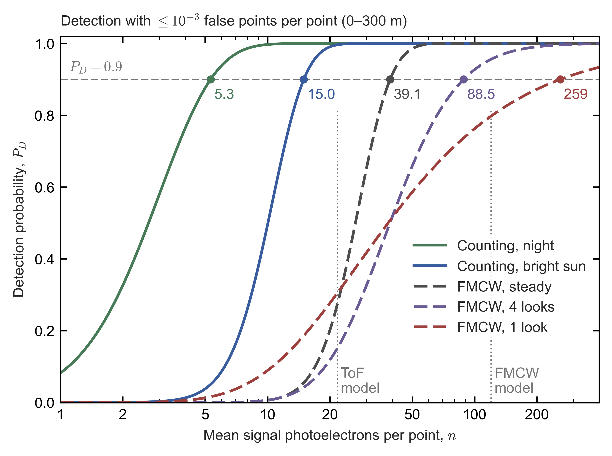

*Figure C0.2.* Detection probability versus mean signal photoelectrons per point, with at most $10^{-3}$ false points per point over a 0–300 m search.
- Solid: photon counting at night and in bright sun (2,000 bins, Eq. \eqref{eq:poisson-detection-probability}). Dashed: FMCW with the echo's peak found in both chirp ramps (Eq. \eqref{eq:fmcw-two-ramp-detection}), for a steady target, four summed looks and one look.
- Dots and numbers mark $P_D=0.9$. The dotted verticals are the photoelectron counts used in the §C7a model: 21.7 for ToF (subsection 5.1) and 120 for FMCW (four looks).

**Reading Figure C0.2** [E]:
- **ToF:** the model's 21.7 counts keep a ×1.45 implementation margin over the 15.0 that an ideal counter needs in bright sun ($n_{\rm req}=1.45\times14.98=21.7$). The dead time is not part of this margin, because it is counted in the SPAD's efficiency (the live fraction of subsection 4.2, §C7a(a)). The margin covers a return spread over about two bins, which needs 18.1 counts summed over both (×1.21: the two bins hold $2b=3.24$ background counts, which raises the threshold to 16), and leaves ×1.20 for pile-up distortion (§C6) and other implementation losses. In the model's high case, a fully sunlit scene of reflectance 0.9 ($r_{\rm bg}=3.66\times10^{8}$ s⁻¹, live fraction 0.784, $b=2.87$, $n_{\rm th}=15$), the ideal counter needs 17.3.
- **FMCW:** the model's 120 photoelectrons over four looks carry a 1.36× margin over the ideal 88.5, close to ToF's 1.45×. They give $P_D=0.96$ with four looks, 0.90 with two and 0.80 with one.
- **Waymo's figure is a one-ramp figure.** Waymo's 50 photons per detection, 45 photoelectrons at its quantum efficiency of 0.9, for 90% detection with four averaged speckles at $10^{-6}$ per bin [P] match one ramp searched in full, which needs 47.3 under the rule here ($10^{-3}$ false points over 2,450 bins, i.e. $4.1\times10^{-7}$ per bin) and 44.9 at Waymo's own $10^{-6}$ per bin (subsection 6.1). Requiring the peak in both ramps raises this to 88.5.
- **Where FMCW's extra photons go** (four looks, 88.5 against the counter's 15.0 in bright sun):
  - *the noise floor, ×1.5:* even a steady target in one fully searched ramp needs 21.9, 1.46 times the counter in bright sun ($21.9/15.0$). Each of the 2,450 bins carries one photoelectron of shot noise, and the threshold must clear the largest of them; the counter's threshold only has to clear the Poisson tail of 1.62 counts;
  - *both ramps, ×1.8:* splitting the photons and passing two thresholds raises the steady target to 39.1;
  - *fading, ×2.3:* four looks raise it to 88.5. One look would raise it to 259, ×6.6.
- **Curve shapes:** photon counting has the steepest curves. Once the mean clears the threshold, a non-fading Poisson signal almost always crosses it. Speckle fading makes the coherent curves shallow: the median ($P_D=0.5$) is 36–39 photoelectrons with one, two or four looks, but reaching 90% costs up to 7× the median (259 against 38.2 with one look). At the median more looks do not help: two looks need 36.2 and four need 39.0, against 38.2 for one, because the summed noise of four looks needs a higher threshold (18.2 against 11.1), which offsets their narrower fading.

**The FFT is nearly the limit** [E]. For a tone of unknown frequency and phase in white noise, the peak of the FFT power spectrum (the periodogram) is the maximum-likelihood, or generalized likelihood-ratio, detector [I: S. M. Kay, *Fundamentals of Statistical Signal Processing*, Vol. II: Detection Theory (Prentice Hall, 1998)]. No algorithm extracts more from one ramp without prior information. Two costs remain:
- **Straddle (scalloping) loss.** A beat that falls between FFT bins loses signal: 1.1 dB on average and 3.9 dB at worst with a rectangular window, and 0.3 and 0.9 dB with twofold zero padding. This belongs to the 1.36× implementation margin.
- **The search.** The threshold rises with the logarithm of the number of cells searched. A joint search, neighbour checks or a tracking window lower the requirement by 8–33%, for both receivers:

| Search (FMCW: four looks; ToF: bright sun) | FMCW $\bar n$ for $P_D=0.9$ | ToF $s$ for $P_D=0.9$ |
|---|---|---|
| Full search (the rule above) | 88.5 | 15.0 |
| Joint search over all $N_bN_w=4.4\times10^{6}$ up–down pairs, summing both ramps | 77.8 | — |
| $10^{-2}$ false points per point, pruned by neighbour checks | 81.6 | 13.8 |
| Tracking window of 20 bins per ramp around a predicted return | 59.6 | 11.4 |
| Known cell (no search; the ideal bound) | 32.2 | 10.2 |

- **What the table shows.** The joint search is the optimal detector for an unknown range and velocity, and the two-stage search of Eq. \eqref{eq:fmcw-two-ramp-detection} needs only 14% more. Even a known cell needs 32.2 photoelectrons with four looks (13.8 for a steady target, 77.1 for one look), well above the counter's 10.2. Fading and heterodyne shot noise are physics, not algorithm. The model therefore uses the full search for both receivers and treats these gains as sensitivities.

**What this means for the comparison** [E]. Under one rule, a SPAD ToF receiver in bright sun needs 15–22 counts per point (the ideal 15.0 and the model's 21.7), and an FMCW receiver 88–120 photoelectrons with four looks (259 with one). The coherent receiver's freedom from background does not lower its photon requirement: even a steady coherent target needs more (39.1) than an ideal counter in bright sun (15.0), and speckle fading adds to that. Subsection 5.1 turns the model's counts, 21.7 for SPAD ToF and 120 for FMCW (30 in each of four looks), into detection levels.

### 5. Range, its limits and its robustness

Subsections 3.1–4.3 give, for each receiver, how much light comes back and how much is needed. Setting the two equal gives the maximum range (subsection 5.1) and how it scales with energy, aperture, background and reflectance (5.2). Eye safety caps the energy (5.3). The shape of the link-loss curve then decides how much range survives a darker target, a dirty window or bad weather (5.4), and how strong the strongest returns become (5.5).

#### 5.1 Detection level and maximum range

The photoelectron requirement of subsection 4.3 becomes a level on the link-loss axis of Figure C0.1, and the maximum range is the range at which a loss curve crosses that level.

**The detection level.** Setting the mean signal $\bar n$ of Eq. \eqref{eq:mean-signal-per-point} equal to $n_{\rm req}$, the mean number of signal photoelectrons per point that the required detection probability demands (subsection 4.3), gives the largest loss a point can tolerate,
$$\mathcal{L}_{\rm det}=\frac{n_{\rm req}\,E_{\rm ph}}{\eta\,E_{\rm pt}}, \label{eq:detection-level}$$
and the maximum range $R_{\max}$ solves $\mathcal{L}(R_{\max})=\mathcal{L}_{\rm det}$. "Largest loss" means the smallest usable fraction: a link with $\mathcal{L}$ below $\mathcal{L}_{\rm det}$ delivers fewer than $n_{\rm req}$ photoelectrons. The level moves by 10 dB for every factor of 10 in $E_{\rm pt}$. The table gives it for the three receivers compared in this report; these are the dashed lines of Figure C0.1.

| Receiver | $\lambda$ | $n_{\rm req}$ | $\eta$ | $E_{\rm pt}$ | $\mathcal{L}_{\rm det}$ | Tolerable loss |
|---|---|---|---|---|---|---|
| SPAD dToF, bright sun | 940 nm | 21.7 | 0.164 | 0.1 µJ (e.g. ≈10 shots of 10 nJ) | $2.8\times10^{-10}$ | 95.5 dB |
| Linear InGaAs APD ToF | 1,550 nm | ≈890 | 0.40 | 2 µJ (one fibre-laser pulse) | $1.4\times10^{-10}$ | 98.5 dB |
| FMCW, per look (four looks) | 1,550 nm | 30 of the 120 | 0.25 | 0.3 µJ (30 mW × 10 µs of integration) | $5.1\times10^{-11}$ | 102.9 dB |

*How the numbers are derived* [E]:
- **$n_{\rm req}$ and $\eta$** are the §C7a values, with the APD's photoelectron count taken from the amplifier-noise calculation of §C7b subsection 1(a):
  - SPAD: optics 0.5 × photon detection efficiency 0.37 × the bright-sun live fraction 0.885 (6 ns dead time, modelled as paralyzable, subsection 4.2), i.e. $\eta=0.164$, and $n_{\rm req}=21.7$, the ×1.45 margin over the ideal 15.0 counts (subsection 4.3);
  - APD: optics 0.5 × quantum efficiency (QE) 0.8;
  - FMCW: the §C7a(a) efficiency, and 30 photoelectrons per look. The four-look receiver needs 120 in total (subsection 4.3), and each look collects the link loss $\mathcal{L}_{\rm coh}$ of Eq. \eqref{eq:coherent-link}, so its detection level is that of one look with $n_{\rm req}=30$.
- **Worked (SPAD),** from Eq. \eqref{eq:detection-level}: $21.7\times2.11\times10^{-19}/(0.164\times10^{-7})=2.79\times10^{-10}$, and $-10\log_{10}(2.79\times10^{-10})=95.5$ dB.
- **Worked (FMCW, per look):** $30\times1.282\times10^{-19}/(0.25\times3\times10^{-7})=5.13\times10^{-11}$, i.e. 102.9 dB.

**Reading Figure C0.1: where the curves cross the detection levels** [E]:
- **Direct detection collects a fraction proportional to $D^2/R^2$ at every range.** Setting $\rho D^2/(4R^2)=\mathcal{L}_{\rm det}$ (Eq. \eqref{eq:lambertian-link} with $T_{\rm atm}=1$) gives $R_{\max}=\tfrac{D}{2}\sqrt{\rho/\mathcal{L}_{\rm det}}$.
  - SPAD case, $D=25$ mm: $0.0125\times\sqrt{0.1/2.79\times10^{-10}}=237$ m, or 232 m with clear air. The 10 and 50 mm lenses reach 94 and 455 m.
  - The APD case reaches 326 m with 25 mm. Its per-point need $n_{\rm req}E_{\rm ph}/\eta$ is 10.2× the SPAD's (subsection 5.2), but its 20× larger energy leaves a $20/10.2=1.96\times$ margin, i.e. $\sqrt{1.96}=1.40\times$ the range.
- **Coherent collection is flat, then falls** (its loss is flat, then rises). With 0.3 µJ, $D=10$ mm reaches 121 m and $D=25$ mm reaches 189 m.
  - The 50 mm aperture reaches *no* range: its near-field level, 107.0 dB, already exceeds the 102.9 dB budget.
  - At 1,310 nm the 25 mm aperture also fails, narrowly. Its near-field level is 1.5 dB weaker ($10\log_{10}(1310/1550)^2=-1.5$ dB), at 102.4 dB, and its photons, $1550/1310=1.18$ times more energetic, lower the budget by $10\log_{10}1.18=0.7$ dB, to 102.2 dB.
- **Near the plateau, range is hypersensitive to the budget.**
  - For a fixed aperture, ignoring $T_{\rm atm}$, Eqs. \eqref{eq:coherent-link} and \eqref{eq:gaussian-beam-radius} give $\mathcal{L}_{\rm coh}(R)=\mathcal{L}_{\rm coh}(0)/[1+(R/z_R)^2]$, where $\mathcal{L}_{\rm coh}(0)$ is the near-field plateau. So $R_{\max}=z_R\sqrt{\mathcal{L}_{\rm coh}(0)/\mathcal{L}_{\rm det}-1}$.
  - For 25 mm: $257\times\sqrt{8.06/5.13-1}=194$ m, or 189 m with clear air.
  - An extra 1.8 dB, for example 45 instead of 30 photoelectrons per look ($10\log_{10}(45/30)=1.8$ dB) or a receiver at two-thirds of the shot-noise limit, cuts the 25 mm range to $257\times\sqrt{8.06/(1.5\times5.13)-1}=56$ m, or **53 m** with clear air.
  - The best collimated aperture degrades gracefully instead, as $R_{\max}\propto1/n_{\rm req}$: from 198 m to 133 m.
  - Subsection 5.4 follows this sensitivity to its practical consequences: dark targets, dirty windows and weather.
- **At 200 m, the 20–25 mm apertures of §C7a are close to the optimum** ($D_{\rm opt}=22$ mm). An aperture larger than $D_{\rm opt}(R)$ collects less at $R$ itself; it pays only at longer ranges, where it becomes the optimum: at 500 m the optimum is 35 mm.

#### 5.2 How range scales: energy, aperture, background and reflectance

Solve $\mathcal{L}(R_{\max})=\mathcal{L}_{\rm det}(E_{\rm pt})$, i.e. set the link loss of subsections 3.1–3.2 equal to the detection level of Eq. \eqref{eq:detection-level}, with $T_{\rm atm}\approx1$ in the closed forms. The answer tells a designer what an extra joule per point, or a larger lens, buys in range. For FMCW, $n_{\rm req}$ is the 30 photoelectrons of one look (subsection 5.1): each of the four looks collects $\mathcal{L}_{\rm coh}$ and needs a quarter of the 120, so the energies and ranges below hold for the whole receiver.

- **Direct detection:** from Eqs. \eqref{eq:lambertian-link} and \eqref{eq:detection-level},
$$R_{\max}=\frac{D}{2}\sqrt{\frac{\rho\,\eta\,E_{\rm pt}}{n_{\rm req}\,E_{\rm ph}}}\ \propto\sqrt{A_{\rm rx}E_{\rm pt}} . \label{eq:direct-max-range}$$
  At fixed average optical power $P_{\rm opt}$ (W), the point rate is $\dot N=P_{\rm opt}/E_{\rm pt}$ points per second. So $\dot N R_{\max}^2=\rho\,\eta\,D^2P_{\rm opt}/(4n_{\rm req}E_{\rm ph})$ is constant as long as $n_{\rm req}$ is: this is Eq. \eqref{eq:range-weighted-point-rate}, the range-weighted point-rate figure of merit of §C3b, which assumes signal-limited detection. A lidar can then trade points per second for range, but not raise both, without more power or a larger lens. In bright sun, however, $n_{\rm req}$ grows with the background that a point collects. If the energy per point is changed through the number of shots, the ideal counter of subsection 4.3 needs 12.2, 15.0 and 18.1 counts for 5, 10 and 20 shots ($b=0.81$, 1.62 and 3.24; thresholds 9, 12 and 16) [E]. The product $\dot N R_{\max}^2$ then shifts by about 21–23% per factor of two in point rate ($15.0/12.2=1.23$ and $18.1/15.0=1.21$), part of the way toward the $\dot N R^4$ of sunlight-limited detection (§C3b).
- **Background-limited detection.** Eq. \eqref{eq:direct-max-range} is the signal-limited law: range goes as $R\propto\sqrt{E_{\rm p}A_{\rm rx}\rho}$, because holding $N_s\propto E_{\rm p}A_{\rm rx}\rho/R^2$ fixed (at a fixed number of pulses per point) makes $R^2$ proportional to $E_{\rm p}A_{\rm rx}\rho$. When background noise dominates ($N_b\gg N_s$) and also grows with $A_{\rm rx}$ ($N_b\propto A_{\rm rx}$), the SNR of subsection 4.2 becomes $N_s/\sqrt{N_b}\propto(A_{\rm rx}/R^2)/\sqrt{A_{\rm rx}}=\sqrt{A_{\rm rx}}/R^2$. Holding the SNR fixed then gives $R^2\propto\sqrt{A_{\rm rx}}$, i.e. $R\propto A_{\rm rx}^{1/4}$ (§C4d, and §C10.3a, which contrasts one spatial mode with an integrating pixel). In daylight, doubling the lens diameter (4× the area) therefore buys a factor $4^{1/4}=1.41$ in range instead of 2 at night. When the sunlit target itself supplies the background, $N_b\propto\rho$ too, and range scales as $\rho^{1/4}$ rather than $\rho^{1/2}$ (subsection 6.1).
- **Coherent, fixed collimated aperture:** nothing is detected below a minimum energy per point $E_{\min}$, the energy at which even the near-field plateau $\mathcal{L}_{\rm coh}(0)$ just reaches the detection level:
$$E_{\min}=\frac{n_{\rm req}E_{\rm ph}}{\eta\,\mathcal{L}_{\rm coh}(0)}=\frac{2\pi^2\,n_{\rm req}\,E_{\rm ph}\,w_0^2}{\eta\,\rho\,t^2\lambda^2}. \label{eq:coherent-min-energy}$$
  - This is 0.031, 0.19 and 0.76 µJ for $D=10$, 25 and 50 mm.
  - Above it, $R_{\max}=z_R\sqrt{E_{\rm pt}/E_{\min}-1}$, which becomes the $\sqrt{E_{\rm pt}}$ law once $R_{\max}\gg z_R$.
  - Worked (25 mm): $2\pi^2\times30\times1.28\times10^{-19}\times0.01125^2/(0.25\times0.1\times0.838\times(1.55\times10^{-6})^2)=9.6\times10^{-21}/5.0\times10^{-14}=1.9\times10^{-7}$ J.
- **Coherent, best collimated aperture at each range:** setting the envelope of Eq. \eqref{eq:coherent-best-aperture} equal to the detection level gives
$$R_{\max}=\frac{\rho\,t^2\lambda\,\eta\,E_{\rm pt}}{4\pi\,n_{\rm req}E_{\rm ph}}\ \propto E_{\rm pt},\qquad \dot N\,R_{\max}=\text{const}. \label{eq:coherent-max-range}$$
  - Worked: $0.1\times0.838\times1.55\times10^{-6}\times0.25\times3\times10^{-7}/(4\pi\times30\times1.28\times10^{-19})=9.7\times10^{-15}/4.8\times10^{-17}=202$ m (198 m with clear air).
  - Doubling the energy doubles the range, but only if the aperture grows as $\sqrt R$. The footprint area then grows only as $R$ ($\pi w^2=2\lambda R$ at the optimum, subsection 3.2), while a cell of fixed angular pitch $\theta_{\rm cell}$ grows as $R^2$. The beam therefore covers a share $\pi w^2/(R\theta_{\rm cell})^2=2\lambda/(R\theta_{\rm cell}^2)$ of the cell, which shrinks as $1/R$: 4.1% at 100 m for a 0.05° cell (§C10.3a, item 3).
- **Equal apertures, constant gap.** At $D=D_{\rm opt}(R)$, with each FMCW aperture as large as the ToF lens, the ratio of the energies per point needed by FMCW and SPAD ToF does not depend on range:
$$\frac{E_{\rm FMCW}}{E_{\rm SPAD}}=\frac{n_{\rm c}E_{\rm ph,c}/\eta_{\rm c}}{n_{\rm d}E_{\rm ph,d}/\eta_{\rm d}}\cdot\frac{A_{\rm rx}}{A_{\rm mode}}=0.55\times\frac{1}{t^2(0.45)^2}=0.55\times5.9=3.2 . \label{eq:fmcw-spad-energy-ratio}$$
  - The subscripts c and d mark the coherent and direct-detection cases: $n_{\rm c}=30$ (per look) and $n_{\rm d}=21.7$ are their values of $n_{\rm req}$, $E_{\rm ph,c}$ and $E_{\rm ph,d}$ their photon energies (1,550 and 940 nm), and $\eta_{\rm c}$, $\eta_{\rm d}$ their efficiencies.
  - The second factor is the ratio of the direct-detection lens area to the coherent mode-equivalent area at the optimum, $A_{\rm mode}=t^2(0.45)^2A_{\rm rx}$ from subsection 3.2; 0.45 is again the ratio $w_0/D$.
  - The first factor is $(30\times1.28\times10^{-19}/0.25)/(21.7\times2.11\times10^{-19}/0.164)=1.54\times10^{-17}/2.79\times10^{-17}=0.55$.
  - With clear-air loss the ratio is 3.1–3.2 (3.21 at 100 m, 3.11 at 500 m), because clear air costs slightly more at 940 nm than at 1,550 nm.
- **Against a fixed 25 mm SPAD receiver**, the gap per point closes as $1/R$, because the optimal coherent aperture grows: 8.2× at 100 m, 4.1× at 200 m, 2.7× at 300 m and 1.6× at 500 m (150, 303, 458 and 778 nJ against 18.2, 74.2, 169.7 and 487.7 nJ, with clear air).
- **Linear APD against SPAD with the same lens:** $(890\times1.28\times10^{-19}/0.40)/(21.7\times2.11\times10^{-19}/0.164)=2.85\times10^{-16}/2.79\times10^{-17}=10.2$. That is about ten times the energy per point at every range, which the 1,550 nm eye-safety limits can pay for at low point rates (subsection 5.3, §C4c).

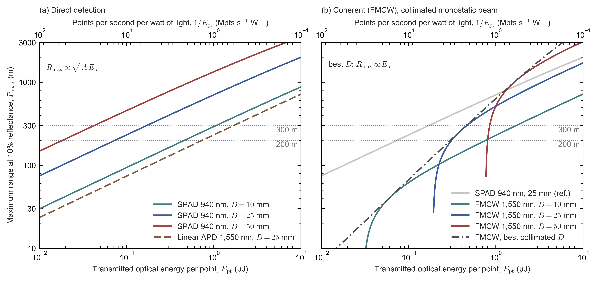

*Figure C0.3.* Maximum range at 10% reflectance versus transmitted optical energy per point, for the detection levels of subsection 5.1.
- The top axis converts energy per point into points per second per watt of light, $1/E_{\rm pt}$ (1 µJ per point is 1 Mpts/s per W).
- *(a)* Direct detection: SPAD at 940 nm with 10, 25 and 50 mm lenses, and a linear APD at 1,550 nm with 25 mm.
- *(b)* FMCW at 1,550 nm with collimated 10, 25 and 50 mm apertures, the best collimated aperture (dash-dot), and the 25 mm SPAD reference (grey).
- The dotted lines mark 200 and 300 m.

**Reading Figure C0.3** [E]:
- **Direct-detection range grows as $\sqrt{E_{\rm pt}}$** (Eq. \eqref{eq:direct-max-range}): a factor of $\sqrt{10}=3.2$ per decade of energy, and doubling the lens diameter doubles the range. The linear APD with a 25 mm lens runs below the 10 mm SPAD, because with the same lens it needs 10.2 times the SPAD's energy (above), more than the factor $2.5^2=6.25$ between the 10 and 25 mm SPAD lenses; at equal energy it reaches $\sqrt{6.25/10.2}=0.78$ of the 10 mm SPAD's range.
- **Each fixed coherent aperture starts at its minimum energy** $E_{\min}$ (Eq. \eqref{eq:coherent-min-energy}): 0.031, 0.19 and 0.76 µJ for 10, 25 and 50 mm. Its range climbs steeply through the near field and then follows the same $\sqrt{E_{\rm pt}}$ law beyond its Rayleigh range.
- **The best collimated aperture's range grows as $E_{\rm pt}$** (Eq. \eqref{eq:coherent-max-range}), and touches each fixed-aperture curve at the range equal to that aperture's Rayleigh range.
- **Against the 25 mm SPAD reference** the FMCW energy gap closes as $1/R$ (above), from 4.1× at 200 m to 1.6× at 500 m, so the two lines cross near 780 m, at about 1.2 µJ per point [E: the $1/R$ law alone gives $500\times1.59\approx800$ m; clear air, which costs more at 940 nm than at 1,550 nm, brings the crossing in to ≈780 m].

#### 5.3 The cap on energy: eye safety

Every scaling law of subsection 5.2 assumes that more energy per point can be spent. Eye safety caps it. Automotive lidars are designed to Class 1 of IEC 60825-1:2014, the laser-safety standard of the International Electrotechnical Commission (IEC); Class 1 is its least hazardous class, defined by limits on the emission accessible under the standard's measurement conditions.

At 905/940 nm the limits are ≈198/233 nJ per isolated small-source pulse and ≈79/93 nJ per pulse in long trains [P, IEC 60825-1:2014; §C4c]. At 1,550 nm the long-exposure limit is ≈10 mW, against ≈1 mW at 905 nm [P/E, IEC 60825-1:2014; §C4], because the front of the eye absorbs 1,550 nm light before it can be focused onto the retina. The classification must hold under reasonably foreseeable single faults, including a stalled scanner (§C4d).

The limits act on the energy of each pulse and on the average power that can reach an eye, so they bound the energy per point a lidar can spend in one direction per unit time. In Figure C0.3 they would appear as a wavelength-dependent vertical limit on the energy axis; §C7b subsection 3a(b) puts numbers on them for the two designs of §C7a. Like the solar background of subsection 4.2, the limits depend on wavelength, which is why the choice between 905/940 nm and 1,550 nm runs through the whole report. The tenfold higher long-exposure limit at 1,550 nm is what lets a linear InGaAs APD receiver, which needs about ten times the energy per point of the SPAD design (subsection 5.2), pay for that energy at low point rates, and what leaves room for the energy of the robust small-aperture FMCW designs of subsection 5.4 (§C4c).

#### 5.4 Margin at short range: dark targets, windows, fog and rain

The crossings of subsection 5.1 say how far a sensor sees one 10% target in clear air, through a clean window. In service it also meets darker targets, dirty or wet windows, fog and rain. Each of these multiplies the returned light by a factor below one. What that factor costs in range depends on the *shape* of the loss curve (subsections 3.1–3.2). Direct detection gains signal steeply as the target comes closer, so a design sized for 200 m has light to spare at short range. A collimated coherent beam does not gain signal, so it has almost none to spare.

**The designs compared.** To compare like with like, each design gets just enough energy per point to reach $R_0=200$ m on a 10% target in clear air: its detection level equals its own link loss at 200 m, $\mathcal{L}_{\rm det}=\mathcal{L}(R_0)$. By Eq. \eqref{eq:detection-level} that energy is $E_{\rm pt}=n_{\rm req}E_{\rm ph}/[\eta\,\mathcal{L}(R_0)]$, with $n_{\rm req}$ and $\eta$ from the table in subsection 5.1.
- **SPAD ToF at 940 nm with a 25 mm lens** needs 74 nJ per point: the 0.1 µJ of subsection 5.1, which reaches 232 m, scaled by $(200/232)^2=0.743$. Without the 0.15 dB of clear-air loss this is the ≈72 nJ of §C7a subsection 2(a) and §C7b subsection 1 ($74.2\ {\rm nJ}/10^{0.15/10}=71.7$ nJ).
- **FMCW at 1,550 nm with the best collimated aperture for 200 m** ($D_{\rm opt}=22$ mm, Eq. \eqref{eq:coherent-best-aperture}) needs 303 nJ in its integration windows; ungated, it emits $303\times12.67/10=384$ nJ (subsection 3.1). This is close to the ≈0.30 µJ of §C7b subsection 1, which uses a 20 mm beam and no atmospheric loss. With a 25 mm aperture it needs 312 nJ.
- **FMCW with smaller apertures** (16, 13, 10 and 7 mm) needs more energy, because at 200 m these beams are in their far field and collect less (subsection 3.2). Eq. \eqref{eq:near-margin-energy-cost} below gives the price.

**Margin.** The margin $\mathcal{M}(R)$ of a design at range $R$ is the extra loss, in dB, that it can absorb there and still detect the target:
$$\begin{aligned}\mathcal{M}(R)&=10\log_{10}\dfrac{\mathcal{L}(R)}{\mathcal{L}_{\rm det}},\\ \mathcal{M}_{\rm DD}(R)&=20\log_{10}\dfrac{R_0}{R},\\ \mathcal{M}_{\rm coh}(R)&=10\log_{10}\dfrac{1+(R_0/z_R)^2}{1+(R/z_R)^2} .\end{aligned} \label{eq:link-margin}$$
The direct-detection form follows from Eq. \eqref{eq:lambertian-link}, and the coherent form from Eqs. \eqref{eq:coherent-link} and \eqref{eq:gaussian-beam-radius}, both with $\mathcal{L}_{\rm det}=\mathcal{L}(R_0)$. Both neglect clear-air extinction, which changes the margins by at most 0.15 dB here.
- **Direct detection gains 6 dB for every halving of range.** At 10 m the margin is $20\log_{10}(200/10)=26.0$ dB, or 26.2 dB with clear air: the design receives 400 times the light it needs.
- **The coherent margin saturates.** As $R\to0$, $\mathcal{M}_{\rm coh}$ rises only to the *plateau margin* $\mathcal{M}_0=10\log_{10}[1+(R_0/z_R)^2]$, because the near-field loss is flat. For the best aperture $z_R=R_0$, so $\mathcal{M}_0=10\log_{10}2=3.0$ dB: at 10 m the design receives only twice the light it needs. For 25 mm, $z_R=257$ m and $\mathcal{M}_0=10\log_{10}[1+(200/257)^2]=2.1$ dB.

**A fixed extra loss: darker targets and dirty or wet windows.** Let $X$ be an extra two-way loss, in dB, that does not depend on range. Examples:
- **A darker target.** Both link losses are proportional to the reflectance (Eqs. \eqref{eq:lambertian-link} and \eqref{eq:coherent-link}). A target of reflectance $\rho$ instead of $\rho_0=10\%$ therefore acts as $X=10\log_{10}(\rho_0/\rho)$: 3.0 dB for a 5% target and 7.0 dB for a 2% target.
- **A water film on the window:** 1.9 dB for a 0.2 mm film at 1,550 nm, neglected at 940 nm (subsection 3.3).
- **Dust, mud, salt or droplets on the window,** which scatter light out of the beam at every wavelength.
- **A receiver below its design point,** for example a Ge photodiode at 125 °C that reaches only 82–94% of the shot-noise limit (§C4c; 0.3–0.9 dB), or a stricter detection requirement than the model assumes (subsection 4.3).

A target is still detected wherever $\mathcal{M}(R)\ge X$. Solving Eq. \eqref{eq:link-margin} for the range gives the maximum range with the extra loss:
$$R_{\max,{\rm DD}}(X)=R_0\,10^{-X/20},\qquad R_{\max,{\rm coh}}(X)=z_R\sqrt{\left[1+(R_0/z_R)^2\right]10^{-X/10}-1}\quad\text{for }X<\mathcal{M}_0 . \label{eq:range-with-extra-loss}$$
- **Direct detection degrades gracefully.** A 3 dB loss costs 29% of the range ($200\times10^{-3/20}=142$ m), 6 dB halves it (101 m), and 10 dB still leaves 64 m.
- **A coherent design falls off a cliff at $X=\mathcal{M}_0$.** Beyond it the square root has no real value: the design detects nothing *at any range*, because even its near-field plateau no longer reaches the detection level. The best-aperture design reaches 111 m behind a 0.2 mm water film ($X=1.88$ dB), 27 m with $X=3$ dB and nothing beyond 3.1 dB. The 25 mm design reaches 61 m behind the film and nothing beyond 2.1 dB.
- **The darkest target detectable at any range** follows from $X=\mathcal{M}_0$. For a coherent design it is $\rho_{\min}=\rho_0/[1+(R_0/z_R)^2]$: 4.9% for the best aperture and 6.1% for 25 mm (with clear air). Direct detection has no such floor, since $\rho_{\min}(R)=\rho_0(R/R_0)^2$ keeps falling as the target comes closer: 0.024% at 10 m.

**What margin costs a coherent design.** Shrinking the aperture shortens the Rayleigh range and raises the plateau margin. But the narrower beam spreads more by 200 m, so more energy is needed to get there. Write $u=z_R/R_0$ for the Rayleigh range in units of the design range. The energy needed is proportional to $1/\mathcal{L}_{\rm coh}(R_0)$, i.e. to $w(R_0)^2$ (Eq. \eqref{eq:coherent-link}). Eq. \eqref{eq:gaussian-beam-radius} with $w_0^2=\lambda z_R/\pi$ gives $w(R_0)^2=w_0^2+(\lambda R_0/\pi w_0)^2=(\lambda R_0/\pi)(u+1/u)$. The best aperture has $u=1$, so relative to its energy per point $E_{\rm best}$
$$\frac{E_{\rm pt}}{E_{\rm best}}=\frac12\left(u+\frac1u\right),\qquad \mathcal{M}_0=10\log_{10}\left(1+\frac1{u^2}\right),\quad\text{i.e.}\quad u=\left(10^{\mathcal{M}_0/10}-1\right)^{-1/2} . \label{eq:near-margin-energy-cost}$$
- Plateau margins of 6.7, 9.7, 13.9 and 20.0 dB (apertures of 16, 13, 10 and 7 mm) cost 1.21, 1.61, 2.54 and 5.02 times the energy.
- For large margins $E_{\rm pt}/E_{\rm best}\approx\tfrac12\,10^{\mathcal{M}_0/20}$, so every further 6 dB of margin doubles the energy. Direct detection gets its short-range margin free.

The table collects these results. Energies are per point, with multiples relative to the best FMCW design; "blind" means no detection at any range.

| Design (each reaches 200 m at 10% in clear air) | $z_R$ | Energy per point | Margin at 10 m | Darkest target at any range | $R_{\max}$ at $X=3$ dB (≈5% target) | $R_{\max}$ at $X=6$ dB | $R_{\max}$ at $X=10$ dB |
|---|---|---|---|---|---|---|---|
| SPAD ToF, 940 nm, 25 mm lens | — | 74 nJ (0.24×) | 26.2 dB | no floor (0.024% at 10 m) | 142 m | 101 m | 64 m |
| FMCW, 1,550 nm, 25 mm | 257 m | 312 nJ (1.03×) | 2.1 dB | 6.1% | blind | blind | blind |
| FMCW, 22 mm (best for 200 m) | 200 m | 303 nJ (1×) | 3.1 dB | 4.9% | 27 m | blind | blind |
| FMCW, 16 mm | 105 m | 368 nJ (1.21×) | 6.7 dB | 2.1% | 121 m | 44 m | blind |
| FMCW, 13 mm | 69 m | 489 nJ (1.61×) | 9.7 dB | 1.05% | 133 m | 81 m | blind |
| FMCW, 10 mm | 41 m | 769 nJ (2.54×) | 13.8 dB | 0.40% | 139 m | 94 m | 50 m |
| FMCW, 7 mm | 20 m | 1,522 nJ (5.02×) | 19.1 dB | 0.10% | 141 m | 99 m | 61 m |

The margins at 10 m in the table differ slightly from the plateau margins $\mathcal{M}_0$ given above (3.0, 6.7, 9.7, 13.9 and 20.0 dB). Each design is sized against the clear-air loss at 200 m, little of which remains at 10 m; at 1,550 nm that adds about 0.07 dB, which lifts the best design to 3.1 dB. For the 10 and 7 mm designs, 10 m is also a sizeable fraction of the Rayleigh range (41 and 20 m), which costs $10\log_{10}[1+(10/41)^2]=0.25$ dB and $10\log_{10}[1+(10/20)^2]=0.97$ dB, hence 13.8 and 19.1 dB.

**Fog.** Fog multiplies $\mathcal{L}$ by $e^{-2\alpha R}$, where $\alpha$ is the extinction coefficient of the Kim model of subsection 3.3, $\alpha=(3.912/V)(\lambda/550\ {\rm nm})^{-q_{\rm K}}$ for meteorological visibility $V$. Below 500 m visibility $q_{\rm K}=0$, so fog then attenuates 940 and 1,550 nm equally. Unlike a dirty window, this loss grows with range: it is $10\log_{10}e^{2\alpha R}=8.686\,\alpha R$ dB, where $8.686=20/\ln10$. A design therefore detects out to the range at which its margin just pays for the fog:
$$\mathcal{M}(R_{\max})=8.686\,\alpha\,R_{\max}\quad({\rm dB}) . \label{eq:fog-margin-range}$$
- **For direct detection** this is the condition $R^2e^{2\alpha R}=R_0^2$: the design still detects while $e^{-2\alpha R}/R^2$ is at least its clear-air value $1/R_0^2$.
- **For a coherent design** the left side never exceeds $\mathcal{M}_0$, so the reach can never exceed $\mathcal{M}_0/(8.686\,\alpha)$. In fog of 200 m visibility ($\alpha=19.6$ /km) the best-aperture design is limited to $3.1/(8.686\times0.0196\ {\rm m^{-1}})=18$ m, which is the reach the script finds.

The table gives each design's maximum range on a 10% target from Eq. \eqref{eq:fog-margin-range}, against meteorological visibility $V$, with the extinction of the Kim model at 940 nm for ToF and at 1,550 nm for FMCW.

| Design | $V=5$ km | 2 km | 1 km | 500 m | 200 m | 100 m | 50 m |
|---|---|---|---|---|---|---|---|
| SPAD ToF, 25 mm | 188 m | 163 m | 136 m | 96 m | 61 m | 41 m | 26 m |
| FMCW, 25 mm | 181 m | 131 m | 84 m | 31 m | 13 m | 6 m | 3 m |
| FMCW, 22 mm (best) | 186 m | 145 m | 102 m | 43 m | 18 m | 9 m | 5 m |
| FMCW, 16 mm | 191 m | 163 m | 131 m | 74 m | 37 m | 19 m | 10 m |
| FMCW, 13 mm | 192 m | 167 m | 138 m | 85 m | 48 m | 27 m | 14 m |
| FMCW, 10 mm | 192 m | 169 m | 142 m | 92 m | 56 m | 34 m | 19 m |
| FMCW, 7 mm | 193 m | 170 m | 144 m | 95 m | 60 m | 39 m | 24 m |

- **In haze** (visibility of 1 km or more) the smaller-aperture FMCW designs reach slightly farther than ToF. The reason is that the Kim model gives 1,550 nm less extinction than 940 nm there: at 1 km, $q_{\rm K}=0.5$ and $\alpha_{1550}/\alpha_{940}=(1550/940)^{-0.5}=0.78$.
- **Below 500 m visibility**, where the Kim exponent $q_{\rm K}$ is zero and extinction no longer depends on wavelength, the best-aperture FMCW design keeps 18 m at 200 m visibility and 5 m at 50 m, against 61 and 26 m for ToF. The 7 mm design matches ToF to within 2 m, at about twenty times its energy ($1{,}522/74=20.6$).
- **The kinks** in Figure C0.4(b) at 0.5 and 1 km visibility come from the Kim model, whose exponent $q_{\rm K}$ changes form at those visibilities (subsection 3.3), not from the receivers.

In very thick fog of 20 m visibility ($\alpha=196$ /km), beyond the range of the table, the ToF design still reaches ≈13.7 m.

*How the direct-detection reach is found* [E]:
- **Reach:** a signal-limited lidar still detects while $e^{-2\alpha R}/R^2$ is at least its clear-air value at 200 m, $1/(200\ {\rm m})^2$. The reach is therefore the root of $R^2e^{2\alpha R}=(200\ {\rm m})^2$, found numerically. For 200 m visibility, $R=61$ m gives $61^2\times e^{2\times0.0196\times61}=3{,}721\times10.93=4.07\times10^4$ m², within 2% of $(200\ {\rm m})^2=4.0\times10^4$ m², as required (61 m is the root rounded from 60.8 m).
- **Reach / $V$** is that reach divided by the visibility, e.g. $61/200=0.30$ and $13.7/20=0.69$.
- **Reach relative to visibility rises as fog thickens:** about 0.5–0.7 V for visibilities of 20–50 m in this model. A reach of 0.6 V therefore needs visibility below about 30 m, and reach equals V only near 4 m visibility, where $\alpha R=3.912$ [E: with $q_{\rm K}=0$ the reach solves $R^2e^{2\alpha R}=(200\ {\rm m})^2$, i.e. $R=200\ {\rm m}\times e^{-\alpha R}$; a reach of 0.6 V means $\alpha R=0.6\times3.912=2.35$, so $R=200\ {\rm m}\times e^{-2.35}=19$ m and $V=19/0.6=32$ m, while a reach of 1 V gives $R=200\ {\rm m}\times e^{-3.912}=4.0$ m]. The ratio rises because at a shorter reach the $1/R^2$ spreading loss is smaller, so the lidar can afford a larger fog optical depth $\alpha R$. Below 500 m visibility, where $\alpha=3.912/V$, reach divided by visibility is that optical depth divided by 3.912.

**Rain and a wet window.** Raindrops are much larger than the wavelength, so rain extinguishes 940 and 1,550 nm almost equally. The empirical law of subsection 3.3 gives the specific attenuation $\gamma_{\rm rain}=1.076\,R_r^{0.67}$ dB/km for a rain rate $R_r$ in mm/h: 3.2, 9.3 and 23.5 dB/km at 5, 25 and 100 mm/h. The light crosses range $R$ twice, so the loss is $2\gamma_{\rm rain}R$ with $R$ in km, e.g. 1.9 dB at 100 m in 25 mm/h rain. Like fog, rain is a loss that grows with range, so Eq. \eqref{eq:fog-margin-range} applies with $8.686\,\alpha R$ replaced by $2\gamma_{\rm rain}R$. In rain the window is usually wet as well, which adds a fixed loss (Eq. \eqref{eq:range-with-extra-loss}) at 1,550 nm only.

The table gives each design's maximum range in rain from Eq. \eqref{eq:fog-margin-range}, with $8.686\,\alpha R$ replaced by $2\gamma_{\rm rain}R$: with a clean window, and behind a water film of 0.1 or 0.2 mm, which costs $0.1\times9.4=0.94$ or $0.2\times9.4=1.88$ dB at 1,550 nm and nothing at 940 nm.

| Design | 5 mm/h | 25 mm/h | 100 mm/h | 25 mm/h + 0.1 mm film | 25 mm/h + 0.2 mm film | 100 mm/h + 0.2 mm film |
|---|---|---|---|---|---|---|
| SPAD ToF, 25 mm | 176 m | 147 m | 111 m | 147 m | 147 m | 111 m |
| FMCW, 25 mm | 143 m | 88 m | 43 m | 53 m | 13 m | 5 m |
| FMCW, 22 mm (best) | 155 m | 106 m | 58 m | 80 m | 50 m | 24 m |
| FMCW, 16 mm | 170 m | 134 m | 91 m | 118 m | 102 m | 69 m |
| FMCW, 13 mm | 173 m | 141 m | 101 m | 127 m | 115 m | 84 m |
| FMCW, 10 mm | 175 m | 144 m | 107 m | 132 m | 121 m | 92 m |
| FMCW, 7 mm | 176 m | 146 m | 110 m | 134 m | 123 m | 95 m |

- **Rain alone costs every design range, and the large-aperture FMCW designs the most.** Heavy rain of 25 mm/h leaves ToF 147 m and the best FMCW design 106 m.
- **A wet window then hits FMCW a second time.** With a 0.2 mm film in 25 mm/h rain, the best-aperture FMCW design reaches 50 m and the 25 mm design 13 m. The ToF design keeps its 147 m, because water barely absorbs at 940 nm. Even the 7 mm FMCW design loses 23 m to the film (146 → 123 m).
- **Film thickness is the uncertain input.** It depends on the window's tilt, coating, heating and wiping, none of which is modelled here. Figure C0.4(d) therefore plots range against film thickness at a fixed 25 mm/h.
- **Rain is often not the worst of it.** Spray and splash from other vehicles, and wet, mirror-like roads, affect both receivers and are not modelled (subsection 3.3).

**Fog also sends light back: backscatter clutter.** Fog droplets scatter some of the light back toward the sensor, from every range. Two numbers decide whether this matters: how strong the fog return is in the target's own range bin, and how strong it is close to the sensor.
- **Symbols.** $\beta$ is the fog's volume backscatter coefficient (m⁻¹ sr⁻¹). A slab of fog of thickness $\Delta R$ sends $\beta\,\Delta R$ per steradian back toward the sensor, per unit of power crossing it. It is tied to the extinction by the lidar ratio $S_{\rm L}=\alpha/\beta$, here 18 sr [E]; O'Connor et al. (2004) give 18.8 sr for water clouds at 905 nm [I]. $\Delta R$ is the range-bin length, here 0.15 m: a 1 ns ToF bin, or the $c/2B$ resolution of an FMCW chirp of bandwidth $B=1$ GHz.
- **In the target's own bin.** The Lambertian target returns $\rho/\pi$ per steradian, and both returns reach the receiver through the same geometry. So
$$\frac{P_{\rm fog}}{P_{\rm tgt}}=\frac{\pi\beta\,\Delta R}{\rho}\ \ \text{(direct detection)},\qquad \frac{P_{\rm fog}}{P_{\rm tgt}}=\frac{2\pi\beta\,\Delta R}{\rho}\ \ \text{(coherent)} . \label{eq:fog-return-own-bin}$$
  - The factor 2 for the coherent receiver arises because spherical droplets keep the polarization: all of their return lies in the LO's polarization, while the model's depolarizing target puts only half of its return there (the ½ in Eq. \eqref{eq:coherent-link}).
  - In fog of 200 m visibility, $\beta=19.6\ {\rm km^{-1}}/18\ {\rm sr}=1.09\times10^{-3}$ m⁻¹ sr⁻¹. Then $\pi\beta\Delta R/\rho=\pi\times1.09\times10^{-3}\times0.15/0.1=5.1\times10^{-3}$, i.e. −22.9 dB, and −19.9 dB for coherent detection. At 50 m visibility the ratios are −16.9 and −13.9 dB.
  - So in the target's own bin the fog is weak for both receivers.
- **Near the sensor.** Here the receivers differ, because they collect nearby light differently. A direct-detection lens collects $A_{\rm rx}/r^2$ from range $r$, so fog a few metres away returns far more per bin than fog near the target. A coherent receiver collects $A_{\rm mode}(r)/r^2=t^2\lambda^2/[2\pi w(r)^2]$ (Eq. \eqref{eq:coherent-link}), which is flat inside the Rayleigh range. Relative to the echo of a 10% target at range $R_t$, the fog in the bin at range $r$ returns
$$\frac{P_{\rm fog}(r)}{P_{\rm tgt}(R_t)}=\begin{cases}\dfrac{\pi\beta\,\Delta R}{\rho}\left(\dfrac{R_t}{r}\right)^2e^{2\alpha(R_t-r)} & \text{direct detection},\\ \dfrac{2\pi\beta\,\Delta R}{\rho}\,\dfrac{w(R_t)^2}{w(r)^2}\,e^{2\alpha(R_t-r)} & \text{coherent},\end{cases} \label{eq:fog-return-by-range}$$
  where the exponential is the extra extinction on the target's longer path. The direct-detection form assumes that the receiver sees the whole beam from $r$ onward (full overlap); a biaxial design, with separate transmit and receive apertures, sees less of the first metres.

The table gives the fog return in one bin relative to the echo of a 10% target at 50 m, in fog of 200 m visibility, from Eq. \eqref{eq:fog-return-by-range}. The reach in each column heading is that design's maximum range in this fog, from the fog table above; the 13 and 25 mm designs would not detect the 50 m target at all.

| Fog in the bin at | SPAD ToF, 25 mm (reach 61 m) | FMCW, 7 mm (reach 60 m) | FMCW, 13 mm (reach 48 m) | FMCW, 25 mm (reach 13 m) |
|---|---|---|---|---|
| 2 m | +13.2 dB | −3.2 dB | −9.9 dB | −11.6 dB |
| 5 m | +4.7 dB | −3.9 dB | −10.5 dB | −12.1 dB |
| 10 m | −2.1 dB | −5.5 dB | −11.4 dB | −12.9 dB |
| 20 m | −9.9 dB | −9.2 dB | −13.3 dB | −14.7 dB |

*How the numbers are derived* [E], worked for the bin at 2 m:
- **Direct detection, 2 m:** $-22.9\ {\rm dB}+20\log_{10}(50/2)+8.686\times0.0196\times48=-22.9+28.0+8.2=+13.2$ dB.
- **FMCW 7 mm, 2 m:** $z_R=20$ m, so $w(50)^2/w(2)^2=[1+(50/20.1)^2]/[1+(2/20.1)^2]=7.19/1.01=7.1$, i.e. 8.5 dB, and $-19.9+8.5+8.2=-3.2$ dB.

**What the clutter means** [E]:
- **Direct detection.** The fog in the first metres returns more light per bin than the target itself (+13 dB at 2 m). Summed over the 200 bins between 20 and 50 m, it returns 5.8 times the target's photons.
  - The target echo still arrives later, so a linear receiver can reject the fog by its arrival time, provided the fog does not saturate its front end.
  - A SPAD, however, is dead for a few nanoseconds after each count, and a first-photon design records only one count per shot. The early fog counts then block part of the target echo (pile-up, §C6). This is the SPAD saturation noted in subsection 3.3.
  - Range gating and a biaxial layout cut the near fog, at the price of a blind zone near the car.
- **Coherent detection.** Fog near the sensor is no brighter per bin than the target, even for the 7 mm design (−3 dB at 2 m), and it arrives at other beat frequencies. The strong LO keeps the receiver linear, so the fog adds a weak noise floor in the near-range bins and, at the target's frequency, only the in-bin fog return of Eq. \eqref{eq:fog-return-own-bin} (−19.9 dB at 200 m visibility). This is FMCW's real advantage in fog: it rejects the clutter, although it gains no signal.
- **Doppler** separates moving targets from fog, but not static ones: the droplets drift with the air, so they share the Doppler shift of the road and of parked cars.
- **Multiple scattering.** A single-mode receiver accepts light only within about $\lambda/(\pi w_0)$ of its axis (44 µrad for 25 mm at 1,550 nm), whereas a direct-detection pixel typically accepts a milliradian or more. The coherent receiver therefore rejects multiply scattered light, which arrives from wider angles. That removes clutter, but also the small gain in real reach that subsection 3.3 notes for direct detection.

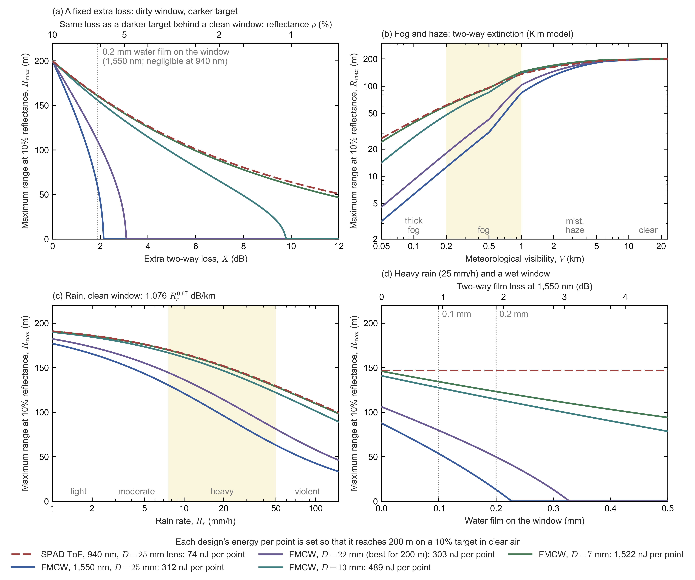

*Figure C0.4.* Maximum range on a 10% target for five designs that all reach 200 m in clear air. The designs are SPAD ToF at 940 nm with a 25 mm lens (red, dashed) and FMCW at 1,550 nm with collimated apertures of 25, 22 (the best for 200 m), 13 and 7 mm (cool colours). Each design's energy per point, given in the legend, is set to reach exactly 200 m.
- *(a)* Range versus an extra fixed two-way loss $X$ (Eq. \eqref{eq:range-with-extra-loss}). The top axis gives the equivalent target reflectance behind a clean window, and the dotted line marks a 0.2 mm water film at 1,550 nm. A range of zero means no detection at any range.
- *(b)* Range versus meteorological visibility, with fog extinction from the Kim model (Eq. \eqref{eq:fog-margin-range}). Fog is visibility below 1 km; the shaded band is 200 m to 1 km, and thick fog is 50–200 m (international visibility code; Kim et al. 2001).
- *(c)* Range versus rain rate, with a clean window (Carbonneau law, subsection 3.3). The rain classes are those of the Canadian observing manual MANOBS (light below 2.5 mm/h, moderate to 7.6, heavy, shaded, to 50, violent above); the World Meteorological Organization (WMO) notes that there is no agreed international definition.
- *(d)* Range in 25 mm/h rain versus the thickness of a water film on the window. The top axis gives the film's two-way loss at 1,550 nm; the film is neglected at 940 nm.

**Reading Figure C0.4** [E]:
- **Panel (a) is Eq. \eqref{eq:range-with-extra-loss}.** The ToF curve falls smoothly. Each FMCW curve drops to zero at its plateau margin $\mathcal{M}_0$: 2.1 dB for 25 mm, 3.1 dB for 22 mm and 9.7 dB for 13 mm.
- **Only the 7 mm design follows the ToF curve.** Its Rayleigh range (20 m) is far below 200 m, so over most of the range it is in its far field, where the fraction it collects falls as $1/R^2$ (its loss rises 20 dB per decade), as for direct detection.
- **Panel (b)** shows the same ordering in fog, whose extinction adds a loss that grows with range. ToF and the 7 mm FMCW design keep about 60 m at 200 m visibility.
- **Panels (c) and (d)** show rain costing every design range. The water film then adds a fixed loss for FMCW only, which pushes the large-aperture designs over their cliff.

**What this means for design** [E]:
- **A range specification at 10% in clear air says little about robustness.** The same "200 m at 10%" describes a ToF design with 26 dB to spare at 10 m and an FMCW design with 3 dB. A coherent sensor's datasheet should therefore also give its plateau margin, or equivalently the darkest target it detects at any range, $\rho_0/[1+(R_0/z_R)^2]$, together with its range at 5% and in 200 m fog.
- **Robustness costs a coherent design energy, not a ToF design.**
  - A 13 mm aperture (1.6× the best FMCW energy) gives 9.7 dB of plateau margin: 133 m on a 5% target, 48 m in 200 m fog, and 115 m in heavy rain behind a 0.2 mm film.
  - A 7 mm aperture matches ToF's tolerance of dark targets and fog. It needs 5.0× the best FMCW energy, i.e. 1.5 µJ per point, about twenty times ToF's 74 nJ.
  - The eye-safety limits at 1,550 nm leave room for that energy (§C4c), but the laser power and channel count of §C7b subsection 1 grow in proportion.
- **The wet window remains a 1,550 nm problem at any aperture,** because water absorbs there (§C4c). Window heating, water-repellent coatings and wiping matter more for FMCW than for 905 or 940 nm ToF.

#### 5.5 Dynamic range: strong returns, blooming and blinding

Subsection 5.4 asked how much light a design has to spare for weak returns. The same excess light appears as a burden for strong ones. A receiver must detect the weakest return it is specified for and still range the strongest one correctly. In between it must stay linear, or at least saturate gracefully, recover quickly and not spill light into neighbouring pixels. The span is sized below for the designs of subsection 5.4, followed by the failure modes documented for ToF receivers and by what coherent detection changes and what it does not. The problem is well studied. Vendors publish firmware fixes for it, China's national lidar standard tests one of its artefacts, and open benchmarks have found it in production sensors.

**How large the span is.** Let the dynamic range a design must handle be the ratio of the link loss of the strongest return that must still be ranged correctly, $\mathcal{L}_{\max}$, to the detection level:
$$\mathcal{D}=\frac{\mathcal{L}_{\max}}{\mathcal{L}_{\rm det}},\qquad 10\log_{10}\mathcal{D}=10\log_{10}\frac{\rho_{\max}}{\rho_0}+\mathcal{M}(R_{\min}) . \label{eq:dynamic-range}$$
Here $\rho_{\max}$ is the effective reflectance of the strongest target, $R_{\min}$ the shortest range at which it must be measured, $\rho_0=10\%$ the reflectance the design is sized for, and $\mathcal{M}$ the margin of Eq. \eqref{eq:link-margin}. The second form holds because both link losses are proportional to reflectance (Eqs. \eqref{eq:lambertian-link} and \eqref{eq:coherent-link}). In words: the span a receiver must handle is the reflectance span plus the short-range margin of subsection 5.4. The excess light that protects direct detection against dirt and fog is the same excess light its receiver must survive, and FMCW has little of either.

**Retroreflectors as effective reflectances.** A retroreflector is specified by its coefficient of retroreflection $R_A$ (cd·lx⁻¹·m⁻²): the intensity it returns per unit illuminance and per unit area, in units of sr⁻¹. A Lambertian surface of reflectance $\rho$ returns $\rho/\pi$ in the same units, so the retroreflector acts like a Lambertian surface of reflectance
$$\rho_{\rm eq}=\pi R_A . \label{eq:retroreflector-equivalent-reflectance}$$
- **Road-sign sheeting.** White sheeting of ASTM D4956 Types I and III has $R_A=70$ and 250 at 0.2° observation and −4° entrance, i.e. $\rho_{\rm eq}\approx220$ and 790 [P]. New sheeting of EN 12899-1 class RA2 measured 414–769, i.e. $\rho_{\rm eq}=$ 1,300–2,400 [I].
- **Licence plates.** ISO 7591 specifies 30–45 at 0.2° observation, with a maximum of 250 [P].
- **These are floors for lidar.** They are measured in visible light at observation angles of 0.2–0.33°, while a monostatic lidar looks back at nearly 0°, where retroreflection is stronger.
- **Measured at a lidar wavelength.** In the 1,310 nm coherent array of Settembrini et al. (2026), a retroreflector at 7.2 m returned 31.8 dB more than a 50% Lambertian target [P]. By Eq. \eqref{eq:retroreflector-equivalent-reflectance}, treating the retroreflector as depolarizing like the reference target, that is $\rho_{\rm eq}=0.5\times10^{3.18}\approx760$, i.e. $R_A=760/\pi\approx240$, close to Type III sheeting. If it preserves polarization, it appears up to 3 dB stronger in a single-polarization coherent receiver (see "Polarization" below the table), and $R_A$ may then be as low as ≈120.
- **Overall span.** Waymo puts real scenes at more than 50 dB of reflectance: a retroreflector can exceed 1,000× a Lambertian target, and a wet dark car can fall below 1% (Piggott et al. 2025) [P].
- **Value used below.** As in §C10.2, item 4, a bright sign is taken as $R_A=500$, i.e. $\rho_{\rm eq}=1{,}571$, 42.0 dB above a 10% target.

The table evaluates Eq. \eqref{eq:dynamic-range} for four of the designs of subsection 5.4, in dB above each design's weakest detectable return.

| Strongest return, relative to the weakest detectable return | SPAD ToF, 25 mm lens | FMCW, 22 mm (best for 200 m) | FMCW, 13 mm | FMCW, 7 mm |
|---|---|---|---|---|
| White 90% target at 1 m | 55.7 dB | 12.6 dB | 19.3 dB | 29.6 dB |
| White 90% target at 0.3 m | 66.2 dB | 12.6 dB | 19.3 dB | 29.6 dB |
| Retroreflective sign ($R_A=500$) at 30 m | 58.6 dB | 44.9 dB | 51.0 dB | 56.9 dB |
| Retroreflective sign at 5 m | 74.1 dB | 45.0 dB | 51.7 dB | 61.8 dB |
| Retroreflective sign at 2 m | 82.1 dB | 45.0 dB | 51.7 dB | 62.0 dB |

*How the numbers are derived* [E]: each design of subsection 5.4 is sized to reach exactly 200 m on a 10% target, so its detection level equals its link loss there, and every entry is Eq. \eqref{eq:dynamic-range} with clear-air loss included.
- **ToF, sign at 5 m:** $10\log_{10}(1{,}571/0.1)=42.0$ dB, plus the margin $20\log_{10}(200/5)=32.0$ dB, plus 0.15 dB of clear-air loss at 200 m, gives 74.1 dB.
- **Best FMCW, sign at 5 m:** 42.0 dB plus $10\log_{10}[2/(1+(5/200)^2)]=3.0$ dB, i.e. 45.0 dB. Inside the Rayleigh range the value hardly depends on range.
- **Polarization.** The coherent entries treat the sign like a depolarizing target. A retroreflector largely preserves polarization, so a single-polarization receiver, or the co-polarized looks of the four-look receiver of subsection 4.3, see it up to 3 dB stronger than the table. Summed over both polarizations, the table holds.

**Optical span and electrical span.** What the electronics must handle depends on how the receiver converts light into current:
$$20\log_{10}\frac{i_{\max}}{i_{\min}}=\begin{cases}2\times10\log_{10}\mathcal{D} & \text{direct detection, } i\propto P,\\[2pt] 10\log_{10}\mathcal{D} & \text{coherent detection, } i\propto\sqrt{P\,P_{\rm LO}} .\end{cases} \label{eq:electrical-span}$$
- **Direct detection.** In a linear (APD or PIN) receiver, a photocurrent proportional to optical power doubles the dB span: facing the ToF design's 74 dB for a sign at 5 m, such a receiver would see 148 dB at its amplifier input. The SPAD design has no linear amplifier; its limit is the count ceiling described below.
- **Coherent detection.** The beat current is proportional to the optical field, the square root of power, so the span keeps its optical value (Piggott et al. 2025) [P]. The best FMCW design's 45 dB needs about 7.5 bits of an analog-to-digital converter (ADC) at 6 dB per bit.
- **Photons, ToF.** Per shot the SPAD design emits 7.4 nJ (its 74 nJ over ten shots), i.e. $7.4\times10^{-9}/2.11\times10^{-19}=3.5\times10^{10}$ photons. The sign at 5 m returns a fraction $\rho_{\rm eq}A_{\rm rx}/(\pi R^2)=1{,}571\times4.91\times10^{-4}/(\pi\times5^2)=9.8\times10^{-3}$ of them to the lens, about $3.4\times10^{8}$ photons, of which $\eta=0.164$, i.e. $5.6\times10^{7}$, are detected. The weakest return the design must see gives $n_{\rm req}/N_{\rm shots}=21.7/10=2.2$ detected photons per shot [E].
- **Photons, FMCW.** For 30 mW transmitted, the same sign sends about 49 nW into the best FMCW design's mode, against a local oscillator of about a milliwatt, so its photodiodes stay linear [E].

**What ToF receivers can span.**
- **SPADs:** a SPAD fires at most once per dead time. Sony's automotive SPAD has a 6 ns dead time and 3×3 SPADs per macro-pixel, so a macro-pixel registers at most nine counts from one echo [P; §C6].
- **Linear amplifiers:**
  - TI's LMH32401 amplifier, at its 20 kΩ gain, has a 1.5 V output swing, so it is linear up to about 75 µA of input current, against 49 nA of root-mean-square (rms) noise [P].
    - That is a linear range of $20\log_{10}(75\ \mu{\rm A}/49\ {\rm nA})=64$ dB in current, which by Eq. \eqref{eq:electrical-span} is only about 32 dB of optical span for a direct detector.
    - Beyond it, a clamp limits the input to 100 mA [P].
  - Maxim's MAX40660 recovers from a 100 mA overload in 2 ns [P].
  - Which lidars use such chips, and why designs with many channels integrate the front end instead, is covered in §C4b (receive front ends).
- **The span of the returns is larger still.** Kurtti et al. put the span of automotive return amplitudes at up to 1:10⁵ in photocurrent, with inputs up to about 100 mA [I].
- ToF receivers are therefore designed to saturate gracefully rather than to stay linear over the full span.

**How strong returns fail in ToF lidars, and how it is tested.** Range walk, blooming, ghosting and blinding in ToF receivers, and the standards, open benchmarks and vendor fixes that address them, are surveyed in §C4b. The fixes there include one built into the receiver architecture: two-dimensional addressing, in which only the pixels facing the emitter block that is firing are counting (Fortsense, a Chinese SPAD-SoC maker).

**What coherent detection changes.**
- **A smaller span, which field detection does not double.** From the table and Eq. \eqref{eq:electrical-span}, the best FMCW design handles 45 dB, optically and electrically, where a linear receiver facing the ToF design's 74 dB would see 148 dB at its amplifier.
- **The time-domain signal stays small** [E].
  - The weakest detectable return carries 15 photoelectrons per look in each ramp (the 120 of subsection 4.3 spread over four looks and two ramps), a per-bin SNR of $10\log_{10}15=11.8$ dB.
  - The sign, 45 dB stronger, then sits about 57 dB above the noise in its FFT bin.
  - An FFT over one 5 µs ramp sampled at ≈1.23 GS/s (§C7a) has about 6,100 samples and gains $10\log_{10}6{,}100\approx38$ dB, so before the FFT the sign's tone is only about 19 dB above the noise, which does not stress the ADC.
- **Spatial filtering** [E].
  - Stray light is detected only if it couples into the LO's single mode.
  - That mode accepts an étendue of about $\lambda^2=2.40\times10^{-12}$ m² sr, against $A_{\rm rx}\Omega_{\rm pix}=4.91\times10^{-4}\ {\rm m^2}\times7.62\times10^{-7}\ {\rm sr}=3.74\times10^{-10}$ m² sr for the 25 mm lens with the model's 0.05° × 0.05° macro-pixel (subsection 4.2).
  - For diffuse glare this suppresses coupling by about $2.40\times10^{-12}/3.74\times10^{-10}=6.4\times10^{-3}$, i.e. −22 dB.
- **Evidence.**
  - Settembrini et al. (2026) saw no noticeable blooming from a retroreflector beside a 5% target at 7.2 m, although the retroreflector's measured SNR exceeded that target's by 37.7 dB in the same single acquisition [P, Extended Data Table 2; E: $10\log_{10}(113{,}715/19.4)=37.7$ dB]. The 31.8 dB of "Measured at a lidar wavelength" comes from the same row ($10\log_{10}(113{,}715/74.7)=31.8$ dB against the 50% target). The two differ by 5.9 dB rather than the 10 dB of the reflectance ratio because the paper averages SNR only over returns that gave the correct distance, which favours the strongest speckles of the 5% target, detected in only 17% of acquisitions [P, Methods; E]. Scaled by reflectance from the 50% target, the retroreflector is ≈42 dB above a 5% Lambertian return [E: $31.8+10.0=41.8$ dB].
  - In their reply to the reviewers, the same authors measured a 52 cm wide retroreflective sheet at about 10 m as 51–52.8 cm wide with three different lenses, i.e. without measurable widening [P, Peer Review File]. Both Pointcloud results are the developers' own.
  - Aeva describes its sensor as "inherently free from retroreflector blooming and ghosting" (2023); Mobileye, SiLC and Voyant make similar claims [P]. No independent test of these claims was found.
- **What does not go away:**
  - *Beam sidelobes.* A retroreflector seen through the transmit beam's own angular sidelobes returns into the same mode, weighted by the two-way pattern. Sidelobes therefore matter for both architectures, as in the phased-array case of §C10.2, item 4.
  - *Clipping.* Strong beats that clip the ADC create harmonics and ghost tones; an Aeva patent uses frequency-domain gain control against them [P].
  - *Window sidelobes.* The FFT sidelobes of a strong beat can mask a weak one at a nearby beat frequency.
    - Harris (1978) tabulates highest sidelobes of −13 dB for a rectangular window, −43 dB for Hamming and −67 to −92 dB for Blackman–Harris windows, which have wider main lobes [I].
    - Waymo uses a Hann window (about −31 dB), which cost 1.8 dB of SNR (a factor of 0.667) in its measurement [P].
  - *Laser phase noise.* The skirt of the strong zero-range reflection from the window sets the minimum range of a monostatic FMCW lidar (Piggott et al. 2025) [P].
  - *Pairing ghosts.* With several targets in one beam, pairing up- and down-chirp peaks can create ghost points. Waymo proposes three or more chirps, or phase codes [P].

**What this means** [E]:
- **ToF.** Dynamic range is the flip side of its robust margin. The receiver cannot stay linear over 56–82 dB of optical span (111–164 dB electrical in a linear receiver), so products rely on graceful saturation, walk correction, glare suppression and filtering. Standards now test some of the resulting artefacts.
- **FMCW.**
  - For a retroreflective sign at 2–5 m, the best design's optical span is 29–37 dB smaller than the ToF design's (45 against 74–82 dB). Electrically the gap is larger still (45 against 148–164 dB in a linear receiver), because field detection does not double the span.
  - Its remaining strong-return problems are spectral (sidelobes, harmonics, phase noise, pairing), handled by windowing and gain control.
  - The robust small-aperture designs of subsection 5.4 give back part of this advantage (62 dB for 7 mm), because beyond their short Rayleigh range they collect like direct detection.

### 6. Testing the model

A model that predicts ranges from first principles is only as good as its agreement with measured systems. Subsection 6.1 tests its link loss, its detection statistics and its assumed efficiencies against published coherent and direct-detection sensors; subsection 6.2 lists what the model leaves out.

#### 6.1 Benchmark against published systems

The model of subsections 3.1–5.1 predicts how much light a design collects and how much it needs. Here those predictions are tested against published systems that state their power, their beam or aperture, and a measured range or SNR. It checks three things:
- **the geometry:** the flat near field and the far-field fall;
- **the absolute level:** photons collected against photons needed;
- **the efficiencies assumed in subsection 5.1.**

Coherent systems publish enough to test all three. ToF systems rarely publish their receive aperture, so for them the test runs backwards: it asks what aperture and efficiency the model needs to reproduce the published range, and whether those are plausible.

**Coherent (FMCW) systems.**

| System | Published inputs | Model | Published result | Agreement |
|---|---|---|---|---|
| Waymo design point (Piggott et al. 2025, Table 1) | 1,550 nm; collimated beam, $w_0=10$ mm; 0.52 µJ per point over two chirps; 5% target at 250 m; lossless optics, QE 0.9; four speckle looks | Link loss 106.2 dB (Eqs. \eqref{eq:coherent-link}–\eqref{eq:gaussian-beam-radius}); 49 photons per chirp (44 photoelectrons at QE 0.9); $P_D=0.895$ at $10^{-6}$ per bin with four looks (Eq. \eqref{eq:pd-speckle-averaged}) | 106.1 dB; 50 photons; $P_D=0.9$ | 0.1 dB |
| Waymo lab validation (same paper, App. A) | 1,550 nm; 1 GHz chirps of 8.3 µs; diffuse 84% target at 8 and 15 m; measured chain 0.403 (optics) × 0.549 (circulator and coupler) × 0.760 (QE) × 0.667 (Hann window) = 0.112 | Eq. \eqref{eq:coherent-link} with the measured efficiency; flat inside $z_R$ | Matches their link equation, independent of range | Shape and level ✓; efficiency 0.112, not 0.25 |
| Pointcloud array (Settembrini et al. 2026) | 1,310 nm; 178 µW per pixel; two 32 µs chirps per point (11.4 nJ); waist 1.31 mm at 11.1 m, measured with a camera; $\eta_p=0.23$; 0.95 A/W; noise 5.6 dB above the shot-noise limit | SNR 57.6 (in their convention, SNR = 2N) on the 50% target at 7.2 m | 74.7. SNR against distance on cardboard (4–22 m) follows their Gaussian-mode model to 17 m and exceeds it by 1–3 dB beyond | About 1 dB; shape ✓ |
| indie / MicroTech whitepaper (2023) | 1,550 nm; 200 mW; 12 mm aperture; $z_R\approx70$ m | Within 0.4 dB of the plateau to 20 m, then falls by 1.8, 4.8 and 9.6 dB at 50, 100 and 200 m | Flat from 1 to 20 m, then −3.1, −8.1 and −16.1 dB | Plateau ✓; falls 1.3–6.5 dB faster at 50–200 m |
| Wang et al. 2025 (RoboSense and the Southern University of Science and Technology, SUSTech) | 1,550 nm; laser of 100 kHz linewidth; 7 mm waist diameter (56.8 mm at 200 m); 1.5 m board of 10%; four dual-polarization receivers; SNR ≥ 10 dB to 200 m; transmit power not published | 20 → 200 m: −16.0 dB of beam spreading and −3.3 dB of coherence loss, −19.3 dB in all | −15 to −15.5 dB | Falls 3.8–4.3 dB more gently; matches a waist radius of 5 mm |

*How the numbers are derived* [E]:
- **Waymo design point.** $z_R=\pi(0.01)^2/1.55\times10^{-6}=203$ m, so $w(250)^2=2.52\,w_0^2$. Eq. \eqref{eq:coherent-link} with $t^2=1$ and $\rho=0.05$ then gives $0.05\times(1.55\times10^{-6})^2/(2\pi^2\times10^{-4}\times2.52)=2.4\times10^{-11}$, i.e. 106.2 dB. That is $0.52\ \mu{\rm J}/1.28\times10^{-19}\ {\rm J}\times2.4\times10^{-11}=98$ photons per point, and at QE 0.9 about 44 photoelectrons per chirp: the ≈45 that Eq. \eqref{eq:pd-speckle-averaged} gives for $P_D=0.9$ with four looks at $10^{-6}$ per bin.
- **Pointcloud array.** The camera-measured beam has $w(7.2\ {\rm m})=1.31\ {\rm mm}\times\sqrt{1+(3.9/4.1)^2}=1.80$ mm.
  - With their stated efficiency $\eta_p=0.23$ as $\eta$, no truncation ($t=1$) and $\rho=0.5$, Eq. \eqref{eq:coherent-link} gives the received fraction $\eta\mathcal{L}_{\rm coh}=0.23\times0.5\times(1.31\ \mu{\rm m})^2/(2\pi^2\times(1.80\ {\rm mm})^2)=3.1\times10^{-9}$ for the 50% target.
  - In one 32 µs chirp that is $0.95\ {\rm A/W}\times178\ \mu{\rm W}\times3.1\times10^{-9}\times32\ \mu{\rm s}/q=104$ photoelectrons, where $q$ is the elementary charge.
  - The measured amplifier noise leaves 28% of that SNR. Their $\kappa=0.62$ puts the total noise at $1+1/\kappa^2=3.6$ times the shot noise (the 5.6 dB above the shot-noise limit in the table), so the SNR keeps $1/(1+1/\kappa^2)=0.28$ of its shot-noise value: 28.8, or 57.6 in their convention, against 74.7 measured.
  - Their own form of the link equation has no polarization factor of ½, so it predicts twice as much; the data lie between the two.
- **Wang.** $z_R=\pi(3.5\ {\rm mm})^2/1.55\ \mu{\rm m}=24.8$ m.
  - Beam spreading from 20 to 200 m costs $10\log_{10}[(1+(200/24.8)^2)/(1+(20/24.8)^2)]=16.0$ dB.
  - The coherence factor $e^{-4\pi\Delta\nu R/c}$ in their own SNR formula, the same as $e^{-2\pi\Delta\nu\tau}$ of §C7b, adds 3.3 dB for $\Delta\nu=100$ kHz.
  - The measured fall of 15–15.5 dB fits a waist radius of 5 mm ($z_R\approx50$ m), not the 3.5 mm radius (7 mm diameter) stated; the paper does not allow the cause to be identified.
  - With transmit power unpublished, only an estimate is possible. Their 1–2 mW local oscillator makes the receiver shot-noise limited, so its SNR is the number of signal photoelectrons per measurement, $\eta P_{\rm tx}T\,\mathcal{L}_{\rm coh}\,e^{-4\pi\Delta\nu R/c}/E_{\rm ph}$, with $T$ the integration time. At 200 m, Eq. \eqref{eq:coherent-link} with $t=1$ gives $\mathcal{L}_{\rm coh}=0.1\times(1.55\ \mu{\rm m})^2/(2\pi^2\times(28.4\ {\rm mm})^2)=1.5\times10^{-11}$, and the coherence factor is $e^{-0.84}=0.43$. An SNR of 10 then needs $\eta P_{\rm tx}T=10\times1.28\times10^{-19}/(1.5\times10^{-11}\times0.43)\approx2\times10^{-7}$ J. The paper's triangular modulation has a period of 36 µs and a sweep of 4.1 GHz, and its beat frequency $(2R/c)(2B/T)$ puts each ramp at half the period [P], so one measurement integrates $T=18$ µs. Then $\eta P_{\rm tx}=2\times10^{-7}\ {\rm J}/18\ \mu{\rm s}\approx11$ mW, i.e. about 44 mW transmitted at the report's $\eta=0.25$, or 22 mW if both ramps of a period were integrated [E].

**What the coherent comparison shows.**
- **Geometry.** The flat near field and the fall beyond $z_R$ appear in every measured data set. The distance of the 3 dB fall-off scales with the square of the waist, as Pointcloud's simulations with camera-measured waists confirm. At 200 m the measured fall lies within ±3–6 dB of the nominal-beam model: steeper for indie, gentler for Wang.
- **Detection statistics.** Waymo's design needs the same ≈45 photoelectrons for $P_D=0.9$ with four looks that Eq. \eqref{eq:pd-speckle-averaged} gives at $10^{-6}$ per bin. Pointcloud's measured detection probability against SNR follows the single-speckle law $\exp[-x_{\rm th}/(1+{\rm SNR})]$ of Eq. \eqref{eq:pd-speckle-single-look}.
- **Efficiency.** It is the weakest input: the 0.25 of subsection 5.1 lies above both measured chains (subsection 3.1).

**Direct-detection ToF systems.** Eqs. \eqref{eq:lambertian-link} and \eqref{eq:detection-level} with $\bar n=n_{\rm req}$ give the product of efficiency and receive area that a published range requires:
$$\eta A_{\rm rx}=\frac{n_{\rm req}\,E_{\rm ph}\,\pi R^2}{\rho\,E_{\rm pt}} . \label{eq:benchmark-efficiency-area}$$
Here $E_{\rm pt}$ is the energy per point, $R$ the published range on a target of reflectance $\rho$, and $n_{\rm req}=21.7$ the model's bright-sun count (subsection 5.1). The model's own receiver, 0.164 × a 25 mm lens, has $\eta A_{\rm rx}=0.164\times4.91\ {\rm cm^2}=0.81$ cm².

| System | Published | Energy per point | Required $\eta A_{\rm rx}$ | Implied receiver |
|---|---|---|---|---|
| Sony, Kumagai et al. (International Solid-State Circuits Conference, ISSCC 2021) | 905 nm, 45 W × 4.5 ns pulses every 3.04 µs, each lighting a vertical line of 63 macro-pixels; 168×63 points at 20 fps; PDE 22%, 6 ns dead time; 150 m on 10% at 117 klx | ≈0.29 µJ (≈89 shots per point) | 0.12 cm² | 10.5–12.4 mm lens at optics 0.7–0.5: about f/1 for the 11.5 mm focal length implied by its 0.15° pixel ✓ |
| Toshiba, Yoshioka et al. (ISSCC 2018) | 905 nm, 50 mW, 240×96 points at 10 fps; 200 m on 10% at 70 klx (92.7% success); accumulates up to 9 neighbouring pixels | 217 nJ | 0.28 cm² (0.031 cm² with 9-pixel accumulation) | 19–27 mm at $\eta=$ 0.10–0.05 ✓ |
| Toyota, Niclass et al. (ISSCC 2013; numbers from Toshiba's comparison table) | 870 nm, 21 mW, 202×96 points at 10 fps; 100 m on 9% at 70 klx | 108 nJ | 0.16 cm² | 14–20 mm at $\eta=$ 0.10–0.05 ✓ |
| Panasonic flash, Hirose et al. (*Sensors* 2018) | 940 nm, four 300 W sources, ≈10 ns pulses spread over 688×384 pixels of 11.2 µm; f/1.4 lens, 10° field (20° in its photon estimate); 250 m at night | 45 pJ per pixel per pulse | — | The model gives 0.13 (20° field) to 0.53 (10° field) photons per pixel per pulse at 100 m on 10%. The paper's own estimate, for an aperture it does not state, is ≈1.2 there, 2–9× more. Both lie below one photon per pulse at 250 m, which the sensor bridges by accumulating pulses |

*How the numbers are derived* [E]:
- **Sony's energy per point is read from its timing diagram, which states no shots per point.**
  - The laser fires every 3.04 µs during 721.76 µs of each 761.6 µs slot, i.e. 237 shots per slot.
  - The mirror sweeps the 168 columns once per slot, with 63 slots per frame, so each column receives $237/168\times63\approx89$ shots.
  - Each 202 nJ pulse is shared by 63 macro-pixels, so a point receives $89\times202/63\approx285$ nJ.
- **Sony's lens.** Eq. \eqref{eq:benchmark-efficiency-area} then asks for $21.7\times2.20\times10^{-19}\times\pi\times150^2/(0.1\times2.85\times10^{-7})=1.18\times10^{-5}$ m². With $\eta=$ 0.5–0.7 (optics) × 0.22 (PDE) × 0.885 (live fraction, subsection 4.2), i.e. 0.097–0.136, that is a lens of 10.5–12.4 mm ($D=2\sqrt{A_{\rm rx}/\pi}$ with $A_{\rm rx}=1.18\times10^{-5}\ {\rm m^2}/\eta$).
- **Toshiba and Toyota** publish laser power but not optics or PDE, so a range of $\eta$ is shown. Eq. \eqref{eq:benchmark-efficiency-area} gives $21.7\times2.20\times10^{-19}\times\pi\times200^2/(0.1\times2.17\times10^{-7})=2.76\times10^{-5}$ m² for Toshiba and $21.7\times2.28\times10^{-19}\times\pi\times100^2/(0.09\times1.08\times10^{-7})=1.60\times10^{-5}$ m² for Toyota. Their $\eta A_{\rm rx}$ is 3–5× below the model's 0.81 cm² ($0.81/0.28=2.9$ and $0.81/0.16=5.1$), consistent with the lower PDE of 2013–2018 detectors.
- **Panasonic's photon count.** Its four sources give $4\times300\ {\rm W}\times10\ {\rm ns}=12\ \mu{\rm J}$ per pulse, which, spread evenly over $688\times384=2.64\times10^{5}$ pixels (illumination filling the camera's field), is $E_{\rm px}=45$ pJ per pixel. Eq. \eqref{eq:benchmark-efficiency-area} solved for the count, with $\eta=1$ because the paper counts photons arriving at a pixel through the lens, before the PDE, gives $\bar n=\rho E_{\rm px}A_{\rm rx}/(\pi R^2E_{\rm ph})$. The aperture of the f/1.4 lens is $D=f/1.4$, and its focal length $f$ follows from the field across the 7.71 mm width of the array ($688\times11.2\ \mu{\rm m}$): $f=3.85\ {\rm mm}/\tan10^\circ=21.9$ mm for a 20° field and $3.85\ {\rm mm}/\tan5^\circ=44.0$ mm for 10°, i.e. $D=15.6$ and 31.5 mm. At 100 m on 10%, $\bar n=0.1\times4.54\times10^{-11}\ {\rm J}\times1.91\times10^{-4}\ {\rm m^2}/(\pi\times(100\ {\rm m})^2\times2.11\times10^{-19}\ {\rm J})=0.13$ for the 20° field, and 0.53 with the 31.5 mm lens ($A_{\rm rx}=7.77\times10^{-4}$ m²). The paper's Figure 2, for 1.2 kW, 10 ns, a 20° field and a 10% target, shows ≈1.2 photons at 100 m and crosses one near 110 m. It gives no aperture or losses for that curve, which lies 9× above the model's 0.13 for the same field [P, Hirose et al. 2018, §2 and Fig. 2; E].

**Products: what their claims imply.** None of the automotive products reviewed here publishes both its laser energy and its receive aperture, so the model can only say what a stated range requires [E]. For photon-counting scanners the inputs are the model's $n_{\rm req}=21.7$ and $\eta=0.164$ (a PDE of 37%), with 20–30 mm lenses; a lower PDE raises the energy in proportion.
- **Ouster OS2-128 Rev7** (SPAD receiver): 865 nm; 200 m on 10% at more than 90% detection probability in 100 klx, in its 1024 × 10 Hz mode (1.31 Mpts/s). It needs 54–122 nJ per point, i.e. 0.07–0.16 W average optical power [E: Eq. \eqref{eq:benchmark-efficiency-area} solved for the energy, $E_{\rm pt}=21.7\times2.30\times10^{-19}\times\pi\times200^2/(0.1\times0.164\times A_{\rm rx})$, with $A_{\rm rx}=7.07$ cm² (30 mm) to 3.14 cm² (20 mm), times 1.31 Mpts/s].
- **Hesai AT128** (onsemi SiPM receiver, whose PDE is not public and is likely below 37% [E]): 905 nm; 210 m on 10%; 1.54 Mpts/s. At the model's efficiency it needs 57–128 nJ, i.e. 0.09–0.20 W at 1.54 Mpts/s, and proportionally more at a lower PDE [E: as for Ouster, with $E_{\rm ph}=2.20\times10^{-19}$ J and $R=210$ m].
- **Analog Photonics FS-4S** (FMCW phased array; datasheet quoted in Pointcloud's peer-review file). It claims 200 m on 10% at 90 kpts/s in its region-of-interest mode, and 80 m at 400 kpts/s in its base mode, with a beam of at most 0.04° × 0.02° full width at half maximum (FWHM).
  - That beam means waists of only 0.83 × 1.66 mm, so 200 m lies deep in the far field, with a link loss of 117.6 dB.
  - It then needs 9 µJ per point at $\eta=0.25$, or 20 µJ at 0.112, i.e. 0.8–1.8 W of optical power.
  - In the far field range grows as the square root of energy per point. Its 4.4× more energy per point in the region-of-interest mode then predicts $80\times\sqrt{4.4}=170$ m, against the 200 m claimed.
- **Reflectance scaling in sunlight.**
  - Ouster quotes 200 m on 10% and 350 m on 80%, a ratio of 1.75. That fits $R\propto\rho^{1/4}$ (1.68), not $\rho^{1/2}$ (2.83).
  - In full sun the target's own sunlit radiance is the background, so a brighter target also raises the background, and range follows the background-limited law of subsection 5.2.
  - The model of subsection 5.1 holds the background fixed, and so scales as $\rho^{1/2}$: it is optimistic for bright targets in full sun and pessimistic for dark ones.

**What the benchmark says** [E]:
- **The coherent link equation holds.** Eq. \eqref{eq:coherent-link}, with its flat near field, reproduces every coherent system whose beam and efficiency are published to within about 1–3 dB. At 200 m the far-field fall matches the nominal beam to within ±3–6 dB.
- **Efficiency is the weak input.** Measured coherent chains reach 0.057–0.17 against the 0.25 used in subsection 5.1 (see subsection 3.1).
- **ToF is consistent but not tested absolutely.** The model's figures match every published scanning research sensor, given f/1-class lenses of 10–30 mm and overall receive efficiencies $\eta$ of 0.05–0.14 (Sony's PDE is 22%; Toshiba and Toyota publish none). Panasonic's flash sensor is the exception: its own photon estimate is 2–9× above the model's, for an aperture it does not state. Because products publish neither laser energy nor aperture, the absolute ToF level cannot be tested against them.
- **Product specifications imply unpublished optical powers:**
  - about 0.07–0.2 W average optical power for 865–905 nm photon-counting scanners;
  - 0.8–1.8 W for a small-aperture FMCW phased array at 200 m.
- **Reflectance scaling.** Ouster's claims suggest that, for SPAD sensors in full sun, range scales with reflectance closer to $\rho^{1/4}$ than the model's $\rho^{1/2}$.

#### 6.2 What the model leaves out

- **Small objects.** An object smaller than the footprint intercepts a fraction of the light that falls as $1/R^2$, so the fraction it returns falls as $1/R^4$ (its loss rises 40 dB per decade) and range grows only as $E_{\rm pt}^{1/4}$ (subsection 3.1; §E11.3, Eq. \eqref{eq:range-energy-target-size}). A narrow coherent beam is filled by smaller objects, but it must hit them (§C10.3a, item 3; §C10.3b, Result 4). At 200–300 m a 15–30 cm object gets at most about one point on a 0.1° grid, whatever the receiver (§E12.3, item 5).
- **Background-limited direct detection.** When sunlight dominates, range scales as $A_{\rm rx}^{1/4}$ rather than $A_{\rm rx}^{1/2}$ (subsection 5.2).
- **Eye safety** is not part of the model's equations; it caps the energy per point from outside (subsection 5.3).
- **Focusing.** Focusing a coherent beam at a set range $R_f$ gives the far-field level $\rho t^2w_0^2/(2R_f^2)$ there, restoring $D^2$ scaling at that range only. A focus at a short range would also restore short-range margin (subsection 5.4), but only by giving up the long range: one beam cannot be focused at both at once.
- **Turbulence and misalignment** lower $\mathcal{L}_{\rm coh}$ further (Frehlich and Kavaya 1991) [I]. **Non-Lambertian targets** change it either way: glossy paint and retroreflectors return far more or far less toward the sensor, depending on angle (the assumptions of subsection 3).
- **Weather beyond extinction.** Subsection 5.4 treats fog and rain as extinction, plus single-scattering backscatter for fog. It leaves out multiple scattering, snow, spray and splash (subsection 3.3), and it treats a wet window as a uniform film. Real droplets and smears on a window also scatter light out of the beam at every wavelength and distort the wavefront, which lowers the coherent receiver's mode overlap further.

### Where these relations are used

| Relation (subsection) | Applied in |
|---|---|
| Range from delay (1.1) | throughout |
| Two-target range resolution (1.1) | §C3b |
| Histogram quantization (1.1) | §C5, §C5a |
| Single-target precision (1.1) | §C5a (measured precisions); subsection 1.2 |
| Unambiguous range and point rate (1.1) | §C4d |
| FMCW beat frequency, range resolution, Doppler shift and its separation from range (1.3) | §C7, §C7a |
| FMCW range precision, velocity resolution, receiver bandwidth and chirp linearity (1.3) | §C7a |
| Coherence and the coherent share of the beat (1.3) | §C7, §C7b |
| FMCW dwell, point rate and per-channel throughput (1.3) | §C7, §C7a, §C7b |
| Shot-noise-limited SNR (1.3) | §C7, §C10.3a |
| Scanning walk-off and scanner-induced Doppler (1.3) | §C4d, §C7, §C10.3a |
| Beam divergence (2.1) | §C7, §C10 |
| Pixel field of view and aperture (2.1) | §C6 |
| Footprint and point spacing at range (2.1) | §E11.3, §E12 (Eqs. \eqref{eq:points-on-car}, \eqref{eq:radar-cross-range-cell}) |
| Points per frame (2.1) | §C3b (Eq. \eqref{eq:spec-triplet}) |
| Mechanical sweep rate (2.1) | §C4d (Eq. \eqref{eq:scanner-sweep-rate}) |
| Étendue (2.1) | §C6, §C10.3a |
| Photon budget of one pulse, Eq. \eqref{eq:photons-per-pulse} (3.1) | §C6 (Eq. \eqref{eq:spad-signal-per-point}) |
| Coherent link equation, Eq. \eqref{eq:coherent-link} (3.2) | §C7b subsection 1(b), §C10.3b and the report's scripts |
| Solar background per pixel, Eq. \eqref{eq:solar-background-rate} (4.2) | §C4c, §C6 (Eq. \eqref{eq:macro-pixel-background-rate}) |
| Detection efficiency, dead time, pile-up, afterpulsing and crosstalk (4.1, 4.2) | §C4b, §C5a, §C6 |

Sources: https://doi.org/10.1364/AO.5.001588 (Siegman 1966) ; https://doi.org/10.1364/AO.18.001390 (Rye 1979) ; https://doi.org/10.1364/AO.30.005325 (Frehlich and Kavaya 1991) ; https://arxiv.org/pdf/2502.09736 (Piggott et al. 2025) ; https://doi.org/10.1117/12.417512 (Kim, McArthur and Korevaar 2001, fog model and visibility classes) ; https://journals.ametsoc.org/view/journals/atot/21/5/1520-0426_2004_021_0777_atfaoc_2_0_co_2.xml (O'Connor, Illingworth and Hogan 2004, lidar ratio of water clouds) ; https://www.baranidesign.com/faq-articles/2020/1/19/rain-rate-intensity-classification (MANOBS rain-rate classes) ; https://community.wmo.int/site/knowledge-hub/programmes-and-initiatives/aviation/aviation-hazards-precipitation (WMO: no agreed international definition of rain intensity) ; https://www.nature.com/articles/s41586-026-10183-6 (Settembrini et al. 2026, coherent array, calibrated targets and retroreflector) ; https://arxiv.org/abs/2605.24753 (Gump et al., CVPR 2026, glare in SPAD lidar) ; https://arxiv.org/html/2512.05932v1 (Dudzik et al. 2025, blooming simulation) ; https://ouster.com/insights/blog/new-lidar-firmware-v112 (Ouster firmware 1.12, retroreflector range bias and blooming) ; https://ouster.com/insights/blog/improved-3-1-firmware (Ouster firmware 3.1) ; https://patents.google.com/patent/US20250189670A1/en (Ouster, pile-up and matched filters) ; https://www.imeko.org/publications/tc4-2014/IMEKO-TC4-2014-292.pdf (Kurtti et al. 2014, walk and receiver linearity) ; https://www.semanticscholar.org/paper/A-Wide-Dynamic-Range-CMOS-Laser-Radar-Receiver-With-Kurtti-Nissinen/cfae82db5979654436ddef2520d36a17fec57dc3 (Kurtti et al. 2017, walk compensation) ; https://www.ti.com/product/LMH32401 (TI LMH32401 amplifier) ; https://www.analog.com/media/en/technical-documentation/data-sheets/max40660-max40661.pdf (MAX40660 amplifier) ; https://www.jstage.jst.go.jp/article/jsaprev/2023/0/2023_230402/_pdf (Sony automotive SPAD) ; https://patents.google.com/patent/US7969558B2/en (Velodyne, one laser at a time) ; https://patents.google.com/patent/US11536845B2/en (Waymo, window ghosts) ; https://patents.google.com/patent/US12560716B2/en (SiPM blind zone after the window reflection) ; https://patents.google.com/patent/US12013497B2/en (Aeva, frequency-domain gain control) ; https://www.normsplash.com/Samples/ASTM/112464169/ASTM-D4956-19-en.pdf (ASTM D4956 sheeting) ; https://2019.tae-conference.cz/proceeding/TAE2019-047-Mariia-Khrapova.pdf (measured EN 12899-1 sheeting) ; https://cdn.standards.iteh.ai/samples/14380/8625afeb8e7a4801be0e685baeac6ac7/ISO-7591-1982.pdf (ISO 7591 licence plates) ; https://www.hesaitech.com/cn/news/1298 (GB/T 45500-2025 test items) ; https://user.guancha.cn/main/content?id=1435473 (GB/T 45500-2025, secondary summary) ; https://iss.rs/en/project/show/iso:proj:84347 (ISO/FDIS 13228) ; https://www.persival.de/post/quantifying-lidar-sensor-performance-through-din-sae-spec-91471-testing-methods (DIN SAE SPEC 91471) ; https://www.spiedigitallibrary.org/journals/optical-engineering/volume-62/issue-3/031211/Toward-open-benchmark-tests-for-automotive-lidars-year-1/10.1117/1.OE.62.3.031211.full (SPIE/SAE benchmark, year 1) ; https://www.spiedigitallibrary.org/journals/optical-engineering/volume-63/issue-8/085102/Toward-standardized-testing-of-automotive-lidars-year-two-results/10.1117/1.OE.63.8.085102.full (SPIE/SAE benchmark, year 2) ; https://tsapps.nist.gov/publication/get_pdf.cfm?pub_id=956735 (NIST 2024) ; https://www.robosense.ai/en/tech-show-55 (RoboSense M1) ; https://www.prnewswire.com/news-releases/hesai-showcases-next-gen-high-performance-lidars-at-iaa-mobility-2025-mass-production-expected-in-2026-302549128.html (Hesai ETX) ; https://www.aeva.com/press/aeva-to-showcase-high-performance-automotive-4d-lidar-at-iaa-mobility-2023/ (Aeva 2023) ; https://www.mobileye.com/blog/radar-lidar-next-generation-active-sensors/ (Mobileye) ; https://www.laserfocusworld.com/test-measurement/article/55253453/the-battle-of-lidar-sensor-technologies-fmcw-vs-tof (Voyant) ; https://doi.org/10.1109/PROC.1978.10837 (Harris 1978, window sidelobes) ; https://doi.org/10.1109/ISSCC42613.2021.9365961 (Kumagai et al., Sony, ISSCC 2021) ; https://toshiba.semicon-storage.com/content/dam/toshiba-ss-v3/master/en/company/technical-review/pdf/technical-review-9_e.pdf (Yoshioka et al., Toshiba, ISSCC 2018, with the comparison to Niclass et al. 2013) ; https://doi.org/10.3390/s18113642 (Hirose et al., Panasonic, *Sensors* 2018) ; https://doi.org/10.3390/s18113642 (Hirose et al., Panasonic, Sensors 2018) ; https://doi.org/10.1007/s44275-025-00030-7 (Wang et al., SUSTech and RoboSense, Moore and More 2025) ; https://www.indie.inc/wp-content/uploads/2025/01/IND-0124-Microtech-Ventures-Whitepaper-LiDAR.pdf (indie Semiconductor and MicroTech Ventures whitepaper, 2023) ; https://www.analogphotonics.com/wp-content/uploads/2025/07/LiDAR-FS-4S-RevA.pdf (Analog Photonics FS-4S datasheet, as quoted in the Settembrini et al. Peer Review File) ; https://data.ouster.io/downloads/datasheets/datasheet-rev7-v2p5-os2.pdf (Ouster OS2 Rev7 datasheet) ; https://www.hesaitech.com/product/at128/ (Hesai AT128) ; https://imagesensors.org/Past%20Workshops/2024%20ISSW/Presentations/R05-2.pdf (Itzler, "Developing InP SWIR SPAD arrays for an automotive Geiger-mode lidar", ISSW 2024, slides 4, 8, 16, 17, 19, 22) ; http://www.ioffe.ru/SVA/NSM/Semicond/Si/bandstr.html (Ioffe NSM archive, silicon band gap and intrinsic carrier density at 300 K) ; http://www.ioffe.ru/SVA/NSM/Semicond/GaInAs/bandstr.html (Ioffe NSM archive, Ga0.47In0.53As) ; http://www.ioffe.ru/SVA/NSM/Semicond/Ge/bandstr.html (Ioffe NSM archive, germanium) ; https://www.excelitas.com/file-download/download/public/61766?filename=Excelitas_C30645_Series_InGaAs_APD_Datasheet.pdf (Excelitas C30645/C30662 InGaAs APD datasheet, Rev. 2024-04, Tables 1 and 2, p. 2) ; https://www.excelitas.com/file-download/download/public/91501?filename=C30902EH_Si_APD_Datasheet.pdf (Excelitas C30902EH Si APD datasheet, Rev. 2022.02, Table 2, p. 2; Table 4 and Notes 2–3, p. 3; Fig. 8, p. 7) ; https://doi.org/10.1364/OE.585267 (Yildirim et al., "Room-temperature, 96×96 pixel 3D-stacked InGaAs/InP SPAD sensor with complementary gating for flash LiDAR", *Opt. Express* 34(3), 5064–5078 (2026), Figs. 1, 3 and 4, Table 1)

## C1. Taxonomy

This section sets up a common vocabulary for automotive lidar, so that the market shares (§C2) and company routes (§C3) that follow can be compared like for like. Every design is a set of choices along five axes: how the return is detected, which wavelength is used, what emits the light, what detects it, and how the beam is steered across the field of view. The axes are coupled. The wavelength decides which detector materials work and how much pulse energy is eye-safe, and the steering method decides how large a receive aperture the sensor can have, which in turn limits its range. The table lists the options; the paragraphs below it say briefly what each term means.

| Design axis | Options |
|---|---|
| **Detection** | Pulsed direct ToF (dToF; histogramming or threshold); indirect ToF (short range; §C0 subsection 1.2); **FMCW coherent** (range + radial velocity) |
| **Wavelength** | 850–865 nm (Ouster); **905 nm**; **940 nm** (in a water-vapour dip of the solar spectrum); **1550 nm** (fiber laser + InGaAs); 1064 nm (Continental HFL110) |
| **Emitter** | Multi-junction edge-emitting laser (EEL; ams OSRAM SPL, moving from 3 to 5 junctions); **multi-junction VCSEL line and 2D arrays** (addressable); Er-fiber master-oscillator power amplifier (MOPA; 1550 nm); narrow-linewidth chirped laser + SOA (FMCW) |
| **Detector** | Si avalanche photodiode (APD); **SiPM** (silicon photomultiplier); **Si SPAD-SoC** (BSI, Cu–Cu stacked, per-pixel time-to-digital converter (TDC) or sampling); InGaAs APD (1550 nm); coherent balanced photodiodes (FMCW) |
| **Scanning** | 360° mechanical spinning (robotaxi); **1D rotating or oscillating mirror + electronically addressed column** (dominant); polygon + galvo (Seyond 1550 nm); 2D MEMS (RoboSense M, Innoviz); **flash / electronic scanning** (addressable VCSEL × SPAD; blind spot); Risley prisms (Livox); optical phased array (OPA); liquid-crystal metasurface (Lumotive); wavelength steering (Baraja) |

**What the terms in the table mean.**
- **Detection.** Direct time of flight (dToF) fires a short laser pulse and times its round trip; the range is half the delay times the speed of light. The receiver either builds a histogram of photon arrival times over many pulses or triggers on the first return above a threshold. Indirect ToF (iToF) infers the delay from the phase shift of amplitude-modulated light, which limits it to short range. FMCW (frequency-modulated continuous wave) lidar sweeps, or "chirps", the laser's optical frequency and mixes the return with a copy of the outgoing light, the local oscillator (LO). The beat frequency between the two gives the range, and its Doppler shift gives the target's radial velocity in the same measurement.
- **Wavelength.** At 850–940 nm, silicon detects the light, so receivers can be made in low-cost CMOS processes, but eye-safety rules cap the pulse energy tightly. At 1,550 nm the front of the eye absorbs the light before it reaches the retina, so far more pulse energy is eye-safe (§C4c). Silicon is transparent there, however, so the receiver needs InGaAs (indium gallium arsenide) and the source is usually an erbium-doped fibre laser, both costlier. At 1,064 nm the eye-safe single-pulse energy is only a few times that at 905 nm (§C3a subsection 3). The 940 nm band sits in a water-vapour absorption dip, so less sunlight reaches the detector.
- **Emitter.** An edge-emitting laser (EEL) emits from the cleaved edge of the chip; stacking several junctions in one chip raises its peak power. A VCSEL (vertical-cavity surface-emitting laser) emits from the wafer surface, so many can be made side by side as line or 2D arrays whose segments can be fired individually ("addressable"). An Er-fibre MOPA is a low-power seed laser followed by an erbium-doped fibre amplifier. FMCW needs a narrow-linewidth laser whose frequency can be chirped, usually followed by a semiconductor optical amplifier (SOA).
- **Detector.** An avalanche photodiode (APD) multiplies each photo-generated electron by an internal avalanche gain. A single-photon avalanche diode (SPAD) is biased above breakdown, so a single photon triggers a full avalanche that can be timed. A silicon photomultiplier (SiPM) sums many SPAD microcells into one analogue output. A SPAD-SoC (system on chip) is a back-side-illuminated (BSI) SPAD array bonded, copper pad to copper pad (Cu–Cu), onto a logic chip that timestamps each pixel's photons with a time-to-digital converter (TDC) or samples its waveform. Coherent receivers use balanced photodiode pairs, which subtract the two outputs of the optical mixer so that only the beat signal remains.
- **Scanning.** The dominant "1D mirror plus electronically addressed column" scans one axis with a rotating or oscillating mirror and covers the other axis with a column of emitters and detectors fired in sequence. A MEMS (micro-electro-mechanical systems) mirror is a small silicon mirror driven to oscillate on one or two axes. A polygon is a multi-faceted rotating mirror, and a galvo is a galvanometer-driven mirror for the slow axis. Flash lidar illuminates the whole field, or zones of it, at once with no moving parts; it is used mainly in short-range blind-spot sensors. Risley prisms are two rotating wedge prisms. An optical phased array (OPA) steers a beam electronically by setting the relative phases of many small emitters on a chip. A liquid-crystal metasurface steers by tuning the phase across a sub-wavelength patterned surface filled with liquid crystal. Wavelength steering uses a dispersive element, so that each wavelength leaves at a different angle.

## C1a. Phase ranging in products: ToF cameras, surveying rangers, ToF chips and what counts as lidar

This section surveys the products and chips built on the amplitude-modulated (phase) ranging of §C0 subsection 1.2 (Eq. \eqref{eq:itof-phase-range}): the three kinds of product that use it, the two pixel architectures of ToF chips, makers that build both, and where usage draws the line of "lidar". The conclusion of §C0 subsection 1.2 carries over: phase ranging (indirect ToF, iToF) suits the cabin, while exterior automotive sensing uses pulsed dToF or FMCW.

**One principle, three kinds of product.** Phase ranging was the first method of electronic distance measurement [S].
- **Geodimeter.** Erik Bergstrand developed the Geodimeter in 1947 to measure the speed of light: a Kerr-cell shutter chopped a light beam at megahertz rates. The Swedish company AGA (AB Gasaccumulator) commercialized it in 1953 [S, Wikipedia]. A baseline measurement gave $c = 299{,}793.1 \pm 0.2$ km/s [S].
- **Surveying and building trades today.** Electronic distance meters, handheld rangefinders and phase-based terrestrial laser scanners all still use it.

The table compares the three kinds of product that use phase ranging today: surveying rangefinders (electronic distance meters, EDMs), phase-based laser scanners and iToF cameras.

| | Surveying rangefinder / EDM | Phase-based laser scanner | iToF camera |
|---|---|---|---|
| **Examples** | Leica DISTO; Kern Mekometer ME5000 | Z+F IMAGER 5016; FARO Focus | Sony DepthSense, Infineon/pmd REAL3, Melexis, ST VD55H1, ADI (§B8) |
| **Illumination** | One collimated beam | One collimated beam (≈0.3 mrad half-angle on the Z+F), swept by a rotating mirror | Flood over the whole field |
| **Receiver** | One photodiode or APD; the signal is mixed down to a low intermediate frequency, in the APD itself in Hilti's patents (below) | One detector with high-speed electronics | Demodulating pixels, VGA to about 1 MP, each pixel its own phase meter |
| **Modulation** | Leica: a fine-ranging frequency its FAQ calls "200 million waves" (per second, i.e. about 200 MHz [U]) for millimetres, lower frequencies for metres [S]. Mekometer: 460–510 MHz on a 633 nm HeNe laser, tuned to a phase null [S] | Several frequencies; 365 m unambiguous range (Z+F) [P] | About 10–200 MHz: MLX75023 up to 40 MHz; ST VD55H1 200 MHz at >85% contrast [T] |
| **Time per point** | Roughly 0.1–1 s [U] | ≈1–7 µs: up to 1.094 Mpts/s, noise specified at 136,719 pts/s (Z+F) [P] | Every pixel at once, over a frame exposure of ms |
| **Range and precision** | Mekometer: ±(0.2 mm + 0.2 ppm) [S] | Z+F: 0.3–365 m. Range noise 0.3 mm rms at 50 m on white (80%), 3.7 mm at 100 m on black (14%); "operational in all conditions, from bright sunlight to darkness" [P]. FARO Focus: up to 400 m [S] | About 0.1–10 m; millimetres to centimetres; degrades in sunlight |
| **Scene** | Static, often a prism or target | Static; minutes per scan (3:44 min for a "high/normal" Z+F scan) [P] | Live, 30–120 frames/s |
| **What the trade calls it** | "Rangefinder", "EDM" | "Laser scanner" (sometimes "lidar") | "ToF camera", "depth camera" |

In the table, EDM is an electronic distance meter, VGA a 640 × 480-pixel format and MP a megapixel; the Mekometer's HeNe laser is a helium–neon gas laser.

*How the numbers are derived* [E]:
- **Z+F time per point** is the inverse of its point rate: $1/(1.094\times10^6\ {\rm s^{-1}})=0.91$ µs at the maximum rate and $1/(136{,}719\ {\rm s^{-1}})=7.3$ µs at the rate at which its noise is specified, hence ≈1–7 µs.

**The APD as mixer.** A phase rangefinder needs the phase of a modulation at hundreds of MHz, but it can measure that phase at kHz, because mixing preserves phase. In the receivers of Hilti's patents, the APD does the mixing itself, before any amplifier. The first of them names the application as distance measurement up to 100 m with accuracies of a few millimetres, important particularly in construction [P, US 6,950,639 B2, col. 1, lines 15–19].
- *How it works.* A local-oscillator voltage of more than 1 V at a frequency $f_{\rm LO}$ is superimposed on the APD's reverse bias. Because the avalanche gain depends steeply on the bias, the gain becomes a function of time, $M(t)$, and the APD's output is $i_{\rm APD}(t)=M(t)\,i_{\rm ph}(t)$, where $i_{\rm ph}(t)$ is the primary photocurrent, modulated at $f_m$. The product contains a component at the difference frequency $f_{\rm IF}=|f_m-f_{\rm LO}|$, the intermediate frequency, which carries the phase $\varphi$ of Eq. \eqref{eq:itof-phase-range}; a low-pass filter removes the rest [P, col. 2, lines 36–58].
- *What it buys.* The intermediate frequency is low, "e.g., 10 kHz to 100 kHz", so the receiver needs no high-frequency components apart from the local oscillator, and its cost and power fall [P, col. 2, line 67 to col. 3, line 9]. The mixing happens inside the APD chip, three to four orders of magnitude smaller than the modulation wavelength, so electromagnetic interference and electrical crosstalk are largely negligible [P, col. 2, lines 58–63]. Crosstalk matters because the laser is driven at the very frequency whose phase is measured; the patent's example asks for about 110 dB of isolation between laser and receiver [P, col. 2, lines 24–27].
- *Time stretch* [E]. Mixing stretches the time scale by $f_m/f_{\rm IF}$. At $f_m=200$ MHz and $f_{\rm IF}=10$ kHz, a 1 mm change of range is a delay of $2\times1\ {\rm mm}/c=6.67$ ps, a phase of $2\pi\times200\ {\rm MHz}\times6.67\ {\rm ps}=8.4\times10^{-3}$ rad (0.48°). At the intermediate frequency the same phase is a shift of $8.4\times10^{-3}/(2\pi\times10\ {\rm kHz})=0.13$ µs, $2\times10^{4}$ times longer, which a low-frequency ADC or counter resolves.
- *The cost.* At the local-oscillator frequency the APD is a purely capacitive load. Driving it to 2 V with a 50 Ω RF amplifier would take about 40 mW, too much for a battery-powered tool, so the patent builds the APD's own depletion capacitance into the resonant circuit of a PLL-stabilized LC oscillator [P, abstract; col. 3, lines 10–25].
- *Pulse trains too.* A second Hilti patent applies the same mixing to trains of light pulses: a train of local-oscillator pulses on the photodiode's bias converts the echo pulses to a comparatively low intermediate frequency, followed only by a low-pass filter, a low-frequency amplifier and an ADC [P, US 6,917,415 B2, abstract and Fig. 1].
- *Background.* The first patent cites earlier work on the APD as an electronic mixer (Kulczyk and Davis) and a 1987 demonstration of direct mixing for distance measurement (Seta and Oh'ishi, *Jpn. J. Appl. Phys.* 26, L1690) [P, front page; col. 2, lines 31–36].

**iToF and dToF chips: two pixel architectures.** Both are CMOS chips (made in the standard silicon logic and image-sensor processes) behind a lens, lit by a VCSEL (vertical-cavity surface-emitting laser, a laser diode that emits from its top surface and is easy to build in arrays). What differs is what the pixel does with a photon.
- **iToF: an analog lock-in integrator.** A linear-mode photodiode (pinned, CAPD or PMD) with gain 1 steers photoelectrons into two or more taps (charge-storage nodes) in step with the modulation. CAPD is a current-assisted photonic demodulator and PMD a photonic mixer device; both switch the collection between taps electrically. In Sony's CAPD pixel, an alternating drift field sends each electron to one of two junctions switched 180° apart [T, LUCID].
  - Four phase samples give $\varphi=\arctan[(Q_{90}-Q_{270})/(Q_0-Q_{180})]$, where $Q_0$, $Q_{90}$, $Q_{180}$ and $Q_{270}$ are the charges integrated with the pixel's demodulation clock shifted by 0°, 90°, 180° and 270° relative to the emitted modulation.
  - Subtracting taps removes the *mean* ambient light but not its shot noise.
  - The time reference is the modulation clock; no single photon is ever timed.
- **dToF: a photon counter with a stopwatch.** A SPAD biased above breakdown turns one photon into a digital event. A time-to-digital converter (TDC) stamps it, and on-chip memory builds a histogram over hundreds to thousands of laser pulses.
  - $\sigma_R\approx(c/2)\,\sigma_t/\sqrt{N_s}$, with $\sigma_t$ set by pulse width, SPAD jitter and TDC step (§C0 subsection 1.1).
  - Ambient photons spread evenly over the histogram bins; only the few bins around the echo compete with it.

| | iToF sensor | dToF (SPAD) chip |
|---|---|---|
| **What the pixel stores** | Analog charge in 2–4 taps | Nothing analog: events go to TDCs or time-gated counters, then to histogram memory |
| **Circuitry per pixel** | Demodulation gates, storage nodes, reset and readout transistors | Quench and recharge, pulse shaping, a shared TDC, histogram SRAM (static on-chip memory) and peak finding |
| **Pitch and resolution** | Small and dense: Sony IMX556 VGA at 10 µm (57% QE at 850 nm) [T]; ST VD55H1 0.54 MP at 4.6 µm [T]; 1 MP parts (ADI/Microsoft) | Coarse: iPhone 15 Pro LiDAR 116 × 92 SPADs at 10.1 µm; VL53L5 14 × 10 macro-pixels of 4 × 4 SPADs, an oversized array from which an 8 × 8 block forms the 64 zones, one macro-pixel each, or 4 × 4 zones of 2 × 2 macro-pixels [I, Bonanno 2024; P, Rae and Mellot 2018]; IMX611 140 × 170 at 28% PDE (940 nm) [P] |
| **Process** | An image-sensor process plus demodulation structures; ST's VD55H1 uses its 40 nm stacked back-illuminated wafers [T] | A SPAD junction (guard rings, low dark count, high-voltage bias) plus dense logic. Sony stacks a 90 nm SPAD wafer on 28 nm logic with 5 µm-pitch Cu–Cu hybrid bonds; ST uses monolithic 40 nm; ams 55 nm high-voltage CMOS [I, Bonanno 2024] |
| **Emitter** | Flood, modulated at 10–200 MHz with ≈50% duty; moderate peak power | ns pulses at high peak power and low duty, often as a dot pattern or addressable zones (the iPhone module's VCSEL has 112 individually addressed cavities) |
| **Raw output** | Four or more raw frames per depth frame → phase processing → dense depth and amplitude images | Photon events → on-chip histograms → one or several peaks per pixel or zone |
| **Unambiguous range** | $c/(2f_m)$ (0.75 m at 200 MHz); fixed with a second frequency | $c/(2\,\text{PRF})$; fixed with the repetition rate or pulse coding |
| **Sunlight** | Integrated into the wells continuously: shot noise and full-well saturation | Seen only in the bins near the echo; heavy flux causes pile-up through SPAD dead time |
| **Multiple echoes** (glass, rain, edges, corners) | One phasor per pixel: the depth is biased | Separate histogram peaks |
| **Power** | Clock distribution across the pixel array, plus the laser | Grows with photon count rate, so sunlight raises power as well as noise |

*How the numbers are derived* [E]:
- **iToF unambiguous range** is $c/(2f_m)=3.0\times10^8/(2\times200\times10^6)=0.75$ m at 200 MHz. The dToF entry $c/(2\,\text{PRF})$ is the same rule for pulses, with PRF the pulse repetition frequency of §C0 subsection 1.1. QE in the table is quantum efficiency, the fraction of incident photons that free an electron.

**Same makers, both architectures** (a comparison that controls for company and process):

| Maker | dToF (SPAD) | iToF (demodulating) |
|---|---|---|
| **ST** | VL53L5/L8: 8 × 8 zones, ≈4 m; a complete module with VCSEL and optics, \$3.60 in 1,000-unit trays [T]. VL53L9 (datasheet from May 2026): up to 54 × 42 zones over 55° × 42°, 5 cm to 8.8 m, up to 100 frames/s, two 940 nm VCSELs, 225–645 mW typical while ranging [P] | VD55H1: 672 × 804 pixels, 200 MHz at >85% demodulation contrast (940 nm), ≈5 m at full resolution, 120 frames/s, <100 mW in some modes; sampling from Feb 2022 [T] |
| **Sony** | IMX611: 23,800 SPADs, 8 m specification point [P] | IMX556: VGA (307,200 pixels), 10 µm CAPD pixels [T] |

- **Resolution.** At a similar 5–8 m, the VD55H1 has ≈23× the IMX611's pixel count and ≈8,400× an 8 × 8 ranger's zones [E]. The VD55H1 has $672\times804=540{,}288$ pixels and the IMX611 $140\times170=23{,}800$ SPADs, so the ratios are $540{,}288/23{,}800\approx22.7$ and $540{,}288/64\approx8{,}440$. The IMX556's VGA count in the table is $640\times480=307{,}200$. ST's VL53L9 narrows the gap within ST's own range: its $54\times42=2{,}268$ zones are $540{,}288/2{,}268\approx238$ times fewer than the VD55H1's pixels.
- **ST's VL53L9 (2026).** Each of its 54 × 42 zones is a 2 × 2 macro-SPAD, and on-chip histogram processing streams depth, ambient and 2D infrared maps [P, datasheet DS14879 Rev 9, pp. 1 and 14]. ST's conference abstract adds a 220 × 198 array of back-illuminated SPADs at 10 µm pitch, wafer-to-wafer stacked on flash TDCs and integrating counters [P, Image Sensors Asia 2026 abstract]. Sunlight shortens its range: under 940 nm target illumination of 10 W/m², which ST equates to 40 klx of daylight, the 54 × 42 range on a grey target of 12% infrared reflectance falls from 8.5 m to 6.0 m, and ST's profile for AR glasses in 100 klx ranges to 3 m [P, p. 29; Table 24, p. 31; Table 9, p. 14]. ST presented a 3D-stacked 54 × 42 lidar SoC with on-chip point-cloud processing at ISSCC 2026 (paper 7.1) [P, programme].
- **Why dToF lags: memory, not optics.** A VGA dToF chip with full per-pixel histograms of 256 bins × 12 bits would need $307{,}200\times256\times12\approx0.94$ Gbit of on-chip memory [E]. dToF chips therefore share TDCs and memory across macro-pixels (4 × 4 SPADs on the VL53L5), histogram by zone, find peaks on the fly, and put the logic on a stacked wafer (§C6). Correlation-assisted dToF, below, keeps only two voltages per pixel.
- **What dToF buys:** time gating against sunlight, separate multiple echoes, and a longer reach per joule.
- **ST's own precision claim follows the $1/f_m$ law.** ST says the VD55H1 gives "depth precision twice as good as typical 100 MHz modulated sensors" [T]: at equal phase noise, $c/(4\pi f_m)$ is $3.0\times10^8/(4\pi\times2\times10^8)=0.12$ m/rad at 200 MHz against $3.0\times10^8/(4\pi\times10^8)=0.24$ m/rad at 100 MHz, a factor of two.

**The line is blurring.**
- **Pulsed ("hybrid") iToF** from Infineon/pmd and Opnous uses a short pulse and two or three gated taps, and reads the delay from the charge ratio. It keeps the dense analog pixel and gains some time gating.
- **SPAD-based iToF and gated photon counting** feed SPAD events into counters correlated with the modulation, at up to GHz rates in research.
- **Correlation-assisted dToF** stores two voltages per pixel instead of a histogram. In the 320 × 240-pixel sensor of Kuijk et al. (Vrije Universiteit Brussel with Sony Depthsensing Solutions, *Sensors* 2025), each SPAD event samples two triangle waves locked to the laser pulses, and two switched-capacitor averagers in each 30 µm pixel accumulate the samples. The two averages give the delay as a phase, while uncorrelated sunlight and dark counts average out and add only their shot noise. The 180 nm demonstrator reached sub-centimetre precision over a 6 m unambiguous range at 12 frames/s indoors, despite a PDE of only 0.7% at 850 nm [P, abstract; Sections 3.1, 4.1 and 5.8].
- **The two underlying axes** are how the pixel detects (an integrating linear photodiode versus a counting Geiger-mode SPAD) and how it gets time (phase correlation versus time stamping). Commercial "iToF" and "dToF" are the two common combinations.

**What counts as lidar.** In physics, any active optical time-of-flight ranger is a lidar, and a ToF camera is a flash iToF lidar (§C6). Usage draws the line by range and market:
- **"ToF camera" or "depth camera":** flood-lit iToF at 0.1–10 m. Examples: Sony DepthSense, Infineon/pmd REAL3, Melexis, ST VD55H1, ADI, and Microsoft's Kinect v2 and Azure Kinect.
- **"ToF sensor":** single-zone or multizone SPAD dToF for proximity and autofocus (ST FlightSense, ams OSRAM).
- **Apple's "LiDAR":** a ≈5 m flash dToF sensor that does not scan (§B8).
- **"Lidar" in the market sense:** mid- to long-range dToF or FMCW products for vehicles, robots and mapping. These include flash units such as the RoboSense E1R and Hesai FT120 (30 m at 10%).
- **Surveying scanners** based on phase ranging are sold as laser scanners and counted in surveying markets.
- **Not ToF at all:** structured light (Face ID, Kinect v1) and active stereo (Intel RealSense D4xx) triangulate.
- **Counting.** Lidar statistics, including Hesai's and RoboSense's reported unit counts and Yole's lidar figures, exclude ToF cameras and ToF sensors. ToF cameras and sensors sit in "3D sensing" (§B8). A robot described as having "no lidar" may still range with ToF cameras (§B4a subsection 4).

The companion report on precision ranging and 3D sensing (`..\precision_ranging_3d_sensing_report\`, Parts A and D) treats these instruments and the consumer market in more depth.

Sources: https://www.ti.com/lit/ug/sbau219d/sbau219d.pdf ; https://thinklucid.com/tech-briefs/sony-depthsense-how-it-works/ ; https://www.eenewseurope.com/en/time-of-flight-depth-image-sensor-has-0-5-megapixels/ ; https://www.imagesensors.org/Past%20Workshops/2024%20ISSW/Papers/R06.1.pdf ; https://geo3d.hr/sites/default/files/2018-06/Z+F%20IMAGER%205016_Datasheet.pdf ; https://www.zofre.de/en/laser-scanners/3d-laser-scanner ; https://www.faro.com/en/Products/Hardware/Focus-Laser-Scanners ; https://shop.leica-geosystems.com/measurement-tools/disto/blog/measuring-techniques-faq ; https://www.slac.stanford.edu/econf/C8907312/papers/013.PDF ; https://en.wikipedia.org/wiki/Geodimeter ; https://albertalandsurveyhistory.ca/evolution-of-land-survey-technology/34-measuring-by-speed-of-light-the-geodimeter/ ; https://www.mouser.com/pdfdocs/MLX75123-MLX75023-Tof-Chipset-Product-Flyer-Melexis.pdf ; https://www.analog.com/en/resources/technical-articles/2021/02/09/16/36/tof-system-for-distance-measurement-and-object-detection.html ; https://patents.google.com/patent/US6950639B2/en (Hilti, "Local oscillator for generating an HF signal for direct mixing by using avalanche photodiodes", US 6,950,639 B2, 2005, abstract, cols. 1–3) ; https://patents.google.com/patent/US6917415B2/en (Hilti, "Method of and apparatus for electro-optical distance measurement", US 6,917,415 B2, 2005, abstract and Fig. 1) ; https://www.st.com/en/imaging-and-photonics-solutions/vl53l9cx.html (ST VL53L9CX product page; datasheet DS14879 Rev 9, Oct 2026, pp. 1, 5, 14, 29 and 31) ; https://www.image-sensors.com/image-sensors-asia/agenda?EventId=21998 (Image Sensors Asia 2026 programme, ST abstract) ; https://submissions.mirasmart.com/ISSCC2026/PDF/ISSCC2026AdvanceProgram.pdf (ISSCC 2026 advance programme, session 7, p. 24) ; https://doi.org/10.3390/s25216772 (Kuijk et al., "320 × 240 SPAD Direct Time-of-Flight Image Sensor and Camera Based on In-Pixel Correlation and Switched-Capacitor Averaging", *Sensors* 25(21), 6772 (2025))

## C2. Market share by technology

This section asks which of the §C1 options actually ship in passenger cars, and in what proportions. The answer is that passenger-car lidar is overwhelmingly near-infrared (near-IR, 905/940 nm) direct time of flight (dToF) with mirror scanning. The 1550 nm wavelength and 2D MEMS (micro-electro-mechanical, i.e. small oscillating silicon) mirrors are losing share, and FMCW (coherent, frequency-chirped) lidar and optical phased arrays (OPAs, chip-based electronic beam steering) have no volume. This matters because the architecture that ships in millions of units sets the cost that every alternative must beat. Evidence tags: [T] trade press; [S] a secondary value, here a search extract; [E] this report's own estimate or calculation.

- **Yole, 2024 passenger cars** [S/T]. Yole is a market-research firm. It puts rotating-mirror designs, marketed as "hybrid solid-state" because only a mirror moves rather than the whole sensor head, at **66%** of 2024 passenger-car lidar, and MEMS scanners at **32%**. Near-IR (905/940 nm) sensors are **≈90%** of volume. Yole's ten-year outlook is rotating mirror 52%, MEMS 6% and **flash 37%** (whole-field illumination with no moving parts); the remaining 5% is not attributed in the extract. These figures come from a search extract of Yole's page; the full report was not checked.
- **Derived China wavelength shares** [E]. The 1550 nm share fell from ≈12–13% of units (2024) to ≈6% (2025) and ≈4–5% (H1 2026, the first half of the year). The 2025 figure treats Seyond's Falcon as the only volume 1550 nm product. It counts Falcon units as Seyond's 332.5k total less its 137.8k Robin units (§B1), and divides by China's 3.21 M installations: $(332.5\text{k}-137.8\text{k})/3.21\ {\rm M}=194.7\text{k}/3.21\ {\rm M}\approx6.1\%$. Seyond, the 1550 nm specialist, shipped 71% of its Q2 2026 units as 9xx-nm (905 or 940 nm) Robin sensors [T].
- **Scanner shares, 2024, weighted by supplier** [E]. Assigning each supplier's 2024 share to its main scanner type gives one-axis mirror ≈54% (Hesai + Huawei), 2D MEMS ≈33% (RoboSense M) and polygon + galvo ≈13% (Seyond Falcon). MEMS is fading: RoboSense calls the MX its last MEMS generation and has moved to its SPAD-SoC "EM" line.
- **Detectors** [T]. Three detector families ship in volume:
  - SiPM (silicon photomultiplier, an array of single-photon avalanche cells summed into one output): Hesai AT128, ATX, JT.
  - SPAD-SoC (a single-photon avalanche diode array stacked on its own timing logic): Huawei D-series; RoboSense E and EM; Hesai ETX/Picasso and FTX; Seyond Robin E2.
  - InGaAs APD (an indium gallium arsenide avalanche photodiode, needed at 1550 nm): Seyond Falcon.
  - NE Times suggests a **cost crossover near 200 lines** (vertical scan lines, i.e. channels of resolution) between SPAD-SoC and SiPM architectures. This is a source-specific industry generalization, not a universal bill-of-materials threshold: optics, channel reuse, volume and integration all shift it.
- **FMCW** is effectively 0% of passenger-car units, and OPA is 0%.

## C3. Company route table (condensed)

This table answers which technical route each significant company took and how far it got in the market. Every high-volume supplier in the table uses dToF (direct time of flight, timing a laser pulse's round trip), mostly at 905 or 940 nm; FMCW (coherent, frequency-chirped) lidar appears only at Aurora, Aeva and Mobileye's ended programme. Range is quoted at 10% reflectivity, meaning a dark, diffusely reflecting target, unless stated, because a range figure without its target reflectivity cannot be compared. Fuller specifications are in the notes below the table, and the abbreviations are explained after the notes.

| Company | Main automotive product(s) | Detection | λ | Emitter / detector | Scanning | Range @10% | Status / volume |
|---|---|---|---|---|---|---|---|
| **Hesai** (CN) | AT128 (2022), **ATX** (2025), ETX/Picasso (H2 2026), FTX (blind spot); OT/Pandar/XT/QT/JT (robotaxi, robotics) | dToF | 905 (FTX/QT: 940) | VCSEL + **SiPM** (AT/ATX); SPAD-SoC (ETX, FTX) | 1D mirror (3-facet rotating on AT128; oscillating on ATX); FTX electronic scan | 210 m (AT128), 230 m (ATX); ETX **400 m** headline or **300 m** in the spec table (notes) | 1.62 M in 2025; ATX >1 M delivered, >6 M backlog; Mercedes L3; VW China JVs; Toyota JVs; NVIDIA Hyperion 10 |
| **RoboSense** (CN) | M1/M1P/MX (2D MEMS); **EM4/EMX** ("digital"); E1/E2 (flash); Phoenix/Peacock chips (2026) | dToF | 905 (M); **940** (M3, EM, likely E) | EEL + APD/SiPM (M); VCSEL + SPAD-SoC (EM, E) | 2D MEMS → **1D mirror** (EM); electronic scan (E) | 200 m (MX); EM4 300 m (basis unclear) | ≈912k in 2025; ADAS backlog >9 M; FAW-Toyota, Dongfeng-Nissan |
| **Huawei** (CN) | 96/192/**896-line** (dual optical path), SL210 solid-state, Limera in-cabin | dToF | 192-line: **905 nm** (TechInsights teardown); 896-line undisclosed | 192-line: 4 emitters (VCSEL line arrays, reportedly from Vertilite) + **SPAD 189×600** (Sony IMX459 geometry) | 192-line: **4-facet rotating prism** with magnetic encoder; 896-line: see notes | 192-line: 180 m; 896-line: see notes | #1 China share 2025 (41.5% incl. blind spot) |
| **Seyond** (CN/US) | Falcon K1/K2/K3 (1550); Robin W/E1X/E2; Hummingbird D1 | dToF | **1550** / 905 (Robin W) and **940 (Robin E1X, per its datasheet)** | Er-fiber MOPA + InGaAs APD / VCSEL + SiPM or SPAD | **Polygon + galvo** / 1D / flash | 250 m (K1), 300 m (K2), 450 m (K3); Robin E1X 200 m; Robin W 70 m (notes) | Main customer NIO; moving to 9xx for cost; listed on the Hong Kong main board on 10 Dec 2025 (02665.HK) through a merger with the SPAC TechStar Acquisition [T] |
| Zvision, Tanway, Vanjee, LeiShen, Benewake, Livox (CN) | various | dToF | mostly 905; LeiShen (LS series) and Benewake (Horn-X2 Pro) 1550 (§C4) | — | MEMS / 1D mirror / prism | 150–300 m | Mostly robotics and industrial; Livox's main automotive customer, Xpeng, went lidar-free in Nov 2024 |
| **Valeo** (FR) | SCALA 1/2/3 | dToF | 905 | **SCALA 1: 3-pixel APD; SCALA 2: 16-pixel APD; SCALA 3 Platform: 360-pixel SPAD** [P]; emitter not established | Motor-driven horizontal scan (SCALA 3 Platform) | SCALA 3: **200 m**, 120° × 26° [P] (notes) | >220,000 on the road [P] |
| **Innoviz** (IL) | InnovizOne/Two/Three | dToF | 905 | — | 2D MEMS | InnovizTwo: 210 m in a 30° × 9.6° region of interest (ROI), 140 m elsewhere; its 300 m is ROI at 50% [P]. InnovizThree: "beyond 250 meters", reflectivity unstated [P] | BMW (L3 ended), Mobileye Drive, Daimler Truck |
| **Luminar → MicroVision** (US) | Iris, Halo | dToF | **1550** | Fiber + InGaAs APD + readout IC (ROIC) | 2-axis macro-mirror | Halo 200 m | Chapter 11 and liquidation; lidar business sold to MicroVision for \$33 M (§C3a) |
| **Ouster** (US) | OS Rev7/Rev8 | dToF | 865 | VCSEL + CMOS SPAD-SoC | spinning | OS1 Rev8: 90 m (1,024 × 10 Hz mode); OS1 Max Rev8: 200 m (256 channels) [P]; OS2: 200 m | Industrial and robotaxi mapping |
| **Opsys** (IL) | ALTOS 70/150/300 | dToF | 905/940 | addressable VCSEL × addressable SPAD | **fully solid-state** | 55/100/200 m at 10%; 100/150/300 m at 70% (FOV shrinks with range) [P] | ITS / security |
| **Waymo** (US) | 5th/6th-gen in-house | presumed dToF | undisclosed | — | roof 360° + perimeter | >300 m (5th gen). 6th gen: no published lidar range or resolution; its "up to 500 meters" is a whole-suite claim [P] | 4 lidars per 6th-gen vehicle; captive |
| **Aurora** (US) | FirstLight gen 1 → gen 2 → gen 3 | **FMCW** | ≈1550 | III-V laser + custom SOAs on a silicon nitride (SiN) photonic engine | undisclosed; Blackmore-origin patents now held by Aurora describe polygon scanners for coherent lidar: two polygons at ≈1,000–5,000 and ≈200–1,000 rpm (US 10,838,045 B2) and a refracting polygon (US 11,822,010 B2) [P, patents; production design U] | ≈1 km (gen 2, max, company claim) | ≈20–25 driverless trucks; gen 2 kit built by Fabrinet; gen 3 with Aumovio 2027 |
| **Aeva** (US) | Aeries II, Atlas, Atlas Ultra | **FMCW** | not stated (1550 assumed) | Silicon photonics (SiPh) "CoreVision" + X1 SoC | undisclosed; a 2021 Aeva patent pairs a galvo-driven slow axis with a diffractive fast axis and adds lag-angle ("satellite") receive waveguides (US 11,372,105 B1); three more compensate "mirror Doppler spreading" above ≈5 kdeg/s (§C7) [P, patents; production design U] | 250 m low-reflectivity (Atlas Ultra) | Daimler Truck (2027), EU OEM L3 (2028), Bendix L2+ |
| **Mobileye** (IL/US) | in-house FMCW (Intel SiPh, 184 lines) | FMCW | — | — | — | — | **Ended Sep 2024** (≈90 affected staff, per its Q3 2024 10-Q); now uses third-party dToF, including Innoviz |

**Notes to the table:**
- **Hesai ETX.** **400 m at 10%** is the platform-wide headline, first used for the 800-channel ETX in 2025 with no operating mode stated. **300 m at 10%** is the only figure in the formal spec table, which also gives a 10 Hz frame rate, a 120°×20° field of view and an angular resolution of 0.06°×0.055°/0.027°. Both are company claims.
- **Huawei.** The 192-line unit covers 120°×20° at ≤20 Hz and ≈1.84 M points per second (pts/s). For the 896-line unit, Huawei confirms separate wide and tele (long-focus) **receiving units**. The ≈120°/30° fields and the ≈600 + 300 "equivalent lines" are media claims, and the transmitter topology is undisclosed. Huawei claims recognition of a 14 cm box at 120 m; media report 400 m in tele mode.
- **Seyond.** The Falcon K2 datasheet gives 500 m maximum range and 20 W. The Robin E1X reaches 200 m at 10% (10 Hz). Its maximum range is **300 m in its C-sample sheet but 250 m in a product-page table**; a C-sample is a production-intent pre-series sample, the stage after A- and B-samples. Its other figures are a 120°×20° field of view; 1200×96 points; 0.1°×0.2° resolution (the product page also shows 0.1°×0.1° and "0.01°x0.01°"); 1.152 M pts/s counting a single return (one echo) per shot; 6 W; 470 g; and laser Class 1 (eye-safe under foreseeable use). The Robin W reaches 70 m at 10% over 120°×70°, with resolution up to 0.15°×0.36°, >1.28 M pts/s and 6 W [P].
- **Valeo.** The detector pixel counts come from a Valeo engineering presentation, which does not establish the emitter or the internals of the SCALA 3 Long Range variant. The SCALA 3 Platform has 0.05° × 0.05° resolution and 12.5 M pts/s per echo at 10 fps (frames per second); it runs at 10–20 fps [P]. Valeo's 2024 slide gives **12.9 M pts/s at 20 fps for SCALA 3 Platform**, which is half the points per frame (§C3b).

**Abbreviations in the table.** The λ column gives the laser wavelength in nm. FOV is field of view and ROI a region of interest, a part of the field scanned more densely. A III-V laser is made of compound semiconductors such as indium phosphide. In Aeva's row, the lag angle is the angle the scan mirror turns during the light's round trip, so "satellite" receive waveguides are placed where the delayed return lands; kdeg/s is thousands of degrees per second of mirror sweep. L2+ and L3 are SAE driving-automation levels: at L2 (and the marketing tier "L2+") the driver supervises at all times, while at L3 the car drives itself in a defined domain and the driver takes over on request. A JV is a joint venture, here between foreign carmakers and Chinese partners. A backlog is orders a supplier has been nominated for but not yet delivered. Blind-spot sensors are short-range units that cover the car's immediate surroundings. An OEM (original equipment manufacturer) is a carmaker, and ADAS is advanced driver-assistance systems. ITS is intelligent transport systems (roadside traffic monitoring). A 2D MEMS scanner is a small silicon mirror oscillating on two axes; a 1D mirror scans one axis mechanically while the other is covered by a column of emitters and detectors; electronic scan fires zones of an emitter array in turn with no moving parts. EEL is an edge-emitting laser, VCSEL a vertical-cavity surface-emitting laser, APD an avalanche photodiode, SiPM a silicon photomultiplier and SPAD a single-photon avalanche diode. SiPh is silicon photonics, SiN silicon nitride waveguides, SOA a semiconductor optical amplifier and SoC a system on chip. A 10-K is a US company's annual report to the Securities and Exchange Commission (SEC). Chapter 11 is US court-supervised bankruptcy, in which a company reorganizes or, as with Luminar, sells its assets and winds up (liquidation).

For companies that died, exited or were absorbed during the 2016–2026 cycle, and for listed-company share prices, see §C3a. For the Western successes, grouped by technical approach, see §C3c.

## C3a. The lidar investment cycle, 2016–2026: closed, acquired and continuing companies

This section asks what happened to the lidar companies that were founded or funded in the 2016–2022 boom, and why. In short, most Western start-ups that bet on coherent detection, solid-state steering or flash illumination died, were sold cheaply or shrank, because private-car autonomy was postponed while Chinese pulsed time-of-flight sensors fell sharply in price. The survivors found trucks, industrial or defence customers, or a patient strategic owner. The history matters for the technology: it shows which component bets the market punished, and which kinds of claims need independent verification in current company presentations. It is written for readers without a finance background, so corporate and funding terms are explained where they first appear.

**The cycle in brief.**
- **Boom (2016–2022).** Venture money, and then listings through SPACs, funded dozens of lidar start-ups. A SPAC (special-purpose acquisition company) is a listed shell that raises cash from investors, held in trust at about \$10 per share, and then merges with a private company, which thereby becomes publicly traded. That merger is called the "de-SPAC"; "the SPAC closed" below means it was completed. The start-ups announced low-cost solid-state or coherent sensors for private-car autonomy, expected around 2020–2025.
- **Bust (2022–2025).** Private-car L4 slipped, and Chinese dToF prices fell sharply. L4 is the SAE driving-automation level at which no driver is needed within a defined operating domain. Direct time of flight (dToF, or simply ToF below) times the round trip of a short laser pulse. In the West:
  - one incumbent (Mobileye) and two Tier-1s (Bosch, Continental) ended lidar programmes; a Tier 1 is a supplier that sells directly to carmakers;
  - most coherent, optical-phased-array (OPA) and novel-steering start-ups died, were bought for a fraction of their capital, or shrank into licensing. Coherent lidar, mostly FMCW (frequency-modulated continuous wave), mixes the return with a copy of the outgoing laser light to measure range and velocity together; an OPA steers the beam electronically by setting the phases of many small emitters on a chip;
  - several SPAC-listed ToF firms went bankrupt or were absorbed.
- **Survivors.** They found a use case where long range and instant velocity pay (trucks), an industrial or defence market (§B8), or a strategic balance sheet, meaning a large corporate owner or investor able to fund years of losses.
- **Re-rating (2025–26).** A re-rating is a sustained rise in the price investors will pay for a company's shares. The survivors' shares rose again on production milestones, on US restrictions on Chinese lidar and on the AI-optics rally, the broad rise in photonics shares driven by demand for data-centre optics.
- **China.** Automotive ToF consolidated into four suppliers with about 95% of domestic installs. The second tier retreated to robotics, and FMCW start-ups mostly went dormant rather than bankrupt.
- **Technology bets.** Subsection 3 groups the casualties by the component they bet on. Flash (lighting the whole scene with each pulse, with no scanning), solid-state steering (no moving parts) and coherent bets built on a special laser failed most consistently. The one exotic-wavelength bet that fully worked, Luminar's 1,550 nm lidar, lost on cost: 1,550 nm allows far more eye-safe pulse energy than 905 nm, but needs costlier fibre lasers and InGaAs detectors.

Evidence tags are used as elsewhere in the report: [P] a primary document (company filing, datasheet, press release or regulator record; a company claim is primary but not independent); [I] an independent source; [T] trade press; [E] this report's own estimate or calculation; [U] unverified, a lead rather than a fact; [S] a secondary value from an aggregator or search extract. Purchase prices marked [P] are from SEC (US Securities and Exchange Commission) filings. The filing types cited are the 10-K (annual report), 10-Q (quarterly report), 8-K (report of a material event), S-1 (registration statement for a new listing), and the 20-F and 6-K (the annual and event reports of foreign companies listed in the US).

### 1. Coherent, OPA and novel-steering companies

This subsection follows ten programmes: nine that bet on coherent detection, optical phased arrays or other novel beam steering, and AEye, an adjacent pulsed-ToF case. Only three of these ten programmes were bought as going concerns, that is, as operating businesses rather than as leftover assets, and all three by autonomous-vehicle (AV) developers: Strobe by GM/Cruise, Blackmore and OURS by Aurora. The rest shut down, went bankrupt or insolvent, or shrank to an IP sale (a sale of patents and know-how without the business) or licensing. Finance terms in the table are explained below it.

| Company | Founded, HQ | Route | Peak funding or valuation | Peak claim | Outcome | Buyer, price | Sources |
|---|---|---|---|---|---|---|---|
| **Strobe** | 2014, Pasadena (spun out of OEwaves) | FMCW with resonator-stabilized narrow-linewidth lasers; "lidar on one chip" | Small (12 staff; sought ≈\$15 M in 2017) [T] | Cut lidar cost "by 99%"; 300 m, <\$100, spring 2018 [T] | Bought by GM/Cruise 9 Oct 2017. GM stopped funding the Cruise robotaxi in Dec 2024; the lidar's fate is undisclosed [U] | GM/Cruise, undisclosed | [TechCrunch 2017](https://techcrunch.com/2017/10/09/cruise-acquires-strobe-to-help-dramatically-reduce-lidar-costs/); [IEEE Spectrum](https://spectrum.ieee.org/gm-cruise-snaps-up-solidstate-lidar-pioneer-strobe-inc) |
| **Blackmore** | ≈2015, Bozeman MT | FMCW Doppler lidar, fibre and bulk optics | \$18 M Series B (Mar 2018; BMW i Ventures, Toyota AI Ventures) [P] | Long-range FMCW with per-point velocity | Bought by Aurora (closed 26 Aug 2019); became the core of FirstLight | **Aurora, \$74.7 M fair value** (\$25.6 M cash, \$47.1 M stock) [P] | [Aurora S-1](https://www.sec.gov/Archives/edgar/data/1828108/000119312521321663/d230050ds1.htm) |
| **Oryx Vision** | 2009, Petach Tikva | Coherent flash lidar at ≈10 µm (long-wave IR, LWIR) onto a staring array of silicon rectifying nano-antennas [T] | \$67 M total (\$17 M A 2016; \$50 M B 2017) [T] | "A million times more sensitive"; immune to sun and other lidars [T] | Shut down Aug 2019; **≈\$40 M returned to investors** [T]. In the CEO's account to Calcalist, he and the founder tried to sell the company before closing but found no buyer, with 45 staff and about \$40 M left [T, CTech]. Globes does not mention a sale attempt, and quotes the founder as having left three months earlier after disagreements with the CEO [T] | None | [Globes](https://en.globes.co.il/en/article-auto-tech-co-oryx-vision-closing-down-1001298410); [Calcalist](https://www.calcalistech.com/ctech/articles/0,7340,L-3768922,00.html) |
| **Quanergy** | 2012, Sunnyvale | 905 nm pulsed ToF steered by an OPA (S3); mostly sold mechanical units (M8) | \$90 M Series B at ">\$1 B" (2016); SPAC closed Feb 2022 at \$1.4 B implied [T] | S3 at "\$250 or less"; "half a million vehicles in 2020" [T] | NYSE suspended trading 8 Nov 2022 at <\$15 M market cap [P]; Chapter 11 Dec 2022; assets sold 23 Feb 2023 [P] | Investor group, undisclosed; the brand continues in security lidar | [TechCrunch 2016](https://techcrunch.com/2016/01/08/quanergy-s3/); [NYSE](https://ir.theice.com/press/news-details/2022/NYSE-to-Suspend-Trading-Immediately-in-Quanergy-Systems-Inc.-QNGY-and-Commence-Delisting-Proceedings/default.aspx); [sale](https://www.prnewswire.com/news-releases/quanergy-successfully-completes-chapter-11-sale-301753966.html) |
| **OURS Technology** | 2017, Berkeley | FMCW on a silicon-photonics chip with solid-state steering | Undisclosed | "Lidar on a chip" | Bought by Aurora 5 Mar 2021 | **Aurora, \$40.8 M fair value** [P] | [Aurora S-1](https://www.sec.gov/Archives/edgar/data/1828108/000119312521321663/d230050ds1.htm) |
| **Baraja** | 2015, Sydney | Wavelength-steered "Spectrum-Scan" plus random-modulation CW (RMCW) with Doppler | US\$32 M Series A (2019); ">\$90 M" raised [T] | "Software-defined" solid-state lidar for L4 [P] | ≈75% of staff cut Jan 2023 [T]; worldwide IP sale launched Aug 2025 [P] | No buyer announced [U]. No transfer out of Baraja Pty Ltd had been recorded at the USPTO by 3 Oct 2026; in Oct 2025 its US subsidiary assigned a pending application to the Australian parent [P] | [IP sale](https://www.businesswire.com/news/home/20250808111769/en/Baraja-Appoints-IP-Pioneer-to-Lead-Global-Sale-of-Spectrum-Scan-LiDAR-IP-Assets); [Startup Daily](https://www.startupdaily.net/topic/business/self-driving-tech-startup-baraja-just-shed-75-of-its-workforce/) |
| **Mobileye / Intel FMCW** | 2021 programme; Intel silicon-photonics (SiPh) fab, New Mexico | FMCW silicon-photonics chip, 184 lines [T] | ≈\$60 M operating cost in 2024 [P] | Lidar on a chip for AVs from 2025 | Ended 9 Sep 2024, citing "better-than-expected cost reductions in third-party time-of-flight" lidar [P]; ≈100 staff in the announcement, ≈90 affected in the Q3 2024 10-Q (§C3) | Wound down | [Mobileye](https://www.mobileye.com/news/mobileye-to-end-internal-lidar-development/); [10-Q](https://www.sec.gov/Archives/edgar/data/1910139/000141057824001734/mbly-20240928x10q.htm) |
| **Insight LiDAR** (and parent Insight Photonic Solutions) | Colorado | FMCW "Digital Coherent LiDAR" on photonic integrated circuits (PICs) with an ASIC | Small, undisclosed | "Highest resolution FMCW"; 200 m on <10% targets (2020) [P] | Chapter 11 filed 6 Jun 2024 by Insight Photonic Solutions and Insight Lidar (Bankr. D. Colo. 24-13141 and 24-13142), with estimated assets of \$1–10 M against liabilities of \$10–50 M [P]. Debtor-in-possession (DIP) financing, a court-approved loan that ranks ahead of existing debts, was denied in Nov 2024, and the US Trustee, the Justice Department office that supervises bankruptcy cases, moved in Jun 2025 to dismiss the case or convert it to liquidation. A disclosure statement was approved in Jun 2026 and an amended plan filed on 24 Sep 2026; the plan was unconfirmed in Oct 2026 [P, docket] | No sale motion on the docket [P] | [Docket](https://www.pacermonitor.com/public/case/53823227/Insight_Photonic_Solutions,_Inc_and_Insight_Lidar,_Inc) |
| **Scantinel Photonics** | 2019, Ulm (ZEISS Ventures) | 1,550 nm FMCW with chip-based solid-state scanning | Series A 2021 (Scania); €10 M extension 2022 [P]; ≈€2.4 M of public grants, including an ECSEL share of €0.34 M [P/T] (public-money block below) | ">300 m" | Insolvency Aug–Oct 2025 [P] | **MicroVision, \$0.4 M for the assets** (closed 1 Jan 2026) plus a \$1.8 M operating advance; ≈20 engineers retained with Zeiss and Scania [P]. The administrator reported 22 staff transferred to the investor and 10 dismissed, and gave no reason for the insolvency [P] | [MicroVision 10-K](https://www.sec.gov/Archives/edgar/data/65770/000149315226008898/form10-k.htm); [PLUTA](https://www.pluta.net/pressemitteilung/pluta-sanierungsexperte-stemshorn-erzielt-investorenvereinbarung-fur-scantinel-photonics) |
| **AEye** (adjacent: ToF, not coherent) | ≈2013, Bay Area | 1,550 nm pulsed ToF with agile MEMS; adaptive "iDAR" scanning | SPAC closed Aug 2021; implied value cut from \$2 B to \$1.52 B; \$225 M PIPE (private investment in public equity) [T] | "Biomimetic" lidar; now "up to 1 km" (Apollo) [T] | Continental ended the HRL131 programme after its Dec 2023 restructuring [T]. Pivoted to licensing, defence and infrastructure; still Nasdaq-listed as LIDR (stockholder letter, 9 Sep 2026) [P]; <\$100 M market cap [T] | Not acquired | [Axios](https://www.axios.com/2021/05/04/lidar-developer-aeye-spac-cf-finance-acquisition); [StreetInsider](https://www.streetinsider.com/Corporate+News/AEye+(LIDR)+Reported+Continental+to+Discontinue+the+Joint+Lidar+Development+Program/22540795.html) |

**Finance and corporate terms in the table.**
- *Series A, Series B:* successive priced venture-capital rounds.
- *Implied value* of a SPAC deal: the post-merger share count times the \$10 trust price per share. It is the value the deal terms put on the company, not a price at which shares traded.
- *PIPE* (private investment in public equity, AEye): new shares sold to selected investors alongside the SPAC merger, adding cash beyond the trust.
- *Market cap* (market capitalization): share price times shares outstanding.
- *Fair value:* the accounting value of what the buyer paid, with shares valued at their market price at closing, as recorded in the buyer's filing (here Aurora's S-1).
- *Chapter 11:* US court-supervised bankruptcy, under which a company either reorganizes or sells its assets (a "Chapter 11 sale", as for Quanergy) while its creditors are held off. NYSE (New York Stock Exchange) suspension of trading is the step before delisting.
- *Insolvency* (German *Insolvenzverfahren*, as for Scantinel): court proceedings run by an insolvency administrator, who may sell the business or its assets to an investor.
- *Operating advance:* money a buyer lends to keep the business running until the purchase closes.
- *ECSEL:* an EU–industry joint undertaking that funded large electronics research consortia (explained in the public-money block below).
- *Technology terms:* FMCW (frequency-modulated continuous wave) is the main coherent method; a narrow-linewidth laser has a very pure optical frequency, which coherent ranging needs. A MEMS (micro-electro-mechanical) scanner is a small oscillating silicon mirror. An ASIC is a custom chip. "Solid-state" steering has no moving parts. Subsection 3 explains each company's approach in more detail.

**Coherent survivors, for contrast** (products and specs in §C7a):

| Company | Route | Money | Status (Sep 2026) |
|---|---|---|---|
| **Aurora FirstLight** | In-house FMCW on SiN/Si photonics (Blackmore + OURS, ≈\$115 M fair value paid: \$74.7 M + \$40.8 M = \$115.5 M) [P] | Aurora balance sheet | Driverless freight Dallas–Houston since 1 May 2025, with an observer in the cab since mid-May 2025 at Paccar's request [T, NYT]; next-generation FirstLight "up to one kilometer" (Jul 2026) [P] |
| **Aeva** | FMCW on silicon photonics (wavelength not officially stated; ≈1,550 nm assumed, §C3) | SPAC Mar 2021; the ≈\$2.1 B announced in Nov 2020 is an implied pro-forma equity value at the \$10 deal price, with an enterprise value of \$1.8 B [P]. Peak ≈\$4.2 B implied, before the merger closed [E: 211.4 M post-merger shares [P] × \$20.00, the highest close of the SPAC's shares on 10 Feb 2021, before the 1:5 reverse split [T]; ≈\$4.6 B at the \$21.835 intraday high of 9 Feb 2021 [T]]. After closing, the highest market value was ≈\$3.4 B on the first trading day, 15 Mar 2021 [E: 211.4 M × \$16.16 [T]]. ≈\$1.0 B market cap in Sep 2026 (68.7 M shares × \$14.78, a September price; the latest weekly close in subsection 5 is \$15.35) [P shares/T price]. LG Innotek: \$32.5 M equity at \$9.26/share [P] | Daimler Truck (C-samples May 2026); European L3 award (Dec 2025); Q2 2026 revenue \$6.1 M, of which \$3.6 M professional services [P] |
| **SiLC** | FMCW silicon-photonics chip (Eyeonic) | \$56 M raised by Nov 2023 [P] | Industrial and robotics products (§B8) |
| **Voyant** | 1,550 nm FMCW with on-chip steering | \$15.4 M Series A; >\$20 M total [T] | Carbon shipping at \$1,490 (industrial) |
| **Pointcloud** | Coherent focal-plane array | ≈\$4.3 M disclosed (aggregators) [S]; no public grants found; only an unfunded partner on UK EPSRC grants [P] (below) | *Nature* 2026; claims a Tier 1 contract (2022); engineering samples 2025–26 [P] (below) |
| **Lumotive** | Liquid-crystal (LC) metasurface steering chips for ToF | \$59 M Series B (2025, incl. Amazon, ITHCA) [T] | Sells chips (Hokuyo YLM-10LX; Leopard Imaging's Sirius Max iToF camera, 2026 [P]) |
| **Lidwave** | Coherent "finite coherent ranging" | \$10 M seed (2024), including an unnamed Swedish truck maker [T] | Early stage |
| **LightIC / 摩尔芯光** | FMCW chips and systems | Undisclosed | Active; operations in both the US and China (§D7) |
| **Analog Photonics** | OPA plus tunable lasers on SiPh | ≈\$45 M of US federal prime contracts and grants (≈\$79 M with \$34.2 M of subawards, mainly from AIM Photonics), mostly DARPA and ONR; SBIR only ≈\$4.3 M [I] | No automotive production award found; two unnamed Tier 1 JDAs (2018, 2020) and on-car tests (2019) claimed [P]; defence FSOC and lasers (below; §C10.2b) |

In this table, SiN/Si photonics means waveguide circuits in silicon nitride and silicon. An FPA (focal-plane array) is a 2D grid of detector pixels in the image plane of a lens, so each pixel sees its own direction without steering a beam; Pointcloud's is coherent, with a coherent receiver in every pixel. A Tier 1 is a supplier selling directly to carmakers, a JDA is a joint development agreement, and FSOC is free-space optical communications (laser data links through air or space). SBIR is the US Small Business Innovation Research programme, explained in the profile below. For Aeva, "pre-split" prices predate its 1:5 reverse split of Mar 2024, and "pro-forma" shares are the share count the merger terms implied; C-samples are production-intent pre-series samples, and L3 and L2+ are SAE automation levels (at L3 the car drives in a defined domain; at L2+ the driver supervises). An intraday high is the highest price traded during a day, as opposed to the day's closing price.

**Two coherent specialists up close: Analog Photonics and Pointcloud** (public records unless tagged)

This block profiles two coherent specialists from their public funding and company records. Analog Photonics is funded mainly through US defence research contracts and subawards; Pointcloud is a small venture-funded chip developer with no public grants found.

*Analog Photonics* (Boston; founded about 2012 by Michael Watts of MIT, who remains CEO [P/S]). Its federal funding comes from USAspending.gov, the US government's database of federal awards. There, a *prime obligation* is money a federal agency has legally committed under a contract or grant held directly by the company. A *subaward* is money passed on to the company by another organization that holds the prime award. The UEI (Unique Entity Identifier) is the registration number that ties every award to the same recipient.
- **Public money, from USAspending:** **\$45.2 M** of federal prime obligations over 54 transactions (UEI EA5NMDFQBNF4) [P]. The largest awards are:
  - DARPA (the US Defense Advanced Research Projects Agency) MOABB (Modular Optical Aperture Building Blocks)/"ARGOS", **\$26.6 M**, 2016–2023, awarded in full and open competition [P];
  - DARPA "Optical Phased Arrays at Scale" (OPAS), **\$6.36 M**, 2021–24, sole source (awarded without competition), to "manufacture OPAs and integrated lidar demonstrators at a domestic advanced photonics facility" [I];
  - ONR (the US Office of Naval Research), "Long range lidar and free space optical com transmitter based on SiPh optical phased arrays", **\$3.97 M**, 2023–26 [P];
  - an ONR free-space optical communications (FSOC) transceiver contract (2026) [I, not individually checked].
- **SBIR/STTR is only ≈\$4.3 M of it** (10 awards, 2015–2026) [I, SBIR.gov]. SBIR and STTR (Small Business Innovation Research and Small Business Technology Transfer) are US programmes that reserve part of federal agencies' R&D budgets for small firms, usually in small staged awards. Most of its federal funding comes not from SBIR awards but from large DARPA and ONR prime contracts and from subawards, mainly from AIM Photonics.
- **Subawards, checked award by award** [P, USAspending; E for the bounds]. USAspending lists 31 subaward records naming Analog Photonics as sub-recipient, filed by six prime recipients under 11 prime awards between Nov 2013 and Jun 2026, totalling **\$34.2 M**. Prime recipients report subawards in FSRS (the federal subaward reporting system) and, since Mar 2025, in SAM.gov (the System for Award Management), and USAspending republishes them. The money comes from:
  - **AIM Photonics, \$19.9 M** (2016–2026): the American Institute for Manufacturing Integrated Photonics, the US integrated-photonics manufacturing institute, run by the Research Foundation for SUNY under Air Force cooperative agreements. Most of it pays for building and maintaining AIM's process design kit (PDK, the library of verified components a foundry gives chip designers), plus a quantum-dot laser project, a data-centre photonics challenge and two free-space-communication OPA projects, one with Lockheed Martin;
  - **NCMS, \$8.9 M** (2022–2025): the National Center for Manufacturing Sciences, for "Integrated Photonics for Sustained Operations" under a DoD maintenance-technology programme;
  - **Draper, \$2.3 M** (2020–2025): technical support under Navy Strategic Systems Programs contracts;
  - **DARPA via other primes, \$3.1 M**: UC Santa Barbara (PIPES, \$2.1 M), Rockwell Collins (DiSARMER, \$0.9 M) and Teledyne (MOABB, \$0.1 M).
  - About \$2.1 M of it (6%) concerns optical phased arrays, all for free-space communication or MOABB; none of it is automotive lidar [E]. The records read as separate funding actions; if every record that repeats an earlier description were instead a restated total, the sum would be \$28.3 M [E]. With the \$45.2 M of prime obligations, federal money to the company comes to $45.2+34.2\approx79$ (\$ M) over 2013–2026 [E].
- **Private money:** no venture round was found. Aggregators list government agencies and MassVentures (a Massachusetts state-backed fund) as "investors" [S].
- **Size:** 26 employees (SBIR.gov) [I].
- **Automotive:** the company claims joint development agreements with two unnamed Tier 1s (2018, 2020). Its published milestone timeline stops in 2021 [P]; a 2023 company-authored IEEE Spectrum article projected automotive samples in 2025; no public record of them was found (§C10.2b). The FS-4S datasheet (2025) is analysed in §C10.2b.
- **Direction.** Its recent awards point away from cars, towards:
  - defence FSOC;
  - integrated lasers and isolators (Army SBIR, 2026);
  - two NASA SBIRs (Sep 2026);
  - a DARPA SBIR for a DWDM (dense wavelength-division multiplexing, many wavelengths on one fibre) transceiver;
  - AIM Photonics PDK services [I].
- **Reading** [E]: a contract research and development company funded mainly by US defence photonics programmes. Lidar is one application alongside FSOC and lasers, and no evidence points to an automotive volume business.

*Pointcloud* consists of three entities [P/I]: Pointcloud Inc. (San Francisco, incorporated Q1 2017); Pointcloud GmbH (Zürich, registered Mar 2022), now the headquarters and main R&D site; and Pointcloud Europe Ltd (UK, 2017), dissolved in Mar 2026.
- **People:** CEO Remus Nicolaescu; roughly 10–20 staff [S].
- **Private money:** ≈\$4.3 M disclosed by aggregators, from investors including Heuristic Capital Partners, Propel(x), Taihill Venture, Plug and Play and Baidu Ventures [S].
- **Public money: none found going to the company.** There are no US federal awards (USAspending) and no CORDIS project (CORDIS is the EU's public database of the research projects it funds). Nor is it listed among the projects of Innosuisse, the Swiss innovation agency, in the Swiss Accelerator (2022–23) or start-up innovation project (2023–24) lists [I/P]. Its only public-funding records are as an unfunded project partner, contributing in kind but receiving no money, on three grants of the UK Engineering and Physical Sciences Research Council (EPSRC) held by Southampton [P]. ARAMIS, the Swiss federal register of research projects, which also lists Innosuisse projects and innovation cheques before 2023, has no entry naming the company or its founder, and the open datasets of the SNSF (the Swiss National Science Foundation) list no grant, collaboration or start-up output naming it [I]. Pointcloud GmbH (CHF 20,000 of capital) is wholly owned by the US parent [P, Swiss commercial register]. Swiss firms could not be beneficiaries of the European Innovation Council (EIC) in 2021–24 (next block).
- **Roadmap** (company deck, Munich, Jun 2025) [P]. A monostatic design transmits and receives through the same optics; a bistatic one uses separate transmit and receive apertures. The milestones are:
  - Q2 2020: 16 × 16 monostatic and 32 × 16 bistatic demonstrators;
  - Q1 2021: the bistatic *Nature* paper;
  - Q1 2022: "First major Tier 1 commercial contract win", and the GmbH incorporated. The company's Jun 2024 deck lists Q1 2022 only as the incorporation, and calls its QVGA-class array a custom chipset whose "details [are] proprietary to customer" [P]; no source names the Tier 1;
  - Q1 2025: engineering samples (352 × 176 and 192 × 64);
  - Q2 2026: next-generation samples, "short, mid & long range".
  - An earlier (2024) deck had the 2025 samples at Q3 2024 [S].
- **Technical record:**
  - *Nature* 2026: all authors at Pointcloud GmbH; no public funding acknowledged [I].
  - A development kit with FPGA (field-programmable gate array, reconfigurable logic) processing for 48 channels [P].
  - 11 patent families [S].
- **Reading** [E]:
  - Pointcloud is a small, venture-funded chip developer with a claimed Tier 1 contract.
  - Its coherent FPA puts a TIA (transimpedance amplifier, which turns photocurrent into a voltage) in every pixel. It is the closest public step toward the "coherent SPAD-SoC" that FMCW would need (§C7b): a coherent receiver array integrated with its electronics, as SPAD-SoCs did for pulsed ToF.
  - Its stated next step, an ASIC (custom chip) to replace readout through an RFSoC (a commercial FPGA with built-in high-speed data converters), is the channel-tax problem itself: every simultaneous coherent channel needs its own receiver chain and its own continuous-wave laser power (§C7b).

Sources: https://api.usaspending.gov/api/v2/recipient/0f973eda-ca47-3fc0-76ce-dd336a05fe88-C/?year=all ; https://www.usaspending.gov/award/CONT_AWD_HR001116C0108_9700_-NONE-_-NONE- ; https://www.usaspending.gov/award/CONT_AWD_HR001121C0031_9700_-NONE-_-NONE- ; https://www.usaspending.gov/award/CONT_AWD_N0001423C1046_9700_-NONE-_-NONE- ; https://www.sbir.gov/portfolio/663851 ; https://www.analogphotonics.com/about/ ; https://epic-photonics.com/wp-content/uploads/2024/08/3.7-Pointcloud-Remus-Nicolaescu.pdf ; https://www.moneyhouse.ch/en/company/pointcloud-gmbh-11593279541 ; https://find-and-update.company-information.service.gov.uk/company/11007790/officers ; https://point.cloud/ ; https://www.prnewswire.com/news-releases/leopard-imaging-and-lumotive-introduce-sirius-max--a-long-range-software-defined-3d-perception-platform-for-robotics-and-ai-302889658.html (Leopard Imaging and Lumotive, Sirius Max, 24 Sep 2026)

**Public money in European lidar start-ups: who took EU and national grants, and why not EIC Pathfinder or Transition** (CORDIS project records, Spain's BDNS grants database, German and Swiss registers and company releases, Sep 2026; [P] unless tagged)

This block asks how much European public money went into lidar start-ups, through which schemes, and why none of it came from the EU's early-stage research schemes. The short answer is that most start-ups took single-company innovation grants or small consortium shares, while the early-stage schemes are fenced off by technology maturity, eligibility rules and, for Swiss and UK firms, country of registration.

**How the schemes work, in brief.** CORDIS is the European Commission's public database of the projects it funds, listing each beneficiary's EU contribution. The European Innovation Council (EIC) has three schemes, ordered by maturity. *Pathfinder* funds early research, usually by consortia. *Transition* funds turning a lab result into a validated prototype. The *Accelerator* funds a single start-up or SME (small or medium-sized enterprise) with a grant, optionally combined with an equity stake from the EIC Fund; the combination is called "blended finance". The *SME Instrument* was the predecessor of the Accelerator under Horizon 2020, the EU research programme before Horizon Europe; its Phase 1 paid €50 k feasibility studies and its Phase 2 larger development grants. A proposal that passes the Accelerator's quality threshold but is not funded receives a *Seal of Excellence*, which a national agency may then fund instead. ECSEL, KDT (Key Digital Technologies) and the Chips JU are successive EU–industry joint undertakings for electronics, which fund large consortia of companies and institutes. TRL (technology readiness level) runs from 1, basic principle observed, to 9, proven in operation. An unfunded or associated partner takes part in a project without receiving EU money from it, and the coordinator is the lead beneficiary. A call's "cut-off" is the deadline at which submitted proposals are evaluated together.

- **Most European lidar start-ups did take public money** [E]. It came in four forms:
  - single-company **SME Instrument Phase 2 or EIC Accelerator grants of €1.8–2.5 M**: Blickfeld, XenomatiX, Hybrid Lidar Systems, Outsight with Iridesense, and VoxelSensors (3D sensing for XR, extended-reality headsets);
  - **EIC Accelerator Seals of Excellence paid nationally**: Ommatidia's 2021 seal became a €1.79 M grant from CDTI, Spain's national innovation agency;
  - **€0.1–0.6 M shares** of large ECSEL, KDT or Chips JU consortia and of Horizon Europe Photonics Partnership projects;
  - **national grants and loans**: German federal and Baden-Württemberg programmes, CDTI, Bpifrance (the French public investment bank), Innoviris (Brussels' research agency), VLAIO (Flanders' innovation agency), Innosuisse (the Swiss innovation agency) and the Israel Innovation Authority.
- **None of them coordinates an EIC Pathfinder or Transition project.** The one lidar-component start-up on that track is Deeplight, an EPFL spin-off making FMCW lasers (below).
- **The share of public money in their funding varies** [E]:
  - Grants were ≈5% of Blickfeld's >€60 M.
  - Scantinel had ≈€2.4 M of grants against a disclosed €10 M round.
  - The two Spanish firms are the reverse: Ommatidia has ≈€4.7 M of national grants, and Beamagine shows no equity round at all.
- **Pointcloud and Innoviz are the exceptions:** no public money was found going to either.
- **Company news releases mention these grants inconsistently.** None of Blickfeld's ≈33 press releases, Scantinel's 19 news posts or XenomatiX's posts mentions them. VoxelSensors, Hybrid Lidar, Ommatidia and Beamagine do.

| Company | EU money (CORDIS) | National money | Note |
|---|---|---|---|
| **Blickfeld** (Munich) | EIC Accelerator pilot (the SME Instrument call), 9 Oct 2019 cut-off, grant only: *Automotive3DLiDAR* (947154), **€1,838,375** of €2,626,250, Jun 2020 – May 2022. It aimed to cut sensor cost from over €10,000 to €400 and reach TRL 9; the final report states no TRL reached and says an automotive partner was still being sought. In the MicrocombSys doctoral network (Blickfeld unfunded), EPFL and Blickfeld built a high-speed FMCW demonstrator with frequency-agile photonic-chip lasers | Transport ministry *LiDARshared* (AVF programme, 2020–21; Blickfeld coordinator; consortium €2.86 M, €1.59 M federal), Blickfeld's share €671,853 [T]. BMBF VIVID share €309,157 [T]; mFUND LidarPredict €218,987 [T]; Bavarian IN2Lab; COVID aid ≈€0.70 M [T]. EIB venture debt €15 M under an EFSI guarantee (2022). State-backed equity from Bayern Kapital, Wachstumsfonds Bayern and High-Tech Gründerfonds [T] | ≈€3.0 M of grants (excluding the ≈€0.70 M of COVID aid), ≈5% of >€60 M invested, plus the EIB loan [E] |
| **XenomatiX** (Leuven) | EIC Accelerator, 23 Mar 2022 cut-off, "grant first" (no EIC Fund equity found): *SE€* (190153654), **€2,482,564** of €3,546,520, Nov 2022 – Oct 2024. Consortium shares: RETINA (101135529; FMCW lidar on an InP chip, beam-steered by a tilted grating-coupler array; XenomatiX supplies the ADAS collision-detection use case) €502,988; PhotoGeNIC (101069490; XenomatiX builds an automotive lidar demonstrator with germanium-substrate VCSELs) €424,063; ECSEL AutoDrive €226,787 and NewControl €299,955; KDT Cynergy4MIE €323,741 and DistriMuSe €530,119; European Defence Fund GENIUS and PRECISE (shares not found) | VLAIO since 2013 (amounts not stated); a VLAIO Baekeland PhD mandate at VUB on VCSEL arrays; imec.icon STREAMS. Equity from Finindus (ArcelorMittal and the Flemish Region, 2021) | ≈€4.8 M from the EU [E]. About 50 staff; the business has shifted to road scanning |
| **VoxelSensors** (Brussels) | EIC Accelerator Challenge, Oct 2024 cut-off, recommended for blended finance (equity amount not published): *SPAES* (101218255), **€2,499,999**, Jul 2025 – Jun 2027. This is 3D sensing for XR and Industry 5.0, so borderline lidar; the company claims TRL 7 with its LyraCam/P (Jul 2026). Shares: SPEAR (drone perception; its Andromeda 2 kit uses active triangulation, not ToF) €635,688; IRIS-XR (eye and hand tracking) €1,246,250; the NOVA coordination action €95,563. No EIC Fund investment is public: VoxelSensors is not on the EIC Fund's list of invested companies, and its audited 2025 accounts show paid-in equity unchanged at €10.04 M through 2025, with convertible loans of €2.29 M (spring 2025) and €5 M (Jan 2026) from unnamed lenders [P] | Innoviris SPECTRE (with VUB). Public equity from finance&invest.brussels and the federal SFPIM Relaunch in a €9.5 M seed. A European Defence Fund grant and a Belgian defence grant (company statement) | ≈€4.5 M from the EU [E] |
| **Hybrid Lidar Systems AG** (Lower Saxony) | EIC Accelerator, 11 Jan 2023 cut-off, blended finance: *LiSSA 3D* (190195250), **€2,400,260** of €3,428,943, Aug 2023 – Jul 2025. Hybrid ToF plus "photonic vision" flash lidar; the final report claims TRL 6–7 by component. No EIC Fund investment is public: the company is not on the EIC Fund's list of invested companies, and the 2023 press described the seven-figure equity only as a prospect [P/T]. This is common: only 5 of the 17 companies selected for blended finance at the Jan 2023 cut-off appear on that list [E] | A ZIM badge on its website (not investigated) | Founded 2018, 15 staff (2023); CSO Ulrich Lages, an Ibeo founder [S] |
| **Outsight** (Paris) with **Iridesense** | EIC Accelerator pilot, 19 May 2020 Green Deal cut-off, grant only: *GLiDAR* ("Green LiDAR", 101010266), **€2,442,834**, Dec 2020 – Dec 2023. It was awarded to Outsight alone. When Outsight moved to software, its hardware spin-off Iridesense (founded Mar 2023; a 5-band SWIR multispectral lidar) took over as coordinator (€366,426; Outsight €2,076,408, flagged as terminated). The final report claims two multispectral versions at TRL 8. Outsight is also in PROSAFE-TWIN (road-safety digital twins, 2026–30), €458,816 | Bpifrance innovation aid (amount not stated) and equity from its Fonds Innovation Défense in a €22 M round (Oct 2022) | Iridesense raised €4 M (Jan 2024) [T] |
| **Ommatidia** (Madrid) | Next-2Digits (101120651): Ommatidia specifies the chips and delivers lidar units for drone mapping with YellowScan, validated at TRL 5; €586,500 over two group entities. KDT AGRARSENSE (101095835, led by Komatsu Forest): €424,822 | CDTI NEOTEC 2019 (DILIESAR), €250 k. **CDTI Seal of Excellence programme (NextGenerationEU): 3DAD, €1,794,699 (2022)**, moving 3D sensors for autonomous driving from TRL 6 toward TRL 8. A CDTI grant of €2,058,498 (Nov 2023), probably the Korea–Spain FMCW project MaPALDA [U]. PERTE VEC (the Stellantis-led TESIS) €554,400 (2023). A CDTI loan of €151,657 (2024) | ≈€4.7 M of national grants against ≈€1.0 M from the EU [E]. Now sells 1,550 nm "Laser RADAR" for vibration and metrology |
| **Steerlight** (Grenoble; CEA-Leti spin-off) | Chips JU *STARLight* (101194170; an ST-led 300 mm silicon-photonics pilot with €24.9 M of EU money): €464,100, 2025–28, to bring its non-mechanical FMCW silicon-photonics lidar to industrial maturity | i-Lab 2021 Grand Prix to the pre-company project "AgiLite" (amount unpublished; the cap is €600 k). Bpifrance among three banks lending €1.2 M alongside €2 M of equity (Mar 2024). French Tech 2030 (2025) gives support, not money, and requires TRL ≥ 6 | — |
| **Beamagine** (Barcelona) | ECSEL VIZTA (826600; integrator of the Veoneer-led 1,550 nm MEMS long-range demonstrator): €165,407. Smart Networks and Services JU: 6G-EWOC (101139182; a connected-lidar prototype, TRL 4 target) €333,999; 6G-CATS (101287162, from Sep 2026) €426,718 | CDTI NEOTEC 2018 (SELFVID), €241,444. Eurostars-3 IMIAI with CDTI co-funding, €392,461 (2024). CDTI Science and Innovation Missions: ASUMO €232,206 and TRENERGY €503,039 (2025). Catalan ACCIÓ Startup Capital €77,000 (2018), plus vouchers | ≈€0.9 M from the EU plus ≈€1.4 M national; no equity round found, so largely grant-funded [E] |
| **Scantinel** (Ulm) | ECSEL *Energy ECS* (101007247): **€341,831** of its €1.71 M cost, Jun 2021 – Nov 2024. The final report credits the project with a fully integrated photonic-chip lidar giving velocity and a demonstrated 300 m range. Seven Scantinel FMCW patent filings are listed as results, three of them filed before the project started. NiteLiDAR doctoral network: associated partner, €0 | German co-funding for Energy ECS €331,398 and Invest BW €989,780 (2021) [T]. €740,474 for an FMCW lidar sub-project in POV.OS ("Professional Operating Vehicles Operating System"), a joint project of the federal economics ministry (BMWK, today BMWE) administered by Projektträger TÜV Rheinland, which builds an open hardware and software platform for driverless farm, warehouse and mining machines (Jan 2023 – Mar 2026; 14 funded partners, among them AGCO, Bosch, Elektrobit, indurad and the University of Erlangen-Nürnberg; ≈€8.8 M of federal money) [P, federal funding catalogue; T for Scantinel's share]. Scantinel's sub-project is absent from the catalogue after its insolvency, so the amount actually paid is unknown [U]. PhotonDelta (a Dutch public–private programme) co-invested in the €10 M 2022 round | ≈€2.4 M of public grants [E] |
| **Fastree3D** (Lausanne) | SME Instrument Phase 1 *F3D-Fastsight-PoC* (816417): €50,000 (2018). ECSEL SECREDAS (783119, led by NXP): €183,636 to its Dutch subsidiary, 2018–21 | CTI project 18345 and an EPFL Enable grant [P, company]; Venture Kick, CHF 130 k [S] | §C5 |
| **Deeplight** (Saint-Sulpice; an EPFL spin-off making frequency-agile FMCW lasers, co-founded by Kippenberg and Koos [P, company]) | Founded out of the FET Innovation Launchpad FRESCO (EPFL, €100 k). Deeplight SA is an unfunded associated partner in: the EIC Transition *FORTE*, where it runs the commercialization work package and Thales runs the FMCW lidar demonstration; the EIC Pathfinder *AgiLight*. Its German subsidiary Deeplight GmbH (Karlsruhe) receives **€631,250** in the EIC Transition *CombTools* (led by KIT) | An Innosuisse start-up innovation project [P, company]; a FIT Tech Seed loan of CHF 100 k (Nov 2023) [T] | A laser supplier, not a lidar maker |
| **Ligentec** (silicon-nitride foundry for lidar PICs) | EIC Accelerator pilot, 8 Jan 2020 cut-off: *SPECTRA* (954530), **€2,499,875**, Sep 2020 – Jan 2024 (Ligentec SA €1,893,150; Ligentec France €606,725), awarded before Swiss non-association; lidar and space named as markets. Under Horizon Europe, Ligentec SA is always an unfunded associated partner and Ligentec France takes the money: KDT photonixFAB €1,753,341 (no lidar demonstrator); EIC Transition *femto-iCOMB* (led by Cycle GmbH) €612,500; EIC Transition *MAGNIFY* (chip-based erbium amplifier), which it coordinates, €768,000 | Not in the Innosuisse 2022–24 lists. Île-de-France region €2.25 M jointly with X-FAB (2025) [T] | A supplier, not a lidar maker; self-financed, with no venture capital [T] |
| **Lidwave** (Israel) | None | Israel Innovation Authority, a non-dilutive participant in the \$10 M seed round (2024) [T] | — |
| **Pointcloud** | None: no CORDIS hits for the GmbH or the UK Ltd | None found going to the company. Unfunded partner on three EPSRC grants led by Southampton (EP/X041166/1, £1.63 M; the C-PIC centre EP/Z531066/1; UKRI1248, £1.11 M). Absent from the Swiss Accelerator (2022–23) and start-up innovation project (2023–24) lists. Its *Nature* papers (2021, 2026) acknowledge no grant | Pointcloud Europe Ltd (UK) was dissolved on 3 Mar 2026. The ARAMIS database and Innosuisse years before 2023 were not checked |
| **Innoviz** (Israel) | None | The FY2025 20-F discloses no Innovation Authority grants; the authority appears only in a director's biography and in R&D tax-deduction approvals | — |

**Terms and programme names in the table.** ADAS is advanced driver-assistance systems, and InP (indium phosphide) is the substrate of 1,550 nm lasers and photonic chips. Among the funding programmes: in Germany, AVF is the transport ministry's programme for automated and connected driving, BMBF the federal research ministry, mFUND the transport ministry's data-innovation fund, ZIM the federal Central Innovation Programme for SMEs, and Invest BW Baden-Württemberg's innovation programme. The EIB (European Investment Bank) lent Blickfeld venture debt (a loan to a venture-backed company) backed by a guarantee from EFSI, the European Fund for Strategic Investments. "Grant first" is the Accelerator option in which the grant is awarded before any equity decision. Doctoral networks are EU-funded PhD training consortia, and the European Defence Fund is the EU's defence R&D fund. In Spain, NEOTEC is CDTI's programme for young technology firms, NextGenerationEU the EU's post-COVID recovery fund, PERTE VEC Spain's strategic recovery project for electric and connected vehicles, and ACCIÓ Catalonia's business agency. Eurostars-3 is a European programme for R&D-performing SMEs co-funded by national agencies. In France, i-Lab is the national innovation competition for new technology companies. In Switzerland, CTI was Innosuisse's predecessor. The FET Innovation Launchpad gave small EU grants to turn results of FET (Future and Emerging Technologies) research projects into innovations.

**Where the EIC Pathfinder and Transition money went.** A sweep of CORDIS (25 lidar and ranging queries, 2014–2026) finds 18 EIC, FET or SME Instrument projects centred on lidar or optical ranging. FET Open and FET Proactive were Horizon 2020's schemes for high-risk research, the forerunners of Pathfinder:

| Scheme | Projects | Coordinator | EU money |
|---|---|---|---|
| EIC Pathfinder | 1: SPIDAR (Aalto, sole beneficiary; a GaAs photonic-chip FMCW lidar for CubeSats, 2025–29) | Academic | €1.12 M |
| EIC Transition | 1: FORTE (Thales; frequency-agile lasers for fibre sensing and FMCW lidar, 2023–26). The SMEs Aragon Photonics and ficonTEC take 58% of the money; EPFL and Deeplight are unfunded associated partners | Large firm | €1.97 M |
| FET Open | 1: SURQUID (Münster; Swabian Instruments €0.50 M; Ibeo's participation terminated) | Academic | €3.76 M |
| FET Innovation Launchpad | 2: FRESCO (EPFL; a chip-scale FMCW lidar module, building on the FET Proactive project HOT) and QuaLIDAD (CNR) | Academic or research | €0.2 M |
| SME Instrument Phase 2, Accelerator pilot and EIC Accelerator | 8, each €1.84–2.50 M: Blickfeld, GLiDAR, XenomatiX, Hybrid Lidar, VoxelSensors, Ocean Visuals (oil-spill lidar), Terabee (ToF sensors) and a maritime SME consortium | SME | €18.8 M |
| SME Instrument Phase 1 | 5 feasibility studies of €50 k each, Fastree3D among them | SME | €0.25 M |

- **The TRL fence holds** [E]. Each scheme's technology-readiness window keeps product start-ups out of the early-stage track:
  - EIC and FET money for coherent, comb and photonic-chip lidar ideas exists: ≈€7 M in the core list above.
  - A further 14 enabling-technology projects name lidar as one application (frequency combs, photonic chips, SWIR (short-wave infrared) detectors). Of these, 8 are academic-led, 1 is led by a large firm and 5 by SMEs.
  - No lidar-product start-up coordinates any of them.
  - Deeplight is the one start-up on the track. It arrived by the lab route, from the FET Proactive project HOT to the Launchpad project FRESCO and then to FORTE, AgiLight and CombTools. It took Transition money through its German subsidiary while Switzerland was not associated with Horizon Europe.

**Why not Pathfinder or Transition: eligibility and TRL** [P for the rules, E for the reading]:
1. **Stage.**
   - Pathfinder covers TRL 1–4. Pathfinder Open needs at least three independent entities from three countries; only Challenges accept single applicants.
   - Transition runs from TRL 4 to 5/6, with grants up to €2.5 M, for single entities or 2–5 partners.
   - The Accelerator covers TRL 6–8 for a single SME (now also small mid-caps, firms somewhat larger than SMEs), with a grant below €2.5 M plus €1–10 M of equity.
   - A start-up building B-samples for a Tier 1 sits at TRL 5–7. (Automotive parts are sampled in stages: A-samples are functional prototypes, B-samples near-production designs, and C-samples production-intent parts; a Tier 1 is a supplier selling directly to carmakers.) That is too mature for Pathfinder and at the ceiling of Transition, and a natural fit for the Accelerator, which is where Blickfeld, XenomatiX, Hybrid Lidar and Outsight went.
2. **The prior-results rule.** A Transition proposal must build on results of an earlier EIC Pathfinder, ERC Proof of Concept, Horizon research-and-innovation action, European Defence Fund or research-infrastructure project.
   - Lab spin-outs qualify through their parent project: FRESCO built on HOT, and femto-iCOMB on the FET-Open project FEMTOCHIP.
   - A venture-founded lidar company usually has no such result.
   - Eligibility is assessed on the prior results as the proposal describes them. femto-iCOMB presents FEMTOCHIP as having demonstrated an on-chip femtosecond laser, while FEMTOCHIP's closing post says one could not be demonstrated [P, both].
3. **Country.**
   - **Switzerland** was non-associated in 2021–24: it was not an associated country of Horizon Europe, so Swiss entities could not receive EU money from it. Swiss partners in Horizon Europe show €0 because SERI (the Swiss State Secretariat for Education, Research and Innovation) paid them directly. The single-company EIC Accelerator was replaced by Innosuisse's Swiss Accelerator, which ran calls in 2022 and 2023 only [S]. Swiss firms have been full beneficiaries again since 1 Jan 2025, including EIC equity [S].
   - **Swiss firms routed EU money through EU subsidiaries:** Fastree3D BV (Netherlands) in SECREDAS; Ligentec France in photonixFAB, femto-iCOMB and MAGNIFY, the last of which it coordinates; and Deeplight GmbH in CombTools.
   - **UK** firms were non-associated until the end of 2023. Since 2024 they can take only the grant-only Accelerator, with no EIC Fund equity.
   - **Israel** is associated, yet no Israeli lidar firm (Innoviz, TriEye, Opsys, Lidwave) appears in CORDIS. Innovation Authority grants carry royalties of about 3–5% of sales and limits on transferring know-how abroad [S].
4. **Scale.** A €2.5 M grant is roughly a quarter-year of burn (cash spent in excess of income) for a Blickfeld-sized company (>€60 M over about seven years). In the 2020–22 venture and SPAC boom, when equity was easy to raise, grants stayed a minor source of funding [E]. Where venture money was scarce, as in Spain, national grants carried the companies instead.

**Pointcloud's absence** [E]:
- Its Swiss GmbH was registered in Mar 2022, inside the Swiss exclusion window, and its US parent is outside EU single-company schemes.
- The UK arm could in principle have used Innovate UK, the UK's innovation agency, but no award was found, and it was dissolved in Mar 2026.
- Its only visible public role is as an in-kind partner (contributing work or equipment, not receiving money) of university grants.

Whether EU and US research money as a whole is returning to lidar is counted programme by programme in §D8.

Sources: https://cordis.europa.eu/project/id/947154 ; https://ec.europa.eu/info/funding-tenders/opportunities/docs/cap/h2020/eic-smeinst-2018-2020/1872627-eic_accelerator_list_selected_companies_20191009_en.pdf ; https://cordis.europa.eu/article/id/442515-lidar-sensory-technology-targets-mass-car-market ; https://www.bmv.de/SharedDocs/DE/Artikel/StV/AVF-projekte/lidarshared.html ; https://www.elektronikforschung.de/projekte/vivid ; https://www.blickfeld.com/lidarpredict-crowd-management-for-smart-visitor-control/ ; https://www.eib.org/en/press/all/2022-322-eib-finances-high-tech-company-blickfeld-with-eur15-million ; https://www.northdata.com/Blickfeld%20GmbH,%20M%C3%BCnchen/HRB%20231953 ; https://cordis.europa.eu/project/id/101119968 ; https://cordis.europa.eu/project/id/190153654 ; https://eic.ec.europa.eu/system/files/2022-06/EIC%20Accelerator-March%2023%20Cut%20Off%20v2.pdf ; https://eic.ec.europa.eu/impact/xenomatix_en ; https://een.ec.europa.eu/node/22076 ; https://cordis.europa.eu/project/id/101135529 ; https://retina-project.eu/technology/ ; https://cordis.europa.eu/project/id/101069490 ; https://horizon-photogenic.eu/partners/ ; https://www.imec-int.com/en/research-portfolio/streams ; https://www.finindus.be/node/129 ; https://cordis.europa.eu/project/id/101218255 ; https://voxelsensors.com/news/voxelsensors-eic-accelerator/ ; https://voxelsensors.com/news/voxelsensors-showcases-lyracam-p-at-gitex-ai-europe/ ; https://voxelsensors.com/news/2025s-achievements-fuel-2026s-ambitions/ ; https://www.innoviris.brussels/story/voxelsensors-johannes-peeters ; https://cordis.europa.eu/project/id/190195250 ; https://eic.ec.europa.eu/system/files/2023-03/EIC%20Accelerator-January%2011%202023%20Cut%20Off.pdf ; https://ec.europa.eu/newsroom/eismea/items/784056/en ; https://www.hybrid-lidar.com/ ; https://cordis.europa.eu/project/id/101010266 ; https://iridesense.tech/ ; https://cordis.europa.eu/project/id/101319281 ; https://cordis.europa.eu/project/id/101120651 ; https://next-2digits.eu/consortium/ ; https://cordis.europa.eu/project/id/101095835 ; https://ommatidia-lidar.com/ommatidia-lidar-obtains-neotec-funding/ ; https://ommatidia-lidar.com/parallel-3d-lidar-technology-advancing-lidar-technology/ ; https://www.pap.hacienda.gob.es/bdnstrans/GE/es/concesiones ; https://cordis.europa.eu/project/id/101194170 ; https://www.globenewswire.com/news-release/2025/09/23/3154423/0/en/ ; https://www.quantonation.com/2024/03/21/steerlight-raises-e3-2-million-for-smarter-3d-vision-and-safer-mobility/ ; https://steerlight.com/en/a-new-milestone-for-steerlight/ ; https://cordis.europa.eu/project/id/826600 ; https://www.vinnova.se/en/p/ecsel-2018-ia-vizta-veoneer/ ; https://cordis.europa.eu/project/id/101139182 ; https://cordis.europa.eu/project/id/101287162 ; https://beamagine.com/neotec-project-awarded/ ; https://beamagine.com/eurostars-awarded-project/ ; https://beamagine.com/asumo-awarded-project/ ; https://cordis.europa.eu/project/id/101007247 ; https://energyecs.eu/partners/ ; https://www.elektronikforschung.de/projekte/energy-ecs ; https://www.northdata.com/Scantinel%20Photonics%20GmbH,%20Ulm ; https://cordis.europa.eu/project/id/101120353 ; https://scantinel.com/2022/11/24/scantinel-photonics-lands-e10-million-for-next-gen-lidar-solutions-for-autonomous-vehicles-and-industry/ ; https://cordis.europa.eu/project/id/816417 ; https://cordis.europa.eu/project/id/783119 ; https://deeplight.ai/about-deeplight/ ; https://cordis.europa.eu/project/id/101035029 ; https://cordis.europa.eu/project/id/101137084 ; https://forte-project.eu/ ; https://cordis.europa.eu/project/id/101131069 ; https://cordis.europa.eu/project/id/101136978 ; https://cordis.europa.eu/project/id/954530 ; https://cordis.europa.eu/project/id/101113302 ; https://find-and-update.company-information.service.gov.uk/company/11007790 ; https://cordis.europa.eu/project/id/101159229 ; https://www.femto-icomb.eu ; https://femtochip.eu/post/femtochip-project-ended ; https://cordis.europa.eu/project/id/101111896 ; https://www.calcalistech.com/ctechnews/article/sjhngnj1yl ; https://gtr.ukri.org/projects?ref=EP%2FX041166%2F1 ; https://gtr.ukri.org/projects?ref=UKRI1248 ; https://www.innosuisse.admin.ch/en/approved-swiss-accelerator-innovation-projects ; https://www.innosuisse.admin.ch/en/approved-start-up-innovation-projects ; https://www.sec.gov/Archives/edgar/data/0001835654/000117891326000724/zk2634434.htm ; https://cordis.europa.eu/project/id/101222367 ; https://cordis.europa.eu/project/id/899824 ; https://eic.ec.europa.eu/eic-funding-opportunities/eic-pathfinder_en ; https://eic.ec.europa.eu/eic-funding-opportunities/eic-transition_en ; https://eic.ec.europa.eu/eic-funding-opportunities/eic-accelerator_en ; https://www.sbfi.admin.ch/dam/en/sd-web/pqanmhWO0-Fq/2025-11-10%20Q&A%20on%20Horizon%20package.pdf ; https://accelopment.com/blog/funding/swiss-companies-can-apply-for-eic-accelerator-and-eurostars-again-key-facts-compared/ ; https://innovationisrael.org.il/en/press_release/1-1-billion-to-israel-from-horizon-europe-in-2021-24/

### 2. Time-of-flight casualties and Tier-1 exits

This subsection covers the pulsed time-of-flight (ToF) companies that failed or were sold, and the two Tier-1 suppliers (firms selling directly to carmakers) that dropped their own lidar. Most ToF casualties ended inside a buyer (Ouster, MicroVision, Koito, Lumentum, Argo) or in liquidation (Luminar). Two Tier-1s, Bosch and Continental, ended their own programmes. Finance terms are explained below the table.

| Company | Route | Peak | Outcome | Buyer, price | Sources |
|---|---|---|---|---|---|
| **Luminar** | 1,550 nm fibre laser, InGaAs APD, two-axis mirror | SPAC Dec 2020; standard fit on the Volvo EX90; ≈\$7.4 B market value at the first-day close of \$22.98 (3 Dec 2020) and ≈\$13.5 B at the peak close of \$41.80 (8 Dec 2020) [E: 323.9 M Class A and Class B shares at closing [P] × closing price [T]; prices before the 1-for-15 reverse split of 20 Nov 2024]; \$151.6 M held by non-affiliates on 30 Jun 2025 [P] | Volvo ended the supply agreement (Nov 2025); Chapter 11 on 15 Dec 2025 (S.D. Tex.); quoted on OTC Pink as **LAZRQ** from 24 Dec 2025; Nasdaq Form 25 filed 23 Jan 2026 [P]. Liquidation plan confirmed 3 Apr, effective 6 Apr 2026: **all equity cancelled for no value** [P/T]. Founder-CEO Austin Russell resigned as president, CEO and board chair on 14 May 2025; the company stated that this followed a Code of Business Conduct and Ethics inquiry by the board's audit committee, and he remained a director [P, Luminar 8-K, 14 May 2025]. The Chapter 11 filing had 91% of first-lien and 86% of second-lien noteholders in support [T, WSJ, 15 Dec 2025] | Luminar Semiconductor **\$110.0 M** (to Quantum Computing Inc., 2 Feb 2026); lidar business **\$33.0 M** (+\$0.2 M cure costs) to MicroVision (3 Feb 2026) [P] | [Luminar 10-K](https://www.sec.gov/Archives/edgar/data/1758057/000114036126011477/ef20067963-10k.htm); [MicroVision 10-K](https://www.sec.gov/Archives/edgar/data/65770/000149315226008898/form10-k.htm) |
| **Velodyne** | Spinning multi-beam ToF (the original AV lidar) | SPAC with Graf (\$1.6 B deal, announced Jul 2020, listed Sep 2020); Graf shares briefly reached \$32 before the listing. The investor deck projected >\$680 M of revenue in 2024 against \$94 M in 2020 [T, FT, 16 Jun 2021]. Peak market cap not verified here [U] | Merged into Ouster, all-stock, closed 10 Feb 2023: 0.8204 Ouster shares per Velodyne share [P] | Ouster; **acquisition price \$306.6 M** (≈\$298 M of Ouster stock plus an \$8.6 M Amazon warrant; the stock part is the remainder, \$306.6 M − \$8.6 M = \$298.0 M) [P; split E] | [Ouster 10-K 2023](https://www.sec.gov/Archives/edgar/data/1816581/000162828024013619/oust-20231231.htm); §B3 |
| **Ibeo** (Germany) | Flash ToF plus perception software | ZF partnership and stake [T] | Insolvency Sep 2022: "further growth financing could not be secured" [T] | **MicroVision, ≈€20.0 M (\$21.6 M) total consideration** (closed 31 Jan 2023), including €6.6 M advanced before closing. Net assets were valued at \$23.3 M, which exceeds the \$21.6 M consideration by \$23.3 M − \$21.6 M ≈ \$1.7 M, so a bargain-purchase gain was booked; \$10.1 M of Ibeo software was later written off [P] | [MicroVision 10-K](https://www.sec.gov/Archives/edgar/data/65770/000149315226008898/form10-k.htm) |
| **Cepton** | MEMS-free "MMT" ToF | SPAC with Growth Capital (announced Aug 2021, closed Feb 2022): **\$1,774 M pro-forma equity value** at \$10/share and \$1,549 M firm value, at announcement [P]; GM Ultra Cruise award [T] | GM re-scoped its ADAS offering and cancelled all related purchase orders on 11 Dec 2023 [P]. Taken private by Koito, completed 7 Jan 2025 | **Koito, \$3.17 per share** (25.3% premium) [P]; ≈\$125.4 M aggregate equity value [T], of which \$42.6 M paid for the ≈13.5 M shares and awards Koito did not already own [P] (at \$3.17 per share, \$42.6 M corresponds to $42.6/3.17\approx13.4$ M shares). $125.4/1{,}774 \approx 7\%$ of the SPAC value, i.e. −93% [E] | [deck](https://www.sec.gov/Archives/edgar/data/1498233/000110465921100487/tm2124194d1_ex99-2.htm); [8-K](https://www.sec.gov/Archives/edgar/data/1498233/000101376224001769/ea021004701ex99-1_cepton.htm); [fee table](https://www.sec.gov/Archives/edgar/data/1498233/000121390024081867/ea021546002ex-fee_cepton.htm) |
| **Sense Photonics** | VCSEL flash | — | Acquired Oct 2021 | **Ouster, ≈10 M shares (≈\$68 M at closing)** [P]; \$105 M at announcement [T] | Ouster filing |
| **TriLumina** | VCSEL illuminators for flash lidar | — | Assets sold Nov 2020 | Lumentum, undisclosed [P] | Lumentum release |
| **Princeton Lightwave → Argo AI** | Geiger-mode InGaAs/InP SPAD arrays; Argo's lidar above 1,400 nm [T] | Bought by Argo (Ford/VW) Oct 2017 [T] | Argo shut down Oct 2022 [T] | — | §B4 |
| **Bosch** (Tier-1) | In-house long-range lidar | Announced 2020 | Stopped lidar hardware development Sep–Oct 2023, citing complexity and time to market [T] | — | trade press |
| **Continental** (Tier-1) | HFL110 flash from ASC (Advanced Scientific Concepts, 2016): 1,064 nm, 128 × 32 InGaAs array, 50 m; in series from Nov 2021 on the Toyota Mirai 2 [T/I]. Also the AEye HRL131 | — | HRL131 programme ended Dec 2023 – Jan 2024 [T] | — | [StreetInsider](https://www.streetinsider.com/Corporate+News/AEye+(LIDR)+Reported+Continental+to+Discontinue+the+Joint+Lidar+Development+Program/22540795.html) |

**Finance and corporate terms in table 2.**
- *Standard fit:* fitted to every car of a model, not offered as an option.
- *Market value held by non-affiliates:* the value of shares held by outside investors, which a 10-K must report as of the middle of the fiscal year.
- *Luminar's bankruptcy path.* Its Chapter 11 case (US court-supervised bankruptcy) was filed in the Bankruptcy Court for the Southern District of Texas (S.D. Tex.). The "Q" suffix in LAZRQ marks a bankrupt company's shares, here quoted on OTC Pink, an over-the-counter venue for shares no longer on an exchange. Form 25 is the SEC notice that removes an exchange listing. A *liquidation plan* sells the assets and pays creditors instead of reorganizing the company; shareholders rank last, so their shares were cancelled with nothing paid. *First-lien and second-lien noteholders* are bondholders with the first and second claim on pledged assets. *Cure costs* are what a buyer pays to bring the contracts it takes over up to date.
- *All-stock merger:* the buyer pays in its own shares. A *warrant* is a right to buy shares at a fixed price.
- *Bargain-purchase gain:* when the fair value of the net assets acquired exceeds the price paid, accounting rules book the difference as a gain, as for Ibeo. A *write-off* later cuts an asset's book value to zero or near it.
- *Pro-forma equity value* (Cepton's SPAC): the post-merger share count times the \$10 SPAC price. *Firm value*, also called enterprise value, adds debt and subtracts cash, so it values the operating business rather than the shares.
- *Take-private* ("taken private"): a buyer acquires all publicly held shares and delists the company. The *premium* is the offer's excess over the previous market price, and the aggregate equity value is the offer price times all shares.
- *Series-production award* (GM's for Cepton): what the industry calls a design win, the carmaker's selection of a supplier for a production programme, with purchase orders to follow.

**Other exits in the cycle:**

| Company | Route | Outcome | Buyer, price | Sources |
|---|---|---|---|---|
| **LeddarTech** (Québec) | Flash lidar turned ADAS perception software | SPAC 2023 (value not verified here [U]). Cut ≈138 staff (≈95%) in May 2025. A strategic review found no buyer; after a bridge-loan default it made an assignment into bankruptcy under Canada's *Bankruptcy and Insolvency Act*, filed on 19 Jun 2025 (the company's release says 18 Jun), with Raymond Chabot Inc. as trustee [P]. Its sworn statement of affairs listed ≈\$1.8 M of assets, almost all cash, against ≈\$145.9 M of liabilities, \$138.9 M of them secured; the largest creditors were Investissement Québec (≈\$53.2 M) and the Desjardins group (≈\$40.3 M) [P; sums E; amounts presumably in Canadian dollars]. Nasdaq suspended trading on 24 Jun 2025 and delisted it; the company warned of "little to no value" for security holders [P] | No going-concern buyer. The holding company's subsidiaries and IP were listed at a nominal \$1, "value undetermined", and pledged to the secured lenders [P]. The patents (112 granted of more than 190 filed [T]) belong to the operating subsidiary, LeddarTech Inc. [P]; no sale of them or of the LeddarVision software was found [U]. By 3 Oct 2026 no transfer of its US patents had been recorded; they remain subject to recorded security interests of Investissement Québec, the Desjardins federation and TSX Trust Company, each covering about 30 US patents, with no releases recorded [P, USPTO assignment records] | [release](https://www.globenewswire.com/news-release/2025/06/19/3102401/0/en/LeddarTech-Received-Notice-from-Nasdaq-Regarding-Delisting-and-Announces-Filing-under-the-Bankruptcy-and-Insolvency-Act-in-Canada.html); [6-K](https://www.sec.gov/Archives/edgar/data/1981462/000121390025046129/ea024300301ex99-1_leddartech.htm) |
| **Blickfeld** (Munich) | MEMS-mirror lidar; moved from automotive to security, volume and traffic monitoring | Self-administration insolvency Jun 2024 [T]; proceedings reportedly ended Jan 2025 [U]. Raised >\$64 M of venture capital [T]; another report gives >€45 M in total, including €7.5 M in Dec 2023 [T]. Senstar cites "over €60 million in technology investments since inception" [P]; the higher figures probably include a €15 M European Investment Bank facility (2022) [P]. Public grants ≈€3.0 M, led by an EIC Accelerator-pilot grant of €1.84 M (2020–22) [P/T] (§C3a subsection 1) | **Senstar Technologies (Nasdaq: SNT), €10.4 M cash plus up to €1 M earn-out**. Agreed 9 Dec 2025, closed 17 Feb 2026; runs as a subsidiary under its own name [P] | [agreement](https://www.prnewswire.com/news-releases/senstar-technologies-corporation-announces-agreement-to-acquire-blickfeld-gmbh-302637161.html); [closing](https://www.prnewswire.com/news-releases/senstar-technologies-corporation-announces-closing-of-blickfeld-gmbh-acquisition-302689067.html); [Munich Startup](https://www.munich-startup.de/news/insolvenz-q2-2024) |
| **TetraVue** | Pockels-cell flash lidar | \$10 M Series A (2017) [T]; Robert Bosch Venture Capital took a minority stake, not control [P]. The original California corporation merged into a Delaware corporation of the same name on 17 Oct 2017 [P, via OpenCorporates]. That company filed for Chapter 7 liquidation, US court-supervised liquidation in which a trustee sells the assets and the business does not continue, on 26 Feb 2020 (Bankr. S.D. Cal. No. 20-00979). The court approved a sale of assets free and clear of liens on 17 Jul 2020, and the case closed on 21 Mar 2023 [P, docket]. Its California registration was forfeited on 28 Dec 2021 [P, via OpenCorporates] | Patents and related assets to **nLIGHT, Inc.**, a US maker of semiconductor and fibre lasers, under a 22 Jun 2020 asset purchase agreement approved by the court on 17 Jul 2020 under 11 U.S.C. §363. The sale covered patent families in five jurisdictions, software, trademarks, test systems and the right to sue for past infringement; the price is not public [P, USPTO assignment records]. At filing, TetraVue listed \$42.5 k of assets, \$247 of it bank cash, against \$2.55 M of unsecured debts and no secured debt [P, Chapter 7 schedules] | [Bosch](https://www.bosch-presse.de/pressportal/de/en/robert-bosch-venture-capital-invests-in-tetravue-89600.html); [docket](https://www.courtlistener.com/docket/16895668/tetravue-inc-a-delaware-corporation/); [assignment](https://patents.google.com/patent/US11209664B2/en) |
| **Pioneer 3D-LiDAR** | MEMS-mirror solid-state lidar co-developed with Canon (agreement Apr 2019) | Moved into the subsidiary Pioneer Smart Sensing Innovations (Oct 2019); mass production from Dec 2020 [P]. Sales ended in Dec 2021, and in Feb 2022 Pioneer announced its withdrawal from 3D-LiDAR, citing the long time needed to recover the investment as autonomous driving advanced slowly; the subsidiary was dissolved [T, Nikkei] | Closed, not sold [T] | [Canon](https://global.canon/en/news/2019/20190417.html); [Pioneer](https://global.pioneer/en/corp/news/press/index/2557/); [Nikkei](https://www.nikkei.com/article/DGXZQOUC091R60Z00C22A2000000/) |

In this table, a *bridge loan* is short-term financing meant to last until a sale or new funding round, and a *strategic review* is a search for a buyer or merger partner. An *assignment into bankruptcy* is a Canadian company's voluntary transfer of its assets to a licensed bankruptcy trustee, who sells them for the creditors. *Self-administration insolvency* (German *Eigenverwaltung*) lets management keep running the company during insolvency proceedings under a court-appointed supervisor. An *earn-out* is part of the price paid later, only if agreed targets are met.

**Where the IP went.** Two buyers absorbed most of the Western coherent and distressed ToF IP (intellectual property: patents, designs and know-how):
- **Aurora** bought Blackmore and OURS for ≈\$115 M together (\$74.7 M + \$40.8 M = \$115.5 M in fair value, table 1) and runs the result in driverless trucks.
- **MicroVision** bought Ibeo (≈€20.0 M, \$21.6 M), Scantinel (\$0.4 M, plus a \$1.8 M operating advance) and Luminar's lidar business (\$33.0 M plus \$0.2 M cure costs) [P]. That is \$21.6 M + \$0.4 M + \$33.2 M = \$55.2 M in purchase prices, or \$57.0 M with the Scantinel advance [E]: three distressed purchases for a small fraction of the capital originally invested.

**Fastree3D: a Swiss SPAD developer acquired by Hesai.** Fastree3D, a spin-off of EPFL (the Swiss federal technology institute in Lausanne) and TU Delft (Delft University of Technology), is the SPAD company that Hesai bought, patents included, in late 2023 (§C5); Hesai says it had also researched SPADs itself since 2016. The timeline below traces the company from its academic roots to the acquisition, and the assessment after it asks whether the deal was a success.

| When | Event | Source |
|---|---|---|
| 2000–2002 | Edoardo Charbon is chief architect at **Canesta**, which developed 3D CMOS time-of-flight image sensors. Microsoft bought Canesta in 2010 and used its technology in the later Kinect 3D camera | [I, Wikipedia bio] |
| 2002→ / 2008–2016 | Charbon joins the EPFL faculty (full professor 2015; heads the **AQUA** lab) and holds the TU Delft Chair of VLSI Design (2008–2016). His group develops SPADs in standard CMOS, e.g. early 128×128 SPAD imagers with per-pixel time-to-digital converters (TDCs) | [I] |
| 2012 | Claude Florin (EPFL EE graduate; formerly at HP Labs/Philips and in early-stage VC) meets Charbon. **Bogdan Staszewski** (TU Delft; TDC and digital-PLL expert) joins as partner/advisor | [T, 2020 and 2021 interviews] |
| Jul 2013 | Fastree3D SA founded: statutes of 1 Jul 2013, entered in the Vaud register on 9 Jul 2013 and published on 12 Jul 2013, with its legal seat in Ecublens and its address in the EPFL science park (Parc Scientifique EPFL, PSE-C, 1015 Lausanne), renamed EPFL Innovation Park in 2014. The company calls itself a 2014 **EPFL + TU Delft spin-off**, with an office in Delft. Florin is CEO, Charbon CSO, Lucio Carrara CTO. It starts with more than 15 patents from about 20 years of academic work | [P, register and SOGC; EPFL; company "About"; T] |
| 2013–2020 | **Capital, from the Vaud commercial register and its SOGC notices:** CHF 100,000 in 100,000 registered shares of CHF 1 at founding (statutes 1 Jul 2013, seat Ecublens; board Charbon, Florin and André Borowski, whose 2011 SPAD-imager patents the company later held), rising to **CHF 429,444, i.e. 429,444 shares,** by Aug 2020. Six conversions of loans into shares turned CHF 3.46 M of claims into 141,087 shares: 34,000 at CHF 5 (Oct 2014), 16,400 at CHF 5 (Nov 2015), 14,818 at CHF 27 (Nov 2016), 19,891 at CHF 44 (Apr 2018), 14,528 at CHF 48 (Aug 2019) and 41,450 at ≈CHF 29.8 (Aug 2020, a down-round). The other 188,357 new shares came from rights exercised under the conditional capital (71,164) and from increases with no set-off stated (117,193), at prices not published | [P, register and SOGC; E arithmetic] |
| 2014–2017 | Venture Kick stage-3 winner (2014; CHF 130 k in total [S]); CTI project 18345 and an EPFL Enable grant; two Dutch STW/NWO projects, ToF-3D (13244) and L3SPAD (13916, a TU Delft grant with Charbon as PI, 2015–19, so Fastree3D was probably a user partner [U]); Top-15 Swiss startups (2016); European Photonics Venture Forum winner (2016, 2017) | [P, company page; NWO] |
| 2018–2021 | **EU grants:** H2020 SME Instrument Phase 1 *F3D-Fastsight-PoC* (816417), €50 k (Jun–Oct 2018); ECSEL *SECREDAS* (783119, coordinated by NXP, May 2018 – Oct 2021), €183.6 k to the Dutch subsidiary Fastree3D BV. SECREDAS probably explains the reported "joint R&D with NXP" [E] | [P, CORDIS] |
| ~2019–2021 | **Product concept:** fabless, "single-chip 2D + 3D flash lidar" for short range, on Si-CMOS SPADs with ps timing and low-cost near-infrared (NIR) VCSELs; 1–15 MHz laser repetition. A 30° field-of-view (FOV) / 30 m demonstrator; a 40k-pixel / 60 m version in development (2021). About 10 staff in 2020 | [T, Laser Focus World 2021] |
| 2020 | Joint R&D with **Bosch and NXP** reported; other profiles list interest from Audi-VW, Qualcomm-Veoneer, ifm and Sick. **Series system-on-chip targeted for 2022**, but it never reached independent production | [T] |
| Apr 2022 | "Falcon" hardware kit (2 kpixel) for selected partners: 40 m at 10% reflectivity in 60 klux sunlight, 10 ms latency; roadmap to 3D-stacked SPADs (EPFL/TSMC prototypes). No shipped product with Fastree3D silicon was found | [P, EPIC deck] |
| Total funding | Only about **\$5.9 M** (A3 Angels, Basel Area Business & Innovation, Delft Enterprises and others) [T, Crunchbase/Dealroom], largely as convertible loans (≈CHF 3.46 M of claims converted by 2020 [P, register and SOGC]), plus ≈€0.23 M of EU grants and Swiss grants | [T/P] |
| **15 Dec 2023** | **Hesai buys the company, not just its patents.** Hesai's FY2023 20-F: it acquired a Swiss company that designed "image sensors for spatial awareness for industrial and automotive applications", paying **RMB 54.45 M net of RMB 0.57 M cash acquired (\$7.67 M)**. It booked the acquired **patent rights at RMB 59.35 M (≈\$8.4 M), amortized over 8 years**, and assumed a CHF 299 k loan from 2020 (repaid by 2025). Its 2025 annual report lists **Fastree3D SA** (Switzerland, capital CHF 429,444) as a 100% subsidiary for "Development of LiDAR"; Hesai dates it to September 2013, also in its Hong Kong listing document, two months after the July 2013 of the commercial register. No goodwill, contingent consideration or later payment was recorded, so in accounting terms the price bought the patents [P/E] | [P, Hesai 20-F FY2023; 2025 annual report] |
| Jan–Mar 2024 | Florin, Charbon and Arnaud Béglé leave the board; Hesai co-founder and Chief Scientist **Sun Kai** becomes sole director. New statutes add group cash-pooling and financing clauses, and the registered address returns to the EPFL Innovation Park (Building E, 1015 Lausanne) after seven years at an Ecublens street address (the legal seat stays Ecublens). From 15 Jan 2024 a Swiss-resident professional representative also holds individual signing authority. Older EPFL SPAD-array and TDC patents appear to have been assigned to Fastree3D around the closing [S] | [P, Vaud register] |
| Oct 2024 → 2026 | Patents keep issuing in Fastree3D SA's name (e.g. US 12,130,387, Oct 2024: decision-tree pulse selection with a TDC; inventors Ximenes, Padmanabhan, Charbon); no reassignment to Hesai seen. The register shows the company active in Sep 2026 | [P, USPTO via Justia; register] |
| 27 Feb 2025 | **Hesai discloses the deal** ("In late 2023, Hesai acquired Fastree3D", under a headline calling it an IP acquisition). It says Fastree3D's SPAD patents are built into its 4th-generation platform (production from 2025) and the FTX solid-state lidar (492k pts/s; the release pairs 180°×140° with 30 m @10%, the product page gives 30 m for 140°×105° and 20 m for 180°×140°). Hesai says it had researched SPADs since 2016. The release says nothing about staff | [P, Hesai PR] |
| 2025 | Knowmade ranks Hesai the automotive-lidar IP leader among pure players: 920 applications in 558 families, with SPAD/SiPM detectors as the largest cluster | [T, Knowmade Nov 2025] |

Terms in the timeline:
- VLSI is very-large-scale integration (chip design), and a TDC (time-to-digital converter) is the circuit that timestamps each photon.
- CHF is the Swiss franc and RMB the Chinese yuan. A *conversion of loans into shares* turns money lent to the company into equity at an agreed price per share. A *down-round* is a financing at a lower price per share than the previous one.
- CTI was the Swiss innovation agency; STW and NWO are Dutch research funders; the H2020 SME Instrument and ECSEL are EU programmes for small firms and for electronics research; CORDIS is the EU's project database; and EPIC is the European Photonics Industry Consortium.
- A 20-F is the annual report that a foreign company listed in the US files with the Securities and Exchange Commission. Patent rights "amortized over 8 years" are written off as an expense in equal parts over that period.

**Assessment against four yardsticks** [E]:
- **Capital efficiency: the highest price relative to money raised among the European exits compared here.** About \$7.7 M of cash for a company that raised about \$5.9 M (≈1.3×). Blickfeld sold for €10.4 M after more than €60 M, Scantinel's assets went for \$0.4 M, plus a \$1.8 M operating advance, after a €10 M round, and Ibeo went for ≈€20 M out of insolvency (§C3a).
- **Per share, a soft landing rather than a win.** The \$7.67 M price is about CHF 6.7 M: $7.67\ {\rm M}\times0.8688\ {\rm CHF/\$}=6.66$ M at the Federal Reserve's H.10 rate for the closing date, 15 Dec 2023 [P, H.10; E]. The CHF 429,444 of capital is 429,444 registered shares of CHF 1 [P, register], so that is $6.66\times10^{6}/429{,}444\approx15.5$ CHF per share, below every conversion price from 2016 to 2020 (CHF 27–48) but three times the CHF 5 of the 2014–15 conversions [E]. Hesai's filings show no contingent consideration, later acquisition payments or goodwill, so no material earn-out (a later payment that depends on performance) was made [P/E]. Liquidation preferences (terms that repay some investors first in a sale) could change how the proceeds were split, but their terms are not public [U]. Without them, money invested from 2016 lost value, while the founders' shares, bought at par (nominal value), and the earliest money gained.
- **Technology: the strongest case.** Hesai valued the patents above the cash it paid and says they sit in its 4th-generation platform, and Hesai ships >1 M lidars a year. No public evidence yet shows Fastree3D circuits in a shipping chip, as distinct from its patents protecting Hesai's own designs [P/E].
- **Team: probably not retained in Switzerland.** The founders left the board, and the Swiss company's only director lives in Shanghai, alongside the Swiss-resident signatory [P, register]. Its job page has read "no open positions" since Oct 2024, after listing about ten chip-design and software roles in 2023 [P, web archive]; Hesai had only 28 employees outside mainland China at end-2025 [P, FY2025 20-F]; and no Hesai patent names a Swiss-resident inventor [I]. Whether individual engineers moved to Hesai in China is not public. The company's own goal of a series SoC by 2022 was missed.
- **Reading.** The company's SPAD and TDC know-how, from Canesta and Kinect to EPFL's AQUA lab and TU Delft, could not reach automotive scale on about \$6 M. It did not die, however: Hesai, a high-volume lidar maker, bought it as a going concern, a functioning company rather than a liquidation, at roughly the capital invested. The disclosed IP lineage supports treating Hesai's FTX and Picasso as **distinct designs**, though public information does not expose die or wafer provenance.
- It mirrors the wider pattern described above and in §B3 and §G2, Western lidar IP consolidating into buyers with scale (Luminar, Scantinel and Ibeo into MicroVision), except that here the buyer was Chinese and the price covered the capital.

### 3. The technology bets: what each company staked, and what the pattern shows

**Grouping the failed and exited companies by their technology bet shows which choices failed most consistently.** A bet here means the one non-standard choice (source, steering, detector, wavelength or illumination geometry) that was supposed to beat the incumbent stack. In the tables, "What it needed" is an inference from the disclosed physics [E], and "Stated reason" is what the company, buyer, administrator or customer said. Everything else is tagged. The conclusion, set out after the tables in "What the bets show", is that no bet is on record as killed by a demonstrated physics failure. Instead, each company's edge lived in one exotic component with no other volume market to pay for it while private-car autonomy was delayed. Short technical glosses follow each table.

**(a) Coherent detection built on a special laser**

| Company (fate) | The bet | What it needed [E] | Stated claims vs public record | Stated reason |
|---|---|---|---|---|
| **Strobe** (to GM/Cruise 2017; lidar fate undisclosed) | FMCW with short linear chirps from a laser **self-injection-locked to a crystalline whispering-gallery-mode resonator**, chirped by tuning the resonator [P, patent; T]. Heritage: NASA JPL optoelectronic oscillators, licensed to OEwaves [P]. A Strobe-era international application (filed Oct 2016; granted to GM as US 11,442,149 B2 and 11,675,078 B2) describes one laser and one detector behind a two-axis MEMS (micro-electro-mechanical) mirror used monostatically, prefers the 1,530–1,560 nm telecom C-band, and gives 1–100 GHz chirps and 333,000 points/s at 50 mW [P, patent]; a 2019 Cruise filing again claims a two-dimensional MEMS mirror [P, patent]. The patents show what was developed, not what shipped | A hand-polished crystalline resonator co-packaged with the laser at car cost, holding linear GHz chirps over −40 to +85 °C; plus a steering solution, never disclosed | 300 m, <\$100, "a single chip", a "99 percent" cost cut [T]. No datasheet, independent measurement or Cruise specification found | None; an acquisition |
| **Blackmore** (to Aurora 2019, \$74.7 M) | FMCW Doppler lidar built from **fibre-optic components**; >400 m and single-photon sensitivity claimed [P]. Heritage: Montana State University's Spectrum Lab (chirped-waveform generation) [I/P] | Fibre-component FMCW at automotive volume and cost | On-road demonstration and R&D shipments (2018) [P]. Aurora later "turned to integrated photonics" (OURS, below), implying that the fibre build did not scale [P/E] | None; an acquisition |
| **Insight LiDAR** (Chapter 11, Jun 2024) | FMCW "Digital Coherent LiDAR" with software-programmable waveforms [P], using the parent's electronically tuned ("akinetic") **swept lasers from optical coherence tomography (OCT)** [P/I] | The OCT version is specified at only >1 m coherence length [I]; 250 m FMCW wants a linewidth of ≲60–120 kHz (§C7a(f)), i.e. orders of magnitude more coherence, with the sweep kept linear. Plus a steering solution | 10–100× the sensitivity of ToF; 200 m on <10% targets; "highest resolution FMCW" [P]. No independent data | Not found |
| **Mobileye / Intel** (ended Sep 2024) | FMCW on an Intel silicon-photonics PIC: **184 parallel coherent channels** on one axis, optically scanned on the other; 300 m and 2 M pts/s targeted for 2025 [T] | 184 channels, each with enough low-noise chirped power, a coherent receiver and a GS/s digitizer, at a cost per point below falling ToF prices (FMCW ≈4.9 µJ vs ToF ≈0.42 µJ per point at 200 m, §C7a) | Nothing shipped | "Better-than-expected cost reductions in third-party time-of-flight" lidar [P]: the ToF cost curve |

*Terms in table (a).* A laser's *linewidth* is the spread of its optical frequency. The narrower the line, the longer its *coherence length*, and the farther away a target can be while its return still beats cleanly against the local oscillator (the retained copy of the outgoing light). A *whispering-gallery-mode resonator* is a polished crystalline disc that stores light circulating around its rim with very low loss. *Self-injection locking* feeds a little of that stored light back into the laser, which pins the laser to the resonator's narrow line. *Optical coherence tomography (OCT)* is a medical imaging technique whose swept lasers need fast, wide and linear sweeps but only short coherence lengths. A *PIC* (photonic integrated circuit) puts waveguides, modulators and detectors on one chip, and a *GS/s digitizer* is an analogue-to-digital converter taking billions of samples per second. An *FMCW chirp* is a linear sweep of the laser frequency; its linearity sets how cleanly range can be read from the beat frequency.

*How the numbers are derived* [E]:
- **Insight's coherence gap.** For a laser line with a Lorentzian shape (the lineshape produced by white frequency noise), the coherence length is (§C7)

  $$L_c=\frac{c}{\pi\,\Delta\nu} \label{eq:coherence-length}$$

  where $L_c$ is the coherence length in metres, $c=3\times10^{8}$ m/s is the speed of light and $\Delta\nu$ is the full width at half maximum of the line in Hz. For other lineshapes the conversion changes by a factor of order one. §C7a(f) finds that 250 m FMCW needs a linewidth of ≲60–120 kHz; by Eq. \eqref{eq:coherence-length} that is $L_c=3\times10^{8}/(\pi\times120\times10^{3})\approx0.8$ km to $3\times10^{8}/(\pi\times60\times10^{3})\approx1.6$ km. Inverting Eq. \eqref{eq:coherence-length}, the OCT source's specified >1 m corresponds to a linewidth of only $\Delta\nu\lesssim3\times10^{8}/(\pi\times1\ {\rm m})\approx95$ MHz. The specification therefore guarantees about $1/800$ to $1/1{,}600$ of the needed coherence length, roughly three orders of magnitude short. In engineering terms, nothing in the published specification shows that the source could range coherently to 250 m.

**(b) Solid-state or novel beam steering**

| Company (fate) | The bet | What it needed [E] | Stated claims vs public record | Stated reason |
|---|---|---|---|---|
| **Quanergy** (Chapter 11, Dec 2022) | S3: **905 nm pulsed ToF steered by an optical phased array (OPA)**, "100% solid-state CMOS" [P]. Silicon absorbs at 905 nm, so the waveguides must be SiN-class [E] | Grating-lobe control over ≥100° (element pitch near $\lambda/2\approx0.45$ µm, or sparse-array tricks); thousands of low-loss phase shifters for 0.1° beams; and, decisively, a **receive aperture**: an OPA collects only into its mode-equivalent collecting area (§C10.2–C10.3) | Announced at CES 2016: 150 m, 120° × 120°, \$250 [T]. **S3-2 datasheet (Rev E, Jul 2018): 5 m (NSI) and 20 m (WMI) at 10%, 50°/100° × 4°, two detection layers, 6 W, for robots and automated guided vehicles (AGVs)** [P]. A 2021 claim of 100 m at 10% was not independently tested [P/T]. The mechanical M8's stated range also changed from 300 m to "long" [T] | Not found |
| **OURS Technology** (to Aurora 2021, \$40.8 M) | **FMCW transceiver and solid-state beam steering on one silicon-photonics chip**, after four generations in three years (fibre → SiPh receivers → SiPh transceiver) [P]. Heritage: UC Berkeley large-scale silicon photonics (co-founder Sen Lin, Stojanović group) [P]. Its patents trace the steering bet: an OPA using grating lobes (2017), then coherent pixels, each an optical antenna with its own coherent receiver, switched in the focal plane of a lens for coarse two-axis steering, with fine steering by tuning the laser wavelength through a diffraction grating (2019–22); one patent couples a III-V SOA array to a silicon or silicon-nitride chip [P, patents]. No OURS document found states the wavelength; Aurora describes FirstLight as working around 1,550 nm [P] | On-chip steering with enough aperture and low enough loss for >300 m, alongside coherent receivers | Gen 4 was "one-tenth the size" of the fibre build [P]. Whether FirstLight uses OURS's solid-state scanner is undisclosed | None; an acquisition |
| **Baraja** (75% of staff cut 2023; IP for sale since Aug 2025) | **Spectrum-Scan:** a C-band (1,550 ± 20 nm) telecom tunable laser of the sampled-grating distributed-Bragg-reflector (SG-DBR) type, which hops between wavelengths in tens of ns over ≈35 nm, steers the vertical fast axis by **wavelength** through prism-like dispersive optics with no moving parts, over up to 37° [P, white paper 2021]. The horizontal slow axis is mechanical: the 2021 white paper describes a continuously rotating diffractive optical element (DOE) of <100 g steering 120°, while a 2021–22 patent application claims counter-rotating Risley prisms [P; the patent is a claim, not a shipped design]. The first sensors ranged by random-modulation CW (RMCW) correlation on an avalanche photodiode (APD) with interference rejection; the Spectrum HD line (announced Nov 2021) brought homodyne detection for per-point Doppler and on-chip fast-axis steering, and its slow-axis mechanism is not stated [P/U] | A laser that can be addressed quickly and repeatably across a wide tuning range (the SG-DBR hops between wavelengths by design) and, for the homodyne HD, narrow enough in linewidth for coherent detection, with $\frac{d\theta}{d\lambda}\times\Delta\lambda$ covering the field and a per-unit wavelength-to-angle calibration stable over temperature | Veoneer industrialization agreement (2021), advanced development with an unnamed carmaker (2022), and a volume contract with Hitachi Construction Machinery [P]. No independent test found | Not found |
| **Scantinel** (insolvent 2025; assets to MicroVision) | 1,550 nm FMCW "combining coherent ranging and spectral scanning": an IMEC-made PIC with **parallel FMCW channels in a solid-state fast axis** [P]; a 2022 trade summary gives 256 channels on the PIC [S]. The laser, its tuning range and the point rate are not disclosed [U] | Many parallel coherent channels, each with enough power, plus a wide-tuning, narrow-linewidth source | >300 m, demonstrator in 2022 [P]. No independent data | None given by the administrator [P] |
| **Cepton** (to Koito, Jan 2025) | **MMT ("micro motion technology"):** emitters and detectors on voice-coil-driven flexures, translated in the focal planes of fixed lenses to scan in 2-D; 905 nm [P] | Enough flexure travel per focal length for the field of view at kHz rates, surviving automotive vibration without losing emitter–detector alignment | Working sensors; the GM award was described as the "largest known ADAS lidar series production award" [T/P]. GM cancelled all related purchase orders on 11 Dec 2023 (table 2) [P] | The customer re-scoped: the market |
| **Blickfeld** (insolvent 2024; to Senstar) | An in-house silicon **MEMS mirror of >10 mm diameter, used coaxially** (transmit and receive through the mirror) at 905 nm [P] | A cm-scale resonant mirror stable at large angles and kHz rates under shock; and enough range from a receive aperture set by the mirror itself: of order 1 cm² ($\pi(0.5\,\text{cm})^2\approx0.8$ cm² for a 10 mm mirror), with no separate large receive lens | Cube sensors shipped into industrial, security and volume-measurement uses; no automotive series award found | Not stated |
| **AEye** (Continental programme ended; licensing, still listed) | 1,550 nm pulsed ToF with an **agile MEMS scanner** ("up to 12,000" deflections per second) and software-defined, foveated scanning fused with a camera ("iDAR") [T] | A MEMS aperture large enough for long range at 1,550 nm yet agile; fibre-laser cost; and customers who value region-selective scanning | AutoSens award for the Continental HRL131 (an industry award, not a test) [P/T]; Apollo integrated into NVIDIA DRIVE AGX; shipments to a defence contractor [P] | Continental's Dec 2023 restructuring: Tier-1 economics [P] |

*Terms in table (b).* In the Quanergy row, $\lambda=905$ nm is the laser wavelength. An OPA whose emitters are spaced by more than about $\lambda/2$ also radiates copies of its beam at other angles, called *grating lobes*, so wide-angle steering needs sub-micron emitter pitch or a sparse, irregular layout. The *mode-equivalent collecting area* is the area of an ideal receive lens that would collect, from the same diffuse target, as much signal as the chip antenna collects in the single spatial mode it accepts; for an OPA or grating antenna it is small (§C10.2–C10.3). In the Baraja row, $d\theta/d\lambda$ is the angular dispersion of the steering optics (the change in beam angle $\theta$ per unit change in wavelength $\lambda$) and $\Delta\lambda$ is the laser's tuning range, so their product is the angle the scan can cover. *Mode-hop-free* tuning changes the wavelength smoothly, without sudden jumps between laser cavity modes. The *fast axis* is the one scanned many times per frame, the *slow axis* the one scanned once. In the Cepton row, a *voice coil* is the magnet-and-coil actuator used in loudspeakers, and *flexures* are springs that guide the motion without sliding parts. A *coaxial* scanner sends and receives through the same mirror, so the mirror's area is the receive aperture. *Foveated* scanning samples a chosen region more densely, as the eye's fovea does.

**(c) Flash: no scanning**

| Company (fate) | The bet | What it needed [E] | Stated claims vs public record | Stated reason |
|---|---|---|---|---|
| **Ibeo** (insolvent 2022; to MicroVision) | ibeoNEXT: no moving parts; an **addressable ams VCSEL array** with a SPAD receiver [P/U]. ams calls its VCSEL a "core component" and co-developed the emitter, driver and optics; who designed and made the SPAD receiver chip is not disclosed [S/U] | Addressable flash reaching L3 highway range within 9xx-nm eye-safety limits | L3 series production at Great Wall "starting in 2022" [P]; no series deliveries found | "Further growth financing could not be secured" [T] |
| **Sense Photonics** (to Ouster 2021) | Global-shutter flash: **>15,000 940 nm VCSELs placed by micro-transfer printing** as a distributed source, with a back-side-illuminated (BSI) CMOS SPAD receiver of >140,000 pixels [P] | A distributed (extended) source raises the permitted exposure, but each pulse's energy is still split across ≈10⁵ pixels (point 2 below) | 200 m at 10% "in full sunlight", >10 Mpts/s [T/P]; no independent measurement. It became Ouster's DF series, which was never released (§C3b) | None; a strategic sale |
| **TriLumina** (IP to Lumentum 2020) | **Flip-chip, back-emitting VCSEL arrays** [P]: light exits through the GaAs substrate, and bump bonding gives a short, low-inductance drive path for ns pulses [E] | ns-pulse, high-peak-power VCSEL illuminators that make flash viable before cheap scanned edge-emitting-laser (EEL) systems won | No independent data | Not found |
| **TetraVue** (Chapter 7, 2020; patents to nLIGHT) | Flash through a **Pockels cell** whose polarization rotation ramps after the pulse: the ratio of two polarization images encodes each pixel's time of flight, so ordinary megapixel image sensors serve as the receiver [T/I]. Heritage: Lawrence Livermore National Laboratory (LLNL) and General Atomics [T] | A large-aperture, wide-acceptance-angle electro-optic crystal switching kV in ns at car cost; flash-level pulse energy; a range window no longer than the voltage ramp | Nothing independent found | None found; the Chapter 7 petition and schedules are not freely available [U] |
| **Continental HFL110** (from ASC; in series since Nov 2021) | A single diffused pulse at **1,064 nm** onto an **InGaAs-on-InP focal-plane array of 128 × 32**, 30 Hz [T/I] | At 1,064 nm the small-source single-pulse eye-safety limit is only a few times that at 905 nm: ≈4× if the 1,050–1,400 nm coefficient is 10× the 700–1,050 nm one, as in the 2007 expressions ($2\times10^{-6}C_7$ vs $2\times10^{-7}C_4$ J) [U for the 2014 edition]; compare ≈4×10⁴× at 1,550 nm (§C4c). So flooding the field caps range at tens of metres | **50 m** [T/I]. Fitted to the Toyota Mirai 2 [I]: the only flash product here confirmed in a series car, and a short-range sensor | No exit statement found |

*Terms in table (c).* Flash lidar lights the whole field, or a zone of it, with each pulse and images the return onto a detector array, with no scanning. An *addressable* VCSEL array can fire chosen segments separately. A *global-shutter* receiver exposes all pixels at the same instant. *Micro-transfer printing* lifts thin devices off their growth wafer and prints them onto another substrate. Eye-safety limits are higher for a *distributed* or *extended* source, one that looks large to the eye, because its light is spread over a larger patch of retina. A *Pockels cell* is a crystal whose birefringence follows an applied voltage, so a voltage ramp rotates the polarization of light passing through it in step with time. A *focal-plane array* is a 2D detector array in the image plane of the receive lens.

*How the numbers are derived* [E]:
- **HFL110 eye-safety factor.** The comparison uses the Class 1 single-pulse accessible emission limits (AELs, the largest pulse energy a Class 1 product may emit) of the 2007 edition of the laser-safety standard IEC 60825-1, for a small (point-like) source. Over 700–1,050 nm the limit is $2\times10^{-7}C_4$ J, and over 1,050–1,400 nm it is $2\times10^{-6}C_7$ J. Here $C_4=10^{0.002(\lambda-700)}$, with the wavelength $\lambda$ in nm, and $C_7$ are the standard's dimensionless wavelength correction factors. At 905 nm, $C_4=10^{0.002(905-700)}=2.57$; at 1,064 nm, $C_7=1$. The ratio of the two limits is therefore

  $$\frac{E_{\rm AEL}(1{,}064\ {\rm nm})}{E_{\rm AEL}(905\ {\rm nm})}=\frac{2\times10^{-6}\times1}{2\times10^{-7}\times2.57}=\frac{10}{2.57}\approx3.9 \label{eq:ael-ratio-1064-905}$$

  where $E_{\rm AEL}(\lambda)$ is the single-pulse limit at wavelength $\lambda$. This is the "≈4×" in the table; whether the 2014 edition gives the same ratio is unverified. Against the ≈4×10⁴× gain at 1,550 nm (§C4c, a 2014-edition figure, so the comparison mixes editions), it means that moving from 905 nm to 1,064 nm buys little eye-safe energy, which is why a single diffused pulse covering the whole field reaches only tens of metres.

**(d) Unusual detector or wavelength**

| Company (fate) | The bet | What it needed [E] | Stated claims vs public record | Stated reason |
|---|---|---|---|---|
| **Oryx Vision** (closed 2019) | "Coherent optical radar" at **≈10 µm (LWIR)**: the return is imaged onto a staring array of silicon **rectifying nano-antennas** (optical rectennas), giving per-pixel Doppler [T] | Rectifying diodes working at ≈30 THz ($\nu=c/\lambda=3\times10^{8}/(10\times10^{-6})=3\times10^{13}$ Hz) with useful conversion efficiency (optical rectennas have historically been very inefficient); per-pixel heterodyne mixing with a 10 µm local oscillator; low-cost LWIR lasers and optics | "A million times the sensitivity"; pedestrians at 100 m; a 300-pixel demo to a 100,000-pixel chip within about a year (2016) [T]. An outside engineer: "skeptical until they have a working prototype" [T]. No independent data | The market "is behind schedule and shrinking" (co-founder David Ben-Bassat) [T] |
| **Princeton Lightwave** (to Argo 2017; Argo shut 2022) | **Geiger-mode InP/InGaAs APD focal-plane arrays** (32 × 32 at 100 µm; 32 × 128 at 50 µm) hybridized to CMOS readout with per-pixel quench and timing, for 1.06 or 1.55 µm; the GeigerCruizer claimed >300 m [P/T]. Heritage: defence and airborne mapping [T] | Arrays that survive daylight traffic: at 1,550 nm, with the pixel of §C4c subsection 2, InGaAs SPADs would run ≈340× over their count-rate ceiling in sunlight, with µs-class hold-off against afterpulsing; and cheap hybridized InP arrays | No independent automotive data. Its developers report a 512 × 2 array held at 40 °C, a wavelength above 1,400 nm that attenuates sunlight, and about 400 lidars delivered, roughly half for Ford and Volkswagen fleets; the device team moved to Luminar Semiconductor in 2023 [P, Itzler, ISSW 2024; §C4c subsection 3] | Argo's closure: the market (Ford's quoted reason not verified [U]) |
| **Luminar** (Chapter 11, Dec 2025; equity cancelled) | **1,550 nm pulsed ToF**: a fibre laser (two fibre tips in Iris), an InGaAs receiver with a custom ASIC, and a two-axis scan (rotating/polygon mirror plus vertical galvo) [I/P]. Vertically integrated: Black Forest Engineering receivers and readout ICs (ROICs, 2018) and an InP laser/photodiode unit [T] | Turning the 1,550 nm eye-safety headroom (≈4×10⁴× in single-pulse energy, but 10²–10³× in the scanned regime, §C4c) into range at 10%, while making fibre lasers and InGaAs cheap. Luminar claimed the Black Forest deal cut receiver cost from "tens of thousands" of dollars to \$3 [T] | **The physics worked:** Iris reached series production in the Volvo EX90 [I]. Price targets: Iris <\$1,000, an ADAS version <\$500 (2019); Halo ≈\$500 (Forbes estimate) [T]. Actual selling price not found | "Legacy debt obligations and the pace of industry adoption" (CEO) [T]; \$429 M of long-term debt against \$203 M of assets, a month after Volvo ended the supply deal [T] |

*Terms in table (d).* In the Oryx row, $\nu$ is the optical frequency, $c$ the speed of light and $\lambda$ the wavelength. LWIR is long-wave infrared, about 8–14 µm. An optical *rectenna* is a nano-scale antenna with a diode that rectifies the light's oscillating field directly into a current, as a radio crystal set does. *Heterodyne mixing* combines the return with a local oscillator (a reference laser) so that their difference frequency can be measured. A *Geiger-mode APD* is an avalanche photodiode biased above breakdown, i.e. a SPAD (single-photon avalanche diode); after each detection it must be *quenched* and held off for a *hold-off* time, because trapped carriers otherwise trigger false *afterpulses*. *Hybridized* arrays are detector chips bump-bonded onto a separate CMOS readout chip (a ROIC, readout integrated circuit).

**(e) Conventional architecture, out-competed**

| Company (fate) | The bet | What it needed [E] | Stated claims vs public record | Stated reason |
|---|---|---|---|---|
| **Velodyne** (merged into Ouster 2023) | A spinning head of **many discrete laser/detector pairs** (US 7,969,558, "High definition lidar system") [P] | Per-channel assembly and alignment cost falling faster than copies of the same architecture | Defined the robotaxi lidar. Its US International Trade Commission (ITC) complaint against Hesai and RoboSense (2019) ended, for Hesai, in a cross-licence with royalties [P/T]; Hesai paid "millions of dollars", per a Velodyne filing, without admitting wrongdoing [T, WSJ, 31 Oct 2023]. Revenue, not protection | Merger announced with ≈\$75 M of expected annual cost synergies [P]: scale and runway |
| **LeddarTech** (bankrupt 2025) | **Signal processing instead of photons:** LeddarCore ICs digitize the full return waveform and accumulate it ("up to 245,000 digitized waveforms per second") to extract range from low-cost emitters and detectors [P]. Heritage: a 2007 spin-off of Québec's INO [T] | Averaging $N_{\rm shot}$ shots raises SNR only as $\sqrt{N_{\rm shot}}$ and costs $N_{\rm shot}$× the shots, within a fixed frame time and eye-safe average power: processing redistributes photons, it does not create them | LCA2 production samples (2019) [P]; no automotive series win found. It stepped back from lidar components in 2022 to sell LeddarVision perception software [T] | Financing ("Other exits" table above) |

*Terms in table (e).* In the Velodyne row, a *cross-licence* lets each party use the other's patents, here with royalties paid to Velodyne, and *cost synergies* are the savings expected from combining two companies. In the LeddarTech row, SNR is the signal-to-noise ratio and $N_{\rm shot}$ is the number of laser shots averaged per measurement. The $\sqrt{N_{\rm shot}}$ scaling assumes that the signal adds in step from shot to shot while the noise is independent between shots. Because the frame time and the eye-safe average power are fixed, those extra shots must share the same photon budget, so the averaging cannot beat a sensor that collects more photons in the first place.

Bosch and Pioneer disclosed too little of their technology to classify (table 2 and "Other exits" above).

**What the bets show** [E]:
1. **No public record shows a bet killed by a demonstrated physics failure.** Every stated reason is market, customer, financing or "complexity and time to market" (Bosch). The bets explain why the market's delay was fatal:
   - each company's edge lived in one exotic component with **no other volume market** to pay for it while cars waited;
   - so it could neither cut price when Chinese ToF did nor pivot cheaply. Hesai, RoboSense and Ouster could, because their stack of VCSEL or edge-emitting (EEL) lasers with SiPM or SPAD detectors also sells into robotics (§B8);
   - exotic elements that did find a second market survived, some only after insolvency: Aeva's semiconductor optical amplifier (SOA) in data-centre optics, SiLC and Voyant in industry, AEye as licensing, Blickfeld and Quanergy in security.
2. **Flash lost to the photon budget per pixel.** Compare a flash sensor with a scanner that has the same pixel count, receive optics and average laser power, both limited by sunlight background. Let $N_{\rm pix}$ be the number of pixels lit by each flash pulse, $E_{\rm flash}$ the energy of one flash pulse (J), and $E_{\rm scan}$ the energy of one scanner pulse (J), which lights a single pixel. Each flash pixel receives $E_{\rm flash}/N_{\rm pix}$ per pulse, while every pixel still opens a full range gate of sunlight; the range gate is the listening window during which one pulse's return can arrive. The scanner fires once per pixel, so it spends $N_{\rm pix}E_{\rm scan}$ per frame. At equal average power, a flash system can match the scanner's per-pixel signal only by firing

   $$n_{\rm flash}=\frac{N_{\rm pix}\,E_{\rm scan}}{E_{\rm flash}} \label{eq:flash-pulse-count}$$

   pulses per frame, which gives each pixel $n_{\rm flash}E_{\rm flash}/N_{\rm pix}=E_{\rm scan}$, the same as the scanner. Each pulse opens another range gate, though, so each flash pixel collects $n_{\rm flash}$ times the scanner's background. Parity in background as well as in signal needs $n_{\rm flash}=1$, that is,

   $$E_{\rm flash}=N_{\rm pix}\,E_{\rm scan} \label{eq:flash-parity-energy}$$

   For $N_{\rm pix}\sim10^4$–$10^5$, Eq. \eqref{eq:flash-parity-energy} asks for a single pulse beyond VCSEL-array peak power and beyond single-pulse eye-safety limits, even with an extended source (§C6). Hence:
   - the only series flash sensor here (HFL110) reaches 50 m;
   - zone-addressed "e-scan" (electronic scanning that fires one zone of the array at a time: Ibeo's design, Hesai FTX, RoboSense E, Opsys) recovers a factor of the zone count but remains a short-range, blind-spot architecture (FTX: 20–30 m at 10%, §C3b).
3. **Solid-state steering lost to the receive aperture, not the transmitter.**
   - Steering the outgoing beam (OPA, wavelength-steered grating, on-chip switching) is the easier half. The receiver needs a large aperture across the whole field, but an OPA or grating antenna collects only into its mode-equivalent collecting area (§C10.2–C10.3). That is the physics behind Quanergy's 2018 S3-2 datasheet (for robots and AGVs) giving 5–20 m at 10%, against the 150 m announced for the S3 at CES 2016.
   - Cepton and Blickfeld moved steering into small mechanisms without a documented performance advantage; with a coaxial design the mirror itself sets the receive aperture, of order 1 cm² for a >10 mm mirror.
   - The winners kept one mechanical axis with a large fixed receive lens, plus electronic addressing on the other axis (§C4).
4. **Every coherent bet needed a laser that did not exist at car cost.** FMCW wants a source that is simultaneously:
   - narrow (≲60–120 kHz for 250 m, §C7a(f));
   - linearly and repeatably chirped over ≳1 GHz, because the range resolution is $\Delta R=c/2B$, where $B$ is the chirp bandwidth and $c$ the speed of light ($\Delta R=15$ cm at $B=1$ GHz);
   - powerful (≈30 mW per simultaneous line at 200 m in the §C7a central case, ≈40–53 mW at 250–300 m and ≈88 mW in its high-energy case, §C7a(e));
   - parallelizable.

   Each heritage delivered a subset:
   - Strobe's crystalline resonators: linewidth, but not wafer-scale cost;
   - Insight's OCT sources: sweep range and linearity, not coherence;
   - Baraja's and Scantinel's tunable lasers: tuning, not speed with coherence at car cost;
   - Mobileye's Intel PIC: parallelism, with power per channel and cost per point unsolved (§C7a).

   Integrated self-injection-locked and electro-optic lasers, and comb-based parallel sources, target exactly this list but remain research-stage (§C7a).
5. **The 1,550 nm bet worked and still lost on cost.**
   - Luminar reached series production. Its advantage, 10²–10³× in eye-safe energy in the scanned regime (§C4c), had to be bought with fibre lasers and InGaAs, off the CMOS cost curve.
   - Meanwhile 905/940 nm multi-junction emitters and SiPM/SPAD receivers closed most of the gap. Hesai's ATX gives 230 m at 10% at 8 W, against 250 m at 10% for Seyond's 1,550 nm Falcon K1 (§C3, §C3b).
   - China's 1,550 nm share fell from ≈12–13% of units (2024) to ≈4–5% (H1 2026), and Seyond itself is moving to 9xx nm (§C2).
6. **Detector bets from defence and physics labs did not transfer.**
   - Geiger-mode InGaAs arrays and Pockels-cell imaging suit low-background airborne mapping, where sunlight, cost and scene dynamics are forgiving.
   - In daylight traffic, InGaAs SPADs saturate (§C4c), and electro-optic switching of kilovolts (kV) in nanoseconds (ns) over a wide aperture has no consumer cost curve to ride.
   - Oryx's 30 THz rectennas were a device-physics bet on a detector type that had not been demonstrated with useful efficiency.
7. **The claims shared recognisable features** (checklist in §C3b). These were:
   - range quoted without reflectivity or mode (Quanergy);
   - unit prices of \$100–250 before a qualified sensor existed (Strobe, Quanergy);
   - sensitivity multiples against an unstated baseline (Oryx's "a million times");
   - 200 m flash in sunlight without an independent measurement (Sense).

   The same checks apply to today's coherent and solid-state claims.

Sources: https://spectrum.ieee.org/gm-cruise-snaps-up-solidstate-lidar-pioneer-strobe-inc ; https://patents.google.com/patent/US20160299228A1/en ; https://spinoff.nasa.gov/Lasers-Make-Waves ; https://www.businesswire.com/news/home/20181218005276/en/ ; https://www.theautochannel.com/news/2018/09/05/627069-blackmore-unveils-first-doppler-lidar-road-demonstrates-how-its-current.html ; https://spectrum.montana.edu/ ; https://aurora.tech/newsroom/meet-sen-lin-auroras-silicon-photonics-director-and ; https://spectrum.ieee.org/cars-that-think/transportation/sensors/can-israeli-startup-oryx-oust-lidar-from-selfdriving-cars ; https://www.idtechex.com/en/research-article/oryx-vision/29056 ; https://sitekcaspian.com/static/documents/S3-2NSI-H60%20DataSheet.pdf ; https://spectrum.ieee.org/quanergy-solid-state-lidar ; https://www.robotics247.com/article/quanergy_demonstrates_optical_phased_array_based_solid_state_lidar_with_100m_range ; https://www.industryweek.com/leadership/companies-executives/article/22026176/how-a-billion-dollar-autonomous-vehicle-startup-lost-its-way ; https://www.therobotreport.com/aurora-acquires-lidar-startup-ours-technology/ ; https://www.prnewswire.com/news-releases/veoneer-partners-with-baraja-to-deliver-spectrum-scan-lidar-for-next-generation-autonomous-vehicles-301336230.html ; https://www.baraja.com/en/blog/press-release-baraja-announces-first-volume-commercial-lidar-deal-with-hitachi-construction ; https://www.prnewswire.com/news-releases/baraja-and-veoneer-enters-advanced-lidar-development-agreement-with-global-automotive-brand-301652807.html ; https://www.intc.com/news-events/press-releases/detail/1435/ces-2021-mobileye-innovation-will-bring-avs-to-everyone ; http://image-sensors-world.blogspot.com/2021/01/ces-news-intel-shows-its-fmcw-lidar.html ; https://www.eetimes.com/with-fmcw-lidar-radar-mobileye-targets-consumer-av-in-2025/ ; https://www.businesswire.com/news/home/20190108005833/en/Insight-LiDAR-Announces-FMCW-LiDAR-Sensor-for-Autonomous-Vehicle-Market ; https://www.businesswire.com/news/home/20200106005892/en/Insight-LiDAR-Announces-Highest-Resolution-FMCW-LiDAR ; https://octnews.org/topics/insight-photonic-solutions/ ; https://www.yolegroup.com/industry-news/scantinel-photonics-demonstrates-world-first-full-solid-state-parallelized-fmcw-5d-lidar-system/ ; https://www.eenewseurope.com/en/aeye-continental-jointly-develop-long-range-lidar/ ; https://investors.aeye.ai/news-releases/news-release-details/autosens-names-continental-hrl131-powered-aeye-technology ; https://www.aeye.ai/press-releases/apollo-now-fully-integrated-into-nvidias-autonomous-driving-platform-paving-the-way-for-significant-growth/ ; https://www.techinsights.com/blog/deep-dive-teardown-luminar-technologies-iris-lidar-70-0034-00102203a15650-automotive ; https://patents.google.com/patent/US10324170B1/en ; https://optics.org/news/9/4/21 ; https://optics.org/news/10/7/22 ; https://www.forbes.com/sites/samabuelsamid/2024/04/23/luminar-launches-production-for-volvo-next-gen-halo-lidar/ ; https://optics.org/news/luminar-enters-chapter-11-bankruptcy-agrees-110m-photonics-unit-sale ; https://www.businesswire.com/news/home/20190816005041/en/Velodyne-Files-Patent-Infringement-Complaint-ITC-Hesai ; https://www.freightwaves.com/news/chinese-lidar-maker-gets-us-patent-infringement-claim-terminated ; https://investors.ouster.com/news-releases/news-release-details/ouster-and-velodyne-announce-proposed-merger-equals-accelerate ; https://ams-osram.com/news/press-releases/ibeo-lidar ; https://www.therobotreport.com/lidar-maker-ibeo-files-for-insolvency/ ; https://www.sec.gov/Archives/edgar/data/1498233/000149823324000021/gcac-20231231.htm ; https://patents.google.com/patent/US20170307758A1/en ; https://www.forbes.com/sites/samabuelsamid/2021/09/09/general-motors-selects-cepton-to-supply-lidar-for-2023-production/ ; https://sensephotonics.com/worlds-first-940nm-global-shutter-flash-lidar-200m-range-auto-applications/ ; https://optics.org/news/12/10/5 ; https://investors.ouster.com/news-releases/news-release-details/ouster-completes-acquisition-sense-photonics-and-establishes ; https://www.prnewswire.com/news-releases/lumentum-acquires-trilumina-assets-301173151.html ; https://www.researchgate.net/publication/253156492 ; https://www.photonicsonline.com/doc/32-x-32-geiger-mode-avalanche-photodiode-gmap-0001 ; https://www.laserfocusworld.com/lasers-sources/article/16569577/lidar-maker-princeton-lightwave-acquired-by-fords-argo-ai-unit ; https://www.drivingvisionnews.com/news/2023/10/04/bosch-drops-av-lidar-sensor-development-efforts/ ; https://www.yolegroup.com/product/teardown-track/continental-hfl110-3d-flash-lidar-for-toyota-mirai-2/ ; https://www.techinsights.com/blog/deep-dive-teardown-continental-high-res-3d-flash-lidar-hfl110ta-laser-rangefinder ; https://www.continental-aftermarket.com/us-en/press/press-releases/2021/2021-11-08-continental-releases-hfl110-3d-flash-lidar-to-series-production ; https://www.globenewswire.com/news-release/2019/01/07/1680924/0/en/LeddarTech-Delivers-Production-Samples-of-the-LeddarCore-LCA2-System-on-Chip-for-Mass-Market-Automotive-LiDARs.html ; https://leddartech.com/solutions/lca2-leddarengine/ ; https://canada.autonews.com/technology/leddartech-focus-software-and-scale-back-hardware-division ; https://ino.ca/en/about-ino/spin-offs ; https://www.blickfeld.com/blog/mems-technology-for-lidar/ ; https://www.blickfeld.com/technology/ ; https://spie.org/news/6466-comparing-flash-lidar-detector-options ; https://opg.optica.org/oe/fulltext.cfm?uri=oe-24-26-A1580&id=354877 ; https://imagesensors.org/Past%20Workshops/2024%20ISSW/Presentations/R05-2.pdf (Itzler, "Developing InP SWIR SPAD arrays for an automotive Geiger-mode lidar", ISSW 2024, slides 2, 8, 13, 16, 22) ; https://www.eenewseurope.com/en/argo-ai-breakthrough-lidar-technology-has-400-m-range (eeNews Europe, Argo Lidar above 1,400 nm, 5 May 2021)

### 4. China: consolidation, retreat and dormancy

This subsection asks how the same cycle played out in China, where lidar did reach mass-market cars. China's shake-out produced consolidation at the top, a retreat to robotics in the second tier, and dormancy among FMCW start-ups. Where the Western record is one of bankruptcies and fire sales, the Chinese record mostly shows companies becoming inactive.

- **Consolidation.** In Q1 2026, Hesai (34.9%), Huawei (32.3%), Seyond (16.8%) and RoboSense (11.0%) held ≈95% of China's automotive lidar installs, i.e. of lidar units fitted to new cars (§B1): the four shares sum to $34.9+32.3+16.8+11.0=95.0\%$.
- **Retreat of the second tier.** Zvision, Tanway, Vanjee, LeiShen, Benewake and Livox now sell mainly into robotics and industrial markets. Livox in effect left automotive after Xpeng went lidar-free in Nov 2024 (§C3).
- **The robotics boom as refuge.** RoboSense's robotics volume grew ≈1,460% year on year in Q1 2026, from a small base, to more than 185,500 units, exceeding its ADAS volume that quarter [T]. In Q2 it fell to 97,100 against 291,800 ADAS units [P] (§B8).
- **FMCW start-ups: dormancy, not bankruptcy** (§D7). Five examples:
  - **光勺 (北京光勺科技有限公司):** a phase-coded coherent lidar start-up founded in Jan 2019 that reported a ¥5 M angel round (a first outside investment, from individuals or small funds) in early 2019 [T]. It showed a road-test demo at CES 2020 and planned sales for Q3–Q4 2020 [T], and in Mar 2022 said it had reached small-batch readiness at end-2021 [T]. Nothing dated after Mar 2022 was found, and its web domain had lapsed by Oct 2024 [I]; registry aggregators still show the company as existing (存续) [S].
  - **映讯芯光 (珠海映讯芯光科技有限公司):** not dormant. A supplier of FMCW lasers and silicon-photonic optical engines founded in Aug 2021, with 40 insured employees, it raised a Pre-A round of just under ¥100 M led by 深创投 (Shenzhen Capital Group), reported from 30 Dec 2025 [T]. The round is aimed mainly at co-packaged optics and data-centre uses, and FMCW lidar is one of eight target markets [P/T].
  - **挚感:** industrial sensors only; no record was found of the automotive demonstration announced for H2 2021.
  - **万集:** its OPA (optical phased array, chip-based beam steering) reached 512 channels at ≈10 m in 2021 and was still in a "technical breakthrough stage" in Feb 2024.
  - **LuminWave:** FMCW F-series not in production; repositioned in 2024 as a photonic-engine supplier.

  The evidence that these companies died quietly is therefore silence and dormancy. Corporate-registry status and deregistrations were not checked [U].

### 5. The cycle in the stock market

This subsection asks how the boom and bust showed up in the share prices of the lidar companies that are still listed. A drawdown is the percentage fall of a share price from its highest earlier value (defined exactly below). The listed survivors fell 84–99.9% from their peaks at the worst point (the deepest drawdowns in the table below run from Hesai's −84% to AEye's −99.9%), and the chart still understates the bust. The first of three reasons given below is that the companies that failed outright are no longer listed and so have no price series.

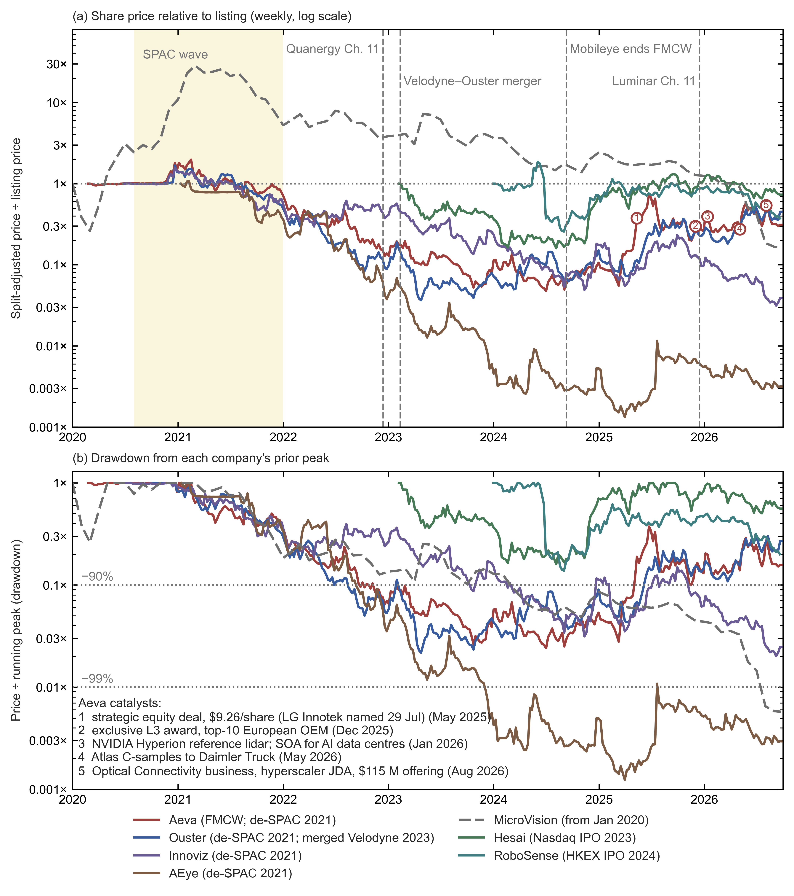

*Figure C3a.*
- *(a)* Weekly split-adjusted share price relative to listing. Split-adjusted means past prices are rescaled by each later reverse-split ratio, so that they compare with today's shares. The reference is the pre-merger shell (≈\$10 trust value) for SPACs, and the first post-listing week for IPOs (initial public offerings, conventional first listings on an exchange); MicroVision is referenced to Jan 2020.
- *(b)* Drawdown from each company's running peak.
- Aeva's dated catalysts are numbered on panel (a).
- *Data:* Yahoo Finance public chart endpoint, downloaded 27 Sep 2026 and stored in `build/figures/lidar_equity_prices_weekly.csv`. *Script:* `build/figures/lidar_equity_hype_cycle.py`.
- The endpoint does not serve delisted tickers (Luminar, Velodyne, Quanergy, Cepton, LeddarTech); Luminar's old ticker LAZR now belongs to an unrelated photonics ETF (exchange-traded fund). Their outcomes are in the tables above.

**How deep the bust was** (drawdown from the running peak; weekly closes) [E, from the stored data]:

| Company | Deepest drawdown | Latest vs peak (Sep 2026) |
|---|---|---|
| Aeva | −97.6% (Jul 2024) | −84% |
| Ouster | −97.8% (Apr 2023) | −73% |
| Innoviz | −98% | −98% |
| AEye | −99.9% (2025) | −99.7% |
| MicroVision | −99.4% | −99.4% |
| Hesai (IPO 2023) | −84% | −44% |
| RoboSense (IPO 2024) | −86% | −80% |

*How the numbers are derived* [E]:
- **Drawdown.** Let $P(t)$ be the weekly split-adjusted closing price in week $t$, as stored in `lidar_equity_prices_weekly.csv`. The drawdown is

  $$D(t)=\frac{P(t)}{\max_{t'\le t}P(t')}-1 \label{eq:drawdown}$$

  where the maximum runs over all weeks $t'$ up to and including $t$. The denominator is the *running peak*, the highest close so far, so $D(t)$ is the fractional fall from it: 0 at a new high and −1 (−100%) if the share becomes worthless. "Deepest drawdown" is the minimum of $D(t)$, and "latest vs peak" is $D$ in the last stored week (25 Sep 2026; 20 Sep for RoboSense's Hong Kong listing). MicroVision's running peak is taken from Jan 2020 onwards, as in Figure C3a.
- **Worked example, Aeva.** The highest weekly close is \$97.50 split-adjusted (week of 15 Feb 2021; \$19.50 before the 1:5 split). The lowest is \$2.35 (week of 1 Jul 2024), so by Eq. \eqref{eq:drawdown} the deepest drawdown is $2.35/97.50-1=-97.6\%$. The latest close, \$15.35, gives $15.35/97.50-1=-84.3\%$.
- **Why Hesai's two columns use different peaks.** Its deepest drawdown came in Aug 2024 against the running peak at that time, \$22.20, the close of its first post-listing week: $3.55/22.20-1=-84.0\%$. Its all-time high, \$29.05, came later (Sep 2025), so the latest \$16.25 is $16.25/29.05-1=-44\%$ from the peak.

**Reverse splits** merge several old shares into one new share (1:5 means five into one), which raises the price per share without changing the company's value. They were Aeva 1:5 (Mar 2024), Ouster 1:10 (Apr 2023), AEye 1:30 (Dec 2023) and MicroVision 1:15 (effective 1 Aug 2026).

**Listing status.** Nasdaq's minimum bid price requirement expects a listed share to trade at \$1 or more; a company below it receives a bid-price deficiency notice and a 180-day period to regain compliance. The Nasdaq Capital Market is the exchange's tier for smaller companies.
- **MicroVision's split** was made "to satisfy the minimum bid price requirement for continued listing on the Nasdaq Capital Market" [P]. It followed a bid-price deficiency notice (Jan 2026) and a transfer to the Capital Market (Jul 2026) [U].
- **Innoviz** closed the week of 25 Sep 2026 at \$0.385 [E, stored data]. It received a Nasdaq bid-price deficiency notice on 25 Mar 2026; on 22 Sep 2026 Nasdaq granted a second 180-day period, to 22 Mar 2027. Shareholders authorised a 1:5–1:20 reverse split on 16 Sep 2026; it has not been effected [P].
- **AEye** remains listed on Nasdaq (LIDR) [P].

**Why the chart understates the bust:**
1. **Survivorship.** The worst outcomes (Luminar, Quanergy, Cepton, LeddarTech) have no series, because only companies that survived to be listed today have price data. Quanergy fell from \$1.4 B implied at listing to <\$15 M within about nine months [P]. Cepton fell from \$1.77 B pro-forma at announcement to a ≈\$125 M take-private, −93% [E: $1-125.4/1{,}774\approx0.93$, table 2]. Luminar went from ≈\$13.5 B at its 8 Dec 2020 close to cancellation of all equity in Apr 2026 [P/T].
2. **The reference price.** A SPAC shell trades near its \$10 trust value, not at the hype peak, so panel (a), measured from \$10, does not show the fall from the higher prices at which the hype peaked.
3. **Dilution.** The survivors issued many new shares, so price and company value diverge: each share is a smaller slice of the company than at listing.

**The 2025–26 re-rating of the survivors: what drove it.** A re-rating is a sustained rise in the price investors pay for the same company. Company events drove most of the move and sector-wide factors contributed, but revenue remains small relative to market value. The multiples below are trough multiples: a later price divided by the lowest weekly close.
- **Aeva** rose ≈15× from its Jul 2024 trough to its Jun 2025 high and is ≈6.5× above that trough in Sep 2026. In the stored weekly closes the trough is \$2.35 (week of 1 Jul 2024), the Jun 2025 high \$36.43 (week of 23 Jun 2025) and the latest close \$15.35, so the rise was $36.43/2.35\approx15.5$ times and the latest price is $15.35/2.35\approx6.5$ times the trough [E, stored data]. The large weekly jumps line up with company events:
  - Mar–May 2025: industrial wins (the Eve 1 metrology sensor with SICK and LMI), a ramp of production capacity, and quarterly results [T].
  - May 2025: a strategic equity deal at \$9.26/share; LG Innotek was named as the investor on 29 Jul 2025 [P/T].
  - Dec 2025: an exclusive L3 award from a European carmaker.
  - Jan 2026: NVIDIA DRIVE Hyperion reference lidar, and a >28 dBm SOA (semiconductor optical amplifier; 28 dBm is about 0.6 W) marketed for AI data centres and co-packaged optics, where optical links sit in the same package as the switch chip [P].
  - Apr 2026: Nikon begins commercial deployment of the APDIS MV5X laser radar built on Aeva's Eve engine; Jun 2026: SICK's first Aeva-based distance sensor [P].
  - May 2026: Atlas C-samples delivered to Daimler Truck.
  - Aug 2026: launch of an Optical Connectivity business, with a joint development agreement for a module for a hyperscaler (an operator of very large cloud data centres; deployment 2H 2027, ramp 2028) and a \$115 M offering (sale of new shares); the stock rose ≈18% in after-hours trading [P/T].
  - The **data-centre business is documented but came later**: most of the 2025 move preceded it.
- **Ouster** rose ≈12–14× from its 2023 trough: from a split-adjusted weekly close of \$3.54 (week of 24 Apr 2023) to a high of \$49.84 (week of 29 Jun 2026) is $49.84/3.54\approx14.1$ times, and the latest \$43.72 is $43.72/3.54\approx12.4$ times [E, stored data]. Market commentary describes it as one of the few remaining Western lidar-only companies, with little debt, and points to supply compliant with the US National Defense Authorization Act (NDAA), Blue UAS approval (Jun 2025; the US Department of Defense framework that clears components for military drones) and robotics / "physical AI" demand, meaning AI systems that act in the physical world [T] (§B8, §D3).
- **Sector factors:** photonics share prices rose generally with demand for data-centre optics, and US restrictions on Chinese lidar (§D3, §D6) favour non-Chinese suppliers in the US market.
- **Revenue is small relative to market value.** Aeva's 2025 revenue was \$18.1 M. Its market value reflects expected programmes rather than current sales: a truck programme (2027), an L3 car programme (2028) and data-centre optics (2028) [E].

### 6. Why the wave busted, and what the survivors did differently

This subsection draws the threads of subsections 1–5 together. The wave busted because the market coherent lidar needed was postponed while ToF got cheap. The survivors found paying customers outside private cars, or backers who could wait.

**Why it busted** [E, drawing on company and analyst statements]:
1. **The market coherent lidar needed was postponed.** Per-point velocity, immunity to sunlight and interference, and shot-noise-limited sensitivity (sensitivity limited only by the quantum noise of the local-oscillator light) pay most in highway L4, i.e. driverless operation on motorways, which slipped for private cars. Oryx's CEO said the AV architecture was "simply not converging" [T], and a co-founder that the market was "behind schedule and shrinking" [T]; Scantinel's round collapsed amid European auto strain [T].
2. **ToF costs fell faster than coherent lidar matured.** Mobileye named "better-than-expected cost reductions in third-party time-of-flight" lidar [P]. China's model count with lidar (≈128 new models in 2024 against 10 in Europe and 2 in the US, per the market-research firm Yole) drove the ToF cost curve [T].
3. **The engineering was harder than early company projections assumed.** FMCW needs narrow-linewidth, linearly chirped sources and massive parallelism for automotive point rates; OPAs face grating lobes, loss and calibration (§C7a, §C10). Quanergy's \$250 S3 and Strobe's sub-\$100 chip never shipped in cars, and the S3-2 datasheet (2018, for robots and AGVs) gives 5–20 m at 10%, against the 150 m announced at CES 2016. Subsection 3 sets out each bet and what it needed.
4. **SPAC valuations priced production years early.** A SPAC is a listed cash shell that merges with a private company to take it public, and the deal value is set when the merger is agreed. Quanergy's \$1.4 B became <\$15 M in nine months, and AEye's valuation was cut before its SPAC closed. Velodyne's SPAC deck projected >\$680 M of revenue for 2024, more than half from multiyear deals, software and subscriptions; it had \$94 M in 2020 and \$62 M in 2021, and was absorbed by Ouster in 2023 [T, FT, 16 Jun 2021; P].
5. **Carmakers chose a different architecture:** cameras, imaging radar and at most one ToF lidar for L2+/L3, the levels at which the driver supervises (L2+) or takes over on request (L3). Yole did not expect FMCW in cars "before 2028" [T].

**What survivors did differently:**
- They picked **trucks**, whose long stopping distances make 1 km range and instant velocity pay (Aurora, Aeva–Daimler, a Swedish truck maker behind Lidwave; Scania's backing did not keep Scantinel out of insolvency).
- They **sold to industry first** (SiLC, Voyant, Aeva metrology; §B8).
- They **sold chips or licences** rather than qualified sensors (Lumotive, AEye).
- They had **strategic balance sheets** (LG Innotek; Zeiss and Scania).
- They **stayed small** until demand appeared (Pointcloud published results without announcing a start of production, SOP).

### 7. Timeline

The table lists the cycle's main events by year, from the first funding rounds to the 2026 sales and delistings. Amounts are funding rounds, implied valuations or purchase prices, as given in the tables above.

| When | Event |
|---|---|
| 2016 | Quanergy S3 "\$250" OPA demo (Jan); \$90 M at >\$1 B (Aug); Oryx \$17 M |
| 2017 | Oryx \$50 M (Aug); GM/Cruise buys Strobe (Oct); Argo buys Princeton Lightwave (Oct) |
| 2018–19 | Blackmore \$18 M (2018); Baraja \$32 M (2019); Aurora buys Blackmore for \$74.7 M (Aug 2019); Oryx closes and returns ≈\$40 M (Aug 2019) |
| 2020 – Feb 2022 | **SPAC wave:** Velodyne, Luminar, Aeva (≈\$2.1 B), Ouster, Innoviz, AEye (\$1.52 B), Cepton, Quanergy (\$1.4 B). Lumentum buys TriLumina (Nov 2020) |
| 2021 | Aeva peak, ≈\$4.2 B implied (Feb); Aurora buys OURS for \$40.8 M (Mar); Ouster buys Sense Photonics (Oct) |
| 2022 | Ibeo insolvency; Argo AI shut down (Oct); Quanergy delisted (Nov) and Chapter 11 (Dec) |
| 2023 | Baraja cuts 75% (Jan); MicroVision closes Ibeo (Jan); Velodyne–Ouster merger (Feb); Quanergy assets sold (Feb); Bosch exits lidar hardware (Sep–Oct); Continental–AEye ends (Dec) |
| 2024 | Aeva–Daimler Truck deal (Jan); Insight Chapter 11 and Blickfeld insolvency (Jun); Yole: FMCW not before 2028 (Jun); Aeva trough (Jul); Mobileye ends FMCW (Sep); GM stops Cruise funding (Dec) |
| 2025 | Koito completes Cepton (\$3.17/share, Jan); Aurora driverless freight (May); Aeva strategic equity deal (May; LG Innotek named Jul); LeddarTech bankruptcy and Nasdaq delisting (Jun); Scantinel insolvency and Baraja IP sale (Aug); Senstar agrees to buy Blickfeld, Aeva's European L3 award and Luminar Chapter 11 (all Dec) |
| 2026 | MicroVision buys Scantinel (\$0.4 M, Jan); Aeva SOA for AI data centres (Jan); MicroVision buys Luminar lidar (\$33 M, Feb); Senstar closes Blickfeld (€10.4 M, Feb); Pointcloud in *Nature* (Mar); Luminar liquidation plan effective, equity cancelled (Apr); Aeva C-samples to Daimler (May); Aurora 1 km FirstLight (Jul); MicroVision 1:15 reverse split and Aeva Optical Connectivity business (Aug); Innoviz bid-price extension to Mar 2027 (Sep) |

Sources: https://www.sec.gov/Archives/edgar/data/1828108/000119312521321663/d230050ds1.htm ; https://www.sec.gov/Archives/edgar/data/65770/000149315226008898/form10-k.htm ; https://www.sec.gov/Archives/edgar/data/1758057/000114036126011477/ef20067963-10k.htm ; https://www.sec.gov/Archives/edgar/data/1910139/000141057824001734/mbly-20240928x10q.htm ; https://www.sec.gov/Archives/edgar/data/1789029/000119312526338179/aeva-20260630.htm ; https://www.mobileye.com/news/mobileye-to-end-internal-lidar-development/ ; https://ir.theice.com/press/news-details/2022/NYSE-to-Suspend-Trading-Immediately-in-Quanergy-Systems-Inc.-QNGY-and-Commence-Delisting-Proceedings/default.aspx ; https://www.prnewswire.com/news-releases/quanergy-successfully-completes-chapter-11-sale-301753966.html ; https://www.pacermonitor.com/public/case/53823227/Insight_Photonic_Solutions,_Inc_and_Insight_Lidar,_Inc ; https://www.pluta.net/pressemitteilung/pluta-sanierungsexperte-stemshorn-erzielt-investorenvereinbarung-fur-scantinel-photonics ; https://www.businesswire.com/news/home/20250808111769/en/Baraja-Appoints-IP-Pioneer-to-Lead-Global-Sale-of-Spectrum-Scan-LiDAR-IP-Assets ; https://en.globes.co.il/en/article-auto-tech-co-oryx-vision-closing-down-1001298410 ; https://techcrunch.com/2017/10/09/cruise-acquires-strobe-to-help-dramatically-reduce-lidar-costs/ ; https://www.axios.com/2021/05/04/lidar-developer-aeye-spac-cf-finance-acquisition ; https://optics.org/news/16/7/43 ; https://techcrunch.com/2025/07/29/aeva-strikes-lidar-chipmaking-deal-with-lg-subsidiary/ ; https://investors.aeva.com/news-releases/news-release-details/aeva-unveils-industry-leading-high-power-semiconductor-optical ; https://www.investing.com/news/transcripts/earnings-call-transcript-aeva-jumps-on-q2-2026-beat-and-optical-push-93CH-4839591 ; https://www.investing.com/news/company-news/aeva-q4-2025-slides-revenue-doubles-nvidia-partnership-secured-93CH-4530200 ; https://www.nasdaq.com/articles/aeva-stock-surges-431-one-year-and-its-still-buy ; https://10xdisruptivestocks.substack.com/p/ouster-oust-stock-analysis-2026 ; https://aurora.tech/newsroom/inside-auroras-photonic-engine-engineering-lidar-for-automotive-scale ; https://www.barchart.com/story/news/1211271/robosense-announced-q1-2026-lidar-sales-robotics-segment-grows-1-458-8-yoy-to-over-185-500-units ; https://www.sec.gov/Archives/edgar/data/1498233/000110465921100487/tm2124194d1_ex99-2.htm ; https://www.sec.gov/Archives/edgar/data/1498233/000101376224001769/ea021004701ex99-1_cepton.htm ; https://www.sec.gov/Archives/edgar/data/1498233/000121390024081867/ea021546002ex-fee_cepton.htm ; https://www.sec.gov/Archives/edgar/data/1818644/000121390026098204/ea030492601ex99-1.htm ; https://companiesmarketcap.com/aeva-technologies/stock-price-history/ ; https://www.investing.com/news/sec-filings/luminar-technologies-completes-liquidation-plan-and-cancels-all-equity-interests-93CH-4599993 ; https://www.forbes.com/sites/alanohnsman/2020/12/03/meet-the-worlds-newest-and-youngest-self-made-billionaire-luminars-austin-russell/ ; https://www.sec.gov/Archives/edgar/data/1816581/000162828024013619/oust-20231231.htm ; https://www.globenewswire.com/news-release/2025/06/19/3102401/0/en/LeddarTech-Received-Notice-from-Nasdaq-Regarding-Delisting-and-Announces-Filing-under-the-Bankruptcy-and-Insolvency-Act-in-Canada.html ; https://www.sec.gov/Archives/edgar/data/1981462/000121390025046129/ea024300301ex99-1_leddartech.htm ; https://www.prnewswire.com/news-releases/senstar-technologies-corporation-announces-agreement-to-acquire-blickfeld-gmbh-302637161.html ; https://www.prnewswire.com/news-releases/senstar-technologies-corporation-announces-closing-of-blickfeld-gmbh-acquisition-302689067.html ; https://www.bosch-presse.de/pressportal/de/en/robert-bosch-venture-capital-invests-in-tetravue-89600.html ; https://global.canon/en/news/2019/20190417.html ; https://www.sec.gov/Archives/edgar/data/65770/000149315226034194/ex99-1.htm ; https://www.sec.gov/Archives/edgar/data/1835654/000117891326004565/zk2636142.htm

## C3b. Reading flagship spec sheets: headline figures and their stated conditions

This section asks how far the headline numbers on a lidar spec sheet can be taken at face value, and how to compare sensors whose sheets are written differently. Flagship lidar claims are rarely false. They are usually **best-case figures from different operating modes, quoted without the conditions that make them comparable**: the longest range may come from a narrow window of the field, the finest resolution from a slower frame rate, and the highest point rate from counting two echoes per laser shot. This matters because carmakers, investors and this report compare suppliers on exactly these numbers. The tables audit the products this report relies on, from their own pages and releases.

**The triplet check** [E]. A scanning lidar samples its field of view on a grid of directions and returns one range measurement (a "point") per direction per frame. Three published numbers describe that grid: the point rate, the angular spacing and the frame rate. This section calls them the triplet. Over the stated field of view, a uniform grid must satisfy

$$\dot N=N_{\rm col}\,N_{\rm row}\,f_{\rm frame}=\frac{\Theta_H}{\delta\theta_H}\cdot\frac{\Theta_V}{\delta\theta_V}\cdot f_{\rm frame} \label{eq:spec-triplet}$$

where $\dot N$ is the point rate (points per second, pts/s; "Mpts/s" means millions); $\Theta_H$ and $\Theta_V$ are the horizontal and vertical field of view (degrees); $\delta\theta_H$ and $\delta\theta_V$ are the angular spacings between neighbouring points (degrees); $N_{\rm col}=\Theta_H/\delta\theta_H$ and $N_{\rm row}=\Theta_V/\delta\theta_V$ are the numbers of columns and rows; and $f_{\rm frame}$ is the frame rate (complete fields per second, in Hz or fps). Eq. \eqref{eq:spec-triplet} is the points-per-frame relation of §C0 subsection 2.1, times the frame rate. Each check compares the published point rate with the right-hand side of Eq. \eqref{eq:spec-triplet}, using only published numbers [E]. The equation assumes one return per laser shot and one uniform grid over the whole stated field. When a sheet's numbers do not balance, it is usually because one of those assumptions fails: the finest spacing applies only in a region of interest (ROI, a sub-window scanned more densely), the frame rate is lower than the one quoted, or the point rate counts two returns per shot. The triplet check does not test range; range can be judged only from the stated conditions on reflectivity, detection probability and mode.

*Terms used in the tables.* "Range at 10%" is the distance at which a diffuse target reflecting 10% of the light (a dark surface) is still detected, usually with a stated detection probability; "max range" is for a bright target. ToF is pulsed time of flight. FMCW (frequency-modulated continuous wave) is a coherent method that measures range and radial velocity from the beat between the returning light and a local copy of the laser. "Lines" are scan rows; "channels" are parallel laser or detector signal paths, and the two need not be equal. "Captive" means built only for the maker's own vehicles. A C-sample is a late pre-production engineering sample. Evidence tags: P primary document, I independent, T trade press, E own estimate or calculation, U unverified.

**Automotive and long-range sensors.** Only the ATX, AT128, SCALA 3 (at 10 fps) and Robin E1X datasheet multiply out in one mode, i.e. satisfy Eq. \eqref{eq:spec-triplet} with a single set of range, spacing and frame-rate conditions.

| Product | Headline | Stated conditions | Consistency check [E] | Reading |
|---|---|---|---|---|
| **Hesai ATX** (ToF) | 230 m at 10%, 3.84 Mpts/s, 8 W | Spec table matches the headline [P]; the ATX S01 user manual (A07, May 2026) gives 10 W typical, 355 g and 1.74 M points/s single return (§E9), so the headline 3.84 Mpts/s and 8 W may describe another variant or return mode [P/U] | 256 channels over 20° at 10 Hz and 3.84 Mpts/s imply ≈1,500 columns, i.e. ≈0.08° × 0.08°: self-consistent | **A self-consistent reference sheet** |
| **Hesai AT128** (ToF) | 1.536 Mpts/s, 128 channels | 210 m at 10%, 120° × 25.4°, 0.1° × ≈0.2° (25.4°/128 = 0.198°), 13.5 W [P] | 1,200 × 128 × 10 Hz = 1.536 M: self-consistent | Self-consistent |
| **Hesai ETX** (ToF) | "4,320 lines"; "400 m at 10%" | Spec table: **300 m at 10%**, 600 m max, 120° × 20°, finest 0.06° × 0.027°, 10 Hz, <13 W [P] | The finest vertical spacing gives ≤740 rows over 20°, so "4,320 channels" are detector channels, not resolvable lines. 2,000 × 740 × 10 Hz ≈ 15 Mpts/s | Two range figures on one page; channel count ≠ resolution (§C10.6) |
| **RoboSense EM4** (ToF) | 2,160 beams, 41.04 Mpts/s, 300 m at 10% | Variant behind 300 m at 10% not stated. Small-object demos captioned as the **520-beam** version; 600 m max [P] | 41.04 M / 10 Hz = 2,160 × 1,900, i.e. ≈0.063° (H) × 0.0125° (V). Holding 300 m at 10% at full resolution would need ≈55× the AT128's power × aperture × efficiency product (§C10.6: $(300/210)^2\times41.04/1.536\approx55$) | Resolution, range and demo come from **different variants** |
| **Huawei 192-line** (L306/D3, ToF) | 192 lines; 250 m | 180 m at 10%; 1.84 Mpts/s; 20 Hz; 120° × 20° [I/T]. The 250 m maximum and 0.1° vertical come from media only [T/U]. No Huawei datasheet found | 20°/192 = 0.104°. $1.84\,\text{M}=192\times960\times10$ (0.125° H) or $192\times480\times20$ (0.25° H): 20 Hz and fine columns are alternatives | Plausible, but media-sourced (§C5) |
| **Huawei 896-line** (ToF) | "896 lines", 400 m tele mode | Huawei confirms two receiving units and a 14 cm box at 120 m; the line count and 400 m come from media [P/T] | Not checkable | Company-confirmed facts only (§C5) |
| **Innoviz InnovizTwo** (905 nm ToF) | 0.3–300 m; "max" 0.05° × 0.05°; 120° × 43°; 10.6 M pixels/s | *Condor* (20 fps, 120° × 28.8° active, 320 lines): **210 m at 10% only in a 30° × 9.6° region of interest (ROI)** (0.1° × 0.05°); 140 m at 10% in the side bands (0.2° × 0.05°) and upper/lower bands (0.2° × 0.15°); **300 m is ROI at 50%**. *Hawk* (10 fps, 120° × 24°, 480 lines): uniform 0.1° × 0.05°; 200 m at 10% in the centre, 120 m at the sides. Detection: 90% true / 1% false positives per pixel at 100 klx. 19 W typ., 29 W max, plus up to 20 W of heater; 1.0 kg; "preliminary series production" [P] | Hawk: $1200\times480\times10=5.76$ M, as stated. Condor: $300\times192+2\times225\times192+600\times128=220{,}800$ pts/frame, ×20 = 4.42 M against 4.992 M stated (+13%); $192+128=320$ lines matches. 0.05° × 0.05° over 120° × 43° is 2.06 M px/frame, i.e. ≈5 fps at 10.6 M px/s | Self-consistent, but **headline range, resolution and field come from three different modes** |
| **Innoviz InnovizThree** (905 nm ToF) | "Beyond 250 meters"; >35% cheaper than InnovizTwo; behind the windshield | 600 g; 13 W "low-power mode". Release (Dec 2025): no reflectivity, field, resolution, point rate or frame rate [P] | Not checkable | A packaging and cost claim, not yet a spec sheet |
| **Valeo SCALA 3** (905 nm ToF) | 200 m at 10%; 0.05° × 0.05°; 12.5 Mpts/s | 120° × 26°. The 12.5 M is "per echo" and "(10 fps)"; frame rate "flexible between 10 and 20 FPS"; no power figure [P] | $2400\times520\times10=12.48$ M: full field at 10 fps. At 20 fps the same grid needs 25 M, so Valeo's 12.9 M at 20 fps (2024 slide, §C3) is half the points per frame. The 520 rows exceed that slide's 360-pixel SPAD column, so 0.05° vertical needs interleaving unless the slide's platform differs | Self-consistent at 10 fps; **0.05° and 20 fps are alternatives** |
| **Seyond Robin E1X** (940 nm ToF) | 300 m; "0.01°x0.01° resolution" (page text) | C-sample sheet: 200 m at 10% (10 Hz), 1–300 m; 1,200 × 96, 0.1° × 0.2°; 1,152,000 pts/s single return; 6 W; "engineering targets". Page table: 1–250 m (200 m at 10%), **0.1° × 0.1°** [P] | Sheet: $1200\times96\times10=1.152$ M matches. 0.1° × 0.1° needs 2.4 M (2.1×); 0.01° × 0.01° needs $12{,}000\times2{,}000\times10=240$ M (208×) | Use the datasheet values: the page gives three resolutions and two maximum ranges |
| **Seyond Robin W** (905 nm, wide) | 150 m; 120° × 70°; "up to" 0.15° × 0.36°; >1.28 Mpts/s; 6 W | 70 m at 10%; 0.1 m minimum; no frame rate on the page [P] | $800\times194.4\approx155{,}600$ pts/frame; 1.28 M ÷ 155,600 = 8.2 Hz. At 10 Hz the grid needs 1.56 M | Either "up to" is the finest spacing only, or the frame rate is <10 Hz |
| **Seyond Falcon K1 / K2** (1,550 nm ToF) | 500 m max; 250 m (K1) / 300 m (K2) at 10% | Full field 0.18° × 0.24°; **0.09° × 0.08° only in the ROI** [T/P] | ROI resolution is 2–3× finer than the full field | Quote full-field and ROI figures separately |
| **Ouster DF** (solid-state digital flash) | "Up to 200 meters" at 10% in full sunlight; DF0/1/2; SOP (start of production) 2025 | Announced Nov 2021; no field, resolution, rate or power published. DF is absent from Ouster's current hardware list (OSDome, OS0, OS1, OS1 Max, OS2) [P] | Not checkable | An unrealised 2021 roadmap |
| **Waymo 6th gen** (captive) | "Up to 500 meters"; 4 lidars | The 500 m is for the whole suite (13 cameras, 4 lidars, 6 radars). A 2026 post mentions custom chips and optics, short-range lidars, and reworked illumination for road spray and reflective signs. No range, reflectivity, field, rate, wavelength or power [P] | Not checkable | A suite claim, not a lidar spec |
| **Aeva Atlas Ultra** (FMCW) | 250 m at 10%, 500 m "simultaneous long range", 3× Atlas resolution | 120° × 25° default, "up to 150°" configurable; ASIL-B(D) (Automotive Safety Integrity Level); −40 to 85 °C. **No point rate, frame rate or power** [P] | Not checkable without point rate | Strong qualification data; missing performance triplet (no point or frame rate) |
| **Aurora FirstLight** (FMCW, captive) | "Up to one kilometer … roughly double the closest FMCW competitor" | No reflectivity, target size, field of view or point rate published [P] | The comparison is with Aeva's 500 m **maximum**, so "1 km" is a max-range figure, not a 10% figure | Evidence is driverless operation, not a spec sheet |
| **LightIC Lark** (FMCW) | 230 m at 10%, 1.5 Mpts/s, 0.1° × 0.08° | 120° × 25°, 10 Hz, 0.05 m/s velocity precision [P] | 0.1° × 0.08° over the full field at 10 Hz would be ≈3.75 Mpts/s, 2.5× the stated rate, so the fine spacing must be ROI-only | "Minimum" resolution ≠ full-field resolution |
| **LuminWave F1** (FMCW) | 250 m at 10%, 0.1° × 0.1°, 128 lines | 300 m max; <45 W; 10 Hz. Apr 2025 datasheet: 150 m at 10% [P] | 128 lines over 25° average 0.195°, so 0.1° × 0.1° is ROI-only. The full field at 0.1° × 0.1° would be ≈3 Mpts/s, against 1.54 M for 128 lines | Range rose from 150 to 250 m between datasheets; **<45 W vs ATX 8 W** |
| **Analog Photonics FS-4S** (optical phased array, OPA) | 200 m at 10% | Only in a 20° × 10° ROI mode; 80 m over 60° × 14°; 35 W [P] | — | §C10.2b |
| **NODAR Hammerhead** (passive stereo) | ">1,000 m"; 25 cm object at 305 m; 10 cm at 150 m | 1 m-tall object at 1,000 m with "1.8% accuracy", but "3.4 cm" at 30 m [P] | Stereo error grows as $R^2$: 3.4 cm at 30 m becomes ≈38 m (3.8%) at 1 km, so the two figures come from different baselines or lenses. Passive, so night reach depends on illumination (§E12) | No independent test found |

*How the numbers are derived* [E]:
- **The triplet check.** A uniform grid has $N_{\rm col}=\Theta_H/\delta\theta_H$ columns and $N_{\rm row}=\Theta_V/\delta\theta_V$ rows, so its point rate is $\dot N=N_{\rm col}N_{\rm row}f_{\rm frame}$, Eq. \eqref{eq:spec-triplet}. Where the rate is given and the spacing is not, the grid is inverted to find the number of columns: $N_{\rm col}=\dot N/(N_{\rm row}f_{\rm frame})$.
- **Hesai ATX** (120° × 20°, §C10.3): $N_{\rm col}=3.84\times10^{6}/(256\times10)=1{,}500$, so the spacing is $120°/1{,}500=0.080°$ horizontally and $20°/256=0.078°$ vertically.
- **Hesai ETX:** the finest spacing gives $120°/0.06°=2{,}000$ columns and $20°/0.027°\approx740$ rows, so $\dot N=2{,}000\times740\times10\approx1.5\times10^{7}$ pts/s.
- **RoboSense EM4** (120° × 27°, §C10.3): $41.04\times10^{6}/10=4.104\times10^{6}$ points per frame, and $4.104\times10^{6}/2{,}160=1{,}900$ columns, so the spacing is $120°/1{,}900\approx0.063°$ by $27°/2{,}160=0.0125°$. For the power factor: at a fixed photon budget per point, the product of optical power, receive aperture and efficiency must scale as $\dot N R^2$, the point rate times the square of the range at 10% (the range-weighted point rate, Eq. \eqref{eq:range-weighted-point-rate} below). The EM4's factor over the AT128 is therefore the ratio of point rates, $41.04/1.536=26.7$, times the square of the range ratio. Against the AT128's 210 m product-page figure, which §C10.6 uses, it is $26.7\times(300/210)^2\approx55$; an older 200 m rating would give $(41.04/1.536)\times(300/200)^2=26.7\times2.25\approx60$.
- **InnovizTwo Condor:** the ROI is $30°/0.1°=300$ columns by $9.6°/0.05°=192$ rows. Each side band is $(120°-30°)/2=45°$ wide, so it has $45°/0.2°=225$ columns over the same 192 rows. The upper and lower bands together are $28.8°-9.6°=19.2°$ tall, so they have $19.2°/0.15°=128$ rows of $120°/0.2°=600$ columns. The frame holds $300\times192+2\times225\times192+600\times128=57{,}600+86{,}400+76{,}800=220{,}800$ points, and $220{,}800\times20\approx4.42\times10^{6}$ pts/s; the stated 4.992 M is $4.992/4.416\approx1.13$ times that. The "max" 0.05° × 0.05° grid over 120° × 43° is $2{,}400\times860=2.06\times10^{6}$ points per frame, and $10.6\times10^{6}/2.06\times10^{6}\approx5.1$ frames/s.
- **Valeo SCALA 3:** $120°/0.05°=2{,}400$ columns and $26°/0.05°=520$ rows. Valeo's 12.9 M pts/s at 20 fps is $12.9\times10^{6}/20=6.45\times10^{5}$ points per frame, which is $6.45\times10^{5}/1.248\times10^{6}\approx0.52$ of the full grid: half.
- **Seyond Robin E1X** (120° × 20°): at 0.1° × 0.1° the grid is $1{,}200\times200$, so $1{,}200\times200\times10=2.4\times10^{6}$ pts/s, $2.4/1.152\approx2.1$ times the datasheet rate; at 0.01° × 0.01° it is $240/1.152\approx208$ times.
- **Seyond Robin W:** $120°/0.15°=800$ columns and $70°/0.36°\approx194.4$ rows make $\approx1.556\times10^{5}$ points per frame. The stated $1.28\times10^{6}$ pts/s then allows $1.28\times10^{6}/1.556\times10^{5}\approx8.2$ frames/s, and 10 Hz would need $1.556\times10^{5}\times10\approx1.56\times10^{6}$ pts/s.
- **Seyond Falcon K1 / K2:** the ROI spacing is $0.18°/0.09°=2$ times finer horizontally and $0.24°/0.08°=3$ times finer vertically.
- **LightIC Lark:** $120°/0.1°=1{,}200$ columns and $25°/0.08°=312.5$ rows give $1{,}200\times312.5\times10=3.75\times10^{6}$ pts/s, $3.75/1.5=2.5$ times the stated rate.
- **LuminWave F1** (120° × 25°, §C10.3): $25°/128\approx0.195°$ per line. A full 0.1° × 0.1° grid is $1{,}200\times250\times10=3.0\times10^{6}$ pts/s, while 128 lines at 0.1° horizontal spacing give $1{,}200\times128\times10\approx1.54\times10^{6}$.
- **NODAR:** a stereo camera pair finds depth from the disparity $d=f\,b/R$, the shift of an object between the two images. Its depth error is therefore $\delta R\approx R^2\,\delta d/(f\,b)$, where $\delta R$ is the range error (m), $\delta d$ the disparity error, $f$ the lens focal length ($\delta d$ and $f$ in the same units, e.g. pixels) and $b$ the baseline between the cameras (m). With fixed optics the error grows as $R^2$, because a fixed disparity error is a growing fraction of a disparity that shrinks as $1/R$: $3.4\ {\rm cm}\times(1{,}000/30)^2\approx37.8$ m at 1 km, or $37.8/1{,}000\approx3.8\%$, against the 1.8% claimed.

In practice, for every automotive sheet except the four that balance, the headline range, resolution and field should be read as coming from different modes, and compared with rivals only mode by mode.

**Robotics, industrial and security sensors.** These sheets are mostly self-consistent. The common pitfalls are dual-return rates (two echoes reported per laser shot, which doubles the point count without more shots), range quoted in a low-rate mode, narrow ROIs and figures mixed from different variants. A second echo is reported separately only if it lies at least about $c\,\tau_p/2$ behind the first, with $\tau_p$ the pulse length: 0.75 m for a 5 ns pulse (§C0 subsection 1.1). Illuminance in klx (kilolux) states the sunlight in which range was measured; 100 klx is a bright-sun condition. A non-repetitive scan (Livox) traces a pattern that does not repeat from frame to frame, so coverage fills in the longer the sensor integrates. QVGA and VGA are the YLM-10LX's coarser and finer readout modes.

| Product | Headline | Stated conditions | Consistency check [E] | Reading |
|---|---|---|---|---|
| **Ouster OS1 Rev8** (865 nm, spinning) | 10.4 Mpts/s; 4,096 columns; 40 Hz; 128 channels | **90 m at 10% in the 1,024 × 10 Hz mode** (>90% detection probability, 100 klx); 170 m at 80%; "500 m max representable" (the product page says 250 m max); 44° vertical (page: 45°); 0.18° beam divergence; 10–20 W, 15 W nominal at 1,024 × 10 Hz [P] | $10{,}485{,}760=128\times4096\times10\times2$ **returns**, so the single-return ceiling is 5.24 M. 4,096 columns at 40 Hz would be 21 M: 4× the single-return ceiling, 2× the dual-return headline. Range mode: $128\times1024\times10=1.31$ M, 1/8 of the headline. 360°/4,096 = 0.088°, finer than the 0.18° beam | The headline rate is dual-return; the range is quoted in a low-rate mode |
| **Ouster OS1 Max Rev8** | 200 m at 10%; 256 channels | 350 m at 80%; 43.9°; ranges in the 1,024 × 10 Hz mode; 15–25 W, 19 W nominal [P] | $256\times4096\times10=10{,}485{,}760$ single-return: the same ceiling as the OS1 | The point rate is capped; more channels do not raise it |
| **Hesai JT128** (robotics dome, spinning) | 360° × 189°; 128 channels; 60 m | 40 m at 10% (60 m max); 1,152,000 pts/s single return; 0.4° × 0.74°; no frame rate or power listed; 265 g [P] | $900\times128\times10=1.152$ M, so 10 Hz is implied. $128\times0.74°=94.7°\approx189°/2$: 189° is the dome's full cross-section | Self-consistent; "189°" is not one column |
| **Hesai FTX** (SPAD, electronic scan or e-scan) | 180° × 140°, 30 m at 10%, 492k pts/s (Feb 2025 release) | Product page: **180° variant 20 m at 10%**, 216 × 192 px, "0.62° finest"; **140° × 105° variant 30 m at 10%**, 256 × 192 px, 0.56° × 0.56°; both 10 Hz, 492,000 pts/s single return, <6 W [P] | 140° variant: $256\times192\times10=491{,}520$ matches; 140°/256 = 0.55°. 180° variant: $216\times192\times10=414{,}720$, 16% below its listed 492k; 180°/216 = 0.83° average against 0.62° "finest", so the spacing is non-uniform | The release pairs one variant's field with the other's range |
| **Livox Mid-360** (905 nm, non-repetitive) | 360° × 59°; 40 m; 200k pts/s | 40 m at 10%, 70 m at 80% (100 klx); −7° to 52°; 200,000 pts/s first return; 10 Hz typical; 6.5 W average, 14 W peak when self-heating below 0 °C; −20 to 55 °C; no angular resolution [P] | 20,000 pts/frame over $360\times59=21{,}240$ deg², i.e. ≈1 point per 1.06 deg² (≈1° × 1° equivalent); density grows with integration time | A self-consistent robotics sheet; the resolution is time-integrated |
| **Opsys ALTOS 70/150/300** (solid-state) | 300 m; no moving parts | "Max Range 10%": 55/100/200 m; 100/150/300 m at 70%; 80° × 22° / 45° × 13° / 22.5° × 6.5°; 0.4° / 0.2° / 0.1°; up to 25/30/25 fps; no point rate or power; −30 to 65 °C in the spec boxes, −20 to 65 °C in the text [P] | Grids of 200 × 55 / 225 × 65 / 225 × 65 give 0.28 / 0.44 / 0.37 Mpts/s at the maximum frame rates. ALTOS 150 and 300 share a 14,625-point grid: one array with 2× optics (§C6) | A consistent family; the 300 m is at 70% in a 22.5° field |
| **Lumotive/Hokuyo YLM-10LX** (liquid-crystal metasurface) | "True solid-state" 3D lidar | 0.3–10 m at 10%, 1–15 m at 90%, on-axis at 25 °C in QVGA; 110° × 90°; 0.375° (QVGA) or 0.188° (VGA); 2–60 Hz, 9.25 Hz default; ≈500k pts/s; ≤25 W; 650 g; −20 to +50 °C; not certified for functional safety [P] | $293\times240\times9.25=651$k against ≈500k (−23%). 840 lines/s ÷ 9.25 = 91 steps of ≈1° each, i.e. 2.6 sensor rows per step | A self-consistent industrial sheet; 25 W for 10 m is today's cost of solid-state steering (§C10.5) |
| **Voyant Carbon** (FMCW) | "Up to" 977k pts/s, 150 m, \$1,490 | Max range without reflectivity (200 m at launch); precision "in specific operating modes"; no power [P] | ≈0.2–0.5° spacing over its fields | Credible industrial sensor, not a long-range one (§B8) |
| **SiLC Eyeonic Vista** (FMCW) | ">1 km" small-target detection | 8 channels with "dynamic region-of-interest scaling"; perimeter security and counter-UAS (counter-drone) [P/T] | 8 coherent channels imply a modest point rate; 1 km applies inside a narrow ROI | A security staring/ROI instrument, not a wide-field lidar |

*How the numbers are derived* [E]:
- **Ouster OS1 Rev8:** 4,096 columns at 40 Hz would need $128\times4{,}096\times40\approx2.10\times10^{7}$ pts/s, which is $2.10\times10^{7}/5.24\times10^{6}=4$ times the single-return ceiling and $2.10\times10^{7}/1.05\times10^{7}=2$ times the dual-return headline. The range mode's $1.31\times10^{6}$ pts/s is $10.49/1.31=8$ times below the headline.
- **Hesai JT128:** $360°/0.4°=900$ columns, so by Eq. \eqref{eq:spec-triplet} $900\times128\times f_{\rm frame}=1.152\times10^{6}$ requires $f_{\rm frame}=10$ Hz.
- **Hesai FTX, 180° variant:** $1-414{,}720/492{,}000\approx0.16$, the 16% shortfall.
- **Livox Mid-360:** 200,000 pts/s at 10 Hz is $2\times10^{5}/10=20{,}000$ points per frame, spread over $360°\times59°=21{,}240$ deg², i.e. $21{,}240/20{,}000\approx1.06$ deg² per point.
- **Opsys ALTOS:** each grid is field ÷ spacing: $80°/0.4°=200$ by $22°/0.4°=55$; $45°/0.2°=225$ by $13°/0.2°=65$; and $22.5°/0.1°=225$ by $6.5°/0.1°=65$. At 25, 30 and 25 fps these give $11{,}000\times25\approx2.8\times10^{5}$, $14{,}625\times30\approx4.4\times10^{5}$ and $14{,}625\times25\approx3.7\times10^{5}$ pts/s.
- **Lumotive/Hokuyo YLM-10LX:** in QVGA the grid is $110°/0.375°\approx293$ by $90°/0.375°=240$, so $293\times240\times9.25\approx6.5\times10^{5}$ pts/s, and $5.0\times10^{5}/6.5\times10^{5}-1\approx-23\%$. At the 840 lines/s steering line rate used in the check (the rate listed in §C10.5) and 9.25 Hz, the scanner makes $840/9.25\approx91$ steps per frame, each $90°/91\approx0.99°$, which is $0.99°/0.375°\approx2.6$ sensor rows.
- **Voyant Carbon:** assuming the 128-line configuration spans the 30° axis of the Carbon 30 or the 60° axis of the Carbon 60 (§B8), the line spacing is $30°/128\approx0.23°$ to $60°/128\approx0.47°$.

**Range-weighted point rate** [E]. The triplet check says whether a sheet is self-consistent, not which sensor delivers more. Point rate alone misleads, because binning (summing several detector pixels into one point), ROI modes and dot patterns trade points against range. A fairer single number multiplies the point rate by the square of the range at 10% reflectivity.
- **The metric.** Points/s × (range at 10%)² tracks the photon budget a sensor delivers, since at fixed energy per frame $N_{\rm points}R^2$ is roughly constant (§C0 subsection 5.2; §C5a applies it to the AS-DT1). Here $N_{\rm points}$ is the number of points per frame and $R$ the range (m) at which a 10% target is still detected. Per second, the conserved quantity is the range-weighted point rate $\dot N R^2$, in m²/s, with $\dot N$ the point rate (pts/s).
- **Why the weight is $R^2$.** Assume a Lambertian (perfectly diffuse) target that fills the laser footprint, clear air, normal incidence, and signal-limited detection (a fixed number of detected signal photons per point suffices, whatever the background). The target re-radiates with radiance $\rho/\pi$ times its irradiance, and the receive aperture subtends a solid angle $A_{\rm rx}/R^2$ as seen from the target, so the aperture collects a fraction $\rho A_{\rm rx}/(\pi R^2)$ of each pulse's energy. The footprint size drops out, because the whole beam lands on the target. This is §C0 Eq. \eqref{eq:photons-per-pulse} in clear air, with the energy per point in place of the pulse energy. A sensor that emits average optical power $P$ and shares it among $\dot N$ points per second gives each point $E_{\rm pt}=P/\dot N$, and a point then yields $N_s=(E_{\rm pt}/E_{\rm ph})\,\rho A_{\rm rx}/(\pi R^2)\,\eta_{\rm opt}\,{\rm PDE}$ detected signal photoelectrons (§C6, Eq. \eqref{eq:spad-signal-per-point}). Setting $N_s$ equal to the number a detection needs, $n_{\rm req}$ (§C0 subsection 4.3), gives

  $$\dot N R^2=\frac{P\,\rho\,A_{\rm rx}\,\eta_{\rm opt}\,{\rm PDE}}{\pi\,E_{\rm ph}\,n_{\rm req}} \label{eq:range-weighted-point-rate}$$

  where $n_{\rm req}$ is the number of signal photoelectrons a point needs to be detected, $E_{\rm ph}=hc/\lambda$ the photon energy ($h$ Planck's constant, $c$ the speed of light, $\lambda$ the wavelength), $\rho$ the target's diffuse reflectance (0.1 here), $A_{\rm rx}$ the receive-aperture area (m²), $\eta_{\rm opt}$ the optics transmission and PDE the detector's photon detection efficiency; for a SPAD in sunlight the effective PDE also carries the dead-time live fraction, $e^{-r\tau_d}=e^{-0.122}=0.885$ in the bright sun of §C0 subsection 4.2, where $r=1.83\times10^{8}/9\ {\rm s^{-1}}$ is the background rate of each of the nine SPADs of a 0.05° × 0.05° macro-pixel and $\tau_d=6$ ns their dead time (§C6(d)). Everything on the right-hand side is fixed by the hardware and the detection threshold. For a given photon budget, $\dot N R^2$ is therefore conserved: collected energy per point falls as $1/R^2$, so a sensor can spend its photons on more points or on more range, but not on both. That is why binning, ROI and dot modes leave the product nearly unchanged.
- **When the weight is not $R^2$.** Two common cases change the exponent.
  - *A target smaller than the footprint* (a tyre, debris) intercepts only part of the beam, and that part itself falls as $1/R^2$, so the return falls as $1/R^4$ (§E11.3, Eq. \eqref{eq:range-energy-target-size}). For such targets the conserved product is $\dot N R^4$.
  - *Sunlight-limited detection.* When solar background rather than signal sets the noise, the signal-to-noise ratio is roughly $N_s/\sqrt{N_{\rm bg}}$, with $N_{\rm bg}$ the background photoelectrons per point. A larger aperture or pixel then collects more background as well as more signal, so range grows only as $A_{\rm rx}^{1/4}$ rather than $A_{\rm rx}^{1/2}$, and falls only as $N_{\rm points}^{-1/4}$ rather than $N_{\rm points}^{-1/2}$ as points are added (§C0 subsection 5.2; §C5a applies it to the AS-DT1). The conserved product is then roughly $\dot N R^4$.
  - The table keeps the $R^2$ weight for every row as a common yardstick. Where sunlight limits range, sensors with many small pixels therefore score higher on it (the native-grouping row below).
- **The caveat.** Conditions differ between spec sheets (sunlight, detection probability), so the table is order-of-magnitude only. "Per watt" divides by the sensor's rated electrical power, so it also folds in the power drawn by electronics and scanning.

| Sensor | Points/s | Range at 10% | Points/s × R² (m²/s) | Power | Per watt |
|---|---|---|---|---|---|
| Sony AS-DT1 (576 points, 15 fps) | 8,640 | ≈11 m outdoors [E, from 20 m at 50%] | ≈1 × 10⁶ | ≤2.5 W maximum (spec sheet); ≈0.35 W in one press report | ≈4 × 10⁵–3 × 10⁶ |
| The same array at native grouping, same budget | ≈0.24–0.36 M | ≈2–4 m outdoors | ≈1–6 × 10⁶ | Same | Same |
| Livox Mid-360 | 200,000 | 40 m (100 klx) | 3.2 × 10⁸ | 6.5 W average | ≈5 × 10⁷ |
| Hesai JT128 | 1,152,000 | 40 m | 1.8 × 10⁹ | Not listed | — |
| Ouster OS1 Rev8 (1,024 × 10 Hz mode, single return) | 1,310,720 | 90 m (100 klx) | 1.1 × 10¹⁰ | 15 W nominal in this mode | ≈7 × 10⁸ |
| Hesai AT128 | 1,536,000 | 210 m | 6.8 × 10¹⁰ | 13.5 W | ≈5 × 10⁹ |
| Hesai ATX | 3,840,000 | 230 m | 2.0 × 10¹¹ | 8 W (10 W typical in the user manual, §E9) | ≈2–2.5 × 10¹⁰ |

The Sony AS-DT1 is a compact Sony SPAD (single-photon avalanche diode) lidar module; its second row shows what the same SPAD array would give if every SPAD were read as its own point, at the same photon budget.

- **Binned and native are the same product.** Both AS-DT1 rows sit at ≈10⁶ m²/s (exactly so when the signal limits range; up to ≈6 × 10⁶ for the native array when sunlight does). The 24 × 24 grouping of the array into 576 points redistributes the photon budget; it does not waste it.
- **The spread is five orders of magnitude.** Above the AS-DT1: ≈300× for a Mid-360, ≈10⁴× for an OS1, ≈10⁵× for an AT128 or ATX. Per watt the gap is ≈16–120× (Mid-360) to ≈10³–10⁵× (AT128, ATX), depending on the AS-DT1's actual draw. The part of the gap not explained by power comes from collection area, scanning and emitter efficiency (§C5a), the other factors in Eq. \eqref{eq:range-weighted-point-rate}.
- **What the number omits.** It weights range but says nothing about angular resolution, small-object detection or velocity. Read it alongside the triplet check, Eq. \eqref{eq:spec-triplet}.

*How the numbers are derived* [E]:
- **The metric.** Each row is $\dot N R^2$, the point rate times the square of the range at 10% (Eq. \eqref{eq:range-weighted-point-rate}), and "per watt" divides it by the rated power. Worked example, Hesai AT128: $1.536\times10^{6}\times210^2\approx6.8\times10^{10}$ m²/s, and $6.8\times10^{10}/13.5\approx5.0\times10^{9}$ per watt. For the ATX, $3.84\times10^{6}\times230^2\approx2.03\times10^{11}$, which divided by 8 or 10 W gives $2.5$ or $2.0\times10^{10}$.
- **Sony AS-DT1.** The point rate is $576\times15=8{,}640$ pts/s (576 points at 15 fps). Sony's 20 m outdoors at 50% reflectivity (Sony's Japanese release gives 100,000 lux but no reflectivity, so the 50% is unconfirmed [U]) is scaled to 10%, a factor $10/50=0.2$ in $\rho$. Range goes as $\rho^{1/2}$ when the signal limits it (Eq. \eqref{eq:range-weighted-point-rate}) and as $\rho^{1/4}$ when sunlight does, because the sunlight the target reflects also scales with $\rho$. This gives $20\times0.2^{1/2}\approx8.9$ m to $20\times0.2^{1/4}\approx13.4$ m (§C5a); the table uses the middle, ≈11 m. Then $8{,}640\times11^2\approx1.0\times10^{6}$ m²/s, and $1.0\times10^{6}/2.5\approx4\times10^{5}$ or $1.0\times10^{6}/0.35\approx3\times10^{6}$ per watt.
- **The native-grouping row** assumes an IMX611-class array (Sony's phone depth-sensor chip) of 23,800 SPADs (§C5a), each read as one point. At 10 to 15 fps its point rate is $23{,}800\times10\approx2.4\times10^{5}$ to $23{,}800\times15\approx3.6\times10^{5}$ pts/s. Scaling the 11 m by the point count, as $N_{\rm points}^{-1/2}$ when the signal limits range and as $N_{\rm points}^{-1/4}$ when sunlight does (§C5a), gives $11\times(576/23{,}800)^{1/2}\approx1.7$ m to $11\times(576/23{,}800)^{1/4}\approx4.3$ m, i.e. ≈2–4 m. The product then spans $2.4\times10^{5}\times2^2\approx1.0\times10^{6}$ to $3.6\times10^{5}\times4^2\approx5.8\times10^{6}$ m²/s. In the signal-limited case it stays at $\approx1.0\times10^{6}$, because $N_{\rm points}R^2$ is conserved; the sunlight-limited end is higher because smaller pixels also collect less sunlight.
- **Ratios to the AS-DT1** ($1.0\times10^{6}$ m²/s): Mid-360 $3.2\times10^{8}/1.0\times10^{6}\approx300$; OS1 $1.1\times10^{10}/1.0\times10^{6}\approx10^{4}$; AT128 $\approx6.5\times10^{4}$; ATX $\approx1.9\times10^{5}$. Per watt, the Mid-360's $4.9\times10^{7}$ is $4.9\times10^{7}/3.0\times10^{6}\approx16$ to $4.9\times10^{7}/4.2\times10^{5}\approx120$ times the AS-DT1's, and the AT128 and ATX ($5.0\times10^{9}$ to $2.5\times10^{10}$) are $5.0\times10^{9}/3.0\times10^{6}\approx1.7\times10^{3}$ to $2.5\times10^{10}/4.2\times10^{5}\approx6\times10^{4}$ times.

**A checklist for reading any lidar spec sheet** [E]. The ten questions below condense the two tables. Each one exposes a way in which figures from different modes end up quoted side by side.
1. **Range:** at what reflectivity, detection probability and false-alarm rate, on what target size, in which field of view and mode? "Max range" usually means a bright, large target.
2. **The triplet:** point rate, angular spacing and frame rate must multiply out over the stated field, Eq. \eqref{eq:spec-triplet}. If they do not, the finest spacing is ROI-only.
3. **Return mode:** single- and dual-return point rates differ by 2×. The Ouster OS1 Rev8's 10.49 Mpts/s is dual-return; the OS1 Max reaches it single-return with 256 channels.
4. **Lines:** detector channels, emitter channels and resolvable rows are different numbers, so a large "line" count may count channels rather than rows (the ETX above).
5. **Power:** ask for the power in the mode that delivers the range and point rate. For FMCW this is the decisive missing number (§C7a).
6. **Simultaneity:** "up to", "in specific operating modes" and "configurable" signal separate modes that cannot all be had at once.
7. **Datasheet drift and variant mixing:** compare successive datasheets (LuminWave from 150 to 250 m; Voyant from 200 to 150/75 m), product pages against datasheets (Robin E1X) and releases against product pages (FTX).
8. **Qualification and temperature range** (AEC-Q, the Automotive Electronics Council's component qualification; ASIL, the ISO 26262 functional-safety level; −40 to 85/105 °C). Industrial sensors often omit these.
9. **Independent evidence:** teardowns, benchmark datasets or customer field data outrank spec sheets.
10. **Range-weighted point rate:** multiply points/s by the square of the range at 10%, Eq. \eqref{eq:range-weighted-point-rate}. Binning, ROI and dot modes trade one factor for the other and leave the product nearly unchanged (table above).

Sources: https://www.hesaitech.com/product/atx/ ; https://www.hesaitech.com/product/at128/ ; https://www.hesaitech.com/product/etx/ ; https://www.robosense.ai/en/IncrementalComponents/EM4 ; https://seyond.com/products/falcon-k1/ ; https://www.aeva.com/atlas-ultra/ ; https://aurora.tech/newsroom/inside-auroras-photonic-engine-engineering-lidar-for-automotive-scale ; https://en.lightic.tech/lark.html ; https://www.luminwave.com.cn/long-distance-fmcw-series/ ; https://voyantphotonics.com/products/ ; https://www.prnewswire.com/news-releases/voyant-photonics-launches-affordable-carbon-lidar-with-fmcw-lidar-sensor-on-a-chip-302339627.html ; https://www.businesswire.com/news/home/20260508656346/en/SiLC-Technologies-Launches-Eyeonic-Vista-Ultra-Long-Range-Vision-System-for-Perimeter-Security ; https://www.nodarsensor.com/technology-overview ; https://www.nodarsensor.com/faq ; https://levelfivesupplies.com/wp-content/uploads/2023/08/InnovizTwo-GMSL-Series-Production-Datasheet_v3.1-1.pdf ; https://www.prnewswire.com/news-releases/innoviz-technologies-unveils-innovizthree-a-quantum-leap-in-innovizs-lidar-solutions-302648729.html ; https://www.valeo.com/en/catalogue/cda/long-range-lidar-sensors-valeo-scala-gen-3/ ; https://data.ouster.io/downloads/datasheets/datasheet-rev8-v4p0-os1.pdf ; https://data.ouster.io/downloads/datasheets/datasheet-rev8-v4p0-os1-max.pdf ; https://ouster.com/products/hardware/os1-lidar-sensor ; https://ouster.com/insights/blog/ouster-automotive-df-series ; https://www.hesaitech.com/product/ftx/ ; https://www.hesaitech.com/hesai-strengthens-patent-portfolio-with-swiss-ip-acquisition-advancing-next-gen-solid-state-lidar-ftx-to-drive-robotics-revolution/ ; https://www.hesaitech.com/product/jt128/ ; https://www.seyond.com/wp-content/uploads/2025/03/Robin-E1X-LiDAR-C-sample_Datasheet_EN_Public_V3.0.0-2.pdf ; https://seyond.com/products/robin-e/ ; https://seyond.com/products/robin-w/ ; https://www.opsys-tech.com/altos-industrial-lidar ; https://www.livoxtech.com/mid-360/specs ; https://waymo.com/blog/2024/08/meet-the-6th-generation-waymo-driver/ ; https://waymo.com/blog/2026/02/ro-on-6th-gen-waymo-driver/ ; https://www.techinsights.com/blog/deep-dive-teardown-huawei-192-line-lidar-l306-lidar-sensor ; https://www.hokuyo-usa.com/application/files/9717/4008/4485/YLM-10LX_Specifications_C-42-04575.pdf

## C3c. What worked: Western lidar successes by approach

This section asks which Western lidar companies and technical approaches actually succeeded, and what those successes had in common. It is the counterpart to the failures in §C3a. The pattern matters for anyone judging a lidar supplier today: success followed a paying function and a route into series production far more than it followed sensor performance.

**Short answer.** Every Western lidar approach produced at least one real success: a series-production car, a de facto standard product, a large contract or a profitable niche. The successes that lasted were tied to a function somebody paid for: highway L3 (SAE Level 3, where the car drives itself in a defined domain and the driver takes over on request), robotaxi mapping, driverless trucks or industrial measurement. They faded when that function was cut.
- **By units shipped,** Valeo is the Western leader.
- **By revenue,** Velodyne (in 2017) and Ouster (in 2025) reached the highest peaks.
- **By technology risk taken and delivered,** Luminar (1,550 nm lidar in a series car) and Aurora (FMCW lidar in driverless operation) stand out.

Evidence tags are as elsewhere in the report: P primary document, I independent, T trade press, E own estimate or calculation, U unverified, S secondary.

*Terms used in the table.* A Tier 1 is a supplier that sells complete systems directly to carmakers (OEMs, original equipment manufacturers). SOP is start of production. AV is autonomous vehicle; ADAS is advanced driver assistance; AEB is automatic emergency braking; L2+ is supervised driver assistance in which the driver stays responsible. ToF is pulsed time of flight; FMCW (frequency-modulated continuous wave) is coherent lidar that also measures velocity. MEMS is a micro-electro-mechanical scanning mirror. VCSEL (vertical-cavity surface-emitting laser) and SPAD (single-photon avalanche diode) are the laser and detector chips of the "digital lidar" approach; SoC is system on chip. An SOA is a semiconductor optical amplifier. GAAP is US generally accepted accounting principles. Chapter 11 is US bankruptcy reorganisation. "Captive" means built only for the maker's own vehicles.

| Company (approach) | Peak success | Why it worked [E] | What came next | Sources |
|---|---|---|---|---|
| **Valeo SCALA** (905 nm, rotating mirror; a Tier-1's industrialization of Ibeo's scanner) | **First automotive-grade lidar in series production** (Audi A8, 2017) [P]. SCALA 2 was in **both of the first L3-certified cars** (Honda Legend and Mercedes S-Class, 2021) [P]. Units: >150,000 produced (older Valeo page); >220,000 "on the road" (current page) [P]. >€1 B of SCALA 3 orders by Feb 2024 [P]. Built in Wemding, Bavaria; 560 patents [P]. From SCALA 1 to 2: 58,000 to 260,800 pts/s, 0.8° to 0.6°, electronics core ≈\$70 to \$110 [I, Yole/System Plus] | Tier-1 qualification, functional safety and a plant. Modest specs matched to one paid function (traffic-jam, then highway L3). Long OEM relationships | L3 was cut: Mercedes paused Drive Pilot (Jan 2026), Stellantis shelved STLA AutoDrive (Aug 2025), and Mercedes' next L3 went to Hesai (§B2). Still the largest Western automotive lidar by units | [Valeo SCALA](https://www.valeo.com/en/valeo-scala-lidar/); [SCALA Gen 3](https://www.valeo.com/en/catalogue/cda/long-range-lidar-sensors-valeo-scala-gen-3/); [SCALA 3 orders](https://www.valeo.com/en/valeo-announces-2-new-major-contracts-for-its-third-generation-lidar/); [Yole/System Plus](https://www.edge-ai-vision.com/2022/09/first-and-second-generation-valeo-scala-lidars-the-technology-gap-revealed/) |
| **Ibeo** (905 nm scanners, later flash) | The ibeo LUX became a standard development-fleet scanner. With Valeo it co-developed the ScaLa (cooperation from 2010; Valeo industrialized it for Audi), the basis of the first series automotive lidar [T, WSJ 21 Jul 2014; S] | Two decades of automotive perception software, plus a Tier-1 partner for production | Its own solid-state flash (ibeoNEXT, to be built by ZF; Great Wall award) did not reach series production. Insolvent 2022; sold to MicroVision for ≈€20 M (§C3a) | [AutonomouStuff](https://autonomoustuff.com/news/autonomoustuff-adds-ibeos-scala); [DVN interview](https://www.drivingvisionnews.com/news/2022/07/06/interview-michael-kiehn-head-lidar-sensor-development-at-ibeo/) |
| **Velodyne** (spinning multi-beam, 905 nm) | The HDL-64E was on **five of the six finishers** of the 2007 DARPA Urban Challenge [P]. Velodyne calls it "the world's first commercially available real-time 3D lidar" [P]. It was the robotaxi and mapping standard of the 2010s. Velodyne Lidar was spun out of Hall's audio company in 2016 with \$150 M from Ford and Baidu, which were also customers [T, FT]. **Revenue peaked at \$182.1 M in 2017** [P], mostly one-off sales to AV research teams at a weighted average price of nearly \$18,000 per sensor [T, FT, 16 Jun 2021], i.e. ≈10,000 sensors [E: 182 M / 18k]. >300 customers in 2019–20 [P] | First mover with a working 360° sensor at the moment every AV programme needed one; in 2017 its sensors had a months-long waiting list [T, FT, 13 Apr 2017] | Revenue fell every year: \$142.9 M (2018), \$101.4 M (2019), \$95.4 M (2020), \$61.9 M (2021) [P]. The 2018 fall came from a mix shift to cheaper sensors (−\$54.0 M) and price cuts (−\$32.6 M), only partly offset by volume (+\$43.5 M) [P]. Velodyne said it cut prices "proactively" as competition increased; Hall alleged that design theft had "ruined" it. Velodyne settled with Hesai, which did not admit wrongdoing [T, WSJ, 31 Oct 2023], and with a second Chinese maker in 2020 for licence and royalty fees [T, FT]. According to the FT, the audit committee investigated Hall and his wife, Hall was removed as chair in Feb 2021, and the company started arbitration against him over trade secrets [T, FT, 16 Jun 2021]. Merged into Ouster at \$306.6 M (2023; §C3a) | [Velodyne blog](https://velodynelidar.com/blog/hdl-64e-lidar-sensor-retires/); [10-K FY2020](https://www.sec.gov/Archives/edgar/data/1745317/000162828021004964/vldr-20201231.htm); [prospectus 2020](https://www.sec.gov/Archives/edgar/data/1745317/000110465920111164/tm2029218-6_424b3.htm) |
| **Luminar** (1,550 nm fibre laser, InGaAs, two-axis scan) | At its Apr 2017 launch it claimed 50× the resolution and 10× the range of rivals, in-house InGaAs receivers, and a 10,000-unit batch from its Orlando plant "later this year"; it had raised \$36 M [T, FT, 13 Apr 2017]. **First lidar fitted as standard on a global production car:** Volvo EX90, SOP Apr 2024 [P]. Revenue \$69.8 M (2023) and \$75.4 M (2024) [P/T]. 9,000 Iris shipped in 2024, 4,000 of them in Q4 [T] | A real range advantage at 10% from 1,550 nm (§C4c), and a customer that made lidar part of its safety brand | Volvo moved Iris to an option from Apr 2026, cutting its estimated lifetime volume by ≈90% [P]. Chapter 11 Dec 2025 (§C3a) | [Luminar Q4 2024](https://www.sec.gov/Archives/edgar/data/1758057/000162828025014115/q42024earningsrelease991.htm); [optics.org](https://optics.org/news/16/3/39); [8-K 2026](https://www.sec.gov/Archives/edgar/data/1758057/000114036126006615/ef20066413_ex99-2.htm); [TechCrunch](https://techcrunch.com/2025/12/16/how-luminars-doomed-volvo-deal-helped-drag-the-company-into-bankruptcy/) |
| **Innoviz** (905 nm, 2-D MEMS) | **InnovizOne in series production from 2023**, via Magna, on the BMW 7 Series/i7 for Personal Pilot L3 (Germany, 2024). BMW partnership since 2018 [T]. InnovizTwo ≈70% cheaper [T]. 9 InnovizTwo per VW ID. Buzz AD (Mobileye Drive) [P]. FY2025 revenue \$55.1 M [P] | A start-up that accepted the Tier-1 route (Magna) and a single L3 function | BMW dropped L3 with the 7 Series facelift (Apr 2026, §B2). Share price −98%; Nasdaq bid-price extension to Mar 2027 (§C3a) | [Just Auto](https://www.just-auto.com/interview/bmw-and-innoviz-achieve-level-3-autonomous-driving-with-the-bmw-7-series/); §B3 |
| **Continental short-range lidar** (905 nm, three pulsed beams; low-speed city braking) | **The first mass-market automotive lidar:** standard in Volvo's City Safety low-speed emergency braking from 2008 [T]. It measured the time of flight of three pulsed 905 nm infrared beams; a later Continental module combined it with a camera [T] | A cheap sensor for a narrow, well-defined job (braking at city speeds) that needed ranging, not imaging | Displaced by camera and radar AEB. Volumes not found [U] | [Volvo City Safety](https://en.wikipedia.org/wiki/Volvo_City_Safety); [Electronic Specifier](https://www.electronicspecifier.com/products/sensors/continental-integrates-the-camera-and-infrared-functions-into-a-single-compact-unit/) |
| **Continental HFL110** (1,064 nm flash, from ASC) | Series production from Nov 2021; fitted to the Toyota Mirai 2 [P/I]. It is the only flash lidar confirmed in a series car | A short-range (50 m) job that flash physics can do (§C3a subsection 3) | No successor. Continental's long-range effort (AEye HRL131) ended in Dec 2023 | §C3a |
| **Cepton** (905 nm, flexure "MMT" scanning) | Won GM's "largest known ADAS lidar series production award" (2021) [T/P]. Koito partner since 2017 [P] | A low-cost mechanism that fits behind the fascia | GM re-scoped and cancelled all purchase orders (Dec 2023) [P]. Koito took it private at \$3.17 per share (Jan 2025) | §C3a |
| **Ouster** (865 nm, VCSEL + SPAD SoC, spinning "digital lidar") | **FY2025 revenue \$169 M** (+52%, including ≈\$21 M of one-time royalties); **>25,000 sensors** (2024: ≈17,000); GAAP gross margin 49%; \$211 M cash and no debt [P/T]. Absorbed Velodyne | A silicon architecture (VCSEL + CMOS SPAD) that rides semiconductor cost curves. Sold to many industrial, infrastructure and defence customers rather than one carmaker (§B8) | Its automotive solid-state DF series was never released (§C3b). It lost an arbitration with Hesai (§B3) | [Ouster FY2025](https://investors.ouster.com/news-releases/news-release-details/ouster-announces-results-fourth-quarter-and-full-year-2025) |
| **Waymo** (in-house) | In Jan 2017, Waymo said building in-house had cut the cost of its top-range lidar by ≈90% from the industry norm of \$75,000 [T]. It sold its short-range lidar to non-AV customers from 2019 [T]. ≈4,000 vehicles with 4–5 in-house lidars each (§B4) | Vertical integration inside a funded robotaxi programme | Captive; external sales stayed a side business | [CNBC 2017](https://www.cnbc.com/2017/01/08/waymo-cuts-costs-raises-reliability-of-its-self-driving-cars.html); [TechCrunch 2019](https://techcrunch.com/2019/03/06/waymo-to-start-selling-standalone-lidar-sensors/) |
| **Aurora** (FMCW, from Blackmore + OURS) | **The only coherent lidar in commercial driverless operation:** Dallas–Houston freight since 1 May 2025 (an observer has ridden in the cab since mid-May 2025 at Paccar's request [T, NYT]); >500k driverless miles; 200 trucks "fully allocated" for end-2026 [P] (§B4, §C7) | Trucks pay for range and instant velocity (§E12), and a captive lidar needs no merchant price | Active | §B4 |
| **Aeva** (FMCW on silicon photonics) | Daimler Truck series programme (production 2026–27); a European L3 award (2028); NVIDIA Hyperion reference [P]. Its SOA was spun into data-centre optics (§C3a) | Truck range and velocity, plus a strategic investor (LG Innotek) | Revenue still small (\$18.1 M in 2025) | §B3, §C3a |
| **Lumotive / Hokuyo** (LC-metasurface steering) | First solid-state beam-steering chip in an industrial product (YLM-10LX, 2024) [P] | Industrial range (10 m) suits solid-state steering (§C10.5) | Active | §C10.5 |
| **Western and Japanese component makers** | Sony SPAD-SoCs, onsemi SiPMs, ams OSRAM edge emitters, and EPC GaN FETs and TI drivers sit inside many Chinese lidars (§C5a, §D1a) | Consumer and industrial volume paid for the process learning (§B8) | Chinese substitutes are rising (§D1a) | §C5a, §D1a |

*How the numbers are derived* [E]:
- **Velodyne's 2018 fall.** Revenue fell from \$182.1 M (2017) to \$142.9 M (2018), a change of \$142.9 M − \$182.1 M = −\$39.2 M, or $-39.2/182.1\approx-21.5\%$ (the "21%" in the price-curve table below). The three effects Velodyne itemised sum to −\$54.0 M − \$32.6 M + \$43.5 M = −\$43.1 M, slightly more than the total fall; the \$3.9 M difference is not itemised here.

**The price curve, as reported at the time, and what happened.** Contemporary press shows how long low-cost lidar has been forecast, and how often the forecast dates moved. The "What happened" column scores each claim against the outcome.

*Terms used in this table.* ASP is average selling price. A SPAC is a special-purpose acquisition company, a listed shell that takes a private company public by merging with it. EBIT is earnings before interest and taxes. An OPA (optical phased array) steers a beam on a chip with no moving parts. An HD (high-definition) map is a pre-built, high-precision map that a car localises against. Urban NOA (navigate on autopilot) is supervised point-to-point driver assistance on city streets. REM (Road Experience Management) is Mobileye's crowd-sourced road model. FSD is Tesla's "Full Self-Driving" option, and HW3 its third-generation onboard computer. A JV is a joint venture, here between a Western carmaker and a Chinese partner.

| When | Claim as reported | What happened | Source |
|---|---|---|---|
| 2013 | Velodyne HDL-64E at \$75–85k (64 lasers, ≈100 m, 10 Hz, 1.3 M points/s). Founder David Hall: "invest \$1 billion in a production line in Asia" and the price drops to "a few hundred dollars"; he would not make cheaper sensors until the market was two or three years away. The market could mature "as soon as five years". Google suggested consumers could buy cars using its technology within about five years [T] | **Price: came true, for others.** Chinese makers reached ≈\$200 (Hesai ATX) and an ASP of RMB 1,336 (RoboSense, Q1 2026) (§B1). **Timing: missed.** No self-driving car is on sale to consumers; robotaxis began to scale only in 2024–26 (§B4). Hall was then "not a fan of semi-autonomous vehicles"; supervised L2+ in China later became lidar's volume market | WSJ, 24 Jun 2013 |
| 2014 | Automotive lidar at \$30–85k. Velodyne's 32-laser unit \$30–40k; a 16-laser unit ≈\$10k planned. Valeo and Audi: four lasers suffice at highway speed. Valeo and Ibeo, working together since 2010, target <\$1,000; they missed 2014 and reset to 2016. ASC flash samples ≈\$10k in 2015, ≤\$500 once in cars. TriLumina aims to cut laser cost from >\$1,500 to \$150 by 2016 [T] | **Velodyne 16-laser: came true.** The VLP-16 (Puck) sold at ≈\$8,000 and was halved to ≈\$4,000 in Jan 2018 [P]. **Valeo–Ibeo: came true, one year late.** SCALA series production began in 2017 (Audi A8); its price is not published, but the electronics core was estimated at ≈\$70 [I]. The A8's L3 was never activated. **Four lasers:** enough only for traffic-jam L3; the industry moved to 128–4,320 lines. **ASC flash: partly.** Continental, which bought ASC in 2016, put the 50 m HFL110 into series in 2021, with no successor. **TriLumina: laser costs fell, but TriLumina did not benefit;** its assets went to Lumentum in 2020 | WSJ, 21 Jul 2014; [Velodyne, 2018](https://www.businesswire.com/news/home/20180101005041/en/Velodyne-Slashes-Price-Popular-LiDAR-Sensor) |
| 2016 | Velodyne ships ≈4,000 sensors (double 2015) to 17 carmakers and tech firms; a new unit at "as little as \$500 at high volume". Quanergy's \$250 solid-state unit "isn't for sale yet" [T] | **Volume: consistent** with ≈10,000 sensors in 2017 [E: \$182.1 M of revenue ÷ ≈\$18,000 per sensor, table above]. **\$500 Velodyne unit: missed.** The Puck was ≈\$4,000 in 2018. The \$100 Velabit, announced in Jan 2020 for "high-volume production", shows no evidence of volume [T]. **Quanergy \$250: missed.** Its 2018 S3-2 datasheet (for robots and AGVs) gives 5–20 m at 10%, and it filed for Chapter 11 in 2022 (§C3a) | WSJ, 15 Apr 2016; [Green Car Congress, 2020](https://www.greencarcongress.com/2020/01/20200108-lidar.html) |
| 2016 | Ford will release a fully driverless car without a steering wheel or pedals "in the next five years", for ride-sharing and delivery fleets, and invests \$75 M in Velodyne with Baidu to bring sensors to \$300–500. Nissan pledges 10 models with self-driving features within five years, including a fully autonomous car. Tesla says it will be first to put a fully driverless car on the road. GM plans Super Cruise hands-free highway driving for 2017 [T] | **Ford, Nissan: missed.** Ford's Argo shut in 2022, and Ford now targets eyes-off L3 in 2028 (§B2); Nissan's next ProPILOT with Wayve is due in FY2027 (§B2). **Tesla:** unsupervised rides began only in 2025–26, in small numbers (§B4). **GM Super Cruise: came true.** It is supervised, not driverless, and has ≈1 B hands-free miles on about 750k cars (§B2) | WSJ, 16 Aug 2016 |
| 2016 | MIT and DARPA's "lidar on a chip" from Michael Watts's Photonic Microsystems Group: 0.5 × 6 mm, transmit and receive phased arrays, on-chip Ge detectors, built in a 300 mm CMOS process. It showed 2 m, targeted 10 m within a year, and was costed at "on the order of \$10 each at production volumes of millions of units per year", with commercial products "in a few years" [T, IEEE Spectrum]. A WSJ column: "Current LIDAR can cost up to \$70,000. The new chip? Maybe \$10. At that price, they'll probably be standard in every new car" [T] | **Missed.** The peer-reviewed version (2017) ranged lens-free to 0.23–0.45 m, on reflective-tape targets over ≈20°, with range "limited by the aperture size of the phased array" [P]. Ten years on, no OPA lidar is in series production (§C10.7). Analog Photonics, where three of the 2017 authors had moved [P], reached 35 m at 10% with 8,192 elements (2022); its FS-4S module (2025) claims 200 m at 10% only in a 20° × 10° ROI, at 35 W (§C10.2b). The \$10 was a chip cost at millions of units, compared in the column with a complete \$70,000 lidar | [IEEE Spectrum, 4 Aug 2016](https://spectrum.ieee.org/mit-lidar-on-a-chip); WSJ, 22 Aug 2016; [Poulton et al., *Opt. Lett.* 42, 4091 (2017)](https://doi.org/10.1364/OL.42.004091) |
| 2016 | Infineon, which had taken automotive radar from ≈\$3,000 to a few hundred dollars by silicon integration, promises the same for lidar. Its MEMS lidar uses a 3 × 4 mm mirror from Innoluce (bought Oct 2016), scans "up to 5,000 data points" a second, reaches 250 m, and should cost carmakers "less than \$250". Prototypes are with Delphi and ZF; lidar chips "should start popping up in vehicles" within about three years [T] | **Missed as stated.** No Infineon MEMS lidar in a series car was found [U]. MEMS lidar reached series production through others (RoboSense M1, InnovizOne in 2023) and is now fading (§C2). **The radar analogy did come true, but elsewhere:** silicon integration cut lidar cost through SPAD-SoC receivers (§C5), in China [E] | Economist, 24 Dec 2016 |
| 2017 | Velodyne's revenue passes \$180 M, mostly one-off sales to AV research teams, at a weighted average of nearly \$18,000 per sensor [T, FT, 16 Jun 2021]. Luminar launches, claiming 50× the resolution and 10× the range of rivals, in-house InGaAs receivers, cost cut "orders of magnitude", and a 10,000-unit batch that year [T, FT, 13 Apr 2017] | **Luminar range: partly.** 1,550 nm did give long range at 10% and reached series production (Volvo EX90, 2024), but 905 nm closed most of the gap (Hesai ATX: 230 m at 10%, §C3b); the 50×/10× figures were never tested independently. **10,000 units in 2017: missed by about seven years;** 9,000 Iris in 2024 was its best year. **Cost: missed.** Luminar made a GAAP gross loss every quarter (e.g. \$18.3 M in Q2 2023, \$13.7 M in Q2 2024) [P/T] and filed for Chapter 11 in Dec 2025 | FT; [Luminar Q2 2023](https://www.sec.gov/Archives/edgar/data/1758057/000162828023028174/q2-2023earningsrelease991.htm) |
| 2017 | Velodyne's new San Jose factory aims at >1 M sensors in 2018. Ford invested \$75 M (2016) to bring cost to \$300–500, and aims at commercially viable driverless cars by 2021. Argo buys Princeton Lightwave because "the component providers are not moving fast enough" [T] | **>1 M in 2018: missed.** Revenue fell 21% in 2018 ($142.9/182.1-1\approx-21.5\%$); the first lidar maker above 1 M a year was Hesai (1.62 M in 2025). **\$300–500: reached, by Chinese suppliers;** Ford sold its Velodyne stake after the 2020 listing [T, FT]. **Ford 2021: missed;** "It's like 2026 is the new 2021" (a former Ford spokesman) [T, NYT, 7 May 2026]. **Argo:** shut down Oct 2022 | WSJ, 27 Oct 2017 |
| 2017 | Volvo agrees to supply Uber with 24,000 SUVs from 2019, to be fitted with Uber's self-driving technology [T] | **Never happened.** An Uber test car killed a pedestrian in Mar 2018, testing halted, and Uber later exited in-house development. In 2026 Uber signed for 10,000 Rivian R2 robotaxis from 2028 [T] | WSJ, 22 Mar 2026 |
| 2017–19 | Valeo starts the first volume production of automotive laser scanners (2017), cutting cost by simplifying the design to one rotating mirror and a laser diode [T] | **Came true.** The first series automotive lidar; >220,000 on the road (table above) | Nikkei Asia, Valeo Level 4 test in Japan |
| 2018 | High-end lidar costs "tens of thousands of dollars", but start-ups' "solid-state designs … should eventually reduce the price to a few hundred dollars". The Audi A8 "is the first car to achieve level 3" [T] | **Price: came true, architecture: missed.** Few-hundred-dollar lidar arrived through one mechanical axis with silicon receivers, not solid-state steering (§C4). The A8's L3 was never activated (§B2) | Economist special report, 1 Mar 2018 |
| 2018 | Volvo, investing in Luminar, aims to make a third of its cars self-driving by 2025. Luminar says it sees dark objects at 250 m against other systems' 30 m [T] | **Missed.** Lidar reached one Volvo model (EX90, 2024), and its lidar functions were never activated (§B2); Luminar filed for Chapter 11 in 2025 (§C3a) | FT, 14 Jun 2018 |
| 2018 | Waymo, Mobileye-based cars and Cadillac Super Cruise localize against a stored HD map, which firms must build or license (Ushr, TomTom, Here). Ushr: precision mapping sensors add "at least \$100,000" per vehicle and are "at least three to five years" from privately bought cars; its Super Cruise map covers ≈200,000 miles of North American controlled-access highway, 6,000–8,000 of them changing a year. Maps push self-driving "even further" back [T] | **Sensor cost and timing: beaten, in China.** China installed 3.21 M lidars in 2025 (§B1), with Hesai's ATX at ≈\$200 (§C3c), though Ushr's \$100,000 was a whole mapping suite [E]. **Map dependence: split.** Super Cruise still runs on pre-built lidar maps with no onboard lidar, on ≈750k cars (§B2, §E10.1). Wayve drove supervised in 219 cities with no prior local data (§E8), and Chinese urban NOA moved off HD maps from 2023: Huawei ADS 2.0 and Xpeng XNGP, with Li Auto following in Jul 2024 [T]. **Delay: came true;** robotaxis scaled only in 2024–26 (§B4). Map churn was 3–4% a year [E: 6,000–8,000 / 200,000] | WSJ (Christopher Mims), 11 Oct 2018 |
| 2018 | Mobileye will be gathering data from three million vehicles' forward cameras by end-2018, for a shared map database usable by driver assist and self-driving from 2019; partners include Nissan, VW and BMW [T] | **Concept: came true; scale not checked.** REM builds a shared road model from production ADAS cars at ≈10 kB per km (§E8), and SuperVision has ≈300k cars on the road (§E1). No dated REM fleet or coverage count was found to test the three million or the 2019 start [U] | WSJ (Christopher Mims), 11 Oct 2018 |
| 2018 | A "typical fully autonomous" car draws 2,000–4,000 W extra and needs computers "much more powerful than those in use today"; Nvidia and Mobileye chips gain ≈10× per generation, against incumbents such as NXP. An analyst: Tesla's sensing and compute "are not capable of providing full self-driving under all conditions"; Musk: Tesla's own AI chip will be a "drop-in" replacement [T] | **Power: probably overtaken [E].** One lidar is rated 6–20 W, a Bosch ADAS computer 19–430 W across variants, and an instrumented research car added ≈447 W (§E9); no production-robotaxi draw is published. **High-end chips: Nvidia won, at least in China:** 52.1% of domain-controller AI chips in 2025, while Mobileye fell from 11.5% (2023) to ≈0 (H1 2026) (§D1a). **Tesla: consistent with the analyst's statement to date.** Its own FSD chip shipped (§D1a), but customer FSD is still "Supervised" and unsupervised rides run only in a small Tesla-run fleet (§E1, §B4). In Jan 2025 Musk said HW3 cars bought with FSD would need a computer upgrade, and in Apr 2026 that HW3 cannot reach unsupervised FSD [T] | WSJ (Christopher Mims), 11 Oct 2018 |
| 2019 | VW invests in Aeva's chip-scale lidar ("less than \$500", no moving parts), to debut on the ID. Buzz in 2022. Woodside Capital forecasts lidar sales growing from ≈100,000 units (2018) to **4.7 M units in 2025**. VW, answering Musk's "anyone relying on lidar is doomed": "if the cost isn't high any more then the argument falls away" [T] | **Aeva/VW: missed.** The ID. Buzz AD uses nine Innoviz lidars (Mobileye Drive, §B4); Aeva's first series programme is Daimler Truck (2026–27). **Volume: roughly came true** at ≈4.2–4.7 M lidars in 2025 [E: Hesai 1.62 M + RoboSense ≈0.91 M + Huawei ≈1.3 M (41.5% of China's 3.21 M) + Seyond 0.33 M + others], but mostly Chinese-made for Chinese L2+ cars at ≈\$200–300, not for autonomous vehicles. **VW's argument: came true.** Cost fell, and VW's own China JVs now fit lidar (§B6) | FT, 11 Dec 2019 |
| 2020 | Velodyne lists via a \$1.6 B SPAC; its deck projects >\$680 M of revenue in 2024 against \$94 M in 2020 [T] | **Missed.** \$62 M in 2021; absorbed by Ouster in Feb 2023 for \$306.6 M (§C3a) | FT, 16 Jun 2021 |
| 2021 | Radar becomes "the hot new technology". Mobileye's CEO: lidar is still 10× the cost of radar and "likely to remain so for the foreseeable future". Luminar's system "costs \$1,000"; a Luminar manager says the best automotive radar only matches "the worst lidar". Conventional radars cost ≈\$50 [T] | **Ratio: missed.** A Chinese automotive lidar at ≈\$200 (§B1) is ≈4× a \$50 radar ($200/50=4$), not 10× [E]. Mobileye ended its own FMCW lidar in 2024, citing "better-than-expected cost reductions in third-party time-of-flight" lidar (§C3a); Luminar's \$1,000 unit was priced far above Chinese units at ≈\$200 (§B1), and Luminar filed for Chapter 11 in Dec 2025 (§C3a) | WSJ (Christopher Mims), 25 Sep 2021 |
| 2021–22 | Velodyne's revenue falls 43% in the first nine months of 2021. Amazon receives a warrant for 39.6 M shares at \$4.18, vesting against up to \$200 M of purchases [T] | **The decline continued.** The Amazon warrant was valued at \$8.6 M in Ouster's purchase price (§C3a) | WSJ, 7 Feb 2022 |
| 2022 | Volvo intends to fit lidar to all future models. The EX90's Luminar unit will see "a black tyre on a black road at 120 meters ahead, or a pedestrian at 250 meters", cutting collisions by 9% and fatal or injury accidents by a fifth [T] | **Missed.** The EX90's lidar functions were never activated; lidar became optional from Apr 2026, the contract was terminated in Nov 2025, and the functions were permanently discontinued in Jul 2026 (§B2) | FT, 21 Sep 2022 |
| 2023 | Robotaxi running costs are forecast at \$0.42–0.75 a mile (Lux Research, Center for Global Policy Solutions; Morgan Stanley in 2016: \$0.50). Cruise targets \$50 B of revenue by 2030 but loses \$561 M (EBIT) on \$30 M of revenue in Q1 2023. Radar and cameras are "two-thirds cheaper" than lidar [T] | **Missed.** Cruise shut its robotaxi service in 2024. In 2025 BCG estimated \$7–9 a mile, against \$2–3 for human-driven ride-hailing; McKinsey expects a decade to get below \$2 [T, Economist, 24 Nov 2025] | FT, 12 Jul 2023 |
| 2025 | Hesai's ATX at ≈\$200, "from thousands of dollars five years ago" [T]. US-made lidars "that used to cost around \$100,000 are now little more than \$1,000" [T] | **The endpoint so far** (§B1, §F2) | Economist, 13 Mar 2025 and 24 Nov 2025; Nikkei Asia, 2025 |

*How the numbers are derived* [E]:
- **2025 lidar volume (2019 row).** Huawei's volume is its 41.5% share of China's 3.21 M installs, $0.415\times3.21\approx1.33$ M. Adding the other named suppliers gives $1.62+0.91+1.33+0.33\approx4.19$ M, the lower end of the range. The upper end, ≈4.7 M, assumes about 0.5 M more from all other suppliers (Western, Japanese and second-tier Chinese makers); that allowance is an assumption, not a sourced total.

**Scorecard** [E]:
- **Price: right direction, different beneficiaries.** From ≈\$18,000 per Velodyne sensor in 2017 to ≈\$200 per Chinese automotive unit in 2025–26 is a factor of $18{,}000/200\approx90$ in eight years. It happened as Hall had proposed in 2013 (a large production line in Asia), but in Hesai's and RoboSense's factories.
- **Volume: about seven years early for the forecasters' own companies,** though one industry-wide forecast held. Woodside's 2019 call of 4.7 M lidars a year by 2025 was roughly met, but by Chinese suppliers selling into Chinese L2+ cars.
  - Velodyne's >1 M a year for 2018 arrived as one Chinese company's 2025 output (Hesai, 1.62 M), $2025-2018=7$ years later.
  - Luminar's 10,000 units for 2017 arrived as its 2024 total, $2024-2017=7$ years later.
  - Velodyne's SPAC deck projected >\$680 M for 2024.
- **Autonomy timelines: missed by 5–10 years:**
  - Google ≈2017 and Hall ≈2018;
  - Ford's wheel-less car by 2021;
  - Nissan's fully autonomous car by ≈2021;
  - Volvo–Uber's 24,000 robotaxis from 2019.

  A WSJ columnist saw the same pattern in 2026: "it's feeling like 2016 all over again" [T, WSJ, 22 Mar 2026].
- **What came true was narrow and programme-bound:**
  - Valeo's single Audi programme (one year late);
  - Velodyne's Puck price cut;
  - Waymo's captive cost-down (≈90% by 2017, table above);
  - GM's supervised Super Cruise (2017), the one 2016 promise that shipped on time. It is not driverless, and it uses no onboard lidar. It relies instead on a pre-built lidar map of the roads where it may be used (§E10.1).
- **The market that arrived was not the one forecast.** Mass-market lidar came through supervised driver assistance in China, not through Western robotaxis or consumer self-driving cars.
- **Chip-scale cost figures were compared with system costs.** MIT's "\$10" was a phased-array chip at millions of units a year; the press compared it with a complete \$70,000 lidar, which also needs a laser, receive aperture, electronics and processing. Later "lidar on a chip" announcements invite the same comparison (§C10).

**What the successes share** [E]:
1. **The route to market, not the physics, decided who reached series production.**
   - Four different architectures reached series cars: rotating mirror (Valeo), MEMS (Innoviz), 1,550 nm fibre (Luminar) and flash (Continental). The earliest was a simpler fifth, Continental's three-beam short-range unit for city braking (Volvo, 2008).
   - All four got there through a Tier-1 or a single committed OEM function with a start-of-production date.
   - Companies without that anchor did not: Quanergy, Cepton after GM, and Ibeo's own flash.
2. **Each automotive success was hostage to one function.**
   - Valeo SCALA 2/3, InnovizOne and Luminar Iris all tracked the fate of L3 or of a single safety programme. When L3 was cut (§B2), their volume disappeared, whatever the sensor's merit.
   - Chinese suppliers, by contrast, sell into mass-market L2+ at ≈3.2 M units a year (§B1).
3. **Lidar has always been a cost-down business.**
   - Velodyne's revenue fell from \$182 M to \$62 M in four years, mostly through price and mix, before Chinese competition peaked.
   - Every durable success since has either ridden a semiconductor cost curve (Ouster, the component makers) or kept the lidar captive, where no merchant price is needed (Waymo, Aurora).
4. **The durable Western successes are where lidar's advantages are paid for directly:**
   - robotaxis (Waymo);
   - driverless trucks (Aurora, Aeva–Daimler);
   - industry, infrastructure and defence (Ouster, Lumotive/Hokuyo, and Blickfeld and Quanergy in security; §B8).
5. **Some of the largest Western lidar business now runs through China.** Western and Japanese chips, emitters and drivers sit inside many of the ≈3 M Chinese automotive lidars a year (§D1a). Western carmakers' largest lidar orders are for their China JVs (§B6).

Sources: https://www.valeo.com/en/valeo-scala-lidar/ ; https://www.valeo.com/en/catalogue/cda/long-range-lidar-sensors-valeo-scala-gen-3/ ; https://www.valeo.com/en/valeo-announces-2-new-major-contracts-for-its-third-generation-lidar/ ; https://www.edge-ai-vision.com/2022/09/first-and-second-generation-valeo-scala-lidars-the-technology-gap-revealed/ ; https://autonomoustuff.com/news/autonomoustuff-adds-ibeos-scala ; https://www.drivingvisionnews.com/news/2022/07/06/interview-michael-kiehn-head-lidar-sensor-development-at-ibeo/ ; https://velodynelidar.com/blog/hdl-64e-lidar-sensor-retires/ ; https://www.sec.gov/Archives/edgar/data/1745317/000162828021004964/vldr-20201231.htm ; https://www.sec.gov/Archives/edgar/data/1745317/000162828022004461/vldr-20211231.htm ; https://www.sec.gov/Archives/edgar/data/1745317/000110465920111164/tm2029218-6_424b3.htm ; https://www.sec.gov/Archives/edgar/data/1758057/000162828025014115/q42024earningsrelease991.htm ; https://optics.org/news/16/3/39 ; https://www.sec.gov/Archives/edgar/data/1758057/000114036126006615/ef20066413_ex99-2.htm ; https://techcrunch.com/2025/12/16/how-luminars-doomed-volvo-deal-helped-drag-the-company-into-bankruptcy/ ; https://www.just-auto.com/interview/bmw-and-innoviz-achieve-level-3-autonomous-driving-with-the-bmw-7-series/ ; https://investors.ouster.com/news-releases/news-release-details/ouster-announces-results-fourth-quarter-and-full-year-2025 ; https://www.cnbc.com/2017/01/08/waymo-cuts-costs-raises-reliability-of-its-self-driving-cars.html ; https://techcrunch.com/2019/03/06/waymo-to-start-selling-standalone-lidar-sensors/

## C4. Why 905/940 nm with silicon receivers and one mechanical axis won

This section explains why the lidars that sell in volume use 905 or 940 nm lasers, silicon detectors and a single mechanical scan axis, rather than 1,550 nm light, InGaAs (indium gallium arsenide) detectors or fully solid-state steering. Seven factors decide it. Eye safety is the main argument for 1,550 nm, and what it buys depends on which limit binds; the other six factors (detectors, sources, sunlight, water, scanning and cost) favour 905/940 nm with silicon (numbers in §C4c, and for scanning in §C4d). The outcome matters because this combination is how lidar reached a price of a few hundred dollars (§C3c).

**1. Eye safety: what 1,550 nm buys.** The governing standard is IEC 60825-1, whose Class 1 is the lowest laser hazard class. IEC 60825-1:2014 Class 1 is a product classification based on accessible emission under specified measurement conditions, not a universal transmitter-power allowance [P, IEC standard and national adoption]. Its accessible emission limits (AELs) are the most power or energy a Class 1 product may let pass through a specified measurement aperture. At 700–1,050 nm the standard scales them by a wavelength correction factor $C_4$, which rises with wavelength because the retina's pigment absorbs less of the light that reaches it (§C4c subsection 1):

$$C_4=10^{0.002(\lambda-700)}\qquad(700\le\lambda\le1{,}050\ {\rm nm}) \label{eq:c4-correction}$$

with $\lambda$ the wavelength in nm.
- **905 vs 940 nm.** Table 9 of the standard gives $C_4$ as in Eq. \eqref{eq:c4-correction} over 700–1,050 nm, so $C_4(905)=10^{0.002\times205}=10^{0.41}=2.570$ and $C_4(940)=10^{0.002\times240}=10^{0.48}=3.020$. Their ratio is $10^{0.002\times(940-905)}=10^{0.07}=1.175$, a **17.5% increase** in any term containing $C_4$ [E]. Every Class 1 limit this report uses between 700 and 1,050 nm (single pulse, pulse train via $C_5$, and long-exposure average power; table in §C4c) contains $C_4$, so a 940 nm design may emit 17.5% more than an otherwise identical 905 nm design whichever rule binds. This is a gain in permitted emission, not in range or signal-to-noise ratio [E].
- **905 vs 1,550 nm, long exposure.** The most restrictive case is a small source, one whose apparent angular size seen from the eye is $\alpha\le1.5$ mrad (§C4c subsection 1).
  - For a small source, Table 3 of the standard gives a long-exposure limit of $3.9\times10^{-4}C_4C_7$ W at 905 nm, where $C_7$ is a further correction factor that equals 1 at this wavelength. That is $3.9\times10^{-4}\times2.570=1.002\times10^{-3}$ W, about **1.00 mW**, against **9.6 mW** at 1,550 nm (1 kW m⁻² over a 3.5 mm aperture; the standard's table entry is commonly quoted as 10 mW) [P/E].
  - Per joule, 1,550 nm carries $1{,}550/905=1.713$ times as many photons as 905 nm, because a photon's energy is inversely proportional to its wavelength (§C4c subsection 1). Adjusted for photon energy, the ratio is therefore ≈16–17: $(9.6/1.00)\times1.713=16.4$, or $(10/1.002)\times1.713=17.1$ from the rounded 10 mW entry. That is the scale of Luminar's "17×" claim.
  - **But the prescribed measurement apertures differ**: 7 mm for the retinal band (wavelengths the eye focuses onto the retina; 7 mm is roughly a dilated pupil), 3.5 mm for long 1,550 nm exposures. The ratio is therefore not a like-for-like comparison of transmitter output, real-scene photon flux, sensor-level range or compliance.
- **Pulses: the edition matters.** The 2007 edition's single-pulse limit, $2\times10^{-7}C_4$ J ($2\times10^{-7}\times2.570=0.514$ µJ at 905 nm and $2\times10^{-7}\times3.020=0.604$ µJ at 940 nm), was lowered in the 2014 edition to **198/233 nJ** per isolated small-source pulse, falling to **79/93 nJ** for long pulse trains. The per-pulse limit falls for trains because many pulses can enter the eye within the counting time $T_2=10$ s (§C4c subsection 1). The 1,550 nm single-pulse limit (7.85 mJ, ≈8 mJ in the standard's table) applies to pulses up to 0.35 s, so §C4c compares it with the 2014 near-IR values, not with the 2007 ones.
- **Real lidars** need nanosecond-pulse limits, pulse-train aggregation, apparent source size, aperture, scan dwell and fault behaviour evaluated together (see also §C4c).

**2. Detectors.** Stacked silicon SPADs have largely overcome silicon's weak absorption at 9xx nm, while InGaAs detectors for 1,550 nm stay noisy and costly. A SPAD (single-photon avalanche diode) is a photodiode biased so that one absorbed photon triggers a full avalanche; its photon detection efficiency (PDE) is the probability that an incident photon is detected.
- **Silicon absorption:** silicon's absorption coefficient is $\alpha_{\rm Si}\approx2.9\times10^2$ cm⁻¹ at 905 nm ($1/\alpha_{\rm Si}\approx35$ µm) and $1.83\times10^2$ cm⁻¹ at 940 nm ($1/\alpha_{\rm Si}\approx55$ µm) [I, Green 2008; the 905 nm value interpolated between the 900 and 910 nm entries]. Here $1/\alpha_{\rm Si}$ is the absorption length, the depth over which the light falls to $1/e$, so a thin silicon detector lets most 9xx-nm photons pass unabsorbed: a 10 µm absorbing layer captures $1-e^{-\alpha_{\rm Si}d}=1-e^{-0.29}=25\%$ of them at 905 nm and $1-e^{-0.183}=17\%$ at 940 nm in one pass, where $d=10^{-3}$ cm is the layer thickness [E].
  - Front-side-illuminated SPADs, in which light enters through the wiring layers on the circuit side of the chip, reached only 2–5% at 905 nm, counted over the SPAD's active area: 2% in Fraunhofer IMS's 0.35 µm lidar sensor and 5% in a 180 nm flash-lidar chip from EPFL and TU Delft, before pixel fill factors of 5% and 28% [I, Beer et al. 2018; S, Villa et al. 2021, Table 1].
  - **Backside illumination (BSI) + Cu–Cu stacking + light trapping** raised this to **24% at 905 nm** (IMX459) and **37% at 940 nm** (IMX479) [P]. BSI means light enters through the thinned back of the wafer; Cu–Cu stacking bonds the sensor wafer to a logic wafer through copper pads; light trapping (textured surface, deep trench isolation, back reflector) lengthens the photons' path inside the silicon. The IMX459 and IMX479 are Sony's automotive SPAD receiver chips.
- **InGaAs/InP avalanche photodiodes (APDs):**
  - The InP multiplier's ionization-coefficient ratio $k$, the impact-ionization coefficient of the weaker-ionizing carrier divided by that of the stronger one (electron/hole in InP, where holes ionize more readily; hole/electron in Si), is $k\approx0.4$–0.5 [I, Campbell et al. 2004], against about 0.02 for Si [P, Excelitas C30902EH datasheet]. A large $k$ makes the avalanche noisy, which limits useful linear gain to about 10–20 [P, Excelitas C30645/C30662 datasheet].
  - InGaAs SPAD arrays suffer from dark counts (avalanches triggered without light) and afterpulsing (false avalanches from charge trapped during an earlier one), and need cooling. In sunlight they would exceed their count-rate ceiling, the highest rate they can sustain with the hold-off (a deliberately extended dead time) that afterpulsing forces, by ≈340× with a 1 µs hold-off and by ≈3,400× with the 10 µs that keeps afterpulsing below 3% (§C4c subsection 3) [I/E].
  - InGaAs wafers are small and expensive: the bare substrate alone costs 2–40× as much per mm² as finished 300 mm CMOS, the standard silicon chip process (§C4c).

**3. Source, power and heat.** Arrays of 9xx-nm semiconductor lasers beat 1,550 nm fibre sources on cost, heat and scanning.
- A 1,550 nm fibre MOPA is expensive and hot. A MOPA (master-oscillator power amplifier) amplifies a seed laser in an erbium-doped fibre amplifier (EDFA), which is pumped at 940 nm; here its output is split into four beams. Seyond's Falcon K1 draws about 30 W in regular operation and about 50 W for under a second at start-up [P, user manual], and its Falcon K2 is specified at 20 W [P, datasheet; §C3, §E9], against about 6–10 W for 9xx-nm units: the Seyond Robin E1X at 6 W [P] and the Hesai ATX at 8 W in its spec table or 10 W typical in its manual [P] (§C3b, §E9).
- A source split only four ways forces fast two-axis mechanical scanning, because four beams must be swept across both axes of the field to fill each frame.
- A **VCSEL column × SPAD column** gets 128 to more than 2,000 lines electronically with **one** scan axis. A column of VCSELs (vertical-cavity surface-emitting lasers) faces a column of SPAD pixels, and each vertical line is addressed electronically, so only the horizontal axis has to move.

**4. Solar background.** Sunlight reflected from the scene adds background photons that compete with the laser echo. Of the three bands, 940 nm has the lowest photon background, and VCSELs allow narrower filters.
- The reference is the ASTM G173-03 standard solar spectrum (global irradiance on a tilted surface). Its spectral irradiance $E_\lambda$, the solar power per unit area per nm of wavelength, is, at the exact wavelength / averaged over ±10 nm: **0.82 / 0.69 W m⁻² nm⁻¹ at 905 nm**, **0.47 / 0.30 at 940 nm** (water-vapour band) and **0.27 / 0.27 at 1,550 nm** [P]. Converted to photons, which is what a detector counts, the band-averaged background at 940 nm is 0.46× that at 905 nm and 0.68× that at 1,550 nm (§C4c subsection 2). At the exact wavelengths 1,550 nm is marginally lower than 940 nm: $E_\lambda\lambda$, which is proportional to the photon flux, is $0.27\times1{,}550\approx419$ against $0.47\times940\approx442$, so the ranking rests on the band average. The advantage shrinks in dry air (§C4c subsection 2).
- **VCSEL wavelength drift** (about 0.07 nm/K, vs 0.25–0.3 nm/K for edge-emitting lasers, EELs) allows 10–20 nm receive filters instead of about 40 nm, cutting background 2–4×. The receive filter must pass the laser line at every operating temperature, so its width must at least cover the laser's drift. Over −40 to +105 °C (about 145 K) a VCSEL drifts $0.07\times145\approx10$ nm and an EEL $(0.25\ {\rm to}\ 0.3)\times145\approx36$–44 nm. Background scales linearly with filter width, so a 20 nm filter instead of 40 nm halves it and a 10 nm filter quarters it (§C6(d′)).
- These are plausible contributors to the industry's move toward **940 nm + VCSEL**, alongside detector PDE, available emitters, cost and system-level eye-safety design. The 17.5% higher emission limit (item 1) is the only intrinsic eye-safety gain of 940 nm; what it is worth at system level depends on those other factors.

**5. Liquid water penalises 1,550 nm.** The absorption coefficient of liquid water is 10.8–11.9 cm⁻¹ at 1,550 nm against about 0.07 cm⁻¹ at 905 nm. By the Beer–Lambert law, a 1 mm water film therefore absorbs about two-thirds of 1,550 nm light in one pass (it transmits 30–34%) but only 0.7% at 905 nm (§C4c subsection 5). That raises losses behind wet windows and weighs against claims that 1,550 nm performs better in rain (§C4c subsection 5).

**6. Why one mechanical axis.** Semiconductor arrays scale cheaply along one axis (a VCSEL line and a SPAD column), and a robust, cheap mirror covers the other (about 120° horizontal). That avoids the aperture and field-of-view limits of MEMS (micro-electro-mechanical) mirrors, and the étendue penalty of fully staring receivers (§C6). Étendue is the receiver's aperture area times the solid angle it accepts. Passive optics cannot increase it, and a detector of given area behind a lens of given f-number has a fixed étendue, so a receiver that stares at the whole field at once (a large solid angle) must accept a small aperture (§C0 subsection 2.1, §C6). The mirror then needs only about 10 sweeps a second, against 1,000–3,000 for a single-beam 2-D MEMS mirror. The required sweep rate is $S=N_{\rm lines}f_{\rm frame}/N_{\rm par}$ (Eq. \eqref{eq:scanner-sweep-rate}, §C4d), where $N_{\rm lines}$ is the number of lines per frame, $f_{\rm frame}$ the frame rate (Hz) and $N_{\rm par}$ the number of lines drawn in parallel, one per channel. With 128 lines, 128 parallel channels and 10 Hz, $S=128\times10/128=10$ sweeps/s; one beam drawing an assumed 100–300 lines at 10 Hz needs $S=(100\ {\rm to}\ 300)\times10/1=1{,}000$–$3{,}000$ sweeps/s. Speed limits, vibration qualification and the deployed trade-offs of each mechanical route are in §C4d.

**7. Cost.** All three sources put 1,550 nm above 9xx nm.
- KrASIA, in a 36Kr article of 22 Oct 2025 on Seyond's listing prospectus, puts the InGaAs route at **2–3×** the cost of 905 nm; the article gives the figure as its own, not as a prospectus figure [T].
- Yole ties fibre-laser (1,550 nm) penetration to one lidar maker and does not expect it to last because of its high cost; 1,550 nm accounted for 8% of passenger-car lidar design wins since 2018, against 89% for 905 nm [MR, Yole Automotive LiDAR 2023 conference, slides 13 and 26].
- RoboSense M3 (940 nm) was pitched as 50–70% cheaper than 1,550 nm competitors [P].

**Where 1,550 nm survives.** Pulsed time-of-flight (ToF) lidar at 1,550 nm survives where long range is worth its price: at NIO (Seyond Falcon K3, 450 m at 10% and 900 m maximum, conditions unstated [P, product page], §C3), in trucks and off-road vehicles, and in defence and very long range (AEye; MicroVision, which bought Luminar's lidar business, §C3a). Two Chinese makers also sell 1,550 nm ToF units. Benewake's Horn-X2 Pro, built for roadside, railway, airport and shipping sensing rather than for vehicles, is a Class 1 unit specified at 300 m on a 10% target under 100 klx at 620 kpts/s, over 90° × 30° and at up to 35 W [P, datasheet BP-DS-62 A01, 2022]. LeiShen launched its LS series in August 2022 with an in-house fibre laser, claiming 250 m at 10% (500 m maximum) over 120° × 25° with 128 to 512 lines at 1.6–6.4 Mpts/s, for highway driver assistance at L3 and above; its release names no carmaker [P, company release]. Separately, 1,550 nm is the natural band for FMCW (frequency-modulated continuous-wave, coherent) lidar (§C4c subsection 6).

Sources: https://kr-asia.com/lidar-maker-seyond-pursues-spac-listing-after-losing-ground-to-rivals (KrASIA, 36Kr article on Seyond, 22 Oct 2025) ; https://medias.yolegroup.com/uploads/2023/12/automotive-lidar_boulay_yole_intelligence_v2.pdf (Yole, Automotive LiDAR 2023 conference) ; https://en.prnasia.com/releases/global/robosense-announces-new-m-platform-lidar-sensors-at-ces-2024-433294.shtml (RoboSense M3 at CES 2024) ; https://www.seyond.com/wp-content/uploads/2024/12/Seyond-Falcon-K1-LiDAR_User-Manual_V2.1.2_EN_PublicRH_20240314.pdf (Seyond Falcon K1 user manual) ; https://www.seyond.cn/falcon-k3-2/ (Seyond Falcon K3 product page) ; https://www.excelitas.com/file-download/download/public/91501?filename=C30902EH_Si_APD_Datasheet.pdf (Excelitas C30902EH Si APD) ; https://www.excelitas.com/file-download/download/public/61766?filename=Excelitas_C30645_Series_InGaAs_APD_Datasheet.pdf (Excelitas C30645/C30662 InGaAs APD) ; https://coldren.ece.ucsb.edu/sites/default/files/publications/campbelljstqejuly04.pdf (Campbell et al., IEEE JSTQE 2004) ; https://pmc.ncbi.nlm.nih.gov/articles/PMC6308528/ (Beer et al., Sensors 2018) ; https://www.mdpi.com/1424-8220/21/11/3839 (Villa et al., Sensors 2021)

## C4b. SiPM vs SPAD-array (SPAD-SoC) receivers

This section compares the two silicon receivers used in today's 905/940 nm lidars: the SiPM (silicon photomultiplier) and the SPAD array built as a system on chip (SPAD-SoC). It asks which suits which lidar, and why the market is shifting between them. Both receivers are built from SPADs. They differ in **how many SPADs are combined per lidar channel, and whether the combining is analog or digital**: SiPMs win on per-channel dynamic range, SPAD-SoCs on resolution and integration. The choice matters because it sets a lidar's line count, its behaviour in sunlight and its bill of materials. A subsection before the verdict follows the signal one step further, into the electronics behind each detector: discrete op-amp TIAs, TIA chips, in-house ASICs, or no amplifier at all.

A **SPAD** (single-photon avalanche diode) is a Geiger-mode avalanche photodiode biased above its breakdown voltage by an excess bias. "Geiger mode" means that each detected photon triggers a binary avalanche, a full-size pulse whatever the number of photons that caused it, which must be quenched (stopped) and the cell recharged. The interval from an avalanche until the cell can fire again is its dead time $\tau_d$ (a few to tens of ns), during which the cell is blind. Its photon detection efficiency (PDE) is the probability that an incident photon triggers an avalanche.
- A **SiPM** (also sold as an MPPC, multi-pixel photon counter) wires hundreds to thousands of SPAD microcells in parallel to one analog output, so the output current is the sum of all the cells that fired.
- A **SPAD-SoC** gives each SPAD, or each small group of SPADs, its own digital circuit on a logic wafer bonded underneath, which timestamps every avalanche and builds the range measurement on the chip. Lidar makers call this "digital lidar".

### Architecture

The table compares the two receivers by structure, output, signal chain, what one lidar channel is, and example products.

| | **SiPM** (silicon photomultiplier, or MPPC: multi-pixel photon counter) | **SPAD array / SPAD-SoC** ("digital lidar") |
|---|---|---|
| Structure | Hundreds to thousands of microcells (about 10–75 µm each), each with a passive quench resistor, **all wired in parallel to one output** | Each SPAD (or a small macro-pixel such as 3×3) has **its own active quench/recharge and a digital output**, usually with a logic wafer bonded underneath |
| Output | **Analog current pulse** whose amplitude is roughly proportional to the number of cells fired (a multi-photon signal) | **Digital events, timestamped and accumulated into on-chip histograms** (time-to-digital converter (TDC) or equivalent-time sampling, then DSP and compression) |
| Signal chain | External analog front end **per channel**: transimpedance amplifier (TIA), comparator or ADC, TDC; often an ASIC plus FPGA | Front end integrated **under each pixel** via 3D stacking; data leave as compressed point or echo data over MIPI |
| One lidar channel = | One SiPM element (for example one of the 12 in onsemi's 1×12 ArrayRDM) | One pixel or macro-pixel (for example Sony's 3×3-binned IMX479 pixel) |
| Examples | Hesai AT128 (onsemi SiPM) and **ATX (17 SiPM dies, 64 physical channels)**; InnovizOne (onsemi ArrayRDM-0112); Cepton; Seyond Robin E1X [T] | Sony IMX459/IMX479; RoboSense E1/EM4/Phoenix; Hesai FTX/Picasso; Huawei D-series; Ouster L3/L4 chips; Adaps ADS6311 |

Terms in the table: a **lidar channel** is one independent range measurement path, giving one point per shot. A **TDC** (time-to-digital converter) timestamps each avalanche relative to the laser shot. Over many shots the timestamps are accumulated into a **histogram**, a count of detections in each small time bin, whose peak marks the round-trip time of flight while background photons fill all bins roughly evenly. Equivalent-time sampling instead builds a finely resolved waveform by sampling successive shots at slightly shifted delays. TIA is a transimpedance amplifier, ADC an analog-to-digital converter, DSP digital signal processing, ASIC an application-specific chip, FPGA a programmable logic chip, and MIPI a standard camera data interface.

A SPAD-SoC **macro-pixel** is a group of adjacent SPADs (here 3×3) read out together as one lidar channel. With coincidence detection (counting an event only when at least a set number of its SPADs fire within a short window, which rejects uncorrelated sunlight), a 3×3 macro-pixel is effectively a tiny *digital SiPM*. "Digital SiPMs" (per-cell digital readout, summed output) also exist. The boundary blurs, but the scaling behaviour differs sharply.

### The core physics trade: per-channel dynamic range vs spatial resolution

Many cells buy a linear single-shot response and sunlight tolerance; small pixels buy angular resolution.

In plain words: a SPAD cell can report at most one photon per dead time, so a channel can count, in one shot, at most as many photons as it has cells. A channel with a thousand cells therefore has a wide dynamic range (the span of signal strengths it can tell apart in a single shot), and sunlight spread over those cells rarely leaves the channel blind. But a thousand cells occupy a large patch of the focal plane, so each channel sees a large angle, and fine angular resolution must come from where the laser points. A channel of only nine cells can be tiny, so many channels fit on a chip and each sees a small angle, which gives fine resolution. The price is that nine cells saturate after a few photons and, in sunlight, are dead a larger fraction of the time. For a given receiver area, cells per channel (dynamic range) and channels per area (resolution) trade against each other.

**Saturation.** Let a channel have $N_c$ SPAD cells, and let $N_{s,1}$ be the mean number of photons it would detect in one pulse if no cell had already fired (photons after PDE; the $N_{s,1}$ of §C0 Eq. \eqref{eq:photons-per-pulse}). Assume the photons of one pulse land at random, uniformly over the channel's cells, and arrive within one dead time, so each cell fires at most once. A given cell then receives a Poisson-distributed number of photons with mean $N_{s,1}/N_c$, and fires with probability $1-e^{-N_{s,1}/N_c}$. The expected number of cells fired is

$$N_{\rm fired}=N_c\left(1-e^{-N_{s,1}/N_c}\right) \label{eq:sipm-cells-fired}$$

where $N_{\rm fired}$ is the resulting number of cells that fire. When $N_{s,1}\ll N_c$, $N_{\rm fired}\approx N_{s,1}$ and the response is linear; when $N_{s,1}\gg N_c$, $N_{\rm fired}\to N_c$ and the channel saturates.

Example [E] of Eq. \eqref{eq:sipm-cells-fired}, with $N_{s,1}=20$ detected photons in a pulse, close to the ≈22 that §C0 Eq. \eqref{eq:photons-per-pulse} gives for a 10% target at 200 m with a 25 mm lens and 100 nJ:
- **SiPM channel** ($N_c=1000$): $N_{\rm fired}=1000\,(1-e^{-20/1000})\approx19.8$. The response is essentially linear: $N_{s,1}=100$ photons give $1000\,(1-e^{-0.1})\approx95$, so it can tell 20 photons from 100.
- **3×3 SPAD macro-pixel** ($N_c=9$): $N_{\rm fired}=9\,(1-e^{-20/9})\approx8.0$. It is saturated: $N_{s,1}=100$ photons give $9\,(1-e^{-100/9})\approx9.0$, so 20 and 100 photons look almost the same.
- The SPAD-SoC compensates with **multi-shot histogramming** (several shots per point), **coincidence detection** and **pixel-level thresholds**. It works statistically, over many shots, not in a single shot.

**Sunlight and pile-up.** Pile-up is the distortion of a SPAD's timing histogram when it counts at a high rate: a cell fired early in the shot (often by a sunlight photon) is dead when later photons, including the laser echo, arrive, so early time bins are over-counted and the echo is under-counted. For the same optics (field and aperture per channel), the background photon rate per channel is the same, but a SiPM spreads it over about $10^3$ cells.
- Each cell sees the channel's background count rate $r_{\rm bg}$ divided by $N_c$, i.e. $r_{\rm bg}/N_c$: about 1000× below the channel rate, and $1000/9\approx110$ times below each SPAD of a 3×3 macro-pixel with the same field. So **dead-time blocking is small** [E: in the 905 nm case of §C6(d) behind a 20 nm filter, $1.1\times10^{9}$ s⁻¹ spread over $N_c=1{,}000$ cells is $1.1\times10^{6}$ s⁻¹ per cell; with an assumed microcell recovery time of 30 ns, a cell is dead $1-e^{-1.1\times10^{6}\times3\times10^{-8}}=1-e^{-0.033}\approx3\%$ of the time by Eq. \eqref{eq:spad-dead-fraction} below, against 52% for each SPAD of a 3×3 macro-pixel]. Sunlight instead appears as a DC background current plus shot noise (the random fluctuation from the discrete arrival of photons) on the analog signal, and a multi-photon threshold can sit above it.
- A 3×3 SPAD macro-pixel with the same field can be dead **4–52% of the time** in bright sun behind 10–20 nm filters, and 77% behind the 40 nm filter of an edge-emitting laser (§C6(d) and (d′)); pile-up also distorts its histogram. A passively recharged SPAD, as Sony's ISSCC 2021 chip appears to be (§C5a), is paralyzable: a photon that arrives while it recovers restarts the recovery, so the SPAD is live only if no photon arrived during the last dead time. Exposed to a rate $r$ of photons that would trigger avalanches, it is dead a fraction

  $$f_{\rm dead}=1-e^{-r\,\tau_d} \label{eq:spad-dead-fraction}$$

  of the time, where $r$ (s⁻¹) is that rate for one SPAD (photon arrival rate × PDE; the recorded count rate is lower, $re^{-r\tau_d}$, Eq. \eqref{eq:paralyzable-count-rate} in §C5a) and $\tau_d$ the dead time (s). Eq. \eqref{eq:spad-dead-fraction} is the paralyzable form of Eq. \eqref{eq:dead-fraction-two-models} (§C6(d)). In bright sun the background dominates, so $r=r_{\rm bg}/9$, where $r_{\rm bg}$ is the macro-pixel's background count rate from the §C6(d) and (d′) cases, shared equally by its nine SPADs. With $\tau_d\approx6$ ns (the dead time Sony quotes for its automotive SPADs, §C5a), those cases run from $r=6.59\times10^{7}/9=7.32\times10^{6}\ {\rm s^{-1}}$ (940 nm, 20 nm filter, 10% scene), giving $1-e^{-0.044}\approx4\%$, to $r=1.1\times10^{9}/9\approx1.22\times10^{8}\ {\rm s^{-1}}$ (905 nm, 20 nm filter, 90% scene), giving $1-e^{-0.73}\approx52\%$ by Eq. \eqref{eq:spad-dead-fraction}; a 40 nm filter doubles $r$ and gives $1-e^{-1.46}\approx77\%$. An actively recharged, non-paralyzable SPAD would be dead $r\tau_d/(1+r\tau_d)$ of the time, 4–42% behind 10–20 nm filters and 59% behind 40 nm (§C6(d) and (d′)).
- **That is why SiPMs pair well with large-aperture, modest-channel-count scanned lidars.** A large aperture collects much sunlight, which a SiPM spreads over many cells, while a modest channel count keeps the per-channel analog front ends affordable.

**Spatial resolution.**
- SiPM channels are large (hundreds of µm), so the lidar's angular resolution comes from **laser channel addressing and scanning**, not detector pixels.
- SPAD-SoCs have SPADs about 10 µm across, read out singly or as small macro-pixels, so the **receiver pixels themselves set the angular resolution** (for example 0.05° vertical in IMX479, set by its 3×3 macro-pixel). That enables "image-grade" 500–2,000+ line receivers, dense enough for the point cloud to resemble a camera image.

The practical consequence: a SiPM lidar gets its lines from the laser side and its robustness from many cells per channel, while a SPAD-SoC lidar gets its lines from the receiver chip and handles sunlight statistically, by histogramming over many shots.

### Strong returns in ToF receivers: failure modes and tests

§C0 subsection 5.5 sizes the span of return strengths a receiver must handle: for a 25 mm SPAD ToF design sized to reach 200 m on a 10% target, 56–82 dB of optical span from its weakest detectable return to a white target at 0.3–1 m or a retroreflective sign at 2–30 m (Eq. \eqref{eq:dynamic-range}). This subsection collects how ToF receivers fail when a return exceeds what they can span, and how standards, benchmarks and vendors test for it.

**How strong returns fail in ToF lidars** (each item is documented in the sources listed at the end of this subsection):
1. **Range walk.** Strong echoes read too short.
   - *SPAD pile-up.* The first photons of a strong echo fire the SPADs, which are then dead for the rest of the pulse, so detections pile up on the leading edge. Ouster's firmware 1.12 fixed retroreflectors that appeared 20–40 cm too close [P]. An Ouster patent attributes errors of this size, about 37 cm on a licence plate, to a matched filter applied to a piled-up return [P].
   - *Linear receivers.* With a fixed threshold, a strong pulse crosses it earlier than a weak one. Kurtti et al. measured 2.5 ns of walk (37 cm) over inputs of 1 µA to 100 mA, from a receiver linear only to about 70 µA. Corrections that use the measured pulse width reached ±4 mm over a 1:10⁵ span [I].
2. **Blooming**, a halo of false points around a bright object, usually at its range.
   - *Glare inside the receiver.* In arrays that share one lens, light reflected between lens and sensor, and scattered in the optics, reaches neighbouring pixels. Gump et al. (Conference on Computer Vision and Pattern Recognition, CVPR 2026) model this as a glare spread function; on a commercial SPAD sensor they cut the depth error on a stop sign from 0.52 to 0.11 m rms [I].
   - *The weak edge of the beam.* Even the faint outer part of the beam returns a detectable echo from a retroreflector, widening its outline by several degrees (Dudzik et al. 2025) [I].
   - *Crosstalk between channels.* Velodyne's patent fires one laser at a time partly to avoid retroreflector crosstalk [P].
   - *Criterion* [E]: a neighbouring pixel stays clean only if the fraction $\varepsilon$ of the bright return that reaches it satisfies $\varepsilon\,\mathcal{D}<1$, with $\mathcal{D}$ the span of Eq. \eqref{eq:dynamic-range}. That is $10\log_{10}\varepsilon<-74$ dB for the 25 mm SPAD ToF design of §C0 subsection 5.4 and a sign at 5 m (§C0 subsection 5.5 table), more suppression than lens and window scattering usually provide [U].
3. **Ghosting.** Copies of the bright object appear elsewhere.
   - Part of the beam reflected off the window leaves in another direction, and its echo is logged along the main beam (a Waymo patent) [P].
   - Strong echoes from beyond the maximum range land in the next listening window [P].
4. **Blinding.**
   - An overloaded amplifier stays blind until it recovers.
   - A SiPM saturated by the reflection from its own window leaves a blind zone of about 3 m after a 20 ns recovery (a patent) [P].
   - Ouster's firmware 3.1 fixed bright objects inside the minimum range deleting other objects [P].

**Tests and evidence.**
- **Standards:**
  - China's national standard GB/T 45500-2025 includes a pass/fail "high-reflectivity ghost" test on a board of Class V retroreflective sheeting, and a test for trailing points [P]. Secondary summaries give the false-point limit as 0.1% or 1%, and none lists a blooming or dynamic-range test [T].
  - ISO/FDIS 13228, a final draft international standard (FDIS), names ghost points in its scope [I]. DIN SAE SPEC 91471 includes a retroreflector among its targets [P].
- **Open benchmarks:**
  - The SPIE/SAE lidar benchmark tested 8 lidars in 2022 and 9 in 2023. It placed road signs beside a 10% "child" target: the signs sharply cut detection range and often merged the child with the sign. Results per vendor were not published [I].
  - NIST (2024) put retroreflectors in front of a 5.9% black panel. One SPAD lidar lost the points on half the panel [I].
- **Vendors market fixes** [P]:
  - RoboSense (M1, 2021) claims ghosting removed and a minimum range of 0.3 m on licence plates.
  - Hesai (ETX, 2025) claims 95% fewer false positives on highly reflective objects.
  - Fortsense, a merchant SPAD-SoC maker (§C5), attributes blooming from signs, number plates and retroreflective film to receiver saturation, pixel crosstalk and signal spreading. It claims a fix across the whole chain of emitter, optics, SPAD array, time-to-digital converter, histogram and signal processing (2026), and presented on the problem at AutoSens Europe 2026.
    - Its second-generation chips (FL6032Q, FL8132Q) add fine-grained two-dimensional illumination addressing: a block of VCSEL emitters fires together with only the matching block of SPAD pixels. O-Film markets a short-range lidar built on the first-generation FL6031 with "true two-dimensional addressing" against blooming [P, company].
    - Its patent filings add staggered firing of two-dimensional emitter groups, random per-block delays that spread crosstalk across histogram bins, large and small sub-pixels in which the small one resists saturation, and polysilicon deep-trench isolation between SPADs [P, CN121186745A, CN121385913A, CN117956308A, CN121001427A].
    - It demonstrated a second-generation prototype on retroreflective boards at CIOE 2026 (the China International Optoelectronic Exposition), and has not published halo size, crosstalk fraction or dynamic range.
- **Why addressing helps** [E]. With two-dimensional addressing, stray light from a bright return falls mostly on pixels that are not counting at that moment, and when their own block fires, the bright object is not lit. Only the stray light that stays inside the active block, or that reaches the object through the edge of the emitter's own beam, still counts toward the criterion under item 2 above. Velodyne's one-laser-at-a-time firing (item 2) is the scanning form of the same idea.

Sources: https://arxiv.org/abs/2605.24753 (Gump et al., CVPR 2026, glare in SPAD lidar) ; https://arxiv.org/html/2512.05932v1 (Dudzik et al. 2025, blooming simulation) ; https://ouster.com/insights/blog/new-lidar-firmware-v112 (Ouster firmware 1.12, retroreflector range bias and blooming) ; https://ouster.com/insights/blog/improved-3-1-firmware (Ouster firmware 3.1) ; https://patents.google.com/patent/US20250189670A1/en (Ouster, pile-up and matched filters) ; https://www.imeko.org/publications/tc4-2014/IMEKO-TC4-2014-292.pdf (Kurtti et al. 2014, walk and receiver linearity) ; https://www.semanticscholar.org/paper/A-Wide-Dynamic-Range-CMOS-Laser-Radar-Receiver-With-Kurtti-Nissinen/cfae82db5979654436ddef2520d36a17fec57dc3 (Kurtti et al. 2017, walk compensation) ; https://patents.google.com/patent/US7969558B2/en (Velodyne, one laser at a time) ; https://patents.google.com/patent/US11536845B2/en (Waymo, window ghosts) ; https://patents.google.com/patent/US12560716B2/en (SiPM blind zone after the window reflection) ; https://www.hesaitech.com/cn/news/1298 (GB/T 45500-2025 test items) ; https://user.guancha.cn/main/content?id=1435473 (GB/T 45500-2025, secondary summary) ; https://iss.rs/en/project/show/iso:proj:84347 (ISO/FDIS 13228) ; https://www.persival.de/post/quantifying-lidar-sensor-performance-through-din-sae-spec-91471-testing-methods (DIN SAE SPEC 91471) ; https://www.spiedigitallibrary.org/journals/optical-engineering/volume-62/issue-3/031211/Toward-open-benchmark-tests-for-automotive-lidars-year-1/10.1117/1.OE.62.3.031211.full (SPIE/SAE benchmark, year 1) ; https://www.spiedigitallibrary.org/journals/optical-engineering/volume-63/issue-8/085102/Toward-standardized-testing-of-automotive-lidars-year-two-results/10.1117/1.OE.63.8.085102.full (SPIE/SAE benchmark, year 2) ; https://tsapps.nist.gov/publication/get_pdf.cfm?pub_id=956735 (NIST 2024) ; https://www.robosense.ai/en/tech-show-55 (RoboSense M1) ; https://www.prnewswire.com/news-releases/hesai-showcases-next-gen-high-performance-lidars-at-iaa-mobility-2025-mass-production-expected-in-2026-302549128.html (Hesai ETX) ; https://www.fortsense.com/News/show?status=1&id=141 (Fortsense, blooming, AutoSens Europe 2026) ; https://www.fortsense.com/News/show?status=1&id=140 (Fortsense, CIOE 2026 retroreflector tests) ; https://www.fortsense.com/News/show?status=1&id=134 (Fortsense second-generation chips) ; https://patents.google.com/patent/CN121385913A/en (Fortsense, block-paired emission)

### Other dimensions

SiPMs keep the cost lead below about 200 lines; SPAD-SoCs win on channel scaling and integration above it. PDE comparisons between the two still lack a matched, same-wavelength measurement.

| Dimension | SiPM | SPAD-SoC |
|---|---|---|
| **Channel-count scaling** | Limited by one analog path and ASIC input per channel: practical ranges are tens to about 128 physical channels. The ATX uses 64 physical channels [T]; its ATX_S01 configuration outputs 116 channels, 64 "normal" and 52 "super-resolution", by a scheme Hesai has not described [P] | Scales on chip: published effective line counts reach 520 and 2,160 per receiver chip, although these may involve binning or interleaving rather than independent channels (§C6). Timing and histogramming sit under the pixels and data are compressed on chip; the limits are the reticle and memory (§C6) |
| **PDE at 905/940 nm** | Front-side, and set by the process: about 2% at 900 nm for a blue-optimized SiPM (onsemi J-Series, 6 V overvoltage) against 16% at 905 nm for onsemi's NIR-enhanced automotive ArrayRDM-0112A20 [P, datasheets]. Fill factor (30–80%) is set by cell size, trenches and quench resistors | Sony reports 24% (IMX459, 905 nm) and 37% (IMX479, 940 nm); RoboSense reports 45% for its 3rd-gen SPAD [P] (measurement basis not matched here). BSI, stacking and light trapping improve PDE. **A matched same-wavelength SiPM-versus-SPAD comparison is still needed** |
| **Timing** | Good single-photon timing, but large capacitance slows pulses and TIA noise adds jitter | Per-pixel TDC or equivalent-time sampling at ps resolution (IMX479: 3 GHz). Ranging precision is cm-class in both, against the ideal ≈0.3 cm of $\sigma_R\approx(c/2)\sigma_t/\sqrt{N_s}$ for 100 ps and 20 photons (§C0 subsection 1.1) |
| **Bias and power** | Tens of volts of bias; front-end power per channel (TIA/ADC) scales with channel count | About 20+ V on the SPAD layer; **avalanche power scales with count rate** (§C6(f)), plus on-chip DSP power |
| **Bill of materials** | Cheap mature dies, but an **external front end, ADC and FPGA per channel** | **One stacked die (two wafers plus hybrid bonding) replaces** discrete front ends, ADCs and part of the DSP. Cost per channel falls with channel count |
| **Cost crossover** | Cheapest below about 200 lines [T, NE Times; §C2] | Cheaper above about 200 lines, and the natural choice for flash and e-scan units |
| **Supply chain** | onsemi (SensL), Hamamatsu, Broadcom, Ketek, FBK; Chinese in-house or startup SiPMs (Hesai describes them as in-house; Adaps) [T/U] | Sony (merchant); in-house Chinese (RoboSense, Hesai, Huawei/HiSilicon); Adaps, Fortsense, VisionICs; ST (Ouster); SolidVue (Korea) |

Terms in the table: the reticle is the largest chip area one lithography exposure can print, which caps die size. Fill factor is the light-sensitive fraction of a cell's area. Jitter is the random timing error of a detected pulse. Hybrid bonding joins the sensor and logic wafers face to face through fine copper pads. A flash lidar lights the whole field at once; an e-scan (electronic-scan) unit lights one zone of the field at a time from an addressable emitter array and enables only the matching receiver zone, with no moving parts. "Merchant" means sold to any lidar maker, as opposed to in-house.

### Receive front ends: op-amp TIAs, TIA chips, in-house ASICs, or no amplifier

This subsection asks what electronics sits between the detector and the circuit that times or digitizes its pulses, and in particular whether lidar makers build their transimpedance amplifiers (TIAs, which turn the detector's photocurrent into a voltage) from wideband operational amplifiers (op-amps) such as Texas Instruments' OPA855 and OPA856. Where teardowns and filings name the parts, they do not. Only linear APDs, SiPMs and coherent photodiodes need an amplifier at all, and linear APDs have become rare: they survive at 1,550 nm, where InGaAs SPAD arrays saturate in sunlight (Seyond's Falcon, Luminar's Iris), and in few-channel 905 nm units, while the 905/940 nm volume leaders use SiPMs or SPAD-SoCs (§C2). A robotics lidar with four APDs uses dedicated TIA chips (Livox's Mid-360, with four TI LMH32401). Hesai moved the amplifiers, ADC drivers, multiplexers and ADCs of its multi-channel SiPM lidars into its own ASICs, and Luminar built its InGaAs detector onto its own readout chip. SPAD-SoCs need no TIA at all, and coherent receivers put the TIA on the photonic chip or in an ASIC beside it. Wideband op-amps appear in the chip makers' reference designs, in prototypes and in single-channel rangefinders. The choice matters because the front end's power, area and cost per channel cap how many analog channels a lidar can afford, which is the reason RoboSense gives for its move to SPAD-SoC ("digital") lidar.

**What each detector asks of its front end.** The detector's gain and capacitance decide how hard the amplifier's job is.

| Detector | Gain (electrons per photoelectron) | Capacitance per channel | What the front end must do | Front ends found |
|---|---|---|---|---|
| Linear APD (Si at 905 nm, InGaAs at 1,550 nm) | $M\approx10$–100 | About 0.25–5 pF, the range that merchant lidar TIAs are specified for [P] | Lift a pulse of tens to hundreds of photoelectrons above the amplifier's own noise, and recover at once from a strong return | TIA chips and in-house readout chips; op-amp TIAs in reference designs |
| SiPM | $1.1\times10^{6}$ (onsemi ArrayRDM-0112) [P] | 20 pF (ArrayRDM-0112) [P] | Pass a large, fast pulse out of a large capacitance; noise is secondary | A 50 Ω load or a one-transistor stage with RF gain, then a comparator or ADC; in-house ASICs at volume |
| SPAD in a SPAD-SoC | One full avalanche, then quenched | One small SPAD junction, wired directly to the circuit beneath it | Register a voltage step of about the excess bias, a few volts [E] | A logic gate and TDC under each pixel; no amplifier |
| Balanced photodiode pair (coherent) | 1; the LO supplies the gain | 1.5 fF when integrated on the photonic chip (Rogers et al.) [P] | Reach about 1 pA/√Hz, so that µW of LO shot noise dominates, and remove the LO's DC photocurrent | A TIA on the photonic chip or in an ASIC |

Terms in the table: a photoelectron is an electron freed by a detected photon, and the gain is the number of electrons that reach the amplifier for each one. The excess bias is how far a SPAD is biased above its breakdown voltage; an avalanche discharges the SPAD by about this voltage before it is quenched. LO is the local oscillator of a coherent receiver (§C4c subsection 4).

**Which lidars still use linear APDs.** The detectors named here are those listed in §C2 and §C3.
- **At 1,550 nm, all volume ToF lidars do.** InGaAs SPAD arrays would run 340–3,400 times above their count-rate ceiling in sunlight, and gating them for nanoseconds avoids the ceiling only by covering 0.45 m of range per shot (§C4c subsection 3). Seyond's Falcon (about 195,000 units in 2025, §C2) and Luminar's Iris therefore use linear InGaAs APDs, and both have few channels: the Falcon splits its fibre source into four beams, and the Iris has two fibre tips (§C4d subsection 1). The one short-wave-infrared SPAD-array lidar that reached vehicles, Argo AI's, ran above 1,400 nm with its arrays held at 40 °C, and about 400 were built, roughly half for robotaxi test fleets (§C4c subsection 3).
  - Innovusion, Seyond's name until 2024, patented a fibre-fed receiver that matches the Falcon's four-way fibre split (§C4d subsection 2(a)) [P, US 11,789,128 B2, priority 1 Mar 2021]. Four or more single-mode transmit fibres sit at a 100–400 µm pitch behind a collimating lens set into an opening of the collection lens, so the beams leave 0.5–2.5° apart through the aperture that also collects their returns (claims 1, 14, 17, 18 and 21). At the image of each beam a multimode receive fibre, with a core of 50–1,000 µm, carries the return to its own detector assembly, where one lens collimates it through a small narrowband filter and a second lens focuses it onto an APD (claims 5, 10 and 11; Figs. 13–17). The fibre core thus sets each channel's field of view and its acceptance angle rejects stray light, and the four detectors can sit apart, clear of each other's optical and electrical crosstalk; the patent contrasts this with four APDs packed side by side in one focal plane (Fig. 12).
  - A second Innovusion patent keeps the APDs in linear mode [P, US 11,789,132 B2, priority 9 Apr 2018]. The bias stays below a temperature-dependent avalanche threshold, set as the measured breakdown voltage times a fitted constant, using a temperature sensor, a look-up table and calibration sweeps at start-up or at intervals (claims 1–3, 7 and 8). Within each pulse period the bias rises, so that near returns see less gain than far ones (claims 12 and 13): the lidar counterpart of the sensitivity-time control by which a radar lowers its gain for near echoes.
  - The patents leave the detector material open, but Seyond's 1,550 nm route uses InGaAs (§C4). Which of these designs the Falcon ships, and its APD supplier and readout chip, are not public; TechInsights sells a deep-dive teardown of the Falcon Kinetic (DDT-2208-806) whose public page names no parts.
- **At 905 nm, only designs with few channels do.** They include Valeo's SCALA 1, with a 3-pixel APD, and SCALA 2, with a 16-pixel APD [P], and robotics sensors such as Livox's Mid-360, with four APDs.
- **The 905/940 nm volume leaders use Geiger-mode detectors.** Hesai's AT128, ATX and JT and the lidars of Innoviz and Cepton use SiPMs. Huawei's lidars, RoboSense's EM and E series, Hesai's ETX and FTX, Seyond's Robin E2, Valeo's SCALA 3 (360 pixels) and Ouster's sensors use SPAD receivers.
- Linear APD receivers therefore have 2–16 channels, and their TIA is chosen for noise, bandwidth and overload rather than for power per channel. The analog receivers with about a hundred channels are SiPM receivers, and the receivers with hundreds of lines need no amplifier at all.

**Why the op-amps that datasheets list for lidar are rarely a lidar's TIA.** The question concerns linear APD receivers: SPAD-SoCs have no amplifier, a SiPM needs a low-impedance stage rather than a transimpedance, and coherent receivers put their TIAs on the photonic chip (table above). For an APD, a wideband op-amp is not the weak link in speed or noise. With a 1 pF photodiode and $R_F=12$ kΩ, the OPA855 reaches about 240 MHz with about 50 nA rms of input noise integrated over that band [P, front-page curves]. TI's LMH32401 TIA chip gives 275 MHz and 49 nA rms at 20 kΩ [P, p. 7]. The op-amp loses on everything a lidar channel needs around that core, and each missing piece must be added outside it, at the input node, where every added picofarad costs bandwidth and noise:
1. *Overload and recovery.* Echoes span up to 1:10⁵ in photocurrent, up to about 100 mA from a retroreflector or a near target (§C0 subsection 5.5). An op-amp TIA is linear only while $iR_F$ fits its output swing. With the OPA855's 3 V peak to peak at 10 kΩ, that is up to $3\ {\rm V}/10\ {\rm k\Omega}=0.3$ mA, even with the whole swing in the signal's direction, so a 100 mA return overdrives it at least $0.1\ {\rm A}/0.3\ {\rm mA}\approx333$ times. Its datasheet specifies recovery (3 ns) only from a twofold overdrive [P, p. 6]; internal diodes clamp its inputs during an over-range [P, §8.3.1, p. 17], but no recovery from such an overload is specified. TIA chips build the clamp in and specify recovery from real overloads: 2 ns from 100 mA for the MAX40660, and a 4 ns pulse extension after a 10 mA, 10 ns pulse for the LMH32401 [P]. A recovery time $t_{\rm rec}$ blanks the range behind a bright return by $c\,t_{\rm rec}/2$: 0.3 m for 2 ns, but 3 m for 20 ns, the blind zone a patent reports after a SiPM saturates on its own window (Strong returns, item 4, above).
2. *Sunlight's DC current.* Sunlight adds a steady photocurrent, multiplied by the APD's gain, that also flows through $R_F$: at 10 kΩ every 10 µA uses 0.1 V of the swing. An op-amp TIA therefore needs AC coupling, a series capacitor and a bias resistor at the input whose baseline shifts when the scan crosses a bright patch, or an external DC-restore loop. TIA chips subtract the DC at the input: the LMH32401's ambient-light cancellation "can be used instead of AC coupling" [P, p. 1].
3. *Compensation set by stray capacitance.* The OPA855 with a 1 pF APD at 10 kΩ needs $C_F=0.083$ pF for a flat response (How the numbers compare, below). A capacitance that small is set as much by the layout as by any component: the OPA855 has a separate feedback pin, isolated from its inverting input by an unconnected pin, to keep stray capacitance down, and its datasheet asks the designer to minimize stray board capacitance [P, §8.3.2, p. 17; §9.2.1.2, p. 22]. Integrated TIAs set $R_F$ and $C_F$ on the die and need no external compensation capacitor over a wide range of photodiode capacitance [P, SDAA465 p. 9].
4. *The rest of the channel.* A comparator or ADC wants a differential signal. The OPA855 datasheet's own receiver example follows the OPA855 with a THS4520 differential amplifier, whose offset an OPA859 buffer sets, before its ADC [P, §9.2.1.2, p. 22]. The LMH32401 contains the differential ADC driver, and its enable pin switches its outputs off, so several TIAs can share one ADC [P, p. 1].
5. *Not a difference: power and qualification.* An op-amp TIA draws about as much as a TIA chip, 86–89 mW against 99–135 mW per channel (How the numbers compare, below), and the OPA855-Q1 is AEC-Q100 Grade 1 [P]. Power per channel is what pushes designs with many channels past both, to ASICs and SPAD-SoCs (Who uses which front end, items 3 and 4).

*Why the datasheets still say "lidar".* Their application lists name market segments, not design wins: the LMH32401 TIA chip lists the same segments, from "Mechanically scanning LIDAR" to "Vacuum robot LIDAR" [P, p. 1]. Within lidar, TI's own design material uses an op-amp TIA (the OPA858) only in its time-to-digital rangefinder design, recommended "when low cost and low power consumption are desired and only a simple distance measurement is required". The same note names "a more integrated TIA like the LMH34400" for ambient-light cancellation, and TI's waveform-sampling design uses the OPA857 TIA chip [P, SBOA337 pp. 1–2]. Wideband op-amps fit where one photodiode is known and the designer wants to choose $R_F$, as in single-channel rangefinders, optical time-domain reflectometers and prototypes. They also serve as voltage amplifiers after the load resistor of a SiPM or a photomultiplier, and the OPA855 datasheet lists both of these uses [P, p. 1].

*What iToF uses.* Phase ranging also does without a wideband TIA.
- *iToF cameras* demodulate in the pixel. The photocurrent is steered alternately into two storage nodes in step with the modulation, and the integrated charges are read out after the exposure, as in an image sensor [P, TI SBAU219D, Fig. 3-1, p. 8]. No amplifier per pixel works at the modulation frequency (§C1a).
- *Single-point phase rangefinders* use an integrated front end, or the APD itself as the mixer.
  - TI's OPT3101, a continuous-wave ToF front end, couples the photodiode capacitively into an on-chip receiver that outputs in-phase and quadrature components. It accepts a 200 nA full-scale signal, photodiodes of up to 6 pF and up to 200 µA of DC ambient current, and it modulates the light at 10 MHz, which gives a 15 m unambiguous range, $c/(2\times10\ {\rm MHz})$ [P, SBAS883A, pp. 1, 17, 19].
  - A mixing APD converts the modulation to an intermediate frequency of 10–100 kHz before any amplifier, so only a low-frequency amplifier follows (§C1a) [P, Hilti, US 6,950,639 B2].

**How the numbers compare** [E]. This block derives the figures used above.
- *Signal per photoelectron.* One photoelectron spread over a 4 ns pulse (the pulse length of §C7b subsection 1) is a current $i_1=Gq/t_p$, where $G$ is the gain, $q=1.602\times10^{-19}$ C the electron charge and $t_p=4$ ns. For comparison, the LMH32401 TIA chip at its 20 kΩ gain has 49 nA rms of input noise, integrated to 250 MHz [P].
  - For a Si APD with $M=100$, $i_1=100\times1.602\times10^{-19}\ {\rm C}/(4\times10^{-9}\ {\rm s})=4.0$ nA, which is 0.08 of the amplifier noise. A pulse must therefore carry tens of photoelectrons to clear the noise. At $M=10$ (InGaAs; 0.4 nA per photoelectron), a single-shot signal-to-noise ratio of 7 takes about 890 photoelectrons (§C7b subsection 1, Eq. \eqref{eq:apd-detection-condition}). In an APD receiver, the amplifier's noise sets the sensitivity.
  - For a SiPM with $G=1.1\times10^{6}$, $i_1=44$ µA, about 900 times the noise, if all of the charge arrived within the 4 ns. Part of it arrives later, during the microcell's 49 ns recovery [P], but onsemi's reference chain, a 50 Ω load followed by two RF amplifiers with about 100× (40 dB) of gain, still gives 47 mV per photoelectron [P]. onsemi concludes that a SiPM receiver tolerates almost two orders of magnitude more readout noise density than an APD receiver [P].
- *Bandwidth of an op-amp TIA.* The bandwidth follows from the circuit's transfer function.
  - Consider an op-amp with gain-bandwidth product GBW and a single-pole open-loop gain $\omega_A/s$, where $\omega_A=2\pi\,{\rm GBW}$ and $s$ is the complex frequency. Its feedback resistor $R_F$, which sets the transimpedance, is shunted by a feedback capacitor $C_F$, and its input sees a total capacitance $C_T$ (photodiode, amplifier input and board).
  - The transimpedance is then $Z(s)=-R_F/[1+s(R_FC_F+1/\omega_A)+s^2R_F(C_T+C_F)/\omega_A]$, a second-order low-pass with natural frequency $\omega_0=\sqrt{\omega_A/[R_F(C_T+C_F)]}$.
  - A maximally flat (Butterworth) response, whose −3 dB point is $\omega_0$, needs $R_FC_F=\sqrt2/\omega_0-1/\omega_A$. For $C_F\ll C_T$ the bandwidth is therefore $f_{-3\,{\rm dB}}\approx\sqrt{{\rm GBW}/(2\pi R_FC_T)}$.
  - Take the OPA855, which has 8 GHz of GBW and an input capacitance of 0.6 pF common-mode plus 0.2 pF differential [P], with a 1 pF APD and $R_F=10$ kΩ. Then $C_T=1.8$ pF, so $f_{-3\,{\rm dB}}=\sqrt{8\times10^{9}/(2\pi\times10^{4}\times1.8\times10^{-12})}=266$ MHz, with $C_F=0.083$ pF. For a 10 pF photodiode at 12 kΩ the formula gives 99 MHz, where the datasheet's front-page curve shows about 100 MHz [P].
  - In this example the op-amp sees, at high frequency, a noise gain of $1+C_T/C_F\approx23$, well above the OPA855's minimum stable gain of 7. This is why decompensated op-amps, which are stable only above a minimum gain and faster for it, suit TIAs.
  - A 20 pF SiPM channel at 10 kΩ gets only 78 MHz, too slow for nanosecond pulses. At 1 kΩ it gets 247 MHz, and the resistor's 4.1 pA/√Hz of thermal noise ($\sqrt{4kT/R_F}$, with $k$ Boltzmann's constant and $T=300$ K) is harmless at SiPM gain. This is why SiPM front ends use a low input impedance rather than a large transimpedance.
- *Power per channel.* The power of one channel is the datasheet's typical supply current times the supply voltage [P].
  - The op-amps draw $17.8\ {\rm mA}\times5\ {\rm V}=89$ mW (OPA855) and $17.2\ {\rm mA}\times5\ {\rm V}=86$ mW (OPA856).
  - The TIA chips draw $30\ {\rm mA}\times3.3\ {\rm V}=99$ mW (LMH32401) and $41\ {\rm mA}\times3.3\ {\rm V}=135$ mW (MAX40660), and the MAX40660 drops to 26 mW in standby between pulses. The LTC6561 draws 200 mW for four inputs that share one output, i.e. 50 mW per input.
  - So 128 always-on channels would draw $128\times89\ {\rm mW}=11.4$ W (OPA855), 12.7 W (LMH32401) or 17.3 W (MAX40660). That is 0.84–1.28 times the 13.5 W of a whole Hesai AT128 (§C3b), before any comparator, ADC or processing. An analog receiver with that many channels must therefore share amplifiers among detectors that fire in turn, power them down between shots, or integrate them.
  - This binds only analog receivers with many channels, which today means SiPM receivers such as the AT128's; Hesai integrated its chain (item 3 below). A linear APD lidar with 2–16 channels spends at most $16\times135\ {\rm mW}\approx2.2$ W on merchant TIAs, and a SPAD-SoC spends nothing on amplifiers.
- *Overload ratings of the TIA chips.* The MAX40660's clamp is rated to 2 A for 10 ns pulses, and the LMH32401 has a 100 mA clamp [P]. The LTC6561 recovers in 12 ns from 1 mA, which blanks $c\times12\ {\rm ns}/2=1.8$ m of range, and it survives ±400 mA [P]. Item 1 of the list above treats the op-amp's overload.

**Who uses which front end.** Five kinds of receive front end are in use.
1. **Discrete op-amp TIAs.** A wideband op-amp serves as the TIA, with $R_F$ and $C_F$ chosen for the photodiode.
   - TI positions three op-amps for optical ToF [P]. The OPA855 has 8 GHz GBW, is stable at gains of 7 and above, has 0.98 nV/√Hz and 2.5 pA/√Hz of input noise, and is AEC-Q100 Grade 1 as the OPA855-Q1. The OPA856 is unity-gain stable, has 1.1 GHz of GBW and 0.9 nV/√Hz, and is aimed at low-capacitance photodiodes. The CMOS-input OPA858 has 5.5 GHz of GBW and is stable at gains of 7 and above; it trades a higher voltage noise, 2.5 nV/√Hz, for a negligible input current, with 10 pA of bias current.
   - Each of the three datasheets shows on its front page two of the op-amps as TIAs feeding TLV3501 comparators and a TDC7201 time-to-digital converter, and names the THS4541 differential amplifier for driving an ADC. The same pages list "silicon photomultiplier (SiPM) buffer amplifier" among their uses.
   - TI's TDC-based reference design TIDA-060025 uses an OPA858 TIA, a TLV3501 or TLV3801 comparator and a TDC7201 [P, SBOA337 p. 1].
   - onsemi documents two readouts for a SiPM's standard output: an op-amp TIA, or a series resistor followed by "a low noise 50 Ω voltage amplifier with a bandwidth of 1 GHz with a gain of 20 dB" [P, AND9782 p. 6, Fig. 13]. Its rangefinder evaluation board uses no TIA at all. There, the SiPM's fast output drives a single RF transistor (NSVF4015SG4) in common-emitter configuration, and a differential line receiver with a built-in 100 Ω termination (NBA3N012C) acts as the comparator [P, SECO-RANGEFINDER-GEVK schematic, sheet 5].
   - None of the teardowns and filings used in this report shows a discrete op-amp TIA in a production automotive lidar (Appendix 1).
2. **Merchant TIA chips.** A TIA chip has a fixed or pin-selected transimpedance and internal compensation. It also packages what a lidar receiver needs: an input clamp, fast overload recovery, ambient-light (DC) cancellation and a differential output to drive an ADC or comparator. Some combine several inputs.
   - The main parts are the following [P].
     - TI's LMH32401 (one channel) and LMH32404 (four channels) offer 2 or 20 kΩ, with 450 or 275 MHz at 1 pF and 250 or 49 nA rms of input noise. Their ambient-light cancellation can be used "instead of AC coupling", and they need no external compensation capacitor over a wide range of photodiode capacitance (TI SDAA465 p. 9).
     - TI's OPA857 offers 5 or 20 kΩ.
     - ADI's MAX40660 and MAX40661, formerly Maxim parts, are AEC-Q100 qualified and offer 25 or 50 kΩ. The MAX40660 reaches 490 MHz at 0.5 pF with 2.1 pA/√Hz. ADI also sells the MAX40658.
     - ADI's LTC6561 is AEC-Q100 qualified and switches four inputs onto one output, with 74 kΩ, 220 MHz at 2 pF and 4.8 pA/√Hz. Its single-input sibling is the LTC6560.
   - The OPA857, LMH32401 and MAX40660 are also sold as bare dies, as are the OPA855 and OPA858 op-amps. A bare die can be wire-bonded right beside the photodiode, which TI notes cuts the parasitic capacitance and inductance between them [P, SBOA337 p. 2].
   - TI's ADC-based reference design TIDA-01187 uses the OPA857, a THS4541 differential amplifier and a 14-bit, 160 MS/s ADC34J45 [P, SBOA337 p. 2]. TI's 2026 dToF application note pairs its LMH13000 laser driver with the LMH32401 and an APD [P, SDAA465 §4].
   - **Livox's Mid-360**, a robotics lidar (§C3b), has four custom Hamamatsu APDs of 130 × 190 µm, each with its own LMH32401 [I]. The differential TIA outputs go straight into the FPGA, whose TDCs time each pulse at several thresholds ("MVT", multi-voltage-threshold sampling) with no separate comparator; the main board's FPGA is a Xilinx Zynq XC7Z020 [I]. In such schemes the FPGA's own differential input buffers act as the comparators [E].
   - **RoboSense**'s 2023 prospectus lists amplifiers, with FPGAs, power-management chips and GaN parts, among the components it bought from US suppliers, and among the parts whose costs rose in the 2021–22 chip shortage; it does not name them [P, pp. 14, 49].
3. **In-house ASICs.** The lidar maker designs its own chips for the amplifiers, ADC drivers, multiplexers and ADCs.
   - **Hesai** counts "TIA chips" and "ADC chips" among the seven key components it develops in house [T, IT之家, 24 Nov 2025]. Its 2025 annual report (20-F) says its fourth-generation ASIC platform folds the lasers, detectors, laser drivers, analog front-end, ADCs, DSPs and controllers into chips. That enables single-board integration of 512 channels and 24.6 billion samples per second, and an 85% cut in power per ranging point. Hesai names the AT128 as its first ASIC-based flagship. It credits ASICs with 66% fewer components, less optical crosstalk and better consistency, and with a single-channel transceiver that cost under a twentieth as much in 2023 as in 2016 [P, 20-F pp. 65–66]. TechInsights found Hesai's own differential ADC driver, multi-channel VCSEL driver and multi-channel analog switch in the AT128 [I].
   - Spread over 512 channels, 24.6 GS/s averages 48 MS/s per channel, while a nanosecond pulse needs 0.5–1 GS/s while its channel listens [E]. The board can therefore digitize about 25–50 channels at a time ($24.6/1\approx25$ to $24.6/0.5\approx49$), consistent with analog switches that route the channels firing at that moment to shared ADCs.
   - **Luminar** built its receiver as an InGaAs detector on its own readout chip, a design of the Black Forest Engineering team it acquired, and put the receiver's cost at about \$3 [T] (§C3a subsection 3, §C4c subsection 3).
4. **SPAD-SoCs, with no amplifier.** This group includes Sony's IMX459 and IMX479, RoboSense's E1 and EM4, Hesai's FTX and ETX, and the chips of Huawei, Ouster, Adaps and Fortsense (Architecture table above). Each avalanche discharges its SPAD by about the excess bias, a step that a logic gate under the pixel registers directly; quenching, timing and histogramming sit on the same stacked die [E]. The TIA, comparator, ADC and part of the DSP disappear into the logic wafer (Other dimensions table above).
   - RoboSense gives this as its reason for going "digital": "it is challenging for traditional analog architecture using discrete components to mass produce LiDAR products that exceed 128 laser-beam channels", while digital lidar "can easily surpass 1,000 laser-beam channels" [P, 2025 annual report p. 8]. The power arithmetic above shows why an analog chain with one amplifier per channel stops near that count.
5. **Coherent receivers, with the TIA on the photonic chip.** Two published designs show the approach.
   - **Rogers et al.** (Pointcloud with the University of Southampton, *Nature* 2021, §C10.4) built 512 pixels on one GlobalFoundries CMS90WG chip. Each pixel has its own TIA after its Ge balanced detector, and a shared amplifier at the end of each row amplifies again [P, Fig. 2(a), (b), p. 4]. The chain has 20 kΩ of gain and a measured bandwidth of 280 MHz through the package (750 MHz simulated on chip). Its input noise is about 1.0–1.2 pA/√Hz across the array, at 1.5 fF of parasitic capacitance. The authors report 2–3× lower noise than published designs of similar gain-bandwidth product "where the photodiodes and the amplifier chains are on separate chips" [P, Fig. 3(a), (b), (d), p. 5].
   - The receiver chip, which multiplexes its 512 pixels onto 8 outputs, drew 250 mW, and the ADCs sat in an external RFSoC [P, pp. 5, 11]. That is ≈31 mW per output before any ADC ($250/8$) [E], against the ≤5 mW per receiver, ADC and FFT included, of §C7b's signpost.
   - **Aeva**'s patent on a configurable TIA (US 12,560,717 B2, granted 24 Feb 2026) states that lidar systems "are increasingly integrating photodiodes (PDs) into silicon photonics and integrating TIAs into application specific integrated circuits (ASICs)" [P, col. 1]. Its TIA sits in an ASIC, with an LDO regulator for each amplifier [P, col. 11]. Each amplifier input also has a DC-restore loop, because FMCW photodiode signals carry "a large DC component ... which is not common to other TIA systems" [P, col. 12].
   - **Why the TIA moves onto the chip** [E]. An amplifier's voltage noise $e_n$, acting across the input capacitance $C_T$, adds an input current noise $2\pi fC_Te_n$ that rises with frequency $f$. With $e_n=1$ nV/√Hz at 280 MHz, this is 0.88 pA/√Hz for $C_T=0.5$ pF, close to Rogers et al.'s whole noise floor, but 0.0026 pA/√Hz for 1.5 fF. Reaching the ≈1 pA/√Hz at which a few µW of LO dominate (§C4c subsection 4) therefore takes femtofarad input capacitance, which only a TIA on the photonic chip, or on a die bonded to it, provides. The DC restore removes the LO's own photocurrent, which a single photodiode, or an imperfectly balanced pair, passes to the amplifier.

**In short** [E].
- Amplifiers matter only for linear APDs, SiPMs and coherent photodiodes. Linear APDs now survive mainly at 1,550 nm and in few-channel 905 nm units; the 905/940 nm volume leaders use SiPMs or SPAD-SoCs.
- A discrete op-amp TIA matches a TIA chip in bandwidth, noise and power, but leaves the overload clamp, the sunlight cancellation, the compensation and the differential drive to the board. It suits single-channel rangefinders, instruments and prototypes, where the designer can match $R_F$ and $C_F$ to the photodiode; OPA855-class parts reach about 250 MHz at 10 kΩ on a 1 pF APD.
- iToF needs no wideband TIA either: cameras demodulate in the pixel, and single-point rangefinders demodulate in an integrated front end or mix in the APD itself.
- For linear APD receivers with a few channels, TIA chips or a custom readout chip are the practical choice. TIA chips add the clamp, overload recovery, DC cancellation and ADC drive at about the same 90–135 mW per channel as an op-amp.
- The analog receivers with about a hundred channels are SiPM receivers, and their maker integrates the chain (Hesai). Receivers with hundreds of lines are SPAD-SoCs with no amplifier, and coherent receivers put the TIA on the photonic chip.

Sources: https://www.ti.com/lit/ds/symlink/opa855.pdf (TI OPA855 datasheet, SBOS622D, May 2025, pp. 1, 6–7, 17, 22) ; https://www.ti.com/lit/ds/symlink/opt3101.pdf (TI OPT3101 datasheet, SBAS883A, Jun 2018, pp. 1, 12, 17, 19) ; https://www.ti.com/lit/ug/sbau219d/sbau219d.pdf (TI, "Introduction to the Time-of-Flight (ToF) System Design", SBAU219D, Fig. 3-1, p. 8) ; https://patents.google.com/patent/US6950639B2/en (Hilti, APD as direct mixer in a distance meter, cols. 1–3) ; https://www.ti.com/product/OPA855-Q1 (OPA855-Q1, AEC-Q100 Grade 1) ; https://www.ti.com/lit/ds/symlink/opa856.pdf (TI OPA856 datasheet, SBOS623, Oct 2020, pp. 1, 5–6) ; https://www.ti.com/lit/ds/symlink/opa858.pdf (TI OPA858 datasheet, SBOS629B, May 2025, p. 1) ; https://www.ti.com/lit/ds/symlink/lmh32401.pdf (TI LMH32401 datasheet, SBOS965D, Jan 2023, pp. 1, 6–8) ; https://www.ti.com/lit/pdf/sboa337 (TI, "Time of Flight and LIDAR – Optical Front End Design", SBOA337A, pp. 1–2) ; https://www.ti.com/lit/pdf/sdaa465 (TI, "Direct Time of Flight LiDAR Design Using LMH13000 and LMH32401", SDAA465, Aug 2026, §4, pp. 6, 9) ; https://www.analog.com/media/en/technical-documentation/data-sheets/MAX40660-MAX40661.pdf (ADI MAX40660/MAX40661 datasheet, Rev 6, pp. 1, 4–5) ; https://www.analog.com/media/en/technical-documentation/data-sheets/LTC6561.pdf (ADI LTC6561 datasheet, Rev C, p. 1) ; https://mm.digikey.com/Volume0/opasdata/d220001/medias/docus/7169/ARRAYRDM_0112A20_D.pdf (onsemi ArrayRDM-0112A20 datasheet, Rev 3, Table 5 p. 2, Table 7 and Fig. 3 p. 3) ; https://www.onsemi.com/pub/Collateral/AND9782-D.PDF (onsemi AND9782/D, p. 6, Fig. 13) ; https://www.onsemi.com/download/application-notes/pdf/and90257-d.pdf (onsemi AND90257/D, p. 6) ; https://www.onsemi.com/download/eval-board-schematic/pdf/seco-rangefinder-gevk_schematic.pdf (onsemi SECO-RANGEFINDER-GEVK schematic, sheet 5) ; https://news.qq.com/rain/a/20250416A07QMD00 (芯师爷, Livox Mid-360 teardown, 16 Apr 2025) ; https://www.sec.gov/Archives/edgar/data/1861737/000110465926048025/hsai-20251231x20f.htm (Hesai 20-F for 2025, pp. 65–66) ; https://www.ithome.com/0/899/787.htm (IT之家, Hesai Fermi C500 and in-house chips, 24 Nov 2025) ; https://www.techinsights.com/products/ddt-2305-811 (TechInsights, Hesai AT128 teardown) ; https://www.hkexnews.hk/listedco/listconews/sehk/2026/0424/2026042400954.pdf (RoboSense 2025 annual report, p. 8) ; https://www1.hkexnews.hk/listedco/listconews/sehk/2023/1227/2023122700027.pdf (RoboSense prospectus, Dec 2023, pp. 14, 49) ; https://doi.org/10.1038/s41586-021-03259-y (Rogers et al., *Nature* 590, 256 (2021); preprint https://arxiv.org/pdf/2008.02411, Figs. 2–3, pp. 4–5, 11) ; https://patents.google.com/patent/US12560717B2/en (Aeva, configurable TIA for FMCW lidar, cols. 1, 11–12)

### Where each wins, and the trend

This subsection turns the trade-offs above into market positions. The short version is that SiPMs hold the cost-optimised long-range segment today, while SPAD-SoCs take over wherever line count or integration matters.

- **SiPM is well suited** to cost-optimised long-range scanned lidars with 64–128 physical channels. Its many microcells give a broad single-shot photon-counting range; actual sunlight and retroreflector performance depends on the front end, thresholds and optics.
  - **Hesai's ATX, the best-selling long-range ADAS lidar according to Hesai [P], uses SiPM** (more than 1 M delivered, §C3; ≈\$200 [T], §C3c). No independent model-level ranking was found; Huawei's more than 1 M lidars by July 2025 span several models (§E11.2).
  - Innoviz (MEMS) and Cepton also use SiPM.
- **SPAD-SoC is well suited** wherever resolution or integration matters:
  - "image-grade" main lidars with 500–2,000+ lines (RoboSense EM4 and Phoenix, Hesai ETX/Picasso, Huawei 896-line), and some main lidars with fewer lines, such as Huawei's 192-line unit with its 189×600 SPAD array (§C3);
  - many flash and e-scan blind-spot units (FTX, E1, SL210), which use or can benefit from a 2D receiving array (the terms are distinguished in §C6);
  - on-chip RGB-D fusion, i.e. colour and depth from one chip (Picasso, Limera).
- **Trend** [E]:
  - Main lidars move from SiPM to SPAD-SoC as line counts pass about 200 and per-channel front-end cost becomes the bottleneck.
  - The SiPM share of automotive units is likely to fall through 2030 without vanishing; cost-down 100–200-line units and some Western designs are likely to keep it.
  - The architectures also converge: macro-pixels act as digital SiPMs (above), and SiPM front ends gain on-chip digitization.

## C4c. Wavelength selection in numbers: eye safety, sunlight, InGaAs economics, and Ge for coherent receivers

This section asks which laser wavelength an automotive lidar should use, and answers it with numbers from five constraints: how much light the eye-safety standard lets the sensor emit, how much sunlight competes with the returning signal, what InGaAs detectors cost, whether silicon-foundry germanium photodiodes can serve coherent receivers, and how much water on the window or the target absorbs (subsections 1–5; subsection 6 gives the verdict). The numbers favour 940 nm for silicon time-of-flight (ToF) lidar, which times short pulses, and 1,550 nm for frequency-modulated continuous-wave (FMCW) lidar, which measures range and velocity coherently by beating the return against a copy of the transmitted light. 1,550 nm pulsed ToF buys much higher pulse energy, but at a high price in lasers, detectors and water loss (subsection 6 below). The choice matters because the wavelength fixes the detector material (silicon, InGaAs or germanium) and therefore the cost curve of the whole sensor.

"905 nm" here means the 905–910 nm band, served by multi-junction edge-emitting lasers (EELs, which emit from the cleaved edge of the chip) and also by arrays of vertical-cavity surface-emitting lasers (VCSELs, which emit from the chip surface and can be made as dense 1-D or 2-D arrays), as in the Hesai AT128/ATX (§C3). 940 nm is the band of VCSELs.

**Sources:** the 2013 guidelines of ICNIRP, the International Commission on Non-Ionizing Radiation Protection (whose factors IEC 60825-1:2014 uses: $C_4=C_A$, $C_5=C_P$, $C_6=C_E$, $C_7=C_C$); Seibersdorf Laboratories' white papers on the 2014 edition and the EU A11 amendment; an SGS Class 1 test report for a 940 nm device, used as a check; ASTM G173-03; device papers.

The companion script is `build/figures/wavelength_eye_safety_background.py`, which writes `wavelength_eye_safety_background_tables.txt`. Evidence tags are as elsewhere in the report: [P] a primary document, [I] an independent source, [T] trade press, [E] my own estimate or calculation, [U] unverified, [S] a secondary extract. The ICNIRP and IEC documents give the same correction factors different letters; this section uses the IEC names ($C_4$ to $C_7$) and explains each one where it is first used in subsection 1.

### 1. Eye safety: what IEC 60825-1:2014 allows

IEC 60825-1 is the International Electrotechnical Commission's laser-safety standard. It sorts lasers into classes, and an automotive lidar must be **Class 1**, the class that is safe under reasonably foreseeable conditions of use, including looking into the beam. A laser is Class 1 if its *accessible emission* (the energy or power that can pass through a defined measurement aperture placed where an eye could be) stays below the Class 1 **accessible emission limit (AEL)**. This subsection works out the Class 1 AELs at 905, 940 and 1,550 nm and asks how much more light 1,550 nm may emit. The 1,550/905 nm allowance ratio runs from ≈10× when average power binds to ≈10³× for scanned pulses, so any single quoted factor depends on which rule of the standard sets the limit.

**Why wavelength matters to the eye.**
- Between 400 and 1,400 nm the cornea and lens are transparent, so the eye focuses a collimated beam onto a tiny spot on the retina, and the hazard is heating of that spot. The standard therefore measures through a **7 mm aperture**, the diameter of a fully dilated pupil, which collects all the light the eye could.
- Beyond 1,400 nm, water in the cornea and lens absorbs the light before it reaches the retina. The hazard becomes heating of the cornea over the whole beam area, which is why the 1,550 nm limits below are so much higher and use smaller apertures (1 mm for short exposures, 3.5 mm for long ones).
- The **maximum permissible exposure (MPE)** is the largest radiant exposure (J m⁻²) or irradiance (W m⁻²) the eye may receive. For a small source, the AEL is the MPE multiplied by the area of the measurement aperture.
- For the unaided eye, the aperture is placed **100 mm** from the source, roughly the closest distance at which an eye can still focus, and so where it collects the most light. A separate condition, Condition 1 (a 50 mm aperture at 2 m), represents viewing through binoculars.

**Status of the standard.**
- **IEC 60825-1:2014 (Edition 3.0) is current.** Its stability date (the date until which IEC plans no change) is 2027; no Edition 4 was found [P, IEC webstore].
- Two newer technical specifications (TS) cite it. **IEC TS 60825-19:2024** defines velocity-dependent closest points of human access (the nearest positions a person can reach) for lasers on moving platforms, noting that 60825-1 "considers only a stationary aperture" [P]; **TS 60825-13:2026** covers measurement [P].
- Europe alone adds **EN 60825-1:2014/A11:2021** (EN is the European adoption of the standard, A11 a European amendment), which introduces a corneal limit for 1,250–1,400 nm [I, Seibersdorf].

**What the 2014 edition changed for pulses** [I, Seibersdorf; P, ICNIRP 2013]. The IEC limits follow ICNIRP's exposure guidelines.
- **The thermal confinement time $T_i$** is the pulse duration below which heat deposited in the retina has no time to diffuse out of the illuminated spot. Every pulse shorter than $T_i$ therefore heats the spot the same way for the same energy, so the single-pulse limit is a fixed energy below $T_i$.
- $T_i$ fell from 18 µs to **5 µs** for 400–1,050 nm (13 µs for 1,050–1,400 nm). That lowered small-source single-pulse limits **≈2.6×**. Below $T_i$ the limit equals, to within ≈5%, the thermal expression $18\,C_4\,t_{\rm exp}^{0.75}\ {\rm J\,m^{-2}}$ evaluated at $t_{\rm exp}=T_i$. Here $t_{\rm exp}$ is the exposure (pulse) duration in seconds, the coefficient 18 and the exponent 0.75 are the standard's, and $C_4$ is the wavelength factor of Eq. \eqref{eq:c4-correction} (§C4), explained under the Class 1 table below. The limit therefore scales as $T_i^{0.75}$ and falls by $(18/5)^{0.75}=2.6$; in aperture terms, $2\times10^{-7}C_4\ {\rm J}/(7.7\times10^{-8}C_4\ {\rm J})=2.6$ [E].
- **The repetitive-pulse factor $C_5$.** Pulses that land on the same retinal spot add their heating, so the standard lowers the allowed energy of each pulse in a train by a factor $C_5\le1$. The *time base* is the exposure duration the classification assumes. For pulses shorter than $T_i$ and time bases above 0.25 s, the factor for $N$ pulses is, whatever the source size,

  $$C_5=\begin{cases}1, & N\le600\\ \max\!\left[0.4,\;(N/600)^{-1/4}\right], & N>600\end{cases} \label{eq:c5-pulse-train}$$

  where $N$ is the number of pulses reaching the eye within the counting time ($T_2$, defined below), and $\max[\cdot]$ takes the larger of its two arguments. The 600-pulse threshold, the exponent −1/4 and the 0.4 floor are the standard's values. The floor means that no pulse train, however long, reduces the per-pulse limit below 0.4 times the single-pulse limit; the tables below call this "the $C_5$ floor". Pulses within one $T_i$ count as one, with energies added.
- **$C_5$ does not apply above 1,400 nm.** There only the single-pulse rule and the average-power rule remain, because the hazard is corneal rather than a focused retinal spot.

**Class 1 building blocks for a small source** ($\alpha\le1.5$ mrad, $C_6=1$, $T_2=10$ s) [P/E]. The symbols in this heading and the table are as follows.
- **$\alpha$, the apparent source angle**, is the angle the source subtends at the eye, which sets the size of its image on the retina. A collimated laser beam looks like a point: its $\alpha$ is at or below $\alpha_{\min}=1.5$ mrad, the smallest retinal image the eye can form, so the energy lands on the smallest possible spot.
- **$C_6$, the extended-source factor.** A larger apparent source ($\alpha_{\min}<\alpha\le\alpha_{\max}$) spreads its image over more retina, and $C_6=\alpha/\alpha_{\min}$ raises the limit in proportion. Beyond $\alpha_{\max}$, the angle at which a larger image brings no further relief, $C_6$ stops growing. A lidar beam is a small source, so $C_6=1$.
- **$T_2$** is the exposure time after which involuntary eye movements smear the retinal image over a larger area. For a small source it is 10 s, and it is the time over which pulses are counted for $C_5$ (Eq. \eqref{eq:c5-pulse-train} above).
- **$C_4$, the near-infrared wavelength factor** (700–1,400 nm), rises with wavelength because the retina's pigment absorbs less of the light that reaches it, so more energy is needed for the same heating. **$C_7$** is the corresponding factor for 1,150–1,400 nm, where water in the eye begins to shield the retina; it equals 1 at 905 and 940 nm, does not apply at 1,550 nm, and so does not enter the table.
- "CW" is a continuous-wave (unpulsed) exposure, and $t_{\rm exp}$ is the exposure duration.

| λ | $C_4$ | Single pulse, 1 ns ≤ $t_{\rm exp}$ < $T_i$ | Same, at the $C_5$ floor | CW (continuous wave), $t_{\rm exp}$ > 10 s | Aperture |
|---|---|---|---|---|---|
| 905 nm | 2.570 | $7.7\times10^{-8}C_4$ J = **198 nJ** | **79 nJ** | $3.9\times10^{-4}C_4$ W = **1.00 mW** | 7 mm |
| 940 nm | 3.020 | **233 nJ** | **93 nJ** | **1.18 mW** (the SGS report lists 1,177.8 µW) | 7 mm |
| 1,550 nm | — | 10 kJ m⁻² over 1 mm = **7.85 mJ** ($t_{\rm exp}$ < 0.35 s) | no $C_5$ | 1 kW m⁻² over 3.5 mm = **9.6 mW** (IEC's table entry is commonly quoted as 10 mW) | 1 mm to 3.5 mm, growing with exposure time |

- The 940/905 ratio of $C_4$ is $10^{0.002\times(940-905)}=10^{0.07}=$ **1.175**. That is the only intrinsic eye-safety gain of 940 nm, and it applies wherever $C_4$ enters (§C4).
- The 2007 edition's $2\times10^{-7}C_4$ J single-pulse expression is $2\times10^{-7}/(7.7\times10^{-8})=2.6$ times more generous than the 2014 value, which superseded it (§C4).

*How the numbers are derived* [E] (Class 1 table above):
- **$C_4$.** For 700–1,050 nm, $C_4=10^{0.002(\lambda-700)}$ (Eq. \eqref{eq:c4-correction}, §C4) with $\lambda$ the wavelength in nm; it grows by a factor of 10 for every 500 nm. At 905 nm, $C_4=10^{0.002\times205}=10^{0.41}=2.570$; at 940 nm, $C_4=10^{0.002\times240}=10^{0.48}=3.020$.
- **Single pulse and the $C_5$ floor.** Over the 7 mm aperture, whose area is $\pi(3.5\times10^{-3}\ {\rm m})^2=3.85\times10^{-5}\ {\rm m^2}$, the single-pulse limit $7.7\times10^{-8}C_4$ J corresponds to a radiant exposure of $7.7\times10^{-8}C_4\ {\rm J}/(3.85\times10^{-5}\ {\rm m^2})=2.0\times10^{-3}C_4\ {\rm J\,m^{-2}}$. It is $7.7\times10^{-8}\times2.570=198$ nJ at 905 nm and $7.7\times10^{-8}\times3.020=233$ nJ at 940 nm. At the $C_5$ floor of 0.4 these become $0.4\times198=79$ nJ and $0.4\times233=93$ nJ.
- **CW.** The long-exposure limit $3.9\times10^{-4}C_4$ W is $3.9\times10^{-4}\times2.570=1.00$ mW at 905 nm and $3.9\times10^{-4}\times3.020=1.18$ mW at 940 nm.
- **1,550 nm.** The underlying limits are MPEs, a radiant exposure and an irradiance, so they are multiplied by the aperture area to give an energy and a power. The single-pulse limit is $10^{4}\ {\rm J\,m^{-2}}\times\pi(0.5\times10^{-3}\ {\rm m})^2=10^{4}\times7.85\times10^{-7}\ {\rm m^2}=7.85$ mJ, and the CW limit is $10^{3}\ {\rm W\,m^{-2}}\times\pi(1.75\times10^{-3}\ {\rm m})^2=10^{3}\times9.62\times10^{-6}\ {\rm m^2}=9.6$ mW.

**How many times more 1,550 nm allows depends on which rule binds** [E]. The table compares the Class 1 allowance at 1,550 nm with that at 905 nm under each rule of the standard. It gives the ratio both in energy or power and in photons, because a detector counts photons. Each photon carries the energy $E_{\rm ph}=hc/\lambda$, where $h$ is Planck's constant, $c$ the speed of light and $\lambda$ the wavelength. The number of photons per joule, $1/E_{\rm ph}=\lambda/hc$, therefore scales as $\lambda$: per joule, 1,550 nm carries $1{,}550/905=1.713$ times the photons of 905 nm.

| What sets the limit | 1,550 / 905 in power | in photons | Matches |
|---|---|---|---|
| CW or average power, beam inside both apertures | **9.6×** | **16.4×** | Luminar's 10-K: "17 times the number of photons" [P] |
| Corneal irradiance (beam ≥ 7 mm, or uniform scan) | **38×** | 66× | IEEE Spectrum's "40 times more powerful" (the same ratio, rounded) [T] |
| One isolated ns pulse | ≈4×10⁴ (10⁵ against the $C_5$ floor) | — | Upper bound; no lidar fires one pulse |
| Stationary beam, 5 ns pulses at 1 kHz / 10 kHz / ≥100 kHz | 98× / 12× / **≈10×** | 168× / 21× / **16.4×** | At high pulse repetition frequency (PRF) both are average-power limited |
| **Scanned raster** (120° × 25°, 10 Hz, 128 lines, 3 mm beam at 100 mm), 100 / 500 kHz | **≈950× / ≈460×** per pulse (905 nm: 96 / 40 nJ; 1,550 nm: 91 / 18 µJ) | — | SemiNex: 92 nJ at 905 nm vs 29 µJ at 1,550 nm (300×) [T] |

In the table, "pulse repetition frequency" (PRF) is the number of pulses the laser fires per second. A "stationary beam" stays pointed at one place, so every pulse can enter the same eye; a "scanned raster" sweeps the beam over a field of view (FOV) of 120° × 25° line by line, so any one eye position receives only a fraction of the pulses.

*How the numbers are derived* [E] (the CW and stationary-beam rows are also in the companion script's tables):
- **CW or average power.** The ratio of the two CW limits above is $9.6\ {\rm mW}/1.00\ {\rm mW}=9.6$; in photons it is $9.6\times1.713=16.4$.
- **Corneal irradiance.** When the beam overfills the 7 mm aperture, or a scan spreads it uniformly, only the fraction of the power falling on the aperture counts, so the limits are compared as irradiances (power per area) rather than as powers. At 905 nm the CW limit corresponds to $1.00\times10^{-3}\ {\rm W}/(3.85\times10^{-5}\ {\rm m^2})=26.0\ {\rm W\,m^{-2}}$, against 1,000 W m⁻² at 1,550 nm. The ratio is $1{,}000/26.0=38.4$, shown as 38× in the table; in photons it is $38.4\times1.713=66$.
- **One isolated pulse.** $7.85\ {\rm mJ}/198\ {\rm nJ}=4.0\times10^{4}$, and $7.85\ {\rm mJ}/79\ {\rm nJ}=9.9\times10^{4}\approx10^{5}$ against the $C_5$ floor.
- **Stationary beam.** Over the counting time $T_2=10$ s, a pulse repetition frequency $f_p$ (the PRF, in Hz) gives $N=10\ {\rm s}\times f_p$ pulses. Two rules then apply at once, and the stricter one binds. At 905 nm the limit per pulse is the smaller of the repetitive-pulse limit $198\ {\rm nJ}\times C_5(N)$, with $C_5$ from Eq. \eqref{eq:c5-pulse-train}, and the average-power limit $1.00\ {\rm mW}/f_p$ (the CW limit shared among $f_p$ pulses per second). At 1,550 nm, where $C_5$ does not apply, it is the smaller of 7.85 mJ and $9.6\ {\rm mW}/f_p$.
  - At 1 kHz, $N=10^{4}$ and $C_5=(10^{4}/600)^{-1/4}=0.495$, so 905 nm allows $198\times0.495=98$ nJ (the average-power limit is 1.0 µJ), against $9.6\ {\rm mW}/1\ {\rm kHz}=9.6$ µJ at 1,550 nm: 98×.
  - At 10 kHz, $C_5$ reaches its 0.4 floor, so 905 nm allows 79 nJ against 960 nJ: 12×.
  - From 100 kHz both are average-power limited: $1.00\ {\rm mW}/100\ {\rm kHz}=10$ nJ against $9.6\ {\rm mW}/100\ {\rm kHz}=96$ nJ, which is 9.6×, the CW ratio (×1.713 in photons).
- **Scanned raster.** The assumptions are a 120° × 25° raster repeated at a frame rate $f_{\rm frame}=10$ Hz, a 3 mm beam at the aperture, and pulses spread uniformly over the raster. At the evaluation distance $d_{\rm eval}=100$ mm the raster, of solid angle $\Omega_{\rm scan}$ (the angular area it covers, in steradians), covers an area $\Omega_{\rm scan}d_{\rm eval}^2=(2.094\ {\rm rad}\times0.436\ {\rm rad})\times(0.1\ {\rm m})^2=9.14\times10^{-3}\ {\rm m^2}$ ($120°=2.094$ rad, $25°=0.436$ rad), i.e. 9,140 mm².
  - At 1,550 nm the time-averaged irradiance must stay below 1 kW m⁻², so the emitted power may reach $1{,}000\ {\rm W\,m^{-2}}\times9.14\times10^{-3}\ {\rm m^2}=9.1$ W. That is $9.1\ {\rm W}/100\ {\rm kHz}=91$ µJ and $9.1\ {\rm W}/500\ {\rm kHz}=18$ µJ per pulse.
  - At 905 nm the repetitive-pulse rule binds. A pulse reaches the 7 mm aperture when the 3 mm beam overlaps it, i.e. when the beam centre falls within about a $(7+3)\times(7+3)=100\ {\rm mm^2}$ patch. A frame has $f_p/f_{\rm frame}$ pulses spread over 9,140 mm², so at 100 kHz ($10^{4}$ pulses per frame) the aperture receives $100\times10^{4}/9{,}140=109$ pulses per frame, or $N=109\times10\ {\rm Hz}\times10\ {\rm s}=1.09\times10^{4}$ in $T_2$. Then $C_5=(1.09\times10^{4}/600)^{-1/4}=0.484$ from Eq. \eqref{eq:c5-pulse-train}, and the limit is $198\times0.484=96$ nJ. The average-power rule does not bind: the 1.00 mW limit applies to the power entering the 38.5 mm² aperture, which intercepts only 38.5/9,140 of the raster, so the source may emit $1.00\ {\rm mW}\times9{,}140/38.5$, which spread over $10^{5}$ pulses/s is 2.4 µJ per pulse.
  - At 500 kHz the pulses are 2 µs apart. Along a line they land $209\ {\rm mm}/(5\times10^{5}\ {\rm s^{-1}}/1{,}280\ {\rm lines\,s^{-1}})=0.54$ mm apart at 100 mm (a 120° line is $2.094\ {\rm rad}\times100\ {\rm mm}=209$ mm long, and 128 lines at 10 Hz make 1,280 lines a second), far closer than the 10 mm width of the patch, so consecutive pulses both reach the aperture. Pairs therefore fall within one $T_i=5$ µs and count as one pulse carrying the energy of both (two pulses per group assumed). In $T_2$ the aperture receives five times the 100 kHz count, $5\times1.09\times10^{4}=5.5\times10^{4}$ pulses, i.e. $2.7\times10^{4}$ pairs, and Eq. \eqref{eq:c5-pulse-train} gives $(2.7\times10^{4}/600)^{-1/4}=0.39$, below the floor, so $C_5=0.4$. Each pair may then carry $0.4\times198=79$ nJ, i.e. ≈40 nJ per pulse; counting the average 2.5 pulses per $T_i$ instead would give ≈32 nJ.
  - The ratios are $91\ {\rm µJ}/96\ {\rm nJ}\approx950$ and $18.3\ {\rm µJ}/39.6\ {\rm nJ}\approx460$, using the unrounded values $9.14\ {\rm W}/500\ {\rm kHz}=18.3$ µJ and $0.4\times198/2=39.6$ nJ.

**What this means for architectures** [E]:
- **905/940 nm ToF is capped at ≈10–100 nJ per pulse**: ≈10 nJ for a stationary beam at 100 kHz or more, ≈40–96 nJ for the scanned raster of the table, and never more than the 198/233 nJ single-pulse limit. That is why lidars built on silicon single-photon avalanche diodes (SPADs, which register individual photons) fire several low-energy shots per point at high PRF and histogram them, i.e. accumulate the arrival times of many shots and take the peak as the echo. A 300 m design has time for at most ≈10 shots per point (§C6); shorter-range designs can use more (§C0 subsection 6.1).
- **1,550 nm pulsed ToF can use ≈10–100 µJ pulses.** That is why Luminar and Seyond paired fibre lasers with few high-energy pulses and linear InGaAs APDs (avalanche photodiodes operated below breakdown, whose output is proportional to the light rather than one pulse per photon).
- **1,550 nm CW (FMCW) can emit several watts when scanned** (9.1 W time-averaged for the raster in the table: $1\ {\rm kW\,m^{-2}}\times9.14\times10^{-3}\ {\rm m^2}$). At 200 m, eye safety therefore binds FMCW point rate only near 25 Mpts/s. The §C7a model's FMCW needs 3.0 W of useful light at 10 Mpts/s and 7.6 W at 25 Mpts/s. Its central case is ungated, so the laser also emits during the round trips: $T_{\rm dwell}/T_{\rm int}=12.67\ \mu{\rm s}/10\ \mu{\rm s}=1.27$ times as much, where $T_{\rm int}$ is the useful up- plus down-chirp ($2\times5\ \mu{\rm s}$) and $T_{\rm dwell}=T_{\rm int}+2\tau$ adds two round trips of $\tau=2R/c=1.33$ µs (§C7b Eq. \eqref{eq:fmcw-dwell}). That is ≈3.8 W at 10 Mpts/s, within the 9.1 W allowance, and ≈9.6 W at 25 Mpts/s, just above it; a transmitter gated during the round trips would emit only the 7.6 W of useful light and stay within it (§C7a(b); §C7b subsection 3a(b)). Below 25 Mpts/s, heat and wall-plug efficiency (optical output power per unit of electrical input power) bind first (§C7a). At 300 m and 25 Mpts/s even the useful light, the model's 11 W, would exceed the allowance for this field (§C7b subsection 3a(b)).
- A real Class 1 classification must also cover scan-failure cases (a stalled scanner concentrates the pulses in one direction), the most hazardous viewing position, Condition 1 (50 mm at 2 m) and the platform-motion allowance of TS 60825-19.

**Eye-safe is not camera-safe** [P/T/E]. Class 1 protects the eye; IEC 60825-1 sets no limit for camera sensors. Cameras have been reported damaged by 1,550 nm lidars in several publicised cases, all of them photos or videos taken of the lidar. Two laboratory studies show how light that silicon hardly absorbs can still destroy a silicon image sensor. The estimate at the end of this block, which separates single-shot from cumulative damage, finds damage likely for a phone filming a 1,550 nm lidar from a few metres, possible for a camera that faces one without moving for many minutes, out to tens of metres, and unlikely in passing traffic.

- **Reported cases** [T].
  - At CES 2019 the autonomous-vehicle engineer Jit Ray Chowdhury photographed a car carrying AEye's 1,550 nm lidars. Every later picture from his \$1,998 Sony camera showed two bright purple spots with horizontal and vertical lines running from them, even with the lens cap on. AEye's chief executive wrote to Ars Technica that cameras can be up to 1,000 times more sensitive to lasers than eyes and can occasionally suffer thermal damage to the focal-plane array; the company later said he had meant lasers in general, and it offered to buy a new camera. Blackmore, a maker of FMCW lidar, said that a video camera had filmed its sensor from about four feet for 45 minutes without damage [T, Ars Technica, 11 Jan 2019].
  - In Feb 2023 a widely shared video showed a phone filming the roof lidar of a NIO ES7, a 1,550 nm Falcon made by Innovusion (Seyond's name until 2024), until one horizontal and one vertical line stayed in the image [T, ifanr, 16 Feb 2023]. HiEV reported a similar ES7 video, taken while the car was parked with its lidar running, and night photos of a NIO ET5 under the Milky Way that showed two bright points that were not stars [T, HiEV via 36Kr, 17 Mar 2023].
  - In May 2025 a Reddit user's phone showed multicoloured specks after filming the roof lidar of a Volvo EX90, a Luminar Iris (§B2); the specks vanished when the phone switched to another lens, which has its own sensor. Volvo's support page says not to point a camera directly at the lidar, and Volvo told The Drive that close-ups are the problem and that filters or protective covers on the lens help [T, The Drive, 12 May 2025].
  - No laboratory analysis of these cameras was published, and no report of a camera on another vehicle damaged by a lidar was found. The damage patterns, bright spots and lines through them, match the laboratory results below.
- **Why a camera is more exposed than an eye** [P].
  - Above 1,400 nm, water in the cornea and lens absorbs the light before the eye can focus it (above), but a camera lens focuses it, so the 460–950 times larger pulses that Class 1 allows a scanned 1,550 nm raster (table above) reach a camera's sensor concentrated. The lens gathers the light over its whole aperture onto a spot a few pixels wide: Westgate & James put the ratio of irradiance at the pixel to irradiance at the lens at $10^6$ or more, for a 25.4 mm lens at f/8 and 532 nm (their Section 1).
  - Visible-light cameras block the near infrared with filters specified only to about 1,200 nm (optical density, OD, 2.5 from 700 to 1,200 nm in the colour camera of Théberge et al., p. 2474), and Bi et al. note that cameras lack a 1,550 nm filter (p. 4710).
- **How 1,550 nm light damages a silicon sensor** [P].
  - A 1,550 nm photon carries 0.80 eV, less than silicon's 1.12 eV band gap, so the photodiodes hardly respond; Bi et al. still saw the focused spot, which they attribute to impurity levels in the gap (p. 4712). The energy is absorbed instead by the colour-filter polymer above the pixels and by the wiring below them, whose absorption does not depend on the band gap.
  - Bi et al. (Hesai, which funded the work) focused 1,550 nm pulses of 4–10 ns at 50–800 kHz to a ≈30 µm spot on a Sony IMX415, a back-illuminated (BSI) colour sensor without an infrared filter (Table 2 and p. 4711). Damage grew from a point to a line and then to a cross through the spot (Fig. 2, p. 4712), the pattern of the CES and NIO cases. Focused-ion-beam cross-sections (Fig. 8, p. 4717) show the colour filter damaged first, under intact microlenses, at 25 mJ cm⁻² per pulse. At 50 mJ cm⁻² the microlenses and colour filter were ablated and the thin dielectric between the photodiodes and the metal wiring was broken, while the photodiodes showed no abnormal region. In the authors' sequence the colour filter absorbs first, boils and splashes off with the microlens above it (point damage); then the dielectric fails, and short or open circuits in the row and column lines give line and then cross damage (pp. 4716–4717). The same sites were damaged whether or not the sensor was powered, so the damage is optical, not electrical (p. 4716).
  - In a BSI sensor the wiring lies behind the silicon. Westgate & James attribute the robustness of their BSI sensor at 532 nm to the readout circuitry lying below the photosensitive layer: it needed about 10 times the fluence of front-illuminated sensors for line damage and about 100 times for complete failure (≈10³ against ≈10 J cm⁻²; their Section 3.3 and Table 3). At 1,550 nm that silicon is transparent, the light reaches the wiring, and Bi et al.'s cross-sections show the dielectric next to it failing, so back illumination loses the protection it gives in band [E].
  - With 4 ns pulses at 400 kHz for 50 ms, Bi et al. found point damage at 17–25 mJ cm⁻² per pulse, and with 10 ns pulses at 37–43 mJ cm⁻² (Fig. 6, p. 4715); line damage needed ≈9.5 mJ cm⁻² more on average (Fig. 7, p. 4716). The 10 ns pulses needed about twice the fluence at a similar peak irradiance, $37$–$43\ {\rm mJ\,cm^{-2}}/10\ {\rm ns}=3.7$–$4.3\ {\rm MW\,cm^{-2}}$ against $17$–$25\ {\rm mJ\,cm^{-2}}/4\ {\rm ns}=4.3$–$6.3\ {\rm MW\,cm^{-2}}$, which the authors read as damage driven by peak power (p. 4715). How the threshold depends on the number and spacing of the pulses is taken up under single-shot and cumulative damage below.
  - In band, single nanosecond pulses on another Sony BSI sensor (IMX178) need 29 mJ cm⁻² (532 nm) and 41 mJ cm⁻² (1,064 nm) for point damage, and 70 and 101 mJ cm⁻² for line damage (Qian et al., Table 3, p. 263). A few thousand 1,550 nm pulses on one spot therefore damage a sensor at per-pulse fluences similar to or below those of a single in-band pulse.
  - Théberge et al. (Defence Research and Development Canada) exposed four CCD and CMOS cameras, the colour one with its infrared filter removed, to 100 ms of continuous light at 532, 1,072 and 1,970 nm, and give the thresholds at the sensor surface (pp. 2474–2475; Table 2, p. 2480). At 1,970 nm, which silicon does not absorb either, the damage followed the in-band sequence. First a single pixel's response changed permanently by 50%, through damage to the colour filter or microlenses rather than to the silicon (200–510 kW cm⁻²; definition on p. 2475). Line or cross damage followed at 250–700 kW cm⁻², similar to the in-band values, which the authors tie to melting of the aluminium or aluminium–copper wiring; at 1,072 nm they measured 550–950 °C at the pixels in that range (Fig. 4, pp. 2476–2477; p. 2481). Colour sensors were damaged first because their filters absorb more than the clear microlenses of monochrome sensors (p. 2481). Out of band the camera gives no warning: in band the whole sensor saturates at 5–30 kW cm⁻², 2–3 orders of magnitude below damage, while at 1,970 nm saturation needs 200–540 kW cm⁻², close to the damage thresholds (p. 2481).
  - The pulses, not the average power, do the damage [E]. At Bi et al.'s 4 ns threshold at 400 kHz the average irradiance is only $20\ {\rm mJ\,cm^{-2}}\times4\times10^{5}\ {\rm s^{-1}}=8\ {\rm kW\,cm^{-2}}$, against the 150 kW cm⁻² to 1.5 MW cm⁻² at which continuous light permanently damaged all of Théberge et al.'s cameras (p. 2481), while the peak irradiance is $20\ {\rm mJ\,cm^{-2}}/4\ {\rm ns}=5\ {\rm MW\,cm^{-2}}$. A lidar's average power on a camera is smaller still (≈0.1 kW cm⁻² in the close-up case below), so its pulse energy is what matters.

**How likely is damage in practice** [E]. A pulse of energy $E_{\rm p}$ leaves the lidar as a beam of diameter $d_0$ that spreads with full divergence $\theta_{\rm b}$, so at range $R$ it is $d_0+\theta_{\rm b}R$ wide. A camera lens whose entrance pupil (the aperture seen from the front) has diameter $D=f/N$, for focal length $f$ and f-number $N$, collects the fraction $\eta=[D/(d_0+\theta_{\rm b}R)]^2$ of the pulse, treating the beam as uniform, or all of it ($\eta=1$) within $R_1=(D-d_0)/\theta_{\rm b}$. It focuses that energy on a spot of diameter $d_{\rm s}$, so the fluence per pulse on the sensor is $F=\eta E_{\rm p}/(\pi d_{\rm s}^2/4)$. Setting $F$ equal to a damage threshold $F_{\rm th}$ gives the largest range at which damage is possible, $R_{\max}=\left[D\sqrt{E_{\rm p}/(F_{\rm th}\,\pi d_{\rm s}^2/4)}-d_0\right]/\theta_{\rm b}$.

- **Inputs.**
  - $E_{\rm p}=2\ \mu{\rm J}$, with 1 and 10 µJ as bounds. A 1,550 nm fibre source sold for lidar gives 1.4 kW for 3 ns at 500 kHz with 2 W average power, i.e. $2\ {\rm W}/5\times10^{5}\ {\rm s^{-1}}=4\ \mu{\rm J}$ [P, Lumispot product page]; the same 2 W shared among the 900,000 points per second of Seyond's Falcon K1 (§C4d subsection 2) gives $2\ {\rm W}/9\times10^{5}\ {\rm s^{-1}}=2.2\ \mu{\rm J}$. The Class 1 ceiling for a scanned raster is 18–91 µJ (table above). No pulse energy for Seyond's or Luminar's lidars was found.
  - $d_0=2$ mm and $\theta_{\rm b}=1$ mrad. Innovusion's patent spaces single-mode transmit fibres 100–400 µm apart to send beams 0.5–2.5° apart (§C4b). Taking 200 µm and 1° from those ranges implies a collimating lens of focal length $f_{\rm c}\approx200\ \mu{\rm m}/0.0175\ {\rm rad}=11.4$ mm. The fibre's mode, $2w_0=10.4\ \mu{\rm m}$ across, spreads at a half-angle of $\lambda/(\pi w_0)=1.55\ \mu{\rm m}/(\pi\times5.2\ \mu{\rm m})=0.095$ rad, so the beam leaves $2\times0.095\times11.4\ {\rm mm}=2.2$ mm wide and diverges by $2w_0/f_{\rm c}=10.4\ \mu{\rm m}/11.4\ {\rm mm}=0.9$ mrad, finer than the Falcon's finest sample spacing of 0.08° (1.4 mrad).
  - $d_{\rm s}=20\ \mu{\rm m}$, so the spot area is $\pi(20\ \mu{\rm m})^2/4=3.1\times10^{-6}\ {\rm cm^2}$. That lies between the diffraction limit at 1.55 µm ($2.44\lambda N$: 6.8 µm at f/1.8 and 10.6 µm at f/2.8) and Bi et al.'s 30 µm test spot, allowing for lenses designed only for visible light. Close up, the spot is also the image of the beam's cross-section, $d_0f/R$: 28 µm for $f=14$ mm at 1 m.
  - Pulses per camera. While camera and lidar stand still, every pulse that enters the camera lands on the same spot of its sensor, because the lens maps every ray from the lidar's exit window onto the window's image (blurred if the camera is focused elsewhere); the scan decides only when a pulse arrives, not where it lands. A pulse enters when the beam axis passes within $(\theta_{\rm b}+D/R)/2$ of the camera in both axes, so a raster with sample spacings $\Delta\theta_{\rm h}\times\Delta\theta_{\rm v}$ delivers about $(\theta_{\rm b}+D/R)^2/(\Delta\theta_{\rm h}\Delta\theta_{\rm v})$ pulses per frame. For the Falcon K1 these spacings are 0.09° × 0.08° inside its region of interest and 0.18° × 0.24° outside it, at 10 frames/s (§C3b, §C4d). The pulses arrive in bursts: one to a few, microseconds apart, each time a beam sweeps across the camera, with the bursts milliseconds apart (successive scan lines and frames).
- **Single-shot or cumulative damage.** The threshold depends on how many pulses land on the same spot, and at 1,550 nm only the cumulative case has been measured.
  - Bi et al. irradiated each site with 2,500 to $2\times10^6$ pulses; with their shutter the threshold of a single pulse or a few pulses could not be measured (p. 4716). Their 4 ns threshold falls from 26–31 mJ cm⁻² with 2,500–5,000 pulses at 50–100 kHz (Fig. 4, p. 4714) to 17–25 mJ cm⁻² with $2\times10^4$ pulses at 400 kHz and to ≈10 mJ cm⁻² with $2\times10^6$ pulses (5 s at 400 kHz; Fig. 6, p. 4715). Two effects lower it (p. 4715). Heat accumulates when pulses arrive before the irradiated layer has cooled, which their simulation shows only above 100–200 kHz, i.e. for pulses less than 5–10 µs apart (Fig. 5). Incubation is damage left by earlier pulses that makes the site absorb later ones more strongly.
  - A lidar's bursts, milliseconds apart, let the spot cool between them, so heat accumulates over a few pulses at most; incubation, which counts pulses rather than their spacing, still acts. Westgate & James saw cumulative damage without heating, with pulses 100 ms apart: at low fluence five pulses only filled in the damage of the first, but at high fluence each further pulse enlarged it, and five pulses killed a BSI sensor at less than a tenth of the single-pulse fluence (358 against 4,110 J cm⁻²; their Section 3.3 and Table 3).
  - The measured case closest to a lidar is therefore Bi et al.'s lowest rate, at which neither the threshold nor the simulated heating changes with rate any longer: $F_{\rm th}=26$ mJ cm⁻², the lowest of the four sensors' 26–31 mJ cm⁻² at 50–100 kHz. It is a cumulative threshold, valid when about 2,500 pulses land on one spot, and it is the $F_{\rm th}$ used below.
  - A single pulse needs more, by a factor not measured at 1,550 nm. For comparison, a single nanosecond pulse in band needs 29–41 mJ cm⁻² for point damage and 70–101 mJ cm⁻² for line damage on a similar BSI sensor (Qian et al., above).
  - What counts is how long the lens faces the lidar, not the photographic exposure time. Phones, car cameras, dashcams and security cameras have no mechanical shutter, and mirrorless cameras keep theirs open in live view, so every pulse that enters the lens reaches the colour filter and the wiring whether the camera is recording, idle or switched off; Bi et al. found the same damage sites with the sensor powered or unpowered (p. 4716). An electronic shutter only sets when the pixels collect charge. A closed mechanical shutter, as in a DSLR between photos, is the exception, since it limits the pulses to the exposure time.
  - Two regimes follow. A camera that keeps the lidar's image on one spot for minutes, such as a dashcam, a security camera, a parked car's camera or a phone on a mount or tripod, is in the cumulative regime, and $F\ge26$ mJ cm⁻² marks possible damage. A steady hand moves the image little: turning the telephoto camera below by 0.1° shifts it by $f\Delta\theta=14\ {\rm mm}\times1.7\ {\rm mrad}=24\ \mu{\rm m}$, about one spot, and optical image stabilisation, where fitted, cancels such tremor, so steady handheld framing counts as fixed for as long as it lasts. A camera that is panned, carried or driven past spreads the pulses over its sensor and gives each spot only one or a few bursts. That is the single-shot regime, whose threshold is higher by the unmeasured factor.
- **Close-up.** A phone telephoto camera (14 mm, f/2.8, so $D=5$ mm) at 1 m collects whole pulses ($R_1=(5-2)\ {\rm mm}/1\ {\rm mrad}=3$ m), so $F=2\ \mu{\rm J}/3.1\times10^{-6}\ {\rm cm^2}=0.64\ {\rm J\,cm^{-2}}$, or 0.32 J cm⁻² on the 28 µm image spot: 12–25 times the cumulative threshold. Its acceptance window is $\theta_{\rm b}+D/R=1\ {\rm mrad}+5\ {\rm mm}/1\ {\rm m}=6$ mrad (0.34°), so it receives $0.34^2/(0.09\times0.08)=16$ pulses per frame inside the region of interest and $0.34^2/(0.18\times0.24)=2.7$ outside it, i.e. 27–160 pulses/s, and collects 2,500 pulses on one spot in $2{,}500/(160$–$27\ {\rm s^{-1}})=16$–$93$ s. Held steady, it reaches the cumulative regime within about a minute and a half, at more than ten times the threshold. The reported cases, handheld photos and short videos taken from close up, suggest that far fewer pulses suffice at such fluences.
- **Range in the cumulative regime.** With $E_{\rm p}=2\ \mu{\rm J}$, $\sqrt{E_{\rm p}/(F_{\rm th}\pi d_{\rm s}^2/4)}=\sqrt{2\times10^{-6}\ {\rm J}/(0.026\ {\rm J\,cm^{-2}}\times3.14\times10^{-6}\ {\rm cm^2})}=4.95$, so $R_{\max}=(4.95D-2\ {\rm mm})/1\ {\rm mrad}$; for the telephoto camera, $(4.95\times5-2)\ {\rm mm}/1\ {\rm mrad}=22.7$ m. At $R_{\max}$ the window of every camera in the table except the fisheye is about 1.2 mrad, so it receives 0.11–0.69 pulses per frame and needs 6–38 minutes, fixed in place, to collect 2,500 pulses.

| Camera (focal length, f-number) | Entrance pupil $D$ | Whole pulse enters within $R_1$ | Cumulative damage out to $R_{\max}$ at 1 / 2 / 10 µJ |
|---|---|---|---|
| Phone main camera (6.3 mm, f/1.8) | 3.5 mm | 1.5 m | 10 / 15 / 37 m |
| Phone telephoto camera (14 mm, f/2.8) | 5.0 mm | 3.0 m | 16 / 23 / 53 m |
| Camera lens (50 mm, f/4) | 12.5 mm | 10.5 m | 42 / 60 / 136 m |
| Telephoto lens (200 mm, f/2.8) | 71 mm | 69 m | 250 / 350 / 790 m |
| Car front camera (6 mm, f/1.8) | 3.3 mm | 1.3 m | 10 / 15 / 35 m |
| Car reversing camera (1.2 mm fisheye, f/2) | 0.6 mm | never | 0.1 / 1.0 / 4.6 m |

- $R_{\max}$ scales as $D\sqrt{E_{\rm p}/F_{\rm th}}/d_{\rm s}$: a 10 µm spot roughly doubles it, and a Gaussian beam centred on the pupil, which delivers up to twice the uniform beam's fluence, lengthens it by up to $\sqrt2$. Beyond the spread in the table, the ranges are uncertain by a factor of about two either way.
- **The single-shot regime has no measured threshold**, so its range can only be bounded. On the telephoto camera the fluence per pulse, $F=[5/(2+R)]^2\times0.64\ {\rm J\,cm^{-2}}$ with $R$ in metres, falls from 0.64 J cm⁻² at 3 m to 0.32, 0.11 and 0.033 J cm⁻² at 5, 10 and 20 m, i.e. 12, 4.3 and 1.3 times the cumulative threshold. A camera that moves while it faces the lidar is therefore at risk at 10 m only if one pulse damages the sensor at less than 4.3 times the cumulative threshold, and at 20 m only if it does so at less than 1.3 times; neither factor has been measured.
- **Cameras on other cars** have small pupils. A front camera ($D=3.3$ mm) facing a 1,550 nm lidar from 5 m collects $[3.3/(2+5)]^2=22\%$ of each pulse, i.e. $0.22\times2\ \mu{\rm J}/3.1\times10^{-6}\ {\rm cm^2}=0.14\ {\rm J\,cm^{-2}}$, 5.4 times the cumulative threshold, but receives only 0.2–1.3 pulses per frame. It therefore needs 3–20 minutes facing the lidar to collect 2,500 pulses, as when two cars stand nose to nose with both systems running. The reversing fisheye of the car in front, 4.5 m from a roof lidar, collects $[0.6/(2+4.5)]^2=0.85\%$, i.e. 5 mJ cm⁻², a fifth of the cumulative threshold. Car cameras are therefore at risk only within about 15 m of a running lidar that they face for many minutes.
- **905/940 nm lidars.** Eye safety caps their pulses at ≈10–100 nJ (above), 20–200 times below the 2 µJ assumed here. Even a whole 100 nJ pulse in a 20 µm spot gives $10^{-7}\ {\rm J}/3.1\times10^{-6}\ {\rm cm^2}=32\ {\rm mJ\,cm^{-2}}$, close to the in-band single-pulse threshold for a camera without an infrared-cut filter, and an OD 2.5 filter lowers it to 0.1 mJ cm⁻².

**Verdict** [E]. Damage needs a running 1,550 nm pulsed lidar (in cars, mainly Seyond's Falcon on NIO models and Luminar's Iris on the Volvo EX90), a camera without a filter that blocks 1,550 nm, and a line of sight both ways, with the camera inside the lidar's field of view and the lidar inside the camera's frame. It then needs either a short distance or a camera that faces the lidar without moving for minutes; a shutter does not help, because most cameras keep none closed in front of the sensor. Within a few metres of the lidar every pulse is an order of magnitude above the cumulative threshold and a short video collects hundreds of pulses. Farther out, damage needs the cumulative regime: a camera, such as a dashcam or a security camera, that faces the lidar without moving for minutes to tens of minutes, out to 15–23 m for phone and car cameras and to hundreds of metres for a large telephoto lens (2 µJ pulses). Close-up photos and videos of the lidar meet these conditions, which is the case Volvo's warning addresses. Passing traffic rarely does: car cameras have pupils of a few millimetres or less, receive about one pulse per frame or fewer at traffic distances and move relative to the lidar, consistent with the absence of reported cases.

**Remedies** [P/T/E]. A filter in the camera protects new silicon cameras at no cost in image signal, but not the cameras already in use; on the lidar side, only a pulse energy adapted to range keeps the range that justifies 1,550 nm.

- **A 1,550 nm block in front of the sensor.**
  - The worst case considered above, a whole 10 µJ pulse in a 10 µm spot, gives $F=10^{-5}\ {\rm J}/7.85\times10^{-7}\ {\rm cm^2}=12.7\ {\rm J\,cm^{-2}}$, 490 times the cumulative threshold. A transmission below 1/490, i.e. an optical density (OD) of $\log_{10}490=2.7$, therefore keeps every case in the table below the cumulative threshold, even for a camera fixed in front of the lidar; the central case (2 µJ in a 20 µm spot) needs only $\log_{10}(0.64/0.026)=1.4$.
  - Silicon does not respond beyond about 1,100 nm, so a block from 1,100 to 1,700 nm costs no image signal, and cameras that use 850 or 940 nm illumination keep that band.
  - An interference coating's stopband moves to shorter wavelengths for light arriving off axis, by $\Delta\lambda\approx\lambda[1-\sqrt{1-\sin^2\theta/n_{\rm eff}^2}]$ for an angle of incidence $\theta$ and an effective index $n_{\rm eff}$: $1{,}550\ {\rm nm}\times[1-\sqrt{1-0.25/1.8^2}]=61$ nm at $\theta=30°$ and $n_{\rm eff}=1.8$. To block the 1,530–1,565 nm band of erbium-fibre lidars at every angle, the coating should therefore block about 1,500–1,650 nm at normal incidence.
  - Colour cameras already carry an infrared-cut coating, OD 2.5 from 700 to 1,200 nm in Théberge et al.'s camera (p. 2474), whose stopband could be extended to cover this band.
  - The filter receives far less than the sensor. At, for example, 0.5 mm in front of the sensor at f/2.8, the converging beam is still $0.5\ {\rm mm}/2.8=0.18$ mm wide, so a 2–10 µJ pulse spreads to $2$–$10\ \mu{\rm J}/(\pi(0.018\ {\rm cm})^2/4)=8$–$40\ {\rm mJ\,cm^{-2}}$, against 0.64–12.7 J cm⁻² at the focal spot.
  - Bi et al. propose such a filter (p. 4718), and Volvo recommends filters or protective covers on the lens [T, The Drive].
- **What a filter does not fix.**
  - Cameras already in use cannot be recoated. A clip-on filter helps only if its optical density at 1,550 nm is known and high enough: one that reflects 75% of the light (OD 0.6), for example, still leaves a close-up at $0.25\times0.64=0.16\ {\rm J\,cm^{-2}}$, six times the cumulative threshold, and only halves the cumulative ranges, which scale as the square root of the transmission.
  - Day/night security cameras swing their infrared-cut filter out at night to use 850 or 940 nm illumination, so the 1,550 nm block would have to sit on a fixed element; a short-pass edge near 1,100 nm leaves those bands open.
  - Short-wave infrared (SWIR) cameras, such as those built on TriEye's sensor, which is sensitive from 700 to 1,650 nm (§A7.5), detect 1,550 nm themselves. They can only notch out the lidar band, and for them the light is absorbed in the photodiodes; no damage thresholds were found for them.
  - No standard requires either side to act: IEC 60825-1 classifies lidars for the eye only, and no camera-safety requirement for lidars was found.
- **On the lidar side.**
  - Cutting every pulse is not an option. Keeping a whole pulse in a 20 µm spot below the cumulative threshold needs $E_{\rm p}\le26\ {\rm mJ\,cm^{-2}}\times3.14\times10^{-6}\ {\rm cm^2}=82$ nJ, the pulse energy of a 905 nm lidar (subsection 1 above), which gives up the range that justifies 1,550 nm.
  - A pulse energy adapted to range costs little range [E]. A scanning lidar knows each direction's range from the previous frame, and the echo of a target that fills the beam scales as $E_{\rm p}/R^2$ (§C0 subsection 3.1). Cutting the pulse energy 100-fold toward anything within 20 m therefore keeps its echo as strong as a full pulse returns from 200 m, since $(200/20)^2=100$. A camera filming from close up would then receive $20\ {\rm nJ}/3.14\times10^{-6}\ {\rm cm^2}=6.4\ {\rm mJ\,cm^{-2}}$ per pulse, a quarter of the cumulative threshold. The first frame after the camera appears, and large lenses tens of metres away, remain exposed. HiEV suggested a low-energy mode for close range or a stationary car [T, HiEV via 36Kr]; no lidar with such a mode was found.

### 2. Sunlight: 940 nm, not 1,550 nm, has the lowest photon background

In daylight, sunlight scattered from the scene reaches the detector along with the laser echo, and its photons are counted as background noise. This subsection compares the solar photon background in the three bands, first as the solar spectrum at ground level and then as counts per second in a representative lidar pixel. The answer is that 940 nm, which sits in a water-vapour absorption band of the atmosphere, has the lowest photon background, lower than 1,550 nm.

The reference spectrum is ASTM G173-03, the standard tabulation of sunlight at ground level; "global tilt" is its version for a sun-facing tilted surface, including both direct and sky light [P, tabulated]. Spectral irradiance is the solar power per unit area per nm of wavelength:

| λ | Exact (W m⁻² nm⁻¹) | ±10 nm average | ±10 nm photon flux (s⁻¹ m⁻² nm⁻¹) | Band-average ratio, ground / extraterrestrial |
|---|---|---|---|---|
| 905 nm | 0.817 | 0.693 | 3.16×10¹⁸ | 0.76 |
| 940 nm | 0.472 | **0.303** | **1.44×10¹⁸** | **0.36** (water-vapour band) |
| 1,550 nm | 0.270 | 0.270 | 2.10×10¹⁸ | 1.00 |

- The "Exact" column is the spectral irradiance at the stated wavelength. The "±10 nm" columns average it over the 20 nm from $\lambda-10$ to $\lambda+10$ nm. The last column is the fraction of the sunlight above the atmosphere (the extraterrestrial spectrum) that reaches the ground.
- 905 nm sits on a narrow spectral peak (0.689 at 903 nm, 0.845 at 904 nm), so band averages matter.
- **In photons, 940 nm has 0.46× the background of 905 nm and 0.68× that of 1,550 nm.** 1,550 nm has 0.67× that of 905 nm. These are ratios of the unrounded photon fluxes behind the photon-flux column: 940/905 ≈ 0.46, 940/1,550 ≈ 0.68 and 1,550/905 ≈ 0.67. The rounded entries shown give $1.44/3.16=0.46$, $1.44/2.10=0.69$ and $2.10/3.16=0.66$.
- The G173 atmosphere is moderately humid, so the 940 nm advantage, which comes from water-vapour absorption, shrinks in dry air.

*How the numbers are derived* [E] (ASTM table above):
- **Photon flux.** Each photon carries $E_{\rm ph}=hc/\lambda$, so the spectral photon flux is $\Phi=E_\lambda/E_{\rm ph}=E_\lambda\,\lambda/(hc)$, where $E_\lambda$ is the spectral irradiance of the table (W m⁻² nm⁻¹) and $\Phi$ is in photons s⁻¹ m⁻² nm⁻¹. At 940 nm, $\lambda/(hc)=940\times10^{-9}\ {\rm m}/(6.626\times10^{-34}\ {\rm J\,s}\times2.998\times10^{8}\ {\rm m\,s^{-1}})=4.73\times10^{18}$ photons per joule, so $\Phi=0.303\times4.73\times10^{18}=1.43\times10^{18}\ {\rm s^{-1}\,m^{-2}\,nm^{-1}}$; the table's 1.44×10¹⁸ comes from the unrounded band average. The same step gives $0.693\times4.56\times10^{18}=3.16\times10^{18}$ at 905 nm and $0.270\times7.80\times10^{18}=2.1\times10^{18}$ at 1,550 nm.
- **Band averages.** The ±10 nm column averages the 1 nm tabulated global-tilt values from $\lambda-10$ to $\lambda+10$ nm; the last column divides that average by the same average of the extraterrestrial spectrum.

**Per receive pixel.** The table below converts the spectrum into the background count rate of one lidar pixel: a 25 mm receive aperture, a pixel field of view of 0.05° × 0.05° (one macro-pixel of the IMX479 grid, 120°/2,400 columns by 26°/520 lines, §C5a), and a sunlit scene of reflectance $\rho=0.9$ [E]. The irradiance is the ASTM G173 ±10 nm band average of the table above. Each row assumes a detection efficiency (the fraction of arriving photons that are counted) and an optical-filter width for that band.

| Case | Background counts/s (±10 nm band average) |
|---|---|
| 905 nm, 24% efficiency, 20 nm filter | ≈8.1×10⁸ |
| 905 nm, 24%, 40 nm filter (edge-emitting laser over −40 to +105 °C) | ≈1.6×10⁹ |
| 940 nm, 37%, 10 nm filter | **≈2.8×10⁸** |
| 1,550 nm, 30%, 10 nm filter | ≈3.4×10⁸ |

*How the numbers are derived* [E] (companion script):
- **Model and assumptions.** The scene is assumed Lambertian (perfectly diffuse): it scatters the incident sunlight with the same radiance in every direction of the hemisphere (its intensity falls as the cosine of the angle from the surface normal), so its photon radiance (photons per second per m² per steradian, here per nm) is $L=\rho\,\Phi/\pi$. Here $\rho$ is its reflectance and $\Phi$ the spectral photon flux of sunlight falling on it; the model assumes the scene receives the full global-tilt irradiance of the table. Glossy or wet surfaces send more or less toward the sensor, depending on angle. A pixel that sees a solid angle $\Omega_{\rm pix}$ (in sr) of the scene, behind a receive aperture of area $A_{\rm rx}$ and a filter of width $\Delta\lambda$ (nm), then counts background photons at the rate

  $$r_{\rm bg}=L\,\Delta\lambda\,A_{\rm rx}\,\Omega_{\rm pix}\,\eta_{\rm opt}\,\eta_{\rm det} \label{eq:background-rate-radiance}$$

  where $r_{\rm bg}$ is in counts s⁻¹, $\eta_{\rm det}$ is the detection efficiency and $\eta_{\rm opt}=0.5$ is an assumed transmission of the receive optics and filter. Atmospheric loss between scene and sensor is neglected (clear air, short range). Eq. \eqref{eq:background-rate-radiance} is the per-pixel model of Eq. \eqref{eq:solar-background-rate} (§C0 subsection 4.2) and Eq. \eqref{eq:macro-pixel-background-rate} (§C6(d)), written with the photon flux $\Phi$ in place of $E_\odot/E_{\rm ph}$ and $\eta_{\rm det}$ in place of PDE.
- **Inputs.** $A_{\rm rx}=\pi(12.5\ {\rm mm})^2=4.91\times10^{-4}\ {\rm m^2}$; $\Omega_{\rm pix}=(0.05°\times\pi/180)^2=(8.73\times10^{-4})^2=7.62\times10^{-7}$ sr.
- **Worked example, 940 nm.** $L=0.9\times1.43\times10^{18}/\pi=4.11\times10^{17}\ {\rm s^{-1}\,m^{-2}\,sr^{-1}\,nm^{-1}}$, so Eq. \eqref{eq:background-rate-radiance} gives $r_{\rm bg}=4.11\times10^{17}\times10\times4.91\times10^{-4}\times7.62\times10^{-7}\times0.5\times0.37=2.8\times10^{8}$ counts/s. The 905 nm rows use $3.16\times10^{18}$ and 0.24, with a 20 nm filter ($8.1\times10^{8}$) or a 40 nm filter ($1.6\times10^{9}$, taking the same ±10 nm average irradiance); the 1,550 nm row uses $2.1\times10^{18}$, 10 nm and 0.30 ($3.4\times10^{8}$). The 20 nm row assumes a temperature-stabilised source or a 905 nm VCSEL; an edge-emitting laser needs ≈40 nm over −40 to +105 °C (§C4 item 4), which doubles the count.
- **Basis against §C6(d).** A band average is what a filter integrates, and at 940 nm the ±10 nm average used here, 0.303 W m⁻² nm⁻¹, is $0.472/0.303=1.56$ times below the exact-wavelength value and $0.39/0.303=1.29$ times below the 0.39 that §C6(d) and the §C7a ToF model take (the midpoint of the two; at 905 nm $0.75/0.693=1.08$), so the model's 940 nm background is about 1.3× this table's and the model is conservative for 940 nm ToF.

### 3. InGaAs: the economics in numbers

Silicon is transparent at 1,550 nm, because the photon energy there is below its band gap, so a 1,550 nm detector must be made of another semiconductor, usually indium gallium arsenide (InGaAs) grown on an indium phosphide (InP) wafer. This subsection asks what that costs and whether InGaAs single-photon detectors can replace silicon ones. InGaAs cost barely matters for a single avalanche photodiode (APD) but dominates for focal-plane arrays (FPAs, 2-D detector arrays at the focus of the receive lens), and InGaAs SPADs exceed their count-rate ceiling in sunlight. The consequence is that 1,550 nm lidar cannot follow the path of cheap, monolithic silicon detector arrays that 905/940 nm lidar has taken.

**Cost per area.** The table compares the price per mm² of InP, at three stages, with finished silicon chips. A "processed die" is a finished chip cut from the wafer; complementary metal-oxide-semiconductor (CMOS) is the standard silicon chip process, and "28 nm" or "40/45 nm" is its technology generation (node). Multi-project runs share one wafer among many customers' designs, which is how low-volume photonic chips are made.

| Item | Value | Tag |
|---|---|---|
| InP wafer sizes | 3″/4″ mainstream; **6″** fabs at Coherent (Sherman, Järfälla) from 2024, claiming ">60% reduction in die cost" and 4× devices per wafer | [P] |
| InP substrate price | 2″: \$800 (early 2025) → \$2,300–2,500 (Apr 2026); 6″: \$1,400 → \$5,000 (Jun 2026). Prices rose over the same period in which China introduced InP export licensing (Feb 2025, §D2) | [T: BigGo Finance, 25 Apr 2026, citing unnamed "market data"; its headline says prices "nearly double" in a year while its text has the 2″ price nearly tripling; the 6″ rise of 250% to \$5,000 also in Reuters, 11 Jun 2026] |
| Substrate alone, per mm² | 2″: \$0.39–1.23; 6″: \$0.08–0.27 | [E] |
| Fully processed 300 mm CMOS, per mm² | 28 nm ≈\$0.042; 40/45 nm ≈\$0.028 | [T, Silicon Analysts] |
| Processed InP photonic die | Multi-project runs 300–1,000 €/mm²; ≈100 €/mm² at 10k chips/yr; below 10 €/mm² needs >100k/yr; below 1 €/mm² needs >1 M/yr | [I, JePPIX roadmaps 2015 and 2021–25] |

- **Bare InP costs 2–40× more per mm² than *finished* silicon**, and processed InP is about 1.4–3.4 orders of magnitude (24× to 2,400×) dearer than 28 nm silicon, depending on volume (derived below). Against the ≈\$0.1 per mm² of a stacked Sony SPAD die (§C5a), processed InP at 1–10 €/mm² costs 10–100× as much, the figure used in subsection 6.
- **For a single linear APD** (a 200 µm device is $\pi(0.1\ {\rm mm})^2\approx0.03\ {\rm mm^2}$) that barely matters: the substrate costs a few cents (0.031 mm² × \$0.39–1.23 per mm² on a 2″ wafer, about 1–4 cents). Luminar's "tens of thousands of dollars to… three dollars" receiver claim is plausible for its single-element InGaAs APD with an in-house readout IC (ROIC) [T, TechCrunch 2018]. Catalogue prices are another matter: a Hamamatsu G8931-20 InGaAs APD sells for ≈\$700 (₹60,500 in an Indian distributor listing [S, search extract]) against ≈\$113 for a comparable Si APD [U].
- **For arrays it matters a great deal.** An InGaAs array with IMX479's active area (≈16.7 mm², 105 × 1,568 pixels at 10.08 µm pitch, §C6) would cost ≈\$17–170 in processed InGaAs at 1–10 €/mm² (16.7 mm² × 1–10 €/mm², taking €1 ≈ \$1) [E]. That comes on top of a silicon readout chip of roughly the size and cost of the ≈\$17–44 Si SPAD die (§C5a), and of hybridization (bump-bonding the InGaAs detector chip, pixel by pixel, onto that silicon readout chip). Per mm², processed InGaAs costs 10–100× the silicon.
- **Statements from 9xx-nm companies:**
  - Hesai's F-1 (the registration statement a foreign company files with the US Securities and Exchange Commission, SEC, before listing its shares): 1,550 nm systems "generally suffer from high power consumption, higher cost of fiber laser, and low sensitivity of InGaAs-based receivers" [P].
  - A Vertilite/*Nature Communications* 2024 review cites "high cost for both lasers and the InGaAs detectors" for fibre-laser ToF [I].
- **Luminar's semiconductor unit** (InGaAs design, ROIC, lasers) was sold to Quantum Computing Inc. for **\$110 M** on 2 Feb 2026, and its lidar business separately to MicroVision for **\$33 M** (plus \$0.2 M cure costs) on 3 Feb 2026 [P, 10-K; §C3a]. (A 10-K is a US company's annual report to the SEC.)

*How the numbers are derived* [E] (cost table above):
- **Substrate per mm²** is the wafer price divided by the full wafer area (no edge exclusion). A 2″ wafer has $\pi(25.4\ {\rm mm})^2=2{,}027\ {\rm mm^2}$, so \$800–2,500 gives $800/2{,}027=0.39$ to $2{,}500/2{,}027=1.23$ dollars per mm². A 6″ wafer has $\pi(76.2\ {\rm mm})^2=18{,}240\ {\rm mm^2}$, so \$1,400–5,000 gives $1{,}400/18{,}240=0.08$ to $5{,}000/18{,}240=0.27$ dollars per mm².
- **Bare InP against finished silicon** (first bullet above): the cheapest substrate against the dearest silicon is $0.077/0.042=1.8$, and the dearest against the cheapest is $1.23/0.028=44$, i.e. 2–40× to one significant figure.
- **Processed InP against silicon**, taking €1 ≈ \$1 as in the array estimate above and 28 nm silicon at \$0.042 per mm²: $1/0.042=24$ at 1 €/mm² (>1 M chips a year) to $100/0.042=2{,}400$ at ≈100 €/mm² (10k chips a year), i.e. 1.4–3.4 orders of magnitude.

**Why InGaAs SPAD arrays do not rescue 1,550 nm ToF: noise, afterpulsing and count rate.** A SPAD is biased above its breakdown voltage, so one absorbed photon triggers a self-sustaining avalanche that is counted as a single event. The table compares an InGaAs/InP SPAD with a silicon one on four properties.
- **Dark count rate (DCR)** is the rate of avalanches with no light at all, triggered by thermally generated carriers. It is quoted in counts per second (cps) per µm² of active area and rises steeply with temperature.
- **Afterpulsing** is a false count caused by charge trapped in the material during one avalanche and released shortly after, triggering another. The cure is a **hold-off**: after each count the SPAD is held below breakdown long enough for the traps to empty. The **dead time** is the total interval after a count during which the SPAD cannot count again.
- The **maximum count rate** follows from the hold-off or dead time: a SPAD that is blind for about 1 µs after each count cannot register much more than 10⁶ counts per second (1 Mcps).
- **Detection efficiency**, or photon detection efficiency (PDE), is the fraction of incident photons that produce a count. It rises with the **excess bias**, the voltage by which the SPAD is biased above breakdown, but so does the dark count rate.

| Parameter | InGaAs/InP SPAD, 10 µm (Telesca et al., ISSW 2024) [I] | InGaAs/InP lidar array, 512 × 2 at 25 µm pitch, active diameter <10 µm (Argo AI; Itzler, ISSW 2024) [P] | Si SPAD, 10 µm (Sony) [I/P] |
|---|---|---|---|
| Dark count rate | 38–255 cps/µm² at 225 K (at 37–51% efficiency); **≈2.5×10³–6×10⁴ cps/µm² at 300 K**; ≈5–6× lower per 25 K of cooling | Array means 25–35 kcps per pixel at 25 °C and 60–75 kcps at 40 °C, i.e. **at least ≈320–450 and ≈760–950 cps/µm²** (slides 17, 19) | ≈20 cps/µm² at 60 °C (2,007 cps per 10 µm pixel, Sony device paper); 34 cps/µm² typical in the IMX560 datasheet |
| Afterpulsing | ≈8% at 1 µs hold-off, <3% at 10 µs, <0.01% beyond 50 µs | Not given; the pixels are armed and disarmed for each range gate, nominally about every 2 µs (slide 22) | 0.1%, 6 ns dead time |
| Maximum count rate | ≈1 Mcps at 1 µs hold-off (≈0.1 Mcps at 10 µs) | Not given | ≈60 Mcps per SPAD |
| Detection efficiency | 51% at 1,550 nm (cooled) | ≈20% in operation, at 25 and 40 °C (slides 17, 19) | 22–37% at 905/940 nm |

- **The decisive number is sunlight.** A 1,550 nm pixel receives ≈3.4×10⁸ background counts/s in bright sun (subsection 2 table above), about **340× the ≈10⁶ counts/s an InGaAs SPAD can sustain** with a 1 µs hold-off, which still leaves ≈8% afterpulsing [E: $3.4\times10^{8}/10^{6}\approx340$]. The 10 µs hold-off needed for <3% afterpulsing lowers the ceiling to ≈10⁵ counts/s, ≈3,400× below the sunlight rate [E: $3.4\times10^{8}/10^{5}\approx3{,}400$]. A silicon 3×3 macro-pixel (nine SPADs whose counts are pooled into one ranging pixel) at 940 nm stays below its ceiling, at about half to two-thirds of it [E: nine SPADs at 60 Mcps each sustain $5.4\times10^{8}$ counts/s; $2.84\times10^{8}/(5.4\times10^{8})=0.53$ with this subsection's band-averaged irradiance, and $3.66\times10^{8}/(5.4\times10^{8})=0.68$ with the higher irradiance of §C6(d), at the same PDE of 0.37].
- **Nanosecond gates remove the count-rate ceiling, at a cost in range coverage.** Yildirim et al. (EPFL, Fraunhofer HHI and FBH, *Optics Express* 2026) bump-bond a 96 × 96 InGaAs/InP SPAD array at 25 µm pitch to a 110 nm CMOS chip that gates every pixel for 3 ns every 20 µs [P, pp. 5064, 5067 and 5074].
  - *What the gate removes.* Outside the gate the SPAD sits below breakdown, so afterpulses cannot fire, and the pixel counts at most once per gate, 50,000 times a second, well below the ≈10⁶ counts/s ceiling of a free-running SPAD. The chip draws 80 mW. It imaged scenes at 3 m and 10 m in 120 klux of sunlight without cooling, with 3.1 mW of 1,550 nm laser light at 50 kHz, and single-target ranging, averaging all pixels, reached 100 m with better than 2% accuracy [P, Figs. 9 and 12, pp. 5070–5073].
  - *What it does not remove.* The background inside the gate still counts. For the 1,550 nm pixel of subsection 2, at 3.4×10⁸ counts/s, a 3 ns gate would record a background count with probability $1-e^{-3.4\times10^{8}\times3\times10^{-9}}=64\%$ [E]. The outdoor depth images used a 1,550 nm band-pass filter and pixels of about 0.16° at 3 m and 0.03° at 10 m (fields of 15° and 3° over 96 pixels); the paper does not give the lens aperture [P, p. 5073; E].
  - *The price.* Each gate covers only $c\times3\ {\rm ns}/2=0.45$ m of range, so the gate is stepped across the range, with thousands of frames per step. The 10 m depth image took 0.84 s to cover 1.6 m of depth (21 steps of 500 ps with 2,000 frames each), and the 3 m image took 2.4 s to cover 2.25 m (60 steps of 250 ps) [P, p. 5073]. Searching 200 m with non-overlapping 3 ns gates would take $200/0.45\approx445$ gate positions, each receiving only 1/445 of the shots, or $445\times2{,}000/50\ {\rm kHz}\approx18$ s per depth image with these settings [E]. Gating thus trades the overload of a free-running pixel, 340–3,400×, for a loss in range coverage of the same order.
  - *Array maturity.* The published images use 88 × 76 of the 96 × 96 pixels, because bumps damaged in bonding disconnected the rest. The median PDE is 15%, and at 2 V of excess bias the measured crosstalk probability to each nearest neighbour is 0.14 [P, p. 5070; Fig. 5, p. 5069; Table 1, p. 5074].
- Volume 1,550 nm direct ToF is therefore built with **linear-mode APDs**. That is fine for a few channels but forfeits the monolithic line scaling of the SPAD-SoC, a silicon SPAD array stacked on its own timing and processing logic as one system-on-chip, whose channel count grows with chip area (§C5, §C6). Why an InGaAs/InP SPAD is harder than a silicon one at room temperature, from band gap to readout, is explained in §C0 subsection 4.1.
- **One short-wave-infrared SPAD lidar did reach vehicles** [P, Itzler, ISSW 2024].
  - Argo AI, which bought Princeton Lightwave in 2017, built a rotating lidar with two transceivers on the 512 × 2 arrays of the table. The mid-range transceiver covers 2–75 m over a 30° vertical field, and the long-range one 20–250 m over 10° (slides 11, 16). It delivered about 400 units, roughly half for its Ford and Volkswagen test fleets, before Argo closed in 2022; the device team moved to Luminar Semiconductor in 2023 (slides 2, 13).
  - The lidar operated "above 1400 nanometers" [T, eeNews Europe, 5 May 2021], a wavelength chosen, in its developers' words, for "good laser transmission while attenuating solar background" (slide 8). The arrays were held at a nominal 40 °C (slide 22).
  - *How it lives with sunlight* [E]. Each pixel is small: six pixels span 2 mrad, and the two columns about 14 cm at 200 m, so a pixel sees about 0.33 × 0.35 mrad, $1.2\times10^{-7}$ sr, 6.5 times less than the 0.05° × 0.05° pixel of subsection 2. Each point of the long-range transceiver is built from 12 pixels × 13 pulses = 156 Geiger-mode samples, at 400,000 pulses per second (slide 10). For sunlight to blind a pixel no more often than 100 kHz of dark counts do (about a 10% chance of a count within each microsecond, §C0 subsection 4.1), the background must stay near 10⁵ counts/s, about 3,400 times below the 3.4×10⁸ counts/s of the 1,550 nm pixel of subsection 2. The smaller pixel and the lower PDE (0.20 against 0.30) account for about 10× of that ($6.5\times1.5$). The remaining ≈350× has to come from the band above 1,400 nm, where atmospheric water absorbs much of the sunlight, and from the aperture and filter, which the presentation does not give.
  - On cost, its developers conclude that "it's not about InGaAs – it's the large-format arrays". They also judge that a roof-mounted rotating lidar suits robotaxi fleets but not consumer cars (slide 34).

*How the numbers are derived* [E] (SPAD comparison table above):
- **InGaAs dark counts per area.** Telesca et al.'s SPAD has a 10 µm active diameter, $\pi(5\ {\rm µm})^2=78.5\ {\rm µm^2}$. Their 3 kcps (at 37% PDE) and 20 kcps (at 51%) at 225 K give $3{,}000/78.5=38$ and $20{,}000/78.5=255$ cps/µm². Their 300 K (room-temperature) curve (Fig. 5 of the paper) runs from ≈2×10⁵ cps at 3 V to ≈5×10⁶ cps at 11 V excess bias, i.e. $2\times10^{5}/78.5\approx2.5\times10^{3}$ to $5\times10^{6}/78.5\approx6\times10^{4}$ cps/µm². The same figure gives the ≈5–6× step per 25 K (at 3 V: ≈2×10⁵, 3.5×10⁴, 6×10³ and 1.2×10³ cps at 300, 275, 250 and 225 K).
- **Si dark counts per area.** The Sony pixel is 10 µm square, so $2{,}007\ {\rm cps}/100\ {\rm µm^2}=20$ cps/µm²; the IMX560's 3.5 kcps over the $10.08^2=101.6\ {\rm µm^2}$ pitch is $3{,}500/101.6=34$ cps/µm².
- **What the comparison means.** At room temperature the InGaAs SPAD has far more dark counts per µm² than the silicon one (2.5×10³–6×10⁴ against ≈20–34 cps/µm²) and a much lower count-rate ceiling (≈1 against ≈60 Mcps). Cooling reduces the dark counts, but the ceiling is set by the afterpulsing hold-off, and it is the ceiling that sunlight exposes.

### 4. Ge-on-Si for coherent receivers with a strong local oscillator (LO): yes, with one cold-temperature caveat

A coherent (FMCW) receiver mixes the weak return with a strong local oscillator (LO), a copy of the transmitted laser light, on a photodiode. The photocurrent then contains a beat tone whose frequency encodes range and velocity. Because the beat amplitude grows with the square root of the LO power (mixing gain), the strong LO lifts the weak signal above the electronic noise, and the receiver needs no avalanche gain. The question is whether the ordinary germanium photodiodes that silicon-photonics foundries build on silicon wafers (Ge-on-Si) are good enough at 1,550 nm over the automotive temperature range. Foundry Ge photodiodes suffice even at 125 °C; the open issue is responsivity at −40 °C. This matters because Ge-on-Si lets the whole coherent receiver be made in a silicon foundry rather than in InGaAs.

**Performance on foundry platforms** [I]. *Responsivity* is the photocurrent per watt of light (A/W). *Dark current* is the current a reverse-biased photodiode passes in total darkness, from thermally generated carriers; it adds noise and rises with temperature. It is quoted at a reverse bias such as −1 V. *Bandwidth* is the highest signal frequency the photodiode follows. "PIN" is a p-i-n diode, whose undoped (intrinsic) Ge layer between p- and n-doped contacts absorbs the light. The O-band and C-band are the telecom bands around 1,310 and 1,550 nm. "Saturation" is the photocurrent above which the response stops being linear.

| Platform / work | Responsivity (at 1,550 nm unless stated) | Dark current | Bandwidth | Notes |
|---|---|---|---|---|
| AIM Photonics (American Institute for Manufacturing Integrated Photonics), APSUNY process design kit (PDK, from Analog Photonics and SUNY Polytechnic Institute), vertical PIN | >1 A/W at −1 V | — | ≈50 GHz | — |
| imec, 1.8 × 15 µm² | 0.9 A/W | ≈15 nA at −1 V | >50 GHz | — |
| GlobalFoundries, OFC 2025 | 0.95 A/W (O-band) | <30 nA | ≈60 GHz | — |
| Fudan / Zhangjiang Lab / Innolight, ultra-thin Ge | >0.8 A/W (C-band) | <20 nA | up to 100 GHz | — |
| FMCW receiver engine (Moore and More, 2025) | 1.01–1.09 A/W over 18 PDs (photodiodes) | 3.6 nA | — | Saturation photocurrent 6.3 mA |

**When dark current matters.** Any DC photocurrent $I$ carries *shot noise*, the fluctuation due to the random arrival of individual electrons. Its current noise density is $i_n=\sqrt{2qI}$ in A Hz⁻¹ᐟ², where $q=1.602\times10^{-19}$ C is the electron charge; equivalently, its mean-square noise current per hertz is $2qI$ (A² Hz⁻¹). Here $i_n$ is a density, not the band-integrated mean square $\langle i_n^2\rangle$ of Eq. \eqref{eq:apd-multiplied-shot-noise} (§C0 subsection 4.1). An ideal coherent receiver is limited only by the shot noise of the LO photocurrent $I_{\rm LO}$, because that noise grows with LO power at the same rate as the beat signal, so more LO power cannot improve on it. Two other noise sources compete with it. One is the shot noise of the dark current $I_d$. The other is the input noise of the transimpedance amplifier (TIA), the amplifier that converts the photocurrent into a voltage; its input-referred current noise density is $i_{\rm th}$ (A Hz⁻¹ᐟ², mostly thermal). The receiver is therefore LO-shot-noise limited when $2qI_{\rm LO}$ exceeds the amplifier's input noise $i_{\rm th}^2$ and $I_d\ll I_{\rm LO}$.
- With a 3 pA Hz⁻¹ᐟ² TIA, parity (LO shot noise equal to amplifier noise, $2qI_{\rm LO}=i_{\rm th}^2$) needs $I_{\rm LO}=i_{\rm th}^2/2q=(3\times10^{-12}\ {\rm A\,Hz^{-1/2}})^2/(2\times1.602\times10^{-19}\ {\rm C})=28$ µA of LO photocurrent, and a 10× margin needs ≈0.3 mA [E].
- Shot noise is $i_n=\sqrt{2qI}$, so it grows only as the square root of the current. Dark current of 15 nA contributes $\sqrt{2\times1.602\times10^{-19}\times15\times10^{-9}}=6.9\times10^{-14}$, i.e. 69 fA Hz⁻¹ᐟ²; even 1 µA contributes only 0.57 pA Hz⁻¹ᐟ², against $\sqrt{2\times1.602\times10^{-19}\times10^{-3}}=1.79\times10^{-11}$, i.e. 17.9 pA Hz⁻¹ᐟ², from 1 mA of LO [E].
- Hot-end data from Chen et al., *JAP* 2016: bulk leakage (dark current through the volume of the Ge) rises ≈30–40× from 25 to 125 °C [I]. A 15 nA diode then reaches 15 nA × 30–40 ≈ 0.45–0.6 µA, still **≈450–2,000× below the 0.27–0.9 mA photocurrent of a 0.3–1 mW LO** (≈0.9 A/W) [E]: $0.9\ {\rm A/W}\times0.3\ {\rm mW}=0.27$ mA and $0.9\times1\ {\rm mW}=0.9$ mA, and $0.27\ {\rm mA}/0.6\ {\rm µA}=450$ while $0.9\ {\rm mA}/0.45\ {\rm µA}=2{,}000$.

**Shot-noise efficiency.** A *balanced* detector uses two photodiodes whose photocurrents are subtracted, so that noise on the LO's own intensity cancels while the beat signal adds. Its *shot-noise efficiency* $\eta_{\rm sn}$ is the fraction of the ideal, LO-shot-noise-limited signal-to-noise ratio that the real receiver achieves, i.e. the LO shot noise divided by the total noise. Writing every noise term as the DC current that would produce the same shot noise gives

$$\eta_{\rm sn}=\frac{I_{\rm LO}}{I_{\rm LO}+2I_d+i_{\rm th}^2/2q} \label{eq:shot-noise-efficiency}$$

where $I_{\rm LO}$ is the total LO photocurrent of the pair, $2I_d$ the dark current of the two diodes together, and $i_{\rm th}^2/2q$ the TIA noise expressed as an equivalent current. The assumptions are that LO intensity noise cancels perfectly in the balanced pair and that the signal photocurrent is negligible next to the LO.

In the companion figure below, a balanced Ge pair holds 82–94% of the ideal shot-noise limit at 0.3–1 mW of LO even at 125 °C, and 91–97% at 25 °C [E]. With $I_{\rm LO}=0.9\ {\rm A/W}\times0.3\ {\rm mW}=270$ µA, the TIA's $i_{\rm th}^2/2q=28.1$ µA and the figure's deliberately pessimistic 125 °C dark current of 15.8 µA per diode (50 nA at 25 °C, 0.5 eV activation energy) [E: $I_d(T)=I_d(T_0)\,(T/T_0)^3\,e^{-(E_a/k_B)(1/T-1/T_0)}$, with $I_d(T_0)=50$ nA at $T_0=298.15$ K, activation energy $E_a=0.5$ eV and Boltzmann's constant $k_B=8.617\times10^{-5}$ eV/K; at $T=398.15$ K, $(T/T_0)^3=2.38$ and $e^{5{,}803\ {\rm K}\times(1/298.15-1/398.15)\ {\rm K^{-1}}}=e^{4.89}=133$, so $I_d\approx50\ {\rm nA}\times2.38\times133=15.8$ µA], Eq. \eqref{eq:shot-noise-efficiency} gives $\eta_{\rm sn}=270/(270+2\times15.8+28.1)=0.82$; at 1 mW it is $900/(900+31.6+28.1)=0.94$, and at 25 °C (0.05 µA per diode) it is $270/298=0.91$ and $900/928=0.97$. Up to ≈105 °C TIA noise, not dark current, sets the shortfall (at 105 °C, $2I_d=12.5$ µA against 28.1 µA). At 125 °C this pessimistic model's dark current contributes about as much as the TIA (31.6 against 28.1 µA); with the measured 30–40× rise above, the 125 °C dark term $2I_d$ is 0.9–1.2 µA (two diodes at 0.45–0.6 µA each), 23–31 times below the TIA term. In engineering terms, with realistic diodes the dark current at 125 °C is small next to the amplifier noise, so heat does not rule out foundry Ge receivers.

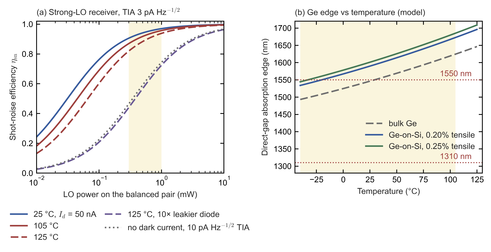

*Figure C4c.* (a) Shot-noise efficiency $\eta_{\rm sn}=I_{\rm LO}/(I_{\rm LO}+2I_d+i_{\rm th}^2/2q)$, Eq. \eqref{eq:shot-noise-efficiency}, for a balanced Ge pair (0.9 A/W). Dark current is scaled from 50 nA at 25 °C with 0.5 eV activation (a cube-of-absolute-temperature prefactor times an Arrhenius factor, the usual law for thermally generated carriers); the yellow band marks 0.3–1 mW of LO. (b) **Model estimate** of the Ge direct-gap absorption edge versus temperature: Varshni form (an empirical fit of band gap against temperature) plus ≈−0.11 eV per 1% biaxial tensile strain. The edge marks where strong direct absorption begins, not a responsivity cut-off. Script: `build/figures/ge_coherent_receiver.py`.

**How LO power is chosen in practice** [I]:
- Rogers et al. (*Nature* 2021) reached shot-noise parity at **5 µW of LO per pixel**. They used foundry-standard Ge PIN balanced detectors in GlobalFoundries **CMS90WG** (a 90 nm silicon-photonics process with electronics on the same chip), with 1.5 fF parasitics (stray capacitance at the amplifier input) and a 20 kΩ TIA (its transimpedance, i.e. output voltage per unit input current), and note that telecom coherent receivers "typically require ~10–100× more LO power". At 0.9 A/W, 5 µW gives 4.5 µA of LO photocurrent, so parity at that current implies an amplifier input noise of $\sqrt{2qI_{\rm LO}}=\sqrt{2\times1.602\times10^{-19}\times4.5\times10^{-6}}\approx1.2$ pA Hz⁻¹ᐟ², about 2.5 times quieter than the 3 pA Hz⁻¹ᐟ² assumed above [E]. The 0.3–1 mW used above therefore buys margin with a noisier amplifier; it is not a physical minimum.
- A discrete FMCW engine uses **1–2 mW** per balanced detector.
- Coherent telecom transceivers have used Ge photodiodes on silicon since at least a 2014 single-chip 100 Gb/s demonstration.
- SiLC describes "germanium detectors" on its chip [T]. Aurora says its "custom-designed photodiode achieves 25% higher sensitivity than… foundry library components", without naming the material [P].

**The caveat is cold, not heat.** Germanium absorbs strongly only photons whose energy exceeds its *direct band gap*, the "direct edge"; in Ge-on-Si that edge lies just longward of 1,550 nm at room temperature. Ge grown on silicon is under biaxial tensile strain (stretched in the wafer plane: on cooling from the growth temperature it would contract more than the silicon beneath it, which holds it stretched), and this lowers that gap and moves the edge to longer wavelengths. Band gaps widen as temperature falls, so in the cold the edge moves to shorter wavelengths, toward 1,550 nm.
- Tensile-strained Ge-on-Si has its direct edge near 1,600–1,625 nm at room temperature; the companion model puts it at 1,590 nm at 25 °C for 0.2% strain. The edge moves to shorter wavelengths as temperature falls: ≈0.54 nm/K for the SPAD cut-off in Vines et al., and ≈0.86 nm/K for the direct gap in the model, which puts the edge at 1,534 nm at −40 °C for 0.2% strain, so $(1{,}590-1{,}534)\ {\rm nm}/65\ {\rm K}=0.86$ nm/K.
- Measured (the absorption coefficient is the fractional loss of light per cm of Ge; responsivity falls with it): at 1,550 nm, one device's responsivity fell from **0.87 A/W at room temperature to 0.34 A/W at 200 K**, and the extracted absorption coefficient from ≈1,100 to 248 cm⁻¹ [I, Liu et al., *Micromachines* 2025].
- At −40 °C (233 K) a 1,550 nm receiver therefore loses roughly 40% of its responsivity unless it compensates [E: interpolating linearly between Liu et al.'s 0.87 A/W at room temperature, taken as 295 K, and 0.34 A/W at 200 K gives $0.34+(0.87-0.34)\times(233-200)/(295-200)=0.34+0.53\times0.347\approx0.52$ A/W at 233 K, i.e. $1-0.52/0.87\approx40\%$ lower]; the model puts the direct edge at 1,534–1,544 nm at −40 °C for 0.20–0.25% strain, already short of 1,550 nm. Options: heat the photonic integrated circuit (PIC), as automotive lidars already heat windows; lengthen the absorber; operate nearer 1,530 nm; use **1,310 nm**, far from the edge at all temperatures (the band Pointcloud chose, §C10.4), where the retinal factor $C_7=8+10^{0.04(\lambda-1250)}=259$ (with $C_4=5$) makes the small-source Class 1 retinal limit for long exposures $3.9\times10^{-4}C_4C_7=0.51$ W, so lenient that the binding limits become the 0.5 W cap at the Class 3B level, which IEC 60825-1:2014 imposes on Class 1 over 1,250–1,400 nm [P, Tables 8 and 9 via TCVN 12670-1:2020; I, Seibersdorf], and, in Europe, the A11 corneal limit for 1,250–1,400 nm, 0.1 W for exposures of 0.35 s or more [I, Seibersdorf] (subsection 1); or bond InGaAs photodiodes to the PIC.
- Datacom (short-reach data communication) Ge photodiodes are mostly O-band (1,310 nm) and specified for 0–70 °C or −5 to 85 °C, so automotive C-band operation at −40 °C is a qualification item, not a solved one.

**Ge for direct detection is a different matter.**
- Ge-on-Si **SPADs** are not ready for automotive 1,550 nm ToF. Artilux's room-temperature device has a dark count of 19 kcps/µm² and 12% PDE at 1,310 nm [I]. Vines et al. needed 125 K for 38% at 1,310 nm [I]; for 1 µm-thick Ge, detection at 1,550 nm needs operation at or above ≈245 K, because cooling moves the absorption edge to wavelengths shorter than 1,550 nm [I/E].
  - Arrays are now appearing for short range. At ISSCC 2026, Sony's Trento and Atsugi teams presented a 400 × 300-pixel SWIR Ge-SPAD dToF range sensor that draws 26 mW at 30 frames/s and is aimed at AR/VR (paper 7.5); the programme does not give its wavelength, PDE or dark count [P, ISSCC 2026 advance programme, p. 24]. Yildirim et al., submitting in November 2025, wrote that flash lidar with Ge-on-Si SPAD arrays had not yet been demonstrated, and the Ge-on-Si array they cite has 32 × 32 pixels [P, p. 5065].
- Sony's IEDM 2025 (International Electron Devices Meeting) 10 µm Ge-on-Si SPAD reports 23.3% PDE at 1,550 nm; its dark count rate (DCR) and operating temperature were not read (§C5a) [I].
- **Linear-mode Ge photodiodes do serve gated imaging.** TriEye's SWIR image sensor lives with a dark current of ≈200 µA cm⁻² by integrating only during short gates synchronised to its own laser pulses and by subtracting the dark current inside each pixel (§A7.5).
- **Coherent detection sidesteps the problem.** It needs no avalanche gain, so ordinary foundry Ge photodiodes suffice.

### 5. Water, rain and fog

Water absorbs near-infrared light more and more strongly toward longer wavelengths, so this subsection asks how much a wet window, a wet target, fog and rain cost in each band. Liquid water on windows and targets is the main weather penalty at 1,550 nm; fog treats the bands almost equally, because fog droplets are larger than all these wavelengths and scatter them about the same. The practical consequence is that a 1,550 nm lidar depends more on keeping its window dry.

| Effect | Numbers | Tag |
|---|---|---|
| Liquid-water absorption coefficient | 905 nm 0.07; 940 nm 0.18–0.29; 1,310 nm 1.2–1.6; **1,550 nm 10.8–11.9 cm⁻¹** | [I, Segelstein; Hale & Querry; Kou] |
| 1 mm water film (window or target) | Transmits 99.3% at 905 nm but **34% at 1,550 nm** (−4.7 dB one-way, **−9.4 dB round trip**); a 0.1 mm film costs 0.47 dB one way at 1,550 nm | [E] |
| Fog | Extinction differs by <10% between 905 and 1,550 nm (a ratio of 1.0–1.1); light of 1,000–2,400 nm, including 1,550 nm, is ≈10% more attenuated than visible light, which 905 nm matches, only in very dense fog (<30 m visibility), especially advection fog | [I, Duthon et al. 2019] |
| Rain | 905 nm reaches ≈2× farther than 1,550 nm at 25 mm/h | [S, Wojtanowski et al. 2014, relayed by a survey] |

*How the numbers are derived* [E]:
- **Film transmission** follows the Beer–Lambert law, $T_{\rm film}=e^{-\alpha_{\rm abs}d_{\rm film}}$. Here $T_{\rm film}$ is the fraction of light transmitted through the film, $\alpha_{\rm abs}$ the absorption coefficient of liquid water from the table (cm⁻¹, the fractional loss per cm of path), and $d_{\rm film}$ the film thickness in cm. The law assumes normal incidence and absorption only, with no scattering or reflection at the film's surfaces. The lower absorption coefficient of each range is used. For a 1 mm film ($d_{\rm film}=0.1$ cm) at 905 nm, $T_{\rm film}=e^{-0.07\times0.1}=0.993$. At 1,550 nm, $T_{\rm film}=e^{-10.8\times0.1}=e^{-1.08}=0.34$, which is $10\log_{10}0.34=-4.7$ dB one way and $2\times(-4.7)=-9.4$ dB for the two passes of a round trip. A 0.1 mm film gives $10\log_{10}e^{-0.108}=-0.47$ dB. With the upper coefficient, 11.9 cm⁻¹, the 1 mm film transmits 30% (−5.2 dB one way). Because the light crosses the film twice, the 1 mm film leaves $0.34^2$ of the dry-window signal at 1,550 nm, which costs range just as a much darker target would.
- **Terms in the table.** Extinction is the total loss of the beam by absorption plus scattering. Advection fog forms when moist air flows over a colder surface, and "visibility" is the distance at which a dark object can still be made out.

### 6. Verdict by band [E]

Putting subsections 1–5 together, each band wins or loses on a different constraint. The summary below is what a sensor architect would take from them.

- **905 nm** is the incumbent: VCSEL columns in the Hesai AT128/ATX and edge-emitting lasers (EELs) in the RoboSense M1/M1P/MX (§C3). It has the highest silicon absorption of the three bands but the worst sunlight. Where the source is an EEL, its drift (the shift of the emission wavelength as the laser warms) forces wide filters, which admit more sunlight.
- **940 nm** (VCSEL plus a back-side-illuminated (BSI) SPAD, lit through the thinned back of the chip so that wiring does not shade it) wins new designs. It has 17.5% more $C_4$ allowance and **the lowest photon background** (0.46× 905 nm, band-averaged). Its VCSEL drift of ≈0.07 nm/K allows 10 nm filters ($0.07\ {\rm nm/K}\times145\ {\rm K}\approx10$ nm over −40 to +105 °C, §C4 item 4). And light-trapped SPADs, whose surface textures lengthen the light's path in the silicon, recover PDE to 37–45% despite silicon's weaker absorption (45% is RoboSense's claim, §C4b).
- **1,550 nm pulsed ToF** gains 10²–10³× in allowed pulse energy for scanned beams (≈460–950× in the scanned-raster row of subsection 1). It pays with fibre lasers; with linear InGaAs APDs, because InGaAs SPAD arrays are ≈340–3,400× over their count-rate ceiling in sunlight (subsection 3); with array costs of 10–100× silicon per mm² (processed InGaAs at 1–10 €/mm² against ≈\$0.1 per mm² for the silicon of a Sony SPAD die, \$17–44 over 244 mm², §C5a); and with a ≈9 dB round-trip penalty through a 1 mm water film. It survives where range at low point rate is worth that price (§C4).
- **1,550 nm FMCW** is the natural pairing. The eye-safety allowance covers watts of CW light; telecom lasers, semiconductor optical amplifiers (SOAs) and modulators exist; and ordinary Ge photodiodes suffice once the LO sets the noise floor. Its constraints are heat, parallelism (how many coherent channels can run at once) and cold-start responsivity (§C7a, this section), not the detector material.

Sources: https://webstore.iec.ch/en/publication/3587 (IEC 60825-1:2014) ; https://webstore.iec.ch/en/publication/62424 (IEC 60825:2026 series, listing IEC 60825-1:2014 as the current Part 1 and TS 60825-13:2026) ; https://cdn.standards.iteh.ai/samples/102962/40796ccffe6b4cebaebebd5cdf8c2cba/IEC-TS-60825-19-2024.pdf (IEC TS 60825-19:2024, sample) ; https://www.icnirp.org/cms/upload/publications/ICNIRPLaser180gdl_2013.pdf (ICNIRP 2013 laser guidelines) ; https://web.archive.org/web/2023id_/https://laser-led-lamp-safety.seibersdorf-laboratories.at/fileadmin/uploads/intranet/dateien/le/laser/whitepaper_iec-60825-1_v1d.pdf (Seibersdorf Laboratories white paper on IEC 60825-1:2014) ; https://web.archive.org/web/2023id_/https://laser-led-lamp-safety.seibersdorf-laboratories.at/fileadmin/uploads/intranet/dateien/le/laser/whitepaper_a11_to_en_60825-1_v2_2022.pdf (Seibersdorf Laboratories white paper on EN 60825-1 A11) ; https://support.tofsensors.com/product/CS20/certification/CS20_Class1_Test_report.pdf (SGS Class 1 test report for a 940 nm device) ; https://www.laserfocusworld.com/lasers-sources/article/14212074/1550-nm-triple-junction-laser-diode-excels-for-automotive-lidar (Laser Focus World, 1,550 nm triple-junction laser diode) ; https://spectrum.ieee.org/under-the-hood-of-luminars-long-reach-lidar (IEEE Spectrum on Luminar) ; https://www.laserfocusworld.com/blogs/article/14040682/safety-questions-raised-about-1550-nm-lidar (Laser Focus World, safety questions about 1,550 nm lidar) ; https://www.sec.gov/Archives/edgar/data/1758057/000114036126011477/ef20067963-10k.htm (Luminar 10-K) ; https://www.sec.gov/Archives/edgar/data/1861737/000110465923004072/tm2120356-19_f1.htm (Hesai F-1) ; https://raw.githubusercontent.com/pvlib/pvlib-python/main/pvlib/data/ASTMG173.csv (ASTM G173-03 spectrum, pvlib copy) ; https://techcrunch.com/2018/04/12/luminar-puts-its-lidar-tech-into-production-through-acquisitions-and-smart-engineering/ (TechCrunch 2018 on Luminar) ; https://www.nature.com/articles/s41467-024-51975-6 (Vertilite review, Nature Communications 2024) ; https://www.coherent.com/news/press-releases/worlds-first-6-inch-inp-scalable-wafer-fabs-paving-the-way-for-the-next-generation-of-lasers-for-ai-transceivers-and-6g-wireless-networks (Coherent 6-inch InP press release) ; https://www.jeppix.eu/wp-content/uploads/2020/pilotline-files/JePPIX_Roadmap_2021_2025.pdf (JePPIX roadmap 2021–2025) ; https://www.jeppix.eu/wp-content/uploads/2020/04/JePPIXRoadmap2015.pdf (JePPIX roadmap 2015) ; https://siliconanalysts.com/data/wafer-pricing (Silicon Analysts wafer pricing) ; https://imagesensors.org/Past%20Workshops/2024%20ISSW/Papers/R02.1.pdf (Telesca et al., ISSW 2024) ; https://www.jstage.jst.go.jp/article/jsaprev/2023/0/2023_230402/_pdf (Sony automotive SPAD) ; https://www.nature.com/articles/s41467-019-08830-w (Vines et al., Nature Communications 2019) ; https://arxiv.org/pdf/2605.07343 (Na et al., review of germanium-silicon SPADs, Proc. SPIE 13448, 2025, for the Artilux and Vines et al. devices) ; https://www.analogphotonics.com/wp-content/uploads/2021/08/7_NFahrenkopf_JSTQE_2019.pdf (Fahrenkopf et al., JSTQE 2019) ; https://www.photonics.intec.ugent.be/download/pub_3746.pdf (Chen et al., Journal of Applied Physics 2016, author copy) ; https://link.springer.com/article/10.1007/s44275-025-00030-7 (Wang et al., SUSTech and RoboSense, Moore and More 2025) ; https://www.ncbi.nlm.nih.gov/pmc/articles/PMC12113715/ (Liu et al., Micromachines 2025) ; https://arxiv.org/pdf/2008.02411 (Rogers et al., Nature 2021, preprint) ; https://opg.optica.org/abstract.cfm?URI=OFC-2014-Th5C.1 (OFC 2014 single-chip 100 Gb/s demonstration) ; https://aurora.tech/newsroom/inside-auroras-photonic-engine-engineering-lidar-for-automotive-scale (Aurora photonic engine) ; https://omlc.org/spectra/water/data/segelstein81.txt (Segelstein water absorption data) ; https://www.mdpi.com/2076-3417/9/14/2843 (Duthon et al. 2019) ; https://arxiv.org/pdf/2112.08936 (Zhang et al., adverse-weather survey, ISPRS 2023, relaying Wojtanowski et al. 2014) ; https://opg.optica.org/abstract.cfm?URI=OFC-2025-Th3E.6 (GlobalFoundries Ge photodiode, OFC 2025) ; https://opg.optica.org/abstract.cfm?uri=OFC-2025-M4K.2 (Fudan University, Zhangjiang Laboratory and Innolight ultra-thin Ge photodiode, OFC 2025) ; https://doi.org/10.1364/AO.12.000555 (Hale and Querry 1973) ; https://doi.org/10.1364/AO.32.003531 (Kou, Labrie and Chylek 1993) ; https://doi.org/10.1038/s41586-024-07076-x (Na et al., Artilux room-temperature Ge-Si SPAD, Nature 2024) ; https://www.embedded.com/chip-integrated-fmcw-lidar-sensors-deliver-coherent-3d-vision/ (SiLC germanium detectors, trade press) ; https://www.indiamart.com/proddetail/hamamatsu-ingaas-apd-23931342712.html (G8931-20 distributor listing) ; https://imagesensors.org/Past%20Workshops/2024%20ISSW/Presentations/R05-2.pdf (Itzler, "Developing InP SWIR SPAD arrays for an automotive Geiger-mode lidar", ISSW 2024, slides 2, 8, 10, 11, 13, 16, 17, 19, 22, 34) ; https://www.eenewseurope.com/en/argo-ai-breakthrough-lidar-technology-has-400-m-range (eeNews Europe, Argo Lidar above 1,400 nm, 5 May 2021) ; https://doi.org/10.1364/OE.585267 (Yildirim et al., *Opt. Express* 34(3), 5064–5078 (2026), pp. 5064–5074) ; https://submissions.mirasmart.com/ISSCC2026/PDF/ISSCC2026AdvanceProgram.pdf (ISSCC 2026 advance programme, session 7, p. 24)

## C4d. Mechanical beam steering in numbers: speed limits, vibration qualification, scanner designs and what shipped

This section asks why lidars still steer their beams mechanically, which mechanisms survived automotive qualification, and why. Every long-range automotive lidar in series production still moves something. The designs that won keep the mechanism slow and put the speed in silicon. A mirror turning at 200 rpm in front of 128 or more laser–detector channels (Hesai), or a rotating four-sided prism (Huawei), has shipped in the millions. A single-beam 2-D MEMS mirror (micro-electro-mechanical systems: a millimetre-scale silicon mirror etched with its own torsion springs and actuators) must sweep 1,000–3,000 times a second [E] (subsection 2(a): 1,250 sweeps/s for the RoboSense M1 and 2,400–2,560 for InnovizOne). MEMS lidars shipped in hundreds of thousands, and their largest user is retiring them. Polygon-plus-galvo scanners grew with 1,550 nm and are now declining with it; Risley prisms and flexure scanners have not gone beyond their first programmes. This section works through the physics of speed (subsection 2), vibration and qualification (subsection 3) and the deployed trade-offs (subsection 4). Evidence tags are as elsewhere ([P] primary document, [I] independent source, [T] trade press, [E] my own estimate or calculation, [U] unverified); [D] deployed, [NT] near-term and [R] research mark deployment status.

**The scanner vocabulary used below.**
- A **polygon** is a mirror with several flat facets that spins continuously; each facet sweeps the beam once across the field.
- A **galvo** (galvanometer scanner) is a mirror on a limited-rotation motor with position feedback, so it can be pointed at any angle, held there, or swept at a chosen speed.
- A **Risley prism pair** is two thin wedge prisms rotating about the beam axis; each deflects the beam by a fixed angle, and their changing relative orientation traces a rosette pattern.
- A **flexure** is a spring-like structure that moves by bending rather than on bearings; a **voice coil** is the moving-coil motor of a loudspeaker, used as an actuator.
- A **resonant** axis oscillates sinusoidally at its mechanical resonance, which gives large angles for little power but a fixed frequency. A **quasi-static** axis is driven below resonance and can follow an arbitrary waveform, such as a slow linear ramp.
- The **fast axis** is swept once per line, the **slow axis** once per frame; "pts/s" is points (range measurements) per second.

### 1. The families: what moves, and where the parallelism sits

| Family | What moves, and how | Parallel channels | Deployment | Receive path |
|---|---|---|---|---|
| **360° spinning head** | The whole transceiver rotates continuously. Velodyne HDL-64E: user-selectable 5–20 Hz, i.e. 300–1,200 rpm [P] | Stacked vertically: HDL-64E 64 lasers and detectors, up to 2.2 M pts/s in its S3 version [P] (§C3c quotes 1.3 M points/s for the 2013 unit); Ouster OS1 32–128 channels [P] | Robotaxi and mapping fleets; HDL-64E on five of the six 2007 Urban Challenge finishers (§C3c) [D, robotaxi and robotics only] | Rotates with the head, so the lens can be as large as the housing |
| **One-axis rotating or oscillating mirror or prism, with an electronic column** | Hesai AT128: a 3-facet mirror, one frame per facet, **200 rpm at 10 Hz** [P, manual]. Hesai ATX: a one-axis mirror whose scan direction alternates every frame (even frames sweep toward increasing azimuth, odd frames back), i.e. an oscillating sweep. The ATX S01 user manual (A07, May 2026, §E9) calls it a "1-D rotating mirror (hybrid solid-state)", refers to more than one mirror surface and lists 10 Hz [P]. Huawei 192-line: a "four-sided rotating prism" positioned by a magnetic encoder [I]. Valeo SCALA: "rotating mirrors" [P] | A VCSEL column with a SiPM or SPAD column: AT128 128 channels; ATX 116 in its ATX_S01 configuration (64 "normal" and 52 "super-resolution" channels on 64 physical receive channels, §C4b) and 256 in the flagship configuration of the version delivered from April 2026 [P]; Huawei 192-line 4 emitters with a 189 × 600 SPAD [I]; SCALA 1/2/3 detectors with 3/16/360 pixels (§C3) | Valeo SCALA since 2017 (>220,000); AT128 (2022–24); ATX (>1 M); Huawei 96/192-line; RoboSense EM4 and Seyond Robin E1X (one axis, mechanism unpublished) [D] | Through the same slow mirror, so a lens of ≈25 mm fits a 25–30 mm-tall module (§C10.3a, item 7) |
| **Polygon plus galvo** (two macro-mirrors) | A spinning polygon for the fast horizontal axis, a galvanometer for the vertical. Luminar Iris: "scanning rotating mirror and mechanical adjustment scanning in vertical orientation" [I]. Seyond Falcon: the manual says only "dual-dimensional scanning" [P]; polygon plus galvo per trade sources [T] | Few: Iris has two fibre tips [I]; Falcon a fibre source split four ways (§C4) | Seyond Falcon on every NIO since the ET7, **750,000 Falcon units by Apr 2026** [T]. Luminar Iris on the Volvo EX90, functions never activated (§B2) [D, declining] | Large facets can share transmit and receive [E] |
| **Risley prism pair** | Two wedge prisms spinning at different speeds. Livox Mid-40: 18° wedges, $n=1.51$, −4,664 and 7,294 rpm on brushless DC motors; 38.4° circular field; 100,000 pts/s [P, Brazeal et al. 2021]. Deviation per prism $\approx(n-1)\alpha_{\rm wedge}=9.2°$, so the pair reaches ≈18° off-axis [E] | One or a few channels; the pattern fills the field over time | Livox HAP on the Xpeng P5 (2021, two per car, \$1,599) [P]. Its launch release calls it "rotating-mirror technology", so its internals may differ from the Mid-40 [U]. No later Livox automotive programme was found after Xpeng went lidar-free (Nov 2024, §C3) [D, exited] | Through the prisms; aperture can be large |
| **Focal-plane flexure** (Cepton MMT) | Emitters and detectors on voice-coil-driven flexures behind fixed lenses (§C3a): "frictionless, mirrorless, rotation-free" [P]. A Cepton patent scans both axes fast and nearly equally, for example 200 Hz horizontally and 210 Hz vertically, a Lissajous pattern that repeats at the 10 Hz difference, on counter-moving tuning-fork flexures that cancel reaction forces, to keep both axes away from road-bump frequencies [P, US 12,313,784 B2; a patent embodiment, not a product value] | Few | Vista-X90: 90° × 25°, 200 m at 10%, 0.13°, <12 W, <900 g, ASIL-B [P]. GM award cancelled Dec 2023; Koito since Jan 2025 [P] [NT, stalled] | Fixed lenses, not limited by a mirror |
| **2-D MEMS mirror** | A silicon mirror a few mm across. Resonant fast axis; resonant or quasi-static slow axis | Several modules tiling the field: RoboSense M1 has **five 905 nm laser + SiPM modules under one MEMS mirror** [I/T]: one laser per module, Hamamatsu SiPMs and a 7 mm electromagnetic mirror from RoboSense's subsidiary 希景科技, by a teardown [I] (an unsourced onsemi claim conflicts [U]). InnovizOne steers four lasers with one large MEMS mirror [P] | RoboSense M1/M1 Plus/MX (10+ brands, 50+ models; >800,000 passenger-car lidars in 2018–24, most of them M-series [P/E]). InnovizOne on the BMW 7 Series (2023); InnovizTwo on the VW ID. Buzz AD [D]. Blickfeld, AEye, MicroVision MAVIN, Pioneer: no car series [R/NT] | Coaxial through the mirror (Blickfeld: two resonant mirrors >10 mm [P]) or separate (AEye: mirror <1 mm [P]) |
| **1-D resonant MEMS with a line laser and a staring line receiver** | Fraunhofer (SPIE 11293, 2020): a 2 × 4 mm elliptical mirror at ≈1.5 kHz, >±45° mechanical, 180° field; hermetically sealed in vacuum; closed-loop position detection below 0.1° [P, abstract] | A line laser and a 1-D receiver array | Infineon's 2016 plan (3 × 4 mm mirror, "less than \$250", §C3c) reached no car found [U]. Research systems (Yoo et al. 2022) [R] | Staring: the receiver does not look through the mirror |
| **Coherent (FMCW) scanners** | Mostly undisclosed; patents and one product show the pattern. Aurora (Blackmore-origin patents): one or two polygons, e.g. ≈1,000–5,000 and ≈200–1,000 rpm (US 10,838,045 B2), or a refracting polygon (US 11,822,010 B2). Aeva: a galvo-driven slow axis with a diffractive fast axis (US 11,372,105 B1) [P, patents]. Voyant Carbon: one axis steered on chip plus a slow mirror (§C10.4) [P] | Few: one to tens of coherent channels (Mobileye's ended design was specified with 184 lines, §C3, §C7a), because each channel needs its own local oscillator (LO), balanced detector and GS/s digitizer for a 100–400 MHz beat (§C7, §C7a) | Aurora FirstLight on ≈20–25 driverless trucks [D]; Aeva on Daimler Truck from 2027 [NT]; Voyant in industrial sales; no passenger-car series (§C7) | Monostatic through the scanner, so walk-off and scanner-induced Doppler must be compensated: Aeva's lag-angle receive waveguides and mirror-Doppler patents (§C7) [P] |

Terms in the table: an **electronic column** is a vertical line of laser and detector channels fired electronically, so the mechanism only has to scan one (horizontal) axis. A **VCSEL** (vertical-cavity surface-emitting laser) emits from the chip surface, which makes dense laser arrays on one chip easy. A **SPAD** (single-photon avalanche diode) is a photodiode biased above breakdown, so that a single photon can trigger a detectable avalanche, and a **SiPM** (silicon photomultiplier) is an array of SPADs whose outputs are summed into one analogue signal. **FMCW** (frequency-modulated continuous-wave) lidar is the coherent kind: it sweeps its laser frequency and measures range and velocity from the beat between the return and the local oscillator. A **coaxial** or **monostatic** receiver looks back through the same optics, here the same scanner, that sent the beam out. A **GS/s digitizer** is an analogue-to-digital converter taking 10⁹ samples per second or more. **ASIL-B** is level B of the four Automotive Safety Integrity Levels of ISO 26262, from A (least demanding) to D (most). Walk-off and scanner-induced Doppler are explained in subsection 2(c).

*How the numbers are derived* [E]:
- **Spinning-head speed.** A head that makes one revolution per frame turns at $60f_{\rm frame}$ rpm, where $f_{\rm frame}$ is the frame rate in Hz, so 5–20 Hz is $60\times5=300$ to $60\times20=1{,}200$ rpm.
- **Risley deviation.** A thin wedge of apex angle $\alpha_{\rm wedge}$ (the angle between its two faces) and refractive index $n$ deviates a ray by $\approx(n-1)\alpha_{\rm wedge}=(1.51-1)\times18°=9.2°$; the thin-prism approximation assumes small angles and near-normal incidence. When the two wedges line up the deviations add, $2\times9.2°=18.4°$, so the pattern reaches ≈18° off-axis, a ≈37° cone, close to the quoted 38.4° field.

### 2. Speed: what limits each family

This subsection asks how fast each scanner must move and what physics stops it going faster. Five limits appear: (a) the sweep rate that the line count demands, (b) the pulse rate a single channel can use without range ambiguity, (c) the angle the scanner turns while the light is in flight, (d) the trade-off between mirror size, angle and frequency in MEMS, and (e) the collecting area of a mirror that also receives. Item (f) adds the eye-safety consequence. Together they explain why many slow channels beat one fast beam.

**(a) The mechanism's speed is set by the channel count.** Consider a frame of $N_{\rm lines}$ lines (rows of points, each drawn along the fast axis and stacked along the slow axis), repeated at the frame rate $f_{\rm frame}$ (Hz), with $N_{\rm par}$ channels imaging different lines at once. Assuming each line takes one full fast-axis sweep and no line is scanned twice, the scanner needs

$$S=\frac{N_{\rm lines}\,f_{\rm frame}}{N_{\rm par}} \label{eq:scanner-sweep-rate}$$

fast-axis sweeps per second ($S$ in s⁻¹). A bidirectional resonant mirror makes two sweeps per cycle (one each way), so its oscillation frequency must be $f_{\rm mirror}=S/2$. Examples [E]:
- AT128: $128\times10/128=10$ sweeps/s, which is one facet per frame at 200 rpm ($3\ {\rm facets}\times200/60\ {\rm rev\,s^{-1}}=10$ facets/s). ATX (256 channels): also $256\times10/256=10$ per second at 10 Hz. HDL-64E: $64\times10/64=10$, one revolution per frame.
- Seyond Falcon K1: its manual gives **1,520 "vertical scanning lines" per second** at 10 frames/s, configurable from 5 to 20 frames/s [P]. That is 152 lines per frame, close to the 144 implied by the manual's resolution table ($4.8°/0.08°=60$ lines inside the region of interest and $(25°-4.8°)/0.24°\approx84$ outside) [E], so a "vertical scanning line" is one horizontal sweep per beam. A teardown of a 2022 Falcon shows a five-facet polygon fed by a one-to-four fibre split, i.e. four beams scanning four lines at once [I]. The polygon therefore makes $1{,}520/4=380$ facet sweeps per second and turns at $1{,}520/(4\times5)=76$ rev/s, i.e. 4,560 rpm [E]. Each facet can sweep the beam over at most $2\times360°/5=144°$, so the 120° field uses $120/144=83\%$ of each sweep.
- RoboSense M1 (125 lines at 10 Hz [P, user guide]; RoboSense's January 2020 launch release gave 15 Hz for the pre-series unit): each of its five modules carries one laser (a teardown confirms one laser per module [I]) and scans every line of its own horizontal tile, so that $N_{\rm par}=1$ per tile in Eq. \eqref{eq:scanner-sweep-rate}, the mirror makes $S=125\times10/1=1{,}250$ sweeps/s, a resonant fast axis near $f_{\rm mirror}=S/2=0.63$ kHz. The point rate fits: $750{,}000/(125\times10)=600$ points per line, one every 0.2° over 120° [P/E].
- InnovizOne (256 lines at 10 frames/s, or 160 at 15 [P]) uses four 905 nm lasers and four silicon detectors behind one large in-house MEMS mirror [P, the chief executive in a call transcript filed with the SEC, Mar 2021]. With $N_{\rm par}=4$ in Eq. \eqref{eq:scanner-sweep-rate}, the mirror makes $256\times10/4=640$ or $160\times15/4=600$ sweeps/s, a resonant fast axis near $f_{\rm mirror}=S/2=0.30$–$0.32$ kHz [E]. A single-beam design would need $2{,}400$–$2{,}560$ sweeps/s, i.e. 1.2–1.3 kHz.
- **This is the core of why one mechanical axis won (§C4, item 6).** The column puts the parallelism in silicon, so the mirror runs about 100–300× slower than a single-beam 2-D mirror (10 sweeps/s against 1,000–3,000, i.e. $1{,}000/10=100$ to $3{,}000/10=300$; $1{,}250/10=125$ for the M1 and $2{,}560/10=256$ for a single-beam InnovizOne; figure panel d). InnovizOne softens the problem by sharing each sweep among four lasers, at 600–640 sweeps/s [P/E].

**(b) Each channel has a time-of-flight rate limit.** If a channel fires its next pulse before the previous echo can have returned from the farthest target, it cannot tell which pulse an echo belongs to (range ambiguity). Without range ambiguity a channel can therefore fire at most once per round trip:

$$\text{PRF}_{\rm ch}\le\frac{c}{2R_{\max}} \label{eq:prf-limit}$$

where $\text{PRF}_{\rm ch}$ is the channel's pulse repetition frequency, $c$ the speed of light and $R_{\max}$ the maximum range. That is $3\times10^{8}\ {\rm m\,s^{-1}}/(2\times200\ {\rm m})=750$ kHz for a 200 m maximum range, 600 kHz for 250 m and 300 kHz for 500 m [E]. Pulse coding (giving successive pulses distinguishable patterns) can relax the bound, at a cost in processing and interference robustness (§C9). A sensor's point rate divided by this per-channel limit is the minimum number of channels that must fire in parallel, at one pulse per point; several pulses per point multiply that minimum by their number. Examples [E]:
- InnovizOne's 2.8 M native pts/s [P] with a 250 m maximum range need at least $2.8\times10^{6}/(6\times10^{5})=4.7$, i.e. five, channels firing in parallel. With four lasers [P], each would fire at $2.8\times10^{6}/4=700$ kHz, above the 600 kHz limit, so each pulse probably yields more than one point, for example through a small detector array per laser [E/U].
- Falcon K1's 900,000 pts/s with a 500 m maximum [P] need at least $9\times10^{5}/(3\times10^{5})=3$, consistent with a four-way split source.
- RoboSense M1 Plus's 787,500 pts/s [P] would just exceed one channel's limit at 200 m ($787{,}500/750{,}000=1.05$). Across five modules each fires at $787{,}500/5\approx160$ kHz.
- AT128 and ATX measure only 12–15 kpts/s per channel (1.536 M pts/s over 128 channels and 3.84 M/256). At one pulse per point that is also each channel's pulse rate, roughly 40–60 times below Eq. \eqref{eq:prf-limit}'s 600–750 kHz ($600/15=40$ to $750/12\approx63$). The ATX_S01 configuration spreads $1.74\times10^{6}$ pts/s over 64 physical receive channels (§C4b), $1.74\times10^{6}/64\approx27$ kpts/s each; if the 256-line version kept 64 channels, each would handle $3.84\times10^{6}/64=60$ kpts/s, still about a tenth of the limit [P/T/E]. **The dominant designs are far from this limit; single-beam scanners run into it.**

**(c) Walk-off during the round trip.** If the return comes back through the moving scanner, the scanner keeps turning during the round-trip time $2R/c$, so by the time the echo arrives the receiver is looking in a slightly different direction from the one the pulse was sent in. The angular offset, the *walk-off*, is

$$\Delta\theta=\frac{2R\,\dot\theta}{c} \label{eq:scan-walk-off}$$

where $R$ is the target range, $c$ the speed of light and $\dot\theta$ the *optical* angular speed, i.e. the rate at which the outgoing beam direction sweeps (for a mirror, twice its mechanical rotation rate $\dot\theta_{\rm m}$, because reflection doubles angles). With $\dot\theta$ in °/s, $\Delta\theta$ comes out in degrees; with $\dot\theta$ in rad/s, in radians. The formula assumes that $\dot\theta$ is constant during the flight time. This is the time-of-flight (ToF) counterpart of the coherent lag angle in §C10.3a (item 6). The table evaluates it at each scanner's peak optical angular speed $\dot\theta$, against a 0.1° receive pixel [E]:

| Scanner | Optical angular speed | Walk-off at 200 m | Against a 0.1° pixel |
|---|---|---|---|
| 360° spin at 10 Hz | 3,600°/s | 0.005° | Negligible |
| AT128 mirror at 200 rpm (reflection doubles the angle) | 2,400°/s | 0.003° | Negligible |
| Polygon, Falcon K1: five facets, four beams, $2\times360°\times76$ rev/s [I/E]; §C7 and §C7b use the lower bound $120°\times380=45{,}600$°/s | 54,720°/s | 0.073° (0.091° at 250 m) | About one 0.09° region-of-interest (ROI) step: the receive field must be elongated or offset along the scan |
| Resonant MEMS, 1 kHz, ±30° optical (illustrative; peak speed, mid-sweep) | 188,500°/s | 0.25° | 2.5 pixels: a coaxial receiver loses the return unless its field is widened, which admits more sunlight |
| Resonant 1-D MEMS, 1.5 kHz, 180° field | 848,000°/s | 1.1° | The receiver must stare, as in Yoo et al.'s line-laser system |

*How the numbers are derived* [E] (companion script):
- **Optical angular speed.** A 10 Hz spin is $360°\times10=3{,}600$°/s. The AT128 mirror turns at $\dot\theta_{\rm m}=200/60\times360°=1{,}200$°/s, doubled on reflection to $\dot\theta=2{,}400$°/s. Each of its three facets turns through 120° per frame and so sweeps the beam through 240°, of which the 120° field uses half; the frame-average rate $120°\times10\ {\rm Hz}=1{,}200$°/s used for a column sweep in §C10.3a (item 6) is therefore half this active rate. The Falcon K1 polygon turns at 76 rev/s (subsection 2(a)), so $\dot\theta=2\times360°\times76\ {\rm s^{-1}}=54{,}720$°/s, the value in the table; the lower bound used in §C7 and §C7b, $120°\times380\ {\rm s^{-1}}=45{,}600$°/s, assumes that the 120° field fills each facet's whole sweep time. A resonant mirror scanning $\theta(t)=(\Theta_{\rm pp}/2)\sin2\pi f_{\rm mirror}t$, where $\theta(t)$ is the optical beam angle at time $t$, $\Theta_{\rm pp}$ the peak-to-peak optical scan angle and $f_{\rm mirror}$ the resonant frequency, moves fastest mid-sweep. Its time derivative peaks there at $\dot\theta_{\max}=\pi f_{\rm mirror}\Theta_{\rm pp}$: $\pi\times1{,}000\ {\rm Hz}\times60°=188{,}500$°/s for ±30°, and $\pi\times1{,}500\ {\rm Hz}\times180°=848{,}000$°/s for the 180° 1-D mirror.
- **Walk-off** is $\Delta\theta=2R\dot\theta/c$, Eq. \eqref{eq:scan-walk-off}. At 200 m and 3,600°/s, $\Delta\theta=2\times200\ {\rm m}\times3{,}600°{\rm /s}/(3\times10^{8}\ {\rm m\,s^{-1}})=0.0048°$. The same step gives 0.0032° (AT128), 0.073° (polygon at 54,720°/s; 0.091° at 250 m, and 0.061° at the 45,600°/s lower bound), 0.25° (1 kHz MEMS, $0.25/0.1=2.5$ pixels) and 1.13° (1.5 kHz 1-D MEMS).
- **Polygon row.** The entry uses the teardown geometry of subsection 2(a): each of the five facets sweeps the beam through $2\times360°/5=144°$, of which the 120° field uses 83%, so the active sweep is faster than the lower bound. The "ROI step" is the finest angular spacing Falcon K1 uses inside its region of interest, the part of the field it samples more densely (0.09°, subsection 4).

Walk-off is why fast resonant mirrors either work at short range or pair with a staring receiver, while slow rotating mirrors can share one large aperture for transmit and receive (figure panel b). For a coherent receiver the moving mirror also spreads and shifts the optical frequency (a Doppler effect, because different parts of the mirror move toward or away from the light), by about $\Delta f_{\rm scan}\approx\dot\theta D/\lambda$ per pass. Here $\dot\theta$ is the optical angular speed in rad/s, $D$ the beam diameter on the scanner and $\lambda$ the wavelength. A chirp (the FMCW frequency sweep) longer than about $1/\Delta f_{\rm scan}=\lambda/(\dot\theta D)$ is smeared, so that time caps the chirp; it is also the time the beam takes to sweep through one diffraction-limited beamwidth, $\lambda/D$. For a 5 mm beam at 1,550 nm and the Falcon polygon's lower-bound 45,600°/s (796 rad/s), $\Delta f_{\rm scan}=796\ {\rm s^{-1}}\times5\times10^{-3}\ {\rm m}/(1.55\times10^{-6}\ {\rm m})\approx2.6$ MHz, which caps the chirp near $1/(2.6\ {\rm MHz})\approx0.39$ µs (§C7, scanner-induced Doppler). ToF is immune, because it measures arrival time, not optical frequency.

**(d) The MEMS bound: aperture × angle × frequency.** A lidar wants a MEMS mirror that is large (to carry a wide beam and collect light), scans a wide angle and moves fast. For a given technology these three pull against each other, so their product is a useful figure of merit (FoM).
- **Figure of merit.** Wang, Watkins & Xie (*Micromachines* 2020) define

  $${\rm FoM}=\theta_e\,d_e\,f_e \label{eq:mems-figure-of-merit}$$

  in mm·rad·kHz. Here $\theta_e$ is the optical field (full scan angle) in radians; $d_e=\sqrt{4A_{\rm mirror}/\pi}$ the effective mirror size in mm, i.e. the diameter of a circle with the same area as the mirror of area $A_{\rm mirror}$; and $f_e$ the resonance in kHz. Their minimum for self-driving cars is a 25° field, a 2 mm mirror, a 0.8 kHz resonance and FoM 0.7; for blind-spot sensing, 120°, 1 mm and 0.5 kHz [P, review]. With $25°=0.436$ rad, the car case is $0.436\times2\times0.8=0.70$.
- **Measured examples** [P]:
  - Mirrorcle's quasi-static gimbal-less mirrors (both axes driven directly, without a separate gimbal frame for the second axis): 2.0 mm / ±10° optical / 1,300 Hz first resonance; 3.0 mm / ±16° / 400 Hz; 5.0 mm / ±11° / 350 Hz; 6.4 mm / ±5° / 300 Hz. These give FoM 0.3–0.9 [E], taking $\theta_e$ as the full optical field: $0.349\ {\rm rad}\ (20°)\times2.0\ {\rm mm}\times1.3\ {\rm kHz}=0.91$; $0.559\times3.0\times0.4=0.67$; $0.384\times5.0\times0.35=0.67$; $0.175\times6.4\times0.3=0.34$.
  - Fraunhofer's resonant 1-D mirror: 2 × 4 mm, 180°, 1.5 kHz, FoM ≈13 [E]: the ellipse, with semi-axes of 1 and 2 mm, has $A_{\rm mirror}=\pi\times1\times2=6.28\ {\rm mm^2}$, so $d_e=\sqrt{4A_{\rm mirror}/\pi}=2.83$ mm and Eq. \eqref{eq:mems-figure-of-merit} gives FoM $=\pi\ {\rm rad}\times2.83\ {\rm mm}\times1.5\ {\rm kHz}=13.3$.
  - Hua et al.'s electromagnetic 2-D Φ5 mm (5 mm diameter) mirror: a 30° fast axis at 1.2–1.3 kHz (FoM ≈3.3 [E]: $0.524\ {\rm rad}\times5\ {\rm mm}\times1.25\ {\rm kHz}=3.3$ at mid-band, 3.1–3.4 over 1.2–1.3 kHz) and a 20° slow axis with a **136 Hz** resonance.
- **Resonance buys an order of magnitude in FoM.** The price is a fixed, sinusoidal fast axis that must track its own resonance (subsection 3).
- **Why the bound exists.** Three effects limit a larger, faster mirror.
  - *Inertia against stiffness.* The mirror's moment of inertia about its rotation axis grows as $J\propto\rho_{\rm m}t_{\rm m}D^4$, where $\rho_{\rm m}$ is the density of the mirror material, $t_{\rm m}$ the mirror thickness and $D$ its diameter (mass $\propto\rho_{\rm m}t_{\rm m}D^2$, times the square of a lever arm $\propto D$). The resonant frequency is set by the torsion spring's stiffness $k_\theta$ (torque per radian of twist) against that inertia, $f_{\rm mirror}\propto\sqrt{k_\theta/J}$, so a bigger mirror needs a much stiffer spring to stay fast.
  - *Spring stress.* A stiffer spring twisted through a large angle is more highly stressed, and the stress runs into silicon's fracture strength.
  - *Dynamic deformation.* The mirror bends as it accelerates, because its outer parts must be pushed hardest. The angular acceleration of a sinusoidal scan peaks at the turning points, where the mirror is flexed most.
- **Brosens' formula** for that dynamic deformation is

  $$\delta_{\max}=\frac{0.217\,\rho_{\rm m}f_{\rm mirror}^2D^5\theta_{\rm mech}}{E\,t_{\rm m}^2} \label{eq:brosens-mirror-deformation}$$

  [I, as reproduced with its variable definitions by Urey (Proc. SPIE 4773, 2002) from P. J. Brosens, *Appl. Opt.* 11, 2987 (1972); the 1972 original is paywalled and was not read]. Here $\delta_{\max}$ is the peak departure of the mirror surface from flat (m); $\rho_{\rm m}$ the density (kg/m³); $f_{\rm mirror}$ the scan frequency (Hz); $D$ the mirror diameter (m); $\theta_{\rm mech}$ the mechanical scan amplitude, i.e. the peak rotation of the mirror from rest (rad), which is half the optical amplitude; $E$ the material's Young's modulus (Pa); and $t_{\rm m}$ the thickness (m). Here $f_{\rm mirror}$ is in hertz, not the angular frequency $2\pi f_{\rm mirror}$; $D$ is strictly the width across the rotation axis, and $\delta_{\max}$ the largest departure of the bent cross-section from the chord through the axis and the edges. A cantilever-strip estimate reproduces the coefficient [E]: each half of a mirror held along its axis, bent by the inertial load of the peak angular acceleration $(2\pi f_{\rm mirror})^2\theta_{\rm mech}$, gives $\delta_{\max}=0.226\,(1-\nu^2)\rho_{\rm m}f_{\rm mirror}^2D^5\theta_{\rm mech}/(E\,t_{\rm m}^2)$, where $\nu$ is Poisson's ratio. That equals 0.217 for $\nu=0.2$, and 0.208–0.215 for silicon ($\nu=0.22$–0.28), within 1–4%. The formula assumes a flat plate of uniform thickness and elastic, small deflections. The steep $D^5$ and $t_{\rm m}^{-2}$ dependences are what make large, thin, fast mirrors impractical. Worked examples for silicon ($\rho_{\rm m}=2{,}330$ kg/m³, $E\approx169$ GPa, a typical value for silicon's direction-dependent stiffness), $\theta_{\rm mech}=15°$ [E]:
  - 3 mm, 100 µm thick, 1.5 kHz: in SI units with $\theta_{\rm mech}=15°=0.26$ rad, Eq. \eqref{eq:brosens-mirror-deformation} gives $\delta_{\max}=0.217\times2{,}330\times1{,}500^2\times(3\times10^{-3})^5\times0.26/[169\times10^{9}\times(10^{-4})^2]=4.25\times10^{-8}$ m, i.e. 42.5 nm.
  - 5 mm, 100 µm, 1.5 kHz: $(5/3)^5=12.86$ times the 3 mm value, $12.86\times42.5\ {\rm nm}=547$ nm ≈ **0.55 µm**, six times $\lambda/10$ at 905 nm (90.5 nm; $547/90.5=6.0$). Here $\lambda/10$, a surface flat to a tenth of the wavelength, is the usual flatness requirement for optics that must not degrade a diffraction-limited beam. At 250 µm thickness the deformation falls by $(250/100)^2=6.25$ to 88 nm.
  - 10 mm at the same frequency: $2^5=32$ times worse, $32\times0.547=17.5$ µm at 100 µm. Since $\delta_{\max}\propto t_{\rm m}^{-2}$, meeting $\lambda/10$ would take $t_{\rm m}=100\ {\rm µm}\times\sqrt{17{,}500/90.5}\approx1.4$ mm of silicon, whose inertia would pull the resonance far below 1.5 kHz (figure panel c).
- **How flat is flat enough for lidar?** $\lambda/10$ is a diffraction-limited imaging criterion. A 905 nm ToF beam is 0.05–0.1° wide, 5–10 times the 0.01° diffraction limit of a 5 mm mirror ($\lambda/D=905\ {\rm nm}/5\ {\rm mm}=0.18$ mrad). What matters is therefore not wavefront error against $\lambda/10$ but whether deformation tilts the reflected rays by a sizeable fraction of the beam width; that tilt is roughly $10\,\delta_{\max}/D$ [E, order of magnitude]. The factor 10 is a rough allowance, not a derived constant: the local surface slope of a bent mirror is several times its average slope $\delta_{\max}/D$, and reflection doubles any tilt of the surface. That gives $10\times0.55\ {\rm µm}/5\ {\rm mm}=1.1$ mrad ≈0.06° for the 5 mm, 100 µm, 1.5 kHz case, already comparable with a 0.1° pixel. A 10 mm mirror 250 µm thick at 1.5 kHz ($\delta_{\max}=17.5\ {\rm µm}/6.25=2.8$ µm) gives $10\times2.8\ {\rm µm}/10\ {\rm mm}=2.8$ mrad ≈0.16°. A coherent receiver, which must match the return to a single optical mode (the LO's wavefront), is held to the stricter $\lambda/10$ class (§C10.3a). In practice, then, a ToF mirror may be less flat than $\lambda/10$, but a 5 mm, 100 µm mirror at 1.5 kHz already blurs the beam by an amount comparable with a pixel.

**(e) Receive aperture: the mirror that also receives sets the collecting area.** Compare a coaxial MEMS mirror with the ≈25 mm (491 mm²) lens of a scanned one-axis unit (§C10.3a, item 7). Range scales as $\sqrt{A_{\rm rx}}$ when signal-limited and as $A_{\rm rx}^{1/4}$ when background-limited, where $A_{\rm rx}$ is the receive-aperture area (the caveats of §C10.3a, item 7) [E]. The reasons are as follows, for a target that fills the beam and returns light as $1/R^2$, with everything else (pixel field, filter, clear air) unchanged.
- *Signal-limited* means that detection needs a fixed number of signal photons. That number scales as $A_{\rm rx}/R^2$, so the range at which it is reached scales as $\sqrt{A_{\rm rx}}$.
- *Background-limited* means that the noise is the shot noise of the sunlight background. The background itself grows in proportion to $A_{\rm rx}$ (Eq. \eqref{eq:background-rate-radiance}), so the signal-to-noise ratio scales as $(A_{\rm rx}/R^2)/\sqrt{A_{\rm rx}}=\sqrt{A_{\rm rx}}/R^2$, and range as $A_{\rm rx}^{1/4}$.

| Coaxial mirror | Area at normal incidence | Area ratio | Range factor, signal-limited | Range factor, background-limited |
|---|---|---|---|---|
| 10 mm (Blickfeld class) | 78.5 mm² | 1/6.3 | 0.40 | 0.63 |
| 5 mm | 19.6 mm² | 1/25 | 0.20 | 0.45 |
| 2 × 4 mm ellipse | 6.3 mm² | 1/78 | 0.11 | 0.34 |
| 2 mm | 3.1 mm² | 1/156 | 0.08 | 0.28 |

- At an angle of incidence $\theta_{\rm inc}$ (between the incoming light and the mirror's normal) the projected area falls by a further $\cos\theta_{\rm inc}$ (0.71 at 45°).
- Mirrorcle's own architecture study reaches the same conclusion from the vendor side [P]. A coaxial rangefinder reaching beyond 100 m "may need" a mirror of 3–5 cm, and even ≥10 mm is needed for 30 m in a concentric design (transmit and receive paths nested on the same axis). Smaller, faster mirrors belong in biaxial designs, whose separate receiver sits beside the transmitter.
- Blickfeld's Cube 1 (two resonant mirrors >10 mm, 70° × 30°, 0.4° divergence) has a typical range of 1.5–75 m [P], consistent with the table: applied to the ≈200 m of a one-axis unit such as the AT128, its factors give roughly 80 m when signal-limited ($0.40\times200$ m) and ≈126 m when background-limited ($0.63\times200$ m). If its receive field matches its 0.4° divergence, it spans about $(0.4/0.1)^2=16$ times the solid angle of a 0.1° pixel, and that extra background favours the lower figure [E].
- **Production MEMS lidars therefore either tile several transceivers under one mirror (RoboSense M1's five modules [I]) or receive through separate optics,** which brings back part of the staring-receiver penalty of §C6 [E].

*How the numbers are derived* [E] (aperture table above):
- **Areas and ratios.** A circular mirror of diameter $D$ has $A_{\rm rx}=\pi D^2/4$: the 25 mm lens has $\pi\times12.5^2=491\ {\rm mm^2}$ and the 10 mm mirror $\pi\times5^2=78.5\ {\rm mm^2}$, a ratio of $491/78.5=6.25$. The ellipse, with semi-axes $a=1$ mm and $b=2$ mm, has $\pi ab=\pi\times1\times2=6.28\ {\rm mm^2}$, and $491/6.28=78$.
- **Range factors** are $(A_{\rm rx}/A_{\rm lens})^{1/2}$ and $(A_{\rm rx}/A_{\rm lens})^{1/4}$, where $A_{\rm lens}=491$ mm² is the 25 mm lens. For the 10 mm mirror they are $(1/6.25)^{1/2}=0.40$ and $(1/6.25)^{1/4}=0.63$; for the 2 mm mirror, $(1/156)^{1/2}=0.080$ and $(1/156)^{1/4}=0.28$.

**(f) Eye safety of a small, fast scanner.** A few-mm mirror emits a beam narrower than the 7 mm pupil, so a whole pulse can enter the eye (§C4c). A stalled scanner also concentrates pulses in one direction.
- IEC 60825-1 requires the class to hold "under reasonably foreseeable single fault failure conditions" [P, via a test house].
- A scanned Class 1 design therefore needs scan monitoring interlocked with the laser, i.e. a circuit that switches the laser off if the scan stops or slows. Mirrorcle: Class 1 on a continuously scanned beam "requires that the scan is reliably monitored" [P]. The system in the Fraunhofer paper uses an Infineon AURIX safety controller (an automotive safety microcontroller) that monitors the mirror, its driver and the receiver [P, abstract via a search extract].
- Spinning heads and rotating mirrors need the same interlock (motor speed, encoder). Their larger exit apertures spread each pulse over more area, so less of it can enter a 7 mm pupil [E].

### 3. Vibration, shock and qualification

A part mounted on a car must survive years of road vibration and occasional shocks, and it must pass standard tests before a carmaker will buy it. This subsection lists what those tests demand, where each scanner family is exposed, and why MEMS mirrors, though mechanically strong, are vulnerable in a way that slow motor-driven mirrors are not. The short answer is that the road's vibration energy sits mostly below 400 Hz, exactly where the slow axis of a MEMS mirror of 3 mm or more resonates.

**What the tests require.** Random-vibration tests are specified by a *power spectral density* (PSD) of acceleration, $G_a(f)$ in (m/s²)²/Hz: the mean-square acceleration per hertz of bandwidth at frequency $f$. Integrating it over frequency gives the total mean-square acceleration, whose square root is the "rms" (root-mean-square) level. Shock and vibration levels are also quoted in units of $g=9.81$ m/s², the acceleration due to gravity.
- **ISO 16750-3 (mechanical loads)** [P, 2012 edition, public preview of the standard]:
  - Test IV, passenger car sprung masses (the body, which sits on the suspension springs), is random vibration to IEC 60068-2-64: **8 h per plane at 27.1 m/s² rms**. The PSD falls from 30 (m/s²)²/Hz at 10 Hz to 0.2 at 400 Hz and stays flat to 1,000 Hz.
  - By integration, 84% of the mean-square acceleration lies below 400 Hz, and nothing lies above 1 kHz [E]. Between 10 and 400 Hz the PSD falls as a power law, a straight line on log–log axes between the two breakpoints (the usual way such profiles are specified):

    $$G_a(f)=30\ {\rm (m/s^2)^2\,Hz^{-1}}\times\left(\frac{f}{10\ {\rm Hz}}\right)^{-\gamma},\qquad \gamma=\frac{\ln(30/0.2)}{\ln(400/10)}=1.358 \label{eq:vibration-psd}$$

    where $-\gamma$ is the slope on log–log axes (the PSD falls as $f^{-\gamma}$). So $\int_{10}^{400}G_a\,df=30\times10/(1-\gamma)\times(40^{1-\gamma}-1)=614\ {\rm (m/s^2)^2}$; the flat part adds $0.2\times600=120$. The total, 734, gives $\sqrt{734}=27.1$ m/s² rms, and $614/734=84\%$.
  - Test V (unsprung masses, i.e. wheel mounts) is 107.3 m/s² rms.
  - The current edition, ISO 16750-3:2023, splits the body test by component size. Test IV covers small and lightweight devices under test (DUTs) on passenger-car sprung masses (§4.1.8), and Test XIV, taken from ISO 19453-3:2018, covers large and heavy DUTs on hybrid-electric and fully electric cars (§4.1.10) [P, official preview]. Its foreword says the vibration profiles were changed "where necessary due to extended datasets of and experience from vehicle measurements". The 2023 breakpoints and the mass threshold between the two classes are not in the public preview, so the 2012 profile is used here, and placing a 0.36–1.75 kg lidar in the small class is an assumption [U].
  - **Mechanical shock:** 500 m/s² (≈50 g), 6 ms half-sine (a single acceleration pulse shaped like half a sine wave, 6 ms long), 10 shocks per direction [P, Bosch datasheet citing ISO 16750-3].
- **LV 124** (the German carmakers' common component specification) includes M-01 free fall, M-04 vibration and M-05 mechanical shock among its tests M-01 to M-09 [T]. Yoo et al. drove their MEMS lidar with a wideband profile based on LV 124 [P].
- **OEM group standards** (a carmaker's, or original equipment manufacturer's, own test specifications).
  - InnovizOne's series datasheet lists "MEMS: AECQ and BMW GS 950324-3-1" as printed. BMW's environmental standard for components is usually cited as GS 95024-3-1 [U].
  - At system level it lists DIN/EN/IEC 60068-2, ISO 16750, ISO 20653 (IP6K6K, IP6K9K, IP6K7) and ISO 26262 ASIL B(D) [P]. ISO 20653 defines the IP (ingress protection) codes: the first digit rates dust ("6K" is dust-tight), the second water (7 is temporary immersion, 9K high-pressure, high-temperature jets, 6K powerful jets). ISO 26262 is the functional-safety standard, and ASIL B(D) denotes a part developed to ASIL B as one share of a safety goal rated ASIL D, the highest level.
- **Component qualification.** The Automotive Electronics Council (AEC) publishes stress-test qualifications for components.
  - AEC-Q100 covers integrated circuits (ICs) and AEC-Q102 discrete optoelectronics such as lasers and photodiodes. AEC-Q103 covers only MEMS pressure sensors (-002) and microphones (-003) [P].
  - **No AEC document covers MEMS mirrors or scanner motors.** Suppliers therefore cite AEC-Q100 for the MEMS chip (RoboSense: MEMS module AEC-Q100, tested by SGS [P]) or an OEM test (Innoviz).
- **System-level examples** [P]:
  - Falcon K1: IEC 60068-2-27 shock and IEC 60068-2-64 vibration; IP67 body and IP69K window; −40 to +85 °C; 1.75 kg.
  - ATX: ASIL B product certification; IP6K7 and IP6K9K; 360 g.
  - M1 Plus: ASIL B; AEC-Q100; IP67 and IP6K9K; −40 to +85 °C.
  - InnovizOne: 15 years, 300,000 km or 8,000 operating hours. It operates from −15 to +85 °C "with airflow/cooling solution (depending on configuration, mounting position and environment)", and is stored at −40 to +105 °C. A −15 °C operating floor is narrow for a car part; the datasheet gives no reason [U].

**Where each family is exposed** [E unless tagged]. The table rates each mechanism against shock, road vibration, wear and temperature. The wear column counts revolutions or oscillation cycles over the 8,000 operating hours that InnovizOne's datasheet specifies as its life.

| Family | Shock | Road vibration (10–1,000 Hz) | Wear over 8,000 operating hours | Temperature |
|---|---|---|---|---|
| Spinning head | Largest moving mass: bearings, balance, alignment of the rotating optics | Rotor modes and bearing loads; roof mount | 10 Hz gives 2.9 × 10⁸ revolutions | Motor, power and data transfer across the rotor |
| One-axis rotating mirror | Small rotor | Mirror and rotor modes far above the band; speed held by an encoder | AT128 at 200 rpm gives 9.6 × 10⁷ revolutions | Motor, lubricant |
| Polygon plus galvo | Two mechanisms; heavier (Falcon K1 1.75 kg [P]) | The galvo servo must out-run the disturbance; polygon speed stability | The 76 rev/s of subsection 2(a) gives 2.2 × 10⁹ revolutions | Motors, bearings |
| Risley pair | Two motors and glass prisms | Continuous rotation, no reversal | 7,294 rpm gives 3.5 × 10⁹ revolutions. Livox alternates the two prism speeds between power cycles, which Brazeal et al. suggest extends motor life [P] | Motors |
| MEMS | **Intrinsically strong** [P, Mirrorcle]: 500 g / 1 ms for integrated 2 mm devices and 300 g / 1 ms for larger bonded ones; 20 g sine over 20–2,000 Hz (MIL-STD-883) | **The weak point:** a slow axis whose resonance lies inside the band, and a fast axis that must hold phase | 1–1.5 kHz gives 2.9–4.3 × 10¹⁰ cycles. Vendor tests report "billions of cycles (2500+ hours)" without mechanical failures; a die-attach epoxy failure was found and fixed [P, Mirrorcle] | Resonance drifts ≈−30 ppm/K in uncompensated silicon, −3,750 ppm over −40 to 85 °C [P]. Vacuum packaging raises Q and protects the mirror (Fraunhofer) |

*How the numbers are derived* [E]:
- **Revolutions or cycles** are rate × 8,000 h × 3,600 s/h, i.e. rate × $2.88\times10^{7}$ s. A 10 Hz head makes $10\times2.88\times10^{7}=2.9\times10^{8}$ revolutions; the AT128 at $200/60=3.33$ rev/s makes $9.6\times10^{7}$; the Risley's $7{,}294/60=122$ rev/s makes $3.5\times10^{9}$; a 1–1.5 kHz mirror makes $2.9\times10^{10}$ to $4.3\times10^{10}$ cycles.
- **Polygon.** The ≈380 sweeps/s of subsection 2(a), already divided by the four beams, need $380/5=76$ rev/s from the five-facet polygon of the teardown (one sweep per facet), and $76\times2.88\times10^{7}=2.2\times10^{9}$.
- **Resonance drift.** $-30\ {\rm ppm/K}\times125\ {\rm K}=-3{,}750$ ppm over −40 to 85 °C (ppm/K is parts per million of the frequency per kelvin). Silicon's stiffness falls slightly as it warms, so an uncompensated resonance drifts downward with temperature.
- **Terms in the table.** "Modes" are a structure's natural patterns of vibration, each with its own resonant frequency. The quality factor $Q$ of a resonance is its frequency divided by its bandwidth; a lightly damped resonance also amplifies a drive at that frequency roughly $Q$ times. Vacuum packaging removes air damping and so raises $Q$. A servo is a feedback-controlled actuator, and "hold phase" means keeping the oscillation in step with the scan timing. MIL-STD-883 is the US military test-method standard for microelectronics, and the die attach is the adhesive that fixes the chip in its package.

**The MEMS vibration problem in numbers** [E unless tagged]
- **Why the resonance must sit high.** In ISO Test IV the PSD at 136 Hz (Hua's slow-axis resonance) is, from Eq. \eqref{eq:vibration-psd}, $30\times(136/10)^{-1.358}=0.87$ (m/s²)²/Hz, $0.87/0.2=4.3$ times its value at 1 kHz. Miles' approximation estimates how much a resonance responds to such random vibration:

  $$x_{\rm rms}\approx\frac{\sqrt{(\pi/2)\,f_n\,Q\,G_a(f_n)}}{(2\pi f_n)^2} \label{eq:miles-rms-response}$$

  Here $x_{\rm rms}$ is the rms relative displacement of the resonating part (m), $f_n$ its natural (resonant) frequency (Hz), $Q$ its quality factor and $G_a(f_n)$ the input PSD at that frequency ((m/s²)²/Hz). The square root is the rms acceleration of the resonant response (m/s²); dividing by $(2\pi f_n)^2$ turns acceleration into displacement for motion at $f_n$. The approximation assumes a single, lightly damped ($Q\gg1$) resonance and an input PSD that is roughly flat across the resonance's bandwidth. $Q=50$ below is an assumed, illustrative value.
  - On that model a Q = 50 mode at 136 Hz moves ≈40 times more than one at 1 kHz: 132 µm against 3.2 µm equivalent displacement. At 136 Hz, $x_{\rm rms}=\sqrt{(\pi/2)\times136\times50\times0.87}/(2\pi\times136)^2=96\ {\rm m\,s^{-2}}/(7.3\times10^{5}\ {\rm s^{-2}})=1.3\times10^{-4}$ m; at 1 kHz, $\sqrt{(\pi/2)\times1{,}000\times50\times0.2}/(2\pi\times1{,}000)^2=125/(3.9\times10^{7})=3.2\times10^{-6}$ m; the ratio is 41. It is a single-degree-of-freedom model (one mass on one spring); the angular error depends on how the mode couples to tilt.
  - A mode above 1 kHz is outside the body profile altogether.
  - This is the physics behind the ">0.8 kHz" requirement (Wang et al.), and behind Mirrorcle's remark that smaller, higher-resonance mirrors are "more robust to shock and vibration" [P].
- **A resonant fast axis cannot be placed at will.** The line budget sets it: $f_{\rm mirror}=S/2$ with $S$ from Eq. \eqref{eq:scanner-sweep-rate}, which gives 0.30–0.63 kHz for the products above. For the M1 that is 0.63 kHz at its 10 Hz frame rate, about half the 1.2–1.3 kHz at which the maker of its module mirror rates the fast axis [I]; that rating matches the 20 Hz to which the M1's GAZE function can switch ($125\times20/2=1{,}250$ Hz) [P/E]. For InnovizOne, whose four lasers share each sweep, it is 0.30–0.32 kHz [P/E]. The frequency also drifts with temperature.
  - At Q = 1,000 (an illustrative value for a resonant mirror) its bandwidth is $f_{\rm mirror}/Q=f_{\rm mirror}/1{,}000$, i.e. 0.1% of $f_{\rm mirror}$, while −40 to +85 °C moves it by $30\ {\rm ppm/K}\times125\ {\rm K}=0.375\%$: $0.375/0.1=3.75$, nearly four bandwidths. A drive left at a fixed frequency would fall off the resonance and lose most of its amplitude.
  - The drive must therefore track the resonance with a phase-locked loop (PLL, a feedback loop that keeps the drive frequency locked to the measured phase of the mirror's motion) and sense the mirror angle. Wang et al. make the same point: non-resonant scanning is "more robust against ambient temperature variations" [P].
- **Measured** [P]:
  - **Yoo et al. (*J. Optical Microsystems* 2022)** tested a 1-D resonant MEMS lidar under a wideband LV 124-based profile. It used a multichannel horizontal line laser, a 10° × 11° field and frame rates up to 29 Hz. In open loop (drive without feedback), vibration caused "wobbly distortion along the scan angle". PLL control cut the mean and standard deviation of the point-to-surface error (the distance of measured points from the true surface) by up to 69.3% and 90.0%.
  - **Hua et al. (*Micromachines* 2021)** shook a Φ5 mm electromagnetic 2-D mirror at 0.8–1.2 g below 200 Hz. The vibration response superposed linearly on the drive and peaked at the 136 Hz slow-axis resonance. A feed-forward sliding-mode controller (a robust nonlinear feedback scheme, plus a term that anticipates the known drive) beat PID control (the standard proportional–integral–derivative feedback).
- **The conclusion for 2-D MEMS.** The quasi-static slow axis that makes a raster must be driven at the frame rate (10–30 Hz) with a resonance well above its drive harmonics (the multiples of the frame rate contained in its ramp-like waveform), so that the ramp is reproduced without ringing. Raising that resonance needs stiffer springs, which cut the quasi-static angle for a given actuator (the FoM bound, Eq. \eqref{eq:mems-figure-of-merit}). Mirrors of 3 mm and more therefore sit at about 100–400 Hz (Hua et al.'s 5 mm mirror at 136 Hz; Mirrorcle's 3–6.4 mm mirrors at 300–400 Hz), the most energetic part of the road spectrum. Only small mirrors escape it, such as Mirrorcle's 2 mm mirror at 1.3 kHz, at the cost of the collecting area of subsection 2(e). A 1-D resonant mirror with an electronic second axis avoids that axis altogether, and so does a one-axis macro-mirror with a column.

### 4. What shipped, and the trade-offs that decided it

This subsection turns from physics to the market record: which scanner families reached series production, what each delivered, and what it cost. The one-axis mirror with an electronic column won on volume, while MEMS, polygon-plus-galvo and Risley designs retreated to niches or left the car market. In the table, "10%" means a target of 10% reflectance, the usual benchmark for quoting range; "klx" is kilolux of ambient illuminance (100 klx is bright sunlight); a "robotaxi" is a driverless taxi; and L3 is SAE driving-automation level 3, where the car drives itself within a defined domain and the driver takes over on request.

| Family | Deployed at scale | What it bought in practice | What it cost in practice | Outcome |
|---|---|---|---|---|
| **360° spinning head** | Robotaxi and mapping fleets: HDL-64E, Hesai Pandar/OT, Ouster OS, Waymo's roof unit [D] | 360° from one sensor; a large rotating aperture | Roof-mounted size, cost and styling; the HDL-64E sold at \$75–85k in 2013 (§C3c) | Stayed in robotaxis and robotics. Even robotaxis now use forward one-axis units as the primary lidar: four AT128 on Pony.ai's seventh generation [P] and on Baidu's Yichi 06 [T] |
| **One-axis mirror or prism with a column** | Valeo SCALA (>220,000 [P]); Hesai (>2 M cumulative by Nov 2025; 1.38 M driver-assistance (ADAS) units of its 1.62 M in 2025 [P], §B1); Huawei (largest China share in 2025, §C3); RoboSense EM4; Seyond Robin [D] | **Slow, robust mechanics** (200 rpm); a large coaxial aperture (§C10.3a, item 7); channel count that scales with silicon (128 → 256 → 1,080 "beams" on EM4 [P]); ATX at 8 W, 360 g and 30 mm tall [P] | A motor in the car; a horizontal-only mechanical scan, so the region of interest (ROI) is made electronically (finer vertical channel pitch, e.g. ATX's 0.05° finest [P]); roof "crown" mounting for AT128 | **Won:** ≈54% of 2024 units weighted by supplier [E], against Yole's 66% for rotating mirrors in 2024 and 52% in its ten-year outlook (§C2) |
| **Polygon plus galvo (1,550 nm)** | Seyond Falcon (750,000 units [T]); Luminar Iris (≈9,000 shipped in 2024, §C3c) [D] | Long range at 10% (Falcon K1 250 m, K3 450 m); **a mechanical ROI:** the K1 samples 0.09° × 0.08° inside a 40° × 4.8° window against 0.18° × 0.24° outside [P], consistent with the galvo slowing over the window and the laser firing faster [E]; the K2 reaches 0.06° × 0.06° in a 120° × 4.8° band (§C10.6) | 1.75 kg, 20–30 W and fibre-laser cost (§C4); walk-off at polygon speed | Tied to 1,550 nm, which fell to ≈4–5% of China units (§C2). Seyond shipped 71% of its Q2 2026 units as 9xx-nm Robin sensors, although Falcon still outsold Robin over 2025 (≈195k against 138k; §B1, §C2); Luminar entered Chapter 11 |
| **2-D MEMS** | RoboSense M1/M1 Plus/MX; InnovizOne/Two [D] | Thin (MX 25 mm [P]), quiet, and a programmable "gaze" ROI (the WEY Mocha's dual M1 with GAZE [P]); M1 Plus 690 g, 15 W; MX <10 W [P] | **Lower range at 10% than same-generation one-axis units:** M1 150 m, M1 Plus 180 m, MX 200 m, against AT128 200–210 m, ATX 230 m and EM4 300 m (basis unclear, §C3) [P]. Line counts of 125–256; field per mirror limited, hence tiling (five modules in M1). InnovizOne (Eagle configuration): native 10% range 110 m inside its 20° × 8° ROI (140 m with pixel summation) and 60 m native (75 m with summation) outside it, at 20 klx with detection defined as 90% true positives and 5% false alarms per pixel [P], an easier sunlight condition than Falcon K1's 100 klx; operating floor −15 °C with cooling [P] | RoboSense calls MX its last MEMS generation and moved to the one-axis EM4 (§C2). Innoviz survives in L3, robotaxi and truck niches. Blickfeld went insolvent and AEye's Continental programme ended (§C3a); Infineon's 2016 plan reached no car found [U] |
| **Risley pair** | Livox HAP on the Xpeng P5 [D] | Cheap brushless-motor optics; large prisms | **A non-repetitive rosette** [P]: Livox's Horizon covers 60% of its field in 100 ms, while the Mid-40's coverage equals that of a 64-line lidar only after 0.5 s and reaches ≈100% after ≈1.4 s. That fits poorly with 10 Hz frame-based perception, and point density peaks at the centre [E] | No car programme found after Nov 2024 |
| **Focal-plane flexure** | None in series [NT] | 90° × 25°, 200 m at 10%, <12 W, a behind-fascia package [P] | Series durability undemonstrated [U] | GM's cancellation, a programme decision (§C3a); now Koito's |
| **Coherent (FMCW) scanners** | Aurora's driverless trucks (≈20–25, with 200 "fully allocated" for end-2026, §B4) [D]; Aeva's Daimler Truck programme (2027) [NT] | Per-point radial velocity and long range: Aurora's FirstLight gen 2 claims ≈1 km maximum range and Aeva's Atlas Ultra 250 m on low-reflectivity targets [P, company claims] | Few channels force fast mechanical sweeps, which bring walk-off and scanner-induced Doppler (§C7, §C10.3a), handled by patented receive and signal-processing schemes; electrical energy per point ≈12× that of SPAD ToF in the §C7a central 2026 case ($4.90\ \mu{\rm J}/0.415\ \mu{\rm J}\approx11.8$) [E] | Trucks only so far. The direction is more on-chip coherent channels with one slow mechanical axis, the coherent counterpart of the ToF column (§C10.4) |

Other terms in the table: Yole is a market-research firm; "roof crown" mounting places the lidar in a bump on the roof above the windscreen; "pixel summation" pools the returns of neighbouring pixels to reach farther at coarser resolution; "behind-fascia" means hidden behind the car's front bodywork; and Chapter 11 is US bankruptcy reorganization.

### 5. What this adds up to [E]

1. **Channel count sets mechanical speed, and silicon made channels cheap.** Sweep rate is lines × frame rate / parallel channels (Eq. \eqref{eq:scanner-sweep-rate}). With 128–256 channels a mirror needs about 10 sweeps a second, so an ordinary motor, encoder and mirror suffice and the mechanism is nowhere near a limit. A single-beam MEMS asks its mirror for 1,000–3,000 sweeps a second and meets four limits at once: the FoM bound (Eq. \eqref{eq:mems-figure-of-merit}), $D^5$ deformation (Eq. \eqref{eq:brosens-mirror-deformation}), walk-off (Eq. \eqref{eq:scan-walk-off}) and the per-channel ToF rate (Eq. \eqref{eq:prf-limit}).
2. **In series production so far, "slow moving parts" has proved a more successful target than "no moving parts".** Motor-driven mirrors proved qualifiable (Valeo since 2017; Hesai and Huawei by the million), so the premise that macroscopic motion could not pass automotive vibration and lifetime tests did not hold. The MEMS mirror's shock strength (300–500 g) was never its problem. Its fast-axis tracking, low slow-axis resonance and small aperture were.
3. **Aperture follows the mechanism.** Anything that receives through its scanner inherits the scanner's aperture, and only slow macro-mirrors could afford a 25 mm-class coaxial path. MEMS designs had to tile modules or receive separately, which re-imports part of the staring-receiver penalty (§C6).
4. **Programmable ROI did not need MEMS.** A galvo-scheduled ROI (Falcon) and an electronic ROI (denser channels in the column) delivered the "gaze" benefit that was one of MEMS's selling points.
5. **What could reverse this.** Two developments could: a large-aperture receive-side steerer (a device that steers the field of view of a large receiving aperture, §C6, §C10), or MEMS mirrors with FoM of order 10 at ≥5 mm and robust closed-loop control at car cost. The Fraunhofer 1-D mirror (FoM ≈13) shows that the resonant 1-D route has headroom; its remaining problem is the staring receiver it requires.

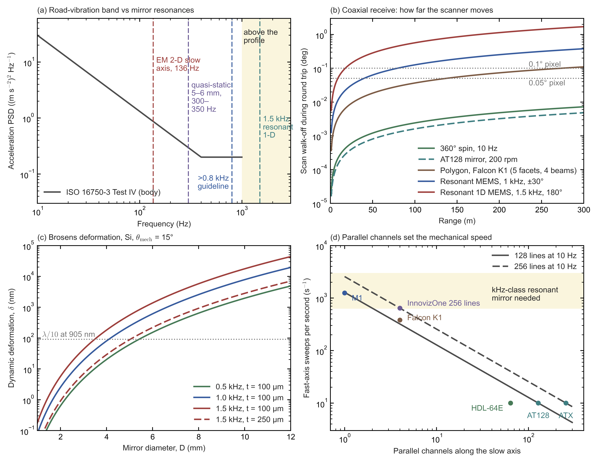

*Figure C4d.* (a) ISO 16750-3:2012 Test IV random-vibration PSD for passenger-car body mounts (27.1 m/s² rms, 10–1,000 Hz), with example mirror resonances: Hua et al.'s 136 Hz slow axis, Mirrorcle's 300–350 Hz quasi-static 5–6.4 mm mirrors, the ">0.8 kHz" guideline and a 1.5 kHz resonant 1-D mirror. The shaded band marks frequencies above 1 kHz, where the Test IV profile has no energy. (b) Scan walk-off $2R\dot\theta/c$ (Eq. \eqref{eq:scan-walk-off}; $R$ range, $\dot\theta$ optical angular speed, $c$ speed of light) for a return received through the moving scanner, at each scanner's peak optical angular speed, against 0.1° and 0.05° pixels; the Falcon K1 curve uses the five-facet polygon and four beams of a teardown ($2\times360°\times76$ rev/s). (c) Brosens dynamic deformation, Eq. \eqref{eq:brosens-mirror-deformation}, for silicon at $\theta_{\rm mech}=15°$, against $\lambda/10$ at 905 nm. (d) Required fast-axis sweeps per second, $N_{\rm lines}f_{\rm frame}/N_{\rm par}$ (Eq. \eqref{eq:scanner-sweep-rate}: lines per frame times frame rate, divided by the number of parallel channels); product markers use published line counts and frame rates, with one beam per module for M1 and four beams for Falcon K1 (teardowns), and four lasers for InnovizOne (company statement). The shaded band, from 625 sweeps/s upward, marks rates that call for a resonant mirror ($f_{\rm mirror}=S/2\gtrsim0.3$ kHz). All curves are engineering estimates [E]; script `build/figures/mechanical_scanning_limits.py`, tables in `automotive_perception_report_figures/mechanical_scanning_limits_tables.txt`.

Sources: https://cdn.standards.iteh.ai/samples/58049/7b18ead72b7f4b4e97f72f4b8fd8d185/ISO-16750-3-2012.pdf ; https://www.bosch-motorsport.com/content/downloads/Raceparts/Resources/pdf/Vibration%20Profile%20Shock_344016651_Vibration_Profiles.pdf ; https://www.testxchange.com/magazine/lab-tests-lv-124/ ; http://aecouncil.com/Documents/AEC_Q103-002_Rev-.pdf ; http://aecouncil.com/Documents/AEC_Q103-003_Rev-.pdf ; https://www.lasermet.com/laser-safety-service/laser-testing-to-iec-60825-1/ ; https://pmc.ncbi.nlm.nih.gov/articles/PMC7281653/ ; https://www.mirrorcletech.com/wp/publications/2020/02/comparison-of-mems-mirror-lidar-architectures/ ; https://ieeexplore.ieee.org/document/879621 ; https://www.spiedigitallibrary.org/conference-proceedings-of-spie/11293/1129309/Resonant-1D-MEMS-mirror-with-a-total-optical-scan-angle/10.1117/12.2546035.full ; https://www.spiedigitallibrary.org/journals/journal-of-optical-microsystems/volume-2/issue-01/011007/Evaluation-of-robustness-against-external-vibrations-for-long-range-MEMS/10.1117/1.JOM.2.1.011007.full ; https://pmc.ncbi.nlm.nih.gov/articles/PMC7826558/ ; https://pmc.ncbi.nlm.nih.gov/articles/PMC7823883 ; https://pmc.ncbi.nlm.nih.gov/articles/PMC8309668/ ; https://livox-wiki-en.readthedocs.io/en/latest/introduction/livox_scanning_pattern.html ; https://www.livoxtech.com/news/hap_spec ; https://www.prnewswire.com/news-releases/empowering-xpeng-p5-livox-officially-releases-hap-lidar-301268675.html ; https://www.mapix.com/wp-content/uploads/2018/07/63-9194_Rev-J_HDL-64E_S3_Spec-Sheet-Web.pdf ; https://data.ouster.io/downloads/datasheets/datasheet-rev7-v3p1-os1.pdf ; https://www.valeo.com/en/catalogue/cda/long-range-lidar-sensors-valeo-scala-gen-3/ ; https://www.yolegroup.com/strategy-insights/whats-in-the-box-hesai-at128-lidar-for-li-auto-l9-at-a-glance/ ; https://www.hesaitech.com/product/atx/ ; https://www.techinsights.com/blog/deep-dive-teardown-huawei-192-line-lidar-l306-lidar-sensor ; https://www.seyond.com/wp-content/uploads/2024/12/Seyond-Falcon-K1-LiDAR_User-Manual_V2.1.2_EN_PublicRH_20240314.pdf ; https://www.techinsights.com/blog/deep-dive-teardown-luminar-technologies-iris-lidar-70-0034-00102203a15650-automotive ; https://www.cepton.com/announcements/cepton-unveils-vista-r-x90-sets-new-standard-for-high-performance-automotive-grade-lidar ; https://yolegroup.com/technology-outlook/whats-in-the-box-chinese-automotive-lidars-at-a-glance ; https://www.businesswire.com/news/home/20200103005139/en/ ; https://www.robosense.ai/en/news-show-1894 ; https://store.robosense.ai/products/m1-plus ; https://www.robosense.ai/en/rslidar/MX ; https://levelfivesupplies.com/wp-content/uploads/2023/08/InnovizOne-Series-Production-Datasheet-18.04.2023.pdf ; https://www.blickfeld.com/technology/ ; https://www.businesswire.com/news/home/20200609005300/en/ ; https://www.hesaitech.com/four-at128-lidar-sensors-from-hesai-selected-as-primary-lidar-for-all-pony-ai-seventh-generation-robotaxis/ ; https://www.hesaitech.com/lidar-company-to-surpass-2-million-units-in-cumulative-delivery/ ; https://cnevpost.com/2026/04/10/nio-supplier-seyond-reaches-1-million-lidar-delivery-milestone/

## C5. SPAD-SoC receivers in Chinese lidars: design origin and foundries

This section asks which receiver chips in Chinese lidars are the makers' own designs and which are bought-in Sony parts, and whether their manufacturing sites have been disclosed. A SPAD-SoC (SPAD system-on-chip) is a single stacked chip that combines an array of single-photon avalanche diodes (SPADs) with the timing, histogramming and processing logic of a direct time-of-flight (dToF) receiver, which times each photon's round trip. SPAD-SoCs in Chinese lidars follow two patterns: (a) Sony parts described generically as "SPAD-SoCs" and (b) distinct designs. No foundry (contract chip manufacturer) is publicly named for any of the lidar makers' own distinct designs; the one named foundry is Tower, for Fortsense's merchant FL6031. The answer matters for judging how much of the lidar's key silicon Chinese makers design themselves.

**The line-count shortcut.** "Line count" in this class is the receiver's long-axis dToF pixel count after 3×3 binning (grouping 3 × 3 SPADs into one ranging pixel). Sony's two automotive parts bin to 192 and 520 lines, so a product with exactly one of these counts is a first candidate for a Sony part (details in §C5a). The two Sony reference parts are described below. "Pitch" is the centre-to-centre spacing of the SPADs. "Cu–Cu bonded" means that the SPAD wafer and the logic wafer are joined face to face through direct copper-to-copper contacts, so each pixel connects straight to circuitry beneath it. "90 nm" and "40 nm" are the process generations (nodes) of the two wafers, and ISSCC is the International Solid-State Circuits Conference.
- **Sony IMX459:** 597×168 SPADs, 10.08 µm pitch, back-side-illuminated (BSI) SPAD wafer Cu–Cu bonded to a logic wafer (a 90 nm SPAD process [I] and, per trade press only, 40 nm logic [T]; §C5a), PDE (photon detection efficiency, the share of arriving photons that are counted) 24% at 905 nm [P]. Binned: about **192** lines [P].
- **Sony IMX479:** 105×1,568 SPADs, 10.08 µm, **520 dToF pixels** at 0.05° vertical, PDE 37% at 940 nm, about 98% on-chip data reduction and 25 Mpts/s [P]; 3 GHz equivalent-time sampling [I, §C5a]. Equivalent-time sampling builds a finely sampled waveform from many repeated measurements with shifted sampling instants, here equivalent to a 3 GHz sampling rate; Mpts/s is millions of points per second.

The table lists, for each Chinese lidar or receiver chip, what teardowns or vendor documents establish and what is only inferred; Hesai's two SiPM-based units, AT128 and ATX, are included for contrast.

| Product | Documented (teardown or vendor) | Inferred / unknown |
|---|---|---|
| Huawei 96-line | TechInsights: **Sony SPAD depth sensor** + 2 Lattice FPGAs [I] | — |
| Huawei 192-line (L306 / D3) | SPAD array **189×600**, the physical array of Sony's ISSCC 2021 design behind the IMX459 (597 × 168 effective SPADs, §C5a); TechInsights says this "suggests" Sony [I] | Very likely Sony |
| Huawei 896-line (Mar 2026) | Separate wide and telephoto receiving units [P]; **detector type, die count, wavelength and foundry undisclosed** | Vendor unknown; no verified teardown. Claims of two HiSilicon SPAD dies or 905 nm extrapolate from other Huawei products and are not established for this unit |
| RoboSense E1/E1R | In-house SPAD-SoC, >250k px, Cu–Cu, AEC-Q102 [P]. TechInsights: **0.27 MP at 9.8 µm pitch**, stacked BSI [I] | **Matches no Sony catalogue part**, consistent with an independent design. Co-developed with Adaps (2019/2020–23; sources differ on the start); the two companies are in litigation with each other (see Foundry check) |
| RoboSense EM4-520 | NE Times teardown: "uses Sony IMX479" [T]. TechInsights: 0.20 MP at 10.0 µm [I], against 0.16 MP active for IMX479 ($105\times1{,}568=164{,}640$ SPADs); the difference may be dummy or margin pixels counted in the teardown [U] | **Most likely IMX479**; if so, "SPAD-SoC" here refers to Sony's stacked chip |
| RoboSense EMX (192-line) | Marketed as a digital SPAD-SoC | 192 lines matches the IMX459 geometry; not teardown-verified |
| RoboSense Eocene "Phoenix" (2160×1900) / "Peacock" (640×480) | **28 nm logic**, SPAD PDE 45%, wafer-level hybrid bonding; mass production 2026 [P] | Foundry undisclosed |
| Hesai AT128 | **onsemi SiPM** (silicon photomultiplier) + Lumentum VCSEL + Xilinx FPGA [I, Yole teardown] | — |
| Hesai ATX | SiPM: 17 dies [T] for 64 physical channels [T], which Hesai's ATX_S01 manual lists as 64 "normal" plus 52 "super-resolution" output channels [P]; TI, 3peak and Infineon parts [I] | SiPM vendor not public; Hesai describes the detectors as in-house |
| Hesai FTX / ETX "Picasso" | SPAD IP from Hesai's acquisition of **Fastree3D** (Swiss, EPFL). Picasso is a 5th-generation RGB+ToF SPAD-SoC, PDE >40% (**wavelength not stated**); **2,160 lines per chip; the 4,320-line ETX uses two chips** [P/T] | Foundry, node, pixel pitch and stacking undisclosed. One Chinese article says Adaps SPAD chips have orders from Hesai and RoboSense [T, single source]. Hesai's 2023 prospectus and a 2023 Hesai slide number its in-house ASICs v1.0, v1.5, V2.0, V3.0 and a planned V4.0 [P], relayed as "V1.0 ... V4.0" chip architectures by ResearchInChina (Oct 2023) [MR]; these are version numbers, not a chip family. Its later releases name the 4th-generation platform (ATX, 2024–25), whose Fermi C500 controller (Nov 2025) completes it, and the 5th-generation Picasso SPAD-SoC [P] |
| Adaps ADS6311 | 256×192, 297 ps bins, Cu–Cu hybrid-bonded, AEC-Q102 [P] | Foundry unnamed; one commentator says domestic SPAD startups mostly use **Tower** (Israel) [T] |
| Fortsense FL6031 / FL6031Q (merchant chip) | 360 × 150 output pixels (more than 50k) from binned SPADs, about 2 M points/s, on-chip time-to-digital converters and histogramming; AEC-Q100 claimed [P, company]. Built on **Tower Semiconductor's 65 nm stacked BSI platform with pixel-level hybrid bonding** (joint press release, Sep 2023) [P] | The only Chinese lidar SPAD-SoC with a publicly named foundry. Tower makes this process in its 300 mm fab at Uozu, Japan [P, Tower, Sep 2019], so the wafers are probably Japanese-made [E]; Fortsense says it uses both overseas and domestic fabs [P]. PDE not published. Receiver of the Zeekr 9X's four blind-spot lidars (§B7.1) |

Terms in the table: a *teardown* is a commercial analysis that takes a product apart and identifies its chips (TechInsights, Yole and NE Times publish them). An FPGA (field-programmable gate array) is a reconfigurable logic chip, and an ASIC an application-specific chip. "px" and "MP" are pixels and megapixels. AEC-Q102 is the automotive qualification for discrete optoelectronic parts. "Wafer-level hybrid bonding" is the Cu–Cu stacking described above. RGB+ToF means one chip that captures colour images and time-of-flight depth, and "297 ps bins" is the width of the timing histogram's bins, $c\,\Delta t_{\rm bin}/2=4.5$ cm of range per bin (§C0 subsection 1.1). TSMC and UMC are Taiwanese foundries; SMIC, XMC and Huali are Chinese; Tower is Israeli.

**Fastree3D: SPAD IP acquired by Hesai.** Part of Hesai's SPAD IP (intellectual property, here mainly patents) comes from Fastree3D, a spin-off of EPFL (the Swiss federal technology institute in Lausanne) and TU Delft (Delft University of Technology) that Hesai bought on 15 December 2023 for \$7.67 M [P]; Hesai says it had also researched SPADs itself since 2016. Hesai booked the acquired patent rights at RMB 59.35 M (≈\$8.4 M) [P]. No public evidence yet shows Fastree3D circuits in a shipping chip, as distinct from its patents in Hesai's 4th-generation platform; §C3a subsection 2, traces the company's history and asks whether the deal was a success.

**Fortsense: the merchant SPAD-SoC inside Zeekr's blind-spot lidars.** Fortsense (阜时科技, founded in Shenzhen in Nov 2017 and now registered in Linhai, Zhejiang) designs SPAD-SoCs for flash lidar. Its founder and chairman, 莫良华 (Michael Mo), controls 49.5% [P]. It began with under-display fingerprint and 3D face-recognition chips and has worked on SPADs since 2019 [P, company]. Unless marked otherwise, the facts below come from the Aug 2026 regulatory filing of its new investor, Shandong Xintong Electronics [P], or from Fortsense's own releases [P, company].
- **Products** [P, company]. The FL6031 (2023) is described in the table above; in 2022 an earlier Fortsense receiver chip was qualified to AEC-Q102 Grade 1. The second generation (2026) comprises the FL6032Q for blind-spot lidar and the FL8132Q (576 × 576, claimed 300 m range) for a long-range lidar with Fortsense's solid-state beam steering. It adds two-dimensional addressing (§C4b), a "telescope" mode with 250 ps timing bins over 75 m, and binning that can differ by region within one frame. A third generation (FL5023Q for parking and blind spots) was first shown in Sep 2026. No Fortsense chip has been described in a peer-reviewed paper; the company's only lidar publication is a review of SPAD dToF chip design (Discover Nano, 2026) [I].
- **Customers.** Each Zeekr 9X H9 carries four FL6031 chips, one in each of Zeekr's in-house blind-spot lidars (§B7.1), and the FL6031 is also on the Zeekr 8X. Fortsense claims "hundreds of thousands" of FL6031s delivered on these cars [P, company, unverified]. The Xintong filing confirms volume production on Zeekr and other brands [P]. Lidar makers that have shown FL6031-based units or signed agreements with Fortsense include Wanji, Tanway, LeiShen, Joyson's PIA and O-Film [P, company].
- **Finances** [P, unaudited]. Revenue was ¥214.0 M in 2025 and ¥112.7 M in H1 2026, with net losses of ¥139.7 M and ¥48.8 M.
  - SPAD-SoC chips made 3.64% of revenue in 2025 and 21.84% in H1 2026, i.e. about ¥7.8 M and ¥24.6 M [E: $0.0364\times214.0$ and $0.2184\times112.7$]. The rest came from short-range 3D machine-vision chips and from automotive-electronics integration services.
  - Xintong (listed in Shenzhen) is paying ¥160 M for 5.63% at the latest round's price, which values Fortsense at ¥2.84 bn after the investment [E: $160/0.0563\approx2{,}840$ M].
  - Funds linked to the carmakers Chery (1.1%) and BAIC (0.4%) are shareholders. Xintong can require the founders to buy its stake back, at cost plus 8% a year, if Fortsense has not applied to list by the end of 2028.
- **Scale check** [E]. NE Times counted 17,568 Zeekr blind-spot units in 2025 (§B7.1). If all of Fortsense's 2025 SPAD-SoC revenue had come from those units, it would amount to about ¥440 per unit [E: $7.79\times10^{6}/17{,}568\approx443$]. The chip business was still small in 2025 and has grown since.
- **Position.** Fortsense's foothold is flash blind-spot and parking lidar and robotics. Hesai and RoboSense now make their own SPAD-SoCs for main lidars (§C5a, item 6), and Adaps and the Hubble-backed VisionICs compete with Fortsense as merchant suppliers [T].
- **Outside China.** The Korean fabless company SolidVue (Seongnam) offers a single-chip SPAD lidar sensor, the SL-2.2, with 400 × 128 pixels and on-chip TDCs and image processing, for which it claims object detection up to 200 m [P, CES 2025 Innovation Awards entry]. With Sungkyunkwan University it presented two SPAD lidar sensors at ISSCC 2026, a 2,880-channel multi-range sensor and a 480 × 320-pixel sensor (papers 7.3 and 7.4) [P, ISSCC 2026 advance programme, p. 24].

**Foundry check.** English and Chinese press releases, teardown summaries and litigation coverage name no foundry for the Chinese lidar SPAD-SoCs listed next. This covers RoboSense E1 and Eocene (28 nm, wafer-level hybrid bonding), Hesai Picasso, FTX and Fermi C500, Adaps ADS6311 ("multiple foundries") and Huawei/HiSilicon.
- Sony's lidar receivers are made in Sony's own fabs; Fortsense's FL6031 (next item) is made on Tower's platform.
- For merchant start-ups the claim that they use Tower Semiconductor is verified for one: Tower and Fortsense announced in Sep 2023 that Fortsense's FL6031 is built on Tower's 65 nm stacked BSI platform [P]. For Adaps and VisionICs it remains unverified.
- RoboSense E1 lineage: joint development with Adaps ran from 2019 or 2020 (sources differ) until early 2023 and ended, according to trade press, after pilot-run performance (the first small manufacturing batch) fell short. Adaps then taped out its own design, i.e. sent the finished layout to a foundry for manufacture (it became the ADS6311), and the two companies are in litigation with each other [T].

**Bottom line.** Some SPAD-SoCs in Chinese lidars are Sony parts described generically (pattern (a)), made in Sony's own fabs. The others are distinct designs (pattern (b)), whose foundry and wafer provenance (where the wafers were made) are undisclosed, except Fortsense's FL6031 (Tower).
- **Pattern (a):** verified Sony use in one Huawei product, and probable or reported Sony use in others, under generic "SPAD-SoC" descriptions.
- **Pattern (b):** distinct designs by geometry or disclosed IP lineage, with production ramps claimed for 2026–27.
- No public evidence shows a Sony die marked or sold as the lidar maker's own design, as distinct from pattern (a), where marketing calls an unnamed Sony part a "SPAD-SoC". Nor is there evidence of Sony pixel wafers bonded to Chinese logic wafers; Sony is not known to sell SPAD pixel wafers. Foundry identities sit behind paywalled teardown die marks (the identifying markings on the silicon that a teardown photographs).

## C5a. Sony's automotive SPAD sensors in depth: specifications, architecture and competitive edge

This section asks what Sony's two automotive lidar receiver chips, IMX459 and IMX479, are, how good they are, and why several Chinese lidars are built on them. The short answer is that they are well-qualified, well-integrated sensors whose advantage lies in Sony's own stacking fabs, a fast efficiency roadmap and on-chip signal processing, not in an unusually quiet pixel. This matters for the market because these chips let a lidar maker ship a 192- or 520-line product without designing its own detector; the main threat to Sony is lidar makers designing their own chips.

IMX459 and IMX479 are the merchant parts (chips sold openly to any customer, as opposed to a lidar maker's in-house design) behind pattern (a) in §C5, where Chinese lidars use Sony parts under a generic "SPAD-SoC" label. Sources: Sony's product pages, press releases and its one industrial datasheet for the same array (IMX560), plus abstracts, programmes and reproduced slides of Sony's ISSCC, VLSI and IEDM papers (the main chip and device conferences). **The IEEE full texts were paywalled and were not read**, so architecture details come from abstracts and reproduced slides.

**How a SPAD direct-time-of-flight receiver works, in brief.** A SPAD (single-photon avalanche diode) is a photodiode biased a few volts above its breakdown voltage; the extra voltage is the *excess bias*. One absorbed photon can then trigger a self-sustaining avalanche, a digital "click". The avalanche must be stopped (quenched) and the diode recharged, and during this *dead time* the SPAD cannot detect another photon. In direct time of flight (dToF) the chip measures the delay between the laser pulse and each click with a time-to-digital converter (TDC, an on-chip stopwatch). Because one shot gives only a few clicks, the delays from many shots are accumulated in a *histogram*: a row of counters, one per *histogram bin*, each bin covering a short time slice (for example 1 ns, i.e. 15 cm of range). The true return shows up as a peak above a flat background of sunlight and dark counts. Neighbouring SPADs are grouped into a *macro-pixel* (for example 3×3 SPADs) whose clicks feed one histogram and give one depth pixel.

### Specifications

IMX479 keeps IMX459's pitch, supplies and qualification, and adds 2.7× the lines, a higher photon detection efficiency and finer time sampling. It works only in line-scan mode, however.

| Parameter | IMX459 (announced 6 Sep 2021) | IMX479 (announced 10 Jun 2025) |
|---|---|---|
| SPAD array | 597 × 168 effective, ≈100k; ISSCC design 189 × 600 physical, ≈110k [P/I] | 105 × 1,568, ≈164k (press release); **105 × 1,560 on the product page** [P]. As 520 × 3 = 1,560, the page figure is probably the number of SPADs spanned by the 520 active macro-pixels along the long axis; the other 8 may be monitor or margin SPADs [E] |
| Pitch | 10.08 µm | 10.08 µm |
| dToF pixel | 3×3 macro-pixels → **192 lines**; 6×6 (the 300 m mode) → about 96 lines [E] | "Minimum 3×3" → **520 lines**, 0.05° vertical, "2.7×" IMX459 |
| Optical format | 1/2.9-type (6.25 mm diagonal) | 1-type (15.8 mm); **chip 12.2 × 20.0 mm** |
| Design wavelength | 905 nm | 940 nm |
| PDE | **24% at 905 nm** (ISSCC development chip: 22%) | **37% at 940 nm**; 905 nm not disclosed |
| Pixel optics | Irregular diffractive incidence surface | Texture on both incident face and pixel bottom, plus an optimised on-chip lens |
| Dead time | 6 ns at room temperature in the ISSCC 2021 development chip [P]; "TBD" on Sony's product page [P] | ≈6 ns; pixel readout comparators with threshold control keep it stable across process, temperature and supply-voltage variation [I, JSSC 2026 abstract] |
| Time sampling | 1 ns bins (15 cm) | **3 GHz equivalent-time sampling** (5 cm) [I, VLSI 2025 C27-2; JSSC 2026, see note below] |
| On-chip processing | Histogram SRAM, FIR filter, echo and peak detection | Histogram-to-depth extraction, **≈98% data reduction** |
| Throughput | Not stated for the product; the ISSCC demonstrator ran at 20 fps | Up to 20 fps; **≈25 Mpts/s** (2,400 × 520 × 20 fps) over 120° × 26°, the field of Sony's own lidar system at 0.05° in both axes rather than a property of the chip [I, JSSC 2026 abstract] |
| Range claim | 300 m (15 cm precision in 6×6 mode, 1 m × 10% target, cloudy day) | 300 m at ≥100 klx; 25 cm object at 250 m |
| Interface, supplies | MIPI CSI-2 (2/4 lanes); $V_{\rm BD}$ −20.5 V, $V_{\rm EX}$ 3.3 V | MIPI CSI-2 (4 lanes); same supplies |
| Power | **1,192 mW** for the development chip [T, reproducing Sony's ISSCC table]; product value not published | **Not published**; the JSSC 2026 abstract gives no power figure (full text not read) [I] |
| Qualification | AEC-Q100 Grade 2; ISO 26262 process, ASIL-B(D) | Same |
| Scan mode | Line or array | **Line only** (needs a one-axis scanner) |
| Samples | Mar 2022 | Autumn 2025 |
| **Sample price** | **¥15,000** (≈\$100) | **¥35,000** (≈\$235), quantity-dependent |
| Mass-production date | Not published | Not published |

Time-sampling sources: VLSI 2025 C27-2 and T. Yui et al., "A 25-Mpts/s Back-Illuminated Stacked SPAD Direct Time-of-Flight Depth Sensor With Equivalent Time Sampling and Pixel-Level Threshold Control for Automotive LiDAR," *IEEE JSSC* 61(4), 1308–1318 (Apr 2026). The papers do not name the part, but the specs match.

*Terms used in the table:*
- **Pitch** is the centre-to-centre spacing of the SPADs. A **dToF pixel** (a macro-pixel) groups 3×3 or 6×6 SPADs into one depth measurement, and a **line** is one such pixel along the long axis of the array, i.e. one row of the final point cloud.
- **Optical format** ("1/2.9-type", "1-type") is the image-sensor industry's legacy size label; the physical diagonal is given alongside.
- **PDE** (photon detection efficiency) is the probability that a photon arriving on the pixel area produces a count. It includes the photosensitive fraction of the area, absorption in the silicon and the probability that the absorbed photon triggers an avalanche.
- **Pixel optics.** Silicon absorbs 905–940 nm light only weakly (§C4), so Sony structures the light-entry surface (and, in IMX479, the pixel bottom) to scatter and diffract light sideways and lengthen its path inside the thin silicon. The **on-chip lens** is a microlens, a tiny lens over each pixel that funnels light onto its sensitive area.
- **Dead time** is the blind interval after each count (see the brief explanation above). The IMX479's comparators decide when a pulse counts as an avalanche; controlling their threshold per pixel keeps the dead time stable.
- **Equivalent-time sampling** samples the repetitive return at slightly shifted clock phases on successive laser shots, so the histogram's effective sampling rate (3 GHz) exceeds the real clock rate.
- **On-chip processing.** Histogram SRAM (static random-access memory, the chip's fast on-die memory) holds the histograms; an FIR (finite-impulse-response) digital filter smooths them; echo and peak detection then pick out the returns. Sending only the extracted distances instead of whole histograms is the source of the ≈98% data reduction.
- **Mpts/s** is millions of points per second, and **klx** is kilolux of ambient illuminance (100 klx is bright direct sunlight).
- **MIPI CSI-2** is the standard serial camera interface used by image sensors, with 2 or 4 data lanes. $V_{\rm BD}$ and $V_{\rm EX}$ are Sony's two SPAD bias supplies (−20.5 V and 3.3 V). Their names suggest the breakdown-side bias and the excess bias, which is how §C6(f) reads them.
- **AEC-Q100 Grade 2** is the automotive stress qualification for integrated circuits over −40 to +105 °C ambient. **ISO 26262** is the automotive functional-safety standard; "ASIL-B(D)" means developed to safety level ASIL B as part of the decomposition of an ASIL D (highest-level) requirement.
- **Scan mode.** "Line only" means the chip reads one column of the scene at a time, so the lidar needs a scanner that sweeps the other axis.

*How the numbers are derived* [E] (specification table above):
- **SPAD counts.** $597\times168=100{,}296\approx100$k; $189\times600=113{,}400$ (≈110k); $105\times1{,}568=164{,}640\approx164$k.
- **Array size.** At 10.08 µm the IMX459 array is $597\times10.08\ {\rm µm}=6.02$ mm by $168\times10.08\ {\rm µm}=1.69$ mm, a $\sqrt{6.02^2+1.69^2}=6.25$ mm diagonal. The IMX479 array is 15.81 mm by 1.06 mm, a 15.8 mm diagonal. Both match the stated optical formats.
- **Lines.** $520/192=2.7$.
- **Range per time bin** is $c\,\Delta t_{\rm bin}/2$ (§C0 subsection 1.1), where $c$ is the speed of light and $\Delta t_{\rm bin}$ the bin width; the factor 2 is there because the light travels out and back. This gives $3\times10^{8}\ {\rm m\,s^{-1}}\times1\ {\rm ns}/2=15$ cm for 1 ns bins, and $3\times10^{8}/(2\times3\times10^{9})=5$ cm for 3 GHz sampling (a bin of $1/(3\ {\rm GHz})$).
- **Prices** at ≈¥149 per dollar: ¥15,000/149 ≈ \$100 and ¥35,000/149 ≈ \$235.

The industrial twin, **IMX560-AAMV** (the same 597 × 168 array), has a public datasheet with numbers Sony does not publish for the automotive parts [P]:
- dark count rate (DCR, the rate of spurious counts in total darkness, caused by thermally generated and tunnelling carriers) **3.5 kcps typical and 6 Mcps maximum, both as the average over the SPADs** (kcps and Mcps are thousands and millions of counts per second; temperature not stated). Only the typical value is marked "for reference only". The maximum, about $6\times10^{6}/3.5\times10^{3}\approx1{,}700$ times the typical value and the same in the 2024 and 2026 versions of the flyer, is a loose limit on the array average rather than the worst SPAD [P; reading E];
- dead time, defined as the width of the SPAD's output pulse and again averaged over the SPADs, given two ways: 15 ns typical (20 ns maximum) for the width that 99% of pulses do not exceed (the flyer's "accumulation 99 %"), and 9 ns typical (11.5 ns maximum) for the most frequent width [P; reading of "accumulation" E]. The most frequent width is the one to compare with the 6 ns measured on the ISSCC 2021 development chip behind IMX459 (specification table above); the remaining 3 ns may reflect a different definition or operating point [U];
- 2,024 histogram bins at 1 GHz (1 ns per bin), 12-bit counts per bin, and full-histogram output.

### Architecture (ISSCC 2021, "A 189×600 back-illuminated stacked SPAD dToF depth sensor for automotive LiDAR")

The development chip behind IMX459 does the whole chain on chip, from photon counting through histogramming to peak detection, so it outputs distances rather than raw counts. Sources disagree on whether its SPADs are recharged passively or actively; the measured count-rate ceiling points to passive recharge.

**Stacked, back-illuminated construction.** The chip is a *stacked die*: a SPAD wafer and a logic wafer are made separately and joined face to face. The SPAD wafer is back-side illuminated (BSI): it is thinned and light enters from the back, so the metal wiring on the front does not shade the pixels. The two wafers are joined by *hybrid (Cu–Cu) bonding*, in which copper pads on both surfaces fuse directly while the surrounding oxide bonds too, so every SPAD gets its own electrical connection to the logic beneath it.

- **Signal chain** [T, reproduced Sony slides]. The stages, in order:
  - a passive quench-and-recharge (PQR) SPAD array, in which a resistive element stops each avalanche and lets the diode recharge on its own, rather than an active circuit forcing a fast reset;
  - coincidence detection, which counts an event only when several SPADs of a macro-pixel fire within a short window, so uncorrelated sunlight counts are rejected (§C6(d′), Layer 3);
  - four time-to-digital converter (TDC) and histogram blocks, each serving 48 macro-pixel rows (4 × 48 = 192), writing into double-banked SRAM histograms (two memory banks, so one fills while the other is read out);
  - FIR filtering, echo analysis and peak detection;
  - MIPI output.

  Also on chip: a PLL (phase-locked loop, the clock generator), temperature sensor, reference and emitter trigger I/O.
- **Measured** [P, [ISSCC 2021 paper 7.3](https://doi.org/10.1109/ISSCC42613.2021.9365961); curve values E]:
  - PDE 22% at 905 nm, the peak of the median curve near 60 °C (≈19% at 25 °C); **14% at −40 °C** and ≈17% at 125 °C. Against wavelength it falls from 29% at 850 nm to 21% at 905 nm and ≈15% at 940 nm (the paper's PDE figure, digitized) [P; E];
  - dead time 6 ns at room temperature, with passive quenching and recharge; jitter 300 ps; dark count rate 2,007 cps; afterpulsing 0.1% (4.9% at −40 °C); maximum count rate 60 Mcps, reached at 200 µW/cm²; power 1,192 mW on a 6.9 × 7.8 mm die;
  - with a MEMS scanner (a micro-electro-mechanical mirror), 905 nm pulses of 4.5 ns at 45 W peak, and 168 × 63 points at 20 fps: 150 m on a 10% target and 200 m on a 95% target under 117 klx.
- **Process:** Sony's IEDM 2020 SPAD paper describes a 10 µm BSI SPAD on a 90 nm CMOS-compatible 300 mm process, with a 7 µm silicon layer, metal-buried full-trench isolation (metal-filled trenches through the silicon around each SPAD, which block light and carriers from leaking into neighbours) and Cu–Cu bonding [I]. The "40 nm logic" wafer appears only in trade press [T].
- **A discrepancy.** The ISSCC abstract says *passive* quenching and recharge; the IMX459 press release says *active* recharge [I/P]. The measured maximum count rate favours the passive reading.
  - *Two kinds of dead time.* In a **non-paralyzable** detector, a photon arriving during the dead time is simply lost, and the dead time ends on schedule. In a **paralyzable** detector, such a photon restarts the dead time. Passive recharge tends to behave paralyzably, because a photon arriving during the slow recharge can re-trigger the diode and restart its recovery.
  - For a paralyzable counter with true photon arrival rate $r$ (s⁻¹, per SPAD, the symbol used in §C6(d)) and dead time $\tau_d$ (s), the recorded count rate $m$ (s⁻¹) is

    $$m=r\,e^{-r\tau_d} \label{eq:paralyzable-count-rate}$$

  - [E] Eq. \eqref{eq:paralyzable-count-rate} peaks at $r=1/\tau_d$, where $m=1/(e\tau_d)=1/(2.718\times6\times10^{-9}\ {\rm s})=6.1\times10^{7}\ {\rm s^{-1}}$, with $e=2.718$ Euler's number and $\tau_d=6$ ns. The measured 60 Mcps maximum matches this $1/(e\tau_d)=61$ Mcps ceiling of a paralyzable counter with 6 ns dead time, which is passive-recharge behaviour. The product may differ from the development chip.

### What the numbers mean physically [E unless tagged]

This subsection asks which of Sony's numbers actually limit a lidar. The answer is that the dark count barely affects range. What matters more is how PDE changes with temperature, the roughly 10 µm pitch that fixes the die size, and the die cost that follows from it.

- **Dark counts are not the competitive axis.** 3.5 kcps per SPAD is about $3{,}500/10.08^2=34$ cps/µm² (dark count rate per unit SPAD area, dividing by the $10.08^2$ µm² pitch cell), well above the <1 cps/µm² reported for research BSI SPADs [I, IEEE TED 2024 review]. It still does not matter for range, for the following reasons.
  - A 3×3 macro-pixel listening ≈20.8 µs per point collects ≈0.7 dark counts per point, spread over ≈2,000 bins. In IMX479's scan each dToF pixel measures one point per column, $2{,}400\times20=48{,}000$ points/s (2,400 columns per frame at 20 frames per second). It therefore listens $1/48{,}000\ {\rm s}=20.8$ µs per point and its nine SPADs collect $9\times3{,}500\ {\rm s^{-1}}\times20.8\ {\rm µs}=0.66$ dark counts; the ≈2,000 bins are the IMX560's 2,024.
  - A 200 m, 10% return delivers ≈21–33 counts in one bin (§C6(c)), so dark counts are negligible. Bright sunlight adds thousands of background counts per point (≈3,370 in the model's central case: $1.83\times10^{8}\ {\rm s^{-1}}\times20.8\ \mu{\rm s}\times0.885$, the background rate per macro-pixel of §C6(d) times the listening time and the live fraction; §C7b subsection 1), which dwarfs them.
  - DCR matters for hot-pixel masking (switching off the few SPADs with abnormally high dark count) and night-time floor estimation (estimating the histogram's noise floor when there is no sunlight). It does **not** limit automotive range. Background pile-up and dead time do: in sunlight each SPAD is often already dead, or has already fired on a background photon, when the real return arrives (§C6(d)).
- **The cold-temperature PDE drop is real.** 14% at −40 °C against the 22% peak means $1-14/22=36\%$ fewer photons; against the ≈19.3% read off the curve at 25 °C it is $1-14/19.3=27\%$ fewer [E].
  - For extended targets range scales as $\sqrt{\rm PDE}$. The reason: when the signal photons, not the background, limit detection, a fixed number of detected photons is needed, and for a target larger than the beam footprint that number is proportional to PDE and falls as $1/R^2$ with range $R$.
  - So the cold loss costs about **20% of range** ($1-\sqrt{14/22}=0.20$) unless excess bias or laser energy compensates. At the hot end (≈17% at 125 °C) the loss is ≈12% of range ($1-\sqrt{17/22}=0.12$). Against the ≈19.3% at 25 °C the cold loss is ≈15% of range ($1-\sqrt{14/19.3}=0.15$) [E].
- **The PDE ladder.** Products went from 24% at 905 nm (2021) to 37% at 940 nm (2025), $37/24\approx1.54$ times the photons. Sony's 2025 research pixel reached **42.5% at 940 nm** through doping design: a triggering probability of 92.9% at 3 V excess bias and a charge-collection efficiency of 98.8%, which leaves $0.425/(0.929\times0.988)=0.46$ for fill factor times absorption [P, VLSI 2025 T1-2 abstract; E]. A 905 nm figure and a metal reflector are not in the abstract or the programme entry [U]. At 940 nm that is $42.5/37\approx1.15$ times IMX479 and $42.5/15.3\approx2.8$ times the ISSCC 2021 chip. Sony's research is therefore roughly level with the 45% claimed for RoboSense's 2026 chip, whose wavelength is not stated: slightly behind it if that figure is at 940 nm, and ahead if it is at 905 nm, where the table below lists an unconfirmed 51.0% for Sony's pixel.
- **Why automotive pitch stays near 10 µm while research reaches 2.5 µm** (IEDM 2022). There are two reasons.
  - NIR absorption in silicon needs tens of micrometres of path (absorption length $1/\alpha_{\rm Si}\approx35$ µm at 905 nm and ≈55 µm at 940 nm, §C4), and Sony's small-pitch SPADs reach only ≈20–22% PDE at 940 nm, against 37% for the 10 µm IMX479.
  - A lidar macro-pixel needs enough SPADs that some are still armed after sunlight has triggered others (the dead-time problem of §C6(d)).
  - Line count therefore grows with array *length*, as in IMX479's 15.8 mm column, rather than with finer pitch. This is why §C6(a)'s discussion of reticle size (the largest area a lithography tool can pattern in one exposure) applies.
- **Die economics.** The number of dies that fit on a wafer sets the silicon cost. The usual estimate of *gross dies* (candidate dies per wafer, before any are rejected) is

  $$N_{\rm die}=\frac{\pi d^2}{4A_{\rm die}}-\frac{\pi d}{\sqrt{2A_{\rm die}}} \label{eq:gross-dies-per-wafer}$$

  where $d$ is the wafer diameter (mm) and $A_{\rm die}$ the die area (mm²). The first term is the wafer area divided by the die area; the second subtracts the partial dies lost around the wafer edge. *Yield* is the fraction of gross dies that work. Because the chip is stacked, each die needs a SPAD wafer and a logic wafer, hence the cost per *bonded wafer pair*.
  - A 244 mm² IMX479 die (12.2 × 20.0 mm) gives ≈247 gross dies per 300 mm wafer: Eq. \eqref{eq:gross-dies-per-wafer} gives $\pi\times300^2/(4\times244)-\pi\times300/\sqrt{2\times244}=290-43=247$. At an assumed \$3.5–6.5k per bonded wafer pair [U] and 60–85% yield, the silicon costs ≈\$17–44 per good die before test and packaging: \$3,500 / (247 × 0.85) = \$17 at best and \$6,500 / (247 × 0.60) = \$44 at worst.
  - The ¥35,000 sample price is therefore not a cost floor; volume prices are not public.
  - A die that size would be ≈5–20% of a \$200–500 lidar bill of materials (BOM, the summed cost of all parts) at plausible volume prices [E]. The range assumes a volume price of ≈\$25–40 per die (\$25 of a \$500 BOM is 5%, \$40 of a \$200 BOM is 20%).
  - The smaller IMX459 is ≈\$3–9 in silicon, taking its die as the footprint of the ISSCC 2021 development chip, $6.9\times7.8\approx54$ mm² [E]. The same formula, Eq. \eqref{eq:gross-dies-per-wafer}, gives $\pi\times300^2/(4\times54)-\pi\times300/\sqrt{108}=1{,}309-91\approx1{,}220$ gross dies, so \$3,500 / (1,220 × 0.85) = \$3.4 to \$6,500 / (1,220 × 0.60) = \$8.9.

### Other Sony SPAD work

Sony's research PDE at 940 nm roughly tripled from 2020 to 2025 (from >14% to 42.5%, $42.5/14=3.0$). In 2025 it also showed a Ge-on-Si short-wave-infrared (SWIR) SPAD: germanium, which absorbs the 1,300–1,550 nm light that silicon does not, grown on a silicon wafer.

| Year | Venue | Pitch | PDE at 940 nm | Note |
|---|---|---|---|---|
| 2020 | IEDM | 10 µm | >14% | Full-trench isolation, Cu–Cu |
| 2021 | IEDM | 6 µm | 20.2% | Pyramid diffraction surface; 137 ps FWHM jitter |
| 2022 | IEDM | 2.5–3.3 µm | 21.8% (2.5 µm) | Sub-micron avalanche region |
| 2023 | VLSI | 6 µm | 36.5% | Dual diffraction, 2×2 on-chip lens |
| 2025 | VLSI | 10 µm | 42.5% (51.0% at 905 nm [U]) | Metal reflector [U]; 92.9% trigger probability |
| 2025 | IEDM | 10 µm **Ge-on-Si** SPAD, 165 × 140 array | 33.8% at 1,300 nm; **23.3% at 1,550 nm** | Cu–Cu bonded to Si logic; DCR and operating temperature not read |

Reading the table: **jitter** is the spread in the time between photon arrival and the SPAD's output pulse, quoted as the full width at half maximum (FWHM) of that timing distribution; it blurs the range measurement. The **trigger probability** is the chance that a photo-generated carrier actually sets off an avalanche. The diffraction surfaces and on-chip lenses lengthen the light path in silicon and steer light onto the sensitive area, as described under the specification table.

Other parts: IMX611, a mobile 23k-SPAD sensor with 28% PDE at 940 nm, sold as ¥1,000 samples (the sensor chip alone; a module adds the VCSEL (vertical-cavity surface-emitting laser), driver and optics, §B8). No newer Sony automotive SPAD product was found up to September 2026.

The Ge-on-Si SPAD matters for §C4c. It is the first public sign that a high-volume sensor maker is researching a **Si-foundry-compatible SWIR direct-detection** route, i.e. SWIR time-of-flight made on silicon-fab equipment. That would attack the position of InGaAs (indium gallium arsenide, today's costly SWIR detector material) in 1,300–1,550 nm ToF. It is a research device [R]; nothing indicates automotive readiness.

### From phone SPAD to lidar: IMX611, the AS-DT1 and the automotive parts

This subsection asks whether Sony's phone depth-sensor chip could simply be used as a lidar receiver, and what separates it from the automotive parts.

**Short answer.**
- The IMX611's SPADs are lidar-grade. They have the same 10.08 µm pitch and stacked process as the automotive IMX459/479.
- A lidar built on it is limited not by the SPAD but by the photon budget, the light-collecting area, the histogram depth (the time window, and hence range, the on-chip memory can record) and qualification.
- Sony has built a product of this kind: the AS-DT1, a 40 m industrial module that reports only 576 points. Its SPAD sensor is not named; the estimates below assume an IMX611-class array [U]. Keeping so few points is what lets it reach 40 m, the trade of resolution for range explained below.

| | IMX611 (phone receiver chip) | AS-DT1 (Sony industrial lidar module) | IMX459 / IMX479 (automotive receiver chips) |
|---|---|---|---|
| **SPADs** | 140 × 170 (23,800) at 10.08 µm; ≈2.4 mm² array, 2.2 mm diagonal [P] | Sensor model not disclosed | 597 × 168 / 105 × 1,568 at 10.08 µm; ≈10 / ≈16.7 mm² active (tables above) |
| **Depth output** | On-chip "distance signal processing" [P] | 576 points over 35.5° × 28.2° (±2°); five mode settings: 20 m at 30 fps; 30 m at 30 fps (the standard mode), at 15 fps, and at 30 fps with 288 points; and 40 m at 15 fps [P, spec sheet and user's guide] | 192 / 520 lines with a one-axis scanner |
| **Wavelength, PDE** | 940 nm, 28% | 940 ± 6 nm; "8x24pix VCSEL laser diodes" (192 emitters) [P] | 905 nm, 24% / 940 nm, 37% |
| **Range** | 8 m specification point, indoors [P] | Modes to 20, 30 and 40 m from 0.3 m. Press: 40 m indoors and 20 m outdoors at 50% reflectivity, to 100 klx [T]; spec-sheet accuracy and outdoor figures below the table [P] | 300 m claims |
| **Power** | 110 mW sensor, 160 mW system at 8 m [P] | Max 2.5 W (spec sheet) [P]; ≈350 mW in one press report [T] | ≈1.2 W (IMX459 development chip) |
| **Qualification** | Consumer | Industrial (drones, AMRs, service robots); Class 1 under IEC 60825-1:2014; performance guaranteed at 0–40 °C, operation from −5 to +45 °C [P] | AEC-Q100 Grade 2, ASIL-B(D) |
| **Price** | ¥1,000 sample | Not published ("call for pricing"); US availability announced Apr 2026 [P] | ¥15,000 / ¥35,000 samples |

Reading the table: AMRs are autonomous mobile robots, such as warehouse robots. Class 1 under IEC 60825-1:2014 is the laser-safety class that is eye-safe under all reasonably foreseeable use. *Accuracy* is how far the average reported distance lies from the true one (a systematic offset, here given as upper and lower bounds); *precision* is the scatter of repeated measurements; the *output step* is only the numerical resolution of the reported value.

**AS-DT1 range details from the spec sheet** [P]. At 10 m, accuracy is +10/−25 mm (20 m mode) to +45/−55 mm (40 m mode) indoors and up to +100/−120 mm outdoors; precision is 5 mm indoors and 20–40 mm outdoors; the output step is 0.25 mm. The "±5 mm" in some press is the indoor precision. In its 40 m mode the sheet also tabulates outdoor figures out to 40 m; Sony's user's guide gives the test conditions as 1,000 lx indoors and 40,000 lx outdoors [P].

*How the numbers are derived* [E]:
- **Array areas.** The IMX611 array is $140\times10.08\ {\rm µm}=1.41$ mm by $170\times10.08\ {\rm µm}=1.71$ mm, so $1.41\times1.71=2.42\ {\rm mm^2}$ with a $\sqrt{1.41^2+1.71^2}=2.22$ mm diagonal. The automotive arrays are $597\times168\times(10.08\ {\rm µm})^2=10.2\ {\rm mm^2}$ and $105\times1{,}568\times(10.08\ {\rm µm})^2=16.7\ {\rm mm^2}$.
- **Emitters.** "8x24" is $8\times24=192$ emitters.

**Where the 576 points come from.** The spec sheet lists "8x24pix VCSEL laser diodes", i.e. 192 emitters, so each emitter probably feeds $576/192=3$ dots through a diffractive splitter (a patterned optic that divides one beam into several) [E/U]. The sensor is described only as "a SPAD sensor"; whether it is IMX611-class is not disclosed [U]. The estimates below assume an IMX611-class array (23,800 SPADs, ≈2.4 mm²) to show the mechanism [E].

**Points cost range: why binning trades resolution for range.** *Binning* here means pooling the counts of a block of neighbouring SPADs into one depth point.
- *In plain words.* The laser can emit only so much light per frame, because eye safety and the power budget cap it. That light is shared among all the points the sensor reports. If the sensor reports fewer points, each point gets a larger share of the light, and the larger block of SPADs behind it collects more of the returned photons. A weak, distant return then still produces enough counts to stand out, so the range grows. The price is that the scene is described by fewer, coarser points. Binning therefore buys range with angular resolution.
- *Quantitatively.* Let $E_{\rm frame}$ be the laser energy per frame (J) and $N_{\rm points}$ the number of depth points per frame. Each point then receives $E_{\rm pt}=E_{\rm frame}/N_{\rm points}$, the optical energy per point, whether the light is flooded, projected as dots or scanned.
- *Assumptions:* detection is limited by the signal photons (indoors or in the dark, so background is small); the target is an extended diffuse (Lambertian) surface filling each point's footprint; and a fixed number of detected photons is needed per point. The detected photons per point then scale as $E_{\rm frame}/(N_{\rm points}R^2)$, where $R$ is the range, so

  $$R\propto\sqrt{E_{\rm frame}/N_{\rm points}},\qquad N_{\rm points}R^2\approx{\rm const} \label{eq:points-range-budget}$$

  This is §C0 Eq. \eqref{eq:direct-max-range}, $R_{\max}\propto\sqrt{A_{\rm rx}E_{\rm pt}}$ with $A_{\rm rx}$ the receive-aperture area, at a fixed aperture; at a fixed frame rate it is also the constant range-weighted point rate (points/s × $R^2$) of §C3b Eq. \eqref{eq:range-weighted-point-rate}. Four times fewer points thus doubles the range. Anchored on Sony's 40 m (indoors, 50%, 15 fps):

| Grouping on a 140 × 170 array | Depth points | Points/s at 15 fps | Indoor range at 50% [E] |
|---|---|---|---|
| ≈6 × 7 SPADs per point (AS-DT1) | 576 | 8,640 | 40 m (Sony) |
| 3 × 3, Sony's minimum dToF pixel on the IMX479 | ≈2,576 | ≈38,600 | ≈19 m |
| One SPAD per point | 23,800 | 357,000 | ≈6 m, near the IMX611's 8 m phone point |

- **The native array is not a real alternative.** At 10 Hz it would give $23{,}800\times10\approx0.24$ Mpts/s, like a Livox Mid-360 (a compact scanning lidar for robots), but only at phone range. A single SPAD is also not a usable depth pixel: after one count it is dead, and it collects too few photons on its own. This is why Sony's automotive parts start at 3 × 3.
- **Outdoors, binning helps less.** When sunlight limits range, detection needs the signal to exceed the random fluctuation of the background, which grows as the square root of the background count. A larger block of SPADs collects more background as well as more signal. The background per point scales as $1/N_{\rm points}$ (each point owns $1/N_{\rm points}$ of the array), so the needed signal scales as $N_{\rm points}^{-1/2}$. Setting the available signal per point, $\propto E_{\rm frame}/(N_{\rm points}R^2)$, equal to this gives $R^2\propto N_{\rm points}^{-1/2}$. Range therefore grows only as $N_{\rm points}^{-1/4}$, unless the chip reads only the SPADs a dot falls on and so keeps the background per point from growing.
- **The AS-DT1 at 10% reflectivity outdoors** would reach ≈9–13 m [E]. This takes its 20 m at 50% reflectivity $\rho$ and scales it between two limits:
  - as $\rho^{1/2}$ when the signal limits range, by the same argument as Eq. \eqref{eq:points-range-budget}, giving $20\ {\rm m}\times(10/50)^{1/2}=8.9$ m;
  - as $\rho^{1/4}$ when the background from the sunlit target itself limits range (both signal and background are then proportional to $\rho$), giving $20\ {\rm m}\times(10/50)^{1/4}=13.4$ m.

*How the numbers are derived* [E] (points table above):
- **Points.** 576 points share 23,800 SPADs, $23{,}800/576=41\approx6\times7$ SPADs each. Whole 3 × 3 blocks fit $\lfloor140/3\rfloor\times\lfloor170/3\rfloor=46\times56=2{,}576$ times, where $\lfloor x\rfloor$ (the floor function) is the largest whole number not above $x$.
- **Points/s** are points × 15 fps, e.g. $2{,}576\times15=38{,}640$.
- **Range** follows from Eq. \eqref{eq:points-range-budget}, $N_{\rm points}R^2=$ const, anchored at 576 points and 40 m: $R=40\ {\rm m}\times\sqrt{576/N_{\rm points}}$, which gives $40\times\sqrt{576/2{,}576}=18.9$ m and $40\times\sqrt{576/23{,}800}=6.2$ m.

**Why several SPADs per point, about 6 × 6 to 6 × 7** [E]. Four constraints favour blocks of several SPADs; the first and third also point to roughly this size:
1. **Range.** Sony itself groups 6 × 6 for the IMX459's 300 m mode (3 × 3 gives its 192 lines). Dividing the IMX611's array into 24 × 24 gives $140/24\times170/24\approx6\times7$, the same long-range grouping.
2. **Sunlight and dead time.** At 100 klx each SPAD counts background at a high rate and is blind for several to 15 ns after each count (IMX560: 15 ns typical). Several SPADs per point mean some are still armed when the return arrives, and they allow coincidence detection (counting an event only when several SPADs fire together).
3. **Parallax.** Because the laser and the receiver lens sit side by side, a dot's image shifts on the sensor with range by $\Delta x=f\,b/R$, where $f$ is the receiver focal length, $b$ the emitter-to-receiver baseline and $R$ the range. With $f\approx2.7$ mm (35.5° across 1.71 mm: $f=(1.71\ {\rm mm}/2)/\tan(35.5°/2)=0.857/0.320=2.68$ mm) and an assumed 10 mm baseline, the shift is $2.68\ {\rm mm}\times10\ {\rm mm}/0.3\ {\rm m}=89$ µm (≈9 SPADs of 10.08 µm) at the 0.3 m minimum range, 54 µm (≈5) at 0.5 m, 14 µm at 2 m and 3 µm at 10 m. Each dot needs a strip about 5–9 SPADs long just to be caught at close range.
4. **Histogram memory.** 40 m needs a $2\times40\ {\rm m}/c=267$ ns window ($c$ is the speed of light; the factor 2 is the round trip): $40\ {\rm m}/2\ {\rm cm}=2{,}000$ bins if each bin were 2 cm. The true bin width is not published; the 0.25 mm output step is interpolated between bins.
   - At 12 bits per bin, 576 points need $576\times2{,}000\times12=13.8$ Mbit ≈14 Mbit; 23,800 points would need $23{,}800\times2{,}000\times12=571$ Mbit.
   - At an assumed ≈0.13 µm² per 28 nm SRAM bit-cell (the area of one memory bit), even 14 Mbit is $13.8\times10^{6}\times0.13\ {\rm µm^2}=1.8\times10^{6}\ {\rm µm^2}$, i.e. ≈1.8 mm², comparable to the whole 2.4 mm² pixel array. Full histograms for every SPAD, at 571 Mbit, would far exceed a chip of this size.
   - Real chips use coarse-then-fine histogramming [U]: a coarse histogram first locates the return, then a fine one covers only a short window around it.

**Against imaging radar.** A sparse 576-point lidar such as the AS-DT1 invites comparison with an imaging radar, which also reports a few hundred to a few thousand angular cells; §E2 compares the two and finds that they do different jobs.

**What a real lidar adds** (range-weighted point rate, §C3b). The range-weighted point rate is points per second multiplied by $R^2$, a figure of merit that credits both point density and range. By this measure (§C3b table), a Livox Mid-360 delivers $3.2\times10^{8}$ m²/s, about $3.2\times10^{8}/(1.0\times10^{6})\approx300$ times the AS-DT1's ≈$1.0\times10^{6}$ m²/s (8,640 pts/s at ≈11 m outdoors on a 10% target). A Hesai AT128 or ATX automotive lidar delivers $6.8\times10^{10}$ to $2.0\times10^{11}$ m²/s, $7\times10^{4}$ to $2\times10^{5}$ times the AS-DT1's. That margin comes from:
- **power:** 6.5–13.5 W against at most 2.5 W for the whole AS-DT1;
- **scanning,** which shortens the dwell per direction against sunlight and relaxes Class 1 with a moving beam (a scanned beam crosses the eye only briefly, so eye-safety limits allow more total power);
- **collection area:** the IMX459/479 arrays are 4–7× the IMX611's ($10.2/2.42=4.2$ and $16.7/2.42=6.9$), and shaped as lines for one-axis scanners;
- **deeper histograms** (300 m needs a $2\times300\ {\rm m}/c=2.0$ µs window) and automotive qualification.

**Sony's phone SPAD becomes an automotive lidar sensor by changing everything around the pixel, not the pixel.**

Sources: https://www.sony-semicon.com/en/news/2023/2023030601.html ; AS-DT1 spec sheet (Sony, via Aegis Electronic Group, PDF of Feb–Apr 2026): https://aegis-elec.com/mwdownloads/download/link/id/7568 ; https://www.image-sensing-solutions.eu/AS-DT1_feature.html ; https://pro.sony/ue_US/products/lidar/as-dt1 ; https://www.cnx-software.com/2025/04/23/sony-as-dt1-tiny-industrial-lidar-depth-sensor-can-operate-under-bright-conditions-up-to-100000-lux/ ; http://image-sensors-world.blogspot.com/2025/04/sony-releases-spad-based-depth-sensor.html ; https://ces.tech/ces-innovation-awards/2025/sl-22-high-resolution-spad-sensor-for-lidar (CES 2025 Innovation Awards, SolidVue SL-2.2) ; https://submissions.mirasmart.com/ISSCC2026/PDF/ISSCC2026AdvanceProgram.pdf (ISSCC 2026 advance programme, session 7, p. 24)

### Who uses them

Sony's lidar customers are inferred from teardowns (analysts opening a product to identify its chips) and from matching array geometry; Sony itself discloses none.

| Claim | Evidence |
|---|---|
| Huawei 96-line uses a Sony SPAD depth sensor | TechInsights teardown [I] (§C5) |
| Huawei 192-line uses IMX459 | TechInsights' teardown found the 189 × 600 array and says this "suggests" Sony [I] (§C5); a Chinese industry-analysis article names IMX459 [T]; no public teardown names the part |
| RoboSense EM4 (520-line) uses IMX479 | NE Times teardown review [T/I]. RoboSense's other E-platform products, such as E1, use its own SPAD-SoC (§C5) |
| "Most 2024 192-line lidars use IMX459" | Trade press only [T/U] |
| Sony customer, volume or lidar revenue disclosures | **None found** |

### Sony's competitive edge, and the threats

Sony's edge is owned hybrid-bonding capacity, a fast PDE roadmap and on-chip processing, not low dark count. The main threat is lidar makers designing their own SPAD-SoCs (a system-on-chip that combines the SPAD array with the timing, histogram and processing logic).

1. **Owned hybrid-bonding capacity.** Sony makes every SPAD part as a back-illuminated (BSI) SPAD wafer bonded to a logic wafer with per-pixel Cu–Cu connections, in its own fabs (chip factories); Sony Semiconductor Manufacturing co-authors the papers [P/I]. This is the image-sensor industry's core competence, which lidar makers designing their own chips must buy from a foundry (a contract chip manufacturer) or build.
2. **A peer-reviewed PDE roadmap that products have so far followed within about two years.** The one clear example: 36.5% at 940 nm in 2023 research, on a 6 µm pixel, became 37% in the 2025 product, on a 10 µm pixel. Research reached 42.5% at 940 nm in 2025.
3. **System integration.** On-chip histogramming, filtering and peak extraction cut output data by ≈98%, and Sony adds reference lidar designs and companion laser-driver ICs [P]. A lidar maker can therefore ship a 192- or 520-line product without its own SPAD or DSP (digital signal processing) team. This is plausibly the main reason tier-2 makers (the smaller lidar makers, the "second tier" of item 6) and Huawei's early products used Sony [E].
4. **Qualification is done:** AEC-Q100 Grade 2 (automotive stress qualification for ICs) and an ASIL-B(D) functional-safety process [P].
5. **Limits of the edge:**
   - "Line mode only" ties IMX479 to one-axis scanned architectures. Its ≈6 ns dead time also leaves each SPAD blind for about a sixth of the time in full sun at 940 nm behind a 10 nm filter (17–18%, §C6(d)).
   - The 10 µm pitch keeps die size large.
   - DCR is higher than research best, though, as shown above, that barely matters.
6. **The threat is vertical integration, not a better merchant chip.** Vertical integration here means a lidar maker designing its own receiver chip.
   - RoboSense's in-house SPAD-SoC is AEC-Q102 (the automotive qualification for discrete optoelectronic parts) with >500k delivered [T]. Its "Phoenix" (2,160 × 1,900, 28 nm, 45% PDE) is claimed for 2026 [P, unverified performance].
   - Hesai's Picasso has 2,160 lines per chip. Adaps and Fortsense sell SPAD-SoCs.
   - Merchant-foundry BSI SPAD processes are appearing outside Sony (the SK hynix case below).
   - Once a lidar maker has its own 2k-line SoC, Sony's merchant part is likely to compete mainly in the second tier.
   - Sony's own Ge-SPAD work suggests it may aim to move the contest to SWIR, where Chinese in-house SPAD programmes have not published. At ISSCC 2026 it presented a 400 × 300-pixel SWIR Ge-SPAD dToF sensor, so far aimed at AR/VR (§C4c subsection 4).

**Merchant-foundry BSI SPADs outside Sony: the SK hynix case.** A fabless SPAD-SoC designer (one without its own fab) needs a foundry that offers a stacked BSI SPAD process. Such a process now exists at SK hynix, but its headline efficiency number needs care, because it is quoted per active area rather than per pixel.
- **The paper:** Yonsei University with SK hynix (CIS Development) report a **3.5 µm-pitch, 3D-stacked back-illuminated SPAD in SK hynix's 40 nm CMOS image sensor (CIS) process, reaching 37% photon detection probability (PDP) at 940 nm by doping optimization** [I; E. Park, H.-S. Park, …, W.-Y. Choi and M.-J. Lee, "Optimization of a 3.5 μm Pitch 3D-Stacked Back-Illuminated SPAD in 40 nm CIS Technology: Achieving 37% PDP at 940 nm," 2025 Symposium on VLSI Technology and Circuits, paper T5-4, pp. 1–3, [doi:10.23919/VLSITechnologyandCir65189.2025.11075016](https://doi.org/10.23919/VLSITechnologyandCir65189.2025.11075016)]. Only the programme abstract was read (full text paywalled); it gives no excess bias, fill factor (the photosensitive fraction of the pixel area), DCR, jitter or array size.
- **The device class**, from the group's open-access predecessor [P; E. Park et al., "A Back-Illuminated SPAD Fabricated With 40 nm CMOS Image Sensor Technology Achieving Near 40% PDP at 940 nm," *IEEE JSTQE* 30(1), 3800207 (2024), [doi:10.1109/JSTQE.2023.3272777](https://doi.org/10.1109/JSTQE.2023.3272777)]:
  - a single round SPAD in the same SK hynix 40 nm CIS process;
  - a P-well/deep-N-well (DNW) junction with a retrograde-DNW virtual guard ring, a doping profile that lowers the field at the junction's edge and so suppresses premature edge breakdown;
  - 5 µm active diameter, ≈25% fill factor;
  - ≈400 nm of residual p-epi (the epitaxial silicon layer) above the junction after backside thinning, a backside anti-reflection coating and a metal reflector;
  - breakdown ≈23.2 V, rising 19 mV/K.
- **Measured at 6 V excess bias with an external 200 kΩ passive quench (1.6 µs dead time):** PDP **39.2% at 940 nm** (81% peak at 675 nm); DCR **70 cps/µm²**, rising to <1 kcps/µm² at 90 °C (trap-assisted, i.e. carriers generated via crystal defects, with activation energy 0.44 eV); **79 ps FWHM** jitter; negligible afterpulsing (false counts shortly after a real one, from carriers trapped during the avalanche and released later).
- **PDP is not PDE.** PDP (photon detection probability) is quoted per unit *active* area. PDE multiplies it by the fill factor and any microlens gain (the extra light a per-pixel lens funnels onto the active area), so it is the figure that counts for a whole pixel.
  - The 2024 device's 39% PDP is ≈**10% PDE** at its 25% fill factor ($39.2\%\times0.25=9.8\%$), and it needs 6 V of excess bias.
  - Sony's 37% for IMX479 is a **product PDE**, at ≈3 V excess bias if the 3.3 V $V_{\rm EX}$ supply is the excess bias (§C5a) [E].
  - Whether the 3.5 µm device's 37% PDP comes with microlenses or a usable fill factor is not public.
- **What it does establish:** a Korean memory/CIS foundry has a stacked BSI SPAD process with near-Sony *junction* efficiency at 940 nm and small pitch, the ingredient fabless SPAD-SoC designers need. Whether any Chinese lidar SPAD-SoC uses SK hynix is not public; Fortsense's FL6031 uses Tower (§C5, §D6).

### Geopolitical note: the Sony–Huawei link is itself a US-licence question

§D6 describes Sony SPADs as "uncontrolled" because Japan has no export controls on them. That holds for sales to Hesai, RoboSense and other Chinese firms not on the US Entity List (the US Commerce Department's list of foreign parties to which exports need a US licence). **Huawei is different:**
- Since the August 2020 Foreign Direct Product Rule amendment, foreign-made chips produced with US-origin software or equipment need a US licence when Huawei is a party [P, Federal Register 2020-18213]. The rule can reach Japanese-made chips because chip fabrication and design commonly rely on US-origin equipment and software.
- In October 2020 Nikkei reported that Sony and OmniVision had received US licences to resume some image-sensor shipments to Huawei [T, via Gizmochina/F4News].
- Whether those licences cover SPAD depth sensors is **not public** [U].

Sony's supply to Huawei's lidar is therefore plausibly subject to a US licence: a dependency on US export licensing for a specific product line, not on Japanese export control. Huawei's newer units with in-house SPAD-SoCs (§D1a) remove that dependency for those products; the 192-line L306/D3, very likely built on Sony's IMX459 (§C5), still depends on it.

Sources: https://www.sony-semicon.com/en/news/2021/2021090601.html ; https://www.sony-semicon.com/en/news/2025/2025061001.html ; https://www.sony-semicon.com/en/products/is/automotive/tof.html ; https://www.sony-semicon.com/files/62/flyer_industry/IMX560-AAMV_Flyer.pdf ; https://www.sony-semicon.com/en/news/2023/2023030601.html ; https://doi.org/10.1109/ISSCC42613.2021.9365961 ; http://image-sensors-world.blogspot.com/2021/02/isscc-2021-sony-spad-for-lidar-reaches.html ; https://doi.org/10.1109/IEDM13553.2020.9371944 ; https://doi.org/10.1109/IEDM19574.2021.9720639 ; https://doi.org/10.1109/IEDM45625.2022.10019414 ; https://doi.org/10.23919/VLSITechnologyandCir57934.2023.10185251 ; https://doi.org/10.23919/VLSITechnologyandCir65189.2025.11075014 ; https://doi.org/10.1109/IEDM50572.2025.11353519 ; https://doi.org/10.1109/JSSC.2026.3663598 ; https://archive.vlsisymposium.org/25web/wp-content/uploads/VLSI2025_Advanceprogram0611.pdf ; https://doi.org/10.1109/TED.2024.3389639 ; https://www.federalregister.gov/documents/2020/08/20/2020-18213/addition-of-huawei-non-us-affiliates-to-the-entity-list-the-removal-of-temporary-general-license-and ; https://www.gizmochina.com/2020/10/30/sony-camera-sensor-supply-huawei/ ; https://submissions.mirasmart.com/ISSCC2026/PDF/ISSCC2026AdvanceProgram.pdf (ISSCC 2026 advance programme, session 7, paper 7.5, p. 24)

## C6. How far can SPAD-SoC receivers scale?

This section asks how far SPAD-SoC receivers (single stacked chips that combine a SPAD array with timing, histogram and processing logic) can be pushed in lines, point rate and field of view. Two receiver types need to be kept apart. A *scanned column receiver* is a narrow strip of pixels that a one-axis scanner sweeps across the scene. A *staring receiver* is a 2D array that views the whole field at once, with no moving parts.

Scanned column receivers have scaled quickly in lines, PDE and point rate. A solid-state wide-field staring receiver at long range runs into four limits: aperture, silicon area, histogram memory and avalanche power. Sunlight pile-up is the daytime limit for both types. Pile-up means that background photons trigger the SPADs before the real return arrives, leaving them dead when it comes. For the car and the market, this is why every long-range lidar shipping or announced, SPAD-based ("digital") or SiPM-based, still keeps one moving axis, while wide-field solid-state units reach about 30 m at 10% reflectivity and serve short-range roles such as parking and blind spots.

### What “flash lidar” means

**In the strict sense, flash describes *how the scene is illuminated and read*, not a detector material or an autonomy level.**
- A broad laser pulse lights an entire angular field at once, and a lens images the return onto a **two-dimensional array**. Each pixel measures the return time for its own direction (or, in indirect ToF, the phase shift of intensity-modulated light, from which the delay follows).
- For pulsed direct ToF, $R=c\tau/2$, where $R$ is the range, $c$ the speed of light and $\tau$ the round-trip delay: a target 100 m away returns after about $\tau=2R/c=2\times100\ {\rm m}/(3\times10^{8}\ {\rm m\,s^{-1}})\approx0.67$ µs. The output is a depth image or point cloud.
- As with a camera flash, the whole field is exposed together, but a usable depth frame may still need **many repeated laser pulses**. “Flash” does not promise a 3D frame from one pulse.
- The detector may be a SPAD array, an avalanche-photodiode (APD, a linear-gain photodiode rather than a single-photon counter) array or another time-resolving imager. **SPAD, flash and fully solid-state are different descriptors**: the first names the detector, the second the illumination and readout, the third the absence of moving parts.

Sources: [Hamamatsu's lidar guide](https://hub.hamamatsu.com/us/en/application-notes/automotive/lidar-a-photonics-guide-to-the-autonomous-vehicle-market.html); [Analog Devices on ToF cameras](https://www.analog.com/en/resources/technical-articles/2021/02/09/16/36/tof-system-for-distance-measurement-and-object-detection.html).

| Illumination/readout approach | What happens within a frame | Why the name matters |
|---|---|---|
| **Full-field flash** | The whole receiving field is lit at once, by a flood or a simultaneous beam pattern; a 2D array records depth across it. | No beam steering or scan timing. A patterned multi-beam flash can avoid lighting gaps between sampled directions. |
| **Zoned or electronically scanned array** | Addressable VCSEL regions light parts of the scene in sequence; matched receiver zones are read or gated; no mirror need move. | Marketed as “flash” or “solid-state”, but **not a simultaneous full-field exposure**. It concentrates photons and suppresses background in each active zone. |
| **Mechanically scanned lidar** | A mirror/prism sweeps a beam or line, often sharing a smaller receiving array and larger aperture across time. | A scanning SPAD/SiPM lidar is not flash, even with the same wavelength and ToF measurement. |

Reading the table: *addressable VCSEL regions* are groups of emitters on a VCSEL (vertical-cavity surface-emitting laser) chip that can be fired separately. A receiver zone is *gated* when its SPADs are switched on only during a chosen time window. A SiPM (silicon photomultiplier) is an array of hundreds of SPAD cells whose outputs are summed into one analog channel (§C4b).

**Product labels do not show whether every direction is measured at the same instant.**
- [Ouster's “multi-beam flash” explanation](https://ouster.com/insights/blog/how-multi-beam-flash-lidar-works) explicitly says its pixels are illuminated and collect simultaneously, using aligned beams rather than an indiscriminate flood.
- [RoboSense describes E1](https://www.robosense.ai/en/tech-show-114) as both “flash” and a **2D addressable VCSEL electronic scan**.
- [Hesai calls FTX](https://www.hesaitech.com/product/ftx/) a fully solid-state **e-scanning** lidar.
- “Fully solid-state” says only that there is no moving optical scanner: an optical phased array (OPA) can be fully solid-state yet steer a beam sequentially.

**The central trade is photon budget.**
- Flooding a very wide field spreads eye-safe laser energy over many directions, so each distant, dark object returns very few photons to its pixel.
- A 2D receiver also needs many timed channels and heavy data reduction; sunlight, optical crosstalk (light or signal leaking between neighbouring pixels), readout power and silicon area all become demanding.
- In return, full-field capture avoids scan-related time skew (in a scanned frame, different directions are measured at different instants, which distorts fast-moving objects), and compact wide-view units serve parking and blind spots.
- The **30 m at 10% reflectivity** of wide-view [RoboSense E1](https://www.robosense.ai/en/tech-show-114) and [Hesai FTX](https://www.hesaitech.com/product/ftx/) is a product-level observation, **not a fundamental flash range ceiling**. A narrower field, larger aperture, other wavelength or energy, longer integration or zoned illumination can extend range, usually at other costs. Compare quoted ranges only at matched reflectivity, sunlight, FOV, frame rate and probability of detection (§E7).

**Along the column axis, published devices have scaled quickly.**
- PDE (photon detection efficiency, the probability that an arriving photon is counted) reports: 22–24% at 905 nm (2021), 37% at 940 nm (2025), and more than 40% claimed for a 2026 chip with wavelength undisclosed. These are **not same-wavelength, same-test-condition measurements**.
- Effective lines per chip went from 192 (Sony IMX459, 2021) to 520 (IMX479, 2025) to 2,160 (Hesai Picasso, 2026); the 4,320-line Hesai ETX uses two chips. "Lines" may involve binning (pooling SPADs into one output) or interleaving (combining samples taken at offset positions), so they are not automatically independent physical detector channels.
- Point rates reach 25 Mpts/s (millions of points per second) for IMX479 (§C5a) and 41 Mpts/s for the 2,160-beam RoboSense EM4 (§C7a).
- A column receiver can use only tens of mm² of active pixel area. IMX479's active array is about 16.7 mm² (105 × 1,568 SPADs at 10.08 µm pitch, $1.06\ {\rm mm}\times15.8\ {\rm mm}\approx16.7\ {\rm mm^2}$, §C5a), but Sony lists a **12.2×20.0 mm (244 mm²) chip** once circuits and margins are included [P, Sony]. Active area alone is a poor proxy for reticle usage, yield or cost.

**IMX479 is self-consistent** [E]. Sony's disclosed geometry, field of view and frame rate fit together, and they fix how many laser shots each point can use:
- 1,568 × 10.08 µm = a 15.8 mm column.
- A 3×3 macro-pixel is $p_{\rm mp}=3\times10.08=30.24$ µm across. For one macro-pixel to subtend $\theta_{\rm line}=0.05°$ (the angle per line, in radians in the formula), the receiver lens needs a focal length $f=p_{\rm mp}/\theta_{\rm line}=30.24\ \mu{\rm m}/(0.05\times\pi/180)=30.24\ \mu{\rm m}/(8.73\times10^{-4})\approx34.7$ mm. The 15.8 mm column then spans $15.8/34.7=0.455$ rad, about 26° vertical, which is also 520 lines × 0.05°.
- 120°/0.05° = 2,400 columns; at 20 fps (frames per second) that is $2{,}400\times20=48{,}000$ columns/s, so each column gets $1/48{,}000\ {\rm s}\approx20.8$ µs.
- At 300 m the round trip is $2R/c=600\ {\rm m}/(3\times10^{8}\ {\rm m\,s^{-1}})=2$ µs, and a new shot cannot be fired until the previous one's far returns are in, if range is to stay unambiguous. The 20.8 µs column time therefore leaves at most about $20.8/2\approx10$ **shots per point** (laser pulses whose returns are accumulated into one histogram) for histogramming.

**What limits further scaling**

Six factors limit how far the approach can go: (a) die size; (b) the photon budget, worked through in the link budget (c); (d) sunlight, with the mitigations of (d′); (e) histogram memory; (f) avalanche power; and (g) cost. Sunlight is the dominant daytime limit. For a wide-field staring receiver, the étendue discussion further below ranks four constraints as binding: aperture, silicon area, histogram memory and avalanche power.

**(a) Reticle and actual die size.** Die size is a manufacturability and economics constraint, **not a hard upper bound on sensor size**.
- A common *single-exposure* lithography field (the reticle field, the largest area a chip-patterning scanner exposes in one shot) is about **26×33 mm** [P, ASML/imec]; usable die dimensions depend on foundry and process.
- Reticle stitching (exposing adjacent fields so the patterns join across the boundary) and multi-die tiling (placing several chips side by side) both exist, but neither makes a larger automotive SPAD receiver free: stitching, hybrid bonding, yield, thermal load, readout and optical alignment still have to work [P, stitching study; imec].
- **Conditional layout examples, not Picasso's dimensions.** At **IMX479's disclosed 10.08 µm physical pitch**, the column length is $L=N_{\rm lines}\,n_{\rm SPAD}\,p$, where $N_{\rm lines}$ is the number of lines, $n_{\rm SPAD}$ the number of SPADs stacked along the column in each line, and $p$ the physical SPAD pitch. 2,160 independent one-SPAD rows would occupy $2{,}160\times10.08\ \mu{\rm m}=21.8$ mm, and 2,160 rows of its minimum 3-SPAD-high macro-pixels $2{,}160\times3\times10.08\ \mu{\rm m}=65.3$ mm, beyond one conventional field. At **5 µm physical pitch**, 3-SPAD-high rows would occupy $2{,}160\times3\times5\ \mu{\rm m}=32.4$ mm *before* periphery, leaving virtually no margin in a 33 mm field.
- Sony discloses IMX479's 15.8 mm active column *and* 20.0 mm die height. For Picasso, the cited sources give no physical pitch, detector grouping, pixel-to-line mapping, die dimensions or process field. Industry reporting describes 2,160 lines per chip and two chips for the 4,320-line ETX [T, Gasgoo/OFweek, Apr 2026]; Hesai confirms the 4,320-line configuration but not the die layout. The two-chip choice **does not by itself prove** a reticle limit; optical splitting, yield, processing, power and product modularity could also motivate it.
- Fewer SPADs per effective line save length but reduce the line's parallel photon collection and dead-time capacity, subject to optical concentration and readout design. Huawei's **dual optical path** is another workaround: a telephoto receiver foveates the horizon band, i.e. gives the band around the horizon, where distant objects appear, finer angular sampling, as the eye's fovea does.

**(b) Photon budget.** More points per second means less light per point, and so less range.
- Let $P_{\rm opt}$ be the average optical laser power (W) and $\dot N_{\rm pts}$ the point rate (points/s). At fixed $P_{\rm opt}$, the energy per point is $E_{\rm pt}=P_{\rm opt}/\dot N_{\rm pts}$. For extended targets and signal-limited detection (the same assumptions as Eq. \eqref{eq:points-range-budget}: a fixed number of detected photons is needed, and it falls as $1/R^2$), the maximum range $R_{\max}$ scales as

  $$R_{\max}\propto\left(\frac{P_{\rm opt}}{\dot N_{\rm pts}}\right)^{1/2} \label{eq:flash-range-point-rate}$$

- Eq. \eqref{eq:flash-range-point-rate} is §C0 Eq. \eqref{eq:direct-max-range} with $E_{\rm pt}=P_{\rm opt}/\dot N_{\rm pts}$; at fixed $P_{\rm opt}$ it keeps $\dot N_{\rm pts}R_{\max}^2$ constant, the range-weighted point rate of §C3b Eq. \eqref{eq:range-weighted-point-rate}. Quadrupling the point count halves the 10%-target range, because Eq. \eqref{eq:flash-range-point-rate} gives $R_{\max}\propto\dot N_{\rm pts}^{-1/2}$ and $4^{-1/2}=0.5$, unless PDE, aperture or power rise.
- **Small-object detection improves:** once a target is sub-pixel (smaller than one pixel's field of view), its signal no longer depends on the pixel size, while the background grows with the pixel's solid angle $\Omega_{\rm pix}$ (sr). Signal-to-background therefore scales as $1/\Omega_{\rm pix}$. That is why vendors now quote "13×17 cm box at 150 m" metrics.
- Quoted maximum ranges may refer to binned or low-line modes [E].

**(c) Link budget example** [E], with a 25 mm aperture and 50% optics. This example gives the number of signal photons behind the "≈21–33 counts" quoted in §C5a.
- *Assumptions:* an extended Lambertian (perfectly diffuse) target that fills the beam footprint, at normal incidence, in clear air (no atmospheric loss); all detected signal photons fall in one histogram bin. Glossy paint or retroreflectors would return far more or far less than this toward the sensor, depending on angle.
- *Formula.* A Lambertian target of reflectance $\rho$ scatters with radiance $\rho/\pi$ times the incident irradiance, so a receive aperture of area $A_{\rm rx}$ at range $R$ collects the fraction $\rho A_{\rm rx}/(\pi R^2)$ of the emitted photons. The detected signal photons per point, summed over all the shots that make up the point, are then

  $$N_s=\frac{E_{\rm pt}}{E_{\rm ph}}\,\frac{\rho A_{\rm rx}}{\pi R^2}\,\eta_{\rm opt}\,{\rm PDE} \label{eq:spad-signal-per-point}$$

  where $E_{\rm pt}$ is the laser energy per point (J), $E_{\rm ph}=hc/\lambda$ the photon energy ($h$ is Planck's constant, $c$ the speed of light, $\lambda$ the wavelength), $\eta_{\rm opt}$ the receive-optics transmission (here 0.5) and PDE the detector's photon detection efficiency.
- *Numbers.* At 200 m @10% and 0.1 µJ per point, Eq. \eqref{eq:spad-signal-per-point} gives about 21 detected photons at PDE 24% and about 33 at PDE 37%, i.e. ≈2–3 per shot over the ≈10 shots of a point (Eq. \eqref{eq:spad-signal-per-point} is §C0 Eq. \eqref{eq:photons-per-pulse} with $T_{\rm atm}=1$ and the energy per point in place of the pulse energy).
  - At 905 nm, $E_{\rm ph}=hc/\lambda=2.20\times10^{-19}$ J, so 0.1 µJ is $4.56\times10^{11}$ photons.
  - With $A_{\rm rx}=\pi(12.5\ {\rm mm})^2=4.91\times10^{-4}\ {\rm m^2}$ (the 25 mm aperture), the geometric factor is $\rho A_{\rm rx}/(\pi R^2)=0.1\times4.91\times10^{-4}/(\pi\times200^2)=3.91\times10^{-10}$.
  - Then $N_s=4.56\times10^{11}\times3.91\times10^{-10}\times0.5\times0.24\approx21$, and PDE 0.37 gives $21.4\times0.37/0.24\approx33$ (≈34 with the 4% more photons per joule at 940 nm, since $E_{\rm ph}$ falls as $1/\lambda$).
- *Laser power.* At 25 Mpts/s and 0.1–0.3 µJ per point, average optical power is about 2.5–7.5 W: $P_{\rm opt}=\dot N_{\rm pts}E_{\rm pt}$ is $25\times10^{6}\ {\rm s^{-1}}\times0.1\ \mu{\rm J}=2.5$ W, and 7.5 W at 0.3 µJ. The wall-plug efficiency $\eta_{\rm wp}$ is the fraction of electrical input power that leaves the laser as light. At 15–30% wall-plug efficiency, the range of the §C7a model, the laser alone draws $P_{\rm opt}/\eta_{\rm wp}$, from $2.5/0.3\approx8$ W to $7.5/0.15=50$ W, which strains the 8–13.5 W electrical envelopes (the total electrical power budget of a lidar unit) of the Hesai ATX and AT128 (§C3b).

**(d) Sunlight, dead time and pile-up (the dominant daytime limit)** [E]

In daylight, sunlight reflected by the scene reaches each pixel through the same optics as the laser return. Every detected background photon leaves a SPAD dead for the dead time $\tau_d$, so in bright sun a large share of the SPADs is blind at any moment. The SPADs also tend to fire on the earliest photons of each shot, which skews the histogram toward early bins; this is *pile-up*. The table below estimates the background count rate and the fraction of time a SPAD is dead for three wavelength and filter choices.

Assumptions:
- a 25 mm receive aperture, a 0.05°×0.05° field per macro-pixel (one cell of the IMX479 grid, 120°/2,400 columns by 26°/520 lines, §C5a), PDE 0.3, about 6 ns dead time, and a 3×3 macro-pixel of nine SPADs;
- receive-optics transmission $\eta_{\rm opt}=0.5$;
- a sunlit Lambertian scene of reflectance $\rho_{\rm scene}=0.9$ that fills the pixel's field, under full clear-sky sunlight, in clear air;
- solar spectral irradiance from the ASTM G173-03 global-tilt reference spectrum (a standard clear-sky solar spectrum at ground level), as tabulated in §C4c. That table gives 0.817 W m⁻² nm⁻¹ exactly at 905 nm and 0.693 averaged over ±10 nm; 0.472 and 0.303 at 940 nm; and 0.270 at 1,550 nm. The calculation takes about 0.75 at 905 nm and about 0.39 at 940 nm, the midpoints of the exact and averaged values; these are the irradiances of the §C7a ToF model, while §C4c's per-pixel table uses the ±10 nm band averages (compared in §C4c subsection 2).

EEL = edge-emitting laser; VCSEL = vertical-cavity surface-emitting laser. The filter widths in the table follow from how far each laser's wavelength drifts with temperature ((d′), Layer 1).

| Case | Counts/s per 0.05° × 0.05° macro-pixel | Fraction of time dead (paralyzable) |
|---|---|---|
| 905 nm, 20 nm filter (VCSEL-type), ρ = 0.9 scene | about 1.1×10⁹ | **52%** |
| 905 nm, 40 nm filter (EEL-type) | about 2.2×10⁹ | 77% |
| 940 nm, 10 nm filter (VCSEL-type) | about 3×10⁸ | 18% |

*How the numbers are derived* [E]:
- **Counts per macro-pixel.** The background count rate per macro-pixel, $r_{\rm bg}$ (counts/s), is the sunlight within the filter passband that the scene reflects into the pixel's field of view and that the receiver then collects and detects:

  $$r_{\rm bg}=\frac{E_\odot\,\Delta\lambda}{E_{\rm ph}}\,\frac{\rho_{\rm scene}}{\pi}\,\Omega_{\rm pix}\,A_{\rm rx}\,\eta_{\rm opt}\,{\rm PDE} \label{eq:macro-pixel-background-rate}$$

  Here $E_\odot$ is the solar spectral irradiance on the scene (W m⁻² nm⁻¹), $\Delta\lambda$ the filter width (nm), $E_{\rm ph}$ the photon energy (J), $\rho_{\rm scene}$ the scene reflectance, $\Omega_{\rm pix}$ the solid angle one macro-pixel views (sr), $A_{\rm rx}$ the receive-aperture area (m²), $\eta_{\rm opt}$ the receive-optics transmission and PDE the detection efficiency. Read from left to right: the first factor is the in-band solar photon flux per m²; multiplying by $\rho_{\rm scene}/\pi$ turns it into the photon radiance of a Lambertian scene (per steradian); and the product $\Omega_{\rm pix}A_{\rm rx}$ (the pixel's étendue, its light-gathering area times solid angle) converts that radiance into collected photons per second. The inputs are $A_{\rm rx}=4.91\times10^{-4}$ m² (25 mm aperture), $\Omega_{\rm pix}=(0.05\times\pi/180)^2=(8.73\times10^{-4})^2=7.62\times10^{-7}$ sr (the 0.05° × 0.05° macro-pixel) and an assumed optics transmission $\eta_{\rm opt}=0.5$. The solar spectral irradiance is taken as about 0.75 W m⁻² nm⁻¹ at 905 nm and about 0.39 W m⁻² nm⁻¹ at 940 nm, midway between the exact and ±10 nm-averaged ASTM G173 values of §C4c (listed in the assumptions above).
- Worked example (905 nm, 20 nm filter): $0.75/(2.20\times10^{-19}\ {\rm J})=3.4\times10^{18}$ photons s⁻¹ m⁻² nm⁻¹, so Eq. \eqref{eq:macro-pixel-background-rate} gives $r_{\rm bg}=3.4\times10^{18}\times20\times(0.9/\pi)\times7.62\times10^{-7}\times4.91\times10^{-4}\times0.5\times0.3\approx1.1\times10^{9}$ s⁻¹. A 40 nm filter doubles this to $2.2\times10^{9}$ s⁻¹. At 940 nm, $0.39/(2.113\times10^{-19}\ {\rm J})=1.846\times10^{18}$ photons s⁻¹ m⁻² nm⁻¹, and the 10 nm case gives $r_{\rm bg}=1.846\times10^{18}\times10\times(0.9/\pi)\times7.615\times10^{-7}\times4.909\times10^{-4}\times0.5\times0.3=2.965\times10^{8}$ s⁻¹, the value the §C7a model uses. With the ±10 nm averages alone (0.69 and 0.30 W m⁻² nm⁻¹), the basis of §C4c's per-pixel table, the counts would be about 8% and 22% lower.
- **Dead fraction.** This assumes that each of the nine SPADs of the 3×3 macro-pixel sees the per-SPAD background rate $r=r_{\rm bg}/9$ (s⁻¹). Sony's SPADs, if passively recharged as the ISSCC 2021 chip appears to be (§C5a), behave paralyzably: a photon that arrives while the SPAD recovers restarts its recovery, so the SPAD is live only if no photon arrived during the last $\tau_d$, which happens with probability $e^{-r\tau_d}$. An actively recharged SPAD is non-paralyzable: such a photon is simply lost, the SPAD records counts at the rate $r/(1+r\tau_d)$ and is dead for $\tau_d$ after each. The fraction of time a SPAD is dead is therefore

  $$f_{\rm dead}=1-e^{-r\tau_d}\ \ \text{(paralyzable)},\qquad f_{\rm dead}=\frac{r\tau_d}{1+r\tau_d}\ \ \text{(non-paralyzable)} \label{eq:dead-fraction-two-models}$$

  with $\tau_d=6$ ns. The paralyzable form is §C4b Eq. \eqref{eq:spad-dead-fraction}. The table uses it, the reading that §C5a's measured count-rate ceiling favours. For 905 nm, 20 nm: $r=1.1\times10^{9}/9=1.22\times10^{8}$ s⁻¹, $r\tau_d=0.73$ and $1-e^{-0.73}=52\%$. The 40 nm case gives $r\tau_d=1.46$ and 77%; the 940 nm case gives $r=2.965\times10^{8}/9=3.29\times10^{7}$ s⁻¹, $r\tau_d=0.20$ and $1-e^{-0.20}=18\%$. Non-paralyzable SPADs would be dead 42%, 59% and 17% of the time ($0.73/1.73$, $1.46/2.46$ and $0.20/1.20$).
- **In the ToF energy model.** The §C7a model and the detection statistics of §C0 subsection 4.2 apply Eq. \eqref{eq:macro-pixel-background-rate} and the paralyzable form of Eq. \eqref{eq:dead-fraction-two-models} at the model's PDE of 0.37, because the same SPADs count signal and background. The 940 nm, 10 nm case then gives $2.965\times10^{8}\times0.37/0.3=3.66\times10^{8}$ s⁻¹ and a 22% dead fraction for the fully sunlit $\rho_{\rm scene}=0.9$ scene ($r\tau_d=(3.66\times10^{8}/9)\times6\ {\rm ns}=0.244$), and $1.83\times10^{8}$ s⁻¹ and 11.5% for the model's central case of half that background ($r\tau_d=0.122$, so a live fraction $e^{-0.122}=0.885$; a sunlit scene of reflectance ≈0.45, or a pixel only half filled by bright surfaces; §C0 subsection 4.2). The same live fraction multiplies the signal, because a SPAD that is dead when the echo arrives misses it; the §C7a model therefore uses a signal efficiency of $0.5\times0.37\times0.885=0.164$ in bright sun.

What this means for the receiver:
- In a bright sunlit scene, SNR (signal-to-noise ratio) per bin is not the problem. **Dead time and pile-up** are: they skew histograms and cut effective PDE, because a SPAD that is dead, or has already fired on a background photon, cannot count the return. For the 0.05° × 0.05° macro-pixel the cut is modest at 940 nm behind a 10 nm filter, 17–18%, but 42–77% at 905 nm behind 20–40 nm filters (the ranges span the non-paralyzable and paralyzable forms of Eq. \eqref{eq:dead-fraction-two-models}).
- Smaller pixels reduce background per pixel in proportion to solid angle, a genuine side benefit of the line-count race.

**(d′) How sunlight is mitigated: a layered toolbox** [E unless tagged]

The background rate per pixel scales as

$$r_{\rm bg} \propto E_{\odot}(\lambda)\,\Delta\lambda\;\frac{\rho_{\rm scene}}{\pi}\;\Omega_{\rm pix}\,A_{\rm rx}\,\eta_{\rm opt}\,\text{PDE} \label{eq:background-rate-scaling}$$

This is Eq. \eqref{eq:macro-pixel-background-rate} written as a proportionality; the Layer 1 mitigations below each act on one of its factors. $E_\odot(\lambda)$ is the solar spectral irradiance at the laser wavelength $\lambda$, $\Delta\lambda$ the filter width, $\rho_{\rm scene}$ the scene reflectance, $\Omega_{\rm pix}$ the pixel's solid angle, $A_{\rm rx}$ the receive-aperture area, $\eta_{\rm opt}$ the optics transmission and PDE the detection efficiency.

Each mitigation attacks one factor, or changes how the detector responds to the remaining background. Each gives roughly 2–100×; no single step is enough, so they are stacked.

*Layer 1 — collect fewer background photons (optics)*
- **Narrow spectral filter ($\Delta\lambda$).** Background scales linearly with filter width, and the laser's wavelength spread sets how narrow the filter can be: the filter must pass the laser line at every operating temperature.
  - An EEL's wavelength follows the semiconductor's bandgap, which shifts strongly with temperature. Over −40 to +105 °C (about 145 K), an EEL drifts about 0.25–0.3 nm/K, so its wavelength moves by $0.25\times145\approx36$ nm to $0.3\times145\approx44$ nm, about 40 nm in total, and it needs a filter of about 40–50 nm.
  - A VCSEL's wavelength is set by its short optical cavity, which drifts less: about 0.07 nm/K, $0.07\times145\approx10$ nm, allowing a 10–20 nm filter. Because background scales with filter width, that alone is a **2–4× background reduction** ($40/20=2$ to $40/10=4$), and a main reason VCSELs displaced EELs.
- **Angle of incidence limits filter width, especially for wide-field receivers.** An interference filter (a stack of thin dielectric layers) passes shorter wavelengths when light hits it obliquely. Its passband centre shifts as $\lambda(\theta)=\lambda_0\sqrt{1-(\sin\theta/n_{\rm eff})^2}$, where $\lambda_0$ is the centre wavelength at normal incidence, $\theta$ the angle of incidence and $n_{\rm eff}$ the effective refractive index of the layer stack. With $n_{\rm eff}\approx1.8$ at 940 nm, the shift is about 4 nm at 10° but about **37 nm at 30°**. At 30°, $\sin\theta/n_{\rm eff}=0.5/1.8=0.278$, so $\lambda=940\sqrt{1-0.278^2}=940\times0.961=903$ nm; at 10°, $0.174/1.8=0.096$ gives $940\times0.9953=935.6$ nm.
  - Narrow filters must therefore sit in collimated or telecentric space (where the light from every field point crosses the filter at nearly the same angle), or the receiver's instantaneous field must be small.
  - A scanned column receiver can do this relatively compactly. Over a very wide **staring** field it is harder and may need bulkier optics or field segmentation, though not categorically impossible; this is one pressure on wide-field flash range.
- **Wavelength.** In the illustrative reference spectrum, 940 nm sits in a water-vapour dip (an absorption band of atmospheric water vapour) with about 0.44–0.58× the solar irradiance of 905 nm. The ratio varies with humidity and passband: the ASTM G173 values of §C4c give $0.303/0.693=0.44$ for ±10 nm band averages and $0.472/0.817=0.58$ at the exact wavelengths. At 1,550 nm the reference value is 0.33–0.39× ($0.270/0.817=0.33$ against the exact 905 nm value, $0.270/0.693=0.39$ against the band average), with a larger permitted average power under the particular Class 1 comparison of §C4c subsection 1. Complete eye-safety limits depend on pulse train, scanning, aperture and exposure.
- **Small instantaneous field per pixel ($\Omega_{\rm pix}$).** Background scales with pixel solid angle. Scanned receivers look only where the laser points at that moment; addressable VCSEL "e-scan" systems enable only the SPAD zone matching the lit emitter zone; finer pixels from the line-count race help directly.
- **Baffles and hoods** (light-blocking vanes and shades around the optics) are used against the sun directly in the FOV (field of view).

*Layer 2 — concentrate the signal in time*
- **Short, high-peak-power pulses.** Eye-safety rules constrain accessible pulse energy for a given pulse duration and repetition/scanning pattern; they impose no single universal peak-power cap. A shorter pulse with a matched receive bin can reduce background per bin, because the signal is squeezed into less time while the background per unit time stays the same. Permitted energy and multi-pulse correction (the reduction in allowed energy per pulse for a pulse train) must then be recalculated under IEC 60825-1. Multi-junction EELs and VCSELs (3–5 junctions stacked in one device) give hundreds of watts peak in ns pulses.
- **Time gating.** SPADs are enabled only in a window around the expected return, so earlier background photons cannot leave them dead when the real return arrives. Gating also rejects near-field clutter (returns from very close surfaces, such as the cover window); "progressive gating" (EPFL) sweeps the window over range.

*Layer 3 — detection logic*
- **Coincidence detection.** A macro-pixel registers an event only if at least $n_{\rm th}$ of its $N_{\rm mp}$ SPADs fire within a short coincidence window $\tau_c$ (s). A laser return arrives as a short burst of photons, whereas sunlight photons arrive at random times, so requiring several near-simultaneous clicks rejects background far more than signal. For uncorrelated background at per-SPAD rate $r$ (s⁻¹), the rate of accidental $n_{\rm th}$-fold coincidences is about

  $$r_{\rm acc}\approx\binom{N_{\rm mp}}{n_{\rm th}}\,n_{\rm th}\,r^{n_{\rm th}}\,\tau_c^{\,n_{\rm th}-1} \label{eq:coincidence-accidental-rate}$$

  Here $\binom{N_{\rm mp}}{n_{\rm th}}=N_{\rm mp}!/[n_{\rm th}!\,(N_{\rm mp}-n_{\rm th})!]$ is the binomial coefficient, the number of ways to choose which $n_{\rm th}$ SPADs take part. Within a chosen set, any of the $n_{\rm th}$ SPADs may fire first (rate $n_{\rm th}r$), and each of the other $n_{\rm th}-1$ must then fire within $\tau_c$, with probability about $r\tau_c$ each. The approximation holds only while $r\tau_c\ll1$. With $N_{\rm mp}=9$ and $\tau_c=1$ ns:

| Scene (3×3 macro-pixel background) | Per-SPAD $r$ | Singles | 2-fold | 3-fold | 4-fold |
|---|---|---|---|---|---|
| 940 nm, 20 nm filter, ρ = 0.1 ($6.59\times10^7$/s) | $7.32\times10^6$/s | $6.59\times10^7$ | $3.9\times10^6$ | $9.9\times10^4$ (**≈670×** lower) | $1.4\times10^3$ |
| 940 nm, 10 nm filter, ρ = 0.9 ($2.965\times10^8$/s) | $3.29\times10^7$/s | $2.965\times10^8$ | $7.8\times10^7$ | $9.0\times10^6$ (33×) | $5.9\times10^5$ (500×) |
| 905 nm, 20 nm filter, ρ = 0.9 ($1.1\times10^9$/s) | $1.22\times10^8$/s | $1.1\times10^9$ | $1.1\times10^9$ (no gain) | $4.6\times10^8$ (≈2×, rough) | $1.1\times10^8$ (≈10×, rough) |

*How the numbers are derived* [E]:
- **Per-SPAD rate:** the macro-pixel background $r_{\rm bg}$ from (d), Eq. \eqref{eq:macro-pixel-background-rate}, is shared by $N_{\rm mp}=9$ SPADs, so $r=r_{\rm bg}/9$; for example $6.59\times10^{7}/9=7.32\times10^{6}$ s⁻¹. The first row's background is the 940 nm, 10 nm, ρ = 0.9 value of (d), $2.965\times10^{8}$ s⁻¹, scaled by twice the filter width and one ninth of the reflectance: $2.965\times10^{8}\times2\times(0.1/0.9)=6.59\times10^{7}$ s⁻¹.
- **Singles** (events with no coincidence requirement) are the macro-pixel rate, $N_{\rm mp}r=r_{\rm bg}$.
- **$n_{\rm th}$-fold accidentals** use Eq. \eqref{eq:coincidence-accidental-rate}, $\binom{N_{\rm mp}}{n_{\rm th}}\,n_{\rm th}\,r^{n_{\rm th}}\tau_c^{\,n_{\rm th}-1}$, with $\tau_c=10^{-9}$ s and $\binom{9}{2}=36$, $\binom{9}{3}=84$, $\binom{9}{4}=126$. First row: 2-fold $36\times2\times(7.32\times10^{6})^2\times10^{-9}=3.9\times10^{6}$; 3-fold $84\times3\times(7.32\times10^{6})^3\times10^{-18}=9.9\times10^{4}$, which is $6.59\times10^{7}/(9.9\times10^{4})\approx670$ times below the singles; 4-fold $126\times4\times(7.32\times10^{6})^4\times10^{-27}=1.4\times10^{3}$. The second row, with $r=2.965\times10^{8}/9=3.29\times10^{7}$ s⁻¹, gives $7.8\times10^{7}$, $9.0\times10^{6}$ (a factor $2.965\times10^{8}/(9.0\times10^{6})\approx33$ below the singles) and $5.9\times10^{5}$ (a factor $2.965\times10^{8}/(5.9\times10^{5})\approx500$).
- **Little gain** in the third row: $r\tau_c=1.22\times10^{8}\times10^{-9}=0.12$ is not small, so Eq. \eqref{eq:coincidence-accidental-rate} is only a rough guide there. It gives 2-fold accidentals of $72\times(1.22\times10^{8})^2\times10^{-9}=1.1\times10^{9}$, about the singles rate, so a 2-fold rule rejects almost nothing; 3- and 4-fold rules give $252\times(1.22\times10^{8})^3\times10^{-18}=4.6\times10^{8}$ and $504\times(1.22\times10^{8})^4\times10^{-27}=1.1\times10^{8}$, only ≈2× and ≈10× below the singles.

What the coincidence numbers teach:
- **Lesson 1:** coincidence works only once optics have made $r\tau_c\ll1$. In the brightest case ($r\tau_c\approx0.12$) a 2-fold rule does nothing and even a 4-fold rule gains only ≈10×, against ≈500× at 940 nm behind a 10 nm filter ($r\tau_c\approx0.033$), so Layer 1 has to come first.
- **Lesson 2:** coincidence costs sensitivity at long range, because it needs at least $n_{\rm th}$ signal photons within $\tau_c$. Let $\bar n$ be the mean number of detected signal photons per shot (the per-pulse count $N_{s,1}$ of §C0 Eq. \eqref{eq:photons-per-pulse}). With Poisson photon statistics, the probability of detecting at least $n_{\rm th}=3$ is one minus the probability of detecting zero, one or two: $P(\ge3)=1-e^{-\bar n}(1+\bar n+\bar n^2/2)$. A mean of $\bar n=5$ detected photons per shot gives $1-e^{-5}\times18.5=0.88$; a mean of 2 gives only $1-e^{-2}\times5=0.32$. At 200 m on a 10% target, (c) gives ≈21–33 photons per point, i.e. $\bar n\approx2.1$–3.3 per shot over the ≈10 shots of a point, so a 3-fold requirement would catch only $1-e^{-2.1}\times5.305=0.35$ to $1-e^{-3.3}\times9.745=0.64$ of the shots.
- Hence **adaptive thresholds**: raise $n_{\rm th}$ in bright sun; lower it in darkness and for weak far returns. RoboSense's multi-threshold TDC (time-to-digital converter) applies this idea [T/I]. IMX479's pixel-level threshold control is a different mechanism: it sets the comparator level at which a pulse counts as an avalanche, which keeps the dead time stable (§C5a).
- **Shorter dead time (active recharge).** An active recharge circuit resets the SPAD quickly after each avalanche instead of letting it recover through a resistor, and makes it non-paralyzable (Eq. \eqref{eq:dead-fraction-two-models}, right-hand form). In the bright 940 nm/10 nm case ($r=2.965\times10^{8}/9=3.29\times10^{7}$ s⁻¹ per SPAD, so $r\tau_d=0.20$ at 6 ns) a passively recharged SPAD with Sony's 6 ns is dead $1-e^{-0.20}=18\%$ of the time, as in (d). With active recharge it is dead 17% at 6 ns ($0.20/1.20$), 9% at 3 ns ($0.099/1.099$) and 40% at 20 ns ($r\tau_d=0.66$, and $0.66/1.66=0.40$). The trade-off is more afterpulsing: carriers trapped during one avalanche are released after a fast reset and trigger a false count.
- **More SPADs per channel.** Larger macro-pixels, up to the SiPM limit of hundreds to about a thousand cells (§C4b), add parallel cells, so some are always armed when the return arrives. The price is resolution.

*Layer 4 — statistics and processing*
- **Multi-shot time-correlated single-photon counting (TCSPC) histograms** accumulate photon arrival times over many shots. Matched filtering correlates the histogram with the expected pulse shape. Constant-false-alarm-rate (CFAR) peak detection sets the detection threshold from the measured noise floor, so that false alarms stay at a fixed rate. The background forms a flat floor that grows in proportion to $N_{\rm shots}$, the number of laser shots accumulated into one histogram, while its relative fluctuation falls as $1/\sqrt{N_{\rm shots}}$; the signal-to-noise ratio of the return therefore grows as $\sqrt{N_{\rm shots}}$.
- **Pile-up correction.** Coates' correction (1968) reconstructs the true arrival histogram from the first-photon-biased one. Research methods go further: asynchronous or shifted gating, and deliberately attenuating flux to the optimal level (Gupta et al., CVPR 2019 / ICCV 2019, two computer-vision conferences) [U].
- **Point-level confidence and spatio-temporal filtering** drop low-confidence returns caused by sunlight noise, using the fact that real surfaces persist between neighbouring points and successive frames while noise does not.

*Layer 5 — system architecture*
- **Adaptive exposure within eye safety.** Concentrate energy on each region of interest (ROI), or trade point rate and frame rate for more energy per point in bright conditions. Hesai's AT128 prospectus describes ASIC-driven (application-specific integrated circuit) addressable laser channels with "dynamic exposure" [P].
- **SiPM receivers** tolerate sunlight better per channel, because background is spread over about $10^3$ cells (§C4b), so a background count blinds only a small fraction of the channel.
- **1550 nm ToF:** about 10× the eye-safe average power and 2.6–3× less solar irradiance, at 2–3× the cost. On the ±10 nm band averages of §C4c, 1,550 nm has $0.270/0.693=0.39$ of the 905 nm solar irradiance (≈2.6× less). Counted in photons per nm, which is what sets the background count, that is $0.39\times1{,}550/905=0.67$ of the 905 nm value (≈1.5× less), because each 1,550 nm photon carries less energy. At the exact wavelengths the two ratios are $0.270/0.817=0.33$ (3× less) and $0.33\times1{,}550/905=0.57$.
- **FMCW coherent detection strongly suppresses broadband sunlight at the detected beat frequency.** In FMCW (frequency-modulated continuous-wave) lidar the laser frequency is swept, and the return is mixed on the detector with a local oscillator (LO), a copy of the outgoing light. The range appears as a beat frequency in the intermediate-frequency (IF) signal. Only light in the local oscillator's spatial mode and IF bandwidth contributes coherently; detector saturation and other interference mechanisms can still matter.
  - Example: a sunlit ρ = 0.5 surface at 1550 nm, in one spatial mode ($A_{\rm rx}\Omega\approx\lambda^2$: the étendue of a single mode, aperture area times accepted solid angle) and a 200 MHz IF bandwidth ($\Delta\lambda\approx1.6$ pm), contributes only about $10^3$ photons/s.
  - The IF bandwidth $\Delta f$ converts to an optical bandwidth as $\Delta\lambda=\lambda^2\Delta f/c=(1.55\times10^{-6})^2\times2\times10^{8}/(3\times10^{8})=1.6\times10^{-12}$ m.
  - With the ASTM G173 irradiance of 0.27 W m⁻² nm⁻¹ at 1,550 nm (§C4c), the in-band irradiance is $0.27\ {\rm W\,m^{-2}\,nm^{-1}}\times1.6\times10^{-3}\ {\rm nm}=4.3\times10^{-4}\ {\rm W\,m^{-2}}$. One mode collects this irradiance times the Lambertian factor $\rho/\pi$ times the single-mode étendue $\lambda^2$: $4.3\times10^{-4}\times(0.5/\pi)\times\lambda^2=4.3\times10^{-4}\times0.159\times2.4\times10^{-12}\approx1.7\times10^{-16}$ W. Dividing by the 1,550 nm photon energy $E_{\rm ph}=1.28\times10^{-19}$ J gives $\approx1.3\times10^{3}$ photons/s (about half that in one polarization).
  - That is 5–6 orders of magnitude below a ToF macro-pixel's $10^8$–$10^9$/s ($10^{8}/(1.3\times10^{3})\approx8\times10^{4}$ to $10^{9}/(1.3\times10^{3})\approx8\times10^{5}$), and negligible against local-oscillator shot noise (the photon-counting noise of the strong LO beam itself).
  - The price is FMCW's cost and point-rate penalties (§C7).

*How it shows up in specs.* Vendors quote range at a stated ambient level: Seyond Falcon K2 gives 250 m @10% at 100 klx with $P_d$ (probability of detection) > 90% [P]; Sony's ISSCC 2021 receiver gives 150 m on a 10% target and 200 m on a 95% target under 117 klx [P] (§C5a). **The sun directly in the field of view** still blinds affected columns for a moment; systems blank or flag those regions and rely on other sensors meanwhile.

**(e) Histogram memory.** Each pixel read out in parallel needs its own histogram, so memory grows with the number of simultaneously active pixels.
- A full 300 m / 5 cm histogram is $300/0.05=6{,}000$ bins × 10 bits (an assumed 10-bit counter per bin) = 60 kbit per pixel. One 520-pixel column needs about $520\times60\ {\rm kbit}=31$ Mbit, **manageable in a scanned column**. A **staring 520k-pixel array needs about 31 Gbit** ($5.2\times10^{5}\times60\ {\rm kbit}$), impractical as full, simultaneous on-sensor storage in a cost-limited automotive device.
- The answers are equivalent-time sampling plus compression (Sony, about 98%), partial histograms, peak tracking (following a known return from frame to frame so only a small window is stored) and zone multiplexing (reading different zones in turn).

**(f) Avalanche power.** Every count, whether from signal or sunlight, dumps a small charge through the biased SPAD, so bright sunlight costs electrical power.
- Each avalanche costs about $C\,V_{\rm ex}(V_{\rm bd}+V_{\rm ex})\approx1.6$–3.9 pJ. Here $C$ is the capacitance of the diode plus its circuit node, $V_{\rm ex}$ the excess bias and $V_{\rm bd}$ the breakdown voltage. The avalanche discharges the node by $V_{\rm ex}$, so a charge $CV_{\rm ex}$ passes, and recharging draws it from the total bias $V_{\rm bd}+V_{\rm ex}$.
- The numbers take Sony's supplies as $V_{\rm bd}=20.5$ V and $V_{\rm ex}=3.3$ V (§C5a) and assume 20–50 fF of diode plus node capacitance. $C=20$ fF gives $20\times10^{-15}\times3.3\times23.8=1.6$ pJ and $C=50$ fF gives 3.9 pJ.
- In sunlight a scanned column dissipates about 0.13–0.33 W in the model's central case (0.24–0.58 W in full sun); a staring VGA (640 × 480) SPAD array about **5–12 W**. The avalanche power is $P_{\rm av}=N_{\rm pix}\,r_{\rm av}\,E_{\rm av}$, where $N_{\rm pix}$ is the number of active pixels, $r_{\rm av}$ the avalanche rate per pixel (s⁻¹) and $E_{\rm av}$ the energy per avalanche (J).
  - Roughly, only photons that find a SPAD armed trigger a full avalanche, so the avalanche rate is close to the recorded count rate (Eq. \eqref{eq:paralyzable-count-rate} for paralyzable SPADs) rather than the incident photon rate. The column figure takes the $1.83\times10^{8}\times0.885=1.62\times10^{8}$ avalanches/s recorded in each of 520 macro-pixels in the model's central case of (d) [E]: $520\times1.62\times10^{8}\ {\rm s^{-1}}\times1.6\ {\rm pJ}=0.13$ W, and 0.33 W at 3.9 pJ. In full sun the recorded rate is $3.66\times10^{8}\times0.784=2.87\times10^{8}$ s⁻¹, which gives 0.24 W and 0.58 W.
  - The VGA figure corresponds to about $10^{7}$ avalanches/s in each of $640\times480=3.1\times10^{5}$ pixels: $3.1\times10^{5}\times10^{7}\ {\rm s^{-1}}\times1.6\ {\rm pJ}=4.9$ W, and 12 W at 3.9 pJ. The $10^{7}$ is the recorded rate of a staring 10 µm single-SPAD pixel behind an f/2.4 lens in the fully sunlit scene of (d). A pixel collects background in proportion to its étendue $\pi p^2/(4N^2)$, with $p$ the pixel pitch and $N$ the f-number: $\pi\times(10\ \mu{\rm m})^2/(4\times2.4^2)=1.36\times10^{-11}$ m² sr, i.e. 0.036 of the $7.62\times10^{-7}\ {\rm sr}\times4.91\times10^{-4}\ {\rm m^2}=3.74\times10^{-10}$ m² sr of the macro-pixel in (d). That gives $2.965\times10^{8}\times0.036=1.08\times10^{7}$ s⁻¹ incident (940 nm, 10 nm filter, reflectance 0.9, PDE 0.3) and, with 6 ns of paralyzable dead time, $1.08\times10^{7}\times e^{-0.065}=1.0\times10^{7}$ s⁻¹ recorded. At f/2 the recorded rate is $1.4\times10^{7}$ s⁻¹; an f/1.2 lens, with four times the étendue of f/2.4, gives $3.3\times10^{7}$ s⁻¹ and about 3.3 times the power [E].
- Enabling only the illuminated zone is one way to control this load; a true simultaneous flash instead needs a different power, gating and readout budget.

**(g) Cost.**
- NE Times reports that SPAD-SoC receivers become cheaper than SiPM receivers above about 200 lines [T].
- RoboSense claims about 50% cost reduction for its Phoenix, which puts the SPAD array and processing on one stacked chip rather than in separate parts [P].
- The SPAD wafer stays on mature (older, cheaper) process nodes, while the logic wafer moves to finer nodes for SRAM and DSP [E].

**Can a fully solid-state 2D addressable VCSEL × SPAD "electronic scan" reach long range over a wide field?**

Shipping wide-field solid-state units reach about 30 m @10%, and every long-range product keeps one moving axis. Receive aperture is the likely first constraint.

To compare products with different fields, the table uses the **descriptive** figure of merit $R_{10\%}^2\cdot\text{FOV}$. Here $R_{10\%}$ is the quoted range on a 10%-reflectance target and FOV is the product of the horizontal and vertical field angles (deg²). The reasoning behind it: at fixed laser power, receiver and integration time, spreading the light over a larger field leaves fewer photons per direction, in proportion to $1/{\rm FOV}$, and signal-limited range scales as the square root of the photons per direction (the same argument as Eq. \eqref{eq:flash-range-point-rate}). For one design, $R^2\cdot{\rm FOV}$ therefore stays roughly constant, and a larger value marks a more capable design. Selected shipping products [P vendor specifications, E figure of merit]:

| Product | FOV | Range @10% | $R^2\cdot$FOV (m²·deg²) |
|---|---|---|---|
| Hesai FTX-140 (solid-state) | 140°×105° | 30 m | 1.3×10⁷ |
| RoboSense E1 (solid-state) | 120°×90° | 30 m | 9.7×10⁶ |
| Seyond Hummingbird D1 (solid-state) | 140°×100° | 30 m | 1.26×10⁷ |
| **Opsys ALTOS 70 / 150 / 300** (same design, different optics) | 80°×22° / 45°×13° / 22.5°×6.5° | 55 / 100 / 200 m | **5.3 / 5.85 / 5.85 ×10⁶** (constant) |
| Hesai ATX (1 scan axis) | 120°×20° | 230 m | 1.3×10⁸ |
| Seyond Falcon K2 (1550 nm, 2-axis) | 120°×25° | 250 m | 1.9×10⁸ |
| RoboSense EM4 (1 scan axis) | 120°×27° [P]; the lens, not the IMX479-class chip, sets this field (Sony's 120° × 26° is its own test system at 0.05°) | 300 m (basis unclear) | about 2.9×10⁸ |

*How the numbers are derived* [E]:
- The figure of merit is the square of the quoted 10% range times the product of the horizontal and vertical fields in degrees. Example: Hesai FTX-140 gives $30^2\times140\times105=900\times14{,}700=1.3\times10^{7}$ m²·deg²; Hesai ATX gives $230^2\times120\times20=52{,}900\times2{,}400=1.3\times10^{8}$.
- Opsys variants: $55^2\times80\times22=5.3\times10^{6}$, $100^2\times45\times13=5.85\times10^{6}$ and $200^2\times22.5\times6.5=5.85\times10^{6}$, a spread of $5.85/5.3=1.10$.

- Opsys keeps $R^2\cdot$FOV constant to within about 10% across its own variants, as the figure of merit predicts for one design behind different optics. Scaling that *same design* to 120°×25° suggests **about 44 m @10%**, if power, integration time and detection threshold are held fixed [E: $R=\sqrt{5.85\times10^{6}/(120\times25)}=\sqrt{1{,}950}\approx44$ m].
- Across manufacturers, the metric does **not** hold those conditions fixed, so it cannot establish a universal solid-state limit.

**The physics behind it: receive étendue and silicon area** [E]. *Étendue* is the product of a receiver's aperture area and the solid angle it accepts. Optics cannot increase it, so it caps how much light the receiver can gather from a scene of given brightness. A wide staring field forces a short focal length onto a fixed-size sensor, and at a given f-number (focal length divided by aperture diameter) that means a small aperture.
- **Aperture.** Take IMX479's 15.8 mm array at f/1.2. With a rectilinear lens (one that maps straight lines to straight lines, image height $f\tan\theta$), half the array length must subtend half the field, $f=(L/2)/\tan(\Theta/2)$, where $f$ is the focal length, $L$ the array length and $\Theta$ the full field angle along it. At f/1.2 the entrance aperture diameter is $D=f/1.2$. Covering a 26° axis (scanned column) needs $f=7.9\ {\rm mm}/\tan13^\circ\approx34$ mm and aperture $D=34.2/1.2\approx28.5$ mm; staring over 120° needs $f=7.9\ {\rm mm}/\tan60^\circ\approx4.6$ mm and $D=4.56/1.2\approx3.8$ mm. That is about **1.8% of the collecting area** ($(3.8/28.5)^2=0.018$). Because range scales as the square root of the collected photons (signal-limited, extended target), and the collected photons scale as $D^2$, that means roughly **7.5× less range** for the same photons ($28.5/3.8=7.5$).
- **Illustrative staring-array size.** 120°×26° sampled at 0.05° needs about **2,400×520 = 1.25 million effective angular cells**. At a 30.24 µm macro-pixel pitch (IMX479's 3×3 unit), an *equiangular image-plane mapping* (image position proportional to field angle, so every cell spans the same angle) gives about **72.6×15.7 mm (1,140 mm²) of active pixels** ($2{,}400\times30.24\ \mu{\rm m}=72.6$ mm by $520\times30.24\ \mu{\rm m}=15.7$ mm): about 68× IMX479's active area ($1{,}140/16.7\approx68$), and too long for one conventional exposure field. This is a **projection-dependent lower-order sizing example**, not the inevitable sensor size: a rectilinear 120° lens at the same *on-axis* angular pitch would be wider still, while deliberate angular nonuniformity can redistribute samples. Circuits, margins and bonding add area beyond the array.
- **Smaller pitch.** A 5 µm physical SPAD pitch with the same 3×3 grouping (15 µm macro-pixels) shrinks the equiangular array to about **36×7.8 mm** ($2{,}400\times15\ \mu{\rm m}$ by $520\times15\ \mu{\rm m}$), still wider than a 33 mm field before periphery; at 4 µm (12 µm macro-pixels) it is about **29×6.2 mm** ($2{,}400\times12\ \mu{\rm m}=28.8$ mm by $520\times12\ \mu{\rm m}=6.2$ mm), nominally within one field. But smaller pixels do not preserve the photon budget automatically. At a fixed 0.05° angular pitch the focal length, $f=p_{\rm mp}/\theta_{\rm line}$ as in the IMX479 check above, shrinks in proportion to the macro-pixel pitch $p_{\rm mp}$, and so does the entrance aperture at a given f-number. In the same f/1.2 example the entrance aperture falls from about **28.5 to 11.5 mm** at 4 µm pitch ($f=12\ \mu{\rm m}/(8.73\times10^{-4}\ {\rm rad})=13.8$ mm and $D=13.8/1.2=11.5$ mm; at 5 µm pitch, $f=17.2$ mm and $D=14.3$ mm); preserving it requires faster optics, a different projection or a different architecture.
- The emitter is not the bottleneck: addressable VCSEL zones concentrate energy as well as a scanner does.
- **Likely binding constraints for the architecture modeled here:** (1) receive étendue and aperture; (2) silicon area and yield; (3) histogram memory for parallel readout; (4) background avalanche power. The order can change with tiling, gating, coherent detection, frame rate and cost target.
- **A mechanical one-axis scanner appears to be the cheapest proven optical multiplexer at current automotive volumes.** An optical multiplexer here means a way of sharing one detector among many viewing directions. The scanner shares one small column across about 2,400 horizontal positions while keeping a large aperture. A matched total-system-cost comparison with new solid-state architectures has not been presented.
- **Industry evidence:** every long-range SPAD-SoC ("digital") product shipping or announced keeps one moving axis (Hesai ETX, RoboSense EM4 and Phoenix-based units, Seyond Robin E2). So do the SiPM-based Hesai ATX and the Huawei 896-line, whose detector type is undisclosed (§C5).

**What could break this** [E]. Four developments could change this conclusion:
1. Tiling narrow-field solid-state modules (about 20× ALTOS 300 to cover 120°×25°: $(120\times25)/(22.5\times6.5)=3{,}000/146\approx20.5$), which is a cost problem.
2. Smaller SPAD pitch (5 µm) with high NIR PDE on stitched or three-layer stacks.
3. **Non-mechanical steering of the receive path**, feeding a small detector from a large aperture: an optical phased array (OPA, which steers light by controlling the phase across many emitting elements), liquid-crystal (LC) metasurfaces (Lumotive), LC polarization gratings, or wavelength steering (a grating sends each wavelength in a different direction). This is **one attractive missing capability**, not the only route.
4. Coherent (FMCW) detection, which removes the sunlight and pile-up problem but brings back 1550 nm and the same steering need.

## C7. FMCW and non-mechanical beam steering

This section asks whether frequency-modulated continuous-wave (FMCW) lidar and non-mechanical beam steering are ready for cars, and what physics limits them. An FMCW lidar sweeps (chirps) the optical frequency of a continuous laser and measures range, and radial velocity through the Doppler shift, from the beat between the returned light and a local copy of the transmitted light, the local oscillator (LO). A time-of-flight (ToF) lidar instead times short pulses. Non-mechanical steering points the beam with no moving parts, for example with an optical phased array (OPA), by tuning the wavelength, or with a liquid-crystal metasurface.

The short answer is that FMCW has no passenger-car series production, and trucks are its only commercial foothold. The physics below shows what holds it back technically: FMCW's per-channel throughput and its single-mode light collection, not its laser coherence, are what limit point rate and cost.

### Commercial status

The first passenger-car programme starts in 2028, and several steering start-ups have entered insolvency or put their assets up for sale, and others sell mainly to industrial users.

- **Passenger cars: zero series production.** Yole (a market-research firm) had said FMCW would not enter automotive "before 2028" [T]. The first passenger-car design win is **Aeva with an unnamed top-10 European OEM, L3, SOP 2028** (announced 3 Dec 2025) [P]. Here OEM means a carmaker, L3 is SAE driving-automation level 3 (the car drives itself in a defined domain and the driver takes over on request), and SOP is start of production.
- **Trucks, the only foothold:**
  - **Aurora FirstLight:**
    - Aurora has run a driverless commercial service since 1 May 2025. Since May 2025 a person Aurora describes as an observer has ridden in the cab: truck maker Paccar asked for a person back on board less than three weeks after the first driverless runs. Aurora counts these as driverless miles [T, NYT, 17 Mar 2026]. Aurora ran 10 driverless trucks in December 2025 and reduced that fleet in early 2026 to prepare a second-generation fleet [P, Q4 2025 shareholder letter]. It launched that fleet in late July 2026 and expected 20–25 second-generation driverless trucks by the end of September [P, Q2 2026 shareholder letter]; CNBC reported 20 on the road on 22 Sep 2026 [T]. It targets more than 200 by year-end 2026, which it says translates to a revenue run-rate of about \$80 M a year for its Transportation-as-a-Service business [P, Q2 2026 shareholder letter].
    - Aurora reports more than 500k driverless miles since commercial launch. At its 23 Sep 2026 investor day Aurora said it is "fully allocated" to exit 2026 with 200 driverless trucks. It targets more than 30,000 by 2030 and has a 500-truck Driver-as-a-Service order (Aurora supplies the self-driving system as a service rather than as hardware) from Hirschbach, with deliveries from 2027 [P] ([release](https://www.sec.gov/Archives/edgar/data/0001828108/000182810826000082/businesswire-aurora2026ana.htm)).
    - Gen 2 claims **1,000 m detection**. Its fiber-free photonic engine uses silicon-nitride (SiN) waveguides, a III-V (compound-semiconductor) laser, custom semiconductor optical amplifiers (SOAs) and custom photodiodes; **Fabrinet**, a contract manufacturer, builds the kit [P].
    - Gen 3 follows in 2027, built by Aumovio (Continental's automotive business, spun off in September 2025), "for tens of thousands of trucks" [P].
    - In Q2 2026 Aurora reported \$2 M of revenue, a \$270 M net loss and about \$1.2 B of cash [P].
  - **Aeva:**
    - Aeva is the exclusive long-range lidar supplier for **Daimler Truck/Torc**. It delivered C-samples (near-production prototypes, the last of the automotive A/B/C sample stages) in May 2026 [P], began production in 2026 on a fully automated final-assembly line at the contract manufacturer Jabil in North America, which it expects to reach 100,000 systems a year [P, Aeva earnings calls of 26 Feb and 12 Aug 2026], and the programme plans Daimler Truck's production ramp for 2027 [P, Aeva–Daimler Truck release, 9 Jan 2024].
    - It also works with **Bendix** on L2+ truck ADAS (advanced driver-assistance systems at level 2+, where the driver still supervises).
    - Its Atlas Ultra reaches 250 m at 10% reflectance over up to 150° of horizontal field of view (FOV), and is specified to ASIL-B(D). ASIL is the ISO 26262 Automotive Safety Integrity Level (A lowest, D highest); B(D) denotes ASIL B obtained by decomposing an ASIL-D safety requirement. Wavelength and scanner type are not disclosed [P].
- **Attrition:**
  - **Mobileye** ended its FMCW programme on Intel silicon photonics (SiPh) in Sep 2024, citing progress of its EyeQ6 vision chip, in-house imaging radar and "better-than-expected cost reductions in third-party time-of-flight lidar" [P].
  - **Scantinel** went insolvent in Aug 2025; its assets went to MicroVision [P] (§C3a).
  - **Baraja** (wavelength steering) cut staff 75% in 2023 [T] and put its patents up for sale in 2025 [P] (§C3a).
  - **Quanergy** (optical phased array, OPA) filed Chapter 11 (US bankruptcy reorganization) in 2022 [P] (§C3a).
  - **Analog Photonics** (OPA with electro-optic phase shifters; its ≈60° phase-steered field implies a pitch of about 1.5 µm [E]) has no production award found. Its 2025 FS-4S datasheet specifies 200 m at 10% in a 20°×10° region of interest (ROI) mode (80 m over 60°×14°), at 35 W [P] (§C10.2b). It is funded mainly by US defence contracts (≈\$45 M of federal prime awards, §C3a).
- **Industrial and security sales**, the route Yole predicted:
  - **SiLC** sells its Eyeonic line for industrial and security uses and claims more than 1 km for its Eyeonic Vista [P/T] (§B8). Honda invested in it through its venture arm, Honda Xcelerator Ventures, in September 2024, for an undisclosed amount [P].
  - **Voyant** sells its Carbon for \$1,490 a unit [P], with one axis steered on chip and the other by a slow mirror (§B8). Its Helium, announced as "coming soon", is a 2D solid-state focal-plane array (FPA), i.e. a chip with a grid of switchable emitters and receivers, one per look direction.
  - **LightIC** builds its Lark lidar on the silicon-photonics foundry platform of Tower Semiconductor [P, Tower Semiconductor, 5 Jan 2026], with a system-on-chip (SoC) that LightIC describes as custom and whose published description matches indie Semiconductor's iND83301 "Surya" [E] (§D7).
- **China:**
  - **LuminWave**'s "Raptor" engine (Sep 2024) is a fully integrated III-V-on-Si chip (compound-semiconductor laser material on silicon photonics) with more than 10 GHz of FM bandwidth, i.e. optical frequency sweep [P, LuminWave, 10 Sep 2024]. Its heavy-truck nomination of 8 July 2025 (selection for a truck programme) does not name the product, customer or start of production, or state that the product is FMCW [P, LuminWave, 8 Jul 2025] (§D7).
  - **No FMCW product from Hesai, RoboSense or Huawei**, although Hesai holds FMCW, OPA and metasurface patents.
- **Non-mechanical steering in production:**
  - flash solid-state units with single-photon avalanche diode (SPAD) receivers, which illuminate the whole field at once (used for blind-spot coverage);
  - **Lumotive** LCM (Light Control Metasurface, a liquid-crystal beam steerer) in an industrial ToF sensor (Hokuyo YLM-10LX, 2024, 10 m at 10%; 180°×140° platform at ≤50 m, 2026; §C10.5).
  - No OPA or wavelength-steered scanner is in automotive series production.

### Physics constraints for FMCW [E]

This subsection goes through the physical requirements an FMCW lidar must meet, one at a time, and says which are hard. Coherence length and target Doppler are manageable. The hard limits are per-channel throughput and single-mode collection:
- Throughput is set by the dwell (the time spent measuring one point) and by the load on the analog-to-digital converter (ADC).
- Single-mode collection is limited by étendue (the area × solid-angle product of the light a receiver accepts) and by speckle (the random interference pattern of light scattered from a rough surface).

A mechanical scanner adds a Doppler shift of its own, which ties scan rate, aperture and chirp length together (below). The practical consequence is that FMCW point rate is bought with parallel coherent channels, not with a faster scanner.

**Coherence.** A laser with a Lorentzian line of full width $\Delta\nu$ (Hz) has a coherence length, the path difference over which its phase stays correlated, of roughly $L_c=c/(\pi\Delta\nu)$, with $c$ the speed of light. Requiring $L_c$ to exceed the 600 m round trip to a 300 m target gives $\Delta\nu\lesssim c/(\pi\times600\ {\rm m})=3\times10^{8}/1{,}885\approx160$ kHz. That condition marks where detection becomes marginal, not a design point. At the round-trip delay $\tau=2R/c$, only a fraction $e^{-2\pi\Delta\nu\tau}$ of the beat power stays in the coherent FFT peak, so $L_c=2R$ keeps $e^{-2}\approx14\%$, an 8.7 dB loss. Holding the loss to 1–3 dB needs ≈18–55 kHz at 300 m (§C7b subsection 2(e)). Practical FMCW sensitivity also depends on chirp linearity, dwell time and processing.

**Beat frequency and ADC load.** A linear chirp of bandwidth $B$ (Hz) swept in a time $T_c$ returns from a target at range $R$ delayed by $2R/c$. By then the LO has moved on in frequency, so the photodiode sees a beat tone at

$$f_b=\frac{2BR}{cT_c} \label{eq:fmcw-beat-frequency}$$

This beat frequency $f_b$ sets the bandwidth each receive channel must digitize. For $B=1$ GHz (range resolution $c/2B=15$ cm), $T_c=10$ µs and $R=300$ m, Eq. \eqref{eq:fmcw-beat-frequency} gives $f_b=2\times10^{9}\times300/(3\times10^{8}\times10^{-5})\approx200$ MHz per channel.

**Doppler.** A target closing at radial speed $v_r$ shifts the return by $f_D=2v_r/\lambda$, where $\lambda$ is the wavelength. At 1,550 nm this is ≈1.29 MHz per m/s ($2/(1.55\times10^{-6}\ {\rm m})=1.29\times10^{6}$). A 50 m/s closing speed adds about $50\times1.29\approx65$ MHz to the beat tone. A single chirp cannot tell this shift from range, so the sensor needs up/down chirps or other disambiguation: the Doppler shift moves the up-chirp and down-chirp beat tones in opposite directions while range moves them together, so a pair separates the two.

**Scanner-induced Doppler (mechanical scanning)** [E unless tagged]. A moving scan mirror shifts the optical frequency of the light it reflects. ToF, which does not measure optical frequency, is immune. The result below is that fast mechanical scanning smears the FMCW beat tone and adds a false velocity, so coherent scanners must scan slowly, use small apertures or short chirps, or correct the effect digitally.
- **Mechanism.** Let the mirror rotate at mechanical angular rate $\dot\theta_{\rm m}$ (rad/s). A point on the mirror a distance $s$ from the rotation axis, measured across the tilt direction, moves along the mirror normal at $v_n=\dot\theta_{\rm m}s$. One reflection at angle of incidence $\theta_i$ (measured from the mirror normal) shifts the light's frequency by $2v_n\cos\theta_i/\lambda$, where $\lambda$ is the wavelength. A monostatic scanner (one that transmits and receives through the same optics) reflects the outgoing and the returning light off the same moving face, so the two shifts add.
- **Spread across the beam.** The two edges of the beam's footprint on the mirror move in opposite directions, so different parts of the beam are shifted by different amounts. Let $\dot\theta$ be the optical scan rate, the rate at which the beam direction sweeps (rad/s; for one mirror reflection it is twice the mechanical rate, $\dot\theta=2\dot\theta_{\rm m}$), and $D$ the beam diameter on the scanner. The frequency spread $\Delta f_{\rm scan}$ across the beam, per pass, is then

  $$\Delta f_{\rm scan}\approx\frac{\dot\theta D}{\lambda} \label{eq:scanner-doppler-spread}$$

  This is the inverse of the time the beam takes to sweep across its own angular width $\theta_b\approx\lambda/D$ (its diffraction divergence, rad). That crossing time $\theta_b/\dot\theta$ is also the speckle-decorrelation time of the return. The received beat is therefore broadened by about $\Delta f_{\rm scan}$ over the round trip, not by $2\Delta f_{\rm scan}$: the outgoing and returning shifts add for the mean shift of Eq. \eqref{eq:scanner-doppler-bias} below, but the width is set by how fast the return decorrelates, once per crossing time [E]. Afocal optics after the mirror (a telescope that enlarges the beam also slows its angular sweep by the same factor) conserve $\dot\theta D$, so for a given field-scan rate the spread grows with the output aperture.
  - Let $T_c$ be the chirp duration of Eq. \eqref{eq:fmcw-beat-frequency}, over which one fast Fourier transform (FFT) integrates the beat tone. If $T_c$ outlasts $\theta_b/\dot\theta$, the beat tone spreads over $\approx T_c\,\dot\theta D/\lambda=T_c\,\Delta f_{\rm scan}$ FFT bins. Its peak falls by that factor (roughly half as much in dB with incoherent combining across bins), and the velocity estimate blurs by $\approx\lambda\Delta f_{\rm scan}/2=\dot\theta D/2=\dot\theta_{\rm m}D$, the difference between the normal velocities of the two edges of the beam's footprint on the mirror.
  - Equivalently, a coherent aperture can integrate a whole chirp only if

    $$D\lesssim\frac{\lambda}{\dot\theta T_c} \label{eq:coherent-aperture-scan-limit}$$

- **Offset: a mean Doppler bias.** If the rotation axis does not pass through the beam centre, the whole return shifts, not just its edges. With $\bar s$ the distance of the beam centre from the rotation axis (across the tilt direction), the shift over the round trip is

  $$f_{\rm bias}\approx\frac{4\dot\theta_{\rm m}\bar s\cos\theta_i}{\lambda} \label{eq:scanner-doppler-bias}$$

  The factor 4 is two reflections (out and back) times the factor 2 of each reflection. The velocity estimator reads this as a false radial velocity $\lambda f_{\rm bias}/2=2\dot\theta_{\rm m}\bar s\cos\theta_i$.
  - Galvanometer mirrors (galvos) and MEMS (micro-electro-mechanical) mirrors are pivoted near the beam centre, so their bias comes from centring error. A polygon facet is never pivoted at the beam: $\bar s$ runs across the facet as it turns, so the bias sweeps with scan angle and differs from facet to facet.
  - A single-slope chirp would also read the bias as range. A beat frequency $f$ maps to range $cf/(2\kappa)$, where $\kappa=B/T_c$ is the chirp rate in Hz/s, so the range error is $\Delta R_{\rm bias}=cf_{\rm bias}/2\kappa$. Up/down chirp pairs cancel it to first order, because the bias adds to one beat tone and subtracts from the other.

The table evaluates Eq. \eqref{eq:scanner-doppler-spread} and Eq. \eqref{eq:coherent-aperture-scan-limit} for four scanners at 1,550 nm, from a slow column sweep to a fast resonant MEMS mirror.

| Example at 1,550 nm | Optical scan rate $\dot\theta$ | Beam $D$ | Spread $\Delta f_{\rm scan}$ (per pass; ≈ the round-trip broadening) | Beam-crossing time | FFT bins spread in a 10 µs chirp | Largest $D$ for a 10 µs / 1 µs chirp |
|---|---|---|---|---|---|---|
| Slow column sweep (the §C10.3a example) | 1,200°/s | 20 mm | 0.27 MHz | 3.7 µs | ≈3 | 7.4 / 74 mm |
| Aeva's threshold (below), read as an optical rate, with a 5 mm beam assumed [E] | 5,000°/s | 5 mm | 0.28 MHz | 3.6 µs | ≈3 | 1.8 / 18 mm |
| Polygon at a Falcon-class sweep (§C4d) | 45,600°/s | 5 mm | 2.6 MHz | 0.39 µs | ≈26 (−14 dB peak) | 0.19 / 1.9 mm |
| Resonant MEMS, 1 kHz, ±30° optical (peak) | 188,500°/s | 5 mm | 10.6 MHz | 94 ns | ≈106 (−20 dB peak) | 0.05 / 0.5 mm |

*How the numbers are derived* [E]:
- **Spread per pass:** $\Delta f_{\rm scan}=\dot\theta D/\lambda$ (Eq. \eqref{eq:scanner-doppler-spread}) with $\dot\theta$ in rad/s. Polygon row: $45{,}600^\circ/{\rm s}\times\pi/180=796$ rad/s, so $\Delta f_{\rm scan}=796\times5\times10^{-3}/(1.55\times10^{-6})=2.6$ MHz. The other rows use 1,200°/s = 20.9 rad/s and 5,000°/s = 87.3 rad/s.
- **Beam-crossing time:** $\theta_b/\dot\theta=\lambda/(D\dot\theta)=1/\Delta f_{\rm scan}$; for the polygon, $1/(2.6\ {\rm MHz})=0.39$ µs.
- **FFT bins spread:** $T_c\,\Delta f_{\rm scan}$ for $T_c=10$ µs, e.g. $10\ \mu{\rm s}\times2.6\ {\rm MHz}\approx26$. An FFT over a chirp of length $T_c$ has bins $1/T_c$ wide, so a tone spread over $\Delta f_{\rm scan}$ occupies $T_c\,\Delta f_{\rm scan}$ bins. The coherent peak falls by that factor, $10\log_{10}26\approx14$ dB.
- **Largest coherent aperture:** $D_{\max}=\lambda/(\dot\theta T_c)$ (Eq. \eqref{eq:coherent-aperture-scan-limit}); for the polygon, $1.55\times10^{-6}/(796\times10^{-5})=0.19$ mm at 10 µs and 1.9 mm at 1 µs.
- **Resonant MEMS peak rate:** a sinusoidal scan of optical amplitude $\Theta_0$ (rad) at scan frequency $f_{\rm mirror}$ (Hz) peaks at $\dot\theta=2\pi f_{\rm mirror}\Theta_0=2\pi\times1{,}000\times0.524\ {\rm rad}=3{,}290$ rad/s, i.e. 188,500°/s. Here $\Theta_0=30^\circ=0.524$ rad.

- **Bias examples.** These put numbers into Eq. \eqref{eq:scanner-doppler-bias} for a polygon and a MEMS mirror, and compare the result with a pedestrian's walking speed.
  - A polygon with facets 20 mm from its axis, turning at 3,000 rpm and used over ±30° mechanical (120° optical) at 30° incidence: $\bar s$ reaches ±11.5 mm, a false radial velocity of up to ±6.3 m/s (±8.1 MHz). A single 1 GHz / 10 µs chirp would read that as ≈12 m of range; an up/down pair cancels all but the bias's drift within the pair, ≈3–4 cm here.
    - The arithmetic [E]: the mechanical rate is $\dot\theta_{\rm m}=3{,}000\times2\pi/60=314$ rad/s. Let $\phi$ be the facet's mechanical rotation angle from scan centre and $h=20$ mm the facet distance (the perpendicular distance from the rotation axis to the facet plane; not Planck's constant). At angle $\phi$ the beam meets the facet $\bar s=h\tan\phi$ from the foot of the perpendicular from the axis: $20\ {\rm mm}\times\tan30^\circ=11.5$ mm at the scan edge. The false velocity is therefore $2\dot\theta_{\rm m}\bar s\cos\theta_i=2\times314\times0.0115\times0.866=6.3$ m/s, and $f_{\rm bias}=2v_r/\lambda=2\times6.3/(1.55\times10^{-6})=8.1$ MHz, with $v_r$ the false radial velocity. With chirp rate $\kappa=B/T_c=10^{9}/10^{-5}=10^{14}$ Hz/s, a single chirp's range error is $cf_{\rm bias}/2\kappa=3\times10^{8}\times8.1\times10^{6}/(2\times10^{14})\approx12$ m.
    - The bias drifts because $d\bar s/dt=h\,\dot\theta_{\rm m}\sec^2\phi$ (with $\sec\phi=1/\cos\phi$), which is 6.3 m/s at scan centre and 8.4 m/s at ±30°. The bias frequency therefore changes at $(4\dot\theta_{\rm m}\cos\theta_i/\lambda)\,d\bar s/dt$, $4.4\times10^{9}$ Hz/s at the centre and $5.9\times10^{9}$ Hz/s at the edge. Let $\delta$ be the change in $f_{\rm bias}$ over the 10 µs between the up- and down-chirp centres: $\delta=44$–59 kHz. The pair's range estimate, which averages the two beat frequencies, is then off by $c\,\delta/(4\kappa)=3.3$–4.4 cm, because only the part of the bias that differs between the two chirps survives the averaging.
  - A 1 kHz MEMS mirror swinging ±15° mechanically (±30° optical, the table's MEMS row), centred to 0.2 mm ($\bar s=0.2$ mm), shows a false velocity of up to ±0.57 m/s that oscillates at the scan frequency. The peak mechanical rate is $\dot\theta_{\rm m}=2\pi\times1{,}000\times0.262\ {\rm rad}=1{,}645$ rad/s ($15^\circ=0.262$ rad), so at the same 30° incidence $2\dot\theta_{\rm m}\bar s\cos\theta_i=2\times1{,}645\times2\times10^{-4}\times0.866=0.57$ m/s.
  - A walking pedestrian moves at ≈1.4 m/s, so the bias must be calibrated per facet, speed and temperature to a few per cent of itself: holding the residual to a tenth of walking speed, 0.14 m/s, for example, is $0.14/6.3\approx2\%$ of the polygon's 6.3 m/s bias.
- **The industry treats this as a real constraint** [P, patents]:
  - Aeva holds three patents (priority Oct 2020) on compensating "mirror Doppler spreading": by convolution (US 11,262,437 B1), matched filtering (US 11,327,158 B1) and power spectral density (US 11,366,200 B2). The convolution patent states that "the mirror-induced Doppler shift may broaden the received signal bandwidth", lowering detection probability and raising range, velocity and reflectivity errors. It places the problem at mirror speeds above about 5 kdeg/s, with "little impact" below. The table treats this as an optical scan rate and assumes a 5 mm beam [E]; if the patent means the mirror's mechanical rate, the optical rate is 10,000°/s and the spread doubles to 0.56 MHz.
  - A Blackmore patent now held by Aurora (US 10,838,061, priority Jul 2019) says speckle evolution "can limit the scanning speed to a value on the order one diffraction limited divergence angle per CPI" (coherent processing interval), and that compensating the broadening digitally allows faster scanning. That is the $D\lesssim\lambda/(\dot\theta T_c)$ condition of Eq. \eqref{eq:coherent-aperture-scan-limit}: one diffraction-limited angle $\lambda/D$ per coherent processing interval $T_c$.
  - Insight LiDAR's patent quantifies the related walk-off: the coherent signal falls by ≈10 dB when the transmit and receive spots are one spot diameter apart (US 11,366,203 B1).
- **Consequence.** Scanner-induced Doppler is the companion of walk-off (§C0 subsection 1.3, §C7a subsection 2(d), §C10.3a). Both compare the angle the beam turns with its width $\lambda/D$: walk-off over the round trip $2R/c$, Doppler spreading over the chirp $T_c$ (Eq. \eqref{eq:coherent-aperture-scan-limit}). Both scale with scan rate, and both push coherent scanners toward slow mechanical axes with parallel on-chip channels, short chirps (which raise the ADC load, §C7a), small apertures, digital compensation or step-and-stare steering. It effectively rules out fast resonant MEMS mirrors for µs-chirp FMCW (§C4d).

**Point rate.** A coherent channel measures one point at a time, so point rate scales with the number of channels, not with scanner speed.
- Each point needs a dwell $T_{\rm dwell}=T_{\rm int}+2\tau$ (several µs to tens of µs; §C7b, Eq. \eqref{eq:fmcw-dwell}). Here $T_{\rm int}$ is the useful integration time of an up-chirp and a down-chirp, which together separate range from Doppler, and $\tau=2R/c$ is the round trip that each of the two ramps loses before its echo arrives. With $N_{\rm ch}$ parallel coherent channels, the point rate $\dot N$ (points per second) is

  $$\dot N\approx\frac{N_{\rm ch}}{T_{\rm dwell}} \label{eq:fmcw-point-rate}$$

- Reaching 2–4 Mpts/s (million points per second) therefore needs **tens of parallel coherent channels**. Each digitizes 100–400 MHz of beat bandwidth, sampled at ≈2.5× the highest beat plus Doppler frequency: ≈1.2 GS/s (gigasamples per second) for 5 µs chirps at 300 m (§C7a subsection 2(c)). The §C7a model integrates a 5 µs up-chirp plus a 5 µs down-chirp, whose beat at 300 m is 400 MHz rather than the 200 MHz of the 10 µs example above. At its 200 m design range the two round trips add $2\tau=2\times2\times200\ {\rm m}/(3\times10^{8}\ {\rm m\,s^{-1}})=2.67$ µs, so $T_{\rm dwell}=10+2.67=12.67$ µs. At that dwell, $N_{\rm ch}=\dot N\,T_{\rm dwell}=2\times10^{6}\ {\rm s^{-1}}\times12.67\times10^{-6}\ {\rm s}=25$ channels, and 51 for 4 Mpts/s.
- Shorter chirps reduce the channel count, though never below the round-trip share $2\tau\dot N$, but raise the beat frequency, $f_b\propto1/T_c$ by Eq. \eqref{eq:fmcw-beat-frequency}, and with it the ADC rate.
- This **throughput problem** is why photonic integration, with many LO-matched receivers on one photonic integrated circuit (PIC), is the main route to higher FMCW point rates [E].

**Single-mode étendue (antenna theorem).** A coherent receiver collects one spatial mode per channel, which ties its collecting area to its angular cell. The mixing with the LO only produces a beat for light that matches the LO's spatial mode, so light arriving in any other mode is lost.
- A **single coherent spatial mode** has an area–angle product (étendue) of order

  $$A_{\rm mode}\,\Omega_{\rm mode}\sim\lambda^2 \label{eq:antenna-theorem}$$

  per polarization, with beam-shape factors of order one. Here $A_{\rm mode}$ is the mode's effective collecting area (the area over which the receiver captures power from a plane wave matched to that mode, m²) and $\Omega_{\rm mode}$ is the solid angle from which the mode accepts light (sr).
- For a nominal mode angular area of a 0.1° cell ($\Omega_{\rm mode}\approx(0.1\times\pi/180)^2=3\times10^{-6}$ sr), Eq. \eqref{eq:antenna-theorem} gives $A_{\rm mode}\sim(1.55\ \mu\text{m})^2/(3\times10^{-6})\approx8\times10^{-7}$ m². That is an equivalent collecting diameter of about **1 mm** ($\sqrt{4A_{\rm mode}/\pi}=\sqrt{4\times7.9\times10^{-7}/\pi}\approx1.0$ mm) before beam-shape and polarization factors. Matching the mode's solid angle to the cell's does not make its response uniform: a round, Gaussian-shaped mode responds weakly near the corners of a square cell.
- A larger coherent aperture narrows one mode's angular acceptance, so the same field needs more angular samples or parallel modes. The 1 mm diameter (0.8 mm²) is therefore **an illustrative size for a mode that fills a 0.1° cell, not a prohibition on larger FMCW telescopes**. §C7a takes the other branch: a 20 mm aperture whose mode collects $A_{\rm mode}\approx64$ mm² at 200 m, with a beam that covers only ≈2% of a 0.05° cell (§C7b subsection 1(b), §C10.3a).
- Direct-detection ToF can accept many spatial modes per pixel and use a larger aperture at the same pixel-defined instantaneous field, although its optics still obey ordinary étendue conservation.
- An LO can lift a weak coherent signal above electronic noise and reject much broadband background. It cannot restore signal photons rejected by poor spatial-mode overlap.

**Speckle.** Light scattered from a rough target interferes with itself into a random pattern of bright and dark speckles. Single-mode detection samples one speckle, whose amplitude is Rayleigh-distributed (its intensity is exponentially distributed), so the return often fades deeply. High detection probability therefore needs polarization, wavelength or spatial diversity, i.e. several independent speckles averaged. Multimode ToF receivers average over many speckle cells automatically.

**Benefits.**
- per-point radial velocity, which lowers prediction latency because motion is known from a single frame;
- intrinsic rejection of sunlight and other lidars, because only LO-matched light within the IF bandwidth (the intermediate-frequency band of beat tones the receiver digitizes) mixes; this is not absolute, since FMCW interference modes exist;
- no retroreflector blooming, i.e. no smearing of very bright returns into neighbouring pixels: Aeva, Mobileye, SiLC and Voyant claim it [P], none has been tested independently, and Settembrini et al. (2026) saw no noticeable blooming beside a retroreflector whose measured SNR was 37.7 dB above that of a 5% target, ≈42 dB in reflectance terms [P/E] (§C0 subsection 5.5).

**OPA arithmetic** [E]. An optical phased array steers a beam by setting the phase of each emitter in a row of emitters spaced at pitch $d$. Wide fields need sub-µm pitch, and fine beams need hundreds to thousands of calibrated elements.
- If the pitch is too large, copies of the main beam (grating lobes) appear at other angles. In this simple array model the field $\pm\arcsin(\lambda/2d)$ about the array normal is free of grating lobes: while the main beam steers to any angle $\theta_{\rm s}$ inside it (measured from the array normal), the nearest grating lobe stays outside, reaching the opposite edge when $\theta_{\rm s}$ reaches the edge. The usable steering range is therefore

  $$\lvert\theta_{\rm s}\rvert\le\arcsin\!\left(\frac{\lambda}{2d}\right) \label{eq:opa-steering-range}$$

  where $\arcsin$ is the inverse sine. At $d=1.5$ µm that is $\pm\arcsin(1.55/3.0)=\pm\arcsin0.517\approx\pm31^\circ$, which matches Analog Photonics' "about 60°".
- Covering ±60° at 1,550 nm with this simple array model needs $d\lesssim\lambda/(2\sin60^\circ)=1.55/1.732\approx0.90$ µm instead. Antenna-pattern and nonuniform-array designs can change the usable field, but the 1.5 µm-pitch example does not supply 120° horizontal coverage.
- The beam's angular width $\theta_b$ (rad) is set by the array's total length $N_{\rm el}d$, roughly $\theta_b\approx\lambda/(N_{\rm el}d)$, so the element count needed for a beamwidth $\theta_b$ is

  $$N_{\rm el}\approx\frac{\lambda}{d\,\theta_b} \label{eq:opa-element-count}$$

  This is about **590 elements for 0.1°** and about 1,200 for 0.05°, each with calibrated phase control. At $d=1.5$ µm and $\theta_b=0.1^\circ=1.745\times10^{-3}$ rad, $N_{\rm el}=1.55/(1.5\times1.745\times10^{-3})\approx592$; halving $\theta_b$ doubles it to ≈1,180.
- The orthogonal axis is usually wavelength-steered with grating emitters, whose emission angle $\theta$ changes with wavelength by about $d\theta/d\lambda=0.1$–0.2°/nm in Si. That needs tens to hundreds of nm of tuning alongside the chirp: covering a vertical field $\Theta_{\rm v}$ takes $\Delta\lambda=\Theta_{\rm v}/(d\theta/d\lambda)$, which is 50–100 nm for a 10° vertical field and 125–250 nm for 25° (§C10.2 item 2 gives 64 and 160 nm at 0.155°/nm).
- Receive-side OPA efficiency and aperture are the hard part.

**Reticle constraint on an FMCW transmitter is architecture-specific.** The reticle is the largest area a lithography tool patterns in one exposure (one "field"), so it bounds the size of a single unstitched chip. A coherent transmitter does **not** need one physical emitter per far-field range pixel. Continuous OPA steering reuses one small aperture; a switched focal-plane array needs one cell per look direction. Whether the reticle binds therefore depends on which of the two is used.

*Continuously steered one-dimensional OPA:*
- The 0.1° and 0.05° beamwidth examples above imply apertures $D\sim\lambda/\theta_b$ of about **0.9 and 1.8 mm** at 1,550 nm ($1.55\ \mu{\rm m}/(1.745\times10^{-3})=0.89$ mm and $1.55\ \mu{\rm m}/(8.73\times10^{-4})=1.78$ mm; the numerical beamwidth convention changes the coefficient).
- These are **transmit diffraction examples**, not sufficient receive collection areas or proofs of long-range sensitivity.
- Phase shifters, splitters, routing, driver bonds, pads, laser and amplifier can use much more die area than the optical aperture. Optical loss, power handling, heat, phase calibration and the packaging of the CMOS electronics with the PIC can bind before the reticle.
- Analog Photonics' published **8,192-element, 1 µm-pitch** coherent OPA, a research device distinct from the 1.5 µm-pitch OPA under Commercial status, has an **≈8.2 mm transmit aperture** ($8{,}192\times1\ \mu{\rm m}=8.2$ mm), well inside one ≈26×33 mm reticle field (§C6(a)) [P, Poulton et al., 2022]. This research demonstrator is evidence of integration scale, not of automotive cost or long-range performance.

*Focal-plane switch array (a separate addressable antenna per look direction):*
- A published 128×128 array at 55 µm pitch uses a **7×7 mm active array on a 10×11 mm PIC**. It reports **0.6° address spacing versus 0.05° beam divergence** over 70°×70° [P, Zhang et al., 2022]. Address spacing and divergence must not be interchanged.
- Extending that *same 55 µm cell pitch* to 2,400×520 distinct addresses would span roughly **132×29 mm** ($2{,}400\times55\ \mu{\rm m}=132$ mm by $520\times55\ \mu{\rm m}=28.6$ mm) before routing, so field size and packaging become severe.
- Only 128×96 cells of the 128×128 FMCW demonstrator were experimentally bonded, because of package-pin limits: a constraint other than reticle size.

*External steering and the receive path:*
- An FMCW system can steer with an **external mirror** and set its final transmitting aperture with **external optics**; that aperture need not fit on the PIC.
- For long-range FMCW, the more consequential sizing question may be the **receive** path: how many coherent modes or parallel channels collect sufficient target light over the desired field, at acceptable loss and cost.
- Stitching can extend photonic waveguides across fields [P, imec]. A stitched, actively phased automotive transmit/receive aperture has additional control and qualification demands, and passive-waveguide stitching is not proof those are solved.

### Advances that would change the FMCW and OPA assessment

This subsection lists the advances that would change the verdict above, and the cost they would have to meet. One high-value technical advance, for both ToF and FMCW, would be a **large-aperture, low-loss, fast, non-mechanical steerer usable on receive**. Its value depends on insertion loss, angular coverage, temperature qualification, cost, and whether tiled or parallel-receiver architectures advance faster. Other advances:
- **coherent focal-plane arrays** with many parallel LO-matched pixels (the Voyant Helium direction), which fix point rate;
- **integrated narrow-linewidth chirped lasers + SOAs** on SiN or thin-film lithium niobate (TFLN) at automotive cost;
- speckle diversity built into the PIC, so that each point averages several independent speckles and fades less.

The cost bar is about **\$300–500 for trucks and L3** and about **\$200 for passenger L2++** (driver-supervised assistance with extended features such as navigation-guided highway driving) [E]. SPAD ToF performance is also rising: RoboSense's 2,160-beam EM4 reaches 41 Mpts/s [P] (§C7a subsection 1), and RoboSense claims a 45% photon detection efficiency (PDE) for its Phoenix SPAD chip [P, unverified] (§C5).

## C7a. FMCW and ToF maturity compared: point rate, pixels, readout and power in numbers

This section asks whether coherent FMCW lidar (frequency-modulated continuous wave, which measures range and velocity from the beat with a local oscillator, LO) can match direct-detection time-of-flight (ToF) lidar with single-photon avalanche diode (SPAD) receivers. It answers with an energy budget per point: optical energy, laser electrical energy and receiver electronics, for a 200 m, 10%-reflectance target. The answer matters because energy per point sets a lidar's heat, point rate and cost, which decide whether FMCW can compete in passenger cars or only in trucks.

**Short answer.**
- **Point rate per watt: very probably not.** Point rate per watt at long range is the metric that Chinese vendors' line-count race (their competition on the number of scan lines) rewards. On it, FMCW is behind for structural reasons that, in this model, engineering narrows but does not remove.
  - The model below gives about **12×** more electrical energy per point than 940 nm SPAD ToF in 2026 ($4.90/0.415\approx11.8$), counting the light the FMCW laser emits for its whole dwell on a point, round trips included. This narrows to about **6×** in an optimistic 2032 projection ($1.74/0.280\approx6.2$; totals from the subsection 3 table). Both receivers are held to the same detection rule (§C0 subsection 4.3). With the lower FMCW efficiencies measured so far (subsection 2(a) below), the 2026 gap is ≈15–19× for a discrete fibre chain and ≈33× for an integrated array.
  - That comparison is *per sample*, and FMCW's sample is sparse: its beam footprint covers about 2% of a 0.05° cell at 200 m (§C10.3b, Result 2).
- **Automotive product maturity: about even odds by 2030 (≈50–60%, subsection 6), in a narrower segment.** Series production, qualification and ≥100k units a year are plausible by about 2028–2030, mainly in trucks and L3 (SAE level 3, where the car drives itself in a defined domain). There FMCW would be a "fewer, richer points" sensor with per-point velocity and immunity to sunlight and other lidars.

The companion script `build/figures/fmcw_tof_system_budget.py` writes the figure and `fmcw_tof_system_budget_tables.txt`. Numbers are [E] unless tagged. Deployability tags:
- **[D]:** shipping or qualified product;
- **[NT]:** product-oriented, with a plausible automotive path within about 5 years;
- **[R]:** research-stage, very unlikely to reach automotive lidars within 5 years.

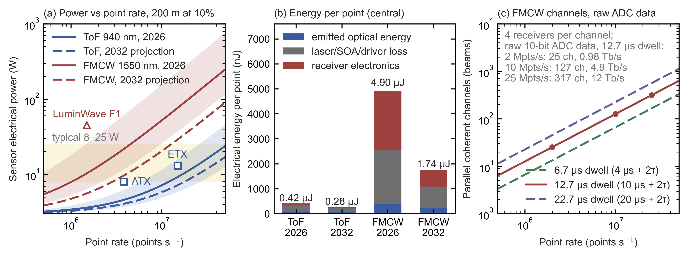

*Figure C7a.*
- *(a)* Modelled sensor electrical power (3 W overhead + point rate × electrical energy per point) for a 200 m, 10% extended target. The 3 W is an assumed fixed overhead for scanner motor, the sensor's system-on-chip (SoC), heaters and power conversion, the same for both sensor types. Bands span the low/high parameter sets, and the yellow band marks the 8–25 W typical of shipping automotive lidars; the parity target of §C7b subsection 5 is ≤15 W.
  - *Product markers* show published point rate and power. They are **at different ranges**, so they are sanity checks, not fits; subsection 1 derives the implied rates:
    - Hesai ATX: 3.84 Mpts/s (million points per second), 8 W, 230 m at 10% [P];
    - Hesai ETX: ≈15 Mpts/s implied, <13 W, 300 m at 10% [P/E];
    - LuminWave F1: 128 lines at 0.1° and 10 Hz, ≈1.5 Mpts/s implied, <45 W, 250 m at 10% [P/E].
- *(b)* Electrical energy per point in the central case, for ToF and FMCW in 2026 and 2032, split into the emitted optical energy, the loss in the laser, semiconductor optical amplifier (SOA) and driver, and the receiver electronics. The totals are 0.42, 0.28, 4.90 and 1.74 µJ. FMCW's emitted energy includes the light its transmitter sends while it stays on through the round trips (an ungated transmitter), $T_{\rm dwell}/T_{\rm int}=12.67/10=1.27$ times its useful energy (subsection 2(d)).
- *(c)* Parallel coherent channels (transmit beams) needed ($\dot N\times T_{\rm dwell}$, point rate times dwell per point) for 4, 10 and 20 µs of integration plus the two round trips at 200 m, $2\tau=2.67$ µs, i.e. dwells of 6.7, 12.7 and 22.7 µs. The note gives the raw ADC data at 10 bits per sample over the useful windows, counting the four receivers of each channel: at the model's 12.7 µs dwell, 2, 10 and 25 Mpts/s need 25, 127 and 317 channels and produce 0.98, 4.9 and 12 Tb/s (subsection 2(d)).

### 1. Published FMCW products and results (vendor figures unless tagged)

This subsection collects what FMCW vendors and research groups have published, so the model below can be checked against it. **Only one FMCW vendor publishes point rate, range and power for the same configuration:** Analog Photonics, whose FS-4S datasheet gives 90 kpts/s at 200 m on a 10% target in a 20° × 10° region-of-interest mode at 35 W, i.e. ≈390 µJ per point [P] (§C0 subsection 6.1, §C3b). The automotive FMCW vendors do not publish all three, and those three numbers together are what the energy-per-point comparison needs.

| Product | Point rate | Range | Power | Status |
|---|---|---|---|---|
| Aeva Aeries II | 4 M raw pts/s (vendor figure) | 500 m max. One published user configuration: **64 channels to 150 m**, because "longer-range configuration leads to more noise" [I, HeLiPR dataset paper] | not published | [D], low volume since 2022 |
| Aeva Atlas / Atlas Ultra | not published | 250 m at 10%; 500 m max; FOV 120° × 30° (Atlas), 150° × 30° (Atlas Ultra) [P] | "4× less than Aeries II"; no watt figure in Aeva releases or the distributor datasheet, which specifies **passive cooling** and −40 to +85 °C [P] | [NT]: Daimler Truck C-samples May 2026; European L3 award, SOP 2028 |
| Aurora FirstLight gen 2 | not published | "1 km" (reflectivity not stated) | not published | [D] on Aurora's own trucks |
| LightIC Lark | 1.5 M pts/s | 230 m at 10% | not published | [NT]; SoC description matches indie's Surya [E] (§D7) |
| LuminWave F1 | ≈1.5 M implied | 250 m at 10% | **<45 W** | [NT] |
| Voyant Carbon | up to 0.98 M pts/s (vendor figure) | 75–150 m max (reflectivity unstated; 200 m at launch) | not published | [D] industrial, \$1,490 single-unit |
| SiLC Eyeonic Edge | 1 M pts/s | ≤10 m | not published | [D] industrial |
| Analog Photonics FS-4S (optical phased array, OPA) | 90 kpts/s in its region-of-interest (ROI) mode; 400 kpts/s in its base mode | 200 m at 10% in a 20° × 10° ROI; 80 m at 10% over 60° × 14° [P] | **35 W** [P]; ≈390 µJ per point in the ROI mode [E] | [R]: no production award found (§C7 Commercial status) |
| Mobileye/Intel EyeC | "2 M PPS", 184 lines | 300 m | — | Cancelled Sep 2024 |
| Pointcloud, *Nature* 2026 (352 × 176 FPA on GF 45SPCLO) | Demonstrated ≈62k pts/s (8 channels at 1 fps); ≈0.9 M claimed with 128 outputs | 65 m at ≈30% | 46 nJ optical per point; 1,310 nm | [NT] mid-range; still fibre-fed with off-chip laser/SOA, FPGA-class readout |
| Microcomb / electro-optic-comb parallel FMCW (Riemensberger 2020; Lukashchuk 2022–24; PKU, ZJU and SYSU 2023–25) | 1.7–12 Mpixel/s (equivalent rate, as reported) | bench, metres to tens of metres | — | **[R]**: bench EDFAs, comb sources, no published power budget or packaging route |

*How the numbers are derived* [E]:
- LuminWave F1: 1,200 columns (120° at 0.1°) × 128 lines × 10 Hz = 1.54 Mpts/s (§C3b).
- Analog Photonics FS-4S: $35\ {\rm W}/(9\times10^{4}\ {\rm s^{-1}})=3.9\times10^{-4}$ J, i.e. ≈390 µJ per point in the ROI mode (§C0 subsection 6.1, §C7b subsection 3).
- Pointcloud: the demonstrated rate is the full $352\times176=61{,}952$-pixel frame at 1 fps (frame per second), ≈62k pts/s. The ≈0.9 M figure is the authors' claim for 128 outputs; scaling the 8-channel demonstration by 128/8 would give ≈1.0 M.
- Abbreviations in the table: FOV is the field of view; PPS points per second; C-samples are near-production prototypes; SOP is start of production; FPA is a focal-plane array (a 2D grid of coherent pixels on one chip); GF 45SPCLO is a GlobalFoundries 45 nm silicon-photonics CMOS process; SOA is a semiconductor optical amplifier; EDFA an erbium-doped fibre amplifier; FPGA a field-programmable gate array (reconfigurable logic chip).

ToF products for comparison:
- **Hesai ATX:** 3.84 Mpts/s at 8 W, ≈\$200 [P/T]; **ETX:** ≈15 Mpts/s implied by field of view ÷ resolution × frame rate ($120^\circ/0.06^\circ=2{,}000$ columns × $20^\circ/0.027^\circ\approx740$ rows × 10 Hz ≈ 14.8 Mpts/s, §C3b), at <13 W, 300 m at 10% [P/E].
- **RoboSense EM4 (2,160 beams):** 41 Mpts/s at 300 m at 10% [P]. The 520-beam EM4 is reported at 6.24 Mpts/s single return [S].

### 2. The limits, one by one

This subsection computes the energy one point costs, stage by stage, for both lidar types. FMCW pays more at every stage: single-mode collection and detection statistics (speckle fading, and a peak needed in both chirp ramps) raise the optical energy, a continuous-wave (CW) laser that stays on through the round trips emits 27% more light than it uses ($T_{\rm dwell}/T_{\rm int}=12.67/10$), CW amplification limits wall-plug efficiency (electrical-to-optical conversion efficiency), and dense digitization in four receivers per point dominates the receiver.

**(a) Optical energy per point: ≈72 nJ for ToF against ≈300 nJ (0.30 µJ) for FMCW.**

*Assumptions of the model.* The budget holds under these conditions:
- **Lambertian target.** The target is a perfectly diffuse reflector of reflectance $\rho$ that fills the sample (the beam footprint, or the ToF pixel's cell), at normal incidence and in clear air (no atmospheric loss). A Lambertian surface scatters a fraction $\rho$ of the incident power into a radiance of $\rho/\pi$ times the irradiance, so a receiver of aperture area $A_{\rm rx}$ at range $R$ collects the fraction $\rho A_{\rm rx}/(\pi R^2)$ of the transmitted power. Glossy paint and retroreflectors are not Lambertian: they return far more or far less toward the sensor, depending on angle, so the budget does not describe them.
- **FMCW receiver: four looks per point.** Each coherent receiver collects only the light that matches its LO in polarization and spatial mode. The central design gives every beam four such receivers, one per polarization on each of two spatial modes (for example two receive apertures side by side), so each point is seen in four independent speckles, four *looks*.
- **Rayleigh speckle.** Each look sees one speckle, whose intensity is exponentially distributed (Rayleigh amplitude), so detection needs extra signal margin against fades; summing the four looks narrows the spread but does not remove it. The ToF pixel sums hundreds of speckles and does not fade.
- **One detection rule for both receivers:** 90% detection per point with at most $10^{-3}$ false points per point over the whole 0–300 m search (§C0 subsection 4.3).
- **Shot-noise-limited LO.** The coherent receiver is limited by the LO's shot noise, with thermal and dark-current noise neglected. At 105–125 °C this holds only approximately: §C4c gives 82–94% of the shot-noise limit for Ge at 125 °C, so the FMCW optical energy would rise somewhat when hot.
- **SPAD dead time 6 ns**, the state of the art: Sony's IMX479 specifies "approx. 6 ns" with 3×3 SPADs per macro-pixel, and its IMX459 predecessor measured 6 ns, a 60 Mcps (million counts per second) count-rate ceiling and 0.1% afterpulsing [P]. The model treats its SPADs as paralyzable [E], as passive recharge would make them, although the IMX459 press release says active recharge (§C5a): a SPAD is live only if no photon arrived during the last dead time $\tau_d=6$ ns. A paralyzable counter counts at most $1/(e\tau_d)=1/(2.718\times6\ {\rm ns})=61$ Mcps, with $e$ Euler's number, which matches the measured 60 Mcps ceiling (§C5a, Eq. \eqref{eq:paralyzable-count-rate}); a non-paralyzable counter would instead approach $1/\tau_d=167$ Mcps. Each macro-pixel sees a 0.05° × 0.05° field, one cell of the IMX479 grid (2,400 × 520 cells over 120° × 26°), i.e. a solid angle $\Omega_{\rm pix}=(0.05^\circ\times\pi/180)^2=(8.727\times10^{-4})^2=7.615\times10^{-7}$ sr. In the model's central "bright sun" case, half the background of a fully sunlit scene of reflectance 0.9 (the model's high case; §C0 subsection 4.2), the macro-pixel counts $r_{\rm bg}=1.83\times10^{8}$ s⁻¹ (subsection 2(c)), so each of its nine SPADs counts $r=1.83\times10^{8}/9=2.03\times10^{7}$ s⁻¹, $r\tau_d=0.122$, and each SPAD is dead a fraction $1-e^{-0.122}=11.5\%$ of the time (Eq. \eqref{eq:dead-fraction-two-models}). A SPAD that is dead when the echo arrives misses it, so the live fraction 0.885 multiplies the signal efficiency as well as the background. In the fully sunlit high case the rate doubles, $r\tau_d=0.244$, and the dead fraction is $1-e^{-0.244}=21.6\%$ (live fraction 0.784).
- **20 mm apertures** for FMCW: each spatial mode is received through a 20 mm aperture in the mode of a Gaussian beam, one of them the monostatic aperture that also transmits; the ToF receiver uses one 25 mm aperture.
- **FMCW efficiency $\eta=0.25$**, checked against Waymo's estimate (details below) rather than built up from component data.

Under these assumptions, the optical energy each point needs is

$$E_{\rm pt}=\frac{n_{\rm req}\,E_{\rm ph}\,\pi R^2}{\rho\,A_{\rm eff}\,\eta} \label{eq:energy-per-point}$$

where:
- $E_{\rm pt}$ is the useful optical energy per point (J), the light whose echo the receiver integrates: all of a ToF point's light, whereas an ungated FMCW laser emits $T_{\rm dwell}/T_{\rm int}$ times more, because it stays on through the round trips (subsection 2(d));
- $n_{\rm req}$ is the number of detected counts (ToF) or photoelectrons (FMCW) needed for reliable detection;
- $E_{\rm ph}=hc/\lambda$ is the photon energy (J);
- $R$ is the range (m) and $\rho$ the target's diffuse reflectance (0.1 here);
- $A_{\rm eff}$ is the effective collecting area (m²): the area that, in the Lambertian fraction $\rho A_{\rm eff}/(\pi R^2)$, gives the power the receiver actually collects into its detection path, before the losses counted in $\eta$;
- $\eta$ is the receive efficiency, the fraction of that collected light that becomes counts or photoelectrons.

Eq. \eqref{eq:energy-per-point} simply inverts the Lambertian link: the detected number is $E_{\rm pt}/E_{\rm ph}$ photons times $\rho A_{\rm eff}\eta/(\pi R^2)$, and it is set equal to $n_{\rm req}$.

- **ToF:** $A_{\rm eff}=A_{\rm rx}$ is the whole 25 mm receive aperture (491 mm²), and the pixel sums hundreds of speckle modes. An ideal counter needs 15.0 counts in the model's bright sun (14.98; §C0 subsection 4.3); the model applies a ×1.45 implementation margin to it [E], $n_{\rm req}=1.448\times14.98=21.7$ counts, and its low and high cases apply ×1.16 and ×2.03 (17.4 and 30.4 counts). At 940 nm, 37% PDE (photon detection efficiency of the SPAD) and the bright-sun live fraction of 0.885 the result is **≈72 nJ** (51–113). With $n_{\rm req}=21.7$ (central), $E_{\rm ph}=2.11\times10^{-19}$ J, $\pi R^2=\pi\times200^2=1.26\times10^{5}$ m², $\rho=0.1$ and $\eta=0.5\times0.37\times0.885=0.164$ (optics transmission × PDE × live fraction): $E_{\rm pt}=21.7\times2.11\times10^{-19}\times1.26\times10^{5}/(0.1\times4.91\times10^{-4}\times0.164)=5.77\times10^{-13}/(8.05\times10^{-6})\approx7.2\times10^{-8}$ J. The low case is night (17.4 counts, no dead time, $\eta=0.185$): 51 nJ. The high case is the fully sunlit scene (30.4 counts, live fraction 0.784, $\eta=0.145$): 113 nJ.
- **FMCW:**
  - Each look collects one polarization in one spatial mode, so its effective area is $A_{\rm mode}$, the mode-equivalent collecting area. It is the area that, placed in the Lambertian fraction $\rho A_{\rm mode}/(\pi R^2)$, gives the power actually coupled into the polarization and spatial mode that the LO selects. It therefore already includes the polarization and mode-shape factors. It rests on the antenna theorem of Eq. \eqref{eq:antenna-theorem} in §C7, applied to a monostatic Gaussian beam rather than to a 0.1° cell (§C0 subsection 3.2):
    - §C0 Eq. \eqref{eq:coherent-link} gives $A_{\rm mode}=t^2\lambda^2R^2/(2\pi w^2)$, where $w$ is the beam's 1/e² radius at the target, $t^2=0.84$ the aperture-truncation factor counted on transmit and on receive, and the 2 in the denominator the factor ½ for the single polarization the LO accepts.
    - A 20 mm aperture launches a beam of 1/e² radius $w_0=0.45\times20\ {\rm mm}=9$ mm, whose Rayleigh range is $\pi w_0^2/\lambda=\pi\times(9\times10^{-3}\ {\rm m})^2/(1.55\times10^{-6}\ {\rm m})\approx164$ m. At 200–250 m the target is only 1.2–1.5 Rayleigh ranges away, so the spot has not yet grown in proportion to range, and $A_{\rm mode}\propto R^2/w^2$ still rises with range. At 200 m, $w=14.2$ mm and $A_{\rm mode}=0.84\times(1.55\times10^{-6})^2\times200^2/(2\pi\times0.0142^2)\approx64$ mm² (§C7b subsection 1(b), §C10.3b); at 250 m it is 74.5 mm², the value used in the Waymo check below.
    - Piggott et al. (Waymo) put one mode ≈6 dB below a direct-detection receiver of the same aperture (3 dB polarization, 3 dB aperture) [P]. In this model one mode collects 4.9× (6.9 dB) less than the 314 mm² of its own 20 mm aperture ($314/64=4.9$).
    - The four looks together give $A_{\rm eff}=4A_{\rm mode}=255$ mm².
  - Single-mode returns fade, so detection needs more signal, and an FMCW point must show its peak in both the up- and the down-ramp of its chirp. Under the report's detection rule four looks need **≈88 photoelectrons** in total for 90% detection, and one look ≈259 (§C0 subsection 4.3). The model uses $n_{\rm req}=120$, 30 per look: a ×1.36 implementation margin, close to the ×1.45 that takes ToF from 15.0 to 21.7 counts. Waymo's analysis uses **50 photons (45 photoelectrons at a quantum efficiency of 0.9) for 90% detection** with four averaged speckles at a $10^{-6}$ false-alarm probability per frequency bin, and finds that with a single speckle 10–30 photoelectrons give only ≈50%, depending on the false-alarm probability [P]. Waymo's 45 photoelectrons require the peak in one ramp only: the report's rule gives 47 for that case and 88.5 when the peak must appear in both ramps (§C0 subsection 4.3).
  - For FMCW, $\eta$ is the product of optical transmission, detector quantum efficiency and heterodyne mixing efficiency. It excludes the mode and polarization factor, which $A_{\rm mode}$ already contains.
  - Result: **≈0.30 µJ** (0.15–0.88) for 120 photoelectrons over four looks. With $A_{\rm eff}=4\times63.7=255$ mm², $E_{\rm ph}=1.28\times10^{-19}$ J at 1,550 nm and $\eta=0.25$, Eq. \eqref{eq:energy-per-point} gives $E_{\rm pt}=120\times1.28\times10^{-19}\times1.26\times10^{5}/(0.1\times2.55\times10^{-4}\times0.25)=1.93\times10^{-12}/(6.37\times10^{-6})\approx3.0\times10^{-7}$ J. The low case uses 96 photoelectrons and $\eta=0.40$ (0.15 µJ), the high case 168 and $\eta=0.12$ (0.88 µJ).
  - **Check against Waymo.** Waymo's "realistic" 10–20 W optical for their ADAS (advanced driver-assistance) case (12 Mpts/s, 250 m, 5%, 50 photons or 45 photoelectrons at a quantum efficiency of 0.9, 90% detection) is 10–20 W divided by $12\times10^{6}$ points/s, i.e. 0.83–1.67 µJ per point. Eq. \eqref{eq:energy-per-point} for one receiver with $A_{\rm mode}=74.5$ mm² (a 20 mm aperture at 250 m) and $\eta=0.25$ gives $45\times1.28\times10^{-19}\times\pi\times250^2/(0.05\times7.45\times10^{-5}\times0.25)=1.21$ µJ for one ramp. Waymo's energy per point pays for two chirps of 50 photons each: its ideal 0.52 µJ is $2\times50\times1.28\times10^{-19}\ {\rm J}/(2.45\times10^{-11})$, through a −106.1 dB worst-case link [P, Piggott et al. 2025, Table 1]. The like-for-like value is therefore $2\times1.21=2.4$ µJ at $\eta=0.25$, 1.5–2.9× Waymo's range, or 1.35 µJ at $\eta=0.45$, the efficiency of Waymo's 3 dB case including its quantum efficiency of 0.9, which lies inside it [E]. One receiver is the right basis for the check, because Waymo takes all four speckles through one single-mode receiver: it sums the FFT spectra of successive acquisitions, between which the scanning beam has moved enough to decorrelate the speckle, and its 50 photons, 45 photoelectrons, are the total over the four acquisitions [P, Piggott et al. 2025, §3.2 and Fig. 8(b)]. The §C7a design takes its four looks through four receivers at once instead, which divides the energy for the same 45 photoelectrons by four, to $1.21/4\approx0.30$ µJ.
  - **Measured efficiencies are lower.** The FMCW value, 0.25, is a design value about 1.5× above the best coherent chain measured so far. Waymo's lab chain measured 0.112 end to end, or 0.168 without its Hann window (Piggott et al. 2025, App. A), and Pointcloud's integrated array 0.057 once its amplifier noise is counted (Settembrini et al. 2026) [P; §C0 subsection 3.1]. With those values FMCW needs $0.25/0.168=1.5$ to $0.25/0.112=2.2$ times (discrete fibre chain) or $0.25/0.057=4.4$ times (integrated array) the optical energy per point quoted here: 0.45–0.68 µJ or 1.3 µJ instead of 0.30 µJ. The laser's electrical energy (2.56 µJ, subsection 3) scales in the same way while the receiver electronics (2.34 µJ) do not, so the total per point rises from 4.90 µJ to $2.563\times1.488+2.337=6.15$ µJ and $2.563\times2.232+2.337=8.06$ µJ (15–19× ToF's 0.415 µJ), or to $2.563\times4.386+2.337=13.6$ µJ (≈33×). The model keeps 0.25 as its central value and carries these as a sensitivity.

FMCW therefore needs ≈4.2× more useful optical energy per point than ToF ($0.303\ \mu{\rm J}/72\ {\rm nJ}=4.2$), and its ungated transmitter emits ≈5.3× more ($0.384\ \mu{\rm J}/72\ {\rm nJ}=5.3$), because it also emits during the round trips (subsection 2(d)). The ≈4.2× ratio is the product of four factors, $1.93\times5.53\times0.606\times0.656=4.2$:
- collection (1.9×), the ToF aperture area over the four looks' $A_{\rm eff}$ (491 mm² against 255 mm²);
- detection statistics (5.5×), 120 required photoelectrons against 21.7 counts: speckle fading, a peak needed in both chirp ramps, and one photoelectron of shot noise in every FFT bin searched (§C0 subsection 4.3);
- photon energy (0.61×), because a 1,550 nm photon carries less energy than a 940 nm one ($1.28/2.11$);
- efficiency (0.66×), ToF's 0.164, which includes the SPADs' dead time in bright sun, against FMCW's 0.25.

§C7b subsection 1 derives each factor. It also explains why pulsing matters to ToF (sunlight in the timing bin) but not to coherent detection, and extends the same budget to ToF with linear-mode avalanche photodiodes (APDs) and to full-cell FMCW coverage.

The 1,550 nm eye-safety allowance (§C4c) can pay for this optical energy. Items (b) and (c) give its electrical and thermal cost.

**(b) Laser wall-plug efficiency and power handling.** **Heat, not eye safety, is the practical ceiling** on FMCW point rate at 1,550 nm. Wall-plug efficiency $\eta_{\rm wp}$ is the optical power out divided by the electrical power in, so the laser's electrical energy per point is the light it emits per point divided by $\eta_{\rm wp}$: $E_{\rm pt}/\eta_{\rm wp}$ for a pulsed ToF laser and $E_{\rm pt}T_{\rm dwell}/(T_{\rm int}\eta_{\rm wp})$ for the ungated FMCW laser (subsection 2(d)). Everything not emitted becomes heat. Eye safety allows ≈9.1 W of scanned light over a 120° × 25° field at 1,550 nm (§C7b subsection 3a(b)). FMCW's useful light at 200 m, 3.0 W at 10 Mpts/s and 7.6 W at 25 Mpts/s, fits within it if the transmitter is gated during the round trips. The model's transmitter is ungated and emits $T_{\rm dwell}/T_{\rm int}=12.67/10=1.27$ times as much, 3.8 W and 9.6 W, so at 25 Mpts/s it exceeds the allowance unless it is gated.
- ToF emitters (multi-junction vertical-cavity surface-emitting lasers, VCSELs, and edge-emitting lasers, EELs, with gallium-nitride (GaN) transistor drivers) reach ≈15–30% system wall-plug efficiency on short pulses [E]. The model spans this range and takes 20% as its 2026 central value (25% in 2032; subsection 3).
- FMCW needs a narrow-linewidth, linearly chirped CW source plus amplification:
  - Aeva reports an SOA at >28 dBm ($10^{28/10}$ mW ≈ 630 mW) with **>20% wall-plug efficiency at ≤50 °C** [P]; no data at 85–105 °C.
  - Silicon waveguides saturate near **16 mW** from two-photon and free-carrier absorption [P, Pointcloud Methods], so the model's 30 mW channels (subsection 2(e)), and brighter ones, need silicon-nitride (SiN) or III-V (compound-semiconductor) paths.
- The model therefore uses 10–20% (central 15%) in 2026.
- At 10 Mpts/s that means ≈3.0 W of useful light, ≈3.8 W emitted and ≈22 W of heat in the laser/SOA stage alone; at 25 Mpts/s, ≈7.6 W useful, ≈9.6 W emitted and ≈54 W of heat. The useful optical power is the point rate $\dot N$ times the optical energy per point, $P_{\rm opt}=\dot N E_{\rm pt}=10^{7}\ {\rm s^{-1}}\times0.303\ \mu{\rm J}=3.03$ W. The ungated laser emits for the whole dwell, $P_{\rm opt}T_{\rm dwell}/T_{\rm int}=3.03\times12.67/10=3.84$ W (subsection 2(d)). The heat is the electrical input minus the light out, $3.84\times(1/\eta_{\rm wp}-1)=3.84\times(1/0.15-1)=21.8$ W; at 25 Mpts/s, $7.59\times1.267\times5.67=54.5$ W, where $5.67=1/0.15-1$.

**(c) Digitization: FMCW pays for every range bin, photons or not.** An FMCW receiver must sample its beat signal densely over the useful window of every chirp ramp and Fourier-transform it, whether or not a target is there, so its electronics energy per point is fixed by range and resolution rather than by the returned light.

The beat frequency is $f_b=2BR/(cT_u)$, Eq. \eqref{eq:fmcw-beat-frequency} with the useful window $T_u$ of one chirp ramp in place of the chirp duration, where $R$ is the range and $B$ the bandwidth swept in the useful window. The useful window is the part of the ramp after the round trip $\tau=2R/c$, once the echo beats with the LO; the ramp itself lasts $T_u+\tau$, with $\tau$ taken at the 200 m design range (§C7b, Eq. \eqref{eq:useful-window}), so the laser sweeps $1\ {\rm GHz}\times(5+1.33)/5=1.27$ GHz per ramp (§C7b, Eq. \eqref{eq:total-sweep-bandwidth}). An echo from beyond 200 m arrives later and beats for less of the window, 4.33 µs instead of 5 µs at 300 m, which the model ignores because its design target sits at 200 m. On top of it comes the Doppler shift $f_D=2v_r/\lambda$ of the fastest target, $2\times70/(1.55\times10^{-6})\approx90$ MHz at a closing speed $v_r=70$ m/s. The model samples at $f_s\approx2.5(f_b+f_D)$, where $f_s$ is the ADC sample rate and $f_b$ is taken at the maximum range $R_{\max}$. The receiver must search the whole 0–300 m window even when the design target is at 200 m, so $R_{\max}=300$ m sets the digitization while 200 m sets the optical energy. The factor 2.5 is twice the highest beat frequency (the Nyquist rate for real sampling) times a 25% margin. Only the two useful windows, $T_{\rm int}=2T_u$ in all, are digitized, so the number of ADC samples per point is $N_{\rm ADC}=f_s\times2T_u$, which gives

$$N_{\rm ADC}\approx 5\,\frac{R_{\max}}{\Delta R}\;+\;5\,f_D\,T_u \label{eq:adc-samples-per-point}$$

samples per point, **independent of how many photons return**. Here $\Delta R=c/(2B)$ is the range resolution, so $R_{\max}/\Delta R$ is the number of range bins. The first term follows because $f_bT_u=2BR_{\max}/c=R_{\max}/\Delta R$ at maximum range. Eq. \eqref{eq:adc-samples-per-point} is Eq. \eqref{eq:adc-samples-dwell} of §C7b with $R=R_{\max}$.
- For 300 m, 15 cm resolution (2,000 range bins) and 5 µs useful windows: $f_s\approx1.2$ GS/s and **≈12,000 samples per point**. Step by step: $B=c/(2\Delta R)=1$ GHz and $R_{\max}/\Delta R=300/0.15=2{,}000$; $f_b=2\times10^{9}\times300/(3\times10^{8}\times5\times10^{-6})=400$ MHz; $f_s=2.5\times(400+90)\ {\rm MHz}=1.23$ GS/s; $N_{\rm ADC}=f_s\times2T_u=1.23\times10^{9}\ {\rm s^{-1}}\times10^{-5}\ {\rm s}\approx12{,}300$. Eq. \eqref{eq:adc-samples-per-point} gives the same count, because $f_bT_u=R_{\max}/\Delta R$: $N_{\rm ADC}=5\times2{,}000+5\times(90\times10^{6})\times(5\times10^{-6})=10{,}000+2{,}250\approx12{,}300$.
- Energy per sample. Each sample costs one analog-to-digital conversion plus its share of the digital processing:
  - ADC: the Walden figure of merit (FOM) is the energy per conversion step, so one conversion at an effective number of bits ENOB (the resolution left after noise and distortion) costs FOM × $2^{\rm ENOB}$. Research 1 GS/s ADCs reach 7–10 fJ/step, i.e. ≈7–20 mW at 10–11 ENOB [I, Murmann survey]; product ADCs are several times worse. The power is $P={\rm FOM}\times2^{\rm ENOB}\times f_s$: $7\ {\rm fJ}\times2^{10}\times10^{9}\ {\rm s^{-1}}=7.2$ mW at the low end (10 ENOB) and $10\ {\rm fJ}\times2^{11}\times10^{9}\ {\rm s^{-1}}=20$ mW at the high end (11 ENOB).
  - Digital signal processing (DSP): the FFT, windowing and peak search take ≈70 operations per sample (a model assumption).
  - Together, the energy per sample is

    $$e_s={\rm FOM}\times2^{\rm ENOB}+N_{\rm op}\,E_{\rm op} \label{eq:energy-per-sample}$$

    with $N_{\rm op}\approx70$ DSP operations per sample and $E_{\rm op}$ the energy per operation.
  - 2026 central: **≈37 pJ/sample** (22–61). The model assumes an 8-bit effective resolution (ENOB = 8) at a product-grade FOM of 50 fJ/step (range 30–100), so the conversion costs $50\ {\rm fJ}\times2^{8}=12.8$ pJ. It adds 70 operations at 0.35 pJ each (range 0.2–0.5 pJ), $70\times0.35=24.5$ pJ, for 37.3 pJ. The low case, still at 8 ENOB ($2^{8}=256$), is $30\ {\rm fJ}\times256+70\times0.2\ {\rm pJ}=7.7+14=22$ pJ, and the high case $100\ {\rm fJ}\times256+70\times0.5\ {\rm pJ}=25.6+35=61$ pJ.
- The analog front end adds ≈10 mW per receiver for the transimpedance amplifier (TIA), bias and drivers, drawn for the whole dwell. Each of the $N_L=4$ receivers of a point (one per look) digitizes and transforms its own beat, so the receiver electronics energy per point is

  $$E_{\rm rx}=N_L\left(N_{\rm ADC}\,e_s+P_{\rm an}\,T_{\rm dwell}\right) \label{eq:receiver-energy-per-point}$$

  where $E_{\rm rx}$ is the receiver electronics energy per point, $N_L$ the number of receivers (looks) per point, $P_{\rm an}$ the analog power per receiver and $T_{\rm dwell}$ the dwell per point. The dwell is the two useful windows plus the two round trips, $T_{\rm dwell}=2T_u+2\tau=10+2.67=12.67$ µs at the 200 m design range (§C7b, Eq. \eqref{eq:fmcw-dwell}). The ADC samples only the useful windows, but the analog front end stays on for the whole dwell. This gives **≈2.3 µJ per point** (1.3–4.0): $E_{\rm rx}=4\times(12{,}300\times37.3\ {\rm pJ}+10\ {\rm mW}\times12.67\ \mu{\rm s})=4\times(0.459+0.127)=2.34$ µJ. The low and high cases are $4\times(12{,}300\times22\ {\rm pJ}+5\ {\rm mW}\times12.67\ \mu{\rm s})=1.3$ µJ and $4\times(12{,}300\times61\ {\rm pJ}+20\ {\rm mW}\times12.67\ \mu{\rm s})=4.0$ µJ.
- Waymo's analysis reaches the same scale from the other direction: **≈$1.1\times10^{13}$ FLOPS** (floating-point operations per second) for 12 Mpts/s, "comparable to a high-end desktop GPU" [P]. The model's count for one receiver per point is the same, $12\times10^{6}\ {\rm s^{-1}}\times12{,}300\times70\approx1.0\times10^{13}$ operations/s; with four receivers per point it is $\approx4\times10^{13}$.
- **ToF is event-driven.** A SPAD-SoC (a SPAD array stacked on its own processing chip) spends energy per avalanche and histogram increment, a few pJ each, plus fixed clocking and readout. Its histogram also has ≈2,000 bins, but they are *counted* sparsely, not *sampled and transformed* densely.
  - *Result:* **≈57 nJ per point** (20–102), calibrated to Sony's 1.19 W development chip (§C5a).
  - *Event count:* background count rate × listening time × live fraction + signal counts, $r_{\rm bg}\,t_{\rm listen}\,(1-f_{\rm dead})+n_{\rm req}=1.83\times10^{8}\ {\rm s^{-1}}\times20.8\ \mu{\rm s}\times0.885+21.7\approx3{,}369+22\approx3{,}390$ events per point in bright sun. The inputs are:
    - the background count rate $r_{\rm bg}=1.83\times10^{8}$ s⁻¹ per 0.05° × 0.05° macro-pixel, half the fully sunlit 940 nm, 10 nm-filter case of §C6(d) (Eq. \eqref{eq:macro-pixel-background-rate}) evaluated at the model's PDE of 0.37. §C6(d) gives $2.965\times10^{8}$ s⁻¹ at PDE 0.3, so $r_{\rm bg}=0.5\times2.965\times10^{8}\times0.37/0.3=1.83\times10^{8}$ s⁻¹, i.e. a sunlit scene of reflectance ≈0.45 or a pixel half filled by bright surfaces (§C0 subsection 4.2);
    - a listening time $t_{\rm listen}=20.8$ µs per point, a model input equal to one column period of a 520-line sensor at 25 Mpts/s ($520/(25\times10^{6}\ {\rm s^{-1}})=20.8$ µs);
    - the live fraction 0.885 that the paralyzable form of Eq. \eqref{eq:dead-fraction-two-models} gives at the per-SPAD rate $r=r_{\rm bg}/9=2.03\times10^{7}$ s⁻¹ (nine SPADs per 3×3 macro-pixel; subsection 2(a)): $e^{-r\tau_d}=e^{-0.122}=0.885$, so each SPAD is blind 11.5% of the time;
    - $n_{\rm req}=21.7$ signal counts (subsection 2(a)).
  - *Cross-check:* the same rate gives $b=r_{\rm bg}\,\Delta t_{\rm bin}\,N_{\rm shots}\,(1-f_{\rm dead})=1.83\times10^{8}\ {\rm s^{-1}}\times1\ {\rm ns}\times10\times0.885=1.62$ background counts per 1 ns bin, summed over the $N_{\rm shots}=10$ shots of a point, the value §C0 subsection 4.2 uses.
  - *Energy:* at 5 pJ per event plus a fixed 40 nJ per point, $E=40\ {\rm nJ}+3{,}390\times5\ {\rm pJ}=57$ nJ.
  - *Calibration:* the 57 nJ total sits inside the 40–80 nJ per point that a 1–2 W IMX479-class chip implies at 25 Mpts/s ($1\ {\rm W}/(25\times10^{6}\ {\rm s^{-1}})=40$ nJ); Sony's 1.19 W gives 48 nJ.
  - *Range:* from 20 nJ at night (20 nJ fixed, 4 pJ per event) to $60\ {\rm nJ}+(3.66\times10^{8}\times20.8\ \mu{\rm s}\times0.784+30.4)\times7\ {\rm pJ}=102$ nJ in the fully sunlit scene (live fraction 0.784).

**(d) Channels and data: the parallelism problem.** Each coherent channel measures one point per dwell, so a point rate $\dot N$ needs $N_{\rm ch}=\dot N\,T_{\rm dwell}$ parallel channels (Eq. \eqref{eq:fmcw-point-rate} rearranged).
- The dwell is the 10 µs of useful integration of (c), the 5 µs up-chirp plus the 5 µs down-chirp, plus the round trip that each of the two ramps loses, $2\tau=2.67$ µs at 200 m: $T_{\rm dwell}=12.67$ µs (the dwell of Eq. \eqref{eq:receiver-energy-per-point}; §C7b, Eq. \eqref{eq:fmcw-dwell}). At that dwell, 2 Mpts/s needs $N_{\rm ch}=2\times10^{6}\ {\rm s^{-1}}\times12.67\times10^{-6}\ {\rm s}=25$ channels, 10 Mpts/s needs **127**, and 25 Mpts/s needs 317. With four receivers per channel these are 101, 507 and 1,267 receivers. Integrating for 4 µs instead (2 µs useful windows) shortens the dwell only to $4+2.67=6.67$ µs, a factor of 1.9 rather than 2.5, because the round trips stay: 13, 67 and 167 channels (53, 267 and 667 receivers). Meanwhile $f_s$ and ADC energy rise: 2 µs chirps give $f_b=1.0$ GHz and $f_s=2.5\times(1{,}000+90)\ {\rm MHz}\approx2.7$ GS/s. The samples per point stay near $5R_{\max}/\Delta R$ ($2.7\times10^{9}\times4\times10^{-6}\approx10{,}900$), so the energy per point rises through the poorer figure of merit of faster converters rather than through more samples.
- The central design is ungated: its laser stays on through the round trips, so it emits $E_{\rm pt}T_{\rm dwell}/T_{\rm int}=0.303\ \mu{\rm J}\times12.67/10=0.38$ µJ per point (0.19–1.12 µJ across the cases), and the laser's electrical energy is counted on that emitted light (subsections 2(b) and 3). A transmitter switched off during the last $\tau$ of each ramp, whose echo would land in the next ramp's discarded window, would save that extra light, $2\tau/T_{\rm dwell}=2.67/12.67=21\%$ of what the ungated laser emits (§C7b subsection 3a(b)).
- Raw ADC output at 10 bits per sample is **0.98, 4.9 and 12 Tb/s** respectively: $N_L\dot N N_{\rm ADC}\times10$ bits with $N_L=4$ receivers per channel, e.g. $4\times10^{7}\ {\rm s^{-1}}\times12{,}300\times10=4.9\times10^{12}$ b/s at 10 Mpts/s. This counts the useful windows only, as the ADC energy of (c) does; converters left running through the round trips would stream $T_{\rm dwell}/T_{\rm int}=1.27$ times more, 6.2 Tb/s. The 10 bits are the converter's output word; the energy model's 8 effective bits (ENOB) are fewer because noise and distortion corrupt the lowest bits. This data stream cannot leave the chip economically, so FFT and peak extraction must sit beside the ADCs in a stacked electronic-photonic IC (EPIC): the same stacking step Sony made for SPAD-SoCs, with GS/s converters instead of counters.
- Today's merchant FMCW SoC, indie's **iND83301 "Surya"**, provides 4 × 1 GS/s or 8 × 500 MS/s 12-bit ADCs with an FFT unit and four DSP cores; power is not published [P]. A 10 Mpts/s sensor would need roughly **120–130 such devices** [E]. The aggregate sample rate is $\dot N N_LN_{\rm ADC}=10^{7}\ {\rm s^{-1}}\times4\times12{,}300\approx4.9\times10^{11}$ samples/s, against $4\times1$ GS/s per device, so $490/4\approx123$ devices. Counting one ADC per receiver gives $507/4\approx127$, but each 1 GS/s converter is then below the 1.23 GS/s a receiver needs during its useful windows, and the 8 × 500 MS/s mode (≈63 devices) is far too slow per receiver. Because $N_{\rm ADC}\approx5R_{\max}/\Delta R$ (Eq. \eqref{eq:adc-samples-per-point}), the aggregate rate barely depends on the chirp length.
- Pointcloud's 2026 array still reads out through an RFSoC (a commercial FPGA with integrated RF data converters) and says an application-specific chip (ASIC) "is under development" [P].
- **Physics bounds the minimum dwell:** each of the two ramps loses one round trip, $\tau=2R/c=2\times250\ {\rm m}/(3\times10^{8}\ {\rm m\,s^{-1}})=1.67$ µs at 250 m, so even unlimited light leaves a dwell of at least $2\tau=3.33$ µs (2.67 µs at 200 m; §C7b subsection 2(a)).
- **Walk-off bounds the scan rate.** During the round trip $2R/c$ the beam direction turns by $\dot\theta\cdot2R/c$, where $\dot\theta$ is the beam's optical scan rate (rad/s; for a spinning sensor, its rotation rate). At range $R$ the return therefore lands a lateral distance $\Delta x\approx2R^2\dot\theta/c$ away from where the receiver now looks. For a 360°, 10 Hz spin ($\dot\theta=2\pi\times10\ {\rm s^{-1}}=62.8$ rad/s) the lag angle $2R\dot\theta/c$ is $2\times100\ {\rm m}\times62.8\ {\rm s^{-1}}/(3\times10^{8}\ {\rm m\,s^{-1}})=4.2\times10^{-5}$ rad $=0.0024^\circ$ at 100 m and 0.006° at 250 m, against the 0.0036° 1/e² half-angle of a beam sized for 250 m (§C10.3a). Waymo says this makes 360°, 10 Hz spinning "impractical for target ranges much above 100 m" and pushes designs to step-and-stare fast axes (point, dwell, then jump) [P]; the lag angles above show why.
- **The scan also bounds the maximum dwell:** a chirp that outlasts the beam's crossing time $\theta_b/\dot\theta$ (with $\theta_b\approx\lambda/D$ the beam's angular width and $D$ its diameter) is spread by scanner-induced Doppler (§C7, Eq. \eqref{eq:scanner-doppler-spread}). At a Falcon-class 45,600°/s (the polygon row of the §C7 table), even the 1.67 µs round trip to 250 m exceeds the crossing time of any beam wider than ≈1.2 mm unless the broadening is compensated digitally [E: the crossing time $\lambda/(D\dot\theta)$ falls below 1.67 µs for $D>\lambda/(\dot\theta\times1.67\ \mu{\rm s})=1.55\times10^{-6}/(796\times1.67\times10^{-6})=1.2$ mm]. For any wider beam even the shortest ramp, one round trip long, outlasts the crossing time, so no chirp length works without digital compensation, as §C7b subsection 2(g) also finds for a 0.05° beam at 300 m.

**(e) Pixel and resolution scaling.** A "line" is one row of the lidar image, i.e. one vertical angular sample repeated across the horizontal field. A ToF line and an FMCW line cost very different amounts, which is why line count scales so differently for the two.
- **SPAD ToF:** one more line is ≈30 µm of die (three 10 µm SPADs) plus a share of a time-to-digital converter and histogram, a few cents of silicon (§C5a economics: \$17–44 of silicon per IMX479 die spread over 520 lines is 3–8 US cents per line). The laser energy is shared in time. This is why Chinese vendors' line counts went 192 → 520 → 896 → 2,160 → 4,320 in under two and a half years, from Huawei's 192-line D3, launched on 26 Dec 2023 [T], to Hesai's ETX with up to 4,320 channels, shown on 17 Apr 2026 [P].
- **FMCW:** every *simultaneous* line needs four receivers (one per look), each with an LO tap, a 90° hybrid (an optical mixer that yields in-phase and quadrature beats) or balanced Ge photodiode pair, a TIA, a GS/s ADC and an FFT pipe, plus its own CW optical power. Lines beyond the channel count come from stepping the beam, which costs dwell.
  - *Light per channel:* **≈30 mW** in the central model at 200 m, the useful energy over the integration time, $P_{\rm ch}=E_{\rm pt}/T_{\rm int}=0.303\ \mu{\rm J}/10\ \mu{\rm s}=30$ mW. The channel emits it for the whole 12.67 µs dwell, 0.38 µJ per point (subsection 2(d)). The high-energy case needs $0.885\ \mu{\rm J}/10\ \mu{\rm s}=88$ mW.
  - *With range:* the power grows with the energy, $E_{\rm pt}\propto R^2/A_{\rm mode}$ (Eq. \eqref{eq:energy-per-point}). For the model's fixed 20 mm aperture, $A_{\rm mode}$ is 63.7 mm² at 200 m, 74.5 mm² at 250 m (subsection 2(a)) and ≈82 mm² at 300 m, where $w=9\ {\rm mm}\times\sqrt{1+(300/164)^2}\approx18.8$ mm and $A_{\rm mode}=0.84\times(1.55\times10^{-6})^2\times300^2/(2\pi\times0.0188^2)\approx82$ mm² (§C0 Eq. \eqref{eq:coherent-link}). A channel therefore needs $30.3\times(250/200)^2\times63.7/74.5=40$ mW at 250 m and $30.3\times(300/200)^2\times63.7/82=53$ mW at 300 m. An aperture re-optimized at each range holds the growth to $\propto R$ (§C7b subsection 1(f)): $30.3\times250/200=38$ mW and $30.3\times300/200=45$ mW.
- **Worked example:** a 520-line, 10 Hz, 2,400-column FMCW image at 200 m (12.5 Mpts/s) implies ≈158 channels (≈630 receivers) at the 12.67 µs dwell, ≈3.8 W of useful light (4.8 W emitted), ≈27 W of laser heat and ≈29 W of receiver electronics under the central 2026 assumptions. That is about **64 W** in total, against ≈8 W for a 520-line ToF unit in the same model, and each FMCW sample still covers only ≈2% of its cell (§C10.3b, Result 2). The arithmetic: $\dot N=520\times2{,}400\times10\ {\rm Hz}=1.25\times10^{7}$ pts/s; $N_{\rm ch}=1.25\times10^{7}\times12.67\ \mu{\rm s}=158$; useful optical power $1.25\times10^{7}\times0.303\ \mu{\rm J}=3.8$ W, emitted $1.25\times10^{7}\times0.384\ \mu{\rm J}=4.8$ W; laser heat, the laser's electrical energy per point minus the light it emits, $1.25\times10^{7}\times(2.56-0.38)\ \mu{\rm J}=27$ W; receivers $1.25\times10^{7}\times2.34\ \mu{\rm J}=29.2$ W. With the 3 W overhead, the total is $3\ {\rm W}+1.25\times10^{7}\times4.90\ \mu{\rm J}\approx64$ W. The ToF unit is $3\ {\rm W}+1.25\times10^{7}\times0.415\ \mu{\rm J}\approx8.2$ W.

**(f) Coherence and chirp: solved as components, not yet as integrated automotive parts.** The laser must have a narrow linewidth and a linear chirp; parts exist that do both, but not yet as integrated, qualified automotive components. §C7b subsection 2(d)–(h) derives the requirements; for 15 cm resolution at 300 m they are:
- **Linewidth.** Laser phase noise leaves a fraction $\eta_{\rm coh}=e^{-2\pi\Delta\nu\cdot2R/c}$ of the beat power in the coherent FFT peak (Eq. \eqref{eq:coherent-fraction}); the rest is lost to detection. It does not limit how long a chirp can be (§C7b subsection 2(e)).
  - A 1 dB loss allows $\Delta\nu\lesssim18$ kHz at 300 m (27 kHz at 200 m), and 3 dB allows 55 kHz (83 kHz) (Eq. \eqref{eq:linewidth-requirement}). Waymo's ≲60–120 kHz for 250 m [P] corresponds to a 2.7–5.5 dB loss [E].
  - Narrow-linewidth grades of commercial distributed-feedback lasers (DFBs) reach tens of kHz: AeroDIODE specifies its 20 mW and 40 mW 1550 nm butterfly DFBs at <50 kHz, measured by the phase-noise method at 1 MHz [P, AeroDIODE datasheets PN_A75 and PN_A79, 2026], and Waymo notes that several vendors offer DFBs with linewidths in the low tens of kHz [P, Piggott et al. 2025]. A standard commercial DFB measured by Bianconi et al. showed 802 kHz over 1 ms [I]. The integrated lasers below are quoted with linewidths over 1 ms, which slow frequency noise dominates. The SiN self-injection-locked laser (42 kHz over 1 ms) has a 3 Hz intrinsic linewidth [I, Voloshin et al. 2025], and the TFLN extended distributed Bragg reflector (E-DBR) laser (378 kHz over 1 ms) one of 2.8 kHz [I, Siddharth et al. 2025]. Taken as Lorentzian widths in Eq. \eqref{eq:coherent-fraction}, the 1 ms values would cost 2.3 dB and 21 dB at 300 m, but the lasers' measured frequency-noise spectra in Eq. \eqref{eq:delayed-phase-variance} give less than 0.01 dB and about 0.2–0.4 dB (up to ≈0.9 dB for a 16 µs useful window) [E].
- **Chirp.** The laser must sweep more than the 1 GHz that 15 cm needs, continuously and without mode hops, because the first round trip $\tau=2R/c$ of each ramp yields no usable beat (Eq. \eqref{eq:total-sweep-bandwidth}). At 300 m that is 1.14–1.27 GHz in 9.5–16 µs ramps at ≤30 mW per channel, and 1.89 GHz in 4.25 µs ramps at 100 mW (§C7b subsection 2(g)), repeated as a 30–120 kHz triangle. Its residual frequency error must stay below ≈$c/(16R)=62.5$ kHz (Eq. \eqref{eq:chirp-nonlinearity-tolerance}), i.e. a chirp-rate error below $\Delta R/R=5\times10^{-4}$.
  - The ramp length is set by the photon budget, not by the laser. The implied chirp rate, $0.7$–$1.3\times10^{14}$ Hz/s at ≤30 mW per channel ($4.4\times10^{14}$ Hz/s at 100 mW), is modest, and a faster laser does not raise the point rate at ≤30 mW per channel (§C7b subsection 2(g)).
- **Parts.** Waymo's thermally chirped DFB with pre-distortion holds its frequency error below 100 kHz over a 1 GHz sweep, a fractional error $\delta\nu/B<10^{-4}$ [P]. Eq. \eqref{eq:chirp-nonlinearity-tolerance} allows a peak deviation of 94 kHz at 200 m, 75 kHz at 250 m and 62.5 kHz at 300 m: read as a peak-to-peak bound (±50 kHz) the figure meets 200–250 m and is marginal at 300 m, while as a peak deviation it is marginal already at 200 m [E].
  - Integrated alternatives are SiN self-injection-locked lasers (42 kHz linewidth over 1 ms, 0.65% nonlinearity) and TFLN E-DBR lasers (378 kHz over 1 ms, 1.5%) [I, Bianconi et al. 2025]. Bianconi et al. define the nonlinearity $\sigma$ as the RMS deviation of the laser frequency from a least-squares straight ramp, divided by the sweep excursion $B$ [I, Bianconi et al. 2025, Supplementary Eq. \eqref{eq:points-on-pedestrian}]. The 0.65% belongs to an unpackaged self-injection-locked chip swept over 500 MHz, which reached 0.08% over 210 MHz once packaged [I, Voloshin et al. 2025]; the 1.5% was measured over a 10.5 GHz sweep [I, Siddharth et al. 2025]. For the parabolic bow of Eq. \eqref{eq:chirp-nonlinearity-tolerance} the peak deviation from the chord is $3\sqrt5/2\approx3.35$ times the RMS deviation, so $\delta\nu_{\max}=3.35\,\sigma B$ and $\varepsilon=8\delta\nu_{\max}/B=12\sqrt5\,\sigma\approx27\sigma$. If the same fractions hold over a 1 GHz sweep, 0.65% and 1.5% give $\delta\nu_{\max}\approx22$ and 50 MHz, or $\varepsilon\approx0.17$ and 0.40: about 350× and 800× the 62.5 kHz (equivalently the $5\times10^{-4}$) that Eq. \eqref{eq:chirp-nonlinearity-tolerance} allows for 15 cm at 300 m. The packaged 0.08% is still about 43× too large. They need pre-distortion or resampling [E].
  - Snigirev et al.'s 12 PHz/s ($1.2\times10^{16}$ Hz/s) TFLN laser (500 MHz excursion; ranging with an EDFA at 4 mW to 3 m) is [R]. Its 500 MHz excursion alone limits the resolution to ≈0.3–0.4 m (§C7b subsection 2(g)).
- **Very fast chirps buy little:** above ≈$10^{17}$ Hz/s, a 25 GHz detector bandwidth restricts ranging to short distances [P, Bianconi et al.]. With chirp rate $\kappa=B/T_u$ (Hz/s), the beat frequency is $\kappa\times2R/c$, the chirp rate times the round-trip delay. It must stay below the detector bandwidth $f_{\rm det}$, so a 25 GHz detector limits range to $R\le cf_{\rm det}/(2\kappa)=3\times10^{8}\times2.5\times10^{10}/(2\times10^{17})\approx37$ m [E]. This limits the value of ultrafast chirps, one of TFLN's advantages, for automotive ranging.
- **What is missing** is not a part that does this on a bench but an integrated source, qualified at 105 °C, that does it while feeding watts of amplified CW light to hundreds of channels. At 10 Mpts/s and 300 m, producing the useful light alone takes ≈30 W of the sensor's ≈68 W electrical draw (4.5 W of optical power at 15% wall-plug efficiency), and light emitted during the round-trip dead time takes ≈9 W more (§C7b subsection 3a(a)).

### 3. Summary, 200 m at 10% [E]

This table collects the budget of subsection 2 for a 200 m, 10%-reflectance target. FMCW needs about 12× ToF's electrical energy per point in 2026 and about 6× in the optimistic 2032 case, but measures velocity on every point.

| Quantity | ToF 940 nm, 2026 | FMCW 1,550 nm, 2026 | ToF 2032 | FMCW 2032 (optimistic) |
|---|---|---|---|---|
| Counts or photoelectrons needed per point (ideal; model) | 15.0; 21.7 | 88.5; 120 (four looks) | 15.9; 22.0 | 88.5; 120 |
| Useful optical energy per point | 0.072 µJ | 0.30 µJ | 0.061 µJ | 0.19 µJ |
| Emitted optical energy per point | 0.072 µJ (pulsed) | 0.38 µJ (ungated, 12.67 µs dwell) | 0.061 µJ | 0.24 µJ |
| Laser/SOA electrical energy | 0.36 µJ | 2.56 µJ | 0.25 µJ | 1.09 µJ |
| Receiver electronics | 0.057 µJ | 2.34 µJ (four receivers) | 0.034 µJ | 0.65 µJ |
| **Total per point** | **0.415 µJ** | **4.90 µJ** | **0.280 µJ** | **1.74 µJ** |
| Sensor power at 10 Mpts/s (incl. 3 W overhead) | 7.2 W | 52.0 W | 5.8 W | 20.4 W |
| Sensor power at 25 Mpts/s | 13.4 W | 125.5 W | 10.0 W | 46.5 W |
| Nominal footprint per sample | whole cell (integrating) | ≈2% of a 0.05° cell | whole cell | ≈2% |
| Per-point radial velocity | no (needs ≥2 frames) | **yes** | no | **yes** |

*How the numbers are derived* [E]:
- All entries are the central cases of the companion script. **Useful optical energy** uses $E_{\rm pt}=n_{\rm req}E_{\rm ph}\pi R^2/(\rho A_{\rm eff}\eta)$, Eq. \eqref{eq:energy-per-point} of subsection 2(a): $n_{\rm req}$ required counts or photoelectrons, $E_{\rm ph}$ photon energy, $R$ range, $\rho$ reflectance, $A_{\rm eff}$ effective collecting area and $\eta$ receive efficiency. ToF 2026 is 72 nJ and FMCW 2026 0.30 µJ (worked in subsection 2(a)). ToF 2032 raises PDE from 0.37 to 0.45, which also raises the sunlight counted, the dead fraction (13.8%, live fraction 0.862) and the background to 1.92 counts per bin. For that background the ideal requirement of §C0 subsection 4.3 is 15.9 counts (threshold 13 counts, whose Poisson tail is $1.3\times10^{-7}$ per bin against the $5\times10^{-7}$ allowed), and the model's is 22.0 (margin ×1.39). That gives $71.7\times(22.0/21.7)\times(0.37\times0.885)/(0.45\times0.862)=61$ nJ. FMCW 2032 keeps the four looks and the 120 photoelectrons, since detection statistics do not improve with technology, and raises $\eta$ to 0.40, giving $0.30\times0.25/0.40=0.19$ µJ. The counts row gives the ideal requirement of §C0 subsection 4.3 and the model's value, 1.45× (ToF 2026), 1.39× (ToF 2032) and 1.36× (FMCW) higher.
- **Emitted optical energy** equals the useful energy for the pulsed ToF laser, which is dark between shots. The ungated FMCW laser emits the useful energy times $T_{\rm dwell}/T_{\rm int}=12.67/10$: $0.303\times1.267=0.38$ µJ in 2026 and $0.190\times1.267=0.24$ µJ in 2032.
- **Laser/SOA electrical energy** is the emitted optical energy divided by $\eta_{\rm wp}$, the wall-plug efficiency, using central wall-plug efficiencies of 20% (ToF 2026), 15% (FMCW 2026), 25% (ToF 2032) and 22% (FMCW 2032): $71.7\ {\rm nJ}/0.20=0.36$ µJ, $0.384\ \mu{\rm J}/0.15=2.56$ µJ, $61.5\ {\rm nJ}/0.25=0.25$ µJ and $0.240\ \mu{\rm J}/0.22=1.09$ µJ.
- **Receiver electronics:** ToF is a fixed 40 nJ (2026) or 20 nJ (2032) plus ≈3,390 or ≈4,010 events at 5 or 3.5 pJ, giving 57 and 34 nJ (subsection 2(c)); the 2032 sensor counts more events because its higher PDE also detects more sunlight (Eq. \eqref{eq:macro-pixel-background-rate}): $2.224\times10^{8}\ {\rm s^{-1}}\times20.8\ \mu{\rm s}\times0.862+22.0\approx4{,}010$. FMCW is $N_L(N_{\rm ADC}e_s+P_{\rm an}T_{\rm dwell})$ (Eq. \eqref{eq:receiver-energy-per-point}): $N_L=4$ receivers, each with $N_{\rm ADC}$ samples per point times energy per sample $e_s$, plus analog power per receiver $P_{\rm an}$ times the dwell $T_{\rm dwell}=12.67$ µs. That is 2.34 µJ in 2026 (subsection 2(c)). In 2032 the model keeps 8 effective bits (ENOB = 8) at a FOM of 12 fJ/step and 70 DSP operations at 0.1 pJ each, so Eq. \eqref{eq:energy-per-sample} gives $e_s=12\ {\rm fJ}\times2^{8}+70\times0.1\ {\rm pJ}=3.07+7=10.07$ pJ, and $4\times(12{,}300\times10.07\ {\rm pJ}+3\ {\rm mW}\times12.67\ \mu{\rm s})=4\times(0.124+0.038)=0.65$ µJ.
- **Total per point** is the laser row plus the receiver row, e.g. FMCW 2026: $2.56+2.34=4.90$ µJ, and ToF 2026: $0.358+0.057=0.415$ µJ.
- **Sensor power** is $3\ {\rm W}+\dot N E_{\rm total}$, the assumed 3 W fixed overhead (scanner motor, system SoC, heaters, power conversion) plus point rate $\dot N$ times total electrical energy per point $E_{\rm total}$, e.g. FMCW 2026 at 10 Mpts/s: $3+10^{7}\times4.90\times10^{-6}=52.0$ W, and at 25 Mpts/s $3+2.5\times10^{7}\times4.90\times10^{-6}=125.5$ W; ToF 2026 at 10 Mpts/s: $3+10^{7}\times0.415\times10^{-6}=7.2$ W.

The 2032 FMCW column assumes efficiency $\eta=0.4$ and 22% wall-plug; ADCs at 12 fJ/step (still at 8 ENOB), FFTs at 0.1 pJ/op and 3 mW of analog per receiver; and the same four looks, 120 photoelectrons and ungated 12.67 µs dwell as in 2026. These are optimistic but not exotic. The residual ≈6× gap ($1.74/0.280=6.2$) comes from detection statistics and single-mode collection, SOA wall-plug efficiency, the light emitted during the round trips, and dense digitization in four receivers per point.

### 4. Maturity beyond physics

Physics is not the only gap. FMCW also trails ToF by about ten doublings of cumulative production volume, which matters because unit cost falls with every doubling, and it trails in automotive qualification.
- **Volume and learning.**
  - Hesai alone shipped ≈200,000 lidars in Q1 2025 [P]. Aeva's Q2 2026 product revenue was \$2.5 M [P]; Aurora runs about 20–25 driverless trucks and plans 200 by end-2026, which it describes as "fully allocated" [P/T].
  - Cumulative automotive ToF volume is roughly $10^7$ units; FMCW's is probably $10^4$ [E]. That is about ten doublings ($\log_2(10^{7}/10^{4})=\log_2 1{,}000\approx10$).
  - The learning rate is the fractional cost reduction for each doubling of cumulative volume (the experience curve). At a 15–20% learning rate per doubling, experience alone predicts a **≈5–10× unit-cost gap** at equal complexity [E]: each doubling multiplies cost by 0.80–0.85, so ten doublings give $1/0.85^{10}\approx5.1$ to $1/0.80^{10}\approx9.3$.
- **Qualification.**
  - No AEC-Q102/Q100 qualification (the Automotive Electronics Council stress-test standards for discrete optoelectronic parts and for integrated circuits) of any FMCW laser, SOA or PIC was found [E, search].
  - Aeva claims an ISO 26262 (functional safety) ASIL-B(D) process, IP69K (protection against dust and high-pressure hot-water jets) and −40 to 85 °C at system level [P, claim].
  - Public laser and SOA ageing data were not found [E, search].
- **Attrition since 2022:** Quanergy (Chapter 11, 2022), Mobileye (exited 2024), Insight LiDAR (Chapter 11, 2024), Baraja (IP sale 2025) and Scantinel (insolvency 2025) [P/T]; details under §C7 Commercial status and, for Insight LiDAR, §C3a.

### 5. What parity would need: the three conditions of §C7b subsection 5

This subsection summarizes the parity arithmetic of §C7b subsection 5. Parity means ≥15 Mpts/s in ≤15 W at 200 m on a 10% target, which leaves 0.8 µJ of electricity per point after the 3 W overhead (Eq. \eqref{eq:parity-energy-budget}); the 2026 SPAD ToF model meets it with $3+15\times0.415=9.2$ W. The central 2026 FMCW model needs 4.90 µJ per point, i.e. $3+15\times4.90=76.5$ W at 15 Mpts/s. Three conditions must land together; any two of them alone leave a 15 Mpts/s sensor at ≈23.5 W or more (§C7b subsection 5 table).

1. **A low-power coherent receiver chip**, with the electronics and photonics stacked or monolithic: ≈2–3 mW per receiver including ≈1 GS/s ADCs and FFT, i.e. ≈0.10 µJ of receiver energy per point against the model's 2.34 µJ, for 115–190 channels of four receivers each.
2. **CW lasers and amplifiers at ≥30% wall-plug efficiency at 105 °C**, twice the model's 15%.
3. **≈0.15 µJ of optical energy per point** at 200 m, half the model's 0.30 µJ, which needs a receive efficiency $\eta$ near 0.5, or more looks per point, each with its own receiver.

With all three and the model's ungated dwell (10 µs of integration, so 15 mW per channel and 190 channels), a point costs $0.150\times1.267/0.30+0.10=0.73$ µJ, and a 15 Mpts/s sensor draws $3+15\times0.73=14.0$ W: just inside the target, yet still 1.8× the electrical energy per point of the SPAD ToF model ($0.73/0.415$). Channels brighter than ≈22 mW stay inside 15 W only with a gated transmitter: at 30 mW per channel the sensor draws 16 W ungated and 12 W gated (§C7b subsection 5). More power per channel is not a lever: it trades receivers against light wasted during the round trips, and the optimum is already ≈30–40 mW per channel (§C7b subsection 3a(a)). The energies also assume a laser narrow enough to lose little to phase noise: ≲27 kHz for a 1 dB coherent loss at 200 m, or ≲55 kHz for 3 dB at 300 m (Eq. \eqref{eq:linewidth-requirement}; table in §C7b subsection 2(e)), with its residual chirp error inside Eq. \eqref{eq:chirp-nonlinearity-tolerance}, all qualified to automotive grade. Two gaps lie outside this per-watt definition: each sample covers only ≈2% of its cell (§C10.3b, Result 2), which more modes per sample would close at the price of more receivers (§C7b subsection 6, item 3), and the cost curve needs programmes of hundreds of thousands of units a year (subsection 4).

### 6. Verdict and probabilities (my judgement)

The likeliest outcome is series production in a truck or L3 niche; matching ToF on point rate per watt is unlikely.

| Outcome | By | Probability |
|---|---|---|
| FMCW in series production (qualified, ≥100k units/yr) in at least one automotive segment, most likely trucks or L3 via Aeva, or Aurora's gen 3 | 2030 | ≈50–60% |
| An FMCW automotive sensor at ≤\$500 with ≥2 Mpts/s at ≥200 m at 10% | 2030 | ≈35–45% |
| FMCW matching 2026 SPAD ToF on point rate per watt (≥15 Mpts/s in ≤15 W at 200 m on a 10% target, the three conditions of subsection 5) | 2032 | ≈3–7% |
| FMCW overtakes ToF as the main passenger-car lidar technology | 2035 | ≈5% |

**FMCW's case is strongest** when the metric is *actionable information per point* (instantaneous velocity at 250–400 m for trucks), and when interference or sunlight starts to hurt ToF measurably (§C9). It does not win a line-count race.

Sources: https://arxiv.org/pdf/2502.09736 ; https://www.nature.com/articles/s41586-026-10183-6 ; https://arxiv.org/pdf/2008.02411 ; https://www.nature.com/articles/s41467-025-62027-y.pdf ; https://arxiv.org/pdf/2112.02036 ; https://www.indie.inc/wp-content/uploads/2024/03/IND-1221-PB-iND83301-Surya-.pdf ; https://raw.githubusercontent.com/bmurmann/ADC-survey/main/xls/ADCsurvey_rev20260801.xlsx ; https://www.aeva.com/press/aeva-introduces-aeries-ii-the-worlds-first-4d-lidar-with-camera-level-resolution/ ; https://www.aeva.com/atlas/ ; https://www.aeva.com/press/aeva-unveils-industry-leading-high-power-semiconductor-optical-amplifier-for-ai-data-center-and-physical-ai-applications/ ; https://www.sec.gov/Archives/edgar/data/1789029/000119312526116518/aeva-20251231.htm ; https://www.fool.com/earnings/call-transcripts/2026/08/12/aeva-aeva-q2-2026-earnings-call-transcript/ ; https://arxiv.org/pdf/2309.14590 ; https://www.sec.gov/Archives/edgar/data/0001828108/000182810826000075/aurora26q2shareholderlet.htm ; https://en.lightic.tech/lark.html ; https://luminwave.com.cn/long-distance-fmcw-series/ ; https://voyantphotonics.com/products/ ; https://silc.com/silc-technologies-debuts-eyeonic-edge-for-high-precision-4d-inspection-of-large-objects/ ; https://www.mobileye.com/news/mobileye-to-end-internal-lidar-development/ ; https://www.hesaitech.com/product/atx/ ; https://www.hesaitech.com/product/etx/ ; https://www.robosense.ai/en/IncrementalComponents/EM4 ; https://arxiv.org/pdf/1912.11374 ; https://www.nature.com/articles/s41467-022-30542-x ; https://optics.org/news/yole-trims-automotive-lidar-expectations-as-prices-drop ; https://www.sony-semicon.com/en/products/is/automotive/tof.html ; https://doi.org/10.11470/jsaprev.230402

## C7b. FMCW against ToF: the binding constraint, what beam steering can and cannot do, and what would have to change

This section asks whether FMCW lidar can beat pulsed time-of-flight (ToF) lidar on a figure that weighs heavily in volume programmes: points measured per second per watt. FMCW (frequency-modulated continuous wave) lidar sweeps the frequency of a continuous laser in linear ramps (chirps), one up and one down per point, and mixes the echo with a copy of its own light, which gives range and radial velocity for every point. The answer is no, not with today's parts. The limit is not beam steering: it is the cost of each parallel coherent receiver channel, which this section calls the channel tax. The point rate per watt matters because it sets how dense a long-range point cloud a car can afford within its power and heat budget.

**Short answer** [E unless tagged].
- **Per joule of useful light, FMCW buys ≈4.2× fewer sampled points than 940 nm SPAD ToF, and the reason is spatial, not temporal** (subsection 1). A coherent receiver collects one spatial mode and one polarization of the echo, ≤65 mm² at 200 m for any collimated beam, and a single speckle that fades, whereas a direct-detection pixel sums the ≈491 mm² of a 25 mm lens and hundreds of speckles. An ungated CW channel, which also emits during the round trips, widens the gap to ≈5.3× per joule emitted, and the coherent efficiencies measured so far (0.057–0.168) widen it to 6–19× (subsection 1(c)).
- **Per covered cell the gap is ≈200×** (subsection 1(d)). One FMCW sample, ≈0.30 µJ against ≈72 nJ per ToF point at 200 m on a 10% target, covers only ≈2% of a 0.05° × 0.05° cell, so covering the cell takes ≈15 µJ (48 samples).
- **Pulsing matters for direct detection, not for coherent detection** (subsection 1(a) and (e)). ToF must pulse so that sunlight competes with the signal only inside a 1 ns bin; spread evenly in time, the same echo would need ≈13× more energy. In FMCW the local oscillator (LO) already rejects sunlight, so continuous-wave (CW) light costs no photons, apart from the 12–35% emitted during the last $\tau$ of each ramp (21% in the §C7a central case), whose echo falls in a discarded window.
- **What CW light costs is hardware: the channel tax** (subsections 2–3). A CW channel carries only tens of milliwatts, so it must dwell $E_{\rm pt}/P_{\rm ch}+2\tau$ on each point, and 15 Mpts/s needs ≈190 channels, each a transmit beam with four complete coherent receivers drawing ≈385 mW against ≈20 mW for a SPAD-SoC macro-pixel.
- **Neither a better beam steerer nor a faster laser removes the tax** (subsections 2(g) and 4). Mirrors already move each beam as fast as one channel can use, faster scanning adds scanner-induced Doppler and receive walk-off (§C7), and at ≤30 mW per channel photons, not the laser's chirp rate or tuning range, set each ramp's useful window (7.5–14 µs at 300 m).
- **At the sensor level most of the power is light** (subsection 3a(a)). A 10 Mpts/s sensor at 300 m draws ≈68 W, ≈30 W of it to make the useful light, which no split among channels reduces; a 100 kHz laser raises the total to ≈160 W.
- **The 1,550 nm eye-safety allowance buys range, not watts per point** (subsection 3a(b)). It allows ≈9.1 W of scanned light over a 120° × 25° field, enough for ≈470–600 m of eye-safe reach at 10 Mpts/s, but the ungated §C7a central transmitter exceeds it at 25 Mpts/s (9.6 W).
- **Parity with ToF, ≥15 Mpts/s in ≤15 W at 200 m and 10%, needs three things at once** (subsection 5): a coherent receiver chip at ≈2–3 mW per receiver for 115–190 channels of four receivers, CW lasers and amplifiers at ≥30% wall-plug efficiency at 105 °C, and ≈0.15 µJ of light per point. With all three an ungated sensor draws ≈14 W at 15 Mpts/s, still 1.8× the electrical energy per point of the 2026 SPAD ToF reference (9.2 W); today's central case draws ≈76.5 W.
- **FMCW can win a market, but not the point-rate race.** Its market is buyers who pay for velocity on every point and for immunity to sunlight and other lidars at long range: trucks and highway L3. (L3 is SAE driving-automation Level 3: the car drives itself in a defined domain, and the driver takes over on request.) Through 2028 that market is projected at thousands of units a year, against millions for ToF (§B4).

### 1. How many points one joule of light buys, by architecture

This subsection asks how much emitted light each lidar architecture needs to measure one point at 200 m on a dark (10% reflectance) target, and therefore how many points one joule of light buys. A 940 nm SPAD time-of-flight sensor needs ≈72 nJ per point; a 1,550 nm FMCW sensor needs ≈0.30 µJ per sample, about 4.2× more. The gap comes from how much of the echo each receiver can collect, not from pulsed versus continuous light, which adds only the light an ungated CW channel emits during the round trips: 1.27× the useful energy in the §C7a central case (item (e)). It matters because the optical energy per point, multiplied by the point rate, sets the laser power, and so the heat, of the whole sensor.

**One equation covers every architecture.** A point is measured when the receiver collects enough signal photoelectrons, $n_{\rm req}$, to pass its detection threshold.
- **Assumptions.** The target is Lambertian (perfectly diffuse: its radiance is $\rho/\pi$ times the irradiance falling on it). It fills the illuminated sample and is seen at normal incidence. The air is clear, so atmospheric transmission is taken as 1. Glossy paint and retroreflectors are not Lambertian: depending on angle, they return far more or far less light toward the sensor. Fog and rain add loss on both legs of the path.
- For such a target of reflectance $\rho$ at range $R$, a fraction $\rho A_{\rm eff}/(\pi R^2)$ of the transmitted light reaches the receiver's effective collecting area $A_{\rm eff}$. $A_{\rm eff}$ is the area of an ideal lens that would collect the same signal. For direct detection it is the real lens area; for coherent detection it is the smaller mode-equivalent area $A_{\rm mode}$ of (b).
- A fraction $\eta$ of the arriving photons becomes photoelectrons. $\eta$ lumps together the optics transmission, the detector's efficiency and, for coherent detection, the mixing efficiency.
- The optical energy that must be sent out per point is therefore Eq. \eqref{eq:energy-per-point} of §C7a, $E_{\rm pt}=n_{\rm req}E_{\rm ph}\pi R^2/(\rho A_{\rm eff}\eta)$, where $E_{\rm ph}=hc/\lambda$ is the energy of one photon, $h$ Planck's constant, $c$ the speed of light and $\lambda$ the wavelength. One joule of light therefore buys $1/E_{\rm pt}$ points.
- The sensor's average optical power is $P_{\rm opt}=E_{\rm pt}\dot N$, where $\dot N$ is the point rate (points per second). This holds whatever the time format of the light. At 15 Mpts/s:
  - SPAD ToF: $72\ {\rm nJ}\times15\times10^{6}\ {\rm s^{-1}}=1.1$ W;
  - FMCW: $0.30\ \mu{\rm J}\times15\times10^{6}\ {\rm s^{-1}}=4.5$ W of useful light, and 1.27 times as much, 5.7 W, from a transmitter that also emits during the round trips (item (e)).
- A ToF pulse of a few hundred nJ at ≈100 W peak simply delivers its share of that average. It does so either by lighting a line of pixels at once or as one of several shots accumulated per point.

**The architecture enters through $A_{\rm eff}$, $n_{\rm req}$ and $\eta$.** How the light is distributed in time, and how it is distributed over the target, enter through *different* terms for the two detection principles. Items (a) and (b) take them in turn.

**(a) Direct detection (SPAD, SiPM or APD ToF): the lens collects everything, and timing sets how many counts are needed.** Direct detection registers the echo's optical power, or its individual photons, without mixing it with a reference beam. A SiPM (silicon photomultiplier) is an array of SPAD microcells summed into one output. An APD (avalanche photodiode) in linear mode amplifies the photocurrent without counting single photons.
- **Collection.** The pixel sums all the light its lens gathers from its cell. $A_{\rm eff}$ is therefore the lens area, however the transmitted light is spread over the cell: for a 25 mm lens, $A_{\rm eff}=\pi(12.5\ {\rm mm})^2=491$ mm². The pixel accepts hundreds of speckle modes at once (§C10.3a). Their fluctuations average out, so the echo does not fade.
- **Counts needed, and why pulses matter here.** Sunlight reflected by the target reaches the pixel along with the signal. A direct detector can separate the two only by *when* photons arrive. So the only competition for the signal is the background that falls in the signal's own time bin,
$$\bar n_{\rm bg,bin}=r_{\rm bg}\,\Delta t_{\rm bin}\,N_{\rm shots}, \label{eq:background-per-bin}$$
where $\bar n_{\rm bg,bin}$ is the mean number of background counts in that bin, $r_{\rm bg}$ the pixel's background count rate (counts per second), $\Delta t_{\rm bin}$ the bin width and $N_{\rm shots}$ the number of laser shots accumulated per point.
  - **In the §C7a model:** a macro-pixel (a group of SPADs read out as one pixel, here 3×3 SPADs viewing a 0.05° × 0.05° field) in bright sun counts $r_{\rm bg}=1.83\times10^{8}$ s⁻¹. That is half the fully sunlit case of §C6(d), $2.965\times10^{8}$ s⁻¹ at a photon detection efficiency (PDE) of 0.3, scaled to the model's PDE of 0.37: $2.965\times10^{8}\times(0.37/0.3)/2=1.83\times10^{8}$ s⁻¹. It listens for the 20.8 µs column time per point (≈10 shots of ≈2 µs, §C6). Each of its nine SPADs counts $r=1.83\times10^{8}/9=2.03\times10^{7}$ s⁻¹. With the dead time $\tau_d=6$ ns this gives $r\tau_d=0.122$, so each SPAD is dead (unable to count) for $1-e^{-0.122}=11.5\%$ of that time (Eq. \eqref{eq:dead-fraction-two-models}, paralyzable form), and the macro-pixel is live for a fraction 0.885 of it. That gives $1.83\times10^{8}\times20.8\times10^{-6}\times0.885\approx3{,}370$ background events per point. (§C7a(c) counts ≈3,390 because it adds the 21.7 signal counts.)
  - **Per bin:** these events are spread over the ≈2,080 histogram bins of 1 ns in each shot's 2.08 µs listening window (≈300 m of range), so there are $3{,}370/2{,}080\approx1.62$ counts per bin. Eq. \eqref{eq:background-per-bin}, with the 0.885 live fraction, gives the same: $1.83\times10^{8}\times10^{-9}\times10\times0.885=1.62$. So the model's 21.7 signal counts in one bin stand out clearly: the detection threshold is 12 counts (§C0 subsection 4.3).
  - **The same energy spread evenly in time,** as with CW light, would have to stand out against all ≈3,370 background events. Their random (Poisson) fluctuation is $\sqrt{3{,}370}\approx58$ counts. At 5 standard deviations that takes $5\sqrt{3{,}370}\approx290$ counts: $290/21.7\approx13$ times the energy per point, before any requirement on ranging precision.
  - This is why direct-detection lidars pulse. It is also why AMCW ToF cameras stay short-range outdoors (§C0 subsection 1.2). (AMCW, amplitude-modulated continuous wave, is the indirect-ToF or iToF principle: range comes from the phase of a modulated light wave.) It also explains why flash designs lose range in sunlight: they light the whole scene at once and so accumulate many weak shots per point, raising $N_{\rm shots}$.
- **Amplifier noise (linear-mode APDs).** A linear APD with a TIA adds electronic noise to every shot, so its threshold is set shot by shot. Splitting the energy across shots then costs sensitivity. Illustrative 1,550 nm case [E], with assumed parameters:
  - **Assumptions.** The APD gain (avalanche multiplication) is $M=10$. The ionization ratio $k$, the impact-ionization coefficient of the weaker-ionizing carrier divided by that of the stronger one (hole/electron in Si; electron/hole in InP), is 0.45; a smaller $k$ gives a quieter avalanche. The excess-noise factor $F=F(M)$ is the factor by which the randomness of the avalanche multiplies the shot noise:
$$F=kM+(1-k)\left(2-\frac{1}{M}\right)=5.5 . \label{eq:apd-excess-noise-example}$$
    The TIA noise is $2\ {\rm pA/\sqrt{Hz}}$ over an electrical bandwidth $\Delta f=250$ MHz, so the rms input noise current is $i_n=2\ {\rm pA/\sqrt{Hz}}\times\sqrt{250\ {\rm MHz}}=32$ nA rms. The pulse lasts $t_p=4$ ns, and the required single-shot signal-to-noise ratio is 7. Sunlight and dark current are neglected.
  - **Solve**
$$M I_s=7\sqrt{2qM^2F\,I_s\,\Delta f+i_n^2},\qquad I_s=\frac{nq}{t_p}, \label{eq:apd-detection-condition}$$
    for $n$. Here $I_s$ is the primary (unmultiplied) signal photocurrent during the pulse, $q$ the elementary charge and $n$ the number of primary photoelectrons per pulse. The left side is the amplified signal current. Under the root, the first term is the amplified shot noise of the signal and the second the amplifier noise. Squaring Eq. \eqref{eq:apd-detection-condition} and dividing by $M^2$ gives a quadratic in $I_s$, $I_s^2-98\,qF\Delta f\,I_s-49\,i_n^2/M^2=0$, with $98\,qF\Delta f=98\times1.60\times10^{-19}\ {\rm C}\times5.5\times2.5\times10^{8}\ {\rm s^{-1}}=21.6$ nA and $49\,i_n^2/M^2=49\times(32\ {\rm nA})^2/100=502\ {\rm nA^2}$. Its positive root is $I_s=(21.6+\sqrt{21.6^2+4\times502})/2\ {\rm nA}=35.7$ nA. Then $n=I_st_p/q=35.7\ {\rm nA}\times4\ {\rm ns}/(1.60\times10^{-19}\ {\rm C})\approx890$ photoelectrons, some 41× the SPAD's 21.7 counts.
  - **Result:** with quantum efficiency 0.8 and optics 0.5 ($\eta=0.40$), Eq. \eqref{eq:energy-per-point} gives $E_{\rm pt}\approx0.73$ µJ at 200 m and 10%. It is 0.6–0.9 µJ for TIA noise of 1.5–3 pA/√Hz.
  - 1,550 nm ToF sensors make up for this with larger apertures and with the µJ-class pulses that 1,550 nm eye-safety limits allow (§C4c), not with more points per joule.

**(b) Coherent detection (FMCW, or pulsed coherent): the LO removes the background, and the spot size sets the collection.** A coherent receiver mixes the echo with the LO on a photodiode. It measures the beat between the two fields, so only light that matches the LO in direction, wavefront and polarization contributes.
- **Background.** The receiver responds only to light in the LO's spatial mode and polarization, within the beat bandwidth. Worked number:
  - Sunlight at 1,550 nm has a spectral irradiance $E_\lambda\approx0.27$ W m⁻² nm⁻¹ (ASTM G173-03, §C4c) [P]. On a 10% target it gives a radiance $L=\rho E_\lambda/\pi=0.1\times0.27/\pi\approx8.6\times10^{-3}$ W m⁻² sr⁻¹ nm⁻¹.
  - One spatial mode has étendue $\lambda^2=2.4\times10^{-12}$ m² sr. (Étendue is the product of collecting area and accepted solid angle; a single mode always occupies $\lambda^2$.) A beat bandwidth $\Delta f_{\rm beat}=1$ GHz corresponds to an optical bandwidth $\Delta\lambda=\lambda^2\Delta f_{\rm beat}/c=0.008$ nm. Accepting one polarization halves the total.
  - Collected sunlight: $8.6\times10^{-3}\times2.4\times10^{-12}\times0.008\times0.5\approx8.3\times10^{-17}$ W. Divided by the photon energy, $8.3\times10^{-17}\ {\rm W}/(1.28\times10^{-19}\ {\rm J})$, that is ≈650 photons per second, or 0.006 photons in the 10 µs that one point integrates ($T_{\rm int}$, subsection 2(b)). The LO's own shot noise, by comparison, is equivalent to about one photon in *every* FFT bin.
  - **So coherent detection gains nothing from concentrating light in time.** CW light costs it no photons per point, apart from the dead time in (e).
- **Collection: one mode, and it depends on where the light lands.** A single-mode receiver collects the target's radiance times $\lambda^2$. The smaller the illuminated spot, the higher the radiance, so the collecting area is set by the beam footprint, not by the lens. Consider a Gaussian beam of radius $w$ at the target. The mode-equivalent area of Eq. \eqref{eq:coherent-link} (§C0 subsection 3.2; §C10.3b evaluates it), with truncation factor $t$ and one polarization, is $A_{\rm mode}=t^2\lambda^2R^2/(2\pi w^2)$.
  - **Variables and derivation.** $A_{\rm mode}$ is the mode-equivalent collecting area. It is the area of an ideal direct-detection lens that would collect the same signal, from the same target, as the coherent receiver collects in its single LO mode. It therefore replaces the lens area in the link budget. $\lambda$ is the wavelength, $R$ the range and $w$ the beam's 1/e² intensity radius at the target. $t=0.915$ is the fraction of the Gaussian's power that passes the aperture, counted once on transmit and once on receive (hence $t^2$). The factor 2 in the denominator is the ½ for the single polarization the LO accepts. §C0 subsection 3.2 derives Eq. \eqref{eq:coherent-link} from the antenna theorem and the back-propagated-LO overlap (Siegman 1966; Rye 1979; Frehlich and Kavaya 1991) [I] and plots it against range (Figure C0.1).
  - **Assumptions of Eq. \eqref{eq:coherent-link}.** The beams are ideal TEM00 Gaussians (beam-quality factor $M^2=1$; this $M$ is unrelated to the APD gain of (a)), with perfect mode matching and alignment between echo and LO, and no atmospheric turbulence. The target is depolarizing, so half the echo is in the accepted polarization; a retroreflector largely preserves polarization, so the factor then differs. Turbulence and misalignment would lower $A_{\rm mode}$.
  - **A collimated 20 mm aperture** ($w_0=9$ mm, $t^2=0.84$) spreads, by Eq. \eqref{eq:gaussian-beam-radius} (§C0 subsection 3.2), to $w(200\ {\rm m})=14.2$ mm. Here $w_0$ is the beam's 1/e² radius as it leaves the aperture. Then $A_{\rm mode}=0.84\times(1.55\times10^{-6})^2\times200^2/(2\pi\times0.0142^2)=64$ mm², about 1/8 of the ToF lens area.
  - **A bigger collimated aperture does not help.**
    - A collimated Gaussian beam of starting radius $w_0$ spreads with range as $w^2=w_0^2+(\lambda R/\pi w_0)^2$, Eq. \eqref{eq:gaussian-beam-radius} written out with the Rayleigh range $z_R=\pi w_0^2/\lambda$.
      At a given $R$, $w^2$ is smallest, $w^2_{\min}=2\lambda R/\pi$, when $w_0=\sqrt{\lambda R/\pi}=9.9$ mm (a ≈22 mm aperture). A smaller beam diffracts faster; a larger one starts wider.
    - Inserting that minimum into Eq. \eqref{eq:coherent-link} gives the ceiling $A_{\rm mode}\le t^2\lambda R/4=65$ mm² at 200 m, the collecting-area form of the best-aperture envelope of Eq. \eqref{eq:coherent-best-aperture}.
      A 40 mm collimated aperture gives 36 mm², and an 80 mm one gives 10 mm², because their beams are wider at 200 m.
    - Only focusing on the target range raises the ceiling, and only near that range.
  - **The price is coverage.** The 14 mm beam's footprint, $\pi w^2=6.3\times10^{-4}$ m², is 2.1% of a 0.05° cell at 200 m, whose area is $(8.7\times10^{-4}\times200\ {\rm m})^2=0.030$ m² (§C10.3b, Result 2). (A cell is one angular resolution element of the point cloud; 0.05° is $8.7\times10^{-4}$ rad.) Widening the beam to fill the cell cuts $A_{\rm mode}$ by the same factor of 48, to 1.3 mm². Covering the cell costs ≈15 µJ either way, as one wide sample or as 48 narrow ones of 0.30 µJ.
- **Counts needed.** One mode means one speckle. A single speckle's intensity is exponentially distributed (its field amplitude follows Rayleigh statistics), so many looks are much dimmer than the mean. Averaging $N_{\rm sp}$ independent speckles narrows this spread; a direct-detection pixel averages hundreds, while each coherent receiver sees one. The §C7a design therefore gives each beam four receivers, one per polarization on each of two spatial modes, and sums their powers: four looks. Under the report's detection rule (90% per point, at most $10^{-3}$ false points per point over the full search) and with the peak required in both the up- and the down-ramp, four looks need ≈88 photoelectrons in total and one look ≈259 (§C0 subsection 4.3). The model uses 120, a ×1.36 margin, close to the ×1.45 that takes ToF from the ideal 15.0 to 21.7 counts. Waymo's 50 photons per detection with four averaged speckles, 45 photoelectrons at its quantum efficiency of 0.9 [P], are the corresponding one-ramp figure (≈47 by the same rule). These counts assume a receiver at the LO shot-noise limit, i.e. thermal and dark-current noise neglected. At 105–125 °C this holds only approximately: §C4c gives 82–94% of the shot-noise limit for Ge at 125 °C.

**(c) Result: points per joule of light, 200 m, 10% target** [E; §C7a parameters unless stated]

The table applies Eq. \eqref{eq:energy-per-point} to each architecture. (dToF is direct time-of-flight, which times each photon's return; a line-flash design lights a whole line of the scene with each shot.) Every row shares the following assumptions:
- a Lambertian target of 10% reflectance that fills the sample, at 200 m and normal incidence;
- clear air, with no atmospheric loss;
- for the coherent rows, a monostatic 20 mm beam (its transmit aperture also receives) and four looks per sample (two polarizations × two spatial modes), each with its own $A_{\rm mode}$ (Eq. \eqref{eq:coherent-link}), and a depolarizing target;
- speckle and search: direct-detection pixels average hundreds of speckles, while each coherent look sees one exponentially fading speckle; with four looks, and the peak required in both ramps, a coherent sample needs 120 photoelectrons against 21.7 counts (§C0 subsection 4.3);
- coherent receivers at the LO shot-noise limit, and the SPAD rows in the bright-sun background of (a).

If the target is glossy or retroreflective or smaller than the sample, or if it is seen through fog or rain, the energies in every row change.

| Architecture | Effective collecting area | Photoelectrons needed | $\eta$ | Optical energy per point | Points per optical joule |
|---|---|---|---|---|---|
| 940 nm SPAD or SiPM dToF, scanned or line-flash, 25 mm lens | 491 mm² (whole lens) | 21.7 counts | 0.164 | 72 nJ | $1.4\times10^{7}$ |
| 1,550 nm pulsed ToF, linear InGaAs APD, same lens (illustrative, (a)) | 491 mm² | ≈890 | 0.40 | ≈0.73 µJ | $1.4\times10^{6}$ |
| 1,550 nm FMCW, collimated 20 mm monostatic beam, four looks, per sample | 255 mm² (4 × 64 mm²) | 120 | 0.25 | 0.30 µJ | $3.3\times10^{6}$ |
| FMCW at the parity target (subsection 5) | — | — | — | 0.15 µJ | $6.7\times10^{6}$ |
| FMCW with the beam widened, or 48 samples tiled, to cover a whole 0.05° cell | 5.3 mm² (4 × 1.3 mm²) | 120 | 0.25 | ≈15 µJ | $6.8\times10^{4}$ |
| AMCW (iToF) camera outdoors at long range | whole lens | set by sunlight integrated over the exposure: ≈4×10⁴× a scanner's sunlight per unit signal (§C0 subsection 1.2) | — | not viable | — |

*How the numbers are derived* [E]:
- **Energy column:** Eq. \eqref{eq:energy-per-point}, $E_{\rm pt}=n_{\rm req}E_{\rm ph}\pi R^2/(\rho A_{\rm eff}\eta)$, with $\pi R^2=1.26\times10^{5}$ m² at $R=200$ m, $\rho=0.1$, and $E_{\rm ph}=2.11\times10^{-19}$ J at 940 nm or $1.28\times10^{-19}$ J at 1,550 nm. Worked example (SPAD row): $21.7\times2.11\times10^{-19}\times1.26\times10^{5}/(0.1\times4.91\times10^{-4}\times0.164)=7.2\times10^{-8}$ J.
- **$\eta$:**
  - ToF: optics 0.5 × photon detection efficiency 0.37 × the bright-sun live fraction 0.885 (6 ns paralyzable dead time, (a) and §C7a(a)), i.e. $0.5\times0.37\times0.885=0.164$;
  - APD: optics 0.5 × quantum efficiency 0.8;
  - FMCW: 0.25, a design value for optics × detector × mixing, checked against Waymo's estimate rather than built from component factors (§C7a(a)); the mode and polarization factors are in $A_{\rm mode}$.
- **Last column:** $1/E_{\rm pt}$; for example $1/(7.2\times10^{-8}\ {\rm J})=1.4\times10^{7}$ points per joule.
- **Full-cell FMCW row:** the energy scales inversely with $A_{\rm mode}$, so $0.30\ \mu{\rm J}\times64/1.32=14.6$ µJ.
- **AMCW row:** an iToF camera integrates sunlight over its whole exposure rather than over a 1 ns bin, so at long range outdoors the background swamps the signal (§C0 subsection 1.2).
- **The FMCW efficiency is a design value.** The FMCW value, 0.25, is a design value about 1.5× above the best coherent chain measured so far: Waymo's lab chain measured 0.112 end to end, or 0.168 without its Hann window (a taper applied to the beat signal before the FFT, which cost Waymo 1.8 dB of SNR, §C0 subsection 5.5), and Pointcloud's integrated array 0.057 [P] (§C0 subsection 3.1, §C7a(a)). With those values the FMCW rows need 1.5–2.2× or about 4.4× the energy shown, so FMCW buys $4.23\times0.25/0.168=6.3$ to $4.23\times0.25/0.112=9.4$ times (discrete fibre chain) or $4.23\times0.25/0.057=18.6$ times (integrated array) fewer points per optical joule than SPAD ToF, instead of ≈4.2×. Here 4.23 is the unrounded ratio of Eq. \eqref{eq:fmcw-tof-energy-ratio}, $0.303\ \mu{\rm J}/71.7\ {\rm nJ}$.
- **Useful and emitted light:** the FMCW rows count the light whose echo arrives inside the useful windows. An ungated CW transmitter also emits during the round trips (item (e)), 1.27 times as much in the §C7a central case: 0.384 µJ per sample, or $1/(3.84\times10^{-7}\ {\rm J})=2.6\times10^{6}$ samples per emitted joule.

**(d) Why FMCW buys ≈4.2× fewer sampled points per joule than SPAD ToF.** Let $E_{\rm FMCW}$ be the optical energy per FMCW sample (0.30 µJ) and $E_{\rm ToF}$ the optical energy per SPAD ToF point (72 nJ), both from Eq. \eqref{eq:energy-per-point}. Their ratio splits term by term; each factor is the ratio of one term of that equation, FMCW over ToF, or its inverse:
$$\frac{E_{\rm FMCW}}{E_{\rm ToF}}=\underbrace{\frac{491}{255}}_{\rm collection}\times\underbrace{\frac{120}{21.7}}_{\rm detection}\times\underbrace{\frac{940}{1{,}550}}_{\rm photon\ energy}\times\underbrace{\frac{0.164}{0.25}}_{\rm efficiency}=1.93\times5.53\times0.606\times0.656\approx4.2. \label{eq:fmcw-tof-energy-ratio}$$
The collection factor is the ratio of effective areas in mm², the detection factor the ratio of required photoelectrons, the photon-energy factor the wavelength ratio (since $E_{\rm ph}=hc/\lambda$), and the efficiency factor the ratio of the two $\eta$ values.
- **Collection (1.9×):**
  - 1.56× of this comes from the model's larger ToF lens ($(25/20)^2$).
  - 1.23× compares the four looks' 255 mm² with the full area of one 20 mm aperture, $\pi(10\ {\rm mm})^2=314$ mm². Each look alone collects only $A_{\rm mode}=64$ mm², 4.9× less than that area ($314/64$), because it takes one polarization, in the Gaussian mode shape, of a 20 mm beam that has spread at 200 m; Waymo puts this single-mode penalty at ≈6 dB [P]. Two polarizations on each of two spatial modes recover a factor of four.
- **Detection statistics (5.5×):** the four looks need 120 photoelectrons and ToF 21.7 counts; for the ideal requirements the ratio is 5.9 ($88.5/15.0$, §C0 subsection 4.3). Of the ideal 5.9, ×1.46 is the coherent receiver's one photoelectron of shot noise in each of the ≈2,450 FFT bins it searches (15.0 → 21.9), ×1.79 is finding the peak in both ramps (21.9 → 39.1), and ×2.26 is speckle fading with four looks (39.1 → 88.5): $1.46\times1.79\times2.26=5.9$.
- **1,550 nm helps (0.61×):** each 1,550 nm photon carries only 0.61× the energy of a 940 nm one, so a joule contains more of them.
- **Efficiency (0.66×):** the FMCW model's $\eta=0.25$ is higher than the ToF model's 0.164, the SPADs' optics × PDE × live fraction in bright sun, which also helps FMCW.
- **Per fully covered cell the gap is ≈200×** ($14.6\ \mu{\rm J}/72\ {\rm nJ}=203$).
- **Which figure to use:** the per-sample figure is the fair one for objects larger than the sample spacing, such as cars. The per-cell figure applies to objects smaller than a cell, such as debris (§C10.3a).

**(e) What CW light does cost FMCW in photons.** Two things: a round-trip dead time, modest at today's channel powers, and a coherence loss set by the laser's linewidth and the range.
- **Round-trip dead time.** The receiver discards the first $\tau$ of each ramp (subsection 2(a)). The light a CW channel sends during the last $\tau$ of each ramp returns in that discarded window of the next ramp and is wasted; the wasted transmission and the receiver's dead time each last $\tau$ per ramp, $2\tau$ per point. Here $\tau=2R/c$ is the round-trip time (Eq. \eqref{eq:round-trip-time}), 1.33 µs at 200 m.
  - The transmitted energy per point is $E_{\rm pt}T_{\rm dwell}/T_{\rm int}$. $T_{\rm dwell}$ is the whole time the channel spends on one point. $T_{\rm int}=E_{\rm pt}/P_{\rm ch}$ is the part of it that collects usable echo, where $P_{\rm ch}$ is the channel's CW optical power (subsection 2(b)).
  - At 16–30 mW per channel, a share $2\tau/T_{\rm dwell}$ of 12–35% of the transmitted energy is emitted during the dead time and wasted (subsection 2 table).
  - The §C7a central case is ungated: $E_{\rm pt}=0.303$ µJ at $P_{\rm ch}=30$ mW gives $T_{\rm int}=10$ µs and $T_{\rm dwell}=12.67$ µs, so each point costs $0.303\times12.67/10=0.384$ µJ of emitted light, 21% of it wasted. Per joule emitted, FMCW therefore buys $0.384/0.072\approx5.3$ times fewer points than SPAD ToF, against the 4.2 of Eq. \eqref{eq:fmcw-tof-energy-ratio} for the useful light.
  - A pulsed laser stays dark while it waits.
- **Coherence loss.** Laser phase noise does not cap how long a ramp can integrate. It removes a range-dependent share of the beat power from the coherent FFT peak and leaves $\eta_{\rm coh}=e^{-2\pi\Delta\nu\,\tau}$ in it (subsection 2(e), Eq. \eqref{eq:coherent-fraction}), where $\Delta\nu$ is the laser's linewidth, the spread of its optical frequency caused by phase noise.
  - The energies of this subsection leave the loss out, so they hold for a laser narrow enough that $\eta_{\rm coh}\approx1$: ≲27 kHz for a 1 dB loss at 200 m (Eq. \eqref{eq:linewidth-requirement}).
  - Otherwise the requirement becomes $E_{\rm pt}/\eta_{\rm coh}$. A 100 kHz laser at 200 m keeps $\eta_{\rm coh}=e^{-2\pi\times10^{5}\times1.33\times10^{-6}}=e^{-0.84}=0.43$, so the central 0.30 µJ becomes 0.70 µJ. At 300 m it keeps 0.28, a 3.5× penalty.

**(f) Range dominates everything.** The required energy grows with range in both principles, but at different rates.
- **Direct detection:** from Eq. \eqref{eq:energy-per-point} with a fixed lens, $E_{\rm pt}\propto R^2/\rho$. The same SPAD receiver needs only $72\ {\rm nJ}\times(10/200)^2=0.18$ nJ per point at 10 m, i.e. 400× more points per joule. This is why phone dToF (direct time-of-flight) modules and ToF cameras deliver many points for milliwatts (§B8, §C0 subsection 1.2).
- **Coherent:** for a collimated beam at its optimum aperture, $A_{\rm mode}\propto R$ (Eq. \eqref{eq:coherent-best-aperture}), so $E_{\rm pt}\propto R^2/A_{\rm mode}\propto R$. The footprint's share of a fixed angular cell, however, falls as $1/R$.
- **Consequence.** FMCW's photon handicap against ToF shrinks as $1/R$. At 300 m FMCW needs $0.30\ \mu{\rm J}\times300/200=0.45$ µJ per sample and SPAD ToF $72\ {\rm nJ}\times(300/200)^2=0.16$ µJ per point, so the ratio of Eq. \eqref{eq:fmcw-tof-energy-ratio} falls from 4.2 at 200 m to $0.45/0.16=2.8$ at 300 m [E]. This assumes that the coherent aperture is re-optimized for each range while the ToF lens stays at 25 mm.

**(g) What the pulse format does change: occupancy, not photons.** A channel is busy for as long as it takes to deliver $E_{\rm pt}$ at its peak power, plus the round trip. That sets how many channels must run in parallel (subsections 2–3). It does not set how many joules the scene needs. In engineering terms: the laser's average power is fixed by the scene, but the number of receivers is fixed by how fast each channel can deliver its energy.

### 2. What sets the dwell of one FMCW point

This subsection asks how long one FMCW channel must stay on each point (its dwell), because the dwell fixes how many points per second one channel can deliver. At 200 m with 16–30 mW per channel, the photon budget dominates: emitting it takes 5–19 µs per point, and the round trip adds a fixed 2.67 µs, for a dwell of 8–21 µs. The ADC rate and the laser's chirp rate and tuning range set further lower bounds on the chirp length, scanning sets an upper bound, and laser linewidth multiplies the energy each point needs (items (c)–(g)). Subsection 3a then adds up the electrical power of a whole sensor at 10 Mpts/s and 300 m and asks what the 1,550 nm eye-safety allowance buys. The dwell matters because, multiplied by the point rate, it gives the number of parallel channels the sensor needs (subsection 3).

**Notation.** An FMCW channel sweeps its optical frequency linearly over one "ramp" (chirp) of duration $T_c$. The chirp rate $\kappa$ (Hz/s) is the rate of that sweep: the bandwidth swept divided by the time taken. The echo from a target at range $R$ returns after the round-trip time

$$\tau=\frac{2R}{c},\qquad \tau(200\ {\rm m})=\frac{2\times200\ {\rm m}}{3\times10^{8}\ {\rm m/s}}=1.33\ \mu{\rm s}, \label{eq:round-trip-time}$$

where $c$ is the speed of light. The standard measurement uses an up-ramp and a down-ramp, because the pair separates range from Doppler (§C0 subsection 1.3). One point therefore takes $T_{\rm dwell}=2T_c$, the dwell.

**(a) The round trip removes $\tau$ from every ramp.** The echo produces a clean beat with the LO only once it has arrived. During the first $\tau$ of each ramp, what returns is the tail of the previous ramp, which has the opposite slope and is discarded. The useful window per ramp is therefore

$$T_u=T_c-\tau . \label{eq:useful-window}$$

Two consequences follow.
- **Resolution comes from the useful window only.**
  - The frequency swept while the beat exists is the effective bandwidth $B_{\rm eff}=\kappa T_u$. The range resolution, the smallest separation at which two targets appear as separate peaks, is $\Delta R=c/(2B_{\rm eff})$.
  - Keeping $\Delta R=15$ cm needs $B_{\rm eff}=c/(2\Delta R)=3\times10^{8}/(2\times0.15)=1$ GHz within $T_u$.
  - The total sweep is larger: $B_{\rm tot}=\kappa T_c=B_{\rm eff}\,T_c/T_u$. For $T_u=2$ µs, $T_c=3.33$ µs and $B_{\rm tot}=1\ {\rm GHz}\times3.33/2=1.67$ GHz.
- **There is a hard ceiling on point rate per channel.** Even with infinite laser power ($T_u\to0$), $T_{\rm dwell}\ge2\tau$. At 200 m that is 2.67 µs, i.e. at most $1/(2.67\ \mu{\rm s})\approx375$ kpts/s per channel.

**(b) The photon budget sets the rest, and it is the binding term.**
- **Energy needed.** Subsection 1 gives an optical energy per point $E_{\rm pt}=0.30$ µJ at 200 m and 10% for the central 2026 case; the parity energy of subsection 5 is 0.15 µJ.
- **Integration time.** A channel transmitting a constant CW optical power $P_{\rm ch}$ must integrate for $T_{\rm int}=E_{\rm pt}/P_{\rm ch}$ of useful window, summed over both ramps: $2T_u=T_{\rm int}$. With $T_c=T_u+\tau$ from Eq. \eqref{eq:useful-window}, the dwell and the per-channel point rate $\dot N_{\rm ch}$ are
  $$\boxed{\,T_{\rm dwell}=2T_c=\frac{E_{\rm pt}}{P_{\rm ch}}+2\tau\,},\qquad \dot N_{\rm ch}=\frac{1}{T_{\rm dwell}}. \label{eq:fmcw-dwell}$$
  The first term is the time needed to emit the required energy; the second is the dead time of the two round trips.
- **Worked example:** $E_{\rm pt}=0.30$ µJ and $P_{\rm ch}=30$ mW give $T_{\rm int}=0.30\times10^{-6}/0.030=10$ µs. Then $T_{\rm dwell}=10+2.67=12.7$ µs and $\dot N_{\rm ch}=1/12.7\ \mu{\rm s}=79$ kpts/s. This is the §C7a central case, whose 10 µs of integration are its two 5 µs useful windows.
- **What limits $P_{\rm ch}$.** It cannot simply be raised:
  - *Heat.* CW sources plus semiconductor optical amplifiers (SOAs) run at ≈15–20% wall-plug efficiency (light out per electrical power in), so each watt of light costs 4–6 W of heat (§C7a(b)).
  - *Waveguide power handling.* Silicon waveguides saturate near 16 mW through two-photon and free-carrier absorption [P, Pointcloud Methods] (§C7a(b)). At high intensity silicon absorbs two photons at once, and the free carriers this creates absorb still more light. Higher power needs SiN (silicon nitride) or III-V (compound-semiconductor, e.g. InP) paths.
  - *Per-beam eye safety at 1,550 nm.* This is secondary; §C7a concludes that heat is the practical ceiling.
- **The wasted share** of the laser's energy, $2\tau/T_{\rm dwell}$ (subsection 1(e)), is $2.67/12.7=21\%$ in the example.

The table evaluates Eq. \eqref{eq:fmcw-dwell} at 200 m for the two energy cases.

| $P_{\rm ch}$ | $T_{\rm dwell}$ at 0.30 µJ | Per-channel rate | Wasted share | $T_{\rm dwell}$ at 0.15 µJ | Per-channel rate | Wasted share |
|---|---|---|---|---|---|---|
| 16 mW (silicon limit) | 21.4 µs | 47 kpts/s | 12% | 12.0 µs | 83 kpts/s | 22% |
| 30 mW | 12.7 µs | 79 kpts/s | 21% | 7.7 µs | 130 kpts/s | 35% |
| 100 mW | 5.7 µs | 176 kpts/s | 47% | 4.2 µs | 240 kpts/s | 64% |
| Unlimited | → 2.67 µs | → 375 kpts/s | → 100% | → 2.67 µs | → 375 kpts/s | → 100% |

*How the table is computed* [E]:
- $T_{\rm dwell}=E_{\rm pt}/P_{\rm ch}+2\tau$ (Eq. \eqref{eq:fmcw-dwell}), with $2\tau=2.67$ µs at 200 m.
- Rate $=1/T_{\rm dwell}$; wasted share $=2\tau/T_{\rm dwell}$.
- Example row (100 mW, 0.15 µJ): $0.15\ \mu{\rm J}/0.1\ {\rm W}=1.5$ µs, plus 2.67 µs, gives 4.17 µs. The rate is $1/4.17\ \mu{\rm s}=240$ kpts/s, and the wasted share is $2.67/4.17=64\%$.

**At the powers realistic for integrated photonics (16–30 mW), the photon term is 2–7 times the round-trip term.** The ratio $T_{\rm int}/2\tau$ of the two terms of Eq. \eqref{eq:fmcw-dwell} is 3.7–7.0 at 0.30 µJ and 1.9–3.5 at 0.15 µJ. So the dwell mostly measures how much CW light one channel can carry.

**(c) Readout bandwidth makes short chirps expensive but does not forbid them.** The electronics must digitize the beat signal, and shorter chirps push the beat to higher frequencies.
- **Beat frequency.** The largest beat, at maximum range and closing speed, is
  $$f_{b,\max}=\kappa\tau+f_D=\frac{B_{\rm eff}}{T_u}\,\tau+\frac{2v}{\lambda}, \label{eq:max-beat-frequency}$$
  where $\kappa=B_{\rm eff}/T_u$ is the chirp rate, $\tau$ the round-trip time, $\kappa\tau$ the beat produced by range, and $f_D=2v/\lambda$ the Doppler shift for a closing speed $v$ at wavelength $\lambda$. At 70 m/s and 1,550 nm, $f_D=2\times70/(1.55\times10^{-6})=90$ MHz.
- **Sampling rate.** The ADC samples at $f_s\approx2.5\,f_{b,\max}$: twice the maximum beat frequency (the Nyquist rate for real sampling) plus a ≈25% margin. At $R=200$ m and $B_{\rm eff}=1$ GHz this gives:

| Useful window $T_u$ | Chirp $T_c=T_u+\tau$ | Total sweep $B_{\rm tot}$ | Range beat $B_{\rm eff}\tau/T_u$ | $f_{b,\max}$ with Doppler | Sampling rate $f_s$ |
|---|---|---|---|---|---|
| 10 µs | 11.3 µs | 1.13 GHz | 133 MHz | 223 MHz | 0.56 GS/s |
| 5 µs | 6.3 µs | 1.27 GHz | 267 MHz | 357 MHz | 0.89 GS/s |
| 2 µs | 3.3 µs | 1.67 GHz | 667 MHz | 757 MHz | 1.9 GS/s |
| 1 µs | 2.3 µs | 2.33 GHz | 1,333 MHz | 1,423 MHz | 3.6 GS/s |

  *Worked row* (5 µs): $1\ {\rm GHz}\times1.33\ \mu{\rm s}/5\ \mu{\rm s}=267$ MHz; adding 90 MHz gives 357 MHz; $\times2.5=0.89$ GS/s.
- **Samples per point barely depend on the chirp length.** Sampling both useful windows at $f_s=2.5f_{b,\max}$ (Eq. \eqref{eq:max-beat-frequency}) gives the number of ADC samples per point,
  $$N_{\rm ADC}=f_s\times2T_u=5B_{\rm eff}\tau+5f_DT_u=5\frac{R}{\Delta R}+5f_DT_u , \label{eq:adc-samples-dwell}$$
  using $B_{\rm eff}\tau=(c/2\Delta R)(2R/c)=R/\Delta R$. Here $\Delta R$ is the range resolution, $T_u$ the useful window per ramp and $f_D$ the Doppler shift. The first term is five samples per range-resolution cell out to range $R$; the second is the extra bandwidth reserved for Doppler.
  - At 200 m and 15 cm with $T_u=5$ µs: $N_{\rm ADC}=5\times200/0.15+5\times90\times10^{6}\times5\times10^{-6}=6{,}670+2{,}260\approx8{,}900$ samples per point.
  - At 300 m (the §C7a case, with the same $T_u=5$ µs), it is $5\times300/0.15+2{,}260=10{,}000+2{,}260\approx12{,}300$. This is the count of §C7a's Eq. \eqref{eq:adc-samples-per-point}: Eq. \eqref{eq:adc-samples-dwell} becomes Eq. \eqref{eq:adc-samples-per-point} when $R$ is the far end of the range searched, $R_{\max}=300$ m, and the chirp duration $T$ of Eq. \eqref{eq:adc-samples-per-point} is read as the useful window $T_u$, since only the useful windows are digitized. The §C7a model digitizes this whole 0–300 m search for its 200 m design point; a sensor that searched only to 200 m would need the 8,900 samples above.
  - A faster ADC simply runs for a shorter time. The §C7a model's central energy is ≈37 pJ per sample (ADC plus FFT). It assumes an 8-ENOB ADC (8 effective bits of resolution) at a product-grade 50 fJ per conversion step, $50\ {\rm fJ}\times2^{8}=12.8$ pJ per sample, plus ≈70 FFT, windowing and peak-search operations per sample at 0.35 pJ each. At that energy each receiver spends $8{,}900\times37\ {\rm pJ}\approx0.33$ µJ per point at 200 m, and $12{,}300\times37\ {\rm pJ}\approx0.45$ µJ at 300 m, before TIA and bias power; the four receivers of the §C7a design spend four times as much, 1.3 and 1.8 µJ.
- **Why short chirps are still costly in practice:**
  - ADC energy per conversion step worsens above about 1 GS/s (the Murmann ADC survey trend) [I].
  - Wider-band TIAs add noise and power [U].
  - All of this is replicated in every channel.
  - So the readout makes $T_u$ below about 2 µs (≥1.9 GS/s per channel at 200 m) expensive at scale, but it is not a physical floor.

**(d) The chirp the laser must deliver: tuning range, ramp time and linearity. A cost, not the floor.** Three quantities specify the chirp: how far it sweeps, how long each ramp lasts, and how straight the sweep is. The chirp rate follows from the first two.
- **Tuning range.** The range resolution is set by the frequency swept *while the echo is present*, $B_{\rm eff}=c/(2\Delta R)$ (item (a)): 1 GHz for $\Delta R=15$ cm, 3 GHz for 5 cm. The laser must sweep further than that, because it keeps sweeping through the round trip $\tau$ at the start of each ramp, before any usable echo has arrived. The total continuous, mode-hop-free sweep per ramp (one without jumps between the laser cavity's modes) is therefore

  $$B_{\rm tot}=\kappa\,T_c=B_{\rm eff}\,\frac{T_u+\tau}{T_u}=B_{\rm eff}\left(1+\frac{\tau}{T_u}\right), \label{eq:total-sweep-bandwidth}$$

  where $\kappa=B_{\rm eff}/T_u$ is the chirp rate, $T_c=T_u+\tau$ the ramp duration (Eq. \eqref{eq:useful-window}) and $T_u$ the useful window.
  - The overhead cannot be avoided when one laser serves as both transmitter and LO. The echo that beats during the useful window $[\tau,T_c]$ was emitted during $[0,T_c-\tau]$, so the laser frequency must follow one straight line over the whole ramp $[0,T_c]$.
  - The overhead is small for long useful windows ($T_u\gg\tau$) and grows without bound as $T_u\to0$. At 300 m ($\tau=2.0$ µs, Eq. \eqref{eq:round-trip-time}) and 15 cm: $T_u=7.5$ µs gives $B_{\rm tot}=1\ {\rm GHz}\times(1+2/7.5)=1.27$ GHz, and $T_u=2.25$ µs gives $1\ {\rm GHz}\times(1+2/2.25)=1.89$ GHz.
- **Ramp time.** $T_c$ is not a free choice of the laser. It is $T_u+\tau$, and $T_u$ is set by how long the channel needs to collect its photons (item (g)). The laser then repeats the up–down triangle at a rate $1/(2T_c)$: 30–120 kHz in the cases of item (g).
- **Chirp rate** follows: $\kappa=B_{\rm eff}/T_u$, e.g. $1\ {\rm GHz}/7.5\ \mu{\rm s}=1.3\times10^{14}$ Hz/s, or $1\ {\rm GHz}/1\ \mu{\rm s}=10^{15}$ Hz/s. It is a derived number, not a requirement in its own right. What the laser must do is cover $B_{\rm tot}$ within $T_c$, linearly, ramp after ramp.
- **Linearity: an absolute frequency tolerance set by range alone.** Let $\delta\nu(t)$ be the laser frequency's deviation from the ideal straight ramp. The beat is the LO frequency now minus the frequency of the echo emitted $\tau$ earlier:

  $$f_b(t)=\nu(t)-\nu(t-\tau)\approx\kappa\tau+\tau\,\frac{d\,\delta\nu}{dt}, \label{eq:beat-with-nonlinearity}$$

  which holds when $\delta\nu$ changes little within $\tau$. The beat therefore wanders by $\tau$ times the slope of the frequency error.
  - Take a smooth bow over the useful window, $\delta\nu(t)=\delta\nu_{\max}\,[1-(2t/T_u-1)^2]$ for $0\le t\le T_u$: zero at both ends and $\delta\nu_{\max}$ at the centre. Its slope runs from $+4\delta\nu_{\max}/T_u$ to $-4\delta\nu_{\max}/T_u$, so by Eq. \eqref{eq:beat-with-nonlinearity} the beat sweeps over $8\tau\,\delta\nu_{\max}/T_u$ during the window.
  - The FFT resolves frequencies in bins $1/T_u$ wide. The peak stays within one bin if $8\tau\,\delta\nu_{\max}/T_u\le1/T_u$, that is

  $$\delta\nu_{\max}\lesssim\frac{1}{8\tau}=\frac{c}{16R}. \label{eq:chirp-nonlinearity-tolerance}$$

  - The tolerance depends on range only, not on the sweep bandwidth or the ramp time: $3\times10^{8}/(16\times300)=62.5$ kHz at 300 m and 94 kHz at 200 m.
  - As a fractional peak-to-peak error in the chirp rate the same condition reads $\varepsilon=8\delta\nu_{\max}/B_{\rm eff}\le1/(\tau B_{\rm eff})=\Delta R/R$, using $B_{\rm eff}\tau=R/\Delta R$ (Eq. \eqref{eq:adc-samples-dwell}). That is $5\times10^{-4}$ for 15 cm at 300 m and $1.7\times10^{-4}$ for 5 cm. It is the range-blur rule $\delta R\approx\varepsilon R$ with the blur held inside one range bin: at 200 m, $\varepsilon=10^{-3}$ gives $\delta R\approx0.2$ m, more than the 15 cm bin, and $\varepsilon=10^{-4}$ gives 2 cm.
  - The tolerance applies to what remains after any correction. An auxiliary reference interferometer that measures the actual ramp, followed by resampling or digital correction of the beat, relaxes the laser requirement at the cost of one more optical and digital path per sensor.
- **Directly modulated DFB lasers** (distributed-feedback laser diodes, chirped by modulating their drive current) tune through two competing effects: fast carrier tuning and slower thermal tuning. The two cross over at roughly 1–10 MHz of modulation frequency [U].
  - A linear ramp of a few µs has harmonic content up to tens of MHz, so pre-distortion (shaping the drive current so that the optical chirp comes out linear) or feedback must stay accurate across that crossover. It gets harder as $T_c$ shrinks.
  - Waymo reports a pre-distorted DFB holding <100 kHz error over 1 GHz [P] (§C7a(f)), a fractional frequency error $\delta\nu/B_{\rm eff}<10^{-4}$. With the bow shape of Eq. \eqref{eq:chirp-nonlinearity-tolerance} and $\delta\nu_{\max}=100$ kHz it would give $\varepsilon=8\times10^{-4}$, just outside the 94 kHz tolerance at 200 m. Read as a peak-to-peak bound (±50 kHz) it meets 200–250 m and is marginal at 300 m (62.5 kHz), so the margin depends on how the figure is defined and on the error's shape [E].
- **Electro-optic chirping**, in thin-film lithium niobate (TFLN) or with single-sideband modulators, or an optical phase-locked loop (a feedback loop that locks the laser's frequency sweep to a reference) reaches $10^{15}$–$10^{16}$ Hz/s linearly [U]. A TFLN laser has been chirped at $1.2\times10^{16}$ Hz/s (Snigirev et al., §C7a(f)) [I]. The laser's ability to chirp is therefore not the fundamental floor; it sets the cost of reaching short, linear chirps. Item (g) shows when that cost matters.

**(e) Laser linewidth sets a range-dependent loss, not a cap on the chirp length.**
- **Where the loss comes from.** The LO and the echo are the same laser at two instants $\tau$ apart. Their phase difference $\Delta\phi(t)=\phi(t)-\phi(t-\tau)$ therefore carries only the phase noise accumulated over $\tau$. Its variance is set by the laser's frequency-noise spectrum:

  $$\sigma^2_{\Delta\phi}\approx\int_{1/T_u}^{\infty}S_\nu(f)\,\frac{4\sin^2(\pi f\tau)}{f^2}\,df, \label{eq:delayed-phase-variance}$$

  where $S_\nu(f)$ is the one-sided power spectral density of the laser's frequency fluctuations (Hz²/Hz) at Fourier frequency $f$, and $4\sin^2(\pi f\tau)/f^2$ is the filter of the delay $\tau$.
  - Frequency noise slower than about $1/T_u$ is left out: within one ramp it only shifts the beat's phase, or its frequency by $\tau\,d\delta\nu/dt$, which the FFT does not count as lost power [E].
  - For white frequency noise, $S_\nu=\Delta\nu/\pi$, where $\Delta\nu$ is the Lorentzian (intrinsic) linewidth. With $\int_0^\infty\sin^2(af)/f^2\,df=\pi a/2$ and $a=\pi\tau$, the integral gives $\sigma^2_{\Delta\phi}=(\Delta\nu/\pi)\times4\times\pi^2\tau/2=2\pi\Delta\nu\,\tau$ (slightly less with the $1/T_u$ lower limit).
  - So the specification that matters is the frequency-noise level at Fourier frequencies from about $1/T_u$ (≈0.1 MHz) to a few $1/\tau$ (MHz), not a linewidth measured over milliseconds.
- **What it costs.** With $\Delta\phi$ Gaussian, the beat splits into a sharp coherent tone that carries a fraction

  $$\eta_{\rm coh}\approx e^{-\sigma^2_{\Delta\phi}}=e^{-2\pi\Delta\nu\,\tau} \label{eq:coherent-fraction}$$

  of the beat power, and a pedestal that carries the rest (Richter et al., *IEEE J. Quantum Electron.* 22, 2070 (1986)) [I].
  - In the regime of automotive lidar, $2\pi\Delta\nu\tau\lesssim1$, the pedestal spreads over roughly $\pm1/\tau$ around the tone (±0.5 MHz at 300 m), not over $2\Delta\nu$. That is about $\pm T_u/\tau$ FFT bins, i.e. $\pm T_u/\tau$ range bins, so it raises the floor near a strong return and can mask a weak target just behind it [E].
- **Why it does not cap the chirp.** The coherent tone is a true spectral line: its FFT peak keeps growing as $T_u$ lengthens, exactly as without phase noise. What linewidth removes is a fixed fraction of the signal, set by the range. It therefore enters the photon budget as a multiplier on the energy, $E_{\rm pt}\to E'=E_{\rm pt}/\eta_{\rm coh}$, not as a limit on $T_u$. What does make long ramps harder is low-frequency noise (flicker noise, drift): as $T_u$ grows, the lower limit $1/T_u$ of Eq. \eqref{eq:delayed-phase-variance} falls and lets more of that noise into $\sigma^2_{\Delta\phi}$. Chirp nonlinearity (Eq. \eqref{eq:chirp-nonlinearity-tolerance}) also makes long ramps harder. Both are specified separately from the linewidth.
- **Requirement.** Allowing the coherent share to fall to no less than $\eta_{\min}$ gives

  $$\Delta\nu\le\frac{\ln(1/\eta_{\min})}{2\pi\tau}=\frac{c\,\ln(1/\eta_{\min})}{4\pi R}. \label{eq:linewidth-requirement}$$

The table evaluates Eq. \eqref{eq:linewidth-requirement} for five allowed losses at 200, 250 and 300 m.

| Allowed coherent loss | $\eta_{\min}$ | Max linewidth at 200 m | at 250 m | at 300 m |
|---|---|---|---|---|
| 0.5 dB | 0.89 | 13.7 kHz | 11.0 kHz | 9.2 kHz |
| 1 dB | 0.79 | 27.5 kHz | 22.0 kHz | 18.3 kHz |
| 3 dB | 0.50 | 82.7 kHz | 66.2 kHz | 55.2 kHz |
| 4.3 dB ($e^{-1}$) | 0.37 | 119 kHz | 95.5 kHz | 79.6 kHz |
| 8.7 dB ($e^{-2}$, the rule $L_c\ge2R$) | 0.14 | 239 kHz | 191 kHz | 159 kHz |

*How the table is computed* [E]: Eq. \eqref{eq:linewidth-requirement} with $2\pi\tau=2\pi\times2R/c$, which is $8.38\times10^{-6}$ s at 200 m, $1.05\times10^{-5}$ s at 250 m and $1.26\times10^{-5}$ s at 300 m. Worked cell (3 dB at 300 m): $\ln2/(1.26\times10^{-5}\ {\rm s})=0.693/(1.26\times10^{-5}\ {\rm s})=55$ kHz. A loss of $L$ dB means $\eta_{\min}=10^{-L/10}$, so $\ln(1/\eta_{\min})=0.115$, 0.230, 0.693, 1 and 2 for the five rows.

- **Lasers against the requirement at 300 m** [E; linewidths as cited in §C7a(f)]. With $2\pi\tau=1.26\times10^{-5}$ s:
  - 10 kHz: $2\pi\Delta\nu\tau=0.126$, $\eta_{\rm coh}=0.88$ (−0.5 dB), energy ×1.13;
  - 42 kHz, taken as a Lorentzian width (the SiN self-injection-locked laser's linewidth over 1 ms; its measured frequency noise gives less than 0.01 dB, §C7a(f)): 0.528, $\eta_{\rm coh}=0.59$ (−2.3 dB), energy ×1.7;
  - 100 kHz (within Waymo's ≲60–120 kHz, §C7a(f); Pointcloud's external DFB, §C10.4): 1.26, $\eta_{\rm coh}=0.28$ (−5.5 dB), energy ×3.5;
  - 378 kHz, taken as a Lorentzian width (the TFLN E-DBR laser's linewidth over 1 ms): 4.75, $\eta_{\rm coh}=0.0087$ (−21 dB), energy ×116. The laser itself does far better: its measured frequency noise, a 2.8 kHz white floor plus slower thermal noise, gives about 0.2–0.4 dB at 300 m through Eq. \eqref{eq:delayed-phase-variance}, with the noise data of §C7a(f) [E].
- **The energies of subsection 1 leave this loss out;** at 200 m a 100 kHz laser more than doubles them (subsection 1(e)).
- **The coherence-length rule of thumb,** $L_c=c/(\pi\Delta\nu)\ge2R$ (§C7; Eq. \eqref{eq:coherence-length} of §C3a, and §F6), where $L_c$ is the coherence length (§C0 subsection 1.3; §C3a, Eq. \eqref{eq:coherence-length}), is the condition $2\pi\Delta\nu\tau\le2$. It keeps only $e^{-2}=14\%$ of the beat in the coherent peak: a limit of detectability, not a design point.

**(f) Scanning caps the chirp from above.** The chirp must end before the beam sweeps across its own width (§C7):
$$T_c\lesssim\frac{\theta_b}{\dot\theta}, \label{eq:chirp-scan-limit}$$
where $T_c$ is the chirp duration, $\theta_b$ the angular width of one beam (rad) and $\dot\theta$ the optical scan rate, the beam's angular speed (rad/s).
- For $\theta_b=0.05°=8.7\times10^{-4}$ rad and a 5 µs chirp, $\dot\theta\lesssim8.7\times10^{-4}/(5\times10^{-6})=175$ rad/s ≈ $10^4$ °/s.
- Target motion during a chirp is negligible: 50 m/s × 10 µs = 0.5 mm.
- Eq. \eqref{eq:chirp-scan-limit} caps each ramp. The up- and down-ramp of one point are paired to separate range from Doppler, and if both must see the same spot the condition becomes $2T_c\lesssim\theta_b/\dot\theta$, which halves the allowed scan rate (≈$5\times10^3$ °/s for 0.05° and 5 µs chirps). Item (g) and subsection 4 use the per-ramp condition of Eq. \eqref{eq:chirp-scan-limit}, which lets the two ramps of a point fall on adjacent beam positions.

**(g) Which floor sets the useful window: photons, ADC, chirp rate or tuning range.** Items (a)–(f) combine into one rule. The useful window of each ramp must be long enough for four separate reasons, and the longest of the four wins:

$$T_u=\max\{T_{\rm ph},\,T_{\rm ADC},\,T_\kappa,\,T_B\}, \label{eq:useful-window-rule}$$

subject to the scan limit $T_u+\tau\le\theta_b/\dot\theta$ (Eq. \eqref{eq:chirp-scan-limit}). The dwell is then $T_{\rm dwell}=2(T_u+\tau)$. The four floors are:
1. **Photons,** $T_{\rm ph}=E'/(2P_{\rm ch})$. The two ramps together must collect the energy $E'=E_{\rm pt}/\eta_{\rm coh}$ (item (e)) at the channel's CW optical power $P_{\rm ch}$; this is Eq. \eqref{eq:fmcw-dwell} with the coherent loss included.
2. **ADC,** $T_{\rm ADC}=(R/\Delta R)/(f_{s,\max}/2.5-f_D)$. The largest beat, $\kappa\tau+f_D=(R/\Delta R)/T_u+f_D$ (Eq. \eqref{eq:max-beat-frequency}, with $B_{\rm eff}\tau=R/\Delta R$), must fit a converter that samples at most at $f_{s,\max}$ under the 2.5× rule of item (c). Solving $2.5[(R/\Delta R)/T_u+f_D]\le f_{s,\max}$ for $T_u$ gives the floor.
3. **Laser chirp rate,** $T_\kappa=B_{\rm eff}/\kappa_{\max}$. A laser that cannot chirp faster than $\kappa_{\max}$ needs at least this long to sweep $B_{\rm eff}$.
4. **Laser tuning range,** $T_B=\tau B_{\rm eff}/(B_{\max}-B_{\rm eff})$. Solving $B_{\rm eff}(1+\tau/T_u)\le B_{\max}$ (Eq. \eqref{eq:total-sweep-bandwidth}) for $T_u$, where $B_{\max}$ is the laser's largest continuous, linear sweep at the required repetition rate. If $B_{\max}\le B_{\rm eff}$, the resolution cannot be reached at all.

**A better laser (a larger $\kappa_{\max}$ or $B_{\max}$) shortens the dwell only if $T_\kappa$ or $T_B$ is the largest floor. Otherwise it changes nothing.**

The table evaluates the floors at 300 m and 15 cm ($R/\Delta R=2{,}000$, $\tau=2.0$ µs, $f_D=90$ MHz at 70 m/s). It takes $E'=0.45$ µJ: the central 0.30 µJ at 200 m scaled in proportion to range for an aperture optimized at 300 m (subsection 1(f)), with a laser narrow enough to lose nothing to coherence ($\eta_{\rm coh}\approx1$).

| Floor | Setting | $T_u$ floor |
|---|---|---|
| Photons, $T_{\rm ph}$ | $P_{\rm ch}=16$ / 30 / 100 / 300 mW | 14.1 / 7.5 / 2.25 / 0.75 µs |
| ADC, $T_{\rm ADC}$ | $f_{s,\max}=1$ / 2 / 4 GS/s | 6.5 / 2.8 / 1.3 µs |
| Chirp rate, $T_\kappa$ | $\kappa_{\max}=10^{14}$ / $3\times10^{14}$ / $10^{15}$ / $10^{16}$ Hz/s | 10 / 3.3 / 1.0 / 0.1 µs |
| Tuning range, $T_B$ | $B_{\max}=1.2$ / 1.5 / 2 / 5 GHz | 10 / 4.0 / 2.0 / 0.5 µs |

*How the table is computed* [E]:
- $T_{\rm ph}=E'/(2P_{\rm ch})$: $0.45\ \mu{\rm J}/(2\times0.030\ {\rm W})=7.5$ µs; the other powers scale inversely.
- $T_{\rm ADC}$: at 1 GS/s, $f_{s,\max}/2.5-f_D=400-90=310$ MHz, so $2{,}000/(3.1\times10^{8}\ {\rm s^{-1}})=6.45$ µs; at 2 GS/s, $2{,}000/(7.1\times10^{8}\ {\rm s^{-1}})=2.8$ µs; at 4 GS/s, $2{,}000/(1.51\times10^{9}\ {\rm s^{-1}})=1.3$ µs.
- $T_\kappa=B_{\rm eff}/\kappa_{\max}$: $10^{9}/10^{14}=10$ µs, and so on.
- $T_B=\tau B_{\rm eff}/(B_{\max}-B_{\rm eff})$: $2\ \mu{\rm s}\times1/(1.2-1)=10$ µs; $2\times1/0.5=4$ µs; $2\times1/1=2$ µs; $2\times1/4=0.5$ µs.

What the table shows [E]:
- **At ≤30 mW per channel, photons set the window: 7.5–14 µs.** The laser then needs only 1.14–1.27 GHz of sweep in ramps of 9.5–16 µs, a chirp rate of $0.7$–$1.3\times10^{14}$ Hz/s, with 0.14–0.27 GHz of headroom above $B_{\rm eff}$ (Eq. \eqref{eq:total-sweep-bandwidth}). A faster or wider-tuning laser shortens nothing, and even a 1 GS/s converter does not bind.
- **The ADC binds next, not the laser.** Photons stop setting the window once $T_{\rm ph}<T_{\rm ADC}$, i.e. above $P_{\rm ch}=E'/(2T_{\rm ADC})$. That is $0.45\ \mu{\rm J}/(2\times6.45\ \mu{\rm s})=35$ mW with 1 GS/s converters (the class of indie Semiconductor's Surya FMCW system-on-chip, §C7a(d)), 80 mW at 2 GS/s and 170 mW at 4 GS/s. Beyond that, more power per channel buys nothing unless the converters get faster too.
- **The laser binds only in photon-rich channels.** At 100 mW per channel with converters of ≥2.5 GS/s ($T_{\rm ADC}=2{,}000/(9.1\times10^{8}\ {\rm s^{-1}})=2.2$ µs), the window falls to $T_{\rm ph}=2.25$ µs. The laser must then sweep 1.89 GHz in 4.25 µs ($4.4\times10^{14}$ Hz/s). A DFB limited to $10^{14}$ Hz/s, or to a 1.2 GHz sweep, would stretch the window back to 10 µs.
- **A fast but narrow sweep limits resolution instead.** A laser with $B_{\max}=0.5$ GHz, like the 500 MHz excursion of the 12 PHz/s TFLN laser of §C7a(f), cannot reach 15 cm at all. With $T_u=7.5$ µs at 300 m it gives $B_{\rm eff}\le B_{\max}T_u/(T_u+\tau)=0.5\times7.5/9.5=0.39$ GHz, i.e. $\Delta R\ge3\times10^{8}/(2\times3.9\times10^{8})=0.38$ m.
- **Finer resolution is paid for in converters, not photons.** Halving $\Delta R$ doubles $B_{\rm eff}$, $B_{\rm tot}$, $\kappa$, the range beat and $T_{\rm ADC}$, and doubles the range samples per point, $5R/\Delta R$ (Eq. \eqref{eq:adc-samples-dwell}). At 5 cm and 300 m, $T_{\rm ADC}=6{,}000/(3.1\times10^{8}\ {\rm s^{-1}})=19$ µs at 1 GS/s, so the converter, not photons, sets the window even at 16 mW. A surface that is deeper than $\Delta R$ within the beam footprint (a road at grazing incidence) also spreads its echo over several range bins, so finer resolution can lower the peak signal.
- **Splitting a dwell into several shorter chirp pairs never helps.** Each pair pays its own round trip, so $k$ pairs need $T_{\rm dwell}=E'/P_{\rm ch}+2k\tau$ for the same energy. Short, fast chirps pay only when photons are plentiful or when the scan forces them.
- **So a faster or wider-tuning laser helps in three cases only:**
  - photon-rich channels: ≳100 mW each at 300 m, or short range and bright targets, where $T_{\rm ph}$ falls below the laser floors;
  - fast scanning, when $\theta_b/\dot\theta$ (Eq. \eqref{eq:chirp-scan-limit}) forces the ramp below the photon window. The shorter window then also needs more power per channel, $P_{\rm ch}\ge E'/[2(\theta_b/\dot\theta-\tau)]$. For a 0.05° beam at $10^4$ °/s ($\theta_b/\dot\theta=5$ µs) at 300 m, that is $0.45\ \mu{\rm J}/(2\times3\ \mu{\rm s})=75$ mW. At the 45,600°/s of a Falcon-class polygon (§C4d) the crossing time, 1.1 µs, is shorter than the 2 µs round trip, and no chirp fits;
  - finer range resolution, which needs a wider $B_{\rm eff}$.
- **Linearity (Eq. \eqref{eq:chirp-nonlinearity-tolerance}) and linewidth (Eq. \eqref{eq:linewidth-requirement}) always matter,** because they blur every point or multiply every point's energy.

**Summary of the dwell.**
- At 200 m, with 16–30 mW per channel, the photon budget dominates: emitting it takes 5–19 µs per point, and the round trip adds a fixed 2.67 µs, for a dwell of 8–21 µs, i.e. 47–130 kpts/s per channel.
- The round trip alone caps any channel at ≈375 kpts/s.
- The useful window is the largest of four floors (Eq. \eqref{eq:useful-window-rule}): photons, ADC rate, laser chirp rate and laser tuning range. At ≤30 mW per channel photons win, so a faster or wider-tuning laser does not raise the point rate; the ADC binds next (above ≈35 mW per channel with 1 GS/s converters at 300 m).
- Scanning caps the ramp at $\theta_b/\dot\theta$ (Eq. \eqref{eq:chirp-scan-limit}). Linewidth does not cap it but multiplies every point's energy by $1/\eta_{\rm coh}$ (Eq. \eqref{eq:coherent-fraction}).
- In practice, then, one coherent channel at 200 m delivers at most ≈375 kpts/s, and far fewer at realistic power, so a sensor that needs millions of points per second must run many channels in parallel (subsection 3).

### 3. The channel tax: channels, power and receivers

This subsection turns the dwell of subsection 2 into the number of parallel coherent channels a sensor needs, and into the power those channels draw. At 15 Mpts/s the answer is ≈190 channels, each with four receivers and drawing ≈385 mW of electrical power (receivers plus its share of the laser), against ≈20 mW per ToF channel. This matters because each coherent channel is four complete receivers fed by its own light, so the channel count drives both the power and the cost of an FMCW sensor.

**Channels follow from average power.** Each coherent channel measures one point per dwell, so a sensor that must deliver $\dot N$ points per second needs
$$N_{\rm ch}=\dot N\,T_{\rm dwell}=\dot N\left(\frac{E_{\rm pt}}{P_{\rm ch}}+2\tau\right)=\frac{P_{\rm opt}}{P_{\rm ch}}+2\tau\dot N \label{eq:fmcw-channel-count}$$
simultaneous channels. Here $T_{\rm dwell}$ is the dwell per point from Eq. \eqref{eq:fmcw-dwell}, $E_{\rm pt}$ the optical energy per point, $P_{\rm ch}$ the CW optical power per channel, $\tau$ the round-trip time (Eq. \eqref{eq:round-trip-time}) and $P_{\rm opt}=E_{\rm pt}\dot N$ the sensor's average optical power. Eq. \eqref{eq:fmcw-channel-count} is Eq. \eqref{eq:fmcw-point-rate} of §C7, rearranged.
- The first term is the scene's average optical power (subsection 1) divided by the power one channel can carry. The second is the round-trip occupancy.
- Example: 15 Mpts/s at 0.30 µJ and 30 mW gives $4.5\ {\rm W}/0.03\ {\rm W}+2\times1.33\times10^{-6}\times15\times10^{6}=150+40=190$ channels. That equals $15\times10^{6}\times12.7\times10^{-6}$.
- **The watts are fixed by the scene; the channel count is fixed by the channel.** The scene needs only its average optical power, in any architecture. FMCW's problem is that this power must be split into CW channels of ≤30 mW, each with its own LO-matched receiver.

The table applies Eq. \eqref{eq:fmcw-channel-count} to four point rates at two dwells, both with the 2.67 µs of round trips at 200 m: the §C7a central dwell, 10 µs of integration (30 mW at 0.30 µJ), and a short one, 4 µs of integration.

| Target point rate | Channels at 6.67 µs dwell (4 µs integration + $2\tau$) | Channels at 12.67 µs dwell (10 µs integration + $2\tau$; §C7a central) |
|---|---|---|
| 2 Mpts/s (Aeries-class) | 13 | 25 |
| 10 Mpts/s | 67 | 127 |
| 15 Mpts/s (the parity point rate) | 100 | 190 |
| 41 Mpts/s (RoboSense EM4, ToF) | 273 | 519 |

*How the table is computed* [E]:
- $N_{\rm ch}=\dot N\,T_{\rm dwell}$ (Eq. \eqref{eq:fmcw-channel-count}), with $T_{\rm dwell}=T_{\rm int}+2\tau$ (Eq. \eqref{eq:fmcw-dwell}); for example $41\times10^{6}\times6.67\times10^{-6}=273$ and $41\times10^{6}\times12.67\times10^{-6}=519$.
- A 4 µs integration time is close to the lower practical end at 200 m. It means $T_u=2$ µs per ramp and $T_c=T_u+\tau=3.33$ µs. The sampling rate is then $f_s\approx1.9$ GS/s for a search to 200 m (subsection 2(c) table), or ≈2.7 GS/s for the 0–300 m search of the §C7a model (§C7a(d)), and each channel needs $P_{\rm ch}=E_{\rm pt}/T_{\rm int}=0.30\ \mu{\rm J}/4\ \mu{\rm s}\approx76$ mW (38 mW at 0.15 µJ).
- "Aeries-class" refers to Aeva's Aeries FMCW sensors. Aeva specifies 4 M raw points/s for Aeries II [P] (§C7a subsection 1), and its dataset paper reports ≈0.85 M delivered points/s [P] (Appendix 1), so 2 Mpts/s is a representative rate between the two [E]. The 41 Mpts/s row is RoboSense's EM4, a ToF sensor (41.04 Mpts/s [P], §C3b), shown for scale.
- In the §C7a design each channel carries four receivers, so the receiver count is four times these figures.

**ToF also runs hundreds of receive channels. The difference is what each one costs.**
- **ToF channel count.** A SPAD macro-pixel is occupied for its listening time. In the §C6/§C7a model that is the 20.8 µs column time per point (≈10 shots), the time the scanned column of pixels spends on one direction. So 15 Mpts/s keeps $15\times10^{6}\times20.8\times10^{-6}=312$ macro-pixels listening at once, for example one 312-pixel column.
- **Power per ToF channel.** At the §C7a central values (≈57 nJ of receive electronics and ≈0.36 µJ of laser electrical energy per ToF point):
  - receive: $15\times10^{6}\times57\ {\rm nJ}=0.855$ W, i.e. $0.855\ {\rm W}/312=2.7$ mW per macro-pixel;
  - laser: $15\times10^{6}\times0.36\ \mu{\rm J}=5.4$ W, i.e. ≈17 mW per macro-pixel.
  - Each macro-pixel is ≈30 µm of SPAD column plus a share of a time-to-digital converter (TDC, the timer that stamps each photon's arrival) and of histogram memory (static random-access memory, SRAM): a few cents of silicon (§C7a(e)).
- **Power per FMCW channel.** With 190 channels:
  - receive: $15\times10^{6}\times2.34\ \mu{\rm J}=35.1$ W, i.e. ≈185 mW per channel, ≈46 mW for each of its four receivers (2.34 µJ is the §C7a receiver energy per point, $E_{\rm rx}$ below);
  - light: each channel transmits 30 mW continuously, round trips included, i.e. $0.030/0.15=200$ mW of electrical power at 15% wall-plug efficiency.
  - Each channel is four receivers, each an LO tap, a balanced photodiode pair, a TIA, a GS/s ADC and a pipelined FFT processor.
- **So the per-channel electrical power is ≈385 mW for FMCW (185 + 200 mW) against ≈20 mW for ToF (2.7 + 17 mW), ≈19× more.** The FMCW channel is also far larger and costlier.

**Optical and receiver power.**
- **Optical power** depends only on the energy per point, not on the dwell: $P_{\rm opt}=E_{\rm pt}\dot N=4.5$ W at 0.30 µJ, or 2.25 W at 0.15 µJ. The power an ungated transmitter emits is larger by the dead-time factor $T_{\rm dwell}/T_{\rm int}$, e.g. $190\times30\ {\rm mW}=5.7$ W in the §C7a central case.
- **Brighter channels do not save watts.** They shorten the dwell and cut the channel count, which saves receiver chains, but they do not lower the watts per point. The round-trip waste even raises the transmitted energy (subsection 2 table).
- **Receiver power** is $P_{\rm rx}=\dot N E_{\rm rx}$, where $E_{\rm rx}$ is the receiver's electrical energy per point.
  - The §C7a 2026 central value digitizes the 0–300 m search and keeps the analog front end on for the whole 12.67 µs dwell, round trips included (Eq. \eqref{eq:receiver-energy-per-point} with $T_{\rm dwell}$ from Eq. \eqref{eq:fmcw-dwell}): $E_{\rm rx}=4\times(12{,}265\times37.3\ {\rm pJ}+10\ {\rm mW}\times12.67\ \mu{\rm s})=4\times(0.457+0.127)\approx2.34$ µJ per point, for four receivers. In each, the first term is the samples: 12,265 per point (the ≈12,300 of Eq. \eqref{eq:adc-samples-dwell} at $R=300$ m, taken in the two 5 µs useful windows) times ≈37.3 pJ each, the §C7a figure for an 8-ENOB ADC at 50 fJ per conversion step plus the FFT. The second term is the ≈10 mW per receiver that §C7a assumes for the TIA, bias and drivers, running for the whole dwell. A sensor that searched only to 200 m would digitize 8,900 samples per receiver (subsection 2(c)) and need $4\times(8{,}900\times37.3\ {\rm pJ}+0.127\ \mu{\rm J})=4\times(0.332+0.127)\approx1.84$ µJ.
  - At 15 Mpts/s that is $15\times10^{6}\times2.34\times10^{-6}=35.1$ W of receiver electronics, about 4.3 times a whole 520-line ToF unit ($35.1/8.2=4.3$; ≈8.2 W at 12.5 Mpts/s in the §C7a model: $3\ {\rm W}+12.5\times10^{6}\ {\rm s^{-1}}\times0.415\ \mu{\rm J}$).

**Published products** (vendor figures [P], at different ranges). Electrical energy per point is the sensor's electrical power $P$ divided by its point rate, $E_{\rm el}=P/\dot N$ [E, from the vendor figures]. The ranges and fields differ, so the comparison is of orders of magnitude, not like for like: the FMCW products spend 30–390 µJ per point against 2–9 µJ for the ToF products. (OPA: optical phased array, a chip that steers a beam electronically; ROI: region of interest.)

| Sensor | Architecture | Point rate $\dot N$ | Power $P$ | $E_{\rm el}=P/\dot N$ | Range at 10% |
|---|---|---|---|---|---|
| Hesai ATX | ToF, one mechanical axis | 3.84 Mpts/s | 8 W | $8/(3.84\times10^{6})=2.1$ µJ | 230 m |
| Hesai AT128 | ToF, one mechanical axis | 1.536 Mpts/s | 13.5 W | $13.5/(1.536\times10^{6})=8.8$ µJ | 210 m |
| LuminWave F1 | FMCW, on-chip antennas | ≈1.5 Mpts/s (implied) | <45 W | $\lesssim45/(1.5\times10^{6})=30$ µJ | 250 m |
| Analog Photonics FS-4S | FMCW, OPA | 0.09 / 0.4 Mpts/s | 35 W | $35/(0.09\times10^{6})=390$ / $35/(0.4\times10^{6})=88$ µJ | 200 m in a 20° × 10° ROI / 80 m over 60° × 14° |

**Pointcloud's research array** is the only coherent array with a published energy figure. It reports ≈46 nJ *optical* per point at 65 m and 30% reflectivity, with coherent averaging [P].
- Pointcloud's beam leaves a ≈6 mm aperture (§C10.4), whose Rayleigh range at 1,310 nm is at most $\pi(3\ {\rm mm})^2/1.31\ \mu{\rm m}\approx22$ m. At 65–200 m the beam is therefore in its far field, where $A_{\rm mode}$ (Eq. \eqref{eq:coherent-link}) changes little with range, and the optical energy per point scales as $R^2/\rho$ (Eq. \eqref{eq:energy-per-point}) rather than as the $R$ of subsection 1(f), which re-optimizes the aperture for each range. Scaling to 200 m and 10% multiplies it by $(200/65)^2\times(0.30/0.10)=9.47\times3=28.4$.
- That gives $46\ {\rm nJ}\times28.4\approx1.3$ µJ optical per point: ≈4.4× the §C7a central 0.30 µJ, before any electrical conversion [E]. Pointcloud works at 1,310 nm, where a photon carries $1{,}550/1{,}310=1.18$ times the energy of a 1,550 nm photon, so in photons the gap is ≈3.7× [E].

### 3a. Sensor power at 10 Mpts/s and 300 m, and the 1,550 nm eye-safety ceiling

This subsection adds up a whole FMCW sensor's electrical power from the dwell (subsection 2) and the channel count (Eq. \eqref{eq:fmcw-channel-count}), and asks whether the 1,550 nm eye-safety allowance relaxes it.

**(a) What limits a 10 Mpts/s sensor at 300 m: the light itself.** Summing over all channels turns the dwell into power. With the ingredients of §C7a (laser wall-plug efficiency, per-receiver analog power, per-sample ADC and FFT energy, four receivers per channel), the sensor's electrical power is

$$P_{\rm elec}=\underbrace{\frac{\dot N E'}{\eta_{\rm wp}}}_{\rm useful\ light}+\underbrace{\frac{2\tau\,\dot N P_{\rm ch}}{\eta_{\rm wp}}}_{\rm dead\text{-}time\ light}+\underbrace{N_{\rm ch}N_LP_{\rm an}}_{\rm analog}+\underbrace{\dot N N_LN_{\rm ADC}e_s}_{\rm ADC\ and\ FFT}+P_{\rm oh} . \label{eq:fmcw-sensor-power}$$

Here $\dot N$ is the point rate; $\eta_{\rm wp}$ the wall-plug efficiency of the CW laser with its amplifiers, the optical power out per electrical power in (≈0.15 in 2026, §C7a(b)); $P_{\rm an}$ the analog power per receiver (TIA, bias and drivers, ≈10 mW); $N_L=4$ the receivers (looks) per channel; $e_s$ the energy per ADC sample including the FFT (≈37 pJ, Eq. \eqref{eq:energy-per-sample}); $P_{\rm oh}$ the fixed overhead (≈3 W); and $N_{\rm ch}=\dot N(E'/P_{\rm ch}+2\tau)$ the channel count (Eq. \eqref{eq:fmcw-channel-count}). While photons set the window, $T_u=E'/(2P_{\rm ch})$ and $N_{\rm ADC}=5R/\Delta R+5f_DT_u$ (Eq. \eqref{eq:adc-samples-dwell}).

- **The useful-light term does not depend on how the light is split among channels.** It is the photon budget, $\dot N E'$ of useful optical power, divided by the laser efficiency. More power per channel reduces the number of channels, but it cannot reduce this term.
- **Only the channel terms depend on $P_{\rm ch}$.** Substituting $N_{\rm ch}$ and $N_{\rm ADC}$ splits $P_{\rm elec}$ into three parts:

$$\begin{aligned}P_{\rm elec}&=\underbrace{\dot N\left[\dfrac{E'}{\eta_{\rm wp}}+5N_L\,\dfrac{R}{\Delta R}\,e_s+2\tau N_LP_{\rm an}\right]+P_{\rm oh}}_{\text{fixed}}\\ &\quad+\underbrace{\dfrac{2\tau\,\dot NP_{\rm ch}}{\eta_{\rm wp}}}_{\propto\,P_{\rm ch}}+\underbrace{\dfrac{\dot NE'N_L\,(P_{\rm an}+2.5f_De_s)}{P_{\rm ch}}}_{\propto\,1/P_{\rm ch}} .\end{aligned} \label{eq:fmcw-power-split}$$

  The first part is fixed by the point rate and the photons per point. The dead-time light grows with $P_{\rm ch}$, while the analog power and the Doppler share of the samples fall as $1/P_{\rm ch}$. Setting the derivative with respect to $P_{\rm ch}$ to zero gives the optimum power per channel,

$$P_{\rm ch}^{*}=\sqrt{\frac{\eta_{\rm wp}\,E'\,N_L\,(P_{\rm an}+2.5f_De_s)}{2\tau}}, \label{eq:optimal-channel-power}$$

  at which the two $P_{\rm ch}$-dependent terms are equal, so the minimum power is

$$P_{\rm elec,min}=\dot N\left[\frac{E'}{\eta_{\rm wp}}+5N_L\,\frac{R}{\Delta R}\,e_s+2\tau N_LP_{\rm an}+2\sqrt{\frac{2\tau\,E'\,N_L\,(P_{\rm an}+2.5f_De_s)}{\eta_{\rm wp}}}\,\right]+P_{\rm oh} . \label{eq:fmcw-min-power}$$

- **Numbers for 10 Mpts/s at 300 m and 15 cm** [E], with $E'=0.45$ µJ, $\eta_{\rm wp}=0.15$, $P_{\rm an}=10$ mW, $e_s=37$ pJ, $f_D=90$ MHz, $\tau=2.0$ µs and $P_{\rm oh}=3$ W:
  - $P_{\rm an}+2.5f_De_s=10\ {\rm mW}+2.5\times9\times10^{7}\ {\rm s^{-1}}\times37\times10^{-12}\ {\rm J}=10+8.3=18.3$ mW per receiver.
  - Eq. \eqref{eq:optimal-channel-power}: $P_{\rm ch}^{*}=\sqrt{0.15\times0.45\times10^{-6}\times4\times0.0183/(4\times10^{-6})}=35.2$ mW, at the ≈35 mW where 1 GS/s converters start to bind (subsection 2(g)). Then $T_u=0.45\ \mu{\rm J}/(2\times35.2\ {\rm mW})=6.4$ µs, $T_c=8.4$ µs, $B_{\rm tot}=1.31$ GHz, $\kappa=1.6\times10^{14}$ Hz/s, $f_s=2.5\times(313+90)\ {\rm MHz}=1.01$ GS/s and $N_{\rm ch}=10^{7}\times(12.8+4.0)\ \mu{\rm s}=168$ channels, i.e. 672 receivers.
  - Eq. \eqref{eq:fmcw-min-power}: useful light $10^{7}\times0.45\ \mu{\rm J}/0.15=30$ W; range samples $10^{7}\times5\times2{,}000\times4\times37\ {\rm pJ}=14.8$ W; fixed analog share $10^{7}\times4\ \mu{\rm s}\times4\times10\ {\rm mW}=1.6$ W; the two channel terms $2\times9.4=18.8$ W, where $2\tau\dot NP_{\rm ch}^{*}/\eta_{\rm wp}=4\times10^{-6}\times10^{7}\times0.0352/0.15=9.4$ W; overhead 3 W. **Total ≈68 W, of which ≈44% is the useful light and ≈38% the receivers.**

The table evaluates Eq. \eqref{eq:fmcw-sensor-power} at 10 Mpts/s and 300 m for four powers per channel, including the optimum of Eq. \eqref{eq:optimal-channel-power}.

| $P_{\rm ch}$ | Channels (receivers) | $T_u$ | $B_{\rm tot}$ | $f_s$ | Useful light | Dead-time light | Analog | ADC and FFT | Total |
|---|---|---|---|---|---|---|---|---|---|
| 16 mW | 321 (1,285) | 14.1 µs | 1.14 GHz | 0.58 GS/s | 30.0 W | 4.3 W | 12.8 W | 24.2 W | 74.3 W |
| 30 mW | 190 (760) | 7.5 µs | 1.27 GHz | 0.89 GS/s | 30.0 W | 8.0 W | 7.6 W | 19.8 W | 68.4 W |
| 35.2 mW (optimum) | 168 (672) | 6.4 µs | 1.31 GHz | 1.01 GS/s | 30.0 W | 9.4 W | 6.7 W | 19.1 W | 68.2 W |
| 100 mW (needs ≥2.5 GS/s ADCs) | 85 (340) | 2.25 µs | 1.89 GHz | 2.45 GS/s | 30.0 W | 26.7 W | 3.4 W | 16.3 W | 79.4 W |

*How the table is computed* [E], Eq. \eqref{eq:fmcw-sensor-power} term by term, each total including $P_{\rm oh}=3$ W:
- Channels $N_{\rm ch}=\dot N(E'/P_{\rm ch}+2\tau)$: at 30 mW, $10^{7}\times(15+4)\ \mu{\rm s}=190$.
- Dead-time light $2\tau\dot NP_{\rm ch}/\eta_{\rm wp}$: at 30 mW, $4\times10^{-6}\times10^{7}\times0.030/0.15=8.0$ W.
- Analog $N_{\rm ch}\times4\times10$ mW; ADC and FFT $\dot N\times4\times(10{,}000+5f_DT_u)\times37$ pJ: at 30 mW, $10^{7}\times4\times(10{,}000+3{,}375)\times37\ {\rm pJ}=19.8$ W.
- The 100 mW row keeps $e_s=37$ pJ, which flatters it: faster converters have a poorer figure of merit (subsection 2(c)).

**What moves the total** [E], from Eq. \eqref{eq:fmcw-min-power}:
- **Photons per point, $E'$:** it enters the dominant term linearly and the channel terms as a square root. Halving it (to the parity energy, subsection 5) saves $15+18.8\times(1-1/\sqrt2)=20.5$ W.
- **Laser linewidth, through $\eta_{\rm coh}$:** at 300 m a laser of 10 kHz Lorentzian linewidth ($E'=0.51$ µJ, Eq. \eqref{eq:coherent-fraction}) gives ≈73 W, one of 42 kHz ($E'=0.76$ µJ) ≈95 W and one of 100 kHz ($E'=1.58$ µJ) ≈160 W, against ≈68 W with no coherent loss. Worked (100 kHz): useful light $10^{7}\times1.58\ \mu{\rm J}/0.15=105$ W, channel terms $2\times10^{7}\times\sqrt{4\times10^{-6}\times1.58\times10^{-6}\times4\times0.0183/0.15}=35.2$ W, plus $14.8+1.6+3$ W.
- **Wall-plug efficiency:** doubling $\eta_{\rm wp}$ to 0.30 saves the same ≈20 W as halving $E'$, since both enter as $E'/\eta_{\rm wp}$.
- **Channel electronics:** halving $P_{\rm an}$ and $e_s$ together saves ≈13.7 W: 7.4 W of range samples, 0.8 W of fixed analog power, and $18.8\times(1-1/\sqrt2)=5.5$ W of channel terms.
- **A faster or wider-tuning laser:** nothing, while photons set the window (subsection 2(g)).
- **More power per channel:** nothing, or worse. The optimum is ≈30–40 mW; 100 mW per channel costs ≈11 W more, because 17 W more dead-time light outweighs the saving in receivers, unless the transmitter is gated (item (b)).

**So is it just a matter of more optical power?** Partly, in the sense that matters.
- **The useful light itself is large and expensive.** FMCW needs $\dot N E'=10^{7}\times0.45\ \mu{\rm J}=4.5$ W of useful CW light for 10 Mpts/s at 300 m even with a perfect laser, ≈5.9 W as emitted at the optimum, and each watt costs ≈7 W of electrical power at 15% wall-plug efficiency. That light and its heat are the largest problem; the four receivers per beam are the second (≈26 W).
- **More power *per channel* is not the lever.** It only trades receivers against dead-time light, and past ≈35 mW it runs into the ADC floor (subsection 2(g)).
- **The levers are fewer photons per point, cheaper photons and cheaper receivers:** a smaller $E'$ (collection per look, coherence), a higher $\eta_{\rm wp}$ and less power per receiver. Chirp speed, tuning range and beam steering are not the limits at these channel powers.
- **Against ToF, FMCW's photon handicap shrinks with range** (subsection 1(f)): at 10 Mpts/s and 300 m the same SPAD ToF model needs $0.16\ \mu{\rm J}\times10^{7}\ {\rm s^{-1}}=1.6$ W of useful light with a fixed 25 mm lens, against FMCW's 4.5 W, a ratio of 2.8 rather than the 4.2 of 200 m.

**(b) What the 1,550 nm eye-safety allowance buys: range and brighter channels, not fewer watts per point.** Class 1 eye safety caps how much light a lidar may emit, and at 1,550 nm the cap is far higher than at 905/940 nm (§C4c). The allowance does not lower the energy a point needs, which subsection 1 derives from collection and detection statistics; it raises the ceiling that energy must stay under.
- **The ceilings** [E; §C4c, for the same 120° × 25° field scanned at 10 Hz and evaluated 100 mm from the sensor]:
  - *1,550 nm:* the cornea limits the time-averaged irradiance to 1 kW m⁻², so a scanned CW beam may emit ≈9.1 W. What counts is the average power that reaches the eye over the exposure time. It is set by how often and how long the beam crosses the pupil, i.e. by the field and the scan, not by the chirp.
  - *905/940 nm:* the retina limits each pulse to ≈80–230 nJ and the time average to ≈0.24–0.28 W for a small, collimated source. This is why SPAD ToF splits each point into ≈10 weak shots. Production units still emit watts, because a VCSEL (vertical-cavity surface-emitting laser) array behind a line-forming lens is an extended source, whose apparent size raises the limits by the IEC 60825-1 extended-source factor $C_6$ (§C4c; up to ≈67×).
- **How much of it the two designs use** [E]:
  - A gated FMCW transmitter (dark during the last $\tau$ of each ramp, item 2 below) emits $\dot NE_{\rm pt}$: 3.0 W at 10 Mpts/s and 200 m, a third of the 9.1 W, and 7.6 W at 25 Mpts/s, 83% of it. At 300 m it needs 4.5 and 11.3 W; the latter exceeds the allowance for this field. An ungated transmitter also emits during the round trips, 1.14–1.27 times as much at 16–30 mW per channel (Eq. \eqref{eq:fmcw-dwell}): 3.5–3.8 W at 10 Mpts/s and 8.6–9.6 W at 25 Mpts/s at 200 m, so at 25 Mpts/s it can exceed the allowance. The upper values, at 30 mW per channel, are the ungated §C7a central case [E].
  - SPAD ToF emits 0.72 W at 10 Mpts/s and 1.8 W at 25 Mpts/s, 7.2 nJ per shot and point. That is within the per-pulse limits but above the small-source average, so it relies on the extended-source relief that production units use.
  - At the 200 m operating point of this section neither design is limited by eye safety at 10 Mpts/s, so the per-watt comparison stands; at 25 Mpts/s the ungated §C7a central transmitter exceeds it (9.6 against 9.1 W).
- **What the headroom buys FMCW:**
  1. *Range at moderate point rates.* At 10 Mpts/s the allowance covers 0.91 µJ per point, 3× the 200 m need. With an aperture matched to each range the energy grows only as $R$ (subsection 1(f)), so that is ≈600 m of eye-safe reach on a 10% target with a gated transmitter, or ≈470 m ungated at 30 mW per channel [E]. SPAD ToF, whose energy grows as $R^2$, would need 0.65 µJ per point at 600 m and 6.5 W at 10 Mpts/s, far beyond its small-source average limit of ≈0.24–0.28 W. At 25 Mpts/s the headroom shrinks to 0.36 µJ per point, i.e. ≈240 m gated or ≈190 m ungated.
  2. *Brighter channels.* The limit applies to the sensor's total emission, not to each beam, so channels may carry 100 mW or more. Item (a) shows that this pays only if the transmitter is dark while its echo would be discarded: the dead-time light otherwise grows with $P_{\rm ch}$. A transmit SOA gated off during the last $\tau$ of each ramp, whose echo would arrive in the next ramp's discarded window, removes that term [E]. At 10 Mpts/s and 300 m the sensor then falls from ≈68 W to ≈59 W at the same 35 mW per channel, and to ≈53 W at 100 mW per channel (85 channels, 340 receivers, ≥2.5 GS/s converters). As $P_{\rm ch}\to\infty$ it approaches ≈49 W: the useful light (30 W), the range samples (14.8 W), the analog power held during the round trips (1.6 W) and the overhead (3 W).
  3. *One dwell per point.* FMCW need not split a point into many weak shots, so it has no multi-shot accumulation to manage.
- **What it does not buy: fewer watts per point.** At 300 m and 10 Mpts/s the gated floor of ≈49 W is still $49.4/11.7\approx4.2$ times the ≈11.7 W of the SPAD ToF sensor at the same range and rate. The allowance helps FMCW most where ToF meets its own eye-safety limits, at long range and high point rate, which is FMCW's truck niche; it does not close the per-watt gap at 200 m.

*How the numbers are derived* [E]:
- **Use of the allowance:** $\dot NE_{\rm pt}$ with the §C7a energies, e.g. $2.5\times10^{7}\times0.303\ \mu{\rm J}=7.6$ W; at 300 m, $2.5\times10^{7}\times0.45\ \mu{\rm J}=11.3$ W against 9.1 W. An ungated transmitter emits more by the factor $T_{\rm dwell}/T_{\rm int}$ of Eq. \eqref{eq:fmcw-dwell}: $21.4/18.75=1.14$ at 16 mW and $12.7/10=1.27$ at 30 mW (subsection 2(b) table). At 10 Mpts/s that gives $3.03\ {\rm W}\times1.14=3.5$ W to $3.03\ {\rm W}\times1.27=3.8$ W, and at 25 Mpts/s $7.58\ {\rm W}\times1.14=8.6$ W to $7.58\ {\rm W}\times1.27=9.6$ W.
- **Reach:** $9.1\ {\rm W}/10^{7}\ {\rm s^{-1}}=0.91$ µJ per point, and $200\ {\rm m}\times0.91/0.30=600$ m with $E_{\rm pt}\propto R$. Ungated at 30 mW, both terms of Eq. \eqref{eq:fmcw-dwell} grow as $R$, so the factor 1.27 holds at every range and the reach is $600\ {\rm m}/1.27\approx470$ m. At 25 Mpts/s the allowance is $9.1\ {\rm W}/(2.5\times10^{7}\ {\rm s^{-1}})=0.36$ µJ per point, so the reach is $200\ {\rm m}\times0.36/0.30\approx240$ m gated and $240\ {\rm m}/1.27\approx190$ m ungated. For ToF, $72\ {\rm nJ}\times(600/200)^2=0.65$ µJ, and $0.65\ \mu{\rm J}\times10^{7}\ {\rm s^{-1}}=6.5$ W.
- **Gated transmitter:** Eq. \eqref{eq:fmcw-sensor-power} without its dead-time term. At 100 mW, $10^{7}\times0.45\ \mu{\rm J}/0.15=30$ W of useful light, 85 channels × 4 receivers × 10 mW = 3.4 W of analog power, $10^{7}\times4\times(10{,}000+5\times9\times10^{7}\times2.25\times10^{-6})\times37\ {\rm pJ}=16.3$ W of ADC and FFT, and 3 W of overhead: 52.7 W. The floor is $30+14.8+1.6+3=49.4$ W.
- **ToF at 300 m:** the 3 W overhead, plus per point the laser's electrical energy at the §C7a ToF wall-plug efficiency of 0.20, with the optical energy scaled by $(300/200)^2=2.25$, and ≈57 nJ of SPAD-SoC receive electronics (§C7a(c)): $3\ {\rm W}+10^{7}\ {\rm s^{-1}}\times(72\ {\rm nJ}\times2.25/0.20+57\ {\rm nJ})=3+8.7=11.7$ W.

### 4. What beam steering can and cannot do for FMCW

This subsection asks whether a better beam steerer (a mirror, polygon, MEMS device or optical phased array) could close FMCW's gap. It cannot. Existing steerers already supply more beam positions per second than one coherent channel can use, faster scanning degrades coherent detection, and no steerer changes the photons each point needs. The subsection then tests one recent chip-scale scanner, the "photonic ski-jump", against these criteria.

**Steering is not the rate limiter.**
- **What one channel can use.** At 200 m, one channel can use at most $1/T_{\rm dwell}$ beam positions per second, where $T_{\rm dwell}$ is its dwell per point (Eq. \eqref{eq:fmcw-dwell}). That is 47–130 k at the realistic 16–30 mW, 176–240 k at 100 mW, and never more than 375 k (subsection 2).
- **What steerers supply.** A steerer that sweeps a beam of angular width $\theta_b$ at angular speed $\dot\theta$ supplies $\dot\theta/\theta_b$ positions per second per beam:
  - a Falcon-class polygon (the rotating polygon mirror of Seyond's Falcon lidar) at 45,600 °/s, the lower bound of §C4d [E], with a 0.05° beam gives $45{,}600/0.05=912{,}000$;
  - a resonant MEMS (micro-electro-mechanical system) mirror at 188,500 °/s peak gives $188{,}500/0.05=3.8\times10^{6}$ (§C7 table);
  - the AT128's mirror, by comparison, visits only $1{,}200\times10=12{,}000$ columns per second per channel (1,200 columns per frame at 10 frames per second).
- **So a faster steerer buys nothing in points per second per channel.**

**Faster scanning actively hurts above a threshold:** about $10^4$ °/s for a 0.05° beam and 5 µs chirps, the scan rate at which one chirp lasts as long as the beam takes to cross its own width (Eq. \eqref{eq:chirp-scan-limit}, subsection 2(f)). Above this, two things happen (§C7):
- scanner-induced Doppler spreads the beat over $\approx T_c\,\dot\theta D/\lambda$ FFT bins, where $D$ is the aperture diameter and $\lambda$ the wavelength;
- receive walk-off costs signal: the receive mode has moved on by the time the echo returns.

Coherent designs therefore favour *slow* mechanical axes or step-and-stare (pointing the beam, holding it still for the measurement, then jumping to the next direction).

**No steerer raises photons per point.** The coherent collecting area is set by the beam footprint at the target (subsection 1(b)):
- at most ≈65 mm² per look for any collimated beam at 200 m (Eq. \eqref{eq:coherent-best-aperture}), ≈260 mm² for the four looks of the §C7a design;
- 1.3 mm² if the beam is widened to fill a 0.05° cell. Equivalently, one mode's étendue $\lambda^2$ divided by the cell's solid angle $\Omega_{\rm cell}=\theta_{\rm cell}^2$, where $\theta_{\rm cell}=8.7\times10^{-4}$ rad is the cell's angular pitch, gives $\lambda^2/\Omega_{\rm cell}=(1.55\times10^{-6})^2/(8.7\times10^{-4})^2=3.2$ mm² before the mode and polarization factors.

A steerer changes where the footprint goes, not how large it must be. A larger steered aperture only narrows each mode's angular acceptance, so the field then needs more samples or more channels. Only more *modes per sample*, i.e. more receivers, raises the collection per cell, and that returns to the channel tax.

**What a steerer can buy (secondary, but real).**
1. **Random access and foveation.** Foveation, named after the eye's sharp central fovea, means concentrating samples where they matter. FMCW can spend its scarce samples on tracked objects. Worked example [E]:
   - A 120° × 25° field is 3,000 deg². Put 80% of an Aeries-class 2 Mpts/s on the 5% of it (150 deg²) that holds tracked objects. The density there is $1.6\times10^{6}/150=10{,}700$ pts/deg²/s, about 2× a uniform 15 Mpts/s ToF ($15\times10^{6}/3{,}000=5{,}000$), with velocity on every point.
   - The remaining 95% of the field (2,850 deg²) then gets $0.4\times10^{6}/2{,}850=140$ pts/deg²/s, $5{,}000/140\approx36\times$ sparser than ToF. That is where an unexpected small obstacle must be *found* (§C10.6).
   - Foveation therefore helps tracking, not first detection.
2. **Step-and-stare without a moving mirror.** This removes scanner Doppler and walk-off, which allows longer chirps. The trade is more photons per point for fewer points per second.
3. **Solid-state packaging and reliability.** This matters less than it once seemed, because motor-driven one-axis mirrors have passed automotive qualification and shipped in millions (§C4d).

**Case study: the "photonic ski-jump"** [P: M. Saha, Y. H. Wen, A. S. Greenspon, M. Zimmermann et al. (MITRE, MIT, Sandia and others), "Nanophotonic waveguide chip-to-world beam scanning", *Nature* 651, 356–362 (12 Mar 2026), open access, https://doi.org/10.1038/s41586-025-10038-6].
The paper is a useful test case because it claims a large gain in scanning speed per chip area, exactly the kind of steering advance that might be expected to help FMCW.
- **What it is:** a 400 × 300 nm SiN (silicon nitride) waveguide on a ≈2 µm-thick AlN (aluminium nitride) piezoelectric cantilever, a tiny beam that bends when a voltage is applied. The cantilever curls ≈90° out of the chip plane, within <0.1 mm², so light leaves from its tip. It is made in a 200 mm CMOS (complementary metal-oxide-semiconductor) foundry.
  - It emits a mode ≈0.5–0.66 µm across (1/e² diameter; divergence half-angles 41° × 53°) and scans it resonantly at 1 kHz to >100 kHz.
  - Its mechanical quality factor (Q, $2\pi$ times the stored energy divided by the energy lost per oscillation cycle; high Q gives large motion for a small drive) is Q ≈ 10,000 in high vacuum against ≈5 at atmospheric pressure.
  - It is driven at 1–10 Vpp (volts peak to peak) in vacuum and holds a DC position with ≈10 nW.
- **Its figure of merit:** 68.6 M spots s⁻¹ mm⁻², ">50-fold" that of state-of-the-art MEMS mirrors, "sufficient for one million pixels at 100 Hz from an approximately 1.5 mm diameter footprint". (Check: $68.6\times10^{6}\times\pi(0.75\ {\rm mm})^2=1.2\times10^{8}$ spots/s against $10^{6}\times100=10^{8}$ needed.)
- **Demonstrations:**
  - full-colour Lissajous image projection at 7–36 Hz (a Lissajous pattern is the path traced by two sinusoidal motions at different frequencies);
  - addressing of silicon-vacancy qubits (optically controlled quantum bits);
  - a 64-device array with <2% curvature spread;
  - a projected >1 gigaspot at kHz rates from <5 cm, given a further 10× in figure of merit.
- **Limitations the authors state:** vacuum packaging, no true random access, a curved scan trajectory, and possible nonlinearity or thermal loading at higher optical power.
- **Tested against lidar needs** [E]:
  - **Dwell per spot.** Consider a resonant raster at scan frequency $f$ with $N_{\rm line}$ resolvable spots per line and two lines per period (one each way). The time on each spot is $t_{\rm spot}=1/(2fN_{\rm line})$. A chirp of duration $T_c=5$ µs per spot therefore allows at most $N_{\rm line,max}=1/(2fT_c)$ spots per line.
    - At the lowest ≈1.3 kHz mode: $1/(2\times1{,}300\times5\times10^{-6})=77$ spots per line.
    - At the ≈4.9 kHz lateral mode: $1/(2\times4{,}900\times5\times10^{-6})=20$.
    - A 0.05°-class lidar needs ≈2,400 columns over 120°.
    - Off resonance the motion is small (≈29 µm of DC tip travel for ±50 V). Slowing the device to FMCW dwell times therefore sacrifices most of its range of motion.
  - **Monostatic receive.** A monostatic design receives through the same aperture it transmits from. In a focal-plane scanner, the echo images back onto the tip position at the moment of emission. Meanwhile the tip has moved $\Delta x=v\tau$, where $\tau$ is the round-trip time and $v=2\pi f\,a_{\rm tip}$ the tip's peak speed for a sinusoidal oscillation of amplitude $a_{\rm tip}$ at frequency $f$.
    - With $a_{\rm tip}\approx50$ µm and $f\approx5$ kHz: $v=2\pi\times5{,}000\times50\times10^{-6}=1.6$ m/s.
    - The fraction of the echo's power that couples back into the tip's mode is, for two identical Gaussian modes offset by $\Delta x$, $\eta_{\rm cpl}=e^{-(\Delta x/w_{\rm tip})^2}$. Here $w_{\rm tip}\approx0.3$ µm is the 1/e² radius of the tip's emitted mode.
    - At 20 m ($\tau=133$ ns): $\Delta x=0.21$ µm and $\eta_{\rm cpl}=e^{-0.49}$, i.e. −2.1 dB.
    - At 50 m: $\Delta x=0.52$ µm and $\eta_{\rm cpl}=e^{-3.0}$, i.e. −13 dB.
    - At 200 m: $\Delta x=2.1$ µm and $\eta_{\rm cpl}=e^{-49}$, i.e. nothing.
    - It therefore needs a separate or lag-offset receive path (compare Aeva's lag-angle receive waveguides, §C3) or a much slower scan.
  - **Wavelength and power.** It is designed at 737 nm and shown broadband over 450–750 nm. Lidar-level CW power (15–30 mW or more per channel at 1,310/1,550 nm) was not tested; it is plausible on SiN [U] but undemonstrated.
  - **Environment.** Its Q needs high vacuum, and a PID loop (a proportional-integral-derivative feedback controller) tracks the resonance as it drifts. Its modes (1.3–7 kHz) sit near the automotive vibration band, which ISO 16750-3 (the automotive standard for mechanical loads) extends to ≈2 kHz (§C4d). Die-level vacuum packaging, −40 to +105 °C drift and vibration coupling are open questions.
  - **Parallel beams.** Arrays are natural: 64 were built, and >1,000 under one 12 mm lens are projected. Each beam, though, still needs its own coherent receiver chain and optical power. The device *relocates* the channel tax rather than removing it.
- **Assessment:** a chip-to-free-space scanner, strongest for visible displays and qubit control, as the paper demonstrates. For automotive FMCW it is [R], and it attacks neither of FMCW's binding costs: the photons per point and the cost per channel.
- **The same test applies to any steerer**, including OPAs, LC (liquid-crystal) metasurfaces and switched FPAs (focal-plane arrays that select one of many on-chip emitters behind a lens). A steerer helps FMCW only where it enables step-and-stare, random access or cheap parallel beams, and parallel beams help only if the receiver chain per beam becomes cheap.

### 5. The parity arithmetic: all three conditions must land together

This subsection asks what FMCW must improve, and by how much, to match ToF's point rate per watt. Three improvements must land together: a cheap, low-power multichannel coherent receiver, more efficient CW lasers and amplifiers, and a lower optical energy per point. With all three, a 15 Mpts/s sensor whose transmitter stays on through the round trips, as in the §C7a model, draws ≈14 W with 15 mW channels, just inside the 15 W target (below); with 30 mW channels it draws 16 W unless the transmitter is gated, which brings it to 12 W. Without the efficient laser, or without the lower energy per point, it stays near 23.5 W; without the low-power receiver it stays near 48 W. A receiver at 0.30 µJ per point, 8× better than today's but 3× short of the goal, gives 17 W. Even at parity FMCW spends 1.8× the electrical energy per point of the 2026 SPAD ToF reference, which needs only 9.2 W at 15 Mpts/s.

**The target.** Parity, in this report, means ≥15 Mpts/s in ≤15 W at 200 m and 10% (§C7a subsection 5 summarizes the conditions derived here). The 2026 SPAD ToF reference of §C7a, at 0.415 µJ of electrical energy per point, meets it with room to spare: $3\ {\rm W}+15\times10^{6}\ {\rm s^{-1}}\times0.415\ \mu{\rm J}=9.2$ W. Sensor power is overhead plus point rate times electrical energy per point:
$$P=P_{\rm oh}+\dot N\left(\frac{E_{\rm pt}}{\eta_{\rm wp}}\,\frac{T_{\rm dwell}}{T_{\rm int}}+E_{\rm rx}\right), \label{eq:parity-sensor-power}$$
where $P$ is the sensor's electrical power and $P_{\rm oh}$ the fixed overhead that does not scale with point rate. $\dot N$ is the point rate, $E_{\rm pt}$ the optical energy per point and $\eta_{\rm wp}$ the laser and amplifier wall-plug efficiency (light out per electrical power in). $T_{\rm dwell}/T_{\rm int}=1+2\tau P_{\rm ch}/E_{\rm pt}$ (Eq. \eqref{eq:fmcw-dwell}) is the factor by which an ungated CW transmitter emits more than the useful energy: $12.67/10=1.27$ at the §C7a dwell, and 1 for a transmitter switched off during the last $\tau$ of each ramp. The first term in the bracket is therefore the laser's electrical energy per point. $E_{\rm rx}$ is the receiver's electrical energy per point (samples, TIA and bias over the whole dwell; subsection 3). With $P_{\rm oh}=3$ W, parity needs
$$\frac{E_{\rm pt}}{\eta_{\rm wp}}\,\frac{T_{\rm dwell}}{T_{\rm int}}+E_{\rm rx}\le\frac{15-3\ {\rm W}}{15\times10^{6}\ {\rm s^{-1}}}=0.8\ \mu{\rm J}. \label{eq:parity-energy-budget}$$
In words: after the overhead, each point may cost at most 0.8 µJ of electricity, for its light and its receiver together, i.e. $0.8/0.415=1.9$ times what the ToF reference spends per point. Eq. \eqref{eq:parity-sensor-power} is Eq. \eqref{eq:fmcw-sensor-power} of subsection 3a(a) with its useful and dead-time light combined in the factor $T_{\rm dwell}/T_{\rm int}$, the per-channel receiver terms folded into $E_{\rm rx}$ (Eq. \eqref{eq:receiver-energy-per-point}) and no coherent loss ($E'=E_{\rm pt}$), which holds to within 1 dB for a laser of ≲27 kHz at 200 m (≲55 kHz keeps the loss within 3 dB at 300 m; Eq. \eqref{eq:linewidth-requirement} and its table). Subsection 3a(a) evaluated Eq. \eqref{eq:fmcw-sensor-power} at 10 Mpts/s and 300 m, whereas this subsection evaluates Eq. \eqref{eq:parity-sensor-power} at 15 Mpts/s and 200 m, so the ≈68 W there and the ≈76.5 W below are different cases.

**Reaching $E_{\rm pt}\approx0.15$ µJ** means improving the terms of Eq. \eqref{eq:energy-per-point} without changing the geometry. The photoelectrons needed are fixed by detection statistics (120 for four looks, §C0 subsection 4.3), so the efficiency must carry most of it: raising $\eta$ from 0.25 to 0.40 gives $0.30\times0.25/0.40=0.19$ µJ, the §C7a 2032 case, and $\eta=0.50$ gives 0.15 µJ. The alternative is more looks per sample, each collecting its own $A_{\rm mode}$: eight looks ideally need ≈82 photoelectrons, ≈112 with the same margin, spread over twice the area, which gives $0.30\times(112/120)\times(4/8)=0.14$ µJ at the price of eight receivers per beam. A better detector than the full FFT search helps less: a joint search over both ramps saves 12% (§C0 subsection 4.3).

**The efficiency is also the least certain input.** The FMCW value, 0.25, is a design value about 1.5× above the best coherent chain measured so far (subsection 1(c)). With the measured efficiencies, 0.112–0.168 for Waymo's discrete fibre chain and 0.057 for Pointcloud's integrated array, the optical energy per point grows by $0.25/\eta$, and the 2026 central case at 15 Mpts/s rises from ≈76.5 W to ≈95–124 W, or to ≈207 W. For example, at $\eta=0.112$ the optical energy is $0.303\ \mu{\rm J}\times0.25/0.112=0.68$ µJ, or 0.86 µJ as emitted ($\times1.267$), and Eq. \eqref{eq:parity-sensor-power} gives $3+15\times(0.86/0.15+2.34)=124$ W. Parity's $\eta\approx0.5$ is therefore 3–9× above the chains measured so far.

The table evaluates Eq. \eqref{eq:parity-sensor-power} for the 2026 SPAD ToF reference and for the central, optimistic and parity FMCW cases. Every FMCW row is ungated at the §C7a dwell, 10 µs of integration plus the 2.67 µs of round trips at 200 m (Eq. \eqref{eq:fmcw-dwell}): each channel carries $E_{\rm pt}/10\ \mu{\rm s}$ (30 mW at 0.303 µJ, 15 mW at 0.15 µJ), emits 1.267 times $E_{\rm pt}$, and 15 Mpts/s needs 190 channels.

| Case | $E_{\rm pt}$ | Emitted per point | $\eta_{\rm wp}$ | Laser electrical | $E_{\rm rx}$ | Total per point | Total ÷ 0.415 µJ (2026 ToF) | $P$ at 15 Mpts/s |
|---|---|---|---|---|---|---|---|---|
| 2026 SPAD ToF reference (§C7a) | 0.0717 µJ | 0.0717 µJ (pulsed) | 20% | 0.358 µJ | 0.057 µJ | 0.415 µJ | 1 | $3+15\times0.415=9.2$ W |
| 2026 FMCW central (§C7a) | 0.303 µJ | 0.384 µJ | 15% | 2.563 µJ | 2.337 µJ | 4.900 µJ | 11.8 | $3+15\times4.900=76.5$ W |
| Better steering only (no other change) | 0.303 µJ | 0.384 µJ | 15% | 2.563 µJ | 2.337 µJ | 4.900 µJ | 11.8 | 76.5 W |
| 2032 optimistic (§C7a) | 0.190 µJ | 0.240 µJ | 22% | 1.092 µJ | 0.646 µJ | 1.738 µJ | 4.2 | 29.1 W |
| All three win conditions | 0.150 µJ | 0.190 µJ | 30% | 0.633 µJ | 0.100 µJ | 0.733 µJ | 1.8 | **14.0 W (parity)** |
| Two of three: $\eta_{\rm wp}$ stays at 15% | 0.150 µJ | 0.190 µJ | 15% | 1.267 µJ | 0.100 µJ | 1.367 µJ | 3.3 | 23.5 W |
| Receiver only partly improved: $E_{\rm rx}$ at 0.30 µJ | 0.150 µJ | 0.190 µJ | 30% | 0.633 µJ | 0.300 µJ | 0.933 µJ | 2.2 | 17.0 W |
| Two of three: $E_{\rm rx}$ stays at today's 2.337 µJ | 0.150 µJ | 0.190 µJ | 30% | 0.633 µJ | 2.337 µJ | 2.970 µJ | 7.2 | 47.6 W |
| Two of three: $E_{\rm pt}$ stays at 0.303 µJ | 0.303 µJ | 0.384 µJ | 30% | 1.281 µJ | 0.100 µJ | 1.381 µJ | 3.3 | 23.7 W |

*How the table is computed* [E], row by row from Eq. \eqref{eq:parity-sensor-power} with $P_{\rm oh}=3$ W and $\dot N=15\times10^{6}$ s⁻¹:
- *Worked row* ("all three"): at 15 mW per channel the integration takes $T_{\rm int}=0.15\ \mu{\rm J}/0.015\ {\rm W}=10$ µs and the dwell $T_{\rm dwell}=10+2.67=12.67$ µs, so the channel emits $0.150\times12.67/10=0.190$ µJ per point. The laser term is $0.190/0.30=0.633$ µJ; adding 0.100 µJ gives 0.733 µJ; $3\ {\rm W}+15\times10^{6}\times0.733\times10^{-6}\ {\rm J}=3+11.0=14.0$ W.
- *2026 central:* $0.3034\times12.67/10=0.3844$ µJ emitted, $0.3844/0.15=2.563$ µJ for the laser and $E_{\rm rx}=2.337$ µJ (subsection 3), so $2.563+2.337=4.900$ µJ.
- *2032 optimistic,* with the §C7a 2032 inputs (0.190 µJ, 22%, 10.07 pJ per sample, 3 mW of analog power per receiver): $0.1897\times12.67/10=0.2403$ µJ emitted, $0.2403/0.22=1.092$ µJ for the laser, and $E_{\rm rx}=4\times(12{,}265\times10.07\ {\rm pJ}+3\ {\rm mW}\times12.67\ \mu{\rm s})=4\times(0.1235+0.0380)=0.646$ µJ. Against §C7a's 2032 ToF (0.280 µJ per point) its ratio is $1.738/0.280=6.2$ rather than 4.2.
- *ToF reference:* the §C7a central budget, 71.67 nJ of light (the 72 nJ of subsection 1), $71.67/0.20=358$ nJ for the laser and 57 nJ for the SPAD-SoC (§C7a(c)). A pulsed laser emits nothing while it waits for the echo.
- *Ratio column:* each total divided by the ToF reference's 0.415 µJ, e.g. $0.733/0.415=1.8$.

**Brighter channels need a gated transmitter** [E]. More power per channel at the same 0.15 µJ shortens the dwell and cuts the channel count, but an ungated transmitter then wastes a larger share of its light (Eq. \eqref{eq:fmcw-dwell}):
- **At 30 mW per channel:** $T_{\rm int}=0.15\ \mu{\rm J}/0.03\ {\rm W}=5$ µs and $T_{\rm dwell}=7.67$ µs, so 15 Mpts/s needs only $15\times10^{6}\times7.67\times10^{-6}=115$ channels.
  - Ungated, each point emits $0.15\times7.67/5=0.230$ µJ, and the total is $0.230/0.30+0.10=0.867$ µJ, i.e. $3+15\times0.867=16.0$ W, above the target.
  - Switched off during the last $\tau$ of each ramp (subsection 3a(b), item 2), the transmitter emits only $E_{\rm pt}$: $0.15/0.30+0.10=0.60$ µJ, i.e. $3+15\times0.60=12.0$ W, at any power per channel.
- **The ungated ceiling:** Eq. \eqref{eq:parity-energy-budget} with $\eta_{\rm wp}=0.30$ and $E_{\rm rx}=0.10$ µJ allows $T_{\rm dwell}/T_{\rm int}\le(0.8-0.10)\times0.30/0.15=1.40$, i.e. $2\tau P_{\rm ch}/E_{\rm pt}\le0.40$, so $P_{\rm ch}\le0.40\times0.15\ \mu{\rm J}/2.67\ \mu{\rm s}=22.5$ mW. Then $T_{\rm int}=0.15\ \mu{\rm J}/22.5\ {\rm mW}=6.67$ µs, and 15 Mpts/s needs $15\times10^{6}\times(6.67+2.67)\times10^{-6}=140$ channels.
- Parity therefore also forces a choice between many dim channels (140–190 at 15–22.5 mW, ungated) and fewer bright ones behind a transmitter switched off during the last $\tau$ of each ramp (115 at 30 mW).

**The three conditions reach parity, but narrowly** [E].
- Ungated, as in the §C7a model, the "all three" case draws 14.0 W at 15 Mpts/s, 1 W inside the target, and only while each channel carries ≤22.5 mW.
- The receiver condition is the tightest: with the other two met, Eq. \eqref{eq:parity-energy-budget} leaves $0.8-0.633=0.17$ µJ per point for the receiver, 14× below today's 2.34 µJ.
- Parity in this sense is not equality with ToF. The parity case still spends $0.733/0.415=1.8$ times the electrical energy per point of the 2026 SPAD ToF reference, which delivers the same 15 Mpts/s in 9.2 W. Matching that reference point for point would need, even with a gated transmitter, $\eta_{\rm wp}=0.30$ and a 0.10 µJ receiver, an optical energy of $(0.415-0.10)\times0.30=0.095$ µJ per point. By Eq. \eqref{eq:energy-per-point} that is a receive efficiency near $0.25\times0.303/0.095=0.80$, far above the 0.5 that the parity case already assumes.

**The per-channel budget at parity** follows from these numbers:
- 140–190 channels (560–760 receivers) at ≈15–22.5 mW of optical power each with an ungated transmitter, or 115 channels (460 receivers) at 30 mW with a gated one;
- ≈8–13 mW of receive power per channel, i.e. ≈2–3 mW for each of its four receivers, including ≈1 GS/s ADCs and FFT. This comes from dividing the receiver power $E_{\rm rx}\dot N=0.10\ \mu{\rm J}\times15\times10^{6}\ {\rm s^{-1}}=1.5$ W by the channel count $N_{\rm ch}$: 7.9, 10.7 or 13.0 mW for 190, 140 or 115 channels, and 2.0, 2.7 or 3.3 mW per receiver. Today's §C7a receiver draws ≈46 mW ($2.337\ \mu{\rm J}/12.67\ \mu{\rm s}/4$), 14–23× more.
- The only merchant FMCW SoC today (a system-on-chip sold to any customer), indie Semiconductor's Surya, offers four 1 GS/s ADC channels per chip, with power not published [P] (§C7a(d)).

### 6. What would have to change, ranked

This subsection ranks the changes that would move FMCW toward parity, the most important first, with the deployability status of each in brackets ([D] shipping, [NT] a plausible automotive path within about five years, [R] research-stage); the sixth, a hypothetical, carries the evidence tag [U]. Only the first three change the physics or the cost of a point; the fourth is about demand, the fifth is a different architecture, and the sixth is a hypothetical weakness in ToF.

1. **A coherent SPAD-SoC** [NT/R].
   - What it is: a stacked or monolithic electronic-photonic IC (photonics and electronics on one chip, or on separate chips bonded on top of each other) with 115–190 channels of four LO-matched receivers each, 460–760 receivers in all (140–190 channels with an ungated transmitter, 115 with a gated one; subsection 5). Each receiver runs at ≈2–3 mW including ADC and FFT (subsection 5), for a few cents of silicon.
   - This is the single enabler that attacks the channel tax. Pointcloud's own paper names the missing piece: an ASIC (application-specific integrated circuit) to replace its RFSoC readout, a general-purpose radio-frequency system-on-chip [P].
   - Signpost: a published chip with ≥256 receivers (64 channels) at ≤5 mW each, a third to a half of the parity count ($64/190=0.34$ to $64/115=0.56$) at about twice the parity power per receiver (5 mW against 2–3 mW). §C10.7's signpost, ≥256 channels within ≈10 W (≈10 mW per receiver if each channel has four: $10\ {\rm W}/1{,}024$), asks for more channels at a higher power per receiver.
2. **Efficient CW light at temperature** [NT].
   - A wall-plug efficiency $\eta_{\rm wp}\ge30\%$ (light out per electrical power in) at 105 °C for SOAs or lasers delivering ≈2.3–2.9 W of light across 115–190 channels on SiN or III-V: at the parity point, $E_{\rm pt}\dot N=0.15\ \mu{\rm J}\times15\times10^{6}\ {\rm s^{-1}}=2.25$ W of useful light, and $190\times15\ {\rm mW}=2.85$ W as emitted by an ungated transmitter.
   - A comb or multi-wavelength source (one laser emitting many evenly spaced wavelengths) can feed many channels from one laser, but it does not reduce the receiver count.
3. **More modes per sample** [R].
   - Diversity or multimode coherent reception beyond the four looks already assumed. Each further look collects its own $A_{\rm mode}$, so eight looks would roughly halve the optical energy per point (subsection 5), and many modes per sample would restore coverage, which subsection 1(b) caps at ≈2% of a 0.05° cell per collimated sample (§C10.3b, Result 2).
   - Each extra mode needs its own coherent receiver, so this costs receivers and presupposes item 1.
4. **A buyer for "fewer, richer points"** [D] (trucks only).
   - Driverless trucks and highway L3, where 250–400 m detection and instantaneous velocity pay (§F6).
   - A safety-case credit for instantaneous Doppler would widen this market. (A safety case is the documented argument that a vehicle is acceptably safe; a credit would mean that argument counts directly measured velocity in the sensor's favour.)
5. **Energy storage instead of CW** [R].
   - The dwell–power link is specific to CW light. A pulsed coherent (pulse-compression) design fires chirped pulses from an energy-storing amplifier, so one channel delivers its energy in a short time. Pulsed coherent Doppler wind lidars do this with erbium-doped fibre amplifiers, whose excited-state lifetime is milliseconds [U].
   - This cuts the occupancy term $E_{\rm pt}/P_{\rm ch}$ of Eq. \eqref{eq:fmcw-channel-count}, and so the channel count. It does not cut the photons per point, which subsection 1 shows are set by single-mode collection.
   - SOAs cannot store energy (their carrier lifetime is nanoseconds), and fibre amplifiers are bulky and costly. For automotive this is research-stage.
6. **A ToF failure mode** (hypothetical, none documented) [U].
   - It would matter if mutual interference were documented at high penetration (§C9), i.e. when many lidar-equipped cars share the road, or if 905/940 nm ToF hit eye-safety and sunlight limits beyond 300 m.
   - Neither is documented today; ToF coding and randomization cope with interference.

**What does not change the verdict:**
- faster or larger steering (subsection 4);
- more OPA elements (8,192 are already demonstrated, §C7 and §C10.2b);
- ultrafast chirps, which are bounded by detector and ADC bandwidth (subsection 2(c); §C7a(f));
- the 1,550 nm eye-safety allowance on its own, since heat, not eye safety, is the ceiling (§C7a(b)).

### 7. Probabilities (my judgement; the §C7a table stands)

The table puts judgement-based probabilities on the outcomes discussed above. They complement the §C7a probability table and do not replace it. The low figures follow from subsections 4 and 5: steering alone cannot reach parity, and parity needs three advances at once.

| Outcome | By | Probability |
|---|---|---|
| A better beam steerer alone, with channel costs unchanged, brings FMCW to ToF parity on point rate per watt | 2032 | **<2%** |
| A published coherent receiver chip with ≥256 simultaneous receivers (64 channels) including ADC and FFT at ≤5 mW per receiver | 2030 | ≈20–30% |
| The same class of chip in a qualified automotive product | 2032 | ≈8–12% |
| FMCW parity on point rate per watt (≥15 Mpts/s in ≤15 W at 200 m and 10%, subsection 5) | 2032 | ≈3–7% |
| FMCW automotive volume above 1% of lidar units | 2028 | <5%. Truck and L3 demand is a few thousand to ≈20k units (§B4) against Hesai's own 2026 target of 3.0–3.5 M ToF units (§B1) |

**Signposts to watch:**
- channel count and per-channel power in the next coherent FPA (focal-plane array) or column chip, from Pointcloud, Voyant, Aeva or imec;
- a published SOA wall-plug efficiency at 105 °C;
- Aeva–Daimler 2027 volumes and the count of Aurora's FirstLight (its in-house FMCW lidar) per truck;
- whether Aeva's 2028 L3 programme specifies point rate and power together;
- any Hesai or RoboSense coherent product.

Sources: https://doi.org/10.1038/s41586-025-10038-6 ; https://pmc.ncbi.nlm.nih.gov/articles/PMC12979198/ ; https://www.analogphotonics.com/wp-content/uploads/2025/07/LiDAR-FS-4S-RevA.pdf ; https://luminwave.com.cn/long-distance-fmcw-series/ ; https://www.hesaitech.com/product/atx/ ; https://www.hesaitech.com/product/at128/ ; https://www.nature.com/articles/s41467-025-62027-y ; https://github.com/bmurmann/ADC-survey ; https://arxiv.org/pdf/2502.09736

## C8. Chip-size and reticle limits across architectures

This section asks whether the size of a single chip limits any lidar architecture. A lithography scanner prints a chip one exposure field (the "reticle" field) at a time. A chip larger than that field must be stitched from several exposures or split across several dies, and both cost yield and money. The answer is that only architectures with one on-chip cell per look direction hit this limit at automotive resolution: staring arrays of single-photon avalanche diodes (SPADs) and switched focal-plane arrays for frequency-modulated continuous-wave (FMCW) lidar. For the others, photons, memory, pins or heat bind first. This is one reason scanned designs dominate today.

What sets the silicon area decides whether the reticle binds:
- **"One cell per look direction"** architectures (staring 2D arrays, switched focal-plane arrays) grow with $(\text{FOV}/\theta_{\rm cell})^2$, so they meet the reticle first. Here FOV is the field of view and $\theta_{\rm cell}$ the angular pitch of one cell, so $\text{FOV}/\theta_{\rm cell}$ is the number of cells along one axis.
- **Scanned or phased** architectures reuse a small array across many directions, so other limits usually bind before the reticle.

§C6(a) and §C7 treat SPAD columns and FMCW transmitters in detail. A single lithography exposure field is about **26×33 mm** (858 mm²) [P, ASML], but it is an **economic and engineering threshold, not a physical wall**. **Stitching**, exposing adjacent fields so that their patterns join into one larger chip, can exceed it. CMOS (complementary metal–oxide–semiconductor, the standard silicon chip process) image sensors of 28.3×38.8 mm on 300 mm wafers, and a 203×179 mm, 1.8-gigapixel wafer-scale sensor, have been demonstrated [P, Zhu et al., *ELEX* 2016]. Wafer-scale stitched sensors are being qualified for particle physics (the ITS3 inner-tracker upgrade of CERN's ALICE experiment, with its MOSS monolithic stitched-sensor prototype) [I].

### C8.1 The comparison

At automotive resolution, only staring SPAD arrays and switched FMCW focal-plane arrays are clearly reticle-bound. The table compares what sets die area in each architecture and what usually binds first.

Abbreviations in the table:
- a SiPM is a silicon photomultiplier;
- a VCSEL is a vertical-cavity surface-emitting laser, and an EEL an edge-emitting laser;
- an OPA is an optical phased array, which steers a beam by setting the phase of many emitters;
- a switched focal-plane array (FPA) selects one of many on-chip emitters behind a lens, one per direction;
- TFLN is thin-film lithium niobate, an electro-optic material;
- III-V, InP and GaAs are compound semiconductors, and GaN is used for fast laser drivers;
- "e-scan" is electronic scanning, which addresses parts of the array in turn instead of moving a mirror;
- LO is the local oscillator, the reference light each coherent pixel mixes with its echo;
- a SPAD-SoC is a SPAD array stacked on its own timing and histogram logic as one system-on-chip (§C5);
- an SOA is a semiconductor optical amplifier, and SiN is silicon nitride;
- an ASIC is an application-specific integrated circuit;
- étendue is the product of an aperture's area and the solid angle it accepts (§C0 subsection 2.1).

| Architecture | What sets die area | Published or illustrative size | Reticle-bound? | What usually binds first | Escape routes |
|---|---|---|---|---|---|
| **SPAD-SoC column** (scanned; Hesai ETX, RoboSense EM4, Huawei D-series) | lines × SPAD pitch × SPADs per line, plus periphery | Sony IMX479: 15.8 mm column on a **12.2×20.0 mm** die [P]. 2,160 rows of 3-SPAD-high macro-pixels at 10.08 µm ≈ 65 mm (§C6(a)) | Yes above about 1,090 lines with 3-SPAD-high (3×3) macro-pixels, or above about 3,270 lines with one-SPAD rows, at IMX479's 10.08 µm pitch in a 33 mm field before periphery; more lines fit at smaller pitch [E] | Photon budget per point, histogram memory, laser power and heat (§C6(b)–(g)) | Smaller pitch; fewer SPADs per line; **two chips** (reported for the 4,320-line ETX, though that choice alone does not prove a reticle limit, §C6(a)); a dual optical path (Huawei); stitching |
| **SPAD staring 2D array** (flash / e-scan) | $(\text{FOV}/\theta_{\rm cell})^2$ × pixel pitch² | 0.05° over 120°×26° with 30.24 µm (3×3) macro-pixels ≈ **72.6×15.7 mm** (§C6) | **Yes**, at long-range resolution | Receiver étendue and aperture; memory; avalanche power | Coarse resolution for blind spots (FTX-140 256×192 at 0.56°); tiling several narrow-field modules; zone multiplexing |
| **SiPM linear arrays** (ATX, AT128, InnovizOne) | Small dies (mm²), tiled on a board | ATX: **17 SiPM dies** [T, teardown relayed by MyDrivers] for **64 physical channels** [T, NE Times]; how the channels map onto the dies is not public [U] | No | Analog front end per channel, pins, board area and power (§C4b) | Integrate the front end on chip (convergence towards SPAD-SoC) |
| **VCSEL arrays** (GaAs) | Emitter count × pitch, plus addressing lines | Few-mm addressable arrays [U] | Rarely | Thermal density at hundreds of watts peak; current spreading; yield on 150 mm GaAs; GaN driver co-packaging; Ga supply (§D2) | Multi-junction stacks (more power per area); segmented dies |
| **Multi-junction EEL** (905 nm) | Stripe count × pitch | mm-scale bars/chips [U] | No | Facet damage, heat, beam-shaping optics | More junctions (3→5); VCSEL substitution |
| **FMCW OPA transmitter** (continuous steering) | Phase shifters, splitters, routing and pads, not the optical aperture | Aperture $D\sim\lambda/\theta_{\rm beam}$, with $\theta_{\rm beam}$ the beam's angular width: 0.9–1.8 mm for 0.1–0.05° at 1550 nm. The 8,192-element, 1 µm-pitch OPA has about an 8 mm aperture [P] | Only for large element counts with **long** phase shifters (§C8.2, item 3) | Phase-shifter power or length, calibration, loss, heat, CMOS flip-chip I/O (§C7) | Wavelength steering in one axis; hybrid (OPA + slow mirror, e.g. Voyant Carbon) |
| **FMCW switched focal-plane array** (one address per direction) | directions × cell pitch² | Berkeley 128×128 at 55 µm: **7×7 mm** active on a 10×11 mm chip [P]. Pointcloud 352×176 at **53 µm**: about **18.7×9.3 mm** active [E from P] | **Yes** at automotive resolution: 0.1° over 120°×25° at 53 µm ≈ **63.6×13.3 mm** [E]. At 0.05° over the same 120°×25° and 53 µm ≈127×26.5 mm (2,400×500 addresses, as in §C10.4); §C7's 2,400×520 grid at Berkeley's 55 µm pitch gives ≈132×29 mm. Both assume contiguous sampling (address spacing = beamwidth), unlike Berkeley's sparse addresses (0.6° spacing, 0.05° beams) | Package pins and bonding (Berkeley bonded only 128×96 cells [P]); simultaneous readout channels (Pointcloud: up to 128 outputs [P]); LO distribution and power per pixel | Smaller cell pitch (25 µm → 30×6 mm); tiling several FPAs behind separate lenses; a one-axis mechanical scan |
| **FMCW lasers and SOAs** (III-V, heterogeneous) | Small dies | mm-scale [U] | No | Heat, coupling loss, wafer size (3–4" InP), cost | Si/SiN external cavities; SOA arrays; TFLN modulators |

*How the numbers are derived* [E]:
- **SPAD column line limits:** a 33 mm field holds $33\ {\rm mm}/(3\times10.08\ \mu{\rm m})\approx1{,}090$ lines of 3-SPAD-high macro-pixels, or $33\ {\rm mm}/10.08\ \mu{\rm m}\approx3{,}270$ one-SPAD rows, before periphery. 2,160 rows of 3-SPAD-high macro-pixels at 10.08 µm are $2{,}160\times30.24\ \mu{\rm m}\approx65.3$ mm.
- **FPA active areas** are addresses × cell pitch along each axis. Pointcloud: $352\times53\ \mu{\rm m}=18.7$ mm by $176\times53\ \mu{\rm m}=9.3$ mm. 0.1° over 120°×25° is 1,200 × 250 addresses: $1{,}200\times53\ \mu{\rm m}=63.6$ mm by $250\times53\ \mu{\rm m}=13.3$ mm, or $30\times6.25$ mm at 25 µm pitch.
- **OPA aperture:** by diffraction, a beam of angular width $\theta_{\rm beam}$ at wavelength $\lambda$ needs an emitting aperture of diameter $D\sim\lambda/\theta_{\rm beam}$. At 1550 nm that is $1.55\ \mu{\rm m}/(0.1\times\pi/180)=0.89$ mm for 0.1° and 1.78 mm for 0.05°. The optical aperture is therefore small; the die area goes into the phase shifters and routing that feed it.

### C8.2 Four effects beyond the reticle itself

Die cost, optics, phase-shifter length and readout can each bind before the reticle does. Each item below explains one of these limits and when it bites.

**1. Yield and cost grow faster than area.** A die is lost if a single "killer" defect lands on it. With randomly scattered defects (a Poisson model), the yield, i.e. the fraction of dies that work, and the silicon cost per good die are
$$Y=e^{-AD_0},\qquad \text{cost per good die}\propto\frac{A}{Y}=A\,e^{AD_0}, \label{eq:poisson-yield}$$
where $A$ is the die area (cm²) and $D_0$ the density of killer defects (cm⁻²), here an illustrative $D_0=0.1$ cm⁻² [E]. The cost per good die grows faster than linearly with $A$, because a larger die both uses more wafer and is more likely to be hit. The table evaluates Eq. \eqref{eq:poisson-yield} for four die areas, on one wafer and on two stacked wafers:

| Die area | 1 cm² | 2.44 cm² (IMX479 die) | 8.58 cm² (full field) | 17.2 cm² (two stitched fields) |
|---|---|---|---|---|
| Single-wafer yield | 90% | 78% | 42% | 18% |
| Two stacked wafers × 95% bond yield (same area and $D_0$) | 78% | 58% | 17% | 3% |
| Relative cost per good die, single wafer | reference | ≈2.8× | ≈18× | ≈86× |
| Relative cost per good die, stacked | reference | ≈3.3× | ≈39× | ≈435× |

*How the numbers are derived* [E]:
- **Single-wafer yield** is $Y=e^{-AD_0}$ (Eq. \eqref{eq:poisson-yield}) with $D_0=0.1$ cm⁻²: for the full field, $e^{-8.58\times0.1}=e^{-0.858}=0.42$; for two fields (17.16 cm²), $e^{-1.716}=0.18$.
- **Stacked yield** multiplies two independent wafers of the same area and a 95% bond yield, $0.95\,e^{-2AD_0}$, e.g. $0.95\times0.42^2=0.17$ for the full field.
- **Relative cost** is $A/Y$ divided by the 1 cm² value for the same process (single wafer or stacked). Single wafer, full field: $(8.58/0.424)/(1/0.905)=20.2/1.105\approx18$. Stacked, two fields: $(17.16/0.0307)/(1/0.778)=559/1.286\approx435$.

- Stacked SPAD-SoCs pay twice: wafer-level hybrid bonding (bonding a whole SPAD wafer to a whole logic wafer) cannot pre-select known-good dies.
- **Caveat:** pixel arrays tolerate some defects (defective pixels can be mapped out), so real imager yields beat the Poisson logic-yield figure. Logic periphery, TDCs (time-to-digital converters) and memory are less tolerant.
- Poisson is also pessimistic for large dies, because real defects cluster. A negative-binomial model allows for this:
  $$Y=\left(1+\frac{AD_0}{\alpha}\right)^{-\alpha}, \label{eq:negative-binomial-yield}$$
  where $\alpha$ is a clustering parameter: smaller $\alpha$ means stronger clustering, and $\alpha\to\infty$ recovers Eq. \eqref{eq:poisson-yield}. With $\alpha=2$ it gives 49% and 29% yield for one and two fields ($(1+0.429)^{-2}=0.49$ and $(1+0.858)^{-2}=0.29$), against 42% and 18% for Poisson. The size of the penalty is therefore uncertain by about 1.2–1.6× ($0.49/0.42=1.15$ and $0.29/0.18=1.6$).
- The conclusion holds: **cost per die rises steeply once area passes about a full field**. That favours scanned column receivers and multi-die tiling over single giant staring arrays.

**2. Optics scale with the die.** For a fixed field of view and f-number (focal length divided by lens diameter), focal length and lens diameter scale with sensor size, and lens volume and mass roughly with its cube.
- Example [E]: a focal-plane array at 53 µm pitch needs $f\approx30$ mm for 0.1° per cell. The focal length $f$ is the cell pitch $p$ divided by the angle per cell $\theta_{\rm cell}$ in radians: $f=p/\theta_{\rm cell}=53\ \mu{\rm m}/(1.745\times10^{-3})=30.4$ mm. Covering 120° needs about 64 mm of image width even with an f-θ lens, a lens whose image position is proportional to field angle. The width is $f\Theta$, with $\Theta$ the full field angle in radians: $30.4\ {\rm mm}\times2.09\ {\rm rad}=63.6$ mm.
- At 25 µm pitch: $f\approx14$ mm and about 30 mm width. At 10 µm: $f\approx6$ mm and about 12 mm. The same two relations, $f=p/\theta_{\rm cell}$ and width $=f\Theta$, give $f=14.3$ and 5.7 mm and widths of 30 and 12 mm.
- Small cell pitch therefore matters as much for **packaging** (behind-glass modules are about 25–30 mm tall [U]) as for die area.
- **In a coherent FPA the aperture is not a free f-number choice** [E]:
  - Each address is one spatial mode, so the useful aperture per address is about $\lambda/\theta_{\rm beam}$, where $\theta_{\rm beam}$ is the angular width of the beam: about 0.9 mm at 0.1° and 1550 nm ($\lambda/\theta_{\rm beam}$, before the truncation and single-polarization factor $t^2/2$ of §C10.3b, which gives an equivalent diameter of ≈0.65 mm, 0.33 mm²; §C7).
  - Shrinking the pitch shortens $f$ (30 → 5.7 mm) without a photon penalty. In a SPAD staring array the same kind of shrink, from 10.08 to 4 µm SPAD pitch, cuts the f/1.2 entrance aperture from 28.5 to 11.5 mm, about six times less collecting area ($(28.5/11.5)^2=6.1$; §C6).
  - The difficulty moves to the antenna: contiguous sampling needs each cell's mode to fill most of its pitch. Berkeley's array shows the gap. Its lens has $f=55\ \mu{\rm m}/(0.6\times\pi/180)=5.3$ mm, so a 0.05° beam corresponds to a mode only $f\,\theta_{\rm beam}=5.3\ {\rm mm}\times8.7\times10^{-4}\approx4.6\ \mu{\rm m}$ wide in the focal plane, a twelfth of the 55 µm pitch. The array therefore samples at 0.6° with 0.05° beams ($0.6/0.05=55/4.6\approx12$; §C10.4).

**3. Phase-shifter physics can make OPAs area-bound; this is the key TFLN trade.** Low-power OPAs trade watts for millimetres. Each OPA element needs a phase shifter, and the two main kinds are either power-hungry or long.
- **Thermo-optic Si phase shifters** (a heater changes the silicon's refractive index) are short (about 60–200 µm) but draw about 0.1–25 mW per $\pi$ of phase shift each. Heaters with trenches or undercuts reach 0.14 mW/π but respond in 200–300 µs, while the thermal shifters of MIT's 50-element array need 13 mW/π (§C10.2b). The upper end is a compact, fast heater without thermal isolation: a 61.6 µm doped-silicon heater in a standard oxide-clad CMOS process needs 24.77 mW/π at a 130 kHz modulation bandwidth [I, Harris *et al.*, *Opt. Express* 22, 10487 (2014)]. With a mean phase of about $\pi$, 1,000 elements need roughly **0.1–25 W** of control power ($1{,}000\times0.14$ mW $=0.14$ W to $1{,}000\times25$ mW $=25$ W) [E].
- **Electro-optic phase shifters** (an applied field changes the refractive index directly) draw almost no static power, but they are long:
  - Their efficiency is quoted as $V_\pi L$: the voltage $V_\pi$ needed for a $\pi$ phase shift times the electrode length $L$, so a smaller value means a shorter or lower-voltage device. The often-quoted TFLN $V_\pi L\approx2$–3 V·cm is a *push-pull* Mach–Zehnder figure, in which both arms of an interferometer are driven in opposite directions. A single OPA channel sees one arm's phase, so its per-element $V_\pi L$ is about 4–6 V·cm.
  - A $2\pi$ swing then needs **about 8–20 mm with bipolar ±3–5 V drive, or about 16–24 mm with unipolar 0–5 V** (≈27–40 mm at 0–3 V) [E]. A $2\pi$ shift needs twice $V_\pi$, so the length needed is
    $$L_{2\pi}=\frac{2\,V_\pi L}{\Delta V}, \label{eq:phase-shifter-length}$$
    where $\Delta V$ is the total voltage swing the driver provides. With 4 V·cm and a 10 V swing (±5 V), $L_{2\pi}=8/10$ cm = 8 mm; with 6 V·cm and a 6 V swing (±3 V), $12/6=2$ cm = 20 mm; with 0–5 V, $8/5=1.6$ cm to $12/5=2.4$ cm; with 0–3 V, $8/3=2.7$ cm to $12/3=4.0$ cm.
  - Si depletion shifters have comparable $V_\pi L$ and much higher loss [U].
  - At 20–30 µm fan-in pitch (the spacing of the parallel phase-shifter waveguides before they converge on the emitters), 1,000 such elements occupy **20–30 mm** of width. At 8–20 mm length that is about 20–70% of one exposure field, before fan-in tapers: $20\times8=160$ mm² is 19% of 858 mm², and $30\times20=600$ mm² is 70%.
  - Folded or high-confinement designs (about 1 V·cm push-pull has been demonstrated) and higher drive voltages trade area against loss and driver cost. Wrapping the phase modulo $2\pi$ still requires a full $2\pi$ range; going below it means accepting phase errors.
- At 0–5 V (16–24 mm) the same 1,000 elements take $20\times16=320$ to $30\times24=720$ mm², 37–84% of one 858 mm² field; at 0–3 V (27–40 mm) they take $20\times27=540$ to $30\times40=1{,}200$ mm², 63–140%. Low-voltage electro-optic OPAs are therefore among the few *transmitter* designs that approach or exceed the reticle.

**4. Readout and packaging often bind first.** For coherent arrays the scaling cost is **per simultaneously active channel**, each needing LO power, a balanced detector and a digitizer for a 100–400 MHz beat, sampling at about 1 GS/s (10⁹ samples per second; §C7, §C7a); pixel count on the die is not the cost driver. This is the chip-level face of the channel tax of §C7b.
- The Berkeley switched array bonded only 128×96 of its 128×128 cells because of **package pins** [P].
- Pointcloud's 352×176 coherent array reads **up to 128 channels at once**, and its authors say an ASIC would be needed for higher frame rates [P].
- Pointcloud also notes that silicon's **nonlinear absorption** limits optical power per waveguide (§C7a(b)), and proposes blended Si–SiN routing [P].

### C8.3 Bottom line

- **Reticle is a real constraint mainly for "one cell per direction" designs at automotive resolution:** staring SPAD arrays and switched FMCW focal-plane arrays.
- For scanned SPAD columns, SiPMs, lasers and continuously steered OPAs, other limits usually bind first (photons, memory, pins, phase control, heat), and chip area matters mainly through yield and cost.
- **Stitching moves the wall at superlinear, yield-driven cost ($\propto A\,e^{AD_0}$, Eq. \eqref{eq:poisson-yield}, with $A$ the die area and $D_0$ the killer-defect density). Tiling known-good dies keeps silicon cost roughly linear in area, but adds packaging, alignment and optics cost.**
- The one-axis mechanical scan dominates today (§C4, item 6; §C4d) partly because it is effectively a **silicon-area multiplier**: it time-shares a small array across thousands of directions.
- For FMCW, the most promising path to automotive resolution is **hybrid**: an on-chip array for one axis or a modest 2D sub-field, combined with a slow mirror, lens tiling or wavelength steering. A single wafer-scale coherent imager is not the likely route.

## C9. Lidar-to-lidar interference as penetration rises

This section asks whether lidars on different cars will disturb one another as more cars carry them. Interference here means that my receiver picks up laser pulses fired by someone else's lidar, which can create false points ("ghosts", points where no object exists) or blind some pixels. In short, foreign pulses are common in dense traffic, and the receiver's rejection logic decides whether they become false points. The residual risks are identical units firing in step, saturation when one lidar looks straight into another, and products without that logic; the judgement below gives the detail. This matters because interference immunity is often cited as a reason to prefer FMCW (frequency-modulated continuous-wave) lidar, whose coherent receiver rejects most foreign light.

**Judgement.** At today's penetration, lidar-to-lidar interference is a **manageable engineering requirement**, not yet a decisive argument for FMCW (§F6). The raw collision rate is *not* small: percent-level of points in dense, fully overlapping traffic. The safeguard is therefore rejection logic, not rarity: coded or dithered firing, shot-to-shot consistency tests, filtering and a test standard. Any product without dither or coding is exposed.
- *Dithered firing* shifts each shot's firing time by a small pseudo-random amount, so foreign pulses do not line up from one shot to the next.
- *Coding* gives a unit's pulse train a distinctive pattern (in timing or pulse shape) that its own receiver can recognise and a foreign unit's pulses do not match.
- A *shot-to-shot consistency test* accepts a range peak only if it recurs at the same range on several shots of the same point.

**Why it matters now.** In China, lidar is in about 21–25% of newly sold new-energy vehicles (NEVs: battery-electric, plug-in hybrid and range-extended cars), and flagships carry up to six units (§B6, §F2).
- **Sales penetration is not fleet share.** About 3.2–3.3 M lidar units were installed in 2025 (3.21 M in §B1; ≈3.32 M per NE Times in §B7.1). GGAI (高工智能汽车研究院), which counts cars as well as units, puts 2025 at 3.25 M units on 2.56 M new cars, i.e. $324.84/256.28\approx1.27$ units per car, below the 1.3–1.6 assumed in §F2 [MR/E]. Earlier years add little: GGAI counts 0.11 M lidar cars in 2022 and 0.44 M in 2023 (0.13 M and 0.57 M units), about 4,000 in 2021 and 1.37 M in 2024 [MR/E], so about $0.004+0.112+0.440+1.374+2.563\approx4.5$ M lidar cars were on China's roads at end-2025 [E]. Adding 2026 (985k units in Q1, §B1, and an assumed 4–5 M for the whole year) at 1.27 units per car gives $4.5+4/1.27\approx7.6$ M to $4.5+5/1.27\approx8.4$ M lidar cars by end-2026 [E]. That is about 2% ($7.6/371\approx2.0\%$ to $8.4/371\approx2.3\%$) of the 371 M automobiles registered in China at 30 June 2026, a count that includes trucks and buses [P, Ministry of Public Security], so lidar cars remain only a few percent of the fleet [E].
- **Units within 100 m of a car in dense traffic** (100–200 vehicles in that radius) [E]: from about 3 to about 16 lidars today, depending on city and location, and dozens later as the fleet turns over; the estimate below takes 10–30 for that later case. The count is the number of vehicles in the radius, times the share of them that carry lidar, times the lidar units per car: $100\times0.02\times1.3\approx3$ with the fleet-average share of 2%, and $200\times0.05\times1.6\approx16$ where new cars are over-represented (the 5% local share is an assumption).
- **Most operate at 905 nm or 940 nm, so the interfering population is mainly the same-band fleet**, which shares a passband. The two bands are about 35 nm apart, outside most receive filters (optical band-pass filters 10–40 nm wide in front of the detector). The exception is at temperature extremes, because a laser's wavelength rises with temperature. A 905 nm edge-emitting laser (EEL), whose wavelength temperature coefficient is 0.27 nm/K, drifts to about 927 nm at +105 °C ($905\ {\rm nm}+0.27\ {\rm nm\,K^{-1}}\times80\ {\rm K}\approx927$ nm, taking 905 nm at 25 °C). That reaches a 940 nm receiver only through a filter wider than about 26 nm ($2\times(940-927)$ nm), at the wide end of the 10–40 nm range.

**Two kinds of event matter.**
1. **Indirect** interference: another lidar's pulse reflects off the scene into my pixel during my listening window (the time after each of my shots during which my receiver records returns) and produces a **ghost point**.
2. **Direct** interference: I look straight into another lidar's aperture, which can **saturate** pixels like a small sun or a retroreflector.
   - Order of magnitude [E]: let the foreign lidar emit power $P$ (W) into a beam of solid angle $\Omega_b$ (sr). Looking straight into that beam from a distance $R$ (m), I receive an irradiance of $P/(\Omega_bR^2)$ (W/m²). If the whole beam instead lands on a Lambertian (perfectly diffuse) surface of reflectance $\rho$ at the same distance $R$ from me, the scattered light gives me only about $\rho P/(\pi R^2)$. The direct path is therefore stronger by the ratio $\pi/(\rho\Omega_b)$, about $10^7$ for a 0.1° beam and $\rho=0.1$: $\Omega_b\approx(1.745\times10^{-3})^2=3.0\times10^{-6}$ sr, so $\pi/(0.1\times3.0\times10^{-6})\approx1.0\times10^{7}$. A glossy or retroreflective surface is not Lambertian and can return much more toward me than this.
   - Aligned hits, in which my active pixel looks at the foreign unit while its beam crosses my aperture, are rare [E]. Take two facing §C6-class units more than about 30 m apart, each scanning 2,400 columns of 20.8 µs per 50 ms frame. Each unit's 0.05° column is then at least as wide as the other's 25 mm aperture ($8.73\times10^{-4}\ {\rm rad}\times30\ {\rm m}=26$ mm), so the foreign beam lights my aperture during one or two of its column periods per frame, and my pixel that images the foreign aperture listens during one or two of mine. With unsynchronized scans the two intervals overlap in $2/2{,}400=0.8\times10^{-3}$ to $4/2{,}400=1.7\times10^{-3}$ of frames, and each overlap saturates one to four points. Aligned hits therefore occur in about one frame in a thousand, a few points at a time.
   - Stray light is the larger risk. If lens flare or window scatter delivers even $10^{-5}$ of the directly received power to each of the other active pixels, each gets about 100 times the return of a 10% Lambertian target at the same range ($10^{-5}\times10^{7}=10^{2}$). How many points each crossing of the foreign beam over my aperture costs then depends on how far that light spreads [E]:
     - In the *localized* case it spreads over about 2.5° around the foreign unit, the order of Popko's direct-interference extent (§C9a item 5), and it reaches my active column only while my scan is within those 50 columns ($2.5^\circ/0.05^\circ$), in $(50+2)/2{,}400=2.2\%$ of frames. It then hits about 50 pixels in each of one or two columns: 50–100 points, or $4\times10^{-5}$ to $8\times10^{-5}$ of a 1.25 Mpt frame ($50/(1.25\times10^{6})$ and $100/(1.25\times10^{6})$). Averaged over all frames, that is at most $0.022\times100/(1.25\times10^{6})=1.7\times10^{-6}$ of points.
     - In the *column-wide* case it reaches the whole active column at every crossing, and each frame loses $520\times1=520$ to $520\times2=1{,}040$ points, $4\times10^{-4}$ to $8\times10^{-4}$ of the frame. That is the order $10^{-3}$ of points per frame, and the upper end of this chain.

**Order-of-magnitude estimate for indirect interference** [E; illustrative worst case with fully overlapping scenes]

The estimate multiplies how often foreign shots land in my pixel's footprint by how long my pixel listens per point. In symbols, let $\dot N_{\rm f}$ be the foreign lidar's shot rate (shots/s), $\Omega_{\rm f}$ the solid angle of its field (over which its shots are spread uniformly), $\Omega_{\rm hit}$ the solid angle within which one foreign shot's spot overlaps my pixel's footprint (the larger of the foreign spot and my pixel), $T_{\rm listen}$ my total listening window per point, and $n$ the number of foreign lidars whose fields fully overlap mine. Then the rate of foreign shots landing in my pixel's footprint is $r_{\rm f}=\dot N_{\rm f}\Omega_{\rm hit}/\Omega_{\rm f}$, the mean number of foreign shots per point from one foreign lidar is $p_1$, and the fraction of points with at least one foreign shot is $P_{\ge1}$:

$$p_1=r_{\rm f}\,T_{\rm listen}=\dot N_{\rm f}\,\frac{\Omega_{\rm hit}}{\Omega_{\rm f}}\,T_{\rm listen},\qquad P_{\ge1}=1-(1-p_1)^{n} \label{eq:interference-hit-probability}$$

Because $p_1\ll1$, it is also the probability that a given point collects a foreign shot from that lidar.

- **Assumptions:**
  - A foreign lidar of the §C6 class measures 25 Mpts/s with 10 shots per point: $\dot N_{\rm f}=2.5\times10^8$ illuminated 0.05°×0.05° spot-shots per second, spread over $\Omega_{\rm f}=$ 120°×26° (3,120 deg²).
  - My pixel is 0.05°×0.05°, the same size as the foreign spot, so $\Omega_{\rm hit}=0.0025$ deg².
  - The scenes fully overlap at similar range, so a foreign return is about as strong as my own per shot. The foreign unit is in my wavelength band, and only light scattered once by the scene is counted.
- **Chain:**
  - About **200 foreign shots per second** land in my pixel's footprint: the foreign shots are spread over 3,120 deg² and my 0.05°×0.05° footprint is 0.0025 deg², so $r_{\rm f}=2.5\times10^{8}\ {\rm s^{-1}}\times0.0025/3{,}120\approx200$ s⁻¹. They arrive as one ten-shot column per 50 ms frame ($10\times20\ {\rm s^{-1}}=200\ {\rm s^{-1}}$), which sets the ghost rate after rejection (§C9a item 3).
  - My pixel listens for the whole 20.8 µs column time per point, about 10 shots of ≈2 µs each (§C6), so $T_{\rm listen}\approx20.8$ µs.
  - A point therefore collects about $4\times10^{-3}$ foreign shots per fully overlapping foreign lidar ($p_1=200\ {\rm s^{-1}}\times20.8\ \mu{\rm s}=4.2\times10^{-3}$).
  - At 25 Mpts/s that is about **$10^5$ single-shot ghost candidates per second per foreign lidar**, before rejection ($25\times10^{6}\times4.2\times10^{-3}=1.0\times10^{5}$).
- **Result:** with today's 3–16 such lidars within 100 m (above), if all of them overlapped fully, **about 1.2–6.5% of points would carry at least one foreign shot in their histogram window** (the set of time bins in which the receiver accumulates counts for one point), and the later 10–30 would give about 4–12%. From Eq. \eqref{eq:interference-hit-probability} with the unrounded $p_1=4.17\times10^{-3}$ ($200.3\ {\rm s^{-1}}\times20.83\ \mu{\rm s}$), $1-(1-p_1)^{n}$ is 1.2% for $n=3$, 6.5% for $n=16$, 4.1% for $n=10$ and 11.8% for $n=30$. §C9a item 2 scales these down for partial overlap and wavelength. A smaller foreign unit (2 Mpts/s, 0.1° pixel) gives about a third of this: at 10 shots per point it fires $2\times10^{7}$ shots/s, each lighting 0.01 deg² (larger than my pixel, so $\Omega_{\rm hit}\approx0.01$ deg²), so $2\times10^{7}\times0.01/3{,}120\approx64$ shots/s land on my pixel, $64\times20.8\ \mu{\rm s}=1.3\times10^{-3}$ per point, and 3–16 such units give 0.4–2.1% while 10–30 give 1.3–3.9%.

**Why most of these never become ghosts.** Dithered firing plus a shot-to-shot consistency test rejects them; a coincidence gate or a count threshold alone does not. The receiver assumed here is a SPAD (single-photon avalanche diode) array that fires several shots per point and accumulates the photon arrival times in a histogram of time bins; a peak in the histogram is reported as a point.
- **A foreign pulse is a time-correlated photon burst, not a stray background count.**
  - In one shot it can add several counts to one bin, up to all nine SPADs of a 3×3 macro-pixel (a group of SPADs read out together as one pixel).
  - It passes an $n_{\rm th}$-of-$N$ coincidence gate as readily as a true return. Such a gate registers an event only if at least $n_{\rm th}$ of the $N$ SPADs in a macro-pixel fire within a short coincidence window. Coincidence suppresses *uncorrelated* background (§C6(d′)), whose photons arrive independently, not pulses, whose photons arrive together.
- **Shot-to-shot inconsistency rejects it.** With dithered firing times it falls in different bins on different shots, while a true return builds up in one bin over all shots.
  - With 5 cm bins (0.33 ns, $2\times0.05\ {\rm m}/c$, where $c$ is the speed of light and the factor 2 accounts for the round trip), ±0.3 µs of dither spreads each foreign shot over about 1,800 bins ($0.6\ \mu{\rm s}/0.333\ {\rm ns}$).
  - Even if about five foreign shots overlap one point, the chance that any two share a bin is about $\binom{5}{2}/1800\approx0.6\%$. Here $\binom{5}{2}=10$ is the binomial coefficient, the number of distinct pairs among five shots, and each pair shares a bin with probability 1/1,800. Five is the mean number of shots that one foreign unit's ten-shot column puts into my point when the two overlap; §C9a item 3 turns this into a ghost rate per point.
- **A count threshold alone is marginal for weak far targets.** A 200 m, 10% return gives only about 21–33 counts per point (§C6(c)); a single saturating burst from a nearby bright surface, up to nine counts from the nine SPADs of a 3×3 macro-pixel, is 27–43% of that ($9/33$ to $9/21$). Robust rejection therefore needs a consistency test (a peak present in at least $m$ of the $N_{\rm shots}$ shots of a point), with $m\ge3$ if random ghosts are to be negligible in dense traffic (§C9a item 3), or code matching.
- **Synchronized, identical emitters carry the residual risk.** Two units of the same model with identical shot periods put every overlapping shot at a fixed offset, which builds a ghost as strong as a real return. Coding and dither are required there, not optional.

**Mitigations in use or in research:**
- Pseudo-random timing offsets and cross-PRF (pulse repetition frequency, the rate at which shots are fired) coding. A 2026 study adds ±0.3 µs pseudo-random offsets plus a dynamic receive window [I].
- Multi-pulse codes, CDMA-like (code-division multiple access, in which each unit tags its pulses with its own code and the receiver correlates against that code) identity coding, and wavelength or channel diversity [I/P].
- Temporal and spatial consistency filtering of point clouds.
- Vendor anti-interference modes.
- **Standards:** China's national lidar standard **GB/T 45500-2025** (performance requirements and test methods) includes **anti-interference** among its tested metrics (test conditions and limit in §C9a). The State Administration for Market Regulation (SAMR) listing gives publication and implementation both as 25 Apr 2025. It is recommended (GB/T), not mandatory; Hesai announced it in May 2025 as lead drafter [P].
- **FMCW:** coherent receivers mix the return with a local oscillator (LO, a reference copy of the transmitted laser light) and respond only to light matched to the LO's frequency and chirp (the linear frequency sweep). They are therefore **largely immune**, though FMCW-to-FMCW interference modes exist (§C7, §C9a).

**What would change the judgement:** public field data showing measurable ghost or blinding rates in dense Chinese traffic, or a documented incident attributed to interference. **Such incidence data from real traffic is lacking**, a genuine research and measurement gap. §C9a reviews the published measurements, models, mitigations and standards, and checks this estimate against them.

### C9a. What the literature says, and how it checks the estimate above

This subsection compares the §C9 order-of-magnitude estimate with published measurements, models, mitigations and standards. The published work supports the §C9 estimate, but none of it quantifies interference from *other vehicles'* lidars in real traffic. Mutual interference has been studied since at least 2015, mostly with 2-D industrial scanners or first-generation spinning units in controlled rooms.

Evidence tags are as elsewhere in the report (for example [P] primary document, [I] independent source, [E] my own estimate, [U] unverified); mitigation deployability is tagged [D] shipping, [NT] product path within about 5 years, and [R] research-stage. Key results were read from the papers' tables and figures where the full text was open; otherwise they are marked *abstract*.

**Measurements**

The table lists published measurements of lidar-to-lidar interference: each study's setup and what it found.

| Study | Setup | Result |
|---|---|---|
| Kim, Eom, Park (Yeungnam/Daegu): IEEE IV 2015; SPIE 9504 (2015); *IEMEK J.* 12:43 (2017) [P] | Two SICK LMS-511 (905 nm) in a small room, 24 h, ≈1.4×10⁹ points per arrangement | Interfered-point fraction **6×10⁻⁶–1.7×10⁻⁴**, depending on arrangement; bursts span up to 17 angles and 4 lines. Power analysis: a direct path saturates, a *singly* scattered foreign pulse looks like a normal return, and double scatter falls below threshold |
| Popko, Gaylord, Valenta (Georgia Tech): MS thesis 2019; *Opt. Eng.* 58:033103 (2019), 59:033104 and 59:053106 (2020) [P] | SICK LMS531 pairs; two VLP-16 | Total **0.022–1.04% of returns**; scattered-only 0.022–0.031%. With a direct geometry, ≈1%, of which 91–96% is direct. Direct errors are <1 m; scattered errors spread to maximum range. A 905 nm filter passed a 903 nm VLP-16. Replicating Kim's arrangements gave 1.4–2.4× Kim's rate where only scattered light could interfere and up to ≈350× where direct view was possible (thesis Table 8), so geometry and method matter |
| Diehm et al. (Fraunhofer IOSB), SPIE 10796 (2018) [P] | Two HDL-64E on one vehicle | Worst frames **1.3–1.5%** of points, recurring periodically because the rotation rates differed slightly; mostly via the vehicle's own hardware ≈1 m away |
| Robinson et al. (WMG/NPL), RAAI 2022 [P] | OS1-64 victim, five offenders at ≈2 m | Authors report "no obvious effect"; their table lists ≈2–3×10³ extra outliers per 100 frames with an HDL-64E offender (≈5×10⁻⁴ of points [E], inferred from the stated frame format) |
| Robinson et al., IEEE IV 2025 [P] | Two MEMS lidars (different makers) face to face at 1–3 m | **98–652 interference points per cloud** (baseline ≤15); ghosts hundreds of metres beyond the true range |
| Xu et al., ShanghaiTech mapping robot, arXiv 2406.16713 [I] | Eight lidars on one robot | Only the RoboSense Bpearls and Livox Avia were affected (temporal σ up to 2.5 m); Ruby, PandarQT and Neuvition M1 were unaffected |
| Dow et al., "SSCATeR", arXiv 2512.08557 [I] | Two drone-mounted DJI L1 | Detector false positives in 1.0–2.2% of inference passes; no missed detections |
| Grollius et al., *IEEE Sens. J.* 22:12976 (2022) [P] | SPAD flash lidars | Direct illumination ≈10× indirect for a 60°×20° flash. Identical units at the same pulse rate are the critical case; unit-to-unit rate spread (σ ≈62 mHz at 10 kHz) smears an aggressor over ≈62 ns in 1,000 shots (as reported; the stated spread implies $1000\times100\,\mu{\rm s}\times6.2\times10^{-6}\approx620$ ns, so the two figures are inconsistent by a factor of 10 [E]) |
| Sato et al., NDSS 2024 [P] | Nine commercial lidars probed with a spoofer | **New-generation units have timing randomization or pulse fingerprinting** (OS1-32, Livox Horizon, RoboSense Helios, Hesai XT32, Intel L515, Leddar Pixell), with randomization windows equivalent to 1.5–110 m of range ($2\times1.5\ {\rm m}/c=10$ ns to $2\times110\ {\rm m}/c\approx730$ ns). A random 1 MHz attacker still injected 28–19,000 points, depending on model |

In the table, σ denotes a standard deviation: of the measured range over time for Xu et al., and of the pulse repetition rate across units for Grollius et al. MEMS lidars steer their beam with a micro-electro-mechanical mirror, and flash lidars illuminate their whole field with each pulse instead of scanning it.

**Models.** Popko's geometric model gives the fraction of time two coplanar scanners' beams intersect as 0–½, typically ≈¼. It maps where scattered interference occurs: risk is highest for targets near and between the two scanners. Other analyses:
- a probability model in Kim et al. 2015 [P, not verified];
- CDMA pulse-code simulations: Liang et al. 2022 give 0.11% false alarms (points reported where there is no target) with 200 single-pulse interferers [P];
- correlation ranging: Hwang & Lee, *IEEE Access* 2020, show false-alarm rates held at the preset $10^{-5}$ regardless of interferer power [P].

**No traffic-level model of the form "number of lidars × field of view × shot rate × listening window" was found.** The §C9 estimate, Eq. \eqref{eq:interference-hit-probability}, appears to be new in that form.

**Check of the §C9 numbers** [E]:
1. **Pre-rejection collision rate: consistent.**
   - *Kim's geometry* [P, Kim et al. 2017, Table 1]. Each SICK LMS-511 fires 36 kHz pulses, one per 0.25° step at 25 rotations per second ($36{,}000/25=1{,}440$ steps per 360°). Its beam diverges by 11 mrad (0.63°), it ranges to 80 m, and each point is one shot. SICK's LMS511 datasheet gives a 0.2–80 m working range and, for its PRO variant, 11.9 mrad [P].
   - *Prediction.* The rate of foreign shots into one footprint of the victim scanner is the shot rate times the hit width over the field, $r_{\rm f}=36{,}000\ {\rm s^{-1}}\times\theta_{\rm hit}/360^\circ$. The hit width $\theta_{\rm hit}$ lies between one beam width (0.63°, the larger-of-the-two rule of Eq. \eqref{eq:interference-hit-probability}) and two (1.26°, counting any partial overlap of two 0.63° spots), so $r_{\rm f}=63$–126 s⁻¹. The receiver listens for the round trip to its 80 m maximum range, $T_{\rm listen}=2\times80\ {\rm m}/c=0.534$ µs. Eq. \eqref{eq:interference-hit-probability} then gives $p_1=63\ {\rm s^{-1}}\times0.534\ \mu{\rm s}=3.4\times10^{-5}$ to $126\ {\rm s^{-1}}\times0.534\ \mu{\rm s}=6.7\times10^{-5}$ per point, with a central value of $5.0\times10^{-5}$. This is the model's prediction for Kim's geometry, not a measurement.
   - *Measurement.* Kim measured $6\times10^{-6}$–$1.7\times10^{-4}$ over all four arrangements, as in the table above. Interfered points, summed over the burst lengths of the 2017 paper's Table 4 and divided by the points scanned per arrangement in its Table 3, give $35{,}867/(1.38\times10^{9})=2.6\times10^{-5}$ face to face, $42{,}292/(1.38\times10^{9})=3.1\times10^{-5}$ and $230{,}916/(1.38\times10^{9})=1.7\times10^{-4}$ side by side, and $4{,}691/(7.8\times10^{8})=6.0\times10^{-6}$ back to back. Back to back, the two fields do not overlap, so a foreign pulse must scatter more than once to arrive. The three arrangements with overlapping fields, the case Eq. \eqref{eq:interference-hit-probability} describes, give $2.6\times10^{-5}$–$1.7\times10^{-4}$; the prediction lies inside that range, within a factor of 2.5 of either end. Popko measured 2–3×10⁻⁴ scattered-only, and his repeat of the Kim arrangement in which only scattered light could interfere gave 1.4–2.4× Kim's rate.
   - *Rescaling.* Our flux × window, $p_1=4.17\times10^{-3}$, is $4.17\times10^{-3}/(5.0\times10^{-5})\approx83$ times the central prediction for Kim's geometry. Multiplying the measured $2.6\times10^{-5}$ (Kim, face to face) to $3\times10^{-4}$ (Popko) by 83 gives $2.2\times10^{-3}$–$2.5\times10^{-2}$, which brackets §C9's $4.2\times10^{-3}$ per fully overlapping foreign lidar.
2. **The fully overlapping rates are worst cases, today's 1.2–6.5% as much as the later 4–12%.** In traffic, three factors reduce the rate of foreign shots into my footprints; each is an estimate [E]:
   - *Scene overlap* $f_{\rm ov}$, the share of a foreign unit's shots that land inside my field: 0.25–0.6. The low end is Popko's typical ≈¼ beam-intersection fraction for two coplanar scanners (Models, above); the high end is a car ahead facing the same way, most of whose 120° field lies inside mine.
   - *In-band share* $f_{\rm band}$, the share of foreign units that my receive filter passes: 0.5–0.9. 9xx-nm units are ≈94–96% of Chinese installations (§C2), but this report does not quantify their 905/940 nm split, so the range assumes my band holds half to most of them.
   - *Spot density* $f_{\rm sd}\approx(R/R_{\rm f})^2$, where $R$ and $R_{\rm f}$ are my range and the foreign unit's range to the surfaces I see: 0.5–1. It is 1 at equal range, as Eq. \eqref{eq:interference-hit-probability} assumes, and 0.5 when the foreign unit is 1.4 times farther ($1/1.4^2=0.5$), because the light of its spots on those surfaces falls as the square of its range. A unit closer to them than I am gives more than 1, so this factor is the least certain.
   - The product is $F=f_{\rm ov}f_{\rm band}f_{\rm sd}=0.25\times0.5\times0.5=0.0625$ to $0.6\times0.9\times1=0.54$, and Popko's ≈¼ overlap alone sits inside that range. With $F\,p_1$ in place of $p_1$ in Eq. \eqref{eq:interference-hit-probability}, $1-(1-F\,p_1)^{n}$ gives **about 0.08–3.5% of points carrying at least one foreign shot before rejection today** ($n=3$ with $F=0.0625$, $n=16$ with $F=0.54$) and 0.26–6.5% later ($n=10$ and 30). Counting only single-scatter paths is right (Kim's power analysis).
3. **Random ghosts: a 3-of-10 consistency test makes them negligible by day and night; 2-of-10 is marginal.**
   - Ghosts are built from foreign *shots*, not counts. One foreign shot can fill a bin with up to nine counts (§C9), so a count threshold does not reject it; what rejects it is that it does not recur. The receiver is taken to apply an $m$-of-10 shot-recurrence rule: a peak is accepted only if a significant per-shot event, for example a coincidence-gated one (§C6(d′)), recurs in the same bin on at least $m$ of the ten shots of a point, so a single foreign shot never passes. Background is treated in the sunlight bullet below.
   - The mean number of foreign shots per point is $\bar k=n\,p_1$ (Eq. \eqref{eq:interference-hit-probability}): 0.0125–0.0667 for today's 3–16 units and 0.0417–0.125 for the later 10–30 ($3\times4.17\times10^{-3}=0.0125$, $16\times4.17\times10^{-3}=0.0667$, $10\times4.17\times10^{-3}=0.0417$ and $30\times4.17\times10^{-3}=0.125$). The bins are $\Delta t_{\rm bin}=0.333$ ns wide (the 5 cm bins of §C9), each shot's histogram spans $T_{\rm w}=2$ µs (the round trip to 300 m, $T_{\rm w}/\Delta t_{\rm bin}=6{,}000$ bins), and dither spreads a foreign shot over $T_{\rm dith}=0.6$ µs ($T_{\rm dith}/\Delta t_{\rm bin}=1{,}800$ bins, §C9). Returns are taken to fall in one bin; a pulse spread over several bins widens the effective coincidence window, and the ghost rates below grow in proportion.
   - Shots from one foreign unit arrive together. A §C6-class unit fires one 20.8 µs column of ten shots at my footprint per 50 ms frame (a *visit*). A visit overlaps a given point with probability $2\times20.8\ \mu{\rm s}/50\ {\rm ms}=8.3\times10^{-4}$, and its offset from my point's window is then uniform, so it puts $k=0$ to 10 of its shots into the point: over the 20 equally likely offsets of one shot period each, all 10 once, 1 to 9 twice each and none once. That is 5 shots on average, which reproduces $p_1=8.3\times10^{-4}\times5=4.2\times10^{-3}$, and the number of pairs $\binom{k}{2}$ averages $(2\sum_{k=2}^{9}\binom{k}{2}+\binom{10}{2})/20=(240+45)/20=14.25$, i.e. $q_2=14.25/5=2.85$ pairs per foreign shot. A unit with my shot period puts its shots at the same offset in each of my shots apart from the dither, so a pair shares a bin with probability $\Delta t_{\rm bin}/T_{\rm dith}=1/1{,}800$; a unit with another shot period spreads its shots further and coincides no more often.
   - Shots from two different units are independent. A point holds $\binom{n}{2}p_1^2\approx\bar k^2/2$ such pairs on average, and each shares a bin with probability $\Delta t_{\rm bin}/T_{\rm w}=1/6{,}000$; this slightly overstates them, since the rule also needs the two on different shots. Under the 2-of-10 rule the ghost probability per point is therefore

     $$p_{\rm ghost}\approx q_2\,\bar k\,\frac{\Delta t_{\rm bin}}{T_{\rm dith}}+\frac{\bar k^{2}}{2}\,\frac{\Delta t_{\rm bin}}{T_{\rm w}} \label{eq:ghost-probability}$$

   - The first term dominates. Today it is $2.85\times0.0125/1{,}800=2.0\times10^{-5}$ to $2.85\times0.0667/1{,}800=1.06\times10^{-4}$, against at most $0.0667^2/2/6{,}000=3.7\times10^{-7}$ for the second; later it is $6.6\times10^{-5}$ to $2.85\times0.125/1{,}800=2.0\times10^{-4}$, against at most $0.125^2/2/6{,}000=1.3\times10^{-6}$. A simulation of $10^{7}$ dithered visits gives the same $14.25/1{,}800=0.79\%$ ghost chance per overlapping visit [E].
   - A 1.25 Mpt frame (2,400 × 520 points at 20 fps, §C6) therefore carries about 25–130 random ghosts today ($2.0\times10^{-5}\times1.25\times10^{6}=25$ to $1.06\times10^{-4}\times1.25\times10^{6}=132$) and about 80–250 later ($6.6\times10^{-5}\times1.25\times10^{6}=83$ to $2.0\times10^{-4}\times1.25\times10^{6}=250$), i.e. about 500–2,600 and 1,700–5,000 per second at 20 frames per second. At night that is up to a fifth of the $10^{-3}$ false points per point that the detection rule of §C0 subsection 4.3 allows ($2.0\times10^{-4}/10^{-3}=0.2$): tolerable, but not negligible. The traffic factor $F=0.0625$–0.54 of item 2 scales all of these down in proportion.
   - A 3-of-10 rule makes them negligible. Three shots of one visit must then share a bin, with probability $(\Delta t_{\rm bin}/T_{\rm dith})^2=1/1{,}800^2$ per triple, and the number of triples $\binom{k}{3}$ averages $(2\sum_{k=3}^{9}\binom{k}{3}+\binom{10}{3})/20=(420+120)/20=27$ per overlapping visit, i.e. $q_3=27/5=5.4$ per foreign shot. So $p\approx q_3\,\bar k/1{,}800^2$, at most $5.4\times0.125/(3.24\times10^{6})=2.1\times10^{-7}$ per point: 0.26 ghosts per frame ($2.1\times10^{-7}\times1.25\times10^{6}$), or about 5 per second. The rule costs a weak far return little, since a 200 m, 10% return gives 2.1–3.3 detected photons per shot (§C6(c)) and so registers on most of its ten shots.
   - These rates assume that background never supplies a recurrence, as at night. In bright sun it can: the rate and live fraction of §C0 subsection 4.2 put $1.83\times10^{8}\ {\rm s^{-1}}\times0.333\ {\rm ns}\times0.885=0.054$ background counts into a bin per shot, so a lone foreign burst would find a count in its bin on one of the other nine shots with probability $1-e^{-9\times0.054}=0.39$. A per-shot event must then need two or more counts, which background supplies with probability $1-e^{-0.054}(1+0.054)=1.4\times10^{-3}$ per shot. Under 3-of-10 that adds $\binom{9}{2}(1.4\times10^{-3})^2\,\bar k=7.1\times10^{-5}\,\bar k$ for lone bursts and $8\times1.4\times10^{-3}=1.1\%$ of the visit term for visit pairs, together $1.1\times10^{-5}$ per point at $\bar k=0.125$ (14 per frame), while a 200 m, 10% return of 2.1–3.3 photons per shot (§C6(c)) still clears two counts on three or more of its ten shots in over 99% of points, if it falls in one bin. Under 2-of-10 the same test leaks $9\times1.4\times10^{-3}\,\bar k=1.6\times10^{-3}$ per point at $\bar k=0.125$, above the false-point budget, and a three-count test that avoids this loses up to 9% of those weak returns. In bright sun, then, the 3-of-10 rule is the one that works.
   - Without dither, every pair of a visit shares a bin. The $8.3\times10^{-4}\times0.85=7.1\times10^{-4}$ of points per foreign unit that receive two or more of its shots then all become ghosts, where 0.85 ($17/20$) is the share of overlapping visits that put at least two shots into the point. That is $n\times7.1\times10^{-4}$, i.e. 0.2–1.1% of points for today's 3–16 units and 0.7–2.1% for the later 10–30, the identical-unit failure of §C9.
   - Published post-rejection false-alarm rates, from $10^{-5}$ (Hwang & Lee, a preset value) to $1.1\times10^{-3}$ (Liang et al., with 200 interferers), both from simulations of other receivers, span the 2-of-10 rate derived here and lie at or above the 3-of-10 rate ($2\times10^{-7}$ at night, $1\times10^{-5}$ in bright sun). They are not a test of this model.
4. **Synchronized identical units remain the failure mode.** Diehm's periodic bursts and Grollius's identical-rate case support §C9.
   - Dither suppresses them by 35–56 dB in demonstrations: 35–50 dB with a linear-feedback shift register (LFSR, a simple digital pseudo-random number generator) random delay (Carrara & Fiergolski, Fastree3D, *Appl. Sci.* 2019) [NT]; 56 dB (Tsai et al., *Opt. Lett.* 2020) [NT, abstract].
   - Those figures accumulate 10³–10⁵ shots. With ≈10 shots per point, protection comes from coincidence and consistency rules, not averaging.
   - **An untested hypothesis worth measuring [U]:** same-model sensors phase-locked to GPS pulse-per-second (PPS) or Precision Time Protocol (PTP) timing, a standard feature for rotation-phase synchronization (aligning spinning units' rotation angle to a common clock), might fire in step on *different* vehicles unless the firing dither is independent of the lock.
5. **Direct view: the measurements fit the localized case of the §C9 chain.**
   - Popko found direct interference 10–100× more frequent than scattered in coplanar 2-D scanners, but only at scan angles that view the other scanner or lie at most ≈2.5° beyond its angular extent; face to face, 90% of the direct events fell inside the other scanner's angular extent. Popko attributes the spread to beam divergence and the receiver's field of view [P, thesis §7.2]. That is the localized case of §C9, not stray light across the whole field.
   - Robinson 2025 found 98–652 interference points per cloud with two MEMS units face to face at 1–3 m. A §C6-class pair at that spacing would lose up to about 500–1,500 points per crossing in the localized case, the same order: the interferer's column then takes $1+25\ {\rm mm}/(8.73\times10^{-4}\times3\ {\rm m})=10.5$ to $1+25\ {\rm mm}/(8.73\times10^{-4}\times1\ {\rm m})=29.6$ column periods to cross a 25 mm aperture, and $50\times10.5=525$, $50\times29.6=1{,}480$.
   - Neither measured a 3-D one-axis unit at road distance, where the chain gives at most $1.7\times10^{-6}$ of points per frame in the localized case and $4\times10^{-4}$ to $8\times10^{-4}$ if stray light reaches the whole active column.

**Mitigations by deployability**

The table sorts the published and shipping mitigations by how close each is to automotive use: [D] shipping, [NT] a plausible product path within about 5 years, [R] research-stage.

| Tag | Mitigation | Result or status |
|---|---|---|
| [D] | Randomized firing and pulse-pair fingerprints | In shipping units (Sato et al.) |
| [D] | Phase lock, azimuth masking and motor-speed offsets for sensors on the *same* vehicle | Ouster, RoboSense; Hokuyo's >300 rpm offset |
| [D] | Incidental wavelength diversity (905 / 940 / 1,550 nm) | Uncontrolled and leaky (903 nm passing a 905 nm filter) |
| [NT] | LFSR random delays in SPAD flash | 35–50 dB |
| [NT] | Photon-triggered random timing | 56 dB |
| [NT] | Code-word switching | 82.6–85.5% less interference in a driving simulation (Lee/Park/Kim 2023, *abstract*) |
| [NT] | Dual-pulse discriminators | >98% fewer false ranges (2026, *abstract*) |
| [NT] | On-chip interference filters | Samsung-affiliated 36-channel SPAD sensor reliable with 32 interfering lidars (*JSSC* 2021, *abstract*) |
| [NT] | Spatio-temporal point-cloud filters | Robinson 2025: 652 → ≈19 interference points per frame; not yet real-time; risk of deleting small far objects |
| [R] | Carrier-hopping prime codes | Kim/Eom/Park series, simulated |
| [R] | Optical polar modulation | ISSCC 2018, 18.6 dB |
| [R] | Optical-chaos and random-modulation lidar | +20 dB SNR at 100 m (2018); ≥15 dB tolerance (2024) |
| [R] | Chaotic-microcomb ranging | PKU, *Nat. Photon.* 2023: detection held to ≈30 dB interference-to-signal ratio against an FMCW jammer at ≈10 m. Lukashchuk et al., *Nat. Photon.* 2023: immunity argued from first principles |
| [R] | Vehicle-to-everything (V2X) time sharing | — |

In the table, SNR is the signal-to-noise ratio. The dB figures are as reported by each study; they measure different things (interference suppression, SNR gain or tolerated interference-to-signal ratio) and are not directly comparable.

**FMCW is not categorically immune:** matched chirps can create ghosts. An FMCW receiver responds to any light that beats with its LO at a frequency inside its receiver band, so a foreign FMCW laser whose frequency sweep happens to coincide with mine in frequency and time can produce a false target.
- Hwang, Yun & Lee (*Optik* 2020) distinguish transient interference, which lowers SNR, from **in-band interference by matched chirps, which creates ghosts** [P].
- Esen, Gaylord & Valenta (SPIE 2025) require spatial, spectral and temporal alignment and show direct-path ghosts in simulation [P, abstract].
- No traffic-level FMCW collision probability is published. A first-order extension of §C9 multiplies the spatial term of Eq. \eqref{eq:interference-hit-probability} by a spectral-overlap factor $f_{\rm spec}$, the probability that a foreign laser's frequency falls close enough to mine to produce a beat inside my receiver band [E]:

  $$f_{\rm spec}\sim\frac{B_{\rm beat}+B_{\rm rx}}{\Delta\nu_{\rm foreign}}\approx10^{-2},\qquad \Delta\nu_{\rm foreign}=\frac{c\,\Delta\lambda}{\lambda^2} \label{eq:coherent-spectral-overlap}$$

  Here $B_{\rm beat}$ is the frequency span over which a foreign laser can beat with my chirp, $B_{\rm rx}$ my receiver's electrical bandwidth, $\Delta\nu_{\rm foreign}$ the spread of the foreign lasers' optical frequencies (assumed uniform), $\Delta\lambda$ the same spread in wavelength, $\lambda$ the wavelength and $c$ the speed of light. For example, assuming $B_{\rm beat}+B_{\rm rx}\approx1.5$ GHz (a 1 GHz chirp plus ≈0.5 GHz of receiver bandwidth) and foreign lasers spread over ≈1 nm, which is $c\,\Delta\lambda/\lambda^2\approx125$ GHz at 1,550 nm, the factor is $1.5/125\approx1.2\times10^{-2}$. That is roughly two orders below ToF (time-of-flight, pulsed direct detection) before rejection, not zero.

**What the security literature adds.** Randomization (random variation of each shot's firing time or pulse pattern, as in the dither described in §C9) now ships, but **consistency tests and saturation flagging are still needed.**
- Petit et al. (Black Hat EU 2015), Shin et al. (CHES 2017), Cao et al. (CCS 2019, USENIX 2023), Sun et al. (USENIX 2020) and Jin et al. (S&P 2023, *abstract*) show that first-generation lidars could be spoofed (fed fake points by an attacker's laser) or blinded cheaply. Shin et al. recommended timing and waveform randomization, noting it "also can help mitigate inter-lidar interference".
- Sato et al. (NDSS 2024) showed that such randomization now blocks *synchronized* injection. It is sized for interference, not an adversary: random high-rate injection and removal attacks (which add false points or erase real ones) still work.
- It removes correlated coincidences, not single uncorrelated counts or saturation.

**Standards and tests.**
- **GB/T 45500-2025** [P; read from the Jan 2024 draft for comment, so the final text may differ]:
  - Clause 5.1.8 requires an anti-interference **false-point rate ≤0.1%**.
  - Test 6.2.9 uses a lidar of the **same model** as interferer, windows facing at 0.5, 1 and 2 m, with at least one face-to-face exposure per frame. The room is ≥4×4×2 m with surfaces ≤10% reflectance, over ≥100 frames on and off; false points are those lying more than 6σ from the walls, where σ is the standard deviation of the measured wall points.
  - It is a direct-view test only: no scattered paths, multiple interferers or synchronized-unit case. For direct view, though, it is not a lenient bar [E]. At its 0.5–2 m spacing the interferer's 0.05° column takes at least $1+25\ {\rm mm}/(8.73\times10^{-4}\times2\ {\rm m})=15$ to $1+25\ {\rm mm}/(8.73\times10^{-4}\times0.5\ {\rm m})=58$ column periods to cross a 25 mm aperture, against one or two at road distance (§C9). A §C6-class unit without dither or coding, whose foreign bursts then build consistent peaks, would put false points into $520\times15/(1.25\times10^{6})=0.6\%$ to $520\times58/(1.25\times10^{6})=2.4\%$ of its points in every frame if stray light reaches its whole active column, and fail the ≤0.1% limit. If the light stays within about 2.5° (50 pixels), at most $50\times15/(1.25\times10^{6})=0.06\%$ to $50\times58/(1.25\times10^{6})=0.23\%$ are hit, and only in frames where the two scans meet: near the limit, which such a unit can exceed at 1 m ($50\times29.6/(1.25\times10^{6})=0.12\%$) and 0.5 m. At road distance even the column-wide case stays below the limit, at $4\times10^{-4}$ to $8\times10^{-4}$ (§C9).
- **T/CAAMTB 180-2023** (flash lidar) adds facing, same-direction and infrared-lamp interference tests [P].
- **ISO/FDIS 13228** (FDIS: final draft international standard), *Road vehicles — Test method for automotive LiDAR* (ISO/TC 22/SC 32, Hesai-led), was at stage 50.00 in Aug 2026, with anti-interference and ghost points in scope [I].
- **IEC 61496-3:2018** (industrial safety scanners) has interference tests between identical 3-D devices [P].
- **DIN SAE SPEC 91571:2026-04** covers adverse conditions from a project whose scope included interference; clauses unverified [T/U].
- No SAE J-standard or UNECE regulation on lidar interference was found.

**Field incidents.** None documented: no NHTSA (US National Highway Traffic Safety Administration) record, robotaxi report or Chinese-language report attributes a perception failure to another vehicle's lidar. The only field-type data are same-vehicle crosstalk and multi-sensor robots. This confirms the measurement gap flagged in §C9.

**Net effect on the §C9 judgement.** Unchanged, and better anchored:
- Pre-rejection collisions at the percent level are real.
- Post-rejection random ghosts become negligible with dither plus a consistency test that needs a peak on three of the ten shots (at most $1.1\times10^{-5}$ of points in bright sun and dense, fully overlapping traffic); a two-of-ten test is marginal.
- The residual risks are synchronized identical units (including the untested GPS/PTP-lock case), direct-view saturation, and products without randomization.
- The Chinese national test checks only one of these, direct view by a same-model unit at 0.5–2 m, which column-wide stray light would fail.

Sources: https://doi.org/10.1109/IVS.2015.7225724 ; https://doi.org/10.1117/12.2178502 ; https://doi.org/10.14372/IEMEK.2017.12.1.43 ; https://www.sick.com/media/pdf/1/41/941/dataSheet_LMS511-10100-PRO_1046135_en.pdf ; http://hdl.handle.net/1853/62690 ; https://doi.org/10.1117/12.2324305 ; https://doi.org/10.1109/RAAI56146.2022.10092997 ; https://wrap.warwick.ac.uk/170120 ; https://doi.org/10.1109/IV64158.2025.11097804 ; https://arxiv.org/abs/2406.16713 ; https://arxiv.org/abs/2512.08557 ; https://doi.org/10.1109/JSEN.2022.3178179 ; https://doi.org/10.14722/ndss.2024.23350 ; Carrara & Fiergolski, Appl. Sci. 9:2206 (2019) ; https://doi.org/10.1364/OL.384894 ; https://doi.org/10.1109/JSSC.2020.3048074 ; https://doi.org/10.1109/JSEN.2022.3228257 ; Hwang & Lee, IEEE Access 8:124123 (2020) ; Hwang, Yun & Lee, Optik 220:165109 (2020) ; https://doi.org/10.1117/12.3053799 ; https://doi.org/10.1038/s41566-023-01158-4 ; https://doi.org/10.1038/s41566-023-01246-5 ; https://doi.org/10.1007/978-3-319-66787-4_22 ; https://doi.org/10.1109/ISSCC.2018.8310201 ; https://doi.org/10.3390/s26175462 ; https://openstd.samr.gov.cn/bzgk/gb/newGbInfo?hcno=025947B02F32ED0B39F97F04237FB509

## C10. Can optical phased arrays compete at high resolution? FPAs, LC metasurfaces, and what "camera-like" resolution is worth

Solid-state beam steering, with no moving parts, has long been a goal for automotive lidar because it promises cheaper and more robust sensors. This section tests the leading chip-scale approach, the optical phased array, against the angular resolution that cars are now being offered, and compares it with focal-plane arrays and liquid-crystal metasurfaces. The short answer is that OPAs are unlikely to be the main long-range automotive lidar this decade, for physical, not only engineering, reasons. Very fine "camera-like" sampling is also cheaper to build with time-of-flight pixel arrays than with coherent receivers. For the market, this bears on which lidar architectures can keep up as resolution specifications rise.

This section asks four linked questions:
1. Can an integrated **optical phased array (OPA)** become a real automotive contender, particularly at high angular resolution? An OPA is a photonic chip with many small optical emitters whose relative phases are set electronically, so that their combined beam points in a chosen direction without moving parts.
2. Are **focal-plane arrays (FPAs)** a better solid-state route? An FPA is a chip of many switchable transmit/receive cells behind a lens; each point in a lens's focal plane corresponds to one direction in the scene, so switching on one cell selects one look direction.
3. How does **Lumotive's reflective liquid-crystal (LC) metasurface** work, and where does it fit? It is a reflecting surface patterned with sub-wavelength structures whose optical phase is tuned by a liquid-crystal layer, so it steers the beam reflected from it.
4. Does the push to **"camera-like" lidar** create value? Here camera-like means about 0.025–0.03°, an 8 MP camera's pixel pitch over 120° (§C10.1); vendors' "2,000+ line" claims go further, since 2,000 rows over a 25° vertical field is a $25^\circ/2{,}000=0.0125^\circ$ pitch.

Figures are published device parameters [P/I] or my own first-principles estimates [E], computed explicitly with stated assumptions so they can be checked or rerun. Coherent detection here means mixing the return with a local oscillator (LO), as in FMCW (frequency-modulated continuous-wave) lidar; ToF means pulsed time-of-flight with direct photon detection, typically on SPADs (single-photon avalanche diodes).

**Summary of the verdicts** [E]:
- **OPA as the primary long-range automotive lidar** [R] (range ≥200 m on a 10%-reflectance target, horizontal field ≥100°, resolution ≤0.1°): **unlikely by 2032**. The obstacles are physical scaling laws, not only immaturity:
  - degrees of freedom: for a steerer built from element-level controls, the number of directions it can address efficiently is roughly its number of independent controls, while whole-aperture phase ramps (mirror tilt, wavelength sweep) escape this at a cost in dwell, bandwidth or loss (§C10.1);
  - the second steering axis: phase control on both axes needs about $10^6$ shifters at 0.05° over 120° × 25°, and wavelength steering over 25° needs ≈160 nm of tuning on Si (§C10.2, item 2);
  - optical loss, which counts twice in a monostatic design (one that transmits and receives through the same aperture);
  - single-mode receive étendue: a single-mode receiver's collecting area times its accepted solid angle is only about $\lambda^2$, the wavelength squared.
- **Where OPAs could matter:** as a **component** (one on-chip axis in a hybrid), in short-range or robotic sensors, or as monostatic coherent sub-apertures.
- **FPAs are the more natural solid-state coherent architecture** [NT, mid-range; §C7a]. A lens supplies a large physical aperture without per-element phase control.
  - But the cell count still bounds the mode-equivalent collecting area per look direction. The mode-equivalent collecting area $A_{\rm mode}$ is the effective area with which a single-mode receiver collects light scattered by a diffuse target in one look direction; it is smaller than the lens area because only light matching one spatial mode is detected. For Pointcloud's coherent FPA (*Nature* 2026, 1.31 µm), covering its whole field would leave an $A_{\rm mode}$ equal to that of a lens under 1 mm across; the one beam its authors measured has a nominal footprint fraction (defined below) of only ≈1–2% at 11–22 m and gets ≈3.5–5 mm (§C10.3a, item 5).
  - The price is one cell per look direction. At automotive resolution FPAs become area- and readout-bound, so the realistic near-term form is a hybrid or tiled design.
- **LC metasurfaces (Lumotive) are the only non-mechanical beam steerer found in commercial production** [D]. A large, free-space-fed aperture could address the solid-state *receive* problem, collecting many spatial modes from the steered direction (§C10.2, item 6), although no shipping product documents a receive-path metasurface yet (§C10.5). The limits are LC switching speed, one-dimensional steering, cold-temperature response and grating dispersion (the steering angle shifts with wavelength). Shipping products and reference designs reach ≈10–50 m, and one module shown at CES 2026 claims up to 100 m (§C10.5).
- **"Camera-like" resolution has real but narrow value.**
  - The value is fine *vertical* sampling in a band a few degrees wide around the road horizon, for small debris at highway stopping distances, plus pixel-aligned RGB-D fusion (attaching a depth value to each colour-camera pixel). Uniform 2k-line sampling over the whole field adds mainly data volume, with little demonstrated perception benefit.
  - **In hardware, the resolution race structurally favours ToF.** For SPAD-column ToF (a column of SPAD pixels scanned across the field), finer vertical sampling is paid mainly in cheap parallel pixels and in photons per pixel, not in dwell time or per-channel coherent hardware. That is why the race happened there. For OPA or FMCW, every resolvable direction costs elements, cells or dwell time.
  - **In photons, ToF's advantage narrows.** At fixed range and aperture, ToF's required power scales as $1/\Omega_{\rm cell}$ (§C10.3), where $\Omega_{\rm cell}$ is the solid angle of one angular sample. The aperture cannot grow to compensate: at a fixed f-number (focal length divided by aperture diameter) and macro-pixel size a finer pixel angle needs a larger lens, and a behind-glass module holds only about 25–30 mm, so the pixels must shrink instead (§C10.3a, item 7). Ideal full-coverage coherent power does not grow as $1/\Omega_{\rm cell}$ (§C10.3; §C10.3a, item 4). The gap does not close at camera-like pitch, however: at the 0.0125° of "2,000+ line" claims, ideal full-coverage coherent detection still needs 4.2–13× ToF's power (§C10.3).
  - **Dense coverage is expensive for single-mode coherent receivers.** At a fixed power and channel budget they trade wide field, long range and dense nominal footprint coverage. The nominal footprint fraction is the summed area of the beam spots in one frame divided by the area of the field. Illustrative designs have **inferred nominal footprint fractions** of about 0.5–4% as quoted (box or FWHM conventions, i.e. counting a spot as the rectangle of its quoted widths or as its full-width-at-half-maximum contour). Taking the quoted widths as FWHM, as the FS-4S datasheet states for its beam, the nominal 1/e² footprint fraction (§C10.3b convention: the spot is bounded where intensity falls to $1/e^2$ of its peak) is about 1.6–8%. These are not measured obstacle-detection rates (§C10.3).
- **Measured results** (§C10.2b):
  - The best-documented OPA module, Analog Photonics' FS-4S (2025 datasheet), is specified to reach 200 m at 10% only over 20° × 10°, at 35 W; this is a vendor claim [P].
  - Published actively steered OPA ranging reaches about 20 m to a little over 50 m, including 35 m at 10% for 8,192 elements. 100 m has been shown only on a 90% target, by Jilin University's OPAs in 2021 and 2022 (§C10.2b; §D7), which is ≈33 m at 10% under $R^2$ scaling ($100\ {\rm m}\times\sqrt{0.1/0.9}=33$ m). The scaling holds because an extended diffuse target returns power proportional to $\rho/R^2$, with $\rho$ the reflectance and $R$ the range, so equal return needs $R\propto\sqrt{\rho}$.

### C10.1 What "high resolution" asks of any steerer

Camera-like resolution means millions of cells per frame, and each resolvable direction needs an independent control. This subsection first counts the cells (angular samples, one point each) that a given sampling pitch implies over a typical 120° × 25° automotive field, and then states the rule that ties the number of directions any steerer can address efficiently to its number of independent controls.

| Angular sampling over 120°×25° | Cells per axis | Cells per frame | Points per second at 10 Hz |
|---|---|---:|---:|
| 0.1° | 1,200 × 250 | 0.30 M | 3 Mpts/s |
| 0.05° | 2,400 × 500 | 1.2 M | 12 Mpts/s |
| 0.025° ("camera-like") | 4,800 × 1,000 | 4.8 M | 48 Mpts/s |

*How the numbers are derived* [E]:
- Cells per axis are the field divided by the sampling pitch, e.g. $120^\circ/0.05^\circ=2{,}400$ and $25^\circ/0.05^\circ=500$.
- Cells per frame are the product of the two axes, e.g. $2{,}400\times500=1.2\times10^{6}$.
- The point rate is cells per frame times the 10 Hz frame rate, e.g. $1.2\times10^{6}\times10\ {\rm s^{-1}}=1.2\times10^{7}$ points per second, written 12 Mpts/s.

For comparison, an 8 MP camera over 120° has 3,840 pixels across, about **0.031° per pixel** ($120^\circ/3{,}840=0.03125^\circ$). "Camera-like" lidar therefore means roughly 0.025–0.03°.

**A degrees-of-freedom rule links every steerer built from independent element-level controls** [E; standard antenna theory]:
- A phased aperture with $N$ independently phased elements can efficiently form about $N$ resolvable directions at one wavelength. This is the space–bandwidth product: the number of independent spots is the angular range the aperture can steer over divided by its beamwidth, and both are set by the element layout.
  - Controls that impose a whole phase ramp can address many more states per control, at a cost in bandwidth, loss or dwell. Examples are mirror tilt, a wavelength sweep through a dispersive grating, and row–column addressing (§C10.3a, item 5, limit (b): the steering space–bandwidth product).
- **Filled periodic array.** Let the elements sit at a regular pitch $d$ (centre-to-centre spacing), so that $N$ elements span an aperture $Nd$, and let $\lambda$ be the wavelength. Such an array forms grating lobes, unwanted copies of the main beam in other directions, once it is steered too far for its pitch. Steered over its full grating-lobe-free range, it resolves about as many spots as it has elements: the usable FOV (field of view) is $\approx\lambda/d$ in sine space (measured in $\sin\theta$, where $\theta$ is the steering angle), the beamwidth is $\approx\lambda/(Nd)$, and their ratio is $N$.
- **Sparse array.** Spreading $N<N_{\rm spot}$ elements over a larger aperture to get $N_{\rm spot}$ narrower spots leaves only a fraction of the power in the main lobe. The rest goes into sidelobes, the weaker secondary maxima of the far-field pattern outside the main beam:
  - Normalize the intensity radiated by one element to 1. The peak intensity is then $N^2$, because the fields of $N$ elements add in phase in the main-lobe direction, while the angle-averaged intensity is $N$, because elsewhere their random phases add in power. Measured in units of the full steering range, the main lobe is $1/N_{\rm spot}$ wide, so it carries power $N^2/N_{\rm spot}$ out of a total of $N$, a main-lobe power fraction of $N/N_{\rm spot}$. The mean sidelobe level is $N/N^2=1/N$ of the peak: $10\log_{10}(1/128)=-21$ dB for $N=128$ and $10\log_{10}(1/256)=-24$ dB for $N=256$, as the Monte Carlo below finds.
  - A Monte Carlo check [E] placed $N$ isotropic elements independently and uniformly at random over an aperture $L=N_{\rm spot}\lambda/2$: $570\lambda=0.88$ mm for $N=128$ and $N_{\rm spot}=1{,}140$, and $860\lambda=1.33$ mm for $N=256$ and $N_{\rm spot}=1{,}720$, at 1.55 µm. It evaluated the far field over all of visible space, $\sin\theta$ from −1 to 1, which holds $N_{\rm spot}=2L/\lambda$ beamwidths, and counted the main lobe out to its first nulls, $|\sin\theta|<\lambda/L$. Over 200 trials it gave **9.2%** main-lobe power for $N=128$ ($N/N_{\rm spot}=11\%$), with a peak sidelobe of −11.5 dB and a mean sidelobe of −21 dB, and 11.8% ($N/N_{\rm spot}=15\%$), −13.0 dB and −24 dB for $N=256$. Both fractions match the expectation $0.90\,N/(N_{\rm spot}+N)$, 9.1% and 11.7%: 90% of the main lobe lies inside its first nulls, and the main lobe's own power adds to the total.
  - The peak sidelobes are set mostly by the near-in −13.3 dB sidelobe of the aperture envelope (the first sidelobe of a uniformly illuminated aperture), not by the random floor. As expected, they improve only weakly with $N$ (1.5 dB, against 3 dB for the mean).
- **Consequence:** sparse or aperiodic arrays cannot circumvent the element count at lidar dynamic ranges (the ratio between the brightest and faintest returns a lidar must handle, about 58 dB in §C10.2, item 4). The rule applies equally to OPAs (phase shifters), LC metasurfaces (drive electrodes, §C10.5) and FPAs (cells).

### C10.2 OPA physics at high resolution: seven constraints

The phase-steered axis is no longer the barrier. The second axis, calibration, sidelobes, loss, receive étendue and point rate are. This subsection works through seven physical constraints that an OPA must meet at automotive resolution, each with an explicit estimate. Together they explain why OPAs remain far from a long-range automotive product even though chips with thousands of elements exist.

**1. Element count per on-chip axis** [E, $\lambda=1550$ nm, uniform aperture FWHM $0.886\lambda/D$]. Along the phase-steered axis, three quantities fix the design: the largest element pitch $d$ that keeps grating lobes out of the field, the aperture length $D$ that gives the required beamwidth $\theta_{\rm B}$ (full width at half maximum, FWHM, in radians), and the resulting element count $N$:

$$d\le\frac{\lambda}{2\sin(\mathrm{FOV}/2)},\qquad D=\frac{0.886\,\lambda}{\theta_{\rm B}},\qquad N=\frac{D}{d} \label{eq:opa-pitch-aperture-count}$$

Here FOV is the full alias-free field of view along that axis, and 0.886 is the FWHM of the far-field pattern of a uniformly illuminated aperture in units of $\lambda/D$. The table evaluates Eq. \eqref{eq:opa-pitch-aperture-count} for three fields and three beamwidths $\theta_{\rm B}$.

| Alias-free FOV (no grating lobe inside the FOV) | Max pitch $\lambda/(2\sin\tfrac{\rm FOV}{2})$ | Beamwidth $\theta_{\rm B}=0.1^\circ$: aperture / elements | $\theta_{\rm B}=0.05^\circ$ | $\theta_{\rm B}=0.025^\circ$ |
|---|---|---|---|---|
| 60° | 1.55 µm | 0.79 mm / 510 | 1.57 mm / 1,015 | 3.15 mm / 2,030 |
| 100° | 1.01 µm | 0.79 mm / 780 | 1.57 mm / 1,560 | 3.15 mm / 3,110 |
| 120° | 0.89 µm | 0.79 mm / 880 | 1.57 mm / 1,760 | 3.15 mm / 3,520 |

*How the numbers are derived* [E], term by term from Eq. \eqref{eq:opa-pitch-aperture-count}:
- Maximum pitch: when the beam is steered to one field edge, the first grating lobe sits at $\sin\theta_g=\sin\tfrac{\rm FOV}{2}-\lambda/d$, where $\theta_g$ is the grating-lobe direction. Keeping it beyond the opposite edge needs $\sin\tfrac{\rm FOV}{2}-\lambda/d\le-\sin\tfrac{\rm FOV}{2}$, i.e. $d\le\lambda/(2\sin\tfrac{\rm FOV}{2})$. For 100°: $1.55\ \mu{\rm m}/(2\sin50^\circ)=1.55/1.532=1.01\ \mu{\rm m}$.
- Aperture: a uniform aperture of length $D$ has a FWHM beamwidth $\theta_{\rm B}=0.886\lambda/D$, so $D=0.886\lambda/\theta_{\rm B}$. For 0.1° ($1.745\times10^{-3}$ rad): $D=0.886\times1.55\ \mu{\rm m}/1.745\times10^{-3}=0.79$ mm. Halving the beamwidth doubles $D$.
- Elements: $N=D/d$. For a 100° field at 0.1°: $0.787\ {\rm mm}/1.012\ \mu{\rm m}\approx780$.

Two refinements [E]:
- **Stricter pitch.** Excluding grating lobes from *all* visible space (every real angle from −90° to +90°), not just the FOV, needs $d\le\lambda/(1+\sin\tfrac{\rm FOV}{2})$: 1.03, 0.88 and 0.83 µm for the three FOVs, i.e. 1.5×, 1.15× and 1.08× more elements. The element count scales as $1/d$, so the factor is $(1+\sin\tfrac{\rm FOV}{2})/(2\sin\tfrac{\rm FOV}{2})$; for 60° it is $1.5/1.0=1.5$.
- **Field-edge beamwidth.** The beamwidths above are at broadside (perpendicular to the array). A steered beam widens as $1/\cos$ of the steering angle, because the aperture looks shorter when seen obliquely, so holding the beamwidth at the field edge costs a further $1/\cos(\tfrac{\rm FOV}{2})$ in aperture and elements: $1/\cos30^\circ=1.15$, $1/\cos50^\circ=1.56$ and $1/\cos60^\circ=2$.

A 1D element count in the thousands is **no longer the barrier**: an 8,192-element, 1 µm-pitch OPA has been demonstrated (§C7) [P].

**2. The second axis is the hard part.**
- 2D phase control for 2,400×500 spots (0.05° over 120° × 25°) would need about $2{,}400\times500=1.2\times10^{6}$ phase shifters [E]. The largest integrated 2D phased arrays with a phase control per element found for this report are far smaller: 128 emitters in a waveguide-fed silicon chip (Fatemi *et al.*, *IEEE JSSC* 2019) and 160 × 160 = 25,600 MEMS-actuated grating phase shifters in a free-space-fed chip with a 6.6° × 4.4° field (Wang *et al.*, *Optica* 2019) [I], about 9,400 and 47 times fewer ($1.2\times10^{6}/128$ and $1.2\times10^{6}/25{,}600$). Liquid-crystal-on-silicon modulators have millions of phase pixels but respond in milliseconds [I, as cited by Wang *et al.*].
- The standard answer is **wavelength steering** with grating emitters. A grating emitter is a waveguide with a periodic corrugation of period $\Lambda$ that leaks light out at an angle $\theta$ given by the grating equation $\sin\theta=n_{\rm eff}-\lambda/\Lambda$, where $\lambda$ is the wavelength and $n_{\rm eff}$ the effective index of the guided mode (the refractive index the light "sees" in the waveguide). Tuning the laser therefore steers the beam along the second axis. Differentiating the grating equation with respect to $\lambda$, and writing $n_g=n_{\rm eff}-\lambda\,dn_{\rm eff}/d\lambda$, gives the magnitude of the steering rate $d\theta/d\lambda$ (radians of beam angle per nanometre of wavelength change):

  $$\frac{d\theta}{d\lambda}=\frac{n_g-\sin\theta}{\lambda\cos\theta}\approx\frac{n_g}{\lambda}\quad(\theta\approx0) \label{eq:wavelength-steering-rate}$$

  Here $n_g$, the group index of the waveguide, is the ratio of the speed of light in vacuum to the speed of a light pulse in the guide. Near normal emission Eq. \eqref{eq:wavelength-steering-rate} gives [E]:
  - Si waveguides ($n_g\approx4.2$): $n_g/\lambda=4.2/1550\ {\rm nm}=2.7\times10^{-3}$ rad/nm, about **0.155°/nm**, so 25° needs about $25/0.155\approx$ **160 nm** of tuning and 10° about $10/0.155\approx64$ nm;
  - SiN ($n_g\approx2$): $2/1550\ {\rm nm}=1.29\times10^{-3}$ rad/nm, about **0.074°/nm**, so 25° needs about $25/0.074\approx$ **340 nm** and 10° about 135 nm.
- The laser must therefore be **widely tunable, linearly chirped, cheap and narrow in linewidth** at once. Linewidth is the spectral width of the laser; it limits the coherence length and hence the range over which the return can still be mixed coherently with the LO. A 1–3 dB coherent loss at 300 m allows ≲18–55 kHz (§C7b subsection 2(e)); Waymo's design value of ≲60–120 kHz at 250 m accepts a 2.7–5.5 dB loss (§C7a(f); §C10.3). Linearly chirped means that the laser frequency sweeps linearly in time, as FMCW requires. Such a laser is the least mature component in the architecture [E].
- The FMCW chirp itself barely steers the beam. A chirp of bandwidth $B$ (the frequency range it sweeps) changes the wavelength by $\Delta\lambda=\lambda^2B/c$, with $c$ the speed of light. A 1–5 GHz chirp is therefore 8–40 pm ($(1.55\ \mu{\rm m})^2\times1\ {\rm GHz}/c=8$ pm for 1 GHz), which at 0.155°/nm moves a Si-grating beam only $0.155\times0.008=0.001^\circ$ to $0.155\times0.040=0.006^\circ$.
- **Alternatives**, each with a cost: slow-light or dispersion-engineered gratings (waveguides designed for a high group index, giving more °/nm, but with narrower bandwidth and higher loss); several lasers or bands; switched banks of gratings with different periods; or a slow mechanical second axis (the Voyant Carbon type of hybrid).

**3. Phase control, calibration and temperature.**
- **Power and area.** Thermo-optic shifters (small heaters that change a waveguide's refractive index, and hence its phase, by warming it) draw milliwatts each, so 2,000 elements means watts. Electro-optic thin-film lithium niobate (TFLN) shifters, which change the index with an applied voltage, draw almost no power but are millimetres long, so they trade those watts for chip area (§C8.2).
- **Phase errors** (Monte Carlo, $N=256$–1,024 [E]):
  - The ideal uniform array puts 90% of its power in the main lobe (measured null to null, i.e. between the first zeros either side of the peak). The Strehl factor $e^{-\sigma^2}$ is the fraction of peak intensity kept when uncorrelated phase errors of rms $\sigma$ (in radians) are present. For a residual random phase error of $\sigma=0.3$ rad it is $e^{-0.09}=0.914$, which lowers the main-lobe share to **82%** ($0.90\times0.914=0.82$), as the Monte Carlo finds.
  - The diffuse sidelobe floor (the power scattered by the errors into all other directions, relative to the main-lobe peak) scales as about $\sigma^2/N$, roughly −40 dB at $N=1{,}024$ ($0.09/1{,}024=8.8\times10^{-5}$, i.e. −40.6 dB).
- **Temperature drift of the grating emission angle** is a separate, systematic effect [E]. The emission angle depends on the effective index $n_{\rm eff}$ of the guided mode (item 2), and $n_{\rm eff}$ changes with temperature at a rate $dn_{\rm eff}/dT$ (the thermo-optic coefficient of the mode, per kelvin). At fixed wavelength the grating equation gives $\cos\theta\,\Delta\theta=\Delta n_{\rm eff}$, hence the angle drift $\Delta\theta$ for a temperature change $\Delta T$. Dividing it by the steering rate of Eq. \eqref{eq:wavelength-steering-rate} gives the wavelength change $\Delta\lambda_{\rm comp}$ needed per kelvin to hold the angle:

  $$\Delta\theta\approx\frac{\Delta n_{\rm eff}}{\cos\theta}=\frac{(dn_{\rm eff}/dT)\,\Delta T}{\cos\theta},\qquad \frac{\Delta\lambda_{\rm comp}}{\Delta T}\approx\frac{\lambda\,(dn_{\rm eff}/dT)}{n_g} \label{eq:opa-thermal-drift}$$

  - Si: assuming $dn_{\rm eff}/dT\approx1.6\times10^{-4}\ {\rm K^{-1}}$ near normal emission ($\cos\theta\approx1$), $\Delta\theta/\Delta T\approx1.6\times10^{-4}$ rad/K, about **0.009°/K**, i.e. about $0.0092\times145\ {\rm K}\approx$ **1.3° over −40 to +105 °C**, or about 26 cells at 0.05° ($1.3^\circ/0.05^\circ=26$);
  - SiN: assuming $dn_{\rm eff}/dT\approx2.2\times10^{-5}\ {\rm K^{-1}}$, about 0.0012°/K, i.e. about $0.00126\times145\approx0.18^\circ$.
  - **Closed-loop wavelength and phase compensation is therefore mandatory**, especially on Si.
- **Compensation uses up tuning range** [E]. On Si, holding the angle needs, from the second relation in Eq. \eqref{eq:opa-thermal-drift}, $\Delta\lambda\approx\lambda\,(dn_{\rm eff}/dT)/n_g\approx1550\ {\rm nm}\times1.6\times10^{-4}/4.2\approx0.059$ nm/K, about $0.059\times145\approx8.6$ nm over −40 to +105 °C. That is $8.6/60=14\%$ of the 60 nm of RAY-H1 (Analog Photonics' laser, §C10.2b), or $8.6/120=7\%$ of the 8,192-element array's 120 nm. The whole C+L band (the conventional and long-wavelength telecom bands, ≈95 nm together) gives only ≈13–15° of steering on Si ($95\ {\rm nm}\times0.14$ to $0.155^\circ/{\rm nm}$) and ≈7° on SiN ($95\times0.074$).

**4. Sidelobes vs lidar dynamic range.**
- A uniformly weighted aperture has a first sidelobe at **−13.3 dB**. Amplitude tapering (driving the elements near the array edges more weakly than those at the centre) reaches about −25 to −30 dB at the cost of a wider beam.
- **Estimated dynamic range needed** [E]: a retroreflective sign ($R_A\approx500$ cd·lx⁻¹·m⁻²) at 30 m is about **58 dB** brighter than a 10% Lambertian target at 200 m. $R_A$ is the coefficient of retroreflection: the luminous intensity sent back toward the source per unit of illuminance on the sign and per unit sign area. In radiometric terms it is the returned intensity per watt of incident power, in sr⁻¹. Assume that both targets fill the beam, that the sign's visible-band $R_A$ holds at the lidar wavelength, and normal incidence. Then each return scales as the target's radiant-intensity coefficient (returned intensity per incident watt) divided by the square of its range, so

  $$\frac{P_{\rm sign}}{P_{\rm far}}=\frac{R_A}{\rho/\pi}\left(\frac{R_{\rm far}}{R_{\rm sign}}\right)^2 \label{eq:sign-return-ratio}$$

  where $P_{\rm sign}$ and $P_{\rm far}$ are the received powers from the sign and the far target, $\rho$ is the far target's reflectance, and $R_{\rm sign}=30$ m and $R_{\rm far}=200$ m are the ranges. A Lambertian (perfectly diffuse) surface at normal incidence has $\rho/\pi=0.1/\pi=0.032\ {\rm sr^{-1}}$ and the sign $500\ {\rm sr^{-1}}$, so the ratio is $(500/0.032)\times(200/30)^2=1.6\times10^{4}\times44=7\times10^{5}$, i.e. 58 dB. A ghost from a sidelobe landing on the sign must stay below the real far return.
- **The monostatic advantage** [E]: a monostatic coherent OPA, transmitting and receiving through the same aperture, applies its sidelobe pattern twice, so about −29 dB one-way suffices ($58/2=29$).
  - **Measured devices fall well short.** Measured one-way suppression of 10–19 dB (§C10.2b) gives only 20–38 dB two-way, which leaves the 58 dB retroreflector case 38 dB short (10 dB devices) to 20 dB short (19 dB devices).
  - **Vernier Tx/Rx designs (Jilin) give less ghost rejection** in the transmit grating-lobe directions. A Vernier design gives the transmit and receive arrays slightly different pitches, so that their grating lobes point in different directions and are suppressed in the combined pattern. The transmit lobe there is at 0 dB, so ghost rejection rests entirely on the receive sidelobe level of roughly −13 to −21 dB.
  - **The 58 dB figure is a floor.** Retroreflection $R_A$ is specified at a 0.2° observation angle (the angle between the illumination and viewing directions); monostatic returns sit near 0°, where retroreflection is stronger.
- **The bistatic problem.** An OPA transmitter paired with a separate ToF receiver (a bistatic design, with separate transmit and receive apertures) gets only one-way suppression, and −58 dB one-way is not realistic. Ghosts must then be removed in processing.

**5. Loss and power handling.** In a monostatic design every dB of OPA loss counts twice, because the light passes through the OPA once on the way out and once on the way back.
- **Link-budget example** [E]. The number of detected signal photons $N_s$ from one sample (one chirp or pulse) is the number of transmitted photons, times the fraction of them that a Lambertian target scatters into the receive mode, times the detection efficiency, times the OPA's one-way transmission squared:

  $$N_s=\frac{E_{\rm pt}}{E_{\rm ph}}\,\frac{\rho A_{\rm mode}}{\pi R^2}\,\eta\,\eta_{\rm OPA}^2 \label{eq:opa-signal-per-point}$$

  Here $E_{\rm pt}$ is the optical energy transmitted toward one point, $E_{\rm ph}=hc/\lambda$ the photon energy ($1.28\times10^{-19}$ J at 1550 nm), $\rho$ the target's diffuse reflectance, $R$ the range, $A_{\rm mode}$ the mode-equivalent collecting area (the effective area with which a single-mode receiver collects light scattered by a diffuse target, including its single-polarization and truncation factors), $\eta$ the end-to-end efficiency of the rest of the chain (optics × detector × mixing, without polarization or mode shape, which sit in $A_{\rm mode}$) and $\eta_{\rm OPA}$ the OPA's one-way power transmission.
  - Assumptions: a cell-filling 0.05°×0.05° beam (the full-coverage case of §C10.3); a 10% Lambertian target at 200 m that fills the beam, at normal incidence, in clear air; that beam's mode-equivalent collecting area $A_{\rm mode}=\tfrac{t^2}{2}\lambda^2/\Omega_{\rm cell}=0.419\times(1.55\ \mu{\rm m})^2/(8.73\times10^{-4}\ {\rm rad})^2=0.419\times3.15\ {\rm mm^2}=1.32$ mm², where $\Omega_{\rm cell}$ is the solid angle of one 0.05° cell ($8.73\times10^{-4}$ rad on a side) and $t^2/2=0.419$ is the Gaussian model's round-trip truncation factor $t^2=0.838$ times the single-polarization factor ½ (§C10.3b, Result 2), with $t$ the fraction of a Gaussian beam's power that the finite aperture passes one way; 1 W for 5 µs; and $\eta=0.8$, the detector's quantum efficiency with ideal mixing: the OPA's optical loss is counted separately in $\eta_{\rm OPA}$, so the design value 0.25 of §C0 subsection 3.1, which already contains a free-space chain's optics loss, would count it twice. The polarization factor ½ assumes a depolarizing target, which returns half its light in the polarization of the receive mode; a retroreflector largely preserves polarization, so the factor then differs.
  - The 5 µJ sample carries $5\ \mu{\rm J}/(1.28\times10^{-19}\ {\rm J})=3.9\times10^{13}$ photons, and a Lambertian return delivers the fraction $\rho A_{\rm mode}/(\pi R^2)=0.1\times1.32\ {\rm mm^2}/(\pi\times(200\ {\rm m})^2)=1.05\times10^{-12}$ of them to the mode. That gives about **41 photons in the mode before the efficiency and the OPA's loss** ($3.9\times10^{13}\times1.05\times10^{-12}=41$), and $41\times0.8=32.8$ after the efficiency.
  - After one-way OPA losses of 1, 3 and 7 dB, about **21, 8.2 and 1.3 photons** are detected. The monostatic path applies each loss twice, so the factors $\eta_{\rm OPA}^2$ are $10^{-0.2}$, $10^{-0.6}$ and $10^{-1.4}$: $32.8\times0.631=20.7$, $32.8\times0.251=8.23$ and $32.8\times0.0398=1.31$.
- **Speckle raises the requirement.** A rough target produces a speckle pattern, a random interference pattern of bright and dark spots. A single-mode receiver samples one speckle, whose power is exponentially distributed (Rayleigh-distributed amplitude), so the return sometimes fades deeply. For a detection probability $P_D=0.9$ at a per-bin false-alarm probability $p=10^{-6}$, one look needs a mean of about **130 detected photons**. This assumes shot-noise-limited coherent detection: the local oscillator's shot noise dominates and thermal and dark-current noise are neglected, which at 105–125 °C holds only approximately (§C4c gives 82–94% of the shot-noise limit for Ge at 125 °C). With the detection threshold $x_{\rm th}$ expressed in units of the mean noise power, and $\bar n$ the mean number of detected signal photons, $p=e^{-x_{\rm th}}$ and $P_D=e^{-x_{\rm th}/(1+\bar n)}$, the single-speckle detection law of Eq. \eqref{eq:pd-speckle-single-look} (§C0 subsection 4.3). Hence $\bar n=\ln p/\ln P_D-1=13.8/0.105-1\approx130$, using $-\ln10^{-6}=13.8$ and $-\ln0.9=0.105$.
  - With polarization, wavelength or spatial diversity, the required *total*, summed over $L$ independent, incoherently added looks, is 61, 45 and 42 for $L=2$, 4 and 8, or 30, 11 and 5.3 per look. These use the same threshold rule with the looks summed. The sum of $L$ independent exponential variables follows a gamma distribution with shape $L$; the noise sum's $10^{-6}$ tail sets the threshold, and the per-look mean $\bar n_L$ is raised until a gamma sum with shape $L$ and scale $1+\bar n_L$ exceeds that threshold 90% of the time.
  - A non-fading return needs about 21. For a constant signal the detection probability is the Marcum Q-function $Q_1(a,b)$: the probability that the envelope of a constant signal of normalized amplitude $a$ plus complex Gaussian noise exceeds a normalized threshold $b$. With $a=\sqrt{2\bar n}$, $b=\sqrt{2x_{\rm th}}$ and $x_{\rm th}=\ln10^{6}=13.8$, $Q_1=0.9$ at $\bar n=20.8$ [E].
  - These are single-bin figures at $10^{-6}$ per bin. The report's per-point rule is stricter: at most $10^{-3}$ false points per point over a 0–300 m search, with the echo's peak found in both chirp ramps (§C0 subsection 4.3). It raises the requirements to ≈259 detected photons for one look, 120 for two, 88.5 for four, 82 for eight and 39 for a non-fading return. The 120 for two looks is not the 120 of the §C7a model, which is the four-look requirement of 88.5 with a 1.36× margin. The power figures below use these per-point values.
- **A long-range OPA therefore needs:**
  - about 11–31 W per beam at 5 µs of integration and 3 dB one-way loss [E], if the looks share one receive mode (wavelength or time diversity): ≈11 W for four-look and ≈31 W for single-look detection, or ≈1.0–2.9 kW for 92 beams at 12 Mpts/s. With polarization or spatial diversity each look adds a receive mode, which cuts the four-look figure about 4×, to ≈2.7 W per beam (≈250 W for 92 beams). At 3 dB one-way loss, 1 W for 5 µs yields 8.23 detected photons, so 88.5 photons need $88.5/8.23=10.8$ W and 259 need $259/8.23=31.5$ W. Each beam emits that power for its whole dwell, the 5 µs of integration plus the two round trips, $T_{\rm dwell}=5\ \mu{\rm s}+2.67\ \mu{\rm s}=7.67$ µs at 200 m (§C7b, Eq. \eqref{eq:fmcw-dwell}; item 7 below), so 12 Mpts/s needs $12\times10^{6}\ {\rm s^{-1}}\times7.67\ \mu{\rm s}=92$ beams, hence $92\times10.8\approx990$ W to $92\times31.5\approx2{,}900$ W, and $92\times10.8/4\approx250$ W with one receive mode per look;
  - a waveguide platform that carries ≈3–31 W per beam: Si trunks (the input waveguides that carry the full power before it is split among elements) are limited by two-photon absorption, a nonlinear loss that grows with intensity (§C8.2), whereas SiN handles watts (the Si–SiN chip of §C10.2b takes 20 W in, against the 11–31 W per beam of looks that share one receive mode);
  - no more than about 3 dB one-way loss;
  - on-chip diversity.
- Current integrated OPAs do not combine these (open verification items in Appendix 1). In practical terms, full-field coverage by a long-range OPA would need about 1.0–2.9 kW of optical power at 3 dB one-way loss (≈0.25 kW if every look has its own receive mode), together with loss and diversity figures that no integrated chip has yet shown at once.

**6. Receive étendue: an OPA collects only one spatial mode.** A long-range direct-detection (ToF) receiver needs a large multimode aperture looking along the beam, and an OPA does not provide one.
- A monostatic OPA is a **single-mode** antenna ($A_{\rm rx}\Omega\approx\lambda^2$, §C7): its receive area $A_{\rm rx}$ times the solid angle $\Omega$ it accepts, its étendue, is only about one wavelength squared.
- A **bistatic** design (OPA transmitter plus a wide-field staring SPAD receiver, one that views the whole field at once) inherits exactly the staring-array étendue penalty of §C6.
- A monostatic coherent design avoids the staring penalty because its receive mode tracks the beam. But it collects only one spatial mode per polarization per channel (§C10.3a, item 5, limit (a): receive modes per unit time).
- Only a **large-aperture free-space steerer on receive** (§C10.5), or a scanned multimode receiver, keeps multimode collection.

**7. Point rate.** A single-beam FMCW OPA is limited to about $1/T_{\rm dwell}$, where the dwell $T_{\rm dwell}=T_{\rm int}+2\tau$ is how long the beam stays on one point (§C7b, Eq. \eqref{eq:fmcw-dwell}): the integration time $T_{\rm int}$, the useful windows of an up- and a down-ramp, plus the round trip $\tau=2R/c$ that opens each ramp before the echo arrives, $2\tau=2\times2\times200\ {\rm m}/(3\times10^{8}\ {\rm m\,s^{-1}})=2.67$ µs at 200 m. At 2–10 µs of integration that is **0.079–0.21 Mpts/s** ($1/(10+2.67)\ \mu{\rm s}=1/12.67\ \mu{\rm s}=0.079$ Mpts/s and $1/(2+2.67)\ \mu{\rm s}=1/4.67\ \mu{\rm s}=0.21$ Mpts/s).
- One sample per 0.05° cell over the full field (12 Mpts/s) would need **56–152 parallel coherent channels** at 2–10 µs of integration. The number of channels is the required point rate $\dot N$ times the dwell: $N_{\rm ch}=\dot N\,T_{\rm dwell}=12\times10^{6}\ {\rm s^{-1}}\times4.67\ \mu{\rm s}=56$, and $12\times10^{6}\ {\rm s^{-1}}\times12.67\ \mu{\rm s}=152$ at 10 µs of integration.
- Each channel needs its own receiver and digitizer. For a single ramp, the beat at 300 m is 0.2 GHz at 10 µs and 1 GHz at 2 µs, which needs 0.4–2 GS/s (gigasamples per second) of real sampling, as derived next. In FMCW, the beat frequency $f_b$ is the difference between the return and LO frequencies; for a linear chirp of bandwidth $B$ lasting $T$ (chirp rate $\kappa=B/T$, in Hz/s), a target at range $R$ and radial speed $v$ gives

  $$f_b=\frac{2\kappa R}{c}=\frac{2BR}{cT},\qquad f_D=\frac{2v}{\lambda} \label{eq:fmcw-beat-and-doppler}$$

  where $f_D$ is the Doppler shift, which moves the beat up or down with target motion, $c$ the speed of light and $\lambda$ the wavelength. A shorter chirp raises the beat frequency: for $B=1$ GHz, $f_b=2\times10^{9}\times300\ {\rm m}/(3\times10^{8}\ {\rm m\,s^{-1}}\times10\ \mu{\rm s})=0.2$ GHz for a 10 µs chirp and about 1 GHz for a 2 µs chirp. Real sampling needs at least twice the beat frequency (the Nyquist criterion), hence 0.4–2 GS/s. If the integration time is split into an up-ramp and a down-ramp, as the dwell above assumes, each ramp's useful window is half as long, so by Eq. \eqref{eq:fmcw-beat-and-doppler} the beat frequency and the sampling rate double, to 0.4–2 GHz and 0.8–4 GS/s. Doppler adds about ±0.1 GHz: from the Doppler term of Eq. \eqref{eq:fmcw-beat-and-doppler}, ±0.1 GHz covers radial speeds up to $0.1\ {\rm GHz}\times0.775\ \mu{\rm m}=78$ m/s, with $\lambda/2=0.775$ µm at 1550 nm.
- One sample per cell is not full nominal coverage: a 20 mm aperture gives a nominal 1/e² footprint fraction of ≈2.1% at 200 m (§C10.3b). That is, the beam spots, bounded where intensity falls to $1/e^2$ of the peak, cover only about 2% of the field in each frame.
- Multi-beam OPAs are possible, for example with wavelength-multiplexed rows, but they do not remove the per-channel cost.

### C10.2b What has been built: measured OPA state of the art

This subsection compares devices that have actually been built and measured with the degrees-of-freedom rule of §C10.1 and the constraints of §C10.2; seven findings follow the table. Measured devices bear out §C10.2: the phase axis scales, but loss, sidelobes, the wavelength axis and ranging distance fall far short of automotive needs. The table lists record or representative devices with their *measured* figures. [S] marks a value taken from a peer-reviewed review table (mainly the 2025 *npj Nanophotonics* OPA review and the Pointcloud *Nature* 2026 comparison table) rather than from the original paper.

How to read the table: *sidelobe suppression* is the ratio, in dB, of the main-lobe peak to the strongest sidelobe (larger is better); *main-lobe power* is the fraction of emitted power that goes into the main beam; *loss* is counted, where the source defines it, from the optical input to the power in the main lobe. EO and PN shifters are electro-optic phase shifters (PN: a silicon p–n junction), CW is continuous-wave input, and TX/RX denote the transmit and receive arrays.

| Device (group, year) | Elements, pitch | Steering and FOV | Beam (FWHM) | Loss, power, sidelobes | Ranging actually shown |
|---|---|---|---|---|---|
| MIT Photonic Microsystems Group (Watts), 50 elements (IPR 2016; *Opt. Lett.* 2017) [P] | 50, 2 µm; 500 × 100 µm aperture | Phase 46° (thermal, 0–1.2 W) × wavelength 36° (1,454–1,641 nm); grating lobes at ±51° | 0.85° × 0.18° (theory 0.80° × 0.16°) | 13 mW/π thermal shifters in three groups; 1 mW in the main beam; sidelobe suppression ≈8 dB; grating lobes about as strong as the main beam | The first coherent (FMCW) OPA lidar. Through edge couplers and a lens: 0.5–2 m, 20 mm resolution, velocity to 300 mm/s. **Lens-free with TX and RX OPAs: three tape targets at 0.23–0.45 m over ≈20°**, limited "by the aperture size" and by thermal crosstalk [P] |
| Analog Photonics, 512 (JSTQE 2019) [P] | 512, 1.65 µm | Phase 56° × wavelength 15° | <0.04° (probably the grating axis: the 0.84 mm phase-axis aperture limits that axis to ≈0.09°) [U] | EO shifters: <1 mW total for 512 elements; 2.4 dB average shifter loss; sidelobe suppression 12 dB | 185 m pedestrian, but with **passive** (wavelength-only) OPAs and a bench laser; active 2D raster about 10 m |
| Analog Photonics, 8,192 (CLEO 2020; JSTQE 2022) [P/S] | 8,192, 1 µm; about 8 × 5 mm aperture | Phase 100° × wavelength 17° (0.14°/nm) | 0.01° × 0.039° | 8 flip-chip CMOS ASICs; sidelobe suppression 10 dB; >95% element yield | FMCW **35 m at 10%**, 28.6 kpts/s, about 1,700 nJ per point [S] |
| Analog Photonics, 9,216 (VLSI 2023) [I/S] | 9,216 | About 50° × 11° | 0.05°, axis not stated [U] | 5 × 2,048-channel drivers at 125 µW per channel; <3.8 µs point-to-point | More than 50 m coherent [I, abstract]; reflectance not stated |
| Analog Photonics "super-cell" (CLEO 2023) [I, abstract] | >49,152 over **four reticles** | — | — | 24 OPAs combined coherently across stitched fields | None reported |
| DTU 1,000-channel (arXiv 2508.19977, 2025) [P, preprint] | 1,000, λ/2 (0.775 µm) at the slab | Phase **180°** × wavelength 10.8° | 0.17° at centre, about 0.8° at ±80° | **72% of power in the main lobe**; sidelobe −18.7 dB at 0° but −0.9 dB at 85°; total loss about 14 dB; 0.14 mW/π heaters (200–300 µs) | None |
| DTU ultra-sparse 120 (LPR 2024) [P] | 120 in one aperiodic row, ≈50 µm mean pitch, across 6 mm; gratings 5 mm long | Phase 162° × wavelength 13.7° (1,480–1,572 nm) | Camera-limited 0.13° | **Simulated main-lobe power 0.8%; measured floor only 3–6 dB below the peak** | None |
| ZJU/CUMEC 4,096 3D-integrated Si–SiN (OET 2026) [P] | 4 × 1,024, 2 µm | 45° × 5.2° (<40 nm tuning) | 0.038° × 0.017° | **20 W CW in, 1.5 W in the main lobe** (about 11 dB from fibre input to main lobe; ≈10 dB chip insertion loss at centre); PN shifters 1.5 µW/π static but about 1 mW per element with driver (4.1 W total) | FMCW, indoor, 8.7–10.1 m |
| Jilin Vernier SiN-on-SOI (LPR 2024) [P] | 128 Tx + 128 Rx | 160° × 3° | 0.16° × 0.04° | 25 dBm in, about 11 dBm in the main beam | FMCW 22 m, to an indoor wall via a folding mirror; the paper states no reflectance, and the npj review lists 10% [S] |
| Jilin 128-channel SiN-on-SOI (*Photon. Res.* 2021) [P] | 128, aperiodic, 29.7 µm mean pitch; 4 × 3 mm aperture | Phase 140° (chain gratings) or 100° (fishbone) × wavelength 19.2–19.4° (1,350–1,630 nm) | 0.021° × 0.1° (chain), 0.021° × 0.029° (fishbone) | System insertion loss 17.7 dB (chain) and 17.0 dB (fishbone); PN shifters ≤1.8 µW static each; sidelobe suppression 10.3–10.6 dB at 0° | FMCW **100 m on a 90% scatter plate** (path folded by a mirror beyond 50 m; the OPA at one end of the link, a fibre collimator at the other), 26 dBm in; 1,360 nJ per point [S]; ≈33 m at 10% under $R^2$ scaling |
| imec biaxial, OPA Tx + 16×32 FPA Rx (Nat. Commun. 2026) [P, preprint read] | 128-channel OPA | 30° OPA axis | — | **OPA loss about 12 dB, FPA loss about 8 dB**; 60 mW in gives 3.7 mW emitted; about 85% main-lobe power | FMCW 20 m, on a retroreflective traffic-sign-type target; no low-reflectance target was tested [P] |
| Thin-film LiNbO₃ / LiTaO₃ OPAs (2023–2026) [P] | 16–64 channels | 24–62° × 8–11° | 0.6–3.8° | pJ/π, sub-ns switching; LiNbO₃ drifts within minutes under DC bias, cladding-free LiTaO₃ holds >8 dB suppression for >4 h | None beyond links |

*How the numbers are derived* [E]:
- Analog Photonics 512: the phase-axis aperture is $512\times1.65\ \mu{\rm m}=0.84$ mm, and a uniform aperture's FWHM is $0.886\lambda/D=0.886\times1.55\ \mu{\rm m}/0.84\ {\rm mm}=1.6\times10^{-3}$ rad $=0.093^\circ$, which is why the <0.04° figure is attributed to the grating axis.
- Losses in decibels are $10\log_{10}(P_{\rm in}/P_{\rm out})$: ZJU $10\log_{10}(20/1.5)=11.2$ dB; imec $10\log_{10}(60/3.7)=12.1$ dB; Jilin $25-11=14$ dB.
- ZJU driver power: about 1 mW per element times 4,096 elements is 4.1 W.
- Analog Photonics 9,216: by Eq. \eqref{eq:opa-pitch-aperture-count} a 50° alias-free field allows a pitch of at most $1.55\ \mu{\rm m}/(2\sin25^\circ)=1.83$ µm. All 9,216 elements on one phase axis would then span 7.1–16.9 mm (pitch $\lambda/2=0.775$ µm to 1.83 µm), with a FWHM of $0.886\lambda/D=0.011^\circ$ to $0.886\times1.55\ \mu{\rm m}/16.9\ {\rm mm}=8.1\times10^{-5}$ rad $=0.005^\circ$. The listed 0.05° is about 5–11 times wider, so it cannot be the phase-axis beamwidth of a single 9,216-element row; which axis it describes is not stated.

**Seven concrete findings** [E unless tagged]:
1. **The phase axis is no longer the barrier.** Element counts of 10³–10⁴ at λ/2–1 µm pitch exist. The 8,192-element array resolves about 8,100 spots over its 100° phase axis: its 8.19 mm aperture spans $8.19\ {\rm mm}\times2\sin50^\circ/1.55\ \mu{\rm m}\approx8{,}100$ beamwidths in sine space, close to its element count, as the rule of §C10.1 predicts (dividing by the broadside beamwidth instead, $100^\circ/0.01^\circ$, gives $10^{4}$). Multi-reticle stitching of more than 49,152 elements (24 OPAs combined coherently over four reticles) has been reported in a conference abstract [I], without ranging.
2. **Published data bear out the sparse-array arithmetic of §C10.1.** DTU's 120-element array is one aperiodic row of 120 grating emitters at a mean pitch of about 50 µm across 6 mm, each grating 5 mm long and steered by wavelength along the other axis, so it is sparse along one axis only [P]. Its *simulated* main-lobe fraction of 0.8% comes from the array factor alone, with a flat element pattern over the ±90° field, and it is what §C10.1 predicts: counting spots in angle as the paper does, $N_{\rm spot}=\pi D/\lambda=\pi\times6\ {\rm mm}/1.55\ \mu{\rm m}\approx12{,}200$ (the paper's ≈12,000 simulated resolvable points), so $N/N_{\rm spot}=120/12{,}200=1.0\%$, and random 120-element layouts give 0.9% [E]. Its *measured* floor, only 3–6 dB below the peak, is set mostly by the camera's 0.13° resolution, about 9 main-lobe widths ($\lambda/D=1.55\ \mu{\rm m}/6\ {\rm mm}=2.6\times10^{-4}$ rad $=0.015^\circ$, with $D=6$ mm the aperture). The camera spreads the main lobe over those 9 widths and reads its peak about 9.5 dB low ($10\log_{10}9$), while it averages the floor to its mean, $1/N=1/120$ of the true peak (−21 dB). The observed peak therefore stands only about 11 dB above the mean floor, and the floor's highest points lie about 5–6 dB above that mean, so only about 4–6.5 dB below the observed peak, close to the measured 3–6 dB [E: 20 layouts of 120 random emitters over 6 mm with exact amplitudes, seen through a 0.13° Gaussian response, give 11 dB from the observed peak to the mean floor and 4–6.5 dB to the floor's highest point]. The paper itself attributes the gap from its simulated 12.8 dB to amplitude variation in its cascaded directional couplers [P]. The npj review tabulates aperiodic arrays at 4.6–28 dB beam-forming loss and 4–14 dB sidelobe suppression.
3. **Measured peak sidelobes (−10 to −19 dB) sit near the −13.3 dB first sidelobe of an untapered aperture, far above the calibrated random-phase floor.**
   - That floor has a mean of about $\sigma^2/N\approx-40$ dB for an rms phase error $\sigma=0.3$ rad and $N=1{,}024$ elements; its peak is about 8 dB higher. The largest of $K$ independent, exponentially distributed sidelobe samples is about $\ln K$ times their mean, and taking $K\approx N$ gives $10\log_{10}(\ln1{,}024)=8.4$ dB [E].
   - Reaching −29 dB one-way therefore needs amplitude tapering plus control of deterministic effects: crosstalk, amplitude errors, and phase errors *inside* long grating apertures, which input-side shifters cannot correct.
   - Waveguide-width errors, correlated along each guide, accumulate a phase $(2\pi/\lambda)(\partial n_{\rm eff}/\partial w)$ per unit width error and length: about 12 rad per nm of width error per mm for a 400 nm wide Si strip ($\partial n_{\rm eff}/\partial w=3\times10^{-3}\ {\rm nm^{-1}}$ at 1,550 nm, Rizzo *et al.*, *Opt. Lett.* 2023) and about 6.5 rad for the common 500 nm strip ($1.6\times10^{-3}\ {\rm nm^{-1}}$, Yang *et al.*, *Opt. Express* 2015) [I; $(2\pi/1.55\ \mu{\rm m})\times3\times10^{-3}\ {\rm nm^{-1}}\times1\ {\rm mm}=12$ rad]. After a few millimetres the uncalibrated phases are therefore effectively random. Yang *et al.* measured the phase-coherence length of 220 nm SOI waveguides, the length $L_{\rm coh}$ at which the random phase reaches an rms of $\sqrt2$ rad (its rms is $\sqrt{2L/L_{\rm coh}}$ for a length $L$, so $\langle e^{i\Delta\phi}\rangle=e^{-1}$ at $L_{\rm coh}$), at 4.2 mm for strip and 1.6 mm for rib waveguides, from 800 Mach–Zehnder interferometers across one 6-inch foundry wafer [I].
4. **Loss is still about 10–14 dB one-way in the devices that report it** (DTU, ZJU, imec), i.e. about 20–28 dB round trip in a monostatic design. The npj review's itemized state of the art sums to about 4–10 dB, and Analog Photonics specifies its FSOC-B1 steerer at ≤7.5 dB from fibre to beam (products table below; vendor claim [P]). Every dB counts twice (§C10.2, item 5).
5. **The wavelength axis is where the budget breaks.** Demonstrated tuning is about 38–120 nm, which gives 3°–17° and at most a few hundred spots. The 8,192-element array's 17° used 1515–1635 nm at 0.14°/nm ($120\ {\rm nm}\times0.14^\circ/{\rm nm}=16.8^\circ$), which at its 0.039° grating-axis beamwidth is $17/0.039\approx440$ spots. The ZJU chip is limited to 5.2° by its laser.
6. **No paper found reports the temperature stability of calibration.** Each group found calibrates once against a far-field camera (look-up table, genetic algorithm, gradient search). The ZJU paper runs on a thermoelectric cooler (TEC) and warns that thermal gradients would force recalibration.
7. **Actively steered OPA ranging records are short.**
   - 35 m at 10% (8,192 elements) [S]; more than 50 m for the 9,216-element array, reflectance not stated [I, abstract]; 22 m for Jilin's Vernier array, to an indoor wall whose reflectance the paper does not state (10% in the npj review [S]); and 20 m for imec, on a retroreflective traffic-sign-type target [P]. 100 m has been shown only on 90% targets over mirror-folded paths: by Jilin University's 128-channel OPA (Li *et al.*, *Photon. Res.* 2021), with a fibre collimator on the other side of the link [P], and, at 109 m, by the 64-channel OPA of Jilin University and the Changchun Institute of Optics, Fine Mechanics and Physics (CIOMP), with a bulk lens in front of the chip (36 m without it; Zhang *et al.*, *Opt. Express* 2022, §D7) [P]. 100 m on a 90% target is ≈33 m at 10% under $R^2$ scaling.
   - Optical energy per point for OPA lidars is 1,360–1,700 nJ in Pointcloud's comparison table [S]. The 1,360 nJ is that of Jilin University's 128-channel OPA (Li *et al.*, *Photon. Res.* 2021) at 100 m on a 90% target, and the 1,700 nJ that of the 8,192-element array at 35 m on a 10% target. The table counts energy per pulse or per up-and-down chirp pair, and Li *et al.*'s 26 dBm input, less its 17.7 dB system insertion loss, over $2\times100$ µs of chirp gives the same figure [E: $398\ {\rm mW}\times10^{-1.77}=6.8$ mW and $6.8\ {\rm mW}\times200\ \mu{\rm s}=1.35\ \mu{\rm J}$]. Pointcloud's FPA uses 46 nJ (at 65 m and 30%), and the 512-pixel coherent receiver array of Rogers et al. (*Nature* 2021, §C10.4) 212 nJ, from the same table [S].
   - Scaling each measured energy per point to 200 m at 10% as $R^2/\rho$ (the return from an extended diffuse target is proportional to $\rho/R^2$, with $\rho$ the reflectance) gives ≈49–56 µJ per point [E: $1.36\ \mu{\rm J}\times(200/100)^2\times(0.9/0.1)=1.36\ \mu{\rm J}\times36=49\ \mu{\rm J}$ and $1.7\ \mu{\rm J}\times(200/35)^2=1.7\ \mu{\rm J}\times32.7=56\ \mu{\rm J}$]. That sits at or just below the low end of the cell-filling link budget of §C10.2, item 5, Eq. \eqref{eq:opa-signal-per-point}: 54–157 µJ for 88.5–259 photons at 3 dB one-way loss (5 µJ yields 8.23 detected photons there, so $5\ \mu{\rm J}\times88.5/8.23=54\ \mu{\rm J}$ and $5\ \mu{\rm J}\times259/8.23=157\ \mu{\rm J}$). The 8,192-element array's 0.01° × 0.039° beam is much narrower than a 0.05° cell, so each of its samples collects more photons than a cell-filling one would, at the price of sparse coverage (§C10.3a, item 4).
   - At 12 Mpts/s this is about 590–670 W of optical power ($49\ \mu{\rm J}\times12\times10^{6}\ {\rm s^{-1}}=590$ W, $56\ \mu{\rm J}\times12\times10^{6}\ {\rm s^{-1}}=670$ W). That is 17–19 times the 35 W that the whole FS-4S module draws and 74–84 times the 8 W of the Hesai ATX (table below): a gap of one to two orders of magnitude.

**Analog Photonics as the reference case** [P, company datasheets Rev A, June–July 2025; figures are vendor claims]

In my reading, Analog Photonics is the strongest evidence that an OPA *can* be engineered into a product-like module, and its own datasheets quantify the limits.

**Who they are.** Analog Photonics (Boston) was founded about 2012 by Michael Watts of MIT, who remains CEO [P/S]. Federal records show subawards from Nov 2013 and SBIR (US Small Business Innovation Research) awards from 2015 [I]; the company's own timeline starts with a 2016 award under the MOABB (Modular Optical Aperture Building Blocks) programme of DARPA, the US Defense Advanced Research Projects Agency (§C3a). Its platform is MOABB-funded 300 mm silicon photonics with flip-chip CMOS drivers (electronic driver chips bonded face-down onto the photonic chip). Company milestones [P]: a joint development agreement with a Tier 1 (a supplier selling directly to carmakers) in 2018, on-car tests in 2019, a second Tier 1 agreement in 2020 and a narrow-linewidth FMCW laser in 2021. Funding, size and the departure of the lead author of its OPA papers are covered in §C3a.

Its 2023 company-authored IEEE Spectrum article anticipated "large numbers of samples" for automotive in 2025 [P]. No production award or sample shipment was found in public sources. Funding is mostly from US government contracts and grants: \$45.2 M of federal prime obligations (money committed under contracts and grants the company holds itself) and \$34.2 M of subawards (money passed on by other prime holders) [I], ≈\$79 M over 2013–2026 [E] (§C3a); no venture round was found. A 2025 talk by the CEO emphasized drone and counter-drone (counter-UAS, where UAS means unmanned aircraft system) lidar and drone-to-drone optical links [P].

**Products** ("ROI mode" denotes a restricted region of interest (ROI)):

In the table, Class 1 is the eye-safe laser class of IEC 60825-1; the C+L band is the telecom band near 1550 nm; kpts/s is thousands of points per second; a DSP ASIC is a custom digital-signal-processing chip; and FSOC is free-space optical communication.

| Product | Key specifications | What it shows |
|---|---|---|
| **FS-4S** (long range) | C+L band with an "integrated tunable laser" (no model named), Class 1, flat module with no lenses, 6.5 × 10 × 3 cm, <250 g. **200 m at 10% only in a 20° × 10° "ROI mode" at 90 kpts/s; 80 m at 10% in the 60° × 14° base mode at 400 kpts/s.** Beam ≤0.04° × 0.02° FWHM, sampling grid 0.15° × 0.15°. **35 W** (<10 W "with DSP ASIC", a configuration not yet available) | Phase steers the horizontal axis and wavelength the vertical; separate transmit and receive arrays |
| **SR-1S** (short range) | C+L band with an "integrated tunable laser" (no model named), 20 m at 10%, 150° × 70°, sampling grid 0.4° × 0.4°, beam ≤0.04° × 0.02° FWHM (as for the FS-4S), 660 kpts/s, 35 W | The 70° wavelength-steered axis would need ≈1.17°/nm over a 60 nm sweep such as RAY-H1's, i.e. an effective $(n_g-\sin\theta)/\cos\theta\approx32$ (≈8× a Si strip waveguide), or else switched grating banks or several lasers. It is far beyond the 15–17° wavelength axes of Analog Photonics' 512- and 8,192-element papers [U] |
| **RAY-H1** laser | >25 dBm, 60 nm tuning, <40 kHz linewidth, ≤1.5 GHz linear chirp, **<300 µs random-access retune**, 19 W module | The vertical (wavelength) axis can be re-addressed only about every 300 µs |
| **FSOC-B1** / OPA-B1 steerer | 50° × 14° (phase-steered 50° axis, wavelength-steered 14° axis), 1 mrad × 1 mrad beam, ≤7.5 dB insertion loss from fibre input to beam at up to 400 mW in, <10 µs point-to-point random access, <5 W, customer-provided C/L-band laser; FSOC-B1 has a direct-detection receiver and OPA-B1 an I/Q coherent receiver [P] | The same OPA engine sold for free-space optical links. Because the 14° axis is wavelength-steered and the laser is the customer's, <10 µs access across that axis needs a laser that retunes about 30× faster than RAY-H1 (<300 µs) |

*How the numbers are derived* [E]:
- SR-1S: steering 70° with RAY-H1's 60 nm needs $70^\circ/60\ {\rm nm}=1.17^\circ/{\rm nm}=0.0204$ rad/nm. A grating emitter has $d\theta/d\lambda=(n_g-\sin\theta)/(\lambda\cos\theta)$ (Eq. \eqref{eq:wavelength-steering-rate}, with $n_g$ the waveguide group index and $\theta$ the emission angle), so the required factor is $(n_g-\sin\theta)/\cos\theta=0.0204\ {\rm rad/nm}\times1550\ {\rm nm}\approx32$, against $n_g\approx4.2$ for a Si strip waveguide ($32/4.2\approx8$). Over the whole ≈95 nm C+L band it would still need $70^\circ/95\ {\rm nm}=0.74^\circ/{\rm nm}=0.0129$ rad/nm, a factor $(n_g-\sin\theta)/\cos\theta=0.0129\times1550\approx20$, about $20/4.2\approx4.8$ times a Si strip; either is far beyond the published arrays.
- FS-4S: its 14° wavelength-steered axis over the ≈95 nm C+L band needs $14^\circ/95\ {\rm nm}=0.147^\circ/{\rm nm}$, consistent with the 8,192-element array's 0.14°/nm. Over RAY-H1's 60 nm it would need $14^\circ/60\ {\rm nm}=0.23^\circ/{\rm nm}=0.00407$ rad/nm, a factor $0.00407\times1550\approx6.3$, 1.5 times a Si strip ($6.3/4.2$).

**The limits, from the FS-4S datasheet:**

The comparison uses $R^2\Omega$, the specified range $R$ squared times the solid angle $\Omega$ of the field, as a single figure of merit. It is apt because the photon budget needed to cover a field at a given range scales as $R^2\Omega$ (§C10.3, Eq. \eqref{eq:coherent-tof-power}).

| Metric | FS-4S ROI mode | FS-4S base mode | Hesai ATX (scanned ToF) [P] |
|---|---|---|---|
| Range at 10% | 200 m | 80 m | 230 m |
| Field of view | 20° × 10° | 60° × 14° | 120° × 20° |
| $R^2\Omega$ (m²·sr) | about 2,400 | about 1,600 | about 38,700 |
| Point rate | 90 kpts/s | 400 kpts/s | 3.84 Mpts/s (256-line ATX, single return) |
| Power | 35 W | 35 W | 8 W (ATX product page) |

*How the numbers are derived* [E]: $R^2\Omega$ uses the small-angle field solid angle, the product of the two field angles in radians. ROI mode: $(200\ {\rm m})^2\times(20^\circ\times10^\circ)(\pi/180)^2=4\times10^{4}\times0.0609=2{,}440$ m²·sr. Base mode: $80^2\times0.256=1{,}640$ m²·sr. ATX: $230^2\times(120^\circ\times20^\circ)(\pi/180)^2=5.29\times10^{4}\times0.731=38{,}700$ m²·sr.

- The ToF unit covers about **16–24× more $R^2\Omega$** ($38{,}700/2{,}440=16$ and $38{,}700/1{,}640=24$) at under a quarter of the power ($8\ {\rm W}/35\ {\rm W}=0.23$). Per 2024 press reports, its target price is under \$200 [T].
- The FS-4S **nominal footprint fraction**, (points per frame × beam solid angle) ÷ field, i.e. the share of the field that the beam spots cover in one frame, is about **3.6%** for a 0.04° × 0.02° rectangle on the 0.15° grid. Because points per frame equal the field divided by the grid-cell solid angle, this is the beam area over the cell area, $(0.04\times0.02)/0.15^2=0.036$.
  - The convention matters: it is 2.8% as a FWHM ellipse, and ≈8% as a nominal 1/e² footprint fraction (§C10.3b convention), since the datasheet gives the widths as FWHM. An ellipse with those axes has $\pi/4$ of the rectangle's area, $0.785\times3.56\%=2.8\%$. For a Gaussian beam the 1/e² radius $w$ (where intensity falls to $1/e^2$ of the peak) is $w={\rm FWHM}/\sqrt{2\ln2}$, so the 1/e² contour encloses $2/\ln2=2.89$ times the FWHM contour's area, $2.89\times2.8\%\approx8\%$.
  - Objects wider than the 0.15° pitch in both axes ($200\ {\rm m}\times2.62\times10^{-3}$ rad $=52$ cm at 200 m) still contain a sample centre; sub-pitch debris can fall between samples.
  - This is geometric bookkeeping, not a detection probability. §§C10.3a–b explain why coherent designs make this choice.

**Claimed versus specified range: Quanergy S3.**
- The 2016 claim was 150 m at 8% over 120° × 120°.
- The 2018 S3-2 datasheet specified **5 m at 10%** (20 m for the medium-range variant) over 50–100° × **4°**, with 15 klux sunlight immunity [P].
- That is roughly a 30× range shortfall ($150/5$), or about 30 dB of link budget: an extended-target return scales as $R^{-2}$, and $10\log_{10}30^2=29.5$ dB (30.5 dB after scaling the 8% claim to 10%). The company filed for Chapter 11 (US bankruptcy protection) in December 2022, and its assets sold for up to \$3.15 M [P, SEC 8-K].
- A newer announcement, the LT-V01 from Litra (力策), describes a "2D electronic OPA" dToF (direct time-of-flight) lidar at 230 m at 10%, 1.5 MHz (1.5 Mpts/s if each pulse yields one point), 0.1° × 0.05° and ≤5 W [T, press release only]. It has not yet been independently measured.

### C10.3 The photon arithmetic that decides it: coherent vs ToF as resolution rises

The "photon arithmetic" of this subsection is a count of photons. For each receiver type it asks how many detected photons one angular sample yields for a given transmitted energy, and hence how much average laser power is needed to sample a whole automotive field at a given range, resolution and frame rate. The two receivers compared are a direct-detection time-of-flight (ToF) receiver, which counts every photon that its lens collects, and a single-mode coherent receiver, which detects only the light in one spatial mode matched to its local oscillator. The comparison matters because it decides which architecture can afford the fine angular sampling that "camera-like" lidar promises.

For a 10% target at 200 m and 10 Hz, gap-free single-mode coherent coverage of 120° × 25° needs 58.5–175.5 W at a non-fading threshold of 10–30 detected photons, and about 518–1,515 W once speckle fading is counted under the report's per-point rule, or ≈130 W if each of four looks has its own receive mode (caveat 4; §C10.2, item 5); ToF needs 0.215–13.8 W at 0.1° to 0.0125° sampling. Coherent designs therefore sample sparsely with narrow beams. The gap closes only as ToF cells approach the diffraction limit: at the 0.0125° pitch of "2,000+ line" claims, coherent coverage still needs 4.2–13× ToF's power.

**Name the receiver, not the laser.** The usual comparison is direct detection (pulsed ToF/SPAD) versus coherent detection, which mixes the return with a local oscillator (LO), often in FMCW. A direct-detection lidar can also transmit a highly coherent laser. What matters is the receiver: a direct-detection pixel can sum many received spatial modes, whereas one coherent mixer measures one selected spatial and polarization mode. Parallel coherent channels can recover more modes [Piggott et al., 2025, §2](https://arxiv.org/pdf/2502.09736).

**Assumptions of the photon arithmetic** [E]. The estimates below hold under these conditions; each can fail in the way stated.
- *Lambertian target.* The target is perfectly diffuse, with radiance $\rho/\pi$ times the irradiance on it, large enough to fill the illuminated patch, and seen at normal incidence. Glossy paint and retroreflectors are not Lambertian: depending on angle they return far more or far less toward the sensor.
- *One polarization.* A coherent receiver detects one polarization. A depolarizing target returns about half its light in that polarization; a retroreflector largely preserves polarization, so the factor then differs. That factor ½ is not part of $\eta$: with the round-trip truncation $t^2=0.838$ it forms the factor $t^2/2=0.419$ of the mode-equivalent area (Eq. \eqref{eq:coherent-photons-per-cell} below), as in §C0 subsection 3.2 and §C10.3b.
- *Speckle.* The coherent thresholds $n_{\rm req}=10$–30 bracket the single-bin non-fading requirement (≈21 detected photons) and lie below the per-point one (≈39). A single speckle has exponentially distributed intensity, and a fading return needs more photons (caveat 4 below and §C10.2, item 5).
- *Shot-noise-limited coherent receiver.* The local oscillator's shot noise dominates, and thermal and dark-current noise are neglected. At 105–125 °C this holds only approximately; §C4c gives 82–94% of the shot-noise limit for Ge at 125 °C.
- *Ideal modes.* Beams are ideal TEM00 Gaussians (the fundamental transverse mode, with beam-quality factor $M^2=1$; this $M$ is not an APD gain) with perfect mode matching and alignment, and there is no atmospheric turbulence.
- *Clear air.* Atmospheric transmission is taken as 1.
- *Sunlight.* For ToF, $n_{\rm req}=21.7$ already corresponds to bright sun: an ideal counter needs 15.0 counts there (§C0 subsection 4.3), and the §C7a model applies its ×1.45 implementation margin, $1.45\times15.0\approx21.7$. The dead time that sunlight causes is in $\eta$, through the SPAD live fraction 0.885. At night ≈5 counts suffice.

**One photon budget, two receiving rules** [E]. Both receivers share one transmitted energy per sample, but they differ in how much of the return they can use. The symbols are:
- $\Omega_{\rm FOV}$, the solid angle of the field of view, and $\Omega_{\rm cell}$, the solid angle of one angular sample (resolution cell), both in steradians;
- $N_{\rm samp}\simeq\Omega_{\rm FOV}/\Omega_{\rm cell}$, the number of uniformly spaced samples per frame;
- $E_{\rm pt}=P/(f_{\rm frame}N_{\rm samp})$, the optical energy transmitted toward one sample, with $P$ the average optical power and $f_{\rm frame}$ the frame rate;
- $E_{\rm ph}=hc/\lambda$, the photon energy at wavelength $\lambda$;
- $\eta$, the end-to-end efficiency from photons arriving at the aperture to signal photoelectrons: optics × detector, and for the coherent receiver also × mixing (§C0 subsection 3.1). It excludes the coherent receiver's polarization and mode-shape factors, which sit in $A_{\rm mode}$, and for SPAD ToF it includes the live fraction that sunlight-induced dead time leaves;
- $\rho$, the target's reflectance; $R$, the range; and $A_{\rm rx}$, the receive-aperture area.

For a large Lambertian target that fills the illuminated patch, the number of photons a direct-detection receiver detects is approximately

$$n_{\rm direct}=\frac{\eta\rho E_{\rm pt}}{E_{\rm ph}}\frac{A_{\rm rx}}{\pi R^2}\ \propto\ A_{\rm rx}\Omega_{\rm cell}. \label{eq:direct-photons-per-cell}$$

The factor $A_{\rm rx}/(\pi R^2)$ is the fraction of the light scattered by a Lambertian target at normal incidence that enters an aperture of area $A_{\rm rx}$ at range $R$.
- **Direct detection carries one factor of $\Omega_{\rm cell}$**, because finer sampling divides fixed frame energy among more points ($E_{\rm pt}\propto1/N_{\rm samp}\propto\Omega_{\rm cell}$). The receiver's étendue adds no second factor: the lens collects light from the whole illuminated cell, whatever its size.
- **A matched single-mode coherent receiver uses the mode-equivalent collecting area $A_{\rm mode}$ of §C10.2, item 5, instead of the hard area.** Only light matching its one spatial mode counts, so its area and accepted solid angle together are limited to about $\lambda^2$. The coherent count is Eq. \eqref{eq:direct-photons-per-cell} with $A_{\rm mode}$ in place of $A_{\rm rx}$, which is also Eq. \eqref{eq:opa-signal-per-point} with $\eta_{\rm OPA}=1$:

  $$n_{\rm coh}=\frac{\eta\rho E_{\rm pt}}{E_{\rm ph}}\frac{A_{\rm mode}}{\pi R^2},\qquad A_{\rm mode}\simeq\frac{t^2}{2}\,\frac{\lambda^2}{\Omega_{\rm cell}} \label{eq:coherent-photons-per-cell}$$

  If the received mode is widened until its Gaussian 1/e² spot fills one angular cell, the Gaussian model gives the second relation (Eq. \eqref{eq:mode-area-footprint-identity} of §C10.3a, item 4, with a footprint fraction of one), where $t^2/2=0.419$ is the round-trip truncation $t^2=0.838$ times the single-polarization factor ½; at 0.05° it is 1.32 mm². The two cell-angle factors (in $E_{\rm pt}$ and in $A_{\rm mode}$) then cancel. That is the ideal full-coverage scaling used below, subject to beam shape and receive-mode overlap at the cell corners.
- **A practical coherent system can instead keep a larger aperture and a narrow beam,** collecting more photons in each sampled direction but leaving gaps between beam footprints (§§C10.3a–b).

**Required average optical power** to cover 120°×25° at 10 Hz and reach 200 m on a 10% target. Setting the detected count of Eq. \eqref{eq:direct-photons-per-cell} or Eq. \eqref{eq:coherent-photons-per-cell} equal to the required count $n_{\rm req}$ and solving for $P=f_{\rm frame}N_{\rm samp}E_{\rm pt}$ gives

$$\begin{aligned}P_{\rm coh}&=\dfrac{n_{\rm req}E_{\rm ph}\pi R^2f_{\rm frame}\,\Omega_{\rm FOV}}{\rho\,\tfrac{t^2}{2}\lambda^2\,\eta},\\ P_{\rm ToF}&=\dfrac{n_{\rm req}E_{\rm ph}\pi R^2f_{\rm frame}\,\Omega_{\rm FOV}}{\rho\,A_{\rm rx}\Omega_{\rm cell}\,\eta}\end{aligned} \label{eq:coherent-tof-power}$$

$n_{\rm req}$ is the number of detected photons (photoelectrons) required per sample, as in §C0 subsection 4.3. The ToF inputs are those of the 940 nm SPAD model of §C0 subsection 4.3 and §C7a: a 25 mm aperture, $n_{\rm req}=21.7$ [E: the bright-sun requirement with the model's ×1.45 margin] and $\eta=0.5\times0.37\times0.885=0.164$ [E: optics × PDE × the bright-sun live fraction]. They belong to the model's 0.05° × 0.05° macro-pixel and are held fixed across the grids below, although a coarser pixel collects more sunlight and a finer one less. Single-mode coherent: 1550 nm, $n_{\rm req}$ 10–30 and $\eta=0.25$, the design value of §C0 subsection 3.1, needing **58.5–175.5 W** on every grid, because $\Omega_{\rm cell}$ does not appear in $P_{\rm coh}$; Waymo's measured chain efficiency of 0.112 (§C0 subsection 3.1) would raise this 2.23-fold. Both powers grow as $R^2\Omega_{\rm FOV}$, which is why §C10.2b and the product comparison below rank by $R^2\Omega$.

The table gives $P_{\rm ToF}$ from Eq. \eqref{eq:coherent-tof-power} for five sampling grids (horizontal × vertical cell size), and the ratio of the coherent power, which is 58.5–175.5 W on every grid, to it.

| Sampling (H×V) | ToF power | Ratio, coherent ÷ ToF |
|---|---:|---:|
| 0.1° × 0.1° | 0.215 W | 272–816× |
| 0.1° × 0.05° | 0.43 W | 136–408× |
| 0.05° × 0.05° | 0.86 W | 68–204× |
| 0.025° × 0.025° | 3.44 W | 17–51× |
| 0.0125° × 0.0125° | 13.8 W | 4.2–13× |

*How the numbers are derived* [E]:
- Common inputs: $\Omega_{\rm FOV}=(120^\circ\times25^\circ)(\pi/180)^2=0.914$ sr (small-angle approximation: the product of the two field angles in radians), $R=200$ m, $f_{\rm frame}=10$ Hz and $\rho=0.1$, so $\pi R^2f_{\rm frame}\,\Omega_{\rm FOV}/\rho=1.148\times10^{7}\ {\rm m^2\,s^{-1}\,sr}$.
- Coherent: $E_{\rm ph}=hc/\lambda=1.282\times10^{-19}$ J and $\lambda^2=2.403\times10^{-12}$ m² at 1550 nm, and $t^2/2=0.419$. With $n_{\rm req}=10$ and $\eta=0.25$, $P_{\rm coh}=10\times1.282\times10^{-19}\times1.148\times10^{7}/(0.419\times2.403\times10^{-12}\times0.25)=58.5$ W, i.e. 5.85 W per detected photon per sample; $n_{\rm req}=30$ triples it, to 175.5 W. With the measured efficiency 0.112 instead of 0.25, both rise $0.25/0.112=2.23$-fold, to 131 and 392 W.
- ToF: $E_{\rm ph}=2.113\times10^{-19}$ J at 940 nm and $A_{\rm rx}=\pi(12.5\ {\rm mm})^2=4.909\times10^{-4}$ m² for the 25 mm aperture. At 0.1° × 0.1°, $\Omega_{\rm cell}=(1.745\times10^{-3})^2=3.046\times10^{-6}$ sr, so $P_{\rm ToF}=21.7\times2.113\times10^{-19}\times1.148\times10^{7}/(4.909\times10^{-4}\times3.046\times10^{-6}\times0.164)=0.215$ W. Halving one cell side doubles $P_{\rm ToF}$, and halving both quadruples it.
- Ratio: $P_{\rm coh}/P_{\rm ToF}$ falls in proportion to $\Omega_{\rm cell}$. At 0.1° × 0.1°, $58.5/0.215=272$ and $175.5/0.215=816$; at 0.05° × 0.05°, $58.5/0.860=68$ and $175.5/0.860=204$.

This table is an **idealized full-coverage mode-count bound**, not a product forecast:
- It assumes a realizable cell-filling single mode with $A_{\rm mode}=\tfrac{t^2}{2}\lambda^2/\Omega_{\rm cell}$ (1.32 mm² at 0.05°), which carries the single-polarization and truncation factors, and no further mode-shape penalty in $\eta$.
- The two cases use different wavelengths, detection thresholds and efficiencies, so the ratio is not an isolated architecture effect.
- The factor $t^2/2=0.419$ in Eq. \eqref{eq:coherent-tof-power} is that of the numerical Gaussian model in §C10.3b, on the convention of §C0 subsection 3.1, in which $\eta$ excludes truncation and polarization. Here $t=0.915$ is the Gaussian aperture-truncation (power) factor, the fraction of a Gaussian beam's power that passes the finite aperture, counted on transmit and on receive ($t^2=0.838$), and ½ is the single-polarization factor for a depolarizing target.

**What the table means** [E]:
1. **In this fixed-threshold example, gap-free single-mode coverage of a full automotive field to 200 m needs 58.5–175.5 W, even before speckle fading (caveat 4).** A coherent design must allocate range by elevation: 200 m within a ±1.5° horizon band and 50 m elsewhere cuts the required power about **5.7×**. Required power scales as $R^2$ times solid angle (Eq. \eqref{eq:coherent-tof-power}), so the mix costs $[3^\circ\times1+22^\circ\times(50/200)^2]/25^\circ=0.175$ of the uniform 200 m case, and $1/0.175=5.7$. It must also narrow its field, lower its point rate or accept sparse footprints. Some FMCW products are long-range, narrower-field truck sensors (§C7, §F6), while the scanned 120°-wide ones sample sparsely (the $R^2\Omega$ table below).
2. **The resolution race narrows the gap only as fast as $\Omega_{\rm cell}$ shrinks.** Power parity arrives only near **0.0035–0.006°**, where a 25 mm ToF receiver itself approaches the diffraction limit ($A_{\rm rx}\Omega_{\rm cell}\to\lambda^2$): its étendue per cell then shrinks to a single mode, the same as a coherent receiver's. Because the ratio scales as $\theta_{\rm cell}^2$, with $\theta_{\rm cell}$ the cell width, parity needs $\theta_{\rm cell}=0.1^\circ/\sqrt{272}=0.0061^\circ$ to $0.1^\circ/\sqrt{816}=0.0035^\circ$; the diffraction limit itself is at $\theta_{\rm cell}=\lambda/\sqrt{A_{\rm rx}}=0.940\ \mu{\rm m}/22.2\ {\rm mm}=4.2\times10^{-5}$ rad $=0.0024^\circ$. That is beyond even "camera-like" resolution, and finer than the 0.0125° of "2,000+ line" claims, at which full-coverage coherent detection still needs 4.2–13× ToF's power.
3. **Optical phased array (OPA) random access is worth less than it seems.** Range requirements depend mostly on elevation, which is static geometry. A **static, non-uniform allocation** (more power, dwell or channels near the horizon) therefore captures most of the benefit of foveation, which means concentrating resolution or power where it is needed, as the eye's fovea does. Scanned ToF units already do this with denser central lines and region of interest (ROI) modes.
4. **Caveats.**
   - Sunlight is already included in the ToF inputs: $n_{\rm req}=21.7$ is the bright-sun requirement, and $\eta=0.164$ contains the bright-sun live fraction 0.885. A fully sunlit scene of reflectance 0.9 doubles the background to $3.66\times10^{8}$ counts/s per macro-pixel, which lowers the live fraction to $e^{-0.244}=0.784$ (each of the nine SPADs has $r\tau_d=3.66\times10^{8}/9\times6\ {\rm ns}=0.244$) and raises the ideal requirement only to 17.3 counts ($b=3.66\times10^{8}\ {\rm s^{-1}}\times1\ {\rm ns}\times10\times0.784=2.87$ background counts per bin, threshold 15; §C0 subsection 4.3; background model in §C6(d)). $P_{\rm ToF}$ then rises by $(17.3/15.0)\times(0.885/0.784)=1.30$.
   - FMCW buys velocity and interference immunity, which this photon count does not value.
   - The choices of $n_{\rm req}$ and $\eta$ move the numbers but do not change the scaling with $\Omega_{\rm cell}$. The measured chain efficiency of 0.112 in place of the design value 0.25 raises the coherent powers 2.23×, and speckle raises the coherent $n_{\rm req}$ to 88.5–259, 3–26× the 10–30 of the table (next bullet).
   - **Speckle.** $n_{\rm req}=10$–30 is at or below the non-fading requirement: ≈21 detected photons for $P_D=0.9$ at $p=10^{-6}$ in one bin, and ≈39 under the report's per-point rule, which searches 0–300 m and needs the peak in both chirp ramps (§C0 subsection 4.3). A single-mode fading return needs about 88 photons in total with four-look diversity, or about 259 with one look, under that rule (§C10.2, item 5). If the looks share one mode's collection (wavelength or time diversity), that raises the coherent requirement to about **518–1,515 W**: at fixed $\eta$, Eq. \eqref{eq:coherent-tof-power} gives $P_{\rm coh}\propto n_{\rm req}$, 5.85 W per detected photon, so 88.5 photons need $58.5\times88.5/10=518$ W and 259 need $58.5\times259/10=1{,}515$ W, while the non-fading per-point 39.1 needs $58.5\times3.91=229$ W. Looks that each add a mode (polarization or spatial diversity, as in §C7a) collect four times as much, which brings the four-look case back to ≈130 W ($518/4$).

**Relaxing the cell-filling assumption: coherent designs trade coverage for photons** [E, checked against the full text of Piggott et al. (Waymo), arXiv 2502.09736, 2025]

The table assumes that the coherent beam fills its resolution cell. A monostatic coherent system need not do so:
- **Collected mode power depends on beam overlap, not on the sampling grid alone.** For a matched monostatic Gaussian beam on a diffuse target, Piggott et al. give the speckle-averaged received power (their Eq. 15) as $\langle P_{\rm RX}\rangle=\lambda^2\eta\rho P_{\rm TX}/(2\pi A_{\rm beam})$, the link loss of Eq. \eqref{eq:coherent-link} (§C0 subsection 3.2) with $A_{\rm beam}=\pi w(R)^2$ and no truncation ($t=1$), where $\langle\cdot\rangle$ denotes the average over speckle, $P_{\rm TX}$ the transmitted power, $\eta$ the detection efficiency, $\rho$ the target reflectance, $\lambda$ the wavelength, and $A_{\rm beam}=\pi w(R)^2$ the *effective beam area on the target* ($w(R)$ is the 1/e² beam radius at range $R$), not the receive-aperture area [Piggott et al., Eq. 15](https://arxiv.org/pdf/2502.09736). The 2 in the denominator matches the single-polarization factor ½ of §C10.3b's $t^2/2$. Only in the far field, for a well-matched beam, does this recover the familiar $P_{\rm RX}\propto\rho P_{\rm TX}A_{\rm rx}/R^2$ scaling, with $A_{\rm rx}$ the receive-aperture area; in the near field the spot size and range dependence differ.
- **A larger useful aperture can buy photons at the cost of coverage: the sampling pitch is unchanged, but narrow footprints leave gaps between samples.** The system can use an aperture much larger than $\lambda^2/\Omega_{\rm cell}$ and sample the scene with narrow Gaussian footprints. The single-mode space–angle product (area times accepted solid angle) remains of order $\lambda^2$ per polarization. The resulting coverage fraction counts nominal beam footprints, so its value depends on the chosen intensity contour and detection threshold.
- **Waymo's automotive worked example makes this choice.** For 250 m, 120° × 25°, 0.05° sampling, a 5% target, a detection probability $P_D=0.9$ and a false-alarm probability $p=10^{-6}$ per bin:
  - It takes a **$w_0=10$ mm** beam, where $w_0$ is the beam's 1/e² waist radius at the aperture. The derived nominal footprint fraction on the 0.05° grid is about 0.6% with a FWHM-area convention, or about 1.6–1.8% with the Gaussian 1/e²-area convention of §C10.3b. The two figures differ only in the contour convention; neither measures scene coverage. *How the numbers are derived* [E]:
    - The Rayleigh range, the distance over which a Gaussian beam stays roughly collimated, is $z_R=\pi w_0^2/\lambda=\pi(10\ {\rm mm})^2/1.55\ \mu{\rm m}=203$ m, so at $R=250$ m the 1/e² radius is $w=w_0\sqrt{1+(R/z_R)^2}=15.9$ mm.
    - One 0.05° cell is $R\theta_{\rm cell}=250\ {\rm m}\times8.73\times10^{-4}\ {\rm rad}=21.8$ cm wide at 250 m, so the 1/e² fraction is $\pi w^2/(R\theta_{\rm cell})^2=7.9\ {\rm cm^2}/(21.8\ {\rm cm})^2=1.66\%$. The 20 mm-aperture model of §C10.3b (Result 2) gives 1.8%.
    - The FWHM circle encloses $\ln2/2=0.35$ of the 1/e² area, giving $0.35\times1.66\%=0.58\%$.
  - It needs about 50 detected photons for a detection, with four speckles averaged [P]. That is close to the 45 that four looks need in one bin (§C10.2, item 5) and to the 47.3 for one chirp ramp searched in full (§C0 subsection 4.3); requiring the echo's peak in both ramps, as the report's per-point rule does, raises it to 88.5. The link is −106 dB (the ratio of received to transmitted power), and each shot carries 0.52 µJ at $1.2\times10^{7}$ shots/s.
  - Total optical power is **6.2 W ideal, 10–20 W with realistic losses**, against about 100 mW per integrated semiconductor optical amplifier (SOA) channel today. The ideal figure is shot energy times shot rate, $0.52\ \mu{\rm J}\times1.2\times10^{7}\ {\rm s^{-1}}=6.2$ W, and the shot rate is the $2{,}400\times500$ cells of the 0.05° grid times 10 Hz.
  - The laser needs about 60–120 kHz linewidth, and the processing about $10^{13}$ FLOPS (floating-point operations per second).
  - **Evidence level:** the paper checked its coherent link equation experimentally with a lab setup at **8 and 15 m**. The 250 m, 6.2 W ADAS (advanced driver-assistance system) case is an **idealized design calculation**, not a reported 250 m system demonstration [Piggott et al., §§2.4 and 4.1](https://arxiv.org/pdf/2502.09736).
- **Other coherent solid-state designs show the same choice.** These illustrative footprint fractions are inferred from beam width and address pitch, not field-measured detection probabilities (Berkeley FPSA is a focal-plane switch array). The table gives each nominal footprint fraction per frame in three contour conventions: the rectangle of the quoted widths (box), the FWHM ellipse, and the Gaussian 1/e² contour of §C10.3b.

  | Design | Box (quoted widths) | FWHM ellipse | Gaussian 1/e² |
  |---|---|---|---|
  | Analog Photonics FS-4S (§C10.2b) | ≈3.6% | ≈2.8% | ≈8% |
  | Berkeley FPSA (§C10.4) | ≈0.7% | ≈0.55% | ≈1.6% |
  | Waymo's worked example (above) | — | ≈0.6% | ≈1.6–1.8% |
  | A ToF column receiver | ≈100%: its pixels tile the field | ≈100% | ≈100% |

**The design choice.** At automotive fields and ranges, a single-mode coherent receiver trades aggregate optical power, parallel channels, field size and nominal footprint coverage against one another. The ideal full-coverage example (58.5–175.5 W) and Waymo's sparse example (6.2 W) are different points in that design space; neither is a universal limit. Direct-detection ToF can tile the field with multimode pixels, provided its illumination and detector fields also tile it. For the "camera-like" question, dense angular coverage is costly specifically for a single-mode coherent receiver, whereas higher sample counts, dwell time and channel count cost both architectures (§C10.3a).

**The one physics argument that favours non-mechanical steering for coherent long range.** The scanner keeps moving during the round trip, so the transmit and receive modes walk off by the angle the scanner turns while the light travels to the target and back:

$$\Delta\theta\approx\frac{2R\,\dot\theta}{c} \label{eq:coherent-walk-off}$$

where $R$ is the range, $\dot\theta$ the angular scan rate of the beam (rad/s), $2R/c$ the round-trip time and $c$ the speed of light. A single-mode receiver loses signal once this walk-off becomes comparable with the beam's own divergence, because the returning light no longer overlaps the receive mode.
- For a 360° spin at 10 Hz and 250 m, the walk-off is about 0.006°, larger than the beam's 0.0036° angular radius at that range. [E: $\dot\theta=3{,}600^\circ/{\rm s}=62.8$ rad/s, so from Eq. \eqref{eq:coherent-walk-off} $\Delta\theta=2\times250\ {\rm m}\times62.8\ {\rm s^{-1}}/(3\times10^{8}\ {\rm m\,s^{-1}})=1.05\times10^{-4}$ rad $=0.006^\circ$. The beam figure is the 1/e² radius of the $w_0=10$ mm beam at 250 m divided by the range, $15.9\ {\rm mm}/250\ {\rm m}=6.4\times10^{-5}$ rad $=0.0036^\circ$, as in §C10.3a; the far-field half-angle $\lambda/(\pi w_0)=4.9\times10^{-5}$ rad $=0.0028^\circ$ is smaller because 250 m is only $1.2z_R$.]
- Waymo concludes that fast mechanical scanning is impractical much beyond about 100 m for coherent collection. It prefers step-and-stare steering (the beam jumps to a direction and holds still while the return arrives) by an OPA, a focal-plane array (FPA) or another non-mechanical steerer.
- Aeva's patent addresses the same issue with "satellite" receive waveguides at lag angles (offset to catch the walked-off return), alongside a galvo-mirror scanner (a mirror tilted by a galvanometer motor) [P, US 11,372,105 B1].
- This is a genuine point **in favour** of solid-state steering for FMCW. On its own, it cannot overcome the loss, second-axis and channel-count problems above.

**Comparison: range² × field ($R^2\Omega$) of coherent and ToF products** [P vendor or peer-reviewed figures; E metric]

This comparison ranks products by $R^2\Omega$ (§C10.2b), because the photon budget for covering a field scales that way (Eq. \eqref{eq:coherent-tof-power}). Scanned coherent products claim $R^2\Omega$ comparable to scanned ToF, at higher power; solid-state coherent designs sit about 16–24× (FS-4S) to 280× (Pointcloud) below the Hesai ATX.

| Product | Type | Range | Field | $R^2\Omega$ (m²·sr) | Point rate / power |
|---|---|---|---|---|---|
| Pointcloud FPA (*Nature* 2026) | Coherent FPA, solid-state | 65 m at 30% (≈38 m at 10% equivalent) | 23° × 14° | ≈140 | ≈0.9 Mpts/s max (derived) |
| Analog Photonics FS-4S | Coherent OPA, solid-state | 200 m / 80 m at 10% | 20° × 10° / 60° × 14° | ≈2,400 / ≈1,600 | 0.09 / 0.4 Mpts/s; 35 W |
| LuminWave F1 | FMCW, steering undisclosed | 150 m at 10% (Apr 2025 datasheet); 250 m in the Dec 2025 sheet | 120° × 25° | ≈20,600 / ≈57,000 | ≈1.5 Mpts/s implied by 128 lines (§C7a); <45 W |
| LightIC Lark | FMCW, silicon photonics | 230 m at 10% | 120° × 25° | ≈48,000 | 1.5 Mpts/s |
| Aeva Atlas | FMCW; patent suggests a galvo scanner | 250 m at 10% | 120° × 30° | ≈69,000 | not disclosed |
| Hesai AT128 / ATX | ToF, one mechanical axis | 210 / 230 m at 10% (product pages) | 120° × 25.4° / 120° × 20° | ≈41,000 / ≈39,000 | 1.54 / 3.84 Mpts/s; 13.5 / 8 W |
| RoboSense EM4 | ToF, one mechanical axis | 300 m at 10% (configuration unclear) | 120° × 27° | ≈89,000 | 26–41 Mpts/s |

*How the numbers are derived* [E]:
- $R^2\Omega$ is range squared times the small-angle field solid angle (the product of the two field angles in radians). Example, LightIC Lark: $(230\ {\rm m})^2\times(120^\circ\times25^\circ)(\pi/180)^2=5.29\times10^{4}\times0.914=48{,}000$ m²·sr.
- Pointcloud's 10%-equivalent range scales the 30% range as $\sqrt{\rho}$: $65\ {\rm m}\times\sqrt{0.1/0.3}=38$ m, so $R^2\Omega=38^2\times(23^\circ\times14^\circ)(\pi/180)^2=1{,}444\times0.098=140$ m²·sr.
- Pointcloud's maximum point rate is consistent with every pixel being read once per frame at the fastest 15 fps: $61{,}952\times15\ {\rm s^{-1}}=0.93$ Mpts/s.

- The scanned coherent products (Aeva, LightIC and possibly LuminWave) sit on the "narrow beam, sparse coverage, mechanical axis" corner of the trade above.
- Vendor ranges are not measured under common conditions; the table ranks architectures, not products.

### C10.3a Physical background: one spatial mode versus an integrating pixel

This subsection explains the physics behind the photon arithmetic of §C10.3. It asks two questions. Why do a coherent lidar and a direct-detection time-of-flight (ToF) lidar with similar apertures end up using very different numbers of photons? And why must the coherent one leave gaps between its samples? A coherent lidar mixes the return with a local oscillator (LO), usually in frequency-modulated continuous-wave (FMCW) ranging; a ToF lidar times a pulse with a photodetector that simply counts the light it receives. The short answer is that a multimode direct-detection pixel sums every speckle it collects, whereas a single-mode coherent receiver keeps only about one. At fixed laser power a coherent design must therefore trade photons per sample against nominal footprint coverage (the share of the field that the nominal beam spots cover, defined in items 3–4), the number of parallel channels and dwell time. That is the trade behind §C10.3, and it decides whether coherent lidar can follow ToF into "camera-like" resolution.

The target is diffuse and extended. The estimates below are mostly far-field; the Gaussian model of §C10.3b also covers the near field. Optical throughput, detector efficiency, mode coupling and polarization are each accounted for separately rather than lumped together. Numbers are calculated estimates [E] unless tagged. Photon counts per sample in §§C10.3a–b are detected photons, i.e. photoelectrons, unless stated otherwise.

**Assumptions used throughout §§C10.3a–b.** Each is repeated where it matters; when one fails, the photon counts below change.
- **Lambertian target.** The surface is perfectly diffuse: its bidirectional reflectance distribution function (BRDF) is $\rho/\pi$, i.e. it sends radiance $\rho/\pi$ times the incident irradiance into every direction, where $\rho$ is its diffuse reflectance. Retroreflectors (signs, licence plates) and glossy or wet paint are not Lambertian. Depending on angle they return far more or far less toward the sensor, and the counts below then do not apply.
- **Fully developed speckle.** A single coherent speckle has exponentially distributed intensity (a Rayleigh-distributed amplitude), so a single look can fade deeply. Summing $N_{\rm sp}$ independent speckles narrows the distribution.
- **Shot-noise-limited coherent receiver.** The LO is strong enough that its shot noise dominates; thermal and dark-current noise are neglected. At 105–125 °C this holds only approximately: §C4c gives 82–94% of the shot-noise limit for Ge at 125 °C.
- **Ideal beams.** The transmitted beam and the LO are TEM00 beams, i.e. ideal Gaussian beams in the fundamental transverse mode (beam-quality factor $M^2=1$; this $M^2$ is unrelated to the multiplication gain $M$ of an avalanche photodiode, or APD), perfectly mode-matched and aligned. There is no atmospheric turbulence, the air is clear, and incidence is normal.
- **Depolarizing target.** A rough target scrambles polarization, so a single-polarization coherent receiver keeps half of the light: the factor ½ used below. A retroreflector largely preserves polarization, and the factor then differs.

**1. Start with the photons that reach the aperture.**

Both receivers start from the same aperture-limited count. A Lambertian target re-radiates into a hemisphere, so the power reaching a collecting aperture of area $A_{\rm rx}$ at range $R$ is about $\rho P A_{\rm rx}/(\pi R^2)$ for a transmitted power $P$, whatever the detector does. Per sample, the number of photoelectrons this yields after the efficiency $\eta$ (defined below) is

$$n_{\rm aperture}=\frac{\eta\,\rho}{E_{\rm ph}}\cdot\frac{P}{f_{\rm frame}\,N_{\rm samp}}\cdot\frac{A_{\rm rx}}{\pi R^2} \label{eq:aperture-photoelectrons}$$

where:
- $P$ is the average transmitted optical power (W), $f_{\rm frame}$ the frame rate (Hz) and $N_{\rm samp}$ the number of samples per frame, so that $E_{\rm pt}=P/(f_{\rm frame}N_{\rm samp})$ is the transmitted energy per sample;
- $E_{\rm ph}=hc/\lambda$ is the photon energy at wavelength $\lambda$ ($h$ is Planck's constant and $c$ the speed of light);
- $\rho$ is the target's diffuse reflectance, $R$ the range and $A_{\rm rx}$ the receive-aperture area;
- $\eta$ is the end-to-end efficiency of §C10.3 and §C0 subsection 3.1, from photons at the aperture to photoelectrons: optics × detector, and for the coherent receiver also × mixing. It excludes coherent mode selection and polarization loss, which are counted separately below, in $A_{\rm mode}$.

Eq. \eqref{eq:aperture-photoelectrons} assumes that the object fills the illuminated spot, that the return fits within the direct detector's field, and that $A_{\rm rx}$ is the receive aperture of whichever receiver is evaluated (20 mm for the coherent receiver and 25 mm for ToF below).

Example: 1 W, 1.2 M samples per frame, 10 Hz, 200 m, 10% reflectivity and an illustrative $\eta=0.1$ for both receivers, so that only the apertures and wavelengths differ (§C10.3 uses the model values, 0.25 for coherent and 0.164 for ToF). Each sample carries $E_{\rm pt}=P/(f_{\rm frame}N_{\rm samp})=1\ {\rm W}/(10\ {\rm s^{-1}}\times1.2\times10^{6})=83$ nJ, and $\pi R^2=1.26\times10^{5}$ m².
- A 20 mm coherent-system aperture at 1550 nm collects about **16 photoelectron equivalents** (photons at the aperture times $\eta$), before projection into its selected mode [E: $83\ {\rm nJ}/1.28\times10^{-19}\ {\rm J}=6.5\times10^{11}$ photons, times $\eta\rho=0.01$, times $314\ {\rm mm^2}/1.26\times10^{5}\ {\rm m^2}=2.5\times10^{-9}$].
- A 25 mm direct-detection ToF aperture at 940 nm has about **15** [E: $83\ {\rm nJ}/2.11\times10^{-19}\ {\rm J}=3.9\times10^{11}$ photons, times 0.01, times $491\ {\rm mm^2}/1.26\times10^{5}\ {\rm m^2}=3.9\times10^{-9}$]; a well-matched multimode pixel can use nearly all of these after the common losses.

The totals are similar because the smaller aperture area ($(20/25)^2=0.64$) is roughly offset by more photons per joule at 1550 nm ($1550/940=1.65$). **They are not the detected coherent photon count.** A coherent receiver does not collect over its hard aperture area but over its *mode-equivalent collecting area* $A_{\rm mode}$. This is the area of an ideal direct-detection lens that would collect, from the same Lambertian target, the same signal as the coherent receiver collects in its single LO mode and polarization; §C0 subsection 3.2 derives it and §C10.3b evaluates it. At 200 m, the 20 mm Gaussian model of §C10.3b has $A_{\rm mode}=64\,{\rm mm}^2$ against a $314\,{\rm mm}^2$ hard aperture. It therefore yields about **3.3 usable signal photoelectrons** ($16\times64/314$), not 16, under this example's common $\eta=0.1$. The mode-equivalent collecting area already includes the model's single-polarization factor; do not apply that factor again. In practical terms, the photons arriving at the two apertures are similar, but the coherent receiver can use only a fraction of its share.

**2. What a single-mode receiver can use: speckle and modes.**

A rough surface returns a speckle pattern: a random pattern of bright and dark grains, produced by interference among the light scattered from different parts of the lit spot. One coherent mixer uses only about one speckle's worth of it, because it responds only to the single spatial mode of its LO. The van Cittert–Zernike theorem states that light from a spatially incoherent source (here the rough, lit spot) acquires a coherence width of about $\lambda R$ divided by the source size after travelling a distance $R$. The speckle size at the aperture is therefore about $\lambda R/(\text{spot size on target})$. The number of speckles across the aperture equals the number of spatial modes it accepts:

$$N_{\rm spk}\sim\frac{A_{\rm rx}\,\Omega_{\rm spot}}{\lambda^2} \label{eq:speckles-per-aperture}$$

where $A_{\rm rx}$ is the receive-aperture area, $\Omega_{\rm spot}$ the solid angle of the illuminated spot seen from the sensor (spot area divided by $R^2$) and $\lambda$ the wavelength. Eq. \eqref{eq:speckles-per-aperture} is the antenna theorem in counting form. That theorem says that one spatial mode occupies an étendue (collecting area times acceptance solid angle) of about $\lambda^2$ per polarization, $A\Omega\approx\lambda^2$. A receiver whose area–solid-angle product is $A_{\rm rx}\Omega_{\rm spot}$ therefore sees about that many $\lambda^2$-sized modes; §C0 subsection 3.2 states the theorem with its source (Siegman 1966). $N_{\rm spk}$ counts *spatial speckles per polarization*, to order of magnitude; polarization accounting is separate.
- If power is spread roughly uniformly over $N_{\rm spk}$ independent modes, one coherent mixer uses of order $1/N_{\rm spk}$ of the aperture power. The exact coupling depends on illumination and pupil shape. A single-mode receiver still fades like one look, however many speckles fall across its aperture.
- A sufficiently large direct-detection pixel sums the intensities of all the modes.

The table below compares three receivers at 250 m: a monostatic coherent receiver, a ToF pixel and a coherent receiver with a cell-filling spot. For each it gives the spot on the target, the speckle size and speckle count at the aperture, and the share of the collected light that the detector can use. *Monostatic* means that transmit and receive share one aperture and one optical mode. The *confocal optimum* is the aperture whose collimated Gaussian beam is smallest at the target range, $D_{\rm opt}=\sqrt{\lambda R/\pi}/0.45$ (§C0 Eq. \eqref{eq:coherent-best-aperture}; item 3).

| Case (250 m) | Spot on target | Speckle size at aperture | Speckles across aperture, $N_{\rm spk}$ (simple estimate; Goodman model of §C10.3b, Result 1, in parentheses) | Fraction the detector uses |
|---|---|---|---|---|
| Monostatic coherent, 20 mm aperture near the confocal optimum | ≈3 cm | ≈12 mm | ≈3 (3.3 at 200 m, 6.2 at 100 m) | ≈1/4 of hard-aperture power, with polarization, mode shape, truncation and near-field loss included (§C10.3b, Result 2) |
| ToF, 25 mm aperture, 0.05° cell, 940 nm | ≈22 cm | ≈1.1 mm | ≈420 (451) | All (incoherent sum) |
| Coherent receiver with a cell-filling spot, 20 mm aperture | ≈22 cm | ≈1.8 mm | ≈100 (106) | ≈1/100 spatially; ≈1/240 of hard-aperture power with polarization and truncation (§C10.3b, Result 2) |

*How the numbers are derived* [E]:
- Spot on target: a cell-filling spot is one 0.05° cell at 250 m, $250\ {\rm m}\times8.73\times10^{-4}=22$ cm (0.05° is $8.73\times10^{-4}$ rad); the monostatic spot is the 3.3 cm 1/e² diameter of the 20 mm Gaussian model at 250 m (§C10.3b, Result 2). The 1/e² diameter is the width at which the beam intensity falls to $1/e^2$ of its peak.
- Speckle size at the aperture: $\lambda R/L_{\rm spot}$, where $L_{\rm spot}$ is the spot diameter on the target, e.g. $1.55\ \mu{\rm m}\times250\ {\rm m}/3.3\ {\rm cm}=12$ mm (monostatic), $0.940\ \mu{\rm m}\times250\ {\rm m}/22\ {\rm cm}=1.1$ mm (ToF) and $1.55\ \mu{\rm m}\times250\ {\rm m}/22\ {\rm cm}=1.8$ mm (cell-filling coherent).
- Speckles across the aperture: $N_{\rm spk}\approx A_{\rm rx}\,\Omega_{\rm spot}/\lambda^2$ (Eq. \eqref{eq:speckles-per-aperture}). ToF: $491\ {\rm mm^2}\times(8.73\times10^{-4})^2/(0.940\ \mu{\rm m})^2=423\approx420$, against 451 from Goodman's formula. Monostatic: (aperture diameter ÷ speckle size)², $(20/12)^2\approx3$, consistent with the Goodman counts of §C10.3b, Result 1 (3.3 at 200 m and 6.2 at 100 m; no 250 m value is computed there). Cell-filling coherent: $314\ {\rm mm^2}\times(8.73\times10^{-4})^2/(1.55\ \mu{\rm m})^2=100$, against 106 from Goodman's formula.
- Fraction used: one coherent mode out of $N_{\rm spk}$, $\approx1/100$ for the cell-filling spot, counting spatial modes only. With polarization and truncation included, that spot's mode-equivalent collecting area is 1.32 mm² of the 314 mm² hard area, i.e. $1/238\approx1/240$ (§C10.3b, Result 2). For the monostatic case, the hard area is 4.2× $A_{\rm mode}$ at 250 m (§C10.3b, Result 2).

A well-aligned monostatic system can match the transmitted beam and the back-propagated receive mode (the LO mode traced backwards through the optics to the target) on the target, which keeps $N_{\rm spk}$ relatively small. The remaining mode and polarization penalties still matter, and the matched angular footprint can be much smaller than the sampling pitch.

In the numerical model of §C10.3b, the monostatic receiver keeps about 1/4–1/11 of the power landing on a 20 mm hard aperture at 100–300 m (the hard area is 3.8× $A_{\rm mode}$ at 300 m and 10.9× at 100 m, §C10.3b, Result 2). The loss has three parts:
- polarization costs 2×;
- the Gaussian mode shape and truncation cost 1.47× (derived below);
- the rest is near-field loss, because a 20 mm aperture is larger than the confocal optimum at short range (≈16 mm at 100 m).

*How the numbers are derived* [E]: $D=20$ mm is the aperture diameter and $w_0=0.45D$ the Gaussian beam's waist, its 1/e² intensity radius at the aperture (0.45 is the model's waist-to-aperture ratio, as in §C0 subsection 3.2). The factor $t=0.915$ is the one-way power transmission of that Gaussian through the aperture, so $t^2=0.84$ covers transmit and receive. In the far field $A_{\rm mode}\to t^2\pi w_0^2/2$, so the hard area $\pi(D/2)^2$ exceeds $A_{\rm mode}$ by $2(D/2)^2/(t^2w_0^2)=2\times1/(4\times0.45^2\times0.84)=2\times1.47=2.9$: polarization (2) times mode shape and truncation (1.47).

These losses are one reason a coherent receiver's photon budget is tighter than ToF's, even when it is perfectly aligned.

**3. The angular response: a narrow Gaussian versus an integrating pixel.**

A coherent sample weights a narrow Gaussian spot; a ToF pixel integrates everything inside its cell. The difference matters because it decides whether a small object lying between two sample directions is seen at all.

- **Coherent: a narrow response.** In the far field a single coherent mode has an angular acceptance (solid angle) of order $\lambda^2/A_{\rm rx}$: the antenna theorem again, since the mode's collecting area times its acceptance solid angle is about $\lambda^2$. At a fixed range, enlarging the aperture helps only up to a point. A collimated Gaussian beam with waist $w_0$ (its 1/e² intensity radius at the aperture) has, at range $R$, a 1/e² radius given by $w(R)^2=w_0^2+(\lambda R/\pi w_0)^2$. The first term is the aperture-sized beam and the second the diffraction spread. The spot is smallest at $w_0=\sqrt{\lambda R/\pi}$, where the Rayleigh range $z_R=\pi w_0^2/\lambda$ (the distance over which the beam stays roughly collimated) equals the target range: the confocal condition. This is the *best spot at one range*; a range-agnostic lidar may choose a different waist.

  The table gives, for 50–500 m, the confocal waist, the aperture that launches it, the spot on the target and the share of a 0.05° sampling-grid cell that this spot covers. Its last column, the *nominal footprint fraction*, is the share of each grid cell covered by the beam's 1/e² spot.

  | Range | Optimal $w_0$ (beam diameter $2w_0$) | Matching aperture $D_{\rm opt}=w_0/0.45$ | Spot radius at target | 1/e² spot half-angle | 0.05° grid spacing | Nominal 1/e² footprint fraction on that grid |
  |---|---|---|---|---|---|---|
  | 50 m | 5.0 mm (≈10 mm) | ≈11 mm | 7 mm | 0.008° | 4.4 cm | ≈8% |
  | 100 m | 7.0 mm (≈14 mm) | ≈16 mm | 10 mm | 0.006° | 8.7 cm | ≈4% |
  | 250 m | 11.1 mm (≈22 mm) | ≈25 mm | 16 mm | 0.0036° | 21.8 cm | ≈1.6% |
  | 500 m | 15.7 mm (≈31 mm) | ≈35 mm | 22 mm | 0.0025° | 43.6 cm | ≈0.8% |

  *How the numbers are derived* [E], worked for 100 m:
  - Optimal waist: $w_0=\sqrt{\lambda R/\pi}=\sqrt{1.55\ \mu{\rm m}\times100\ {\rm m}/\pi}=7.0$ mm.
  - Matching aperture: $D_{\rm opt}=w_0/0.45=7.0\ {\rm mm}/0.45=15.6$ mm (§C0 Eq. \eqref{eq:coherent-best-aperture}, with the waist-to-aperture ratio 0.45 of item 2); the bracketed $2w_0$ is the beam's diameter, not the aperture's.
  - Spot and half-angle: at the confocal condition $w(R)=\sqrt2\,w_0=9.9$ mm, and the 1/e² half-angle is $w(R)/R=9.9\times10^{-5}$ rad $=0.0057^\circ$.
  - Grid spacing: $R\theta_{\rm cell}=100\ {\rm m}\times8.73\times10^{-4}=8.7$ cm, where $\theta_{\rm cell}$ is the grid pitch in radians (0.05° $=8.73\times10^{-4}$ rad).
  - Footprint fraction: spot area over cell area, $\pi w(R)^2/(R\theta_{\rm cell})^2=2\lambda/(R\theta_{\rm cell}^2)$ (using $w(R)^2=2\lambda R/\pi$ at the confocal condition) $=2\times1.55\ \mu{\rm m}/(100\ {\rm m}\times7.62\times10^{-7})=4.1\%$, with $\theta_{\rm cell}^2=7.62\times10^{-7}$.

  This single-range optimum helps explain Waymo's $w_0\approx10$ mm choice for 250 m. In this model, a long-range coherent sample has a nominal spot a few centimetres across, while a 0.05° grid pitch spans tens of centimetres. **Nominal footprint and overlap fractions**, here and in the rest of §§C10.3a–b, are geometric bookkeeping: they depend on the chosen contour, ignore Gaussian tails, speckle, reflectance and the detector threshold, and are **not** detection probabilities.
- **ToF: an integrating pixel.** Its receive field of view is set mainly by pixel size divided by focal length, and can be chosen largely independently of the receive aperture. With gap-free detector fields and matching illumination, pixels tile the field and integrate the intensity falling within each response. Real pixels have optical point-spread functions, imperfect fill factor and thresholds; the literal box used below is only a simple model.

**The analog-to-digital converter (ADC) analogy.**
- A coherent sample resembles an ADC with a narrow sampling aperture. It weights a small region strongly, has nonzero Gaussian tails, and can alias small features on a coarse grid, i.e. miss them or misplace them.
- A direct-detection pixel resembles an integrating ADC. Its wider spatial response averages a cell, which reduces aliasing but mixes objects and backgrounds within that cell.
- At equal *aperture-incident* photons the spatial transfer functions differ; so do usable photons and detection thresholds.

**What each response costs in practice.** The next table takes three small objects and asks, for a uniformly random grid alignment, how often a coherent spot overlaps the object, under the two binary rules of §C10.3b, Result 4, and how much of one ToF pixel the object fills at best.

| Object | Angular size | Coherent: geometric overlap fraction for one random grid offset (0.05° pitch; centre-in-object to 1/e²-touch rule) | Coherent: overlap over 5 independent offsets (same two rules) | ToF: maximum one-pixel fill fraction |
|---|---|---|---|---|
| 20 × 15 cm at 200 m | 0.057° × 0.043° | 0.86–1.00 | ≈1.0 | 0.86 |
| 15 × 10 cm at 150 m | 0.057° × 0.038° | 0.76–0.95 | ≈1.0 | 0.76 |
| 10 × 10 cm at 250 m | 0.023° × 0.023° | 0.21–0.37 | 0.69–0.90 | 0.21 |

*How the numbers are derived* [E]:
- Angular size: object size over range, e.g. $0.10\ {\rm m}/250\ {\rm m}=4\times10^{-4}$ rad $=0.023^\circ$.
- ToF maximum one-pixel fill: $\min(1,W/p)\min(1,H/p)$, where $W$ and $H$ are the object's width and height and $p=R\theta_{\rm cell}$ is the grid pitch at the target; at 250 m, $p=21.8$ cm and $(10/21.8)^2=0.21$.
- Coherent, one random offset: the two binary rules of §C10.3b, Result 4, applied to the 20 mm collimated beam, whose 1/e² radius $w$ is 1.22, 1.42 and 1.64 cm at 150, 200 and 250 m. The lower value counts an overlap when the beam centre lands inside the object, $\min(1,W/p)\min(1,H/p)$. The upper value counts one when the 1/e² circle touches the object, i.e. when the centre lands inside the object grown by $w$ on every side, of area $WH+2w(W+H)+\pi w^2$, with a grown side that exceeds the pitch capped at one pitch. For 10 × 10 cm at 250 m, $(10/21.8)^2=0.21$ and $(100+65.6+8.5)\ {\rm cm^2}/476\ {\rm cm^2}=0.37$. For 15 × 10 cm at 150 m the grown width, 17.4 cm, exceeds the 13.1 cm pitch, so the upper value is $(10+2.4)/13.1=0.95$.
- Five independent offsets: the chance that at least one of five frames overlaps, $1-(1-P_1)^5$, where $P_1$ is the one-offset fraction, e.g. $1-0.79^5=0.69$ and $1-0.63^5=0.90$.

These are nominal overlap fractions in the sense defined above, not detection probabilities. They assume uniformly random grid alignment, and the five-offset (five-frame) values need independent dithers (small, uncorrelated shifts of the grid between frames). Neither rule includes received-energy variation at the edge, speckle, reflectance, obscuration or the detector threshold.

- An object wider than the grid pitch in **both** dimensions contains at least one grid centre for any grid offset. That guarantees only geometric centre overlap, not detection or a full pixel return. Sub-grid objects sharpen the sampling distinction:
  - **Coherent:** a narrow beam can miss a small object between samples. Partial overlaps give graded returns, and speckle adds fading.
  - **ToF:** a gap-free tiled pixel array always has some geometric overlap with the object, but the pixel fill fraction dilutes the object's return, which may fall below threshold. Edge pixels can mix ranges and do not resolve the object's position within a cell.
- **Consequence:** for coherent lidar, grid spacing (and hence samples per second) sets small-object capability, so the resolution race becomes a race in samples and channels.

**4. The budget: photons × coverage per mode is fixed.**

This item shows that, for a single-mode receiver at fixed laser power, photons per sample and coverage of the field can only be traded against each other, not raised together.

Define $f_{\rm fp}$ as the **nominal footprint fraction**, $f_{\rm fp}=N_{\rm samp}\Omega_{\rm footprint}/\Omega_{\rm FOV}$, capped at one. Here $N_{\rm samp}$ is the number of samples per frame, $\Omega_{\rm footprint}$ the solid angle of one sample's nominal beam footprint seen from the sensor, and $\Omega_{\rm FOV}$ the solid angle of the whole field of view. It is a nominal fraction in the sense of item 3. Let $n_{\rm mode}$ be the mean number of signal photoelectrons per sample collected in the one selected coherent mode. With a consistently defined ideal single-mode footprint and mode area, the photon–footprint scaling is

$$n_{\rm mode}\times f_{\rm fp} \;=\; K \;=\; \frac{t^2}{2}\,\frac{\eta\,\rho\,P\,\lambda^2}{\pi R^2\,f_{\rm frame}\,\Omega_{\rm FOV}\,E_{\rm ph}} \label{eq:mode-footprint-budget}$$

where:
- $K$ is the budget constant: photoelectrons per selected mode times footprint fraction;
- $\eta$ is the end-to-end efficiency of Eq. \eqref{eq:aperture-photoelectrons}, which excludes truncation and polarization; these enter through $t^2/2=0.419$, the round-trip truncation $t^2=0.838$ times the single-polarization factor ½ of the Gaussian model (§C10.3b);
- $\rho$, $P$, $\lambda$, $R$, $f_{\rm frame}$ and $E_{\rm ph}$ are as in Eq. \eqref{eq:aperture-photoelectrons}.

**The mode-area–footprint identity.** Multiplying the mode-equivalent area of Eq. \eqref{eq:coherent-link} (§C0 subsection 3.2), $A_{\rm mode}=t^2\lambda^2R^2/(2\pi w^2)$, by one sample's nominal footprint fraction $f_{\rm fp}=\pi w^2/(R\theta_{\rm cell})^2$, where $\theta_{\rm cell}$ is the mesh pitch (rad), cancels both the beam radius $w$ and the range $R$:

$$A_{\rm mode}\,f_{\rm fp}=\frac{t^2}{2}\left(\frac{\lambda}{\theta_{\rm cell}}\right)^2 \label{eq:mode-area-footprint-identity}$$

with $t^2=0.84$ the round-trip truncation factor, ½ the single-polarization factor and $\lambda$ the wavelength. This is the antenna theorem in the form the Gaussian model gives it, $A_{\rm mode}\,\Omega_{\rm footprint}=\tfrac{t^2}{2}\lambda^2$, since one sample's footprint fraction is $\Omega_{\rm footprint}/\Omega_{\rm cell}$; an ideal single mode without truncation or polarization loss would have $\lambda^2$. A design can therefore buy collecting area (photons per sample) only by giving up footprint fraction (coverage), and vice versa; only the mesh pitch and the wavelength move the product (§C10.3b, Result 2, evaluates it).

Eq. \eqref{eq:mode-footprint-budget} follows from Eq. \eqref{eq:aperture-photoelectrons} with the hard area $A_{\rm rx}$ replaced by the mode-equivalent area $A_{\rm mode}$ and combined with Eq. \eqref{eq:mode-area-footprint-identity}. Multiplying $n_{\rm mode}$ by $f_{\rm fp}$ then cancels $N_{\rm samp}$ and the collecting area.

Aperture and sample count drop out of this **ideal scaling**:
- Spreading fixed energy over the field gives more nominal footprint coverage and fewer signal photons per selected mode. Concentrating it into narrow beams does the reverse.
- A wide transmit beam paired with a much narrower receive mode wastes the light outside the receive mode's target overlap.
- Exact numerical coefficients depend on beam profile, polarization and the chosen footprint contour.

For 200 m, 10% reflectivity, a 120° × 25° field ($\Omega_{\rm FOV}=0.914$ sr), 10 Hz, the coherent design efficiency $\eta=0.25$ of §C10.3 and $t^2/2=0.419$ at 1550 nm ($\lambda^2=2.40\times10^{-12}$ m²), the per-watt budget constant $K/P$ is about **0.17 photoelectrons per watt** [E: $K/P=0.419\times0.25\times0.1\times2.40\times10^{-12}\ {\rm m^2}/(1.26\times10^{5}\ {\rm m^2}\times10\ {\rm s^{-1}}\times0.914\ {\rm sr}\times1.28\times10^{-19}\ {\rm J})=0.171\ {\rm W^{-1}}$]. The table turns this into the largest nominal footprint fraction that each laser power allows at 30 and at 259 photoelectrons per mode:

| Laser power | Ideal upper bound on nominal footprint fraction at 30 photoelectrons per mode | Ideal upper bound at 259 photoelectrons per mode |
|---|---|---|
| 1 W | 0.6% | 0.07% |
| 5 W | 2.8% | 0.3% |
| 20 W | 11% | 1.3% |
| 100 W | 57% | 6.6% |
| ≈175 W | 100% | 12% |

*How the numbers are derived* [E]: the bound is $f_{\rm fp}=K/n_{\rm mode}=(K/P)\,P/n_{\rm mode}$, capped at one, with $K/P=0.171$ W⁻¹ from above. For 20 W, $0.171\times20/30=11\%$ at 30 photoelectrons and $0.171\times20/259=1.3\%$ at 259. Full coverage at 30 photoelectrons needs $P=30/0.171=175$ W, the ≈175 W row, where 259 photoelectrons give $0.171\times175/259=12\%$. The 175 W is the $P_{\rm coh}$ of Eq. \eqref{eq:coherent-tof-power} for $n_{\rm req}=30$, as it must be, since both rest on the same cell-filling mode.

- The 259-photoelectron column is the ideal single-look requirement, without design margin, for 90% detection under the report's per-point rule: at most $10^{-3}$ false points per point over a 0–300 m search, with the echo's peak found in both chirp ramps (§C0 subsection 4.3; §C10.2, item 5). A *look* is one independent speckle realization; with several looks the receiver sums returns whose speckle is uncorrelated, which reduces fading. The 30-photoelectron column is the §C7a four-look design value: 30 per look, a 1.36× margin over the ideal 22 per look (88.5 in total).
- The table already contains the Gaussian model's single-polarization and truncation factor $t^2/2=0.419$ (the round-trip truncation factor $t^2=0.838$ times the single-polarization factor ½) and uses the design efficiency $\eta=0.25$. With the measured chain efficiency of 0.112 (§C0 subsection 3.1), $K/P$ falls to **0.077 photoelectrons per watt** ($0.171\times0.112/0.25$), and 100 W then yields about **26%** nominal footprint fraction at 30 photoelectrons ($0.077\times100/30$), not 57%.
- A quoted efficiency that already includes polarization or truncation must not be reduced again.

In engineering terms: at 1–20 W, even the ideal bound lets a single-mode coherent lidar with this field and range cover only 0.6–11% of the scene with its nominal footprints at 30 photoelectrons per mode. Covering more needs more receive modes per sample (below), more power or a smaller field.

**More modes per sample scale the budget.** Receiving $N_{\rm m}$ spatial modes per sample, each with its own coherent channel and summed incoherently (in intensity), gives

$$n_\Sigma\times f_{\rm fp}\sim N_{\rm m}\,K \label{eq:multimode-budget}$$

where $n_\Sigma=N_{\rm m}\,n_{\rm mode}$ is the photoelectron count summed over the $N_{\rm m}$ selected modes and $K$ is the single-mode budget constant of Eq. \eqref{eq:mode-footprint-budget}. Four modes at 30 photoelectrons each, as in the §C7a four-look design, therefore have the coverage bound of one mode at 30 (the 30-photoelectron column of the table above).

- A **ToF** macro-pixel (a group of SPAD cells read out together as one pixel; SPAD is a single-photon avalanche diode) in this 0.05° example at 940 nm sums of order 420 spatial speckles per polarization in one intensity detector, i.e. $N_{\rm m}\sim N_{\rm spk}\approx420$, subject to its optical acceptance.
- A **coherent** receiver needs extra optical modes, with matching mixing and digitization capacity, to capture that light in parallel. Multiplexed implementations can share hardware at a cost in time or bandwidth. $N_{\rm m}$ independent modes can also supply speckle diversity if their returns are genuinely decorrelated.
- **Wavelength.** Because $K\propto\lambda^2/E_{\rm ph}\propto\lambda^3$ at fixed power *in this ideal model* ($E_{\rm ph}=hc/\lambda$ falls as $1/\lambda$), 1550 nm gains a nominal 5.0× over 905 nm and 1.66× over 1310 nm ($(1550/905)^3=5.0$, $(1550/1310)^3=1.66$). These ratios are not measured product advantages: material reflectance, detector efficiency, beam divergence, atmospheric transmission and permitted emission must be compared separately.

**5. The mode–time budget: where the étendue limit bites.**

Étendue is the product of a system's collecting area and the solid angle over which it accepts light. Passive optics cannot shrink it without losing light, and one spatial mode occupies about $\lambda^2$ of it. A *mode–time slot* is one spatial mode observed for one dwell (the time the receiver spends on one direction). Accepting a nominal fraction $f_{\rm fp}$ of a field $\Omega_{\rm FOV}$ through an aperture of area $A_{\rm rx}$ within one frame involves of order $A_{\rm rx}\,\Omega_{\rm FOV}\,f_{\rm fp}/\lambda^2$ spatial mode–time slots. This counts optical degrees of freedom **accepted**, not independently digitized image samples: a direct detector sums many accepted modes into one measurement, while a single-mode coherent channel selects one. The table compares, for each system, the mode–time slots needed for full nominal coverage of 120° × 25° at 10 Hz with the optical mode–time slots its channels and dwells supply per frame (optical modes × scan slots):

| System (120° × 25°, 10 Hz) | Mode–time slots for full nominal coverage | Available optical mode–time slots per frame | Nominal footprint fraction |
|---|---|---|---|
| ToF at 940 nm: 25 mm aperture, 520 SPAD macro-pixels × ≈420 modes, 2,400 scan columns | 5.1×10⁸ | 5.3×10⁸ | ≈100% |
| Coherent, scanned monostatic: 20 mm aperture, 128 channels × (0.1 s ÷ 12.67 µs dwell for 10 µs of integration) | 1.2×10⁸ | 1.0×10⁶ | ≈0.8% |
| Same with 2 µs of integration (4.67 µs dwell) | 1.2×10⁸ | 2.7×10⁶ | ≈2.3% |

*How the numbers are derived* [E]:
- Required slots, $A_{\rm rx}\,\Omega_{\rm FOV}/\lambda^2$ with $f_{\rm fp}=1$ and $\Omega_{\rm FOV}=0.914$ sr: ToF $491\ {\rm mm^2}\times0.914\ {\rm sr}/(0.940\ \mu{\rm m})^2=5.1\times10^{8}$; coherent $314\ {\rm mm^2}\times0.914\ {\rm sr}/(1.55\ \mu{\rm m})^2=1.2\times10^{8}$.
- Available slots, modes per measurement times measurements per frame: ToF $520\times423\times2{,}400=5.3\times10^{8}$ (each macro-pixel views 0.05° × 0.05°, and the 520 rows span 26°, slightly more than the 25° field, which is why the available slots exceed the required ones); coherent $128\times(0.1\ {\rm s}/12.67\ \mu{\rm s})=128\times7{,}890=1.01\times10^{6}$ (0.1 s is one frame at 10 Hz, and $12.67\ \mu{\rm s}=10\ \mu{\rm s}+2\tau$ is the dwell of §C7b, Eq. \eqref{eq:fmcw-dwell}, with $2\tau=2.67$ µs at 200 m), or $128\times2.14\times10^{4}=2.74\times10^{6}$ for 2 µs of integration ($0.1\ {\rm s}/4.67\ \mu{\rm s}=2.14\times10^{4}$ dwells).
- Nominal footprint fraction, available over required: $1.01\times10^{6}/1.2\times10^{8}=0.84\%$ and $2.74\times10^{6}/1.2\times10^{8}=2.3\%$.

Closing the coherent gap costs either channels or photons:
- Covering the whole field with the native 1/e² spots of a 20 mm aperture (a nominal footprint fraction of one, not the widened "area-matched" spot of §C10.3b) would need about 5,600–15,200 parallel channels by this mode count ($1.2\times10^{8}$ slots divided by $2.14\times10^{4}$ or $7{,}890$ dwells per channel per frame, for 4.67 µs or 12.67 µs dwells, i.e. 2 µs or 10 µs of integration). The footprint count of §C10.3b gives about half that, ≈2,700–7,300: the $1.2\times10^{6}$ cells, divided by the 2.1% footprint fraction of one sample at 200 m (§C10.3b, Result 2; 2.08% unrounded), need $1.2\times10^{6}/0.0208=5.77\times10^{7}$ samples per frame, and $5.77\times10^{7}/2.14\times10^{4}=2{,}700$ and $5.77\times10^{7}/7{,}890=7{,}300$ channels. The factor of two arises because one nominal footprint spans ≈2 hard-aperture modes at 200 m. It is also why the table's ≈0.8% is half the 1.75% that §C10.3b's per-sample footprint gives for the same $1.01\times10^{6}$ samples per frame ($2.08\%\times1.01\times10^{6}/1.2\times10^{6}=1.75\%$).
- Alternatively, with 128 channels, a ≈2 mm aperture gives an area-matched spot at 200 m, but about **60× fewer usable photons per sample** than the 20 mm collimated Gaussian case in §C10.3b. [E: 128 channels at a 12.67 µs dwell (10 µs of integration) give $1.01\times10^{6}$ samples per frame, a 0.054° mesh ($\sqrt{0.914\ {\rm sr}/1.01\times10^{6}}=9.5\times10^{-4}$ rad, 19 cm at 200 m). With aperture diameter $D=2$ mm, waist $w_0=0.9$ mm and Rayleigh range $z_R=\pi w_0^2/\lambda=1.6$ m, the 1/e² radius at 200 m is $w=11$ cm, slightly overfilling such a cell, whose area-matched radius is $19\ {\rm cm}/\sqrt{\pi}=10.7$ cm. Then Eq. \eqref{eq:coherent-link} of §C0 gives $A_{\rm mode}=t^2\lambda^2R^2/(2\pi w^2)=1.07$ mm², against 63.7 mm² for 20 mm, a ratio of 60.]
- Neither area matching nor this channel count by itself guarantees an object-detection threshold at grid corners.

The étendue limit therefore acts in three places, called "bites" (a)–(c) below:
- **(a) Receive modes per unit time: single-mode coherent systems.** A finite channel and dwell budget shows up as sparse nominal footprints (large aperture), fewer photons per mode (small aperture) or a narrower field. Adding simultaneous modes, power or time enlarges the budget, at a cost in hardware or latency.
- **(b) Steering space–bandwidth product: a challenge for wide-field non-mechanical systems.** The space–bandwidth product is the number of distinct beam directions an aperture can resolve. The order $A_{\rm rx}\,\Omega_{\rm FOV}/\lambda^2$ counts these resolvable angular states at one wavelength and aperture. It is **not a requirement for the same number of electrical controls**: wavelength tuning, row–column addressing and time multiplexing can address states with fewer controls, each with its own bandwidth, loss and dwell costs (§C10.1).
  - A 20 mm mirror can address many angular states sequentially with one actuator; it does not observe them simultaneously.
  - Analog Photonics' 8,192-element optical phased array (OPA; 8 × 5 mm aperture, 100° × 17°) must support about 8.6×10⁶ modes. It supplies about 3.6×10⁶ (8,192 phase controls × ≈440 wavelength-steered spots), the same order. [E: $A_{\rm rx}\Omega_{\rm FOV}/\lambda^2=40\ {\rm mm^2}\times(100^\circ\times17^\circ)(\pi/180)^2/(1.55\ \mu{\rm m})^2=4\times10^{-5}\times0.518/2.40\times10^{-12}=8.6\times10^{6}$, with $A_{\rm rx}$ the OPA's shared transmit–receive aperture; the ≈440 is the 17° wavelength-steered axis divided by the 0.039° grating-axis beamwidth, $17^\circ/0.039^\circ$ (§C10.2b).]
  - Pointcloud's 61,952-pixel focal-plane array (FPA, §C10.4) could fill its field only with a mode-equivalent collecting diameter of ≈0.9 mm behind its 50 mm lens. The one beam its authors measured, behind a 25 mm test lens focused at 11.1 m [P, Settembrini et al. 2026, Methods and Extended Data Fig. 2c], has a nominal 1/e² footprint fraction of ≈1% at that focus and ≈2% at 22 m on that lens's 0.12° address grid, and hence a mode-equivalent collecting diameter of ≈5 mm and ≈3.5 mm. [E: the full-coverage bound is the identity Eq. \eqref{eq:mode-area-footprint-identity}, derived in item 4, with $f_{\rm fp}\le1$. For the 0.061° address pitch of the 50 mm lens, $\theta_{\rm cell}=53\ \mu{\rm m}/50\ {\rm mm}=1.06\times10^{-3}$ rad, it gives $A_{\rm mode}\lesssim\tfrac{t^2}{2}(\lambda/\theta_{\rm cell})^2=0.42\times(1.31\ \mu{\rm m}/1.06\times10^{-3})^2=0.64$ mm², an equivalent diameter $2\sqrt{A_{\rm mode}/\pi}=0.9$ mm. Spreading the $N_{\rm cell}=61{,}952$ cells over the measured 23.1° × 13.6° field instead, $\theta_{\rm cell}^2=\Omega_{\rm FOV}/N_{\rm cell}$, gives 0.47 mm² (0.77 mm), because that field includes the routing gaps between pixel blocks: 352 × 176 pixels at 0.061° span only 21.4° × 10.7°. The measured beam has $w(R)=w_0\sqrt{1+[(R-11.1\ {\rm m})/z_R]^2}$ with $w_0=1.31$ mm and $z_R=4.1$ m. On the 25 mm lens's pitch, $\theta_{\rm cell}=53\ \mu{\rm m}/25\ {\rm mm}=2.12\times10^{-3}$ rad, its footprint fraction $f_{\rm fp}=\pi w^2/(R\theta_{\rm cell})^2$ is $5.39\ {\rm mm^2}/(23.5\ {\rm mm})^2=1.0\%$ at 11.1 m and, with $w=3.72$ mm, $43.5\ {\rm mm^2}/(46.6\ {\rm mm})^2=2.0\%$ at 22 m. Eq. \eqref{eq:coherent-link} of §C0 with $t=1$, as in §C0 subsection 6.1, gives $A_{\rm mode}=\lambda^2R^2/(2\pi w^2)=19.6$ mm² (5.0 mm) at 11.1 m and 9.6 mm² (3.5 mm) at 22 m; each times its $f_{\rm fp}$ is $\tfrac12(\lambda/\theta_{\rm cell})^2=0.19$ mm², as Eq. \eqref{eq:mode-area-footprint-identity} requires.]
  - These examples show why aperture, address density, field and loss must be evaluated together. They do not establish a universal aperture limit for all OPAs or FPAs.
- **(c) ToF detector étendue: staring arrays.** A staring array (a 2D detector that views the whole field at once, without scanning) has a fixed étendue, about $\pi A_{\rm det}{\rm NA}^2$ for detector area $A_{\rm det}$ and receive numerical aperture NA, which a wide field spreads over many directions. §C6 ("The physics behind it: receive étendue and silicon area") quantifies the cost: IMX479's 15.8 mm array at f/1.2 gets a ≈28.5 mm aperture as a 26° scanned column but only ≈3.8 mm staring over 120°, 1.8% of the collecting area and about 7.5× less range. A one-axis scanner avoids this by sharing a small detector across many time slots without adding controls; §C6 judges it the cheapest proven way to do so at current automotive volumes.

**6. Specifics of scanned monostatic coherent systems.**

Most coherent products scan mechanically, so this item asks what a moving mirror adds and what it costs.

- **Mechanical scanning supplies time slots, not modes.** It removes bite (b), the steering space–bandwidth limit of item 5, and lets the aperture approach the confocal optimum. Each channel still receives one mode per dwell, so bite (a) remains.
- **Smear does not automatically improve reliable coverage.** With a column of channels swept once per frame (an optical scan rate $\dot\theta=120^\circ\times10$ Hz, about 1,200°/s), a 12.67 µs dwell (10 µs of integration plus $2\tau=2.67$ µs at 200 m, §C7b, Eq. \eqref{eq:fmcw-dwell}) moves the beam about $1{,}200^\circ/{\rm s}\times12.67\ \mu{\rm s}=0.015^\circ$: roughly four 1/e² beam radii of the 250 m confocal spot ($0.015^\circ/0.0036^\circ=4.2$), or 2.1 full 1/e² widths ($0.015^\circ/0.0072^\circ$). The swept geometric footprint is larger, but coherent integration and speckle decorrelation depend on the chirp and processing, and only the 10 µs of useful windows is integrated. The enlarged trail cannot be counted at unchanged signal strength.
- **Scanner-induced Doppler.** The same motion broadens the beat spectrum (the spectrum of the FMCW beat signal, whose peak gives the range) by $\Delta f_{\rm scan}\approx\dot\theta D/\lambda$ per pass (Eq. \eqref{eq:scanner-doppler-spread}, §C7), where $\dot\theta$ is the optical scan rate in rad/s (a scanning mirror itself turns at $\dot\theta_{\rm m}=\dot\theta/2$) and $D$ the beam diameter on the scanner. At 1,200°/s and a 20 mm beam this is 0.27 MHz ($20.9\ {\rm rad\,s^{-1}}\times20\ {\rm mm}/1.55\ \mu{\rm m}$), or ≈3 bins of a 10 µs chirp. The fast-Fourier-transform (FFT) bin width of a chirp of duration $T_c$ is $1/T_c=100$ kHz for $T_c=10$ µs. Spreading over ≈3 bins lowers the beat peak by roughly that factor (§C7).
- **Lag angle.** During the round-trip delay $\tau=2R/c$ (with $c$ the speed of light) the scanner keeps turning, so the receive mode points away from the returning light by the walk-off of Eq. \eqref{eq:coherent-walk-off}, $\Delta\theta\approx2R\dot\theta/c$, where $\dot\theta$ is the optical scan rate in rad/s and $R$ the range. The table shows how it grows with scan rate:

  | Scan | Rate $\dot\theta$ | Lag at 250 m | Compared with the 0.0036° 1/e² half-angle |
  |---|---|---|---|
  | Column sweep | 1,200°/s | ≈0.002° | About half the half-angle; noticeable loss |
  | 360° spin at 10 Hz | 3,600°/s | ≈0.006° | 1.7× the half-angle; most of the signal lost |

  *How the numbers are derived* [E]: $\Delta\theta=2R\dot\theta/c$ with $\dot\theta$ in rad/s. For the column sweep, $\dot\theta=1{,}200^\circ/{\rm s}=20.9$ rad/s and $\Delta\theta=2\times250\ {\rm m}\times20.9\ {\rm s^{-1}}/(3\times10^{8}\ {\rm m\,s^{-1}})=3.5\times10^{-5}$ rad $=0.0020^\circ$, about 0.56 of the 0.0036° 1/e² half-angle of the 250 m confocal spot (item 3). The 360° spin is three times faster, 0.006°, or 1.7 half-angles. §C10.3 compares the same lag with the 0.0028° far-field half-angle of a $w_0=10$ mm beam instead.

  ToF's 0.05° pixel field of view is about 25× the walk-off ($0.05^\circ/0.002^\circ$), so ToF is insensitive to it. For coherent designs, lag caps the scan speed at long range; the extra lag-angle receive waveguides in Aeva's patent are, in effect, extra modes and channels.

**7. Effective aperture in practice.**

The *efficiency-weighted aperture* is the collecting area (the hard area for direct detection, $A_{\rm mode}$ for a coherent receiver) multiplied by the efficiency $\eta$ of §C10.3 (optics × detector, × mixing for a coherent receiver, and for SPAD ToF also the bright-sun live fraction). It is the area of a lossless, perfectly efficient detector that would yield the same signal photoelectrons. On the report's efficiencies, 0.164 for ToF and 0.25 for coherent, a 25 mm scanned ToF receiver keeps about **4–11×** the efficiency-weighted aperture of one mirror-scanned FMCW receiver at 100–300 m. The four receivers per point of §C7a narrow the gap to about 1.3× at 200 m.

In the table, PDE is the SPAD's photon detection efficiency, f/1.0–1.4 are lens f-numbers (focal length over aperture diameter), and "flash" ToF lights and images the whole field at once.

| System | Typical receive aperture | What limits it | Efficiency-weighted aperture [E, typical values] |
|---|---|---|---|
| Long-range scanned ToF | ≈15–30 mm | Module height (25–30 mm behind glass), f/1.0–1.4 lens | ≈80 mm² for 25 mm ($\eta=0.5\times0.37\times0.885=0.164$: optics × PDE × bright-sun live fraction) |
| Mirror-scanned monostatic FMCW | ≈10–25 mm | Confocal optimum ($D_{\rm opt}=\sqrt{\lambda R/\pi}/0.45$, §C0 Eq. \eqref{eq:coherent-best-aperture}: ≈16 mm at 100 m, ≈25 mm at 250 m) | ≈7–21 mm² per receiver for 20 mm at 100–300 m: §C10.3b's mode-equivalent areas, which include its near-field, polarization and mode-shape losses, times $\eta=0.25$; a far-field-only estimate of ≈27 mm² is optimistic |
| OPA or FPA coherent chip | ≈1–8 mm | Element or pixel count (bite b) | ≈4 mm² (8 mm) down to ≈0.07 mm² (1 mm) before on-chip loss, and 4–100× less after 3–10 dB of it each way |
| Solid-state flash ToF | ≈3–5 mm | Staring étendue (bite c) | ≈1–3 mm² |

*How the numbers are derived* [E]:
- Long-range ToF: $\pi(12.5\ {\rm mm})^2\times0.164=491\times0.164=80$ mm². In a fully sunlit scene the live fraction falls to 0.784, and the area to $491\times0.5\times0.37\times0.784=71$ mm².
- Mirror-scanned FMCW, per receiver: the mode-equivalent areas of §C10.3b, Result 2 (28.8, 63.7 and 82.0 mm² at 100, 200 and 300 m), times $\eta=0.25$ (optics × detector × mixing; polarization and mode shape are already in $A_{\rm mode}$): $28.8\times0.25=7.2$ mm² at 100 m, 15.9 mm² at 200 m and 20.5 mm² at 300 m. ToF's 80 mm² is $80/20.5=3.9$ to $80/7.2=11$ times larger; the four receivers per point of §C7a collect $4\times15.9\approx64$ mm² at 200 m, $80/64\approx1.3$ times less than ToF. The far-field-only figure takes the far-field limit of item 2, $A_{\rm mode}\to t^2\pi w_0^2/2=0.838\times\pi(9\ {\rm mm})^2/2=107$ mm² (the hard area divided by 2.9), times the same $\eta$: $107\times0.25=27$ mm².
- OPA or FPA chip: the far-field $A_{\rm mode}$ of the hard aperture (its area divided by 2.9, item 2) times $\eta=0.25$, before on-chip loss: $\pi(8\ {\rm mm})^2/4/2.9\times0.25=4.3$ mm² for 8 mm and $0.785\ {\rm mm^2}/2.9\times0.25=0.07$ mm² for 1 mm. An on-chip loss of 3–10 dB each way multiplies these by $10^{-0.6}=0.25$ to $10^{-2}=0.01$.
- Solid-state flash ToF: a 3–5 mm staring aperture times the same $\eta$, $\pi(1.5\ {\rm mm})^2\times0.164=1.2$ mm² to $\pi(2.5\ {\rm mm})^2\times0.164=3.2$ mm². IMX479 staring over 120° gets a ≈3.8 mm aperture, 1.8% of the 28.5 mm scanned column's area (item 5, bite (c)), i.e. $\pi(1.9\ {\rm mm})^2\times0.164=1.9$ mm².

**Caveats that move the comparison:**
- **Speckle and polarization favour ToF.** Single-mode detection fades (exponential single-speckle statistics). Under the report's detection rule it needs ≈88 photoelectrons with four looks and ≈259 with one for reliable detection, against ≈5 counts for SPAD ToF at night and ≈15 in bright sun (§C0 subsection 4.3). Piggott et al. (Waymo) put coherent detection about 6 dB behind ToF at long range: 3 dB for the single polarization and ≈3 dB because their 30 mm ToF lens, sized not to clip the coherent beam's Gaussian wings ($w_0=10$ mm), has $(15/10)^2=2.25$ times the coherent mode's far-field collecting area $\pi w_0^2$ before polarization [P, §2.5, Fig. 5(a)]. The far-field factor of item 2 in this model is 2.9×, or 4.7 dB, because its Gaussian fills the hard aperture more fully ($w_0=0.45D$, an aperture radius of $1.11w_0$ against $1.5w_0$) and pays 1.47× (1.7 dB) for mode shape and truncation instead of 2.25× (3.5 dB); the polarization factor is the same [E].
- **Sunlight can favour coherent detection.** For SPAD ToF, bright sun costs mainly dead time and pile-up rather than per-bin signal-to-noise ratio (SNR) (§C6(d)): after each detection a SPAD is blind for a dead time, so background light both hides returns and biases the timing. In a fully sunlit scene of reflectance 0.9 this cuts the effective PDE by about a sixth at 940 nm behind a 10 nm filter, and by about a half to three-quarters at 905 nm behind 20–40 nm filters (§C6(d): at PDE 0.3 and the 0.05° × 0.05° macro-pixel, Eq. \eqref{eq:dead-fraction-two-models} with $r\tau_d=2.97\times10^{8}/9\times6\ {\rm ns}=0.20$ gives a dead fraction of 16.5–18% at 940 nm, and 42–77% at 905 nm; §C7a's central case uses a live fraction of 0.885), and a larger aperture collects proportionally more background. Only for a purely background-limited detector, with fixed angular acceptance and integration time, does SNR scale as $\sqrt{A_{\rm rx}}$. A narrowband LO receiver strongly rejects broadband sunlight (about $10^3$ photons/s in one mode, §C6(d′)), though it is not literally background-free; its aperture scaling still depends on beam propagation, mode overlap and noise regime.
- **Finer resolution needs a larger ToF aperture than a module can hold.** At fixed f-number $F_\#$, $D=p_{\rm px}/(\theta_{\rm cell}F_\#)$, where $D$ is the aperture diameter, $p_{\rm px}$ the macro-pixel size and $\theta_{\rm cell}$ the pixel angle (the focal length is $f=p_{\rm px}/\theta_{\rm cell}$ and $D=f/F_\#$). With 30 µm macro-pixels at f/1.2, for example, 0.05° ($8.73\times10^{-4}$ rad) gives $D=30\ \mu{\rm m}/(8.73\times10^{-4}\times1.2)=29$ mm:

  | Pixel angle | Usable aperture |
  |---|---|
  | 0.1° | ≈14 mm |
  | 0.05° | ≈29 mm |
  | 0.025° | ≈57 mm, which does not fit a behind-glass module |

  Smaller pixels or smaller apertures follow (§C6). This is how the resolution race quietly erodes ToF's photon advantage.
- **Non-Lambertian targets break the picture.** Retroreflectors return strongly regardless of aperture, and largely preserve polarization; wet or glossy surfaces at grazing angles return little; targets smaller than the spot produce fewer, larger speckles.

**8. Summary.**
- Every lidar has an étendue budget: modes observed per unit time.
- Direct-detection pixels can sum many spatial modes. One coherent mixer selects one mode per polarization; arrays or multiplexing can add more.
- Scanning supplies successive time slots but is limited by dwell, motion and scan lag. A non-mechanical steerer has a finite optical space–bandwidth product, but its electrical control count need not equal its number of resolvable angular states.
- At a specified optical power, detection threshold and channel budget, wide field, long range and dense nominal footprint coverage compete in the single-mode architecture.
- The footprint fractions in this subsection (0.8–8% for item 3's confocal spots, 0.6–11% for item 4's bounds at 1–20 W and ≈0.8–2.3% for item 5's channel budgets), and the box or FWHM values of 0.5–4% for the designs in §C10.3 (1.6–8% at 1/e²), are *inferred nominal footprint fractions* for particular design examples (item 3), not measured coverage or detection probabilities.
- For dense "camera-like" coverage, the lever is not better steering but **cheap, dense coherent receive channels**: a coherent counterpart of the SPAD-SoC (a SPAD array and its timing and processing electronics on one system-on-chip), with per-pixel mixing and low-power digitization. Pointcloud-type coherent pixel arrays point in that direction.

### C10.3b Numerical check: mode counts, usable aperture and the sampling mesh at the target

This subsection gives the explicit numerical model [E] whose results §C10.3a quotes, and checks the order-of-magnitude scalings there. It pins down two numbers: a matched 20 mm monostatic aperture still sees 3–6 speckles at 100–200 m, and an area-matched coherent sample at 0.05° keeps only 1.3 mm² of mode-equivalent collecting area. These two numbers fix how many photons a coherent lidar gets per sample, and therefore how sparsely it must sample at a given power. The model uses the assumptions listed at the start of §C10.3a: a Lambertian, depolarizing target; fully developed speckle; ideal, perfectly matched TEM00 beams; no turbulence.

**What was computed.**
- **Code and outputs.** The code is `build/figures/coherent_mode_coverage.py`, stored with the report; its printed tables are in `coherent_mode_coverage_tables.txt`.
- **Coherent model:** a monostatic (shared transmit–receive aperture), single-mode, single-polarization Gaussian beam at 1550 nm.
  - The waist (1/e² intensity radius at the aperture) is $w_0=0.45D$ inside a hard aperture of diameter $D$; the ratio 0.45 is the far-field optimum derived in §C0 subsection 3.2. The truncation efficiency is $t=0.915$ each way: $t$ is the one-way power transmission of a Gaussian with $w_0=0.45D$ through the aperture.
  - The beam is collimated (waist at the aperture, not focused on any one range), so the design is range-agnostic.
  - Full Gaussian propagation, including the near field, gives the spot at the target: the 1/e² radius is $w(R)=w_0\sqrt{1+(R/z_R)^2}$ (§C0 Eq. \eqref{eq:gaussian-beam-radius}), with Rayleigh range $z_R=\pi w_0^2/\lambda$.
  - Received power follows Piggott et al.'s monostatic link equation, written as a mode-equivalent collecting area $A_{\rm mode}$ (Eq. \eqref{eq:coherent-link} of §C0, quoted below). It differs from Piggott et al.'s $A_{\rm beam}=\pi w(R)^2$, which is an effective *beam area at the target*. The code calls $A_{\rm mode}$ `a_coh`.
- **ToF model:** a hard 25 mm aperture at 940 nm, the wavelength of the SPAD model of §C0 subsection 5.1 and §C7a, with a polarization-insensitive multimode pixel whose field of view equals one mesh cell.
- **Mode counts:** Goodman's integrated-speckle formula for the degrees of freedom of speckle integrated over a uniformly weighted aperture [I, J. W. Goodman, *Speckle Phenomena in Optics*, 2007, §4.6.1], $N_{\rm spk}=A_{\rm rx}^2\big/\!\int K_{\rm ap}(\Delta)\,|\mu(\Delta)|^2\,d^2\Delta$, where $A_{\rm rx}$ is the aperture area and $\Delta$ a separation vector between two points in the aperture plane.
  - $K_{\rm ap}(\Delta)$ is the aperture autocorrelation: the overlap area between the aperture and a copy of itself shifted by $\Delta$.
  - $\mu(\Delta)$ is the complex coherence factor of the returned light between two points separated by $\Delta$. $|\mu|^2$ comes from the van Cittert–Zernike theorem: Gaussian for a Gaussian spot, $\mathrm{sinc}^2\times\mathrm{sinc}^2$ for a uniformly lit square cell, with $\mathrm{sinc}\,x=\sin(\pi x)/(\pi x)$.
- **Target:** diffuse, depolarizing and extended; powers are speckle-averaged.

**The mode-equivalent collecting area.** $A_{\rm mode}$ is the area of an ideal direct-detection lens that would collect, from the same Lambertian target, the same signal power as the coherent receiver collects in its single LO mode. In this model it is Eq. \eqref{eq:coherent-link} of §C0 subsection 3.2, $A_{\rm mode}(R)=t^2\lambda^2R^2/[2\pi\,w(R)^2]$, where $t$ is the one-way truncation efficiency ($t^2$ for transmit and receive), $\lambda$ the wavelength, $R$ the range and $w(R)$ the beam's 1/e² radius at the target. The factor ½ (the 2 in the denominator) is the selected polarization of a depolarizing target. Physically, a single-mode receiver collects the target's radiance times $\lambda^2$ (the antenna theorem, stated with its source in §C0 subsection 3.2, Siegman 1966). A smaller spot at the target means higher radiance, so $A_{\rm mode}$ grows as $w(R)$ shrinks. $A_{\rm mode}$ is not a physical area: it depends on range and beam, and is usually much smaller than the lens.

**Result 1: modelled spatial-speckle degrees of freedom per sample.** The table compares Goodman's numerical speckle count $N_{\rm spk}$ with the simple antenna-theorem estimate $A_{\rm rx}\Omega/\lambda^2$ of Eq. \eqref{eq:speckles-per-aperture}.

| Receiver and what it looks at | Numerical $N_{\rm spk}$ under the specified pupil/spot model | Simple $A_{\rm rx}\Omega/\lambda^2$ |
|---|---:|---:|
| ToF, 25 mm, 940 nm, 0.1° pixel | 1,752 | 1,692 |
| ToF, 25 mm, 940 nm, 0.05° pixel | 451 | 423 |
| ToF, 25 mm, 940 nm, 0.025° pixel | 118 | 106 |
| Coherent, 20 mm, 1550 nm, spot widened to fill a 0.05° cell | 106 | 100 |
| Coherent, 20 mm, spot widened to fill a 0.1° cell | 410 | 398 |
| Coherent, 10 mm, spot widened to fill a 0.05° cell | 28 | 25 |
| Coherent, 20 mm, its own (matched) spot at 100 m / 200 m | 6.2 / 3.3 | 4.6 / 2.1 |

*How the numbers are derived* [E]: the simple column is $A_{\rm rx}\Omega/\lambda^2$. For a ToF pixel or a widened coherent spot, $\Omega=\theta_{\rm cell}^2$ is the solid angle of one cell, with $\theta_{\rm cell}$ the cell angle in radians, e.g. $491\ {\rm mm^2}\times(8.73\times10^{-4})^2/(0.940\ \mu{\rm m})^2=423$ at 0.05° and $314\ {\rm mm^2}\times(8.73\times10^{-4})^2/(1.55\ \mu{\rm m})^2=100$ for the 20 mm coherent aperture. For the matched spot, $\Omega=\pi w^2/R^2$ is the solid angle of its 1/e² area, e.g. $314\ {\rm mm^2}\times\pi(14.2\ {\rm mm})^2/(1.55\ \mu{\rm m}\times200\ {\rm m})^2=2.1$ at 200 m. The numerical column evaluates Goodman's integral over the aperture autocorrelation in `coherent_mode_coverage.py`; it has no closed form. It is never below the simple count and tends to one, not zero, when the aperture spans less than one coherence area, which is why the matched-spot counts exceed the simple ones most.

- A ToF pixel integrates hundreds of speckles, but the count falls as the square of the pixel angle. The resolution race cuts ToF's mode count from about 1,750 to about 120, still far above one.
- A coherent receiver facing a cell-filling spot sees about 100 speckles and can use only one.
- Even the matched monostatic case sees a few speckles across a 20 mm hard aperture at 100–200 m. At 100 m the 20 mm aperture is larger than the confocal optimum (≈16 mm), so the target sits in the beam's near field. At 200 m it is close to the optimum (≈22 mm), yet the hard aperture still spans about two coherence areas of the speckle, $A_{\rm rx}\pi w^2/(\lambda R)^2=314\ {\rm mm^2}/152\ {\rm mm^2}\approx2.1$, because the Gaussian launched with $w_0=0.45D$ does not fill it. The simple expectation $N_{\rm spk}\approx1$ is therefore too optimistic even at the optimum.

**Result 2: a 20 mm coherent aperture on a 0.05° mesh.** For each range the table gives the beam size, the mesh pitch at the target, the nominal footprint fraction, the mode-equivalent area of Eq. \eqref{eq:coherent-link} and, in the last column, $A_{\rm mode}$ when the spot is widened until its 1/e² area equals one cell (an *area-matched* cell).

| Range | Spot (1/e² diameter) | Mesh pitch | Nominal 1/e² footprint fraction per cell | $A_{\rm mode}$ (equivalent diameter) | Hard area ÷ $A_{\rm mode}$ | $A_{\rm mode}$ for an area-matched cell |
|---|---|---|---|---|---|---|
| 50 m | 1.9 cm | 4.4 cm | 15% | 9 mm² (3.4 mm) | 35× | 1.3 mm² (1.3 mm) |
| 100 m | 2.1 cm | 8.7 cm | 4.6% | 29 mm² (6.1 mm) | 11× | 1.3 mm² |
| 150 m | 2.4 cm | 13.1 cm | 2.7% | 49 mm² (7.9 mm) | 6.5× | 1.3 mm² |
| 200 m | 2.8 cm | 17.5 cm | 2.1% | 64 mm² (9.0 mm) | 4.9× | 1.3 mm² |
| 250 m | 3.3 cm | 21.8 cm | 1.8% | 75 mm² (9.7 mm) | 4.2× | 1.3 mm² |
| 300 m | 3.7 cm | 26.2 cm | 1.6% | 82 mm² (10.2 mm) | 3.8× | 1.3 mm² |

*How the numbers are derived* [E], worked for 200 m:
- Beam: $w_0=0.45D=9$ mm for $D=20$ mm, Rayleigh range $z_R=\pi w_0^2/\lambda=\pi(9\ {\rm mm})^2/1.55\ \mu{\rm m}=164$ m, and 1/e² radius $w(R)=w_0\sqrt{1+(R/z_R)^2}=9\ {\rm mm}\times\sqrt{1+(200/164)^2}=14.2$ mm, a 2.8 cm diameter.
- Mesh pitch: $R\theta_{\rm cell}=200\ {\rm m}\times8.73\times10^{-4}=17.5$ cm, with $\theta_{\rm cell}$ the 0.05° mesh pitch in radians.
- Footprint fraction: spot area over cell area, $\pi w^2/(R\theta_{\rm cell})^2=6.32\ {\rm cm^2}/305\ {\rm cm^2}=2.1\%$.
- Truncation: the fraction of the Gaussian's power inside the hard circular aperture, $t=1-\exp[-2(D/2)^2/w_0^2]=1-e^{-2.47}=0.915$, so $t^2=0.838$.
- Mode-equivalent area, from Eq. \eqref{eq:coherent-link}: $A_{\rm mode}=t^2\lambda^2R^2/(2\pi w^2)=0.837\times(1.55\ \mu{\rm m})^2\times(200\ {\rm m})^2/[2\pi\times(14.2\ {\rm mm})^2]=63.7$ mm², an equivalent diameter $2\sqrt{A_{\rm mode}/\pi}=9.0$ mm; the hard area $\pi(10\ {\rm mm})^2=314$ mm² is $314/63.7=4.9$ times larger.
- Area-matched cell: setting $\pi w^2=(R\theta_{\rm cell})^2$ in Eq. \eqref{eq:coherent-link} gives $\tfrac{t^2}{2}(\lambda/\theta_{\rm cell})^2=0.419\times(1.55\ \mu{\rm m}/8.73\times10^{-4})^2=1.32$ mm² at every range.

For comparison, the modelled 25 mm ToF aperture has 491 mm² hard area, and its pixels' response fields tile the grid, before optical and PDE losses.

**Reading Result 2** [E]:
- **Each coherent sample is a nominal 1/e² spot 2–4 cm across on a 4–26 cm grid** (2.8 cm spots on a 17.5 cm pitch at 200 m), a nominal 1/e² footprint fraction of about 1.6–15% (nominal in the sense of §C10.3a, item 3).
- **The monostatic receiver keeps about 1/4 to 1/11 of what lands on the 20 mm lens at 100–300 m.** §C10.3a, item 2, breaks down the loss; in the far field it falls to about 3×.
  - For an ideal *collimated Gaussian* optimized separately for one specified range, the mode-equivalent-area ceiling is $\lambda R/4$: 39, 78 and 116 mm² at 100, 200 and 300 m before truncation (i.e. without the factor $t^2$). At the confocal waist $w(R)^2=2\lambda R/\pi$, so $\lambda^2R^2/(2\pi w^2)=\lambda R/4$, e.g. $1.55\ \mu{\rm m}\times200\ {\rm m}/4=78$ mm².
  - Enlarging the lens alone cannot beat that collimated-Gaussian result at the selected range. Focusing or other beam designs change the assumptions and may trade performance at other ranges.
- **Matching the nominal Gaussian 1/e² spot area to one square grid cell shrinks the mode-equivalent collecting area to an equivalent diameter of about 1.3 mm, whatever the physical lens.** That is 238× (23.8 dB) below the 20 mm hard-aperture area ($314/1.32=238$ and $10\log_{10}238=23.8$ dB), and in this model it is range-independent. *Equal spot and cell areas do not guarantee gap-free 1/e²-contour coverage*: at a square cell corner the Gaussian intensity is only $e^{-\pi}\simeq4.3\%$ of its peak. A stricter corner-intensity or detection requirement costs more power or more samples.
- **Photons and coverage trade one for one.** By the identity of Eq. \eqref{eq:mode-area-footprint-identity} (§C10.3a, item 4), $A_{\rm mode}f_{\rm fp}=\tfrac{t^2}{2}(\lambda/\theta_{\rm cell})^2$, a design can buy collecting area only by giving up footprint fraction; only the mesh pitch (and the wavelength) moves the product:

  | Mesh pitch | $A_{\rm mode}\,f_{\rm fp}$ |
  |---|---|
  | 0.1° | 0.33 mm² |
  | 0.05° | 1.3 mm² |
  | 0.025° | 5.3 mm² |

**Result 3: what the point rate implies for the mesh** (120° × 25°, 10 Hz). The point rate $\dot N$ is the number of range samples per second; Mpts/s means million points per second.

| Point rate | Mesh pitch | Spacing at 100 m / 200 m | 20 mm coherent nominal 1/e² footprint fraction at 200 m |
|---|---|---|---|
| 0.4 Mpts/s | 0.27° | 48 cm / 96 cm | 0.07% |
| 1 Mpts/s | 0.17° | 30 cm / 60 cm | 0.17% |
| 5 Mpts/s | 0.077° | 13.5 cm / 27 cm | 0.9% |
| 12 Mpts/s | 0.050° | 8.7 cm / 17.5 cm | 2.1% |
| 25 Mpts/s | 0.035° | 6.0 cm / 12.1 cm | 4.3% |
| 40 Mpts/s | 0.027° | 4.8 cm / 9.6 cm | 6.9% |

*How the numbers are derived* [E]: a square mesh with $N_{\rm samp}=\dot N/f_{\rm frame}$ points per frame, where $f_{\rm frame}$ is the frame rate, spread over a field of solid angle $\Omega_{\rm FOV}=0.914$ sr has pitch $\theta_{\rm cell}=\sqrt{\Omega_{\rm FOV}f_{\rm frame}/\dot N}$. For 1 Mpts/s, $\sqrt{0.914\times10/10^{6}}=3.0\times10^{-3}$ rad $=0.17^\circ$, i.e. 30 cm at 100 m and 60 cm at 200 m. The footprint fraction is the 200 m spot area of Result 2 over the cell area, $6.32\ {\rm cm^2}/(60.5\ {\rm cm})^2=0.17\%$.

- FMCW products cited in this report claim roughly 0.1–4 Mpts/s [P, vendor claims]: Analog Photonics FS-4S 0.09–0.4 and LightIC Lark 1.5 (§C10.3), and Aeva Aeries II "4 M raw points/s" (§C7a). **If** those points were spread uniformly over the full illustrative 120° × 25° field at 10 Hz, the equivalent square-mesh spacing would be about 30 cm to 2 m at 200 m, with a nominal 1/e² footprint fraction under about 1% [E: $\theta_{\rm cell}=\sqrt{\Omega_{\rm FOV}f_{\rm frame}/\dot N}$ is $\sqrt{0.914\times10/(4\times10^{6})}=1.5\times10^{-3}$ rad (30 cm at 200 m) at 4 Mpts/s and $\sqrt{0.914\times10/(9\times10^{4})}=1.0\times10^{-2}$ rad (2.0 m) at 0.09 Mpts/s; at 4 Mpts/s the footprint fraction is $6.32\ {\rm cm^2}/(30\ {\rm cm})^2=0.7\%$]. Actual scan patterns and fields can differ.
- SPAD-column ToF sits in the 25–40 Mpts/s rows, with pixels that tile the field.
- In short, the cited coherent point rates, if spread over a full automotive field, would leave the nominal footprints covering under about 1% of the scene, whereas SPAD-column ToF tiles it.

**Result 4: geometric overlap fraction for small debris** (20 mm coherent, 0.05° mesh; uniformly random grid offset). The table asks, for a random alignment of the sampling grid, how often a coherent sample hits a small object and how much of one ToF pixel the object fills at best.

| Object and range | Spot centre inside object | Any part of the 1/e² spot touches it | ToF: best-case fraction of one pixel filled |
|---|---|---|---|
| 10 × 10 cm at 100 m | 1.00 | 1.00 | 1.00 |
| 20 × 15 cm at 100 m | 1.00 | 1.00 | 1.00 |
| 10 × 10 cm at 200 m | 0.33 | 0.54 | 0.33 |
| 20 × 15 cm at 200 m | 0.86 | 1.00 | 0.86 |
| 10 × 10 cm at 250 m | 0.21 | 0.37 | 0.21 |
| 20 × 15 cm at 250 m | 0.63 | 0.84 | 0.63 |

*How the numbers are derived* [E]:
- Centre in object: with the grid offset uniform over one pitch $p=R\theta_{\rm cell}$ in each axis ($p$ is the mesh pitch at the target, $W$ and $H$ the object's width and height), the probability is $\min(1,W/p)\min(1,H/p)$; for 10 × 10 cm at 200 m, $(10/17.45)^2=0.33$.
- 1/e² circle touches the object: the centre must land inside the object dilated (grown on all sides) by the spot's 1/e² radius $w$, of area $WH+2w(W+H)+\pi w^2$ when no dilated side exceeds the pitch. For 10 × 10 cm at 200 m ($w=1.42$ cm): $(100+56.7+6.3)\ {\rm cm^2}/305\ {\rm cm^2}=0.54$. Where a dilated side exceeds the pitch (20 × 15 cm at 250 m), the code caps it at one pitch.

- The two coherent columns are **binary geometry tests**: whether a beam centre lands inside the object, and whether the drawn 1/e² circle touches it. Actual Gaussian overlap, coherent speckle, object reflectance and detection threshold give graded received signals, so these fractions are **not detection probabilities**.
- A gap-free ToF pixel grid always overlaps the object somewhere. The tabulated value is the *maximum fill fraction of a single pixel* under the simplified square-response model; it does not predict that pixel's range detection or SNR.
- For a sub-pitch rectangular object, the centre-in-object fraction equals the object's area divided by the cell area. If the object fits wholly within one cell, that also equals its maximum one-pixel fill fraction. The numerical equality illustrates sampling versus integration; it does not equate detection performance.

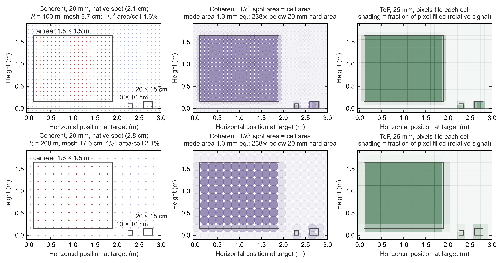

*Figure: the sampling mesh on a 3 m-wide patch of scene at 100 m (top) and 200 m (bottom), 0.05° mesh.*
- *Left: 20 mm monostatic coherent receiver, with its nominal 1/e² spots drawn to scale. Red dots have modelled overlap with an object, computed with an equal-area square proxy (a square of side $\sqrt{\pi}\,w$, whose area equals that of the 1/e² circle: a rule between the centre-in-object and 1/e²-touch rules of Result 4); blue dots have none under that proxy. Real Gaussian tails and speckle are not shown.*
- *Centre: the same mesh with the Gaussian's 1/e² area matched to one cell. The equivalent collecting diameter is about 1.3 mm; the drawn circular contours leave cell corners below the 1/e² intensity level.*
- *Right: ToF 25 mm pixels tiling each cell, shaded by the fraction of the pixel an object fills (relative signal).*
- *The grid alignment is arbitrary. In the 200 m panels the 10 × 10 cm object happens to fall between coherent samples and the 20 × 15 cm object is only grazed (per-frame geometric overlap fractions in Result 4).*

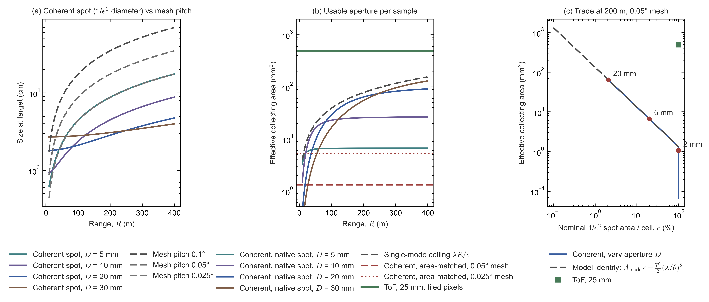

*Figure:*
- *(a) Coherent spot size at the target (1/e² diameter) for 5–30 mm apertures, against mesh pitch at 0.1°, 0.05° and 0.025°. Small apertures diverge; large ones stay near their aperture size (near field) until well beyond 100 m.*
- *(b) Mode-equivalent collecting area per sample versus range. The coherent native-spot curves sit under the collimated Gaussian ceiling $\lambda R/4$. The area-matched coherent levels are flat (1.3 mm² at 0.05°, 5.3 mm² at 0.025°). The ToF 25 mm hard area is 491 mm².*
- *(c) At 200 m on a 0.05° mesh, varying the coherent aperture moves the design along the nominal-footprint identity $A_{\rm mode}f_{\rm fp}=\text{const}$ (Eq. \eqref{eq:mode-area-footprint-identity}) until the footprint fraction $f_{\rm fp}$ reaches one. Beyond that, the nominal spot overfills the cell and the bookkeeping fraction saturates; this is not a detection guarantee. The ToF hard-aperture point lies about 370× ($491/1.32$) above the coherent area-matched line.*

**What the numerical model shows.**
- A mirror-scanned coherent receiver's efficiency-weighted aperture is about **7–21 mm² at 100–300 m** (Result 2's $A_{\rm mode}$ times $\eta=0.25$), not the ≈27 mm² of the far-field formula alone (both are worked in §C10.3a, item 7). A 25 mm ToF unit's ≈80 mm² is about 4–11× larger ($80/20.5=3.9$ to $80/7.2=11$), and the four receivers per point of §C7a narrow this to 1.3× at 200 m. ToF's $\eta=0.164$ already contains the bright-sun live fraction (≈71 mm² in a fully sunlit scene); sunlight's other cost, a higher detection threshold, sits in the photon requirement (§C10.3a, item 7, caveats).
- With truncation and single polarization included, the *area-matched* coherent mode-equivalent collecting area at 0.05° is 1.3 mm². It is 1.6 mm² without the truncation factor $t^2=0.84$, and 3.2 mm² without the single-polarization factor ½ as well; that last value is the ideal $\lambda^2/\Omega_{\rm cell}$, where $\Omega_{\rm cell}=\theta_{\rm cell}^2$ is the solid angle of one mesh cell. The cell-filling estimates of §C10.2, item 5 and §C10.3 use the 1.3 mm². Gap-free detection at a stated threshold needs a separate target-overlap and noise calculation.

### C10.4 Focal-plane arrays: switched and coherent

A focal-plane array (FPA) steers a lidar beam by switching between antennas placed in the focal plane of a lens, instead of phasing many emitters as an optical phased array (OPA) does. This subsection asks whether that makes it a better route to high-resolution solid-state coherent lidar. The answer is partly yes: an FPA avoids OPA phase calibration and takes its aperture from passive glass. It keeps the single-mode photon budget of §C10.3a, however, and needs one cell per look direction, so chip area and channel count become its main costs.

**Principle.** An FPA places a grid of on-chip antennas in the focal plane of a lens, and the lens supplies the aperture. Selecting a pixel selects a look direction $\phi=x/f$, where $x$ is the pixel's distance from the lens axis and $f$ the focal length.
- **Address spacing and beam width are set separately:**
  - the address spacing (the address pitch) is $\theta_{\rm cell}=p/f$, the angle between neighbouring pixels at pixel pitch $p$;
  - the beam width is $\theta_{\rm B}\sim\lambda/D$, where $\lambda$ is the wavelength, $D\approx2NA_ef$ the filled lens aperture and $NA_e$ the emitter numerical aperture (the sine of the half-angle of each on-chip antenna's emission cone).
  - Both are **decoupled from element count per beam**, and there are no phase shifters to calibrate. The two can differ greatly: Berkeley's 0.05° beams sit on a 0.6° address grid.
- **Each single-mode pixel obeys the same mode-area–footprint identity as an OPA,** Eq. \eqref{eq:mode-area-footprint-identity} of §C10.3a: $A_{\rm mode}f_{\rm fp}\simeq\tfrac{t^2}{2}(\lambda/\theta_{\rm cell})^2$. Here $A_{\rm mode}$ is the mode-equivalent collecting area (the area of an ideal direct-detection lens that would collect the same signal as the pixel's single mode), $f_{\rm fp}$ the nominal footprint fraction (the share of each address cell covered by the beam's 1/e² spot), $t=0.915$ the Gaussian truncation factor and $\theta_{\rm cell}$ the address pitch. For a cell-filling footprint ($f_{\rm fp}=1$) this gives $A_{\rm mode}=\tfrac{t^2}{2}\lambda^2/\Omega_{\rm cell}$, where $\Omega_{\rm cell}=\theta_{\rm cell}^2$ is the solid angle of one address cell; the ideal $\lambda^2/\Omega_{\rm cell}$ omits truncation and polarization. The difference from an OPA is that the **glass supplies the aperture passively**.

**Published designs.** The table lists the published coherent FPA designs with their pixel count and pitch, addressing scheme, beam width against address spacing, demonstrated result and main limit. In the table, FPSA is Berkeley's focal-plane switch array; MEMS means microelectromechanical switches; row–column addressing selects a pixel by driving one row line and one column line; FWHM is the full width at half maximum; DFB is a distributed-feedback laser; GF 45SPCLO is GlobalFoundries' monolithic silicon-photonics process; and an ASIC is an application-specific integrated circuit.

| Design | Pixels, pitch | Steering and addressing | Beam / address | Demonstrated | What limits it |
|---|---|---|---|---|---|
| UC Berkeley FPSA (Zhang et al., *Nature* 2022) [I] | 128×128, 55 µm; 10×11 mm chip | MEMS switches, row–column addressed | **0.05° divergence vs 0.6° address spacing**, 70°×70° | FMCW imaging with 128×96 bonded cells | Nominal footprint fraction $(0.05/0.6)^2\approx$ **0.7%** (square box; ≈0.55% circular FWHM; ≈1.6% at 1/e²; not a detection rate); package pins |
| Rogers et al. (Pointcloud Inc. with the University of Southampton, *Nature* 2021) [P] | 512 coherent pixels | Coherent receiver per pixel | — | 3.1 mm precision at 75 m with 4 mW | Scale |
| Pointcloud (*Nature* 2026) [P] | **352×176**, 53 µm; GF 45SPCLO monolithic | External 1310 nm DFB (about 100 kHz linewidth); up to **128 simultaneous outputs** | 0.06° *address spacing* (53 µm ÷ 50 mm). The beam is much narrower: the one measured, behind a 25 mm test lens, has a nominal 1/e² footprint fraction of ≈1–2% of that lens's 0.12° cells at 11–22 m and a mode-equivalent collecting diameter of ≈3.5–5 mm (§C10.3a, item 5) | 4–65 m at 30% reflectivity, 3–15 frames per second (fps); about 46 nJ per point | Readout channels (an ASIC is needed for higher frame rates); Si nonlinear absorption |
| Voyant Helium (announced Dec 2025, CES 2026) [P, vendor] | About 12k to more than 100k pixels | 2D solid-state FMCW FPA | Lens-configurable, up to about 180° | Prototype; industrial first | Not independently characterized |

*How the numbers are derived* [E]:
- Berkeley footprint fraction: a square box of beam width over address pitch gives $(0.05/0.6)^2=0.69\%$; a circle with that FWHM diameter has $\pi/4$ of it, 0.55%; the 1/e² contour of a Gaussian encloses $2/\ln2=2.89$ times the FWHM area, 1.6%.
- Pointcloud address spacing: $p/f=53\ \mu{\rm m}/50\ {\rm mm}=1.06\times10^{-3}$ rad $=0.061^\circ$.

**The three costs of an FPA** [E]:
1. **One cell per look direction, so area grows with $(\text{FOV}/\theta_{\rm cell})^2$**, where FOV is the field of view, $\theta_{\rm cell}$ the address pitch and $(\text{FOV}/\theta_{\rm cell})^2$ the number of cells. Covering 120°×25° at 0.05° ($8.73\times10^{-4}$ rad) needs a focal length $f=p/\theta_{\rm cell}$ for pixel pitch $p$ and an image of $2{,}400p\times500p$ ($120^\circ/0.05^\circ$ by $25^\circ/0.05^\circ$ cells):
   - at 53 µm pitch, $f\approx53\ \mu{\rm m}/8.73\times10^{-4}=61$ mm and an image about **127×27 mm** ($2{,}400\times53\ \mu{\rm m}$ by $500\times53\ \mu{\rm m}$);
   - at 25 µm, $f\approx29$ mm and 60×12.5 mm;
   - at 10 µm, $f\approx11.5$ mm and 24×5 mm.

   A 2,400-cell axis fits one 26×33 mm exposure field (the largest area a lithography scanner prints in one shot) only at ≲11–14 µm pitch ($26\ {\rm mm}/2{,}400=10.8\ \mu{\rm m}$, $33\ {\rm mm}/2{,}400=13.8\ \mu{\rm m}$), 4–5× finer than the 53–55 µm demonstrated ($53/13.8=3.9$, $55/10.8=5.1$). The array would also need 1.2 M cells, ≈19× Pointcloud's 61,952 ($1.2\times10^{6}/61{,}952=19$; §C8).
2. **Nominal footprint fraction (beam fill).** Grating antennas are microns wide but pitches are tens of microns, so each far-field beam is much narrower than the address spacing: the ratio of beam width to address pitch is roughly the ratio of emitter size to pixel pitch. The Berkeley device's nominal beam footprints cover ≈0.5–1.6% of its field per frame (FWHM to 1/e² convention); the Gaussian tails illuminate more, but weakly. Possible fixes:
   - microlens arrays over the antennas;
   - several offset lenses;
   - a small **lens micro-shift** of the kind used in phone optical image stabilization [E, my suggestion]:
     - **Stroke:** filling the gap between address directions needs a translation of about one pixel pitch (≈53–55 µm), whatever the focal length. A ±100 µm stroke is ample.
     - **It supplies dwell slots, not modes.** Sweeping Berkeley's 0.05° beams across a 0.6° pitch needs $(0.6/0.05)^2\approx144$ positions.
     - At fixed power it moves the design along $n_{\rm mode}f_{\rm fp}=K$ (Eq. \eqref{eq:mode-footprint-budget}, §C10.3a: photons per mode times footprint fraction is fixed) rather than raising $K$.
3. **Channels, not pixels, set the cost.** Each *simultaneously* active coherent pixel needs local-oscillator (LO) power, a balanced detector and a digitizer (an analog-to-digital converter, ADC) sampling at gigasamples per second (GS/s): ≈1.2 GS/s for 5 µs chirps to 300 m (§C7a(c)), or 0.4–2 GS/s for 10–2 µs chirps (§C10.2, item 7). The four-look design of §C7a needs four such receivers per channel. The 12 Mpts/s case of §C10.2 would need 56–152 parallel channels at 2–10 µs of integration (§C10.2, item 7).

**Further measured detail** [P unless tagged]:
- **Pointcloud 2026:**
  - 1310 nm DFB laser; a 6 GHz chirp in 32 µs up plus 32 µs down gives 25 mm range resolution ($c/2B=3\times10^{8}/(2\times6\times10^{9})=25$ mm, with $c$ the speed of light and $B$ the chirp bandwidth).
  - A mean of 42 dead pixels out of 61,952.
  - Detection 5.6 dB below the shot-noise limit; about 0.4–0.5 dB per switch layer.
  - A concave microlens per pixel widens each emitter's divergence to fill the imaging lens: a deliberate **photons-over-footprint-fraction** choice (§C10.3a).
  - The authors attribute point-cloud gaps to routing space between pixel blocks, and plan to move switches outside the array.
- **Rogers 2021:** a transmit microlens array matched to the receive pixels gave a **24× signal gain**. This is a transmit–receive overlap fix: it concentrates transmitted light onto the sparse receive fields, raising photons per sample without raising the nominal footprint fraction. The design was bistatic at the chip level: a 16-grating transmit chip and a 512-pixel receive chip, combined by a polarizing beamsplitter and a Faraday rotator behind one output lens of 25 mm aperture [P].
- **imec 2026, biaxial** (transmitter and receiver side by side): an OPA transmitter paired with a 16 × 32 coherent FPA receiver. The authors state that a lens-assisted FPA receive aperture is typically an order of magnitude larger than an OPA's, which is why they receive through the FPA.
- **NYCU (National Yang Ming Chiao Tung University)/Hon Hai metalens FPA (arXiv 2603.26654):** thermo-optic "prisms" (heated regions whose refractive index changes with temperature) fine-steer each channel by up to 168% of its beam width. This turns 15 channels into ≥45 gap-free points over 62°, at a cost of 1.3 W and 16.5 dB of insertion loss.
- **Voyant [P, company releases]:**
  - Carbon (\$1,490; 1550 nm FMCW; 128 lines; 90° × 45°; up to 200 m, reflectivity not stated) steers **one axis on chip plus a slow mirror**.
  - Helium (announced Dec 2025; production in 2027 [U], a date that Voyant's release does not give) is a 2D switched FPA with 12k to >100k pixels. A February 2023 company blog, written before Helium was named, says that the first-generation production version of its 2D monostatic antenna array would have just over 5,000 antennas, and that its demonstration used a 4 × 80 sub-array of the first 2D chip, at a scan-pattern rate of 30 Hz [P].
- **Scantinel (vendor white paper, Oct 2024):**
  - It studied OPAs, filed OPA patents, and concluded that they are not feasible as a high-volume product for 5–10 years because of materials and lithography limits.
  - It chose instead many parallel FMCW channels along one solid-state axis, plus a lens and a separate horizontal scan.
  - The company became insolvent in August 2025; MicroVision bought the assets for \$0.4 M plus a \$1.8 M operating advance, about \$2.2 M in all (§C3a) [P, MicroVision 10-Q].
  - Treat the OPA judgement as one informed competitor's view, not as measurement.

**Aperture–field bound: one wide-field chip is aperture-starved** [E]. For a single chip plus lens,

$$D\,\Theta\approx2\,NA_e\,W \label{eq:aperture-field-bound}$$

where $D$ is the effective aperture diameter, $\Theta$ the full field angle (rad), $NA_e$ the emitter numerical aperture and $W$ the array width. The bound follows because the array maps onto the field through a focal length $f\approx W/\Theta$, and the emitter cone fills a lens of diameter $D\approx2NA_ef$. A wider field at fixed chip size therefore means a smaller aperture. For 120° ($\Theta=2.09$ rad) with $W$ = 20 mm and $NA_e$ = 0.15, $D\approx2\times0.15\times20\ {\rm mm}/2.09=2.9$ mm; with $W$ = 40 mm and $NA_e$ = 0.3, $D\approx2\times0.3\times40/2.09=11.5$ mm.
- Waymo's link model puts the penalty for a 1 mm beam versus a 10 mm beam at 250 m at about **18 dB** [P]. This is a per-sample photon penalty.
- The footprint moves the other way. At 250 m a $w_0=1$ mm waist spreads to a 1/e² diameter of ≈25 cm, overfilling a 0.05° cell (21.8 cm), whereas a $w_0=10$ mm waist gives ≈3.2 cm and a nominal 1/e² footprint fraction of ≈1.7%. The ≈60× photon ratio equals the ≈60× footprint ratio, as $A_{\rm mode}f_{\rm fp}=$ const requires (Eq. \eqref{eq:mode-area-footprint-identity}, §C10.3a). [E: the Rayleigh range $z_R=\pi w_0^2/\lambda$ is 2.0 m for 1 mm and 203 m for 10 mm, so the 1/e² radius $w(250\ {\rm m})=w_0\sqrt{1+(R/z_R)^2}$ is 12.3 cm and 1.59 cm; both ratios are $(12.3/1.59)^2=60$, and $10\log_{10}60=17.8$ dB, matching Waymo's ≈18 dB.]
- A single chip-plus-lens covering 120° is therefore aperture-starved for long range, and a wide-field single-lens FPA is pushed towards §C10.3's full-coverage corner (ideally 58.5–175.5 W at 200 m).
- Tiling several narrower modules is the escape route: it restores aperture at the cost of more chips and lenses.

**Verdict.** FPAs beat OPAs on phase calibration, aperture and loss, but share their single-mode photon budget. At automotive resolution the natural form is **a coherent 1D column or small 2D tile plus one slow mechanical or micro-shift axis**. That is the coherent analogue of the SPAD (single-photon avalanche diode) column that won in time-of-flight (ToF) lidar (§C8.3: the mechanical axis as a silicon-area multiplier; §C6: the cheapest proven optical multiplexer at current automotive volumes).

### C10.5 Lumotive's reflective LC metasurface, explained

Lumotive's liquid-crystal metasurface (LCM) is a reflective, free-space-fed phase grating that steers one axis. This subsection explains how it works and where it can compete in automotive lidar. It avoids the waveguide loss and small aperture of an optical phased array (OPA). Its limits are LC speed (which caps the column rate), one-axis steering, electrode count, cold operation and grating dispersion. Those limits point it towards short- and mid-range wide-field units rather than camera-like long-range lidar.

**Structure** [P, Lumotive patent US 11,005,186 B2, priority March 2019; Akselrod, *Laser Focus World*, 2019]:
- **Geometry:** elongated **copper rails** (optical resonant antennas) stand on a SiO₂-covered **copper mirror**; liquid crystal fills the gaps.
- **Pitch:** rail spacing is **below λ/2** (λ is the optical wavelength); press descriptions say about **λ/4**.
- **Phase:** a refractive-index change of only about **0.25** gives nearly $2\pi$ of reflection phase. The design rule is $Q\,\Delta n\sim1$, where $Q$ is the quality factor of each rail's optical resonance and $\Delta n$ the LC's refractive-index change. Voltage rotates the LC director (the average orientation of the LC molecules), which shifts each resonance by about its own linewidth.
- **Addressing:** the patent's example drives **50,000 rails from 1,000 contacts** in 50 repeated subsets.
- **Fabrication:** a 0.13 µm CMOS (complementary metal–oxide–semiconductor, the standard silicon chip process) foundry process with few modifications (2019 description). The LC is filled after fabrication and sealed under glass, as in liquid-crystal display (LCD) assembly. Production has run on a **SkyWater** custom photonics process, qualified in May 2024 [P].
- **Operation:** the device is a **free-space-fed reflectarray**, an array of reflecting elements each of which imposes a programmed phase. The laser illuminates the whole surface from outside, and a programmed phase ramp of period $\Lambda$ steers the reflection to an angle $\theta$ from the surface normal with $\sin\theta=\lambda/\Lambda$. The rails give **one-dimensional** steering.

**Why this geometry works** [E unless tagged]:
1. **Speed.** LC switching time scales as $\tau_{\rm LC}\propto\gamma d^2/K_{\rm el}$, where $\gamma$ is the LC's rotational viscosity, $d$ the thickness of the LC layer and $K_{\rm el}$ its elastic constant.
   - The sub-micron gaps between rails are about 10× thinner than a roughly 3 µm LCoS (liquid-crystal-on-silicon display panel) cell, so they switch about **100× faster** ($\tau_{\rm LC}\propto d^2$ and $10^2=100$).
   - Lumotive stated about **25 µs** with conventional LCs [P, 2019]. The LM10 is reported at **100 µs** [T; no Lumotive datasheet read].
2. **Wide field.** A blazed grating has a sawtooth phase profile that sends light into a single diffraction order. Quantized into $N$ phase levels per period, it has a first-order efficiency of about $\mathrm{sinc}^2(1/N)$, with ${\rm sinc}\,x=\sin(\pi x)/(\pi x)$.
   - At λ/4 pitch the ideal quantization efficiency is **95% at 30°, 85% at 60° and 82% at 80°**. The steering period is $\Lambda=\lambda/\sin\theta$, so there are $N=\Lambda/p=4/\sin\theta$ levels per period for rail pitch $p=\lambda/4$, and with ${\rm sinc}\,x=\sin(\pi x)/(\pi x)$: $N=8$ at 30° gives ${\rm sinc}^2(1/8)=0.95$, $N=4.6$ at 60° gives 0.85, and $N=4.06$ at 80° gives 0.82.
   - An LCoS panel with 3.74 µm pixels (about 4λ at 905 nm) reaches about **7°** only with a binary 2-pixel period. Its ±1 orders then take 40.5% each, so it produces an equal twin beam. Single-sided blazing needs $N\ge3$–4 phase levels, i.e. about 4.6–3.5° at 68–81% ideal efficiency [E: with pixel pitch $p=3.74$ µm, the binary case has $\sin\theta=\lambda/(2p)=0.905/7.48$, i.e. 6.9°, and a binary phase grating sends $(2/\pi)^2=40.5\%$ into each first order; $N=3$ and 4 give $\sin\theta=\lambda/(Np)$, i.e. 4.6° and 3.5°, with ${\rm sinc}^2(1/3)=0.68$ and ${\rm sinc}^2(1/4)=0.81$].
   - These are ideal-quantization bounds. Fringing fields, resonance-amplitude variation and copper absorption lower the real efficiency, and **measured steering efficiency versus angle is not published** [U].
3. **Aperture without a waveguide network.**
   - Every element is fed from free space, with about 100% fill factor, so the OPA's lossy splitter tree disappears.
   - Apertures: **11×9 mm** on the LM10 [P]; up to **25×25 mm** in the 2019 automotive concept [P].
   - The 2019–2020 design used **two LCMs, one for transmit and one for receive**.
   - **Steering the receive path through a large aperture is one attractive capability that §C6 found missing** (§C6, "What could break this", item 3), not the only route, and the LCM is the most mature candidate found for it.
   - But no shipping product documents a receive-path LCM. The Hokuyo and Adaps designs steer only the transmit line and receive on staring 2D sensors (arrays that view the whole field at once). They therefore still pay the staring-étendue cost quantified in §C6 (a staring sensor's area × acceptance solid angle is small), consistent with their 10–50 m ranges.

**Limits** [E unless tagged]:
- **Degrees of freedom: electrode count, not aperture, sets the addressable directions**, as §C10.1 predicts.
  - Periodic addressing with 1,000 contacts at λ/4 rail pitch $p$ steps $\sin\theta$ in units of $\lambda/(1000p)=0.004$: the 1,000-contact pattern repeats across the surface, so the phase ramp must fit a whole number of periods into 1,000 rails. That is about **0.23° near normal and 0.46° at 60°**, or about 490 directions over ±80° ($\delta\theta=\Delta\sin\theta/\cos\theta$, with $\delta\theta$ the angular step: 0.004 rad $=0.23^\circ$ at normal and $0.004/\cos60^\circ=0.008$ rad $=0.46^\circ$ at 60°; $2\sin80^\circ/0.004=490$).
  - This is the same order as the LM10's reported **0.39° step** [T; no Lumotive datasheet read]. The patent example is not necessarily the LM10's disclosed design.
  - The patent example's 50,000 rails at λ/4 span 11.3 mm at 905 nm ($50{,}000\times0.905\ \mu{\rm m}/4$), matching the LM10's 11 mm aperture. Their diffraction-limited beam width, ≈0.005° ($\lambda/D=0.905\ \mu{\rm m}/11.3\ {\rm mm}=8\times10^{-5}$ rad $=0.0046^\circ$, with $D$ the aperture width), is ≈50× finer than the step ($0.23^\circ/0.0046^\circ$).
  - A near-unity one-axis footprint fraction (the share of each angular step along the steered axis that the beam actually lights) therefore needs deliberately broadened, multimode illumination (Hokuyo lights ≈1° per line). A ToF receiver can use such light; a single-mode coherent receiver cannot collect it efficiently. This fits the ToF pairing of current LCM products [E].
- **Column-rate ceiling.** Each steering step lights one column (one angular position along the steered axis), so steps per second = columns × frame rate:
  - 0.39° over 160° at 30 fps needs about 12.3k steps/s ($160/0.39=410$ columns $\times30\ {\rm s^{-1}}$). That is about 23% above the 10k steps/s ($1/100\ \mu{\rm s}$) a 100 µs device can deliver even at zero dwell; it would need $1/12{,}300\ {\rm s}=81\ \mu{\rm s}$ per step.
  - 0.1° over 120° at 10 fps needs 12k steps/s ($1{,}200\times10$).
  - 0.05° at 20 fps needs 48k; 0.025° at 20 fps needs 96k ($2{,}400\times20$ and $4{,}800\times20$ over 120°).
  - **Camera-like horizontal resolution is therefore beyond a single LCM**, unless LC switching falls towards about 10 µs or several columns are read per step (which brings back part of the staring-array étendue penalty).
- **Temperature.**
  - Pointing is set by the phase period, not by LC temperature. LC birefringence affects only efficiency, as Lumotive notes [P].
  - Speed is the problem. Nematic viscosity commonly rises by an order of magnitude or more from 25 °C to −40 °C [U; no device data published]. Because the switching time $\tau_{\rm LC}\propto\gamma d^2/K_{\rm el}$ grows in proportion to the viscosity $\gamma$ (item 1 above), a 100 µs step could approach about 1 ms: about 1k steps/s, or 0.39° over 160° at about 2.4 fps ($1{,}000/410=2.4$ fps).
  - An automotive LCM therefore needs a stated cold-start time and heater strategy, not only a survival rating. The LM10 is reportedly rated **−20 to +85 °C** [T], short of the automotive −40 °C.
- **Grating dispersion.** A grating steers by wavelength as well as by phase: differentiating $\sin\theta=\lambda/\Lambda$ at fixed period gives $d\theta/d\lambda=\tan\theta/\lambda$, which applies to any grating steerer, including OPAs.
  - An EEL (edge-emitting laser) drifting 0.28 nm/K over 145 K (the span from −40 to +105 °C) moves the beam about **1.5° at 30° and 4.5° at 60°** ($\Delta\lambda=0.28\times145=41$ nm at 905 nm, so $\Delta\theta=\tan\theta\,\Delta\lambda/\lambda=0.577\times41/905=0.026$ rad at 30° and $1.73\times41/905=0.078$ rad at 60°).
  - A VCSEL (vertical-cavity surface-emitting laser; 0.07 nm/K) moves it about 0.4° and 1.1° ($\Delta\lambda=0.07\times145=10$ nm).
  - A 5 nm EEL linewidth blurs the beam by about 0.55° at 60° ($1.73\times5/905=9.6\times10^{-3}$ rad).
  - The steering pattern must therefore track the laser wavelength, and **VCSELs suit it better**.
- **One steered axis.** The rails steer only one axis, so current products cover the second axis with a fanned laser line and a 2D sensor (Hokuyo, below). A "first 2D" LCM beamforming chip shown in March 2026 (below) could relax this limit, but the sources used here give no steering data for it [P/T].

**Products and demonstrated performance** [P, vendor and partner releases; not independently tested]:
- **LM10 (August 2023):** 11×9 mm aperture (one release says 9×10 mm), up to 160° native field, 0.39° step, 100 µs response, 905/940 nm, −20 to +85 °C, more than 10,000 h lifetime. The step, response and temperature figures come from trade press only; no Lumotive datasheet was read [T].
- **Hokuyo YLM-10LX** (industrial; spec sheet dated October 2024):
  - Architecture: a 905 nm VCSEL line fanned 110° horizontally; the **LCM steers only the vertical axis**, and a separate 2D ToF image sensor receives.
  - Range and field: **0.3–10 m at 10%** (1–15 m at 90%), on-axis at 25 °C; 110° × 90°.
  - Rates: 840 lines/s, about 500k pts/s, 9.25 Hz default (2–60 Hz). That is about 91 steering lines per frame ($840/9.25$), roughly 1° per line ($90^\circ/91$) [E], so each step lights a band of sensor rows. This line rate is far below the LC ceiling estimated above.
  - Sampling: 0.375° (QVGA, quarter video graphics array, 320 × 240) or 0.188° (VGA, video graphics array, the doubled 640 × 480 format). Check: with $110^\circ/0.375^\circ=293$ columns, $293\times240\times9.25\approx6.5\times10^5$ pts/s, about 30% more than the stated ≈$5\times10^5$; the gap is unexplained [E].
  - Physical and safety: up to 25 W, 650 g; operating −20 to +50 °C; not certified for functional safety [P].
- **LM10 with Adaps ADS6311 SPAD sensor (April 2026):** 180° × up to 140°, ≤50 m, 30 fps full frame, up to 900 Hz within regions of interest (ROIs). At 0.39° steps over the 140° axis (the LM10 steers at most 160° natively), 30 fps would need about $140^\circ/0.39^\circ\times30\approx10.8$k steps/s, above the 10k steps/s ceiling of a 100 µs device even at zero dwell, so the design probably lights several rows per step, as Hokuyo does [E].
- **Namuga Stella-2** (first shown in May 2025, launched at CES 2026): ≤100 m in its HDR mode (reflectivity not stated), 15–80 Hz, below 15 W; the May 2025 release gave a 120° × 90° field and 30 m typical, 80 m maximum range [P]. It is not the Stella-180 of §F5: Namuga's April 2026 brochure lists a separate wide-angle pair, Stella 120 (120° × 90°) and Stella 180 (185° × 110°), both 256 × 192 points at 30 Hz, 72 m maximum range and 40 m or 30 m on a 10% target in 100 klux [P].
- **Automotive status:** the 2020 automotive concept (X20) claimed more than 120 m; **no automotive series programme was found by September 2026**.
- **Other 2025–2026 signals** [P/T; business figures are company-reported; treat with caution]:
  - A "first 2D" LCM beamforming chip was shown in March 2026. Lumotive says it will also target data-centre optical switches.
  - Funding: a \$45 M Series B (a second, growth-stage venture round; February 2025) plus a \$14 M extension (July 2025, from Amazon's industrial fund and ITHCA, Oman's state technology investor), for more than \$100 M raised in total.
  - About 80 staff, with robotics as the lead market.
  - Voyant is pointing its lidar switch fabric at data-centre optical circuit switching, in a white paper by its CTO (August 2026) [P]. 国科光芯 (Guoke Guangxin, a Haining-based maker of SiN OPA chips, §D7) raised a B+ round of several hundred million yuan in September 2026 mainly for data-centre optical interconnect: 400 Gb/s-per-lane silicon-photonics chips, 1.6T and 3.2T detector chips, near- and co-packaged optics (NPO/CPO) and OIO chiplets, and to expand its datacom subsidiary 星汉光子 [T]. Beam-steering and silicon-photonics IP (intellectual property) is being redirected towards AI interconnect, which currently attracts more funding [E].

**Verdict.** The LCM's most plausible automotive role is **short- to mid-range, wide-field solid-state units** (consistent with the 20–25% probability that §F5 gives an LC-metasurface short- or mid-range automotive unit by 2030). A long-range 0.05° unit at 20 fps would need both:
- about 5× faster switching (≤21 µs per step, $1/48{,}000\ {\rm s}=21\ \mu{\rm s}$ against 100 µs) or multi-beam operation; **and**
- about 5–10× more drive contacts: ≈4,600 near normal, or ≈9,200 to hold 0.05° at 60°, against 1,000 in the patent example. A step $\delta\theta$ (here 0.05° $=8.73\times10^{-4}$ rad) at angle $\theta$ corresponds to $\Delta\sin\theta=\delta\theta\cos\theta$, and needs $N_{\rm contact}=\lambda/(p\,\Delta\sin\theta)=4/(8.73\times10^{-4})=4{,}600$ contacts at normal (rail pitch $p=\lambda/4$) and twice that at 60°. This is the degrees-of-freedom limit again.

### C10.6 Does "camera-like" 2,000+ line resolution create value?

Lidar vendors now advertise thousands of "lines" (rows of vertical samples), approaching camera resolution. This subsection asks whether that resolution buys anything for perception, safety or the business case. The answer is that fine vertical sampling pays off in a thin band around the horizon, for highway small obstacles and for RGB-D fusion (camera colour plus per-pixel depth); uniform 2k-line fields show little demonstrated benefit. For coherent lidar the race is unfavourable, because every extra direction costs elements, cells or dwell time.

**Where the value is real**

**(a) Small debris at highway speed.** At 130 km/h, stopping takes about **127–145 m** (6 m/s², 0.5–1 s reaction), or 181–199 m at a gentler 4 m/s². Stopping distance is the reaction distance $v\,t_{\rm r}$ plus the braking distance $v^2/2a_{\rm b}$, for speed $v$, reaction time $t_{\rm r}$ and braking deceleration $a_{\rm b}$ [E: $v=36.1$ m/s, so braking takes $v^2/2a_{\rm b}=1{,}304/12=109$ m at 6 m/s² and $1{,}304/8=163$ m at 4 m/s², and the reaction adds $v\,t_{\rm r}=18$–36 m]. The table gives expected sample centres per axis (object size divided by pitch, averaged over grid offset). These are geometric counts, not detected returns above threshold.

| Object | Range | 0.1° | 0.05° | 0.025° | 0.0125° |
|---|---|---|---|---|---|
| Debris 20×15 cm (W×H) | 150 m | 0.8×0.6 | 1.5×1.1 | 3.1×2.3 | 6.1×4.6 |
| Debris 20×15 cm | 200 m | 0.6×0.4 | 1.1×0.9 | 2.3×1.7 | 4.6×3.4 |
| Tyre tread 50×20 cm | 150 m | 1.9×0.8 | 3.8×1.5 | 7.6×3.1 | 15×6.1 |
| Pedestrian 0.5×1.7 m | 200 m | 1.4×4.9 | 2.9×9.7 | 5.7×19.5 | 11.5×39 |
| Car 1.8×1.5 m | 200 m | 5.2×4.3 | 10.3×8.6 | 20.6×17.2 | 41×34 |

*How the numbers are derived* [E]: the expected number of sample centres per axis is the object's angular size over the pitch, $(W/R)/\delta\theta$, for object width (or height) $W$, range $R$ and angular pitch $\delta\theta$. For a 20 cm-wide object at 150 m, $0.20/150=1.33\times10^{-3}$ rad $=0.076^\circ$, so $0.076/0.05=1.5$ centres at 0.05°.

- **Vertical samples on a 15 cm object at 150 m** (0.057°) [E]:
  - Guaranteeing two vertical sample centres needs a pitch of ≤0.029°; three need ≤0.019° ($n$ centres are guaranteed for every offset when the pitch is at most the object size divided by $n$: $0.057^\circ/2$ and $0.057^\circ/3$).
  - At 0.05°, only $0.057/0.05-1\approx15\%$ of grid offsets give two; at 0.04°, $0.057/0.04-1\approx43\%$ do.
- **Why a second vertical sample matters:** it identifies the object as upright structure. Its returns sit at a constant range, whereas the road surface behind it would be ≈7–30 m farther. For a sensor at mount height $h_{\rm m}$, a ray one pitch $\delta\theta$ higher meets the road farther away by $\Delta R\approx R^2\delta\theta/h_{\rm m}$ (at 150 m, 0.025–0.05° pitch, 0.7–1.4 m mounts: $150^2\times4.4\times10^{-4}/1.4=7.0$ m and $150^2\times8.7\times10^{-4}/0.7=28$ m) [E].
- **Large objects at 0.1°.** At 200 m on a 0.1° grid, a car subtends ≈5×4 sample centres and a pedestrian ≈1.4×5: enough geometric overlap to register them. That is still below what learned (neural-network) object detectors needed in the studies of (i): about 60–100 points per object, and a pitch of ≈0.075° for a car.
- **The case for camera-like resolution therefore rests mainly on small, low obstacles at highway distances**, and on pedestrian classification beyond 150 m for trucks.

**(b) The value is concentrated in a thin horizon band.** For mount height $h_{\rm m}$, the road at range $R$ lies at a depression angle (angle below the horizontal) of $\arctan(h_{\rm m}/R)$, tabulated below for three mount heights [E]:

| Mount height | 50 m | 100 m | 150 m | 200 m | 300 m |
|---|---|---|---|---|---|
| 0.7 m (grille) | 0.80° | 0.40° | 0.27° | 0.20° | 0.13° |
| 1.4 m (roofline/windshield) | 1.60° | 0.80° | 0.53° | 0.40° | 0.27° |
| 2.5 m (truck) | 2.86° | 1.43° | 0.95° | 0.72° | 0.48° |

*How the numbers are derived* [E]: each entry is $\arctan(h_{\rm m}/R)$, e.g. $\arctan(1.4/100)=0.80^\circ$.

For car-height mounts (0.7–1.4 m), all highway-range road surface therefore lies within about **1° of the horizon** (≈1.4° at 100 m for a 2.5 m truck mount). Even with margin for vehicle pitch under braking, grade changes and road curvature, fine vertical sampling is needed in a band of only **2–4°**.

**(c) Vertical resolution is cheap in a scanned-column ToF, which explains the race** [E].
- In a column scanner (a vertical column of SPAD pixels swept horizontally; SPAD is a single-photon avalanche diode), the horizontal step and the frame rate fix the laser energy per column. Splitting the column into more SPAD pixels does **not** reduce the irradiance on a sub-pixel object: its return still lands in one pixel, and that pixel's background falls with its solid angle.
- So **for small objects, more vertical lines cost silicon rather than photons, provided the receive aperture is kept**: the macro-pixel must shrink in step with the line pitch (smaller SPADs, §C6) or the optics must get faster. With fixed 30 µm macro-pixels at f/1.2, 0.025° would need a ≈57 mm aperture (§C10.3a, item 7). Extended-target range does fall, because energy per pixel drops (§C6(b)).
- Horizontal resolution, by contrast, costs scan time and hence energy.
- This asymmetry helps explain why the industry race has been in vertical lines per SPAD column.

**(d) Pixel-aligned RGB-D fusion.** RGB-D data pair each camera pixel's colour (RGB) with a depth (D). Lidar samples matched to camera pixels (Hesai Picasso, Huawei Limera; §F5) simplify calibration and fusion, and present depth as an extra channel on the camera's pixel grid. That is a practical way to feed lidar into networks whose input stage (the tokenizer, which cuts an image into patches or "tokens") was pretrained on camera images (§E11.2). It is plausibly one real motive for camera-like resolution, independent of detection range [E].

**Where the value is doubtful**

**(e) Uniform fine sampling spends most lines where they add little** [E]. 0.02° over a 4° horizon band plus 0.1° over the remaining 21° takes about **410 lines** ($4/0.02+21/0.1=200+210$); uniform 0.02° over 25° takes **1,250** ($25/0.02$). Most of the lines in a uniform 2k-line design sample sky, near road and nearby objects that already subtend many samples.

**(f) Networks voxelize the data.** A voxel is a small 3D box, a "volume pixel". Most lidar detection networks first bin the points into a regular voxel grid and then process the grid, so detail finer than one voxel is largely averaged away. At 0.05°, point spacing is 4.4 cm at 50 m, 8.7 cm at 100 m and 13 cm at 150 m.
- **Standard configurations** (checked in the OpenPCDet and mmdetection3d config files [I]; these are open-source 3D-detection code bases, and nuScenes, Waymo Open and Argoverse 2 are public driving datasets used as benchmarks):
  - nuScenes: 0.075 m voxels, cropped at ±54 m (CenterPoint, TransFusion, BEVFusion; published 3D detectors, BEV meaning bird's-eye view, a top-down grid of the scene).
  - Waymo: 0.1 × 0.1 × 0.15 m voxels at ±75.2 m.
  - Argoverse 2: 0.1–0.4 m voxels out to 200 m.
- **Consequences:**
  - Inside the benchmark crops, anything finer than about **0.08°** in-plane is already sub-voxel everywhere (a 0.075 m voxel at the 54 m nuScenes crop subtends $0.075/54=1.4\times10^{-3}$ rad $=0.080^\circ$, and a 0.1 m voxel at 75.2 m subtends 0.076°). **The range crop discards more than the voxels do.**
  - Below about 150 m, finer sampling mostly lands several points in the same voxel. Exploiting it needs finer voxels, whose cost grows with the square or cube of the inverse voxel size (§E11.3).
- **Caveats:**
  - Averaged points still carry sub-voxel centroid information.
  - Two-stage refiners (PV-RCNN, a detector that proposes boxes on voxels and then refines them) read raw points.
  - Every study in (i) below varied *vertical* beam count only. No study was found that varies horizontal resolution on its own.

**(g) Temporal accumulation substitutes for part of the single-frame resolution** [E]. The price is latency.
- **Frames available.** A static obstacle first seen at 150 m, with braking needing to start by ≈110–130 m, gives 0.55–1.1 s: **6–11 frames at 10 Hz** (11–22 at 20 Hz). First seen at 200 m, it gives 19–25 frames at 10 Hz (39–50 at 20 Hz). [E: at 36.1 m/s, $(150-130)/36.1=0.55$ s and $(150-110)/36.1=1.1$ s; from 200 m, $(200-130)/36.1=1.9$ s and $(200-110)/36.1=2.5$ s.]
  - Braking alone takes 109 m at 6 m/s² and 130 m at the 5 m/s² assumed by UN Regulation 157 (R157, on Automated Lane Keeping Systems; see (k)) ($1{,}304/12$ and $1{,}304/10$). At 5 m/s² that leaves ≈0.5 s ($(150-130)/36.1=0.54$ s), about 5 frames at 10 Hz.
  - Paragraph (a)'s 127–145 m stopping distance includes reaction time, which is why it differs.
- **Accumulation raises the geometric overlap fraction, not detection probability.** For a 10×10 cm object at 250 m on a 0.05° coherent mesh, one frame gives an overlap fraction of 0.21–0.37 (centre-in-object to 1/e²-touch rule); five independent offsets give 0.69–0.90 (§C10.3a, item 3; §C10.3b, Result 4).
- **Sources of offsets.** Vehicle motion and pitch jitter (small nodding of the car body) provide sub-pixel sampling diversity; Livox's non-repetitive scan pattern is the explicit form of this idea. Pitch jitter supplies useful offsets only if it spans about one pitch (0.05° $=8.7\times10^{-4}$ rad, ≈0.9 mrad), and only if it is measured well enough to register the returns.

**(h) Photons and data.**
- At fixed power and frame rate, extended-target range scales as $N_{\rm samp}^{-1/2}$ in the number of points per frame $N_{\rm samp}$. The energy per point $E_{\rm pt}$ is $\propto1/N_{\rm samp}$ and an extended-target return is $\propto E_{\rm pt}/R^2$, so a fixed detection threshold gives $R\propto N_{\rm samp}^{-1/2}$. Headline ranges are therefore very probably quoted in binned modes, in which several pixels are combined into one output point (§C6(b)).
- A 25–40 Mpts/s unit produces about **2.4–5.1 Gbit/s** (§E11.3).

**(i) Evidence from controlled studies** [I, peer-reviewed or preprint; figures read from the full text]. Public detection studies stop at about 128 beams. The scores below use standard detection metrics. AP (average precision, in %) summarizes a detector's precision–recall trade-off, where recall is the fraction of real objects found. IoU (intersection over union) is the overlap between a predicted and a true box that is required to count as a hit; 0.7 is a strict threshold and 0.4 a loose one. mAP is AP averaged over object classes.
- **More beams still help from 32 to 128, with shrinking returns.** On Zenseact data (recorded with a 128-beam VLS-128 lidar) downsampled beam-wise, with training and testing matched, PV-RCNN++ vehicle AP within 123 m is:

  | Beams | AP at IoU 0.7 | AP at IoU 0.4 |
  |---|---|---|
  | 32 | 55.7 | 70.3 |
  | 64 | 63.5 | 78.3 |
  | 128 | 68.7 | 84.3 |

  Each doubling adds less, but the curve has not saturated (Griesbacher & Fruhwirth-Reisinger, CVWW 2025).
- **How the beams are spread in elevation matters more than how many there are.** In the LiDAR-CS benchmark (ICRA 2024), a 40-beam pattern like that of the ONCE driving dataset scores about the same as a 64-beam pattern (CenterPoint 77.2 vs 78.0 mAP within 70 m), because of its elevation distribution. This is direct evidence for the horizon-band argument in (b) and (e).
- **Points per object.** A Bosch simultaneous-capture study needed about **62–98 points per object for 50% recall**, with recall falling steeply below about 100 points (Richter et al., 2022).
- **Detection collapses with range.** The long-range deficit is a *sampling* problem.
  - On Argoverse 2 the vehicle AP of FSD (a fully sparse 3D detector, unrelated to Tesla's FSD software), averaged over 0.5–4 m centre-distance match thresholds, falls from **89.0 to 61.7, 29.2, 13.9 and 3.6** across 0–50 / 50–100 / 100–150 / 150–200 / 200–250 m. Adding camera virtual points (extra 3D points generated from the camera image) lifts 150–200 m to 23.2 (Khoche et al., IEEE IV 2024, Table III).
  - In nuScenes (32 beams), about **a third of the annotated objects at 50–80 m have zero lidar points**: 45,050 of 145,173 training boxes and 10,069 of 31,727 validation boxes (Gupta et al., Far3Det, WACV 2023, appendix Table 11). The paper's headline "almost 50%" matches the ratio of zero-point boxes to boxes with points ($45{,}050/100{,}123=45\%$).
- **At 200 m with PointPillars, a stationary car needs about 0.075° and a cyclist 0.04°** (Dai et al., *Sensors* 2022, peer-reviewed).
- **Net assessment.** No public benchmark shows a perception or safety gain from going beyond 128 lines to 2,000+. Vendors now quote small-object metrics instead (e.g. a 13×17 cm box at 150 m).

**(j) How spec-sheet line counts are defined** [P, vendor pages and datasheets; E where derived]. The table sets each product's headline line count against the detailed specifications on the same vendor's pages and datasheets. In the table, ROI is a region of interest (a zone scanned more densely), and binning combines neighbouring SPAD pixels into one output pixel.

| Product | Headline | Detailed specification |
|---|---|---|
| Hesai ETX (Picasso version) | 1,080 / 2,160 / 4,320 "lines"; 400 m at 10% and "best 0.05°×0.05°" in the page text | The same page's spec table says **300 m at 10%** and 0.06° × 0.055° / 0.06° × 0.027°. Over 20° vertical that is at most about 740 distinct rows, consistent with about 3 SPAD rows per output row |
| RoboSense EM4 | "2,160-beam" | Small-object demos footnoted as "the 520-beam version"; the Chinese page labels one figure a calculated value. The maximum production version is reportedly 1,080 |
| Seyond Falcon K2 | 0.06° × 0.06° | Only in a **120° × 4.8° ROI band**; 0.18° × 0.24° elsewhere; "*configurable" |
| Innoviz InnovizTwo | "Max" 0.05° × 0.05°, 300 m | Production "Condor" configuration (20 fps): 0.1° × 0.05° in a 30° × 9.6° ROI at 210 m @10% (the 300 m is at 50%); 0.2° × 0.05° in the side bands and 0.2° × 0.15° above and below, both 140 m @10%. "Hawk" (10 fps): uniform 0.1° × 0.05° over 120° × 24° |
| Huawei 896-line | 896 lines | Reported [S] as about 600 wide-angle-equivalent lines plus about 300 in a 30° telephoto window |
| Sony IMX479 | 520 depth rows | Made from 1,568 SPAD rows with at least 3×3 binning |

*How the numbers are derived* [E]:
- Hesai ETX: at the finest 0.027° vertical pitch, 20° holds $20/0.027=740$ rows, and $2{,}160/740=2.9$, i.e. about three SPAD rows per output row.
- Sony IMX479: $1{,}568/3=523$, consistent with 520 depth rows.

- **Vendors already concentrate resolution in the horizon band** (Seyond's 4.8° band, Innoviz's 9.6° ROI, Huawei's telephoto window), as (b) predicts.
- **The quoted line count mostly counts receiver rows**, not independent laser channels or photon-budgeted range samples.
- **Photon budget check** [E]:
  - At the AT128's per-point photon budget, keeping 300 m at 10% at full resolution would need about **35×** more power × aperture × efficiency for EM4-1080, and about **55×** for EM4-2160 [E: at a fixed photon budget per point the required product scales as range squared times point rate; from the AT128's 210 m at 10% and 1.536 Mpts/s, $(300/210)^2\times26/1.536=34.5$ for EM4-1080 at 26 Mpts/s and $(300/210)^2\times41.04/1.536=54.5$ for EM4-2160 at 41.04 Mpts/s].
  - Higher PDE (photon detection efficiency) and more laser power buy part of that, not all of it. Long-range headline figures are therefore probably quoted in binned or ROI modes.

**(k) What regulations and crash data ask for** [P]:
- **UN R157 (Automated Lane Keeping Systems, ALKS; 130 km/h) sets a performance requirement, not a sensor spec.** ALKS is a Level 3 (L3) function on the driving-automation scale of SAE International, an automotive standards body: the car drives itself in its lane on motorways, and the driver takes over on request.
  - It requires a declared forward detection range of at least **150 m** at 130 km/h.
  - The regulation states that its range table assumes 5 m/s² deceleration. Braking alone from 130 km/h takes ≈130 m, so the table also contains ≈0.5 s of margin [E: $v^2/2a_{\rm b}=36.1^2/10=130$ m, and $(150-130)/36.1=0.54$ s].
  - Its range tests use motorcycle and pedestrian targets; **it contains no small-debris target**.
- **China's draft GB 47955 (L2, effective 2027) does include debris.** GB is a Chinese national standard; L2 is SAE Level 2, where the system steers and brakes but the driver supervises at all times. It adds a **50 × 50 × 50 cm cardboard box**, approached from at least 200 m at the maximum set speed, by day and by night. The final text's parameters were not verified.
  - A 50 cm box at 200 m subtends 0.14° ($0.5/200=2.5\times10^{-3}$ rad), so it is already about 1.4 rows at 0.1°. The test does not require 2k lines.
- **Euro NCAP's Assisted Driving v1.1 protocol has no debris test.** Euro NCAP (European New Car Assessment Programme) is the consumer safety-rating body.
- **Debris is a real but small share of harm.**
  - US road-debris crashes, 2018–2023 (AAA Foundation): about **53,000 crashes, 5,500 injuries and 72 deaths per year**.
  - German Autobahn "obstacle on the carriageway" crashes, a broader category, were **1.3%** of injury crashes in 2021.
  - This bounds the safety value that line count, as a small-object tool, can buy. The value is real, but the target is narrow.

**Verdict on resolution** [E]:
- **Real but narrow.** Fine vertical sampling in the horizon band pays for highway small-obstacle detection and for RGB-D fusion.
- **Little demonstrated value elsewhere.** Uniform 2k-line fields mainly add data volume.
- **Specify the task, not the line count.** For example: at least three vertical returns on a 50×15 cm (W×H) object at 150–200 m, 10% reflectivity, 100 klux (bright sunlight) and at least 10 Hz, with stated detection probability and false-alarm rate. Three returns at 200 m need a vertical pitch of ≤0.014° [E: $0.15/200=7.5\times10^{-4}$ rad $=0.043^\circ$, divided by 3].
- **For OPA and FMCW the race is unfavourable.**
  - A coherent single-mode receiver loses no photons per point as resolution rises (§C10.3), but only in the cell-filling bound. A fixed-aperture sparse design instead gains footprint fraction and loses photons per sample in the same proportion, because photons per mode times footprint fraction is fixed, $n_{\rm mode}f_{\rm fp}=K$ (Eq. \eqref{eq:mode-footprint-budget}, §C10.3a).
  - Every extra direction costs elements, cells or dwell time.
  - Even in the ideal full-coverage bound, coherent detection needs 4.2–816× the power of the ToF example (§C10.3; the two cases there also differ in wavelength $\lambda$, required detected photons per sample $n_{\rm req}$ and efficiency $\eta$):

| Pitch | Coherent power ÷ ToF power |
|---|---|
| 0.1° | 272–816× |
| 0.05° | 68–204× |
| 0.025° | 17–51× |
| 0.0125° | 4.2–13× |

SPAD-column ToF, by contrast, pays for the same vertical resolution in cheap silicon.

### C10.7 Overall verdict: can OPA be a true contender?

This subsection draws §§C10.1–C10.6 together to answer the question in the heading: can an integrated optical phased array (OPA) become a true contender for automotive lidar? The answer is that an integrated OPA is unlikely to become the primary long-range automotive lidar by 2032; coherent focal-plane arrays (FPAs), hybrids and liquid-crystal (LC) metasurfaces are likelier routes into series production. The probabilities below are my subjective judgement, and the signposts after them say what evidence would change it.

**Subjective probabilities, by 2032 unless stated** [E]. The table gives my probability for each outcome. In it, "galvo" is a galvanometer-driven scan mirror, "polygon" a rotating multi-faceted mirror, and L3 the SAE Level 3 automation level (the car drives within a defined domain and the driver takes over on request).

| Outcome | Probability |
|---|---:|
| Integrated OPA as the primary long-range automotive lidar (≥200 m at 10%, ≥100° horizontal, ≤0.1°) | **≤5%** |
| OPA at camera-like 0.025° in automotive series production | **<2%** |
| OPA in any automotive series product (hybrid component or short range) by 2030 | 10–15% (as in §F5) |
| Coherent FPA or on-chip coherent-column hybrid (≥16 simultaneous on-chip channels plus at most one mechanical axis; galvo- or polygon-scanned few-beam FMCW such as the Aeva–Daimler programme excluded) in automotive series production (trucks or L3) | 15–25% |
| LC-metasurface short- or mid-range automotive unit by 2030 | 20–25% (as in §F5) |

**Why OPAs are doubtful.** A long-range OPA must meet six requirements *simultaneously*, and no device found combines them. In the table, sidelobes are unwanted secondary beams, quoted in dB relative to the main beam.

| # | Requirement | Status on an OPA |
|---|---|---|
| 1 | Thousands of elements at ≈1 µm pitch or finer | **Clearly demonstrated** (8,192 elements at 1 µm pitch) |
| 2 | A 100+ nm tunable, narrow-linewidth, chirped laser (or another second axis) | Only partly demonstrated (38–120 nm in OPA demonstrations, §C10.2b; 60 nm in a narrow-linewidth chirped module, Analog Photonics' RAY-H1) |
| 3 | At most about 3 dB one-way loss while carrying ≈3–31 W per beam (§C10.2, item 5) | Not reported even in isolation (§C10.2b: 10–14 dB one-way loss) |
| 4 | −25 to −30 dB sidelobes held over −40 to +105 °C with closed-loop calibration | Not reported even in isolation (§C10.2b: −10 to −19 dB measured sidelobes; no temperature-stability data) |
| 5 | 56–152 parallel coherent channels for one sample per 0.05° cell at 12 Mpts/s (§C10.2, item 7) | Not clearly demonstrated |
| 6 | Speckle diversity | Not clearly demonstrated |

**Signposts that would change the verdict:**
- an OPA meeting requirements 1, 3 and 4 together in one published device;
- a laser tunable over ≥100–160 nm, with ≤100 kHz linewidth and a linear chirp, at automotive cost and a few watts (Analog Photonics' RAY-H1 already offers 60 nm and <40 kHz, but in a 19 W module);
- or the same laser with only ≥60 nm of tuning, paired with dispersion-engineered grating emitters that steer ≥0.3° per nanometre of wavelength change ($60\ {\rm nm}\times0.3^\circ/{\rm nm}=18^\circ$ exceeds the $100\ {\rm nm}\times0.155^\circ/{\rm nm}\approx16^\circ$ that the low end of the range gives on plain Si gratings);
- a coherent FPA or column with ≥256 simultaneous receivers (64 channels of four looks, the milestone of §C7b subsection 7) on an ASIC (application-specific integrated circuit) within about 10 W;
- LC metasurfaces switching in ≤21 µs per step at −40 °C, the 0.05°, 20 fps requirement of §C10.5;
- a public small-obstacle benchmark beyond 128 beams showing a decision-level gain.

**Research leverage for a beam-steering researcher** (my ranking):
1. **Monostatic coherent sub-apertures** (each transmitting and receiving through the same aperture), which get square-law sidelobe suppression and single-mode background rejection. Square-law means that a sidelobe present in both the transmit and the receive pattern is suppressed twice, so its level in dB doubles.
2. **Low-loss, high-power SiN or TFLN emitters** (silicon nitride or thin-film lithium niobate waveguides) with closed-loop thermal and wavelength calibration.
3. **Dispersion-engineered second-axis steering** that relaxes the laser tuning range.
4. **FPA footprint-fraction solutions**: microlenses and micro-shift actuation.
5. **Wavelength-multiplexed parallel coherent channels** sharing one aperture.

Each of these attacks one of the binding constraints above rather than the element count, which is no longer the bottleneck.

**The industry evidence points the same way.**
- Several well-resourced firms chose architectures other than two-axis OPAs:
  - Mobileye/Intel: parallel PIC (photonic integrated circuit) channels, "184 vertical lines" that its CEO said are "moved through optics" (CES 2021) [P], in an in-house FMCW programme cancelled in 2024 (§B3) [P/T];
  - Scantinel: parallel channels plus a scan axis;
  - Voyant: one on-chip axis plus a slow mirror (Carbon) and a switched FPA (Helium); Pointcloud: a switched FPA;
  - Aeva: patent evidence of a galvo scanner.
- The only fully solid-state OPA product found to have shipped was Quanergy's S3-2, at 5–20 m [P, datasheet]; Quanergy filed for Chapter 11 in December 2022 [P, SEC 8-K] (§C10.2b); Voyant's Carbon, which pairs one on-chip steered axis with a slow mirror, ships for industrial use (§B8).
- Analog Photonics is the only developer of two-axis non-mechanical OPA lidar found still publishing datasheets; no automotive production award or sample shipment matching its stated 2025 timeline was found.
- None of this proves OPAs cannot win. It does mean an OPA claim should be judged only on **range at a stated reflectivity, together with field, point rate, nominal footprint fraction (with its contour convention) and power, measured by someone other than the vendor.** Preferably it should also report detection probability and false-alarm rate on a stated small target.

---

# Part D — Supply chain and geopolitics

Part D asks where the parts of an automotive lidar come from, who could cut off which of them, and what governments on each side have done so far. It follows the bill of materials (the list of parts) from raw materials such as gallium, germanium, indium and rare earths, through the laser and detector chips and the electronics around them, to the driver-assistance computer that receives the point cloud (§D1, §D1a). It then sets out China's levers (§D2), US measures (§D3), the Chinese and Western responses (§D4, §D5), a ranked list of chokepoints with a calendar of dated legal and materials triggers (§D6), the state of Chinese FMCW lidar (§D7), and whether EU and US public research money is returning to lidar (§D8). The reader needs only the outline of a lidar from Part C (a laser emitter, a photodetector, a scanner and signal-processing chips) and the company names and market shares of Part B; trade and legal terms are explained where they appear. The conclusions feed the projections in Part F and the judgements in Part G, in particular whether Chinese lidar remains an option for Western carmakers.

## D1. Component dependency map (Chinese automotive lidar)

This section asks which parts of a Chinese automotive lidar still come from Western or Japanese suppliers, and how fast they are being replaced. Chinese lidar makers now source most VCSELs (vertical-cavity surface-emitting lasers, the 905/940 nm emitter chips), semiconductor substrates and optics domestically, and are designing out US FPGAs (field-programmable gate arrays, reconfigurable logic chips used as the lidar's controller). The largest remaining foreign dependency inside the lidar is the receiver: the SPAD (single-photon avalanche diode) array, often built as a SPAD-SoC, a system-on-chip that stacks the detector array on the timing and processing logic. A part without a ready domestic substitute is where an export control or a supply shock would bite, which is why the table tracks substitution status.

**Terms used in the table.**
- *GaAs* (gallium arsenide) and *InP* (indium phosphide) substrates are the single-crystal wafers on which III-V lasers and detectors are made (III-V semiconductors are compounds of group-III and group-V elements): GaAs for 905/940 nm VCSELs and edge-emitting lasers, InP for 1550 nm lasers and InGaAs detectors.
- *Epi* (epitaxy) is the stack of thin crystalline layers grown on the substrate, usually by MOCVD (metal-organic chemical vapour deposition), that forms the active structure of the laser or detector. "Substrate/epi upstream" means the exposure sits in these wafer steps rather than in the lidar maker's own plant.
- An *EEL* (edge-emitting laser) emits from the cleaved side of the chip. "Multi-junction" means several emitting layers stacked in one chip to raise the peak power.
- A *SiPM* (silicon photomultiplier) is an array of SPAD microcells whose outputs are summed into one analogue signal.
- An *MCU* (microcontroller unit) is a small processor with on-chip memory, used for housekeeping, motor control and communication. *SOP* is start of production. *RISC-V* is an open, licence-free processor instruction set. *Huawei Hubble* is Huawei's investment arm. *NdFeB* (neodymium–iron–boron) magnets are the strong permanent magnets used in small motors.
- The *Entity List* is the US Commerce Department's list of foreign parties to which exports of US-regulated items need a licence, usually refused. The *FDPR* (Foreign Direct Product Rule) extends US controls to foreign-made items that are the direct product of US technology, software or tools, such as chips made abroad on US equipment or designed with US software.
- An *export licence* ("export-licenses" in the table) is a government permit required before a controlled item may be shipped abroad; the issuing authority can grant it slowly, partially or not at all.

| Component | Western / JP suppliers | Chinese alternatives | Substitution status (2026) | Exposure |
|---|---|---|---|---|
| 905/940 nm multi-junction VCSEL arrays | Lumentum (AT128 era), ams OSRAM, Coherent, Trumpf | Hesai's own VCSEL fabbed at **立昂东芯 (Lion Dongxin)**; **纵慧芯光 Vertilite** (investors include Huawei Hubble, BYD, Xiaomi, DJI, Hesai, RoboSense); **长光华芯 Everbright**; 瑞识 | **Largely substituted** on newer platforms [P/T] | GaAs substrate/epi upstream |
| 905 nm multi-junction EEL | ams OSRAM SPL (RoboSense M1/M2/MX as of 2024) | Everbright, Raybow and others | Partial | ams OSRAM depends more on China: **Greater China was 40.8% of its 2025 revenue** [P] |
| GaAs / InP substrates, epi | Sumitomo, Freiberger, JX; AXT (US-listed, China fabs); IQE and others | Tongmei (AXT's China subsidiary), Vital, Yunnan Xinyao | China self-sufficient | **China export-licenses GaAs (since Aug 2023) and InP (since Feb 2025)**; permit shortfalls cut AXT's InP revenue in Q4 2025 (§D2). No permit needed for domestic sales [P/T] |
| 1550 nm fiber laser / InGaAs | Hamamatsu and others | 光库 Advanced Fiber Resources | Unclear | Niche |
| SPAD / SPAD-SoC | **Sony IMX459 / IMX479**; STMicro | RoboSense in-house; Hesai (Fastree3D); Adaps, Fortsense (wafers on Tower's 65 nm stacked process, made in Japan [P/E]; §C5), VisionICs | **In transition** (§C5) | **The largest remaining foreign dependency** (Japan has no controls on these) |
| SiPM | onsemi (AT128; also InnovizOne's ArrayRDM-0112), Hamamatsu | Hesai claims an in-house receiver; Adaps | **ATX: 17 SiPM dies for 64 physical channels, vendor not public** (die-level detail in paywalled TechInsights DDT-2505-806); no onsemi link found; in-house likely but unconfirmed | Moderate |
| FPGA / controller | **AMD/Xilinx** (the most common across 26 teardowns), Lattice (Huawei 96-line), **Efinix** (US; found in the ATX teardown together with an Infineon MCU and TI power ICs) | **Hesai Fermi C500** RISC-V SoC (SOP Apr 2026); RoboSense in-house; Huawei SoC | **Being designed out, 2025–27** | High only if the Entity List or the US foreign direct product rule (FDPR) were applied (they have not been) |
| MCU, analog, power | TI, Infineon (ATX), ST | 3peak and others | Mixed | Moderate |
| Motor drivers; magnets | MPS, TI drivers | NdFeB magnets and motors Chinese | Drivers still US | China's rare-earth leverage |
| Optics, filters, windows | Schott, Hoya, Viavi | Sunny, Crystal-Optech, Focuslight | Localized | Low |

**How localization progressed.** Localization here means the share of a product's parts that come from domestic (Chinese) suppliers.
- **Then: Yole's teardown of the Hesai AT128 (as fitted to the Li Auto L9).**
  - The unit contained 128 Lumentum 5-junction VCSELs, an onsemi SiPM and a Xilinx FPGA.
  - **The Xilinx FPGA alone was 33% of component cost.**
  - **72% of component value came from US companies and 11% from Chinese ones**, and the Chinese share was almost entirely Hesai's own ASICs (application-specific integrated circuits, i.e. custom chips) [I].
- **By 2025–26, as described in Hesai's 20-F** (the annual report a foreign company listed in the US files with the Securities and Exchange Commission):
  - Hesai says it designs all **seven key components** itself: the laser, the detector, the laser driver (the circuit that delivers the laser's current pulse), the analog front end (AFE, the amplifiers between detector and digitizer), the ADC (analog-to-digital converter), the DSP (digital signal processor) and the controller. It says it has shipped 185–230 M in-house chips.
  - Its CEO describes the route to the \$200 ATX. A \$500 unit developed from 2022 with carmakers, Nvidia and Bosch proved hard to cut further in cost, so Hesai moved lasers, receivers and drivers in-house [T, Nikkei Asia, 2025].
  - Its **largest single supplier accounted for 4.6% of 2025 purchases**, and the top five together for 20.5% [P].
  - **22.8% of 2025 purchases came from suppliers outside China**, up from 17.5% in 2024 [P].
  - These figures show diversification together with continuing foreign sourcing. But **spend concentration does not measure single-source technical dependence**, because a foundry process, substrate or tool that costs little can still be difficult to replace.
- **Revenue exposure of Western suppliers.** This is the other side of the dependence: how much Western component makers earn in China.
  - Lumentum reports about 9.4% of FY2026 revenue from mainland China, probably driven by datacom (optical links for data centres).
  - Coherent reports about 11.7% for FY2025 [P, via search summaries].
  - Neither breaks out lidar, so their lidar exposure to China cannot be read from these figures.

## D1a. Beyond the optics: laser drivers, timing, controllers, MCUs and the ADAS SoC

This section asks whether the electronics around the optics, and the car computer that uses the lidar's output, still depend on foreign suppliers. §D1 covers detectors, emitters and substrates; this section follows the rest of the bill of materials (laser drivers, timing and digitizing circuits, controllers, microcontrollers, power and interface chips), then the processor that consumes the point cloud. The answer is that the leading Chinese lidar makers have moved most of these functions into their own chips, but the ADAS (advanced driver-assistance system) processor that receives the point cloud still comes about half from NVIDIA, and almost all advanced domestic designs are made in Taiwan or Korea. Export controls act on chips and on the factories that make them, so this is where a lidar-equipped Chinese car is most exposed.

The section draws on Hesai's FY2025 20-F (its annual report to the US Securities and Exchange Commission) and RoboSense's 2025 annual report; TechInsights and Yole teardown summaries; NE Times' review of 26 lidar teardowns from 2022–25; notices from the US Bureau of Industry and Security (BIS, the Commerce Department agency that administers US export controls) and China's Ministry of Commerce (MOFCOM, which issues China's export-control and anti-dumping notices); and market-share compilations. Evidence tags are as elsewhere: [P] primary document, [I] independent source, [T] trade press, [E] own estimate or calculation, [U] unverified.

**Chip terms used below.**
- An *SoC* (system-on-chip) is one die that integrates processor cores, memory, accelerators and interfaces. An *MCU* (microcontroller unit) is a small processor with on-chip memory for housekeeping and control. A *PMIC* is a power-management integrated circuit.
- *AEC-Q100* and *AEC-Q101* are the Automotive Electronics Council's qualification test suites, for integrated circuits and for discrete semiconductors such as transistors respectively (AEC-Q102 covers discrete optoelectronics such as lasers and photodiodes). AEC-Q100 *Grade 2* means qualified for ambient temperatures from −40 to +105 °C.
- A *GaN FET* is a gallium-nitride field-effect transistor, a fast high-current switch that delivers the nanosecond current pulse to a pulsed laser; its *gate driver* is the chip that switches it on and off.
- A *foundry* manufactures chips designed by other companies. *EDA* (electronic design automation) is the software used to design chips, mostly of US origin (§D6). *CPU IP* is a licensed processor-core design built into a chip.
- Foundry *node names* such as 28 nm, 16 nm, 7 nm or 5 nm label successive manufacturing generations. A smaller number means denser, faster and more power-efficient transistors, but the number no longer corresponds to any physical feature size.

### Bottom line

1. **The top three have moved the non-optical signal chain into their own chips.**
   - **Hesai** says its fourth-generation ASICs (application-specific integrated circuits) integrate seven functions: laser, detector, **laser driver, analog front end, ADC, DSP** and controller. The analog front end is the amplifier chain between detector and digitizer, the ADC (analog-to-digital converter) digitizes the signal and the DSP (digital signal processor) extracts range. Hesai reports 16 AEC-Q-certified (automotive-qualified) chips and 185 M units delivered by end-2025 [P, 20-F].
   - **RoboSense** attributes part of its 2025 ADAS gross-margin rise, from 13.4% to 19.1%, to "in-house developed SOC processing chips, which have lower costs as compared to the FPGA chips acquired from third-party suppliers" [P, annual report]. (An FPGA is a field-programmable gate array, a reconfigurable logic chip.)
   - **Huawei** designs its own main processor, SPAD-SoC (single-photon avalanche diode receiver on a system-on-chip), lasers and drivers for its newer units [I].
2. **Foreign content is shrinking but not zero.**
   - Hesai's share of purchases from outside China *rose* in 2025, to **22.8%** of the total (§D1) [P].
   - The 20-F warns that in-house ASICs "may not fully eliminate our usage of third-party chips" [P].
   - Most of what remains foreign is MCUs, PMICs, motor drivers and Ethernet/interface parts (from TI, Infineon, NXP, MPS, ADI and Realtek). The rest is US FPGAs in older or second-tier designs, and discrete GaN transistors in edge-emitter designs.
   - **Least visible are the foundries, EDA tools and CPU IP behind the in-house-designed chips**, none of which is disclosed (§C5, §D6).
3. **The ADAS processor is far more foreign-dependent than the lidar.**
   - NVIDIA supplied **52.1%** of China's domain-controller AI chips in 2025 and **45.0%** in H1 2026 [T, NE Times data]. The domain controller is the central driver-assistance computer that fuses camera, radar and lidar data and runs the driving software.
   - Almost every domestic design at 7 nm or below is fabbed (manufactured) at TSMC or Samsung.
   - A domestically sourced lidar therefore often feeds an American-designed computer made in Taiwan or Korea: about half of China's domain-controller AI chips are NVIDIA's.

### Component by component

| Function | What teardowns found | Chinese substitute | Status (2026) |
|---|---|---|---|
| **Laser driver, VCSEL designs** | Hesai AT128: **HesaiTech multi-channel VCSEL driver ASIC** [I, TechInsights]; RoboSense and Huawei in-house drivers [I] | — | **Substituted at the top three.** Whether the ASICs switch the current themselves or drive separate GaN FETs is not public [U] |
| **GaN FET + gate driver, EEL/discrete designs** | Livox Mid-360: 6× **EPC2051** GaN + **TI LMG1020** [I]; Huawei 96-line: TI driver parts [I] | **Innoscience** AEC-Q101 GaN, which its prospectus says is "mainly used in autonomous-driving LiDAR", though it had only 2–5 automotive customers in 2021–H1 2024 [P]; **Novosense NSD2017** lidar GaN driver (1.25 ns minimum pulse) [P]; 3PEAK TPM2015Q/2025Q gate drivers [P] | Qualified alternatives exist, with few disclosed wins. 1–2 years to substitute [E] |
| **TIA / ADC / TDC** | Three patterns (§C4b, receive front ends): (i) merchant TIA chips: four TI LMH32401, one per APD, timed by TDCs in the FPGA, a Xilinx Zynq (Mid-360) [I]; RoboSense listed amplifiers among the parts it bought from US suppliers in 2020–H1 2023 [P]; (ii) in-house TIA + ADC waveform sampling: Hesai's 4th-gen ASIC at 24.6 GS/s aggregate, its own differential ADC driver and multi-channel analog switch in the AT128 [I], and the Fermi C500 integrating ADC and a 256-core waveform engine [P/T]; (iii) TDC + histogram on the SPAD-SoC (Sony IMX459/479; RoboSense, HiSilicon, Adaps, Fortsense) [P/I] | 3PEAK's lidar reference BOM has **no GS/s-class automotive ADC or lidar TIA** [P] | Integrated at the leaders; a discrete gap remains for second-tier and robotics designs [E] |
| **FPGA / main controller** | Still "mainstream" in long-range units across 26 teardowns: Xilinx XAZU2EG/3EG/4EV, XA7S15/50, XA7A50T, XC7Z020; Lattice LIFCL-40; **Efinix Ti60** (US design, TSMC 16 nm); Anlogic EG4X20 [I] | **Anlogic**: AEC-Q100 Grade 2 FPGA in batch supply for "multi-line lidar control" [P]. **Gowin**: AEC-Q100 parts marketed for lidar [T]. In-house SoCs: RoboSense **M-Core** (4 × 64-bit + 2 MCU cores at 1 GHz, 8 MB SRAM, multi-threshold TDC) [P]; **Hesai Fermi C500** (RISC-V; upgraded ATX in volume from Apr 2026, >6 M orders by Q2 2026) [P/T]; Huawei SoC in D3P/Limera [I] | **In transition.** The FPGA-free share of 2026 units is not public. Switching to Efinix does not remove US exposure |
| **MCU** | TI AM2432/AM2632C/F28386D; NXP S32K341, i.MX RT1052; Infineon TC3xx (and a 32-bit Infineon MCU in the ATX); Microchip; Nations N32G435 (Chinese) [I] | SemiDrive E3 series (targets lidar); GigaDevice; Nations [T] | Partly absorbed into in-house SoCs. 1–3 years [E] |
| **PMIC, DC-DC, motor driver** | TI TPS6594-Q1/LP8764-Q1 (Huawei D2); MPS MP6541/MPQ6547 and TI DRV8316/DRV8305 the most common motor drivers; ADI, Nexperia and ST parts in Seyond's Falcon Kinetic [I] | 3PEAK, SGMICRO [P/T] | Partial. 1–2 years [E] |
| **Ethernet PHY** | Realtek RTL9010 (Huawei D2) [I] | Motorcomm YT8011A (pitched for lidar; a 128-line unit ≈500 Mb/s) [T] | Available |

*Reading the table.*
- The **laser driver** delivers the current pulse that fires the laser. In the top three's VCSEL designs it is an in-house driver ASIC (whether that ASIC switches the current itself is not public). In the EEL (edge-emitting laser) and discrete designs found in teardowns it is a GaN FET switched by a separate gate driver.
- A **TIA** (transimpedance amplifier) converts the detector's photocurrent into a voltage. An **ADC** samples that voltage (GS/s is gigasamples per second). A **TDC** (time-to-digital converter) instead timestamps individual photon detections, which a SPAD-SoC accumulates into a histogram of arrival times.
- A **reference BOM** is a vendor's suggested bill of materials for a product. **Zynq** is a Xilinx FPGA family with built-in processor cores.
- A **DC-DC converter** changes one supply voltage into another. An **Ethernet PHY** is the physical-layer transceiver chip that drives the Ethernet cable carrying the point cloud.
- The durations "1–2 years" and "1–3 years" are estimates [E] of the time to substitute a qualified Chinese part.

**Resilience indicators** [P]:
- Hesai holds about 2–4 weeks of internal safety stock (inventory held against supply disruption), plus about a month externally.
- RoboSense's largest supplier fell from 46.6% of purchases (2024) to 15.8% (2025), and its top five from 59.4% to 32.5%.
- As §D1 notes, spend concentration is not single-source technical dependence: a small-spend part can still lack a second source.

### Two legal fronts in the transmit chain

The transmit chain (the laser and the circuits that pulse it) faces one US patent dispute and one Chinese trade case. Neither front currently binds the leading Chinese makers' domestic production.

- **EPC v. Innoscience (US International Trade Commission, ITC, case 337-TA-1366).** The ITC is a federal agency that can bar imports of products found to infringe US patents. EPC (US) and Innoscience (China) both make GaN power transistors.
  - The ITC found infringement of an EPC GaN patent and issued a limited exclusion order, an instruction to US Customs to block imports of the named company's infringing products. The order was confirmed after presidential review (Jan 2025).
  - The Patent Trial and Appeal Board (PTAB, the US Patent Office tribunal that can cancel patent claims) invalidated the asserted claims (Mar 2025), but the ITC declined to rescind the order (May 2025).
  - US Customs ruled (Feb 2026) that Innoscience's redesigned "AD"-suffix parts fall outside it.
  - Appeals were pending at the Federal Circuit (the US appeals court for patent cases) as of Mar 2026; no decision was found by Sep 2026 [P/T].
  - **Effect:** the order restricts imports into the US only, not Chinese lidar assembled and sold in China. Whether US-bound lidars containing older Innoscience dies are affected is unverified [U].
- **China's anti-dumping case on US analog chips.** An anti-dumping case tests whether imports are sold below fair value and can end in extra import duties.
  - MOFCOM opened it on 13 Sep 2025 against 40 nm-and-above analog chips from TI, ADI, Broadcom and onsemi. Its scope names **low-side gate drivers** (the LMG1020/1025 class, which switch a transistor whose source sits at ground, as in discrete laser drivers) and CAN transceivers (interface chips for the car's Controller Area Network bus) [P, MOFCOM notice].
  - The White House said in Nov 2025 that China would end such probes [P]. No termination notice or preliminary ruling was found [U].
  - **Effect:** if the case ends in duties, US analog parts will cost more in Chinese designs. The lidar makers' in-house drivers already put them ahead of that pressure.

### The ADAS SoC: where lidar data actually lands

The lidar's point cloud is processed by the car's ADAS SoC, the AI chip in the domain controller (the central driver-assistance computer). In China, about half of these chips still come from NVIDIA, and the domestic alternatives are mostly made at foreign foundries. This subsection gives the market shares, then the manufacturing nodes and the US export rules that apply to them.

**Share of China's domain-controller AI chips (by chip count)** [T, NE Times data via Tencent News]:

| Supplier | 2023 | 2024 | 2025 | H1 2026 |
|---|---|---|---|---|
| NVIDIA (Orin, Thor) | 33.5% | 42.4% | **52.1%** (4.48 M) | **45.0%** (1.62 M) |
| Tesla (own FSD chip) | 37.0% | 24.7% | n/a | ≈13% |
| Huawei (Ascend 610) | 1.9% | 9.7% | 10.9% | 13.2% |
| Horizon Robotics | 8.2% | 10.0% | 9.7% | 12.0% |
| Qualcomm | — | small | 3.8% | 6.7% |
| NIO / Xpeng in-house | — | — | starting | 4.0% / 2.7% |
| Mobileye | 11.5% | 5.6% | 1.0% | ≈0 |

- Domestic designers held about **32% in H1 2026**, the sum of the four domestic rows (Huawei 13.2% + Horizon 12.0% + NIO 4.0% + Xpeng 2.7% = 31.9%). That is up from about 12% in 2023, although the two domestic rows in the table sum to 10.1% for that year.
- In **front-camera ADAS** (driver assistance run from a single forward camera; 8.9 M vehicles in 2025), Horizon held ≈48% [T, GGAI].
- In **urban NOA** (navigate-on-autopilot, i.e. assisted point-to-point driving on city streets; 2.1 M vehicles), NVIDIA, Huawei and Horizon together held >90% [T, GGAI].
- The Tesla 2025 entry is missing from the compilation, so the rows do not sum to 100%.

**Nodes, foundries and export-control exposure** [T unless tagged]. In the table, "B" is billions of transistors, and "4N" is a TSMC process tailored for NVIDIA. *3A090* is an ECCN (Export Control Classification Number), the code under which the US Commerce Control List specifies which items need a licence for which destinations; 3A090 covers advanced computing chips above set performance thresholds. Items subject to US export rules but not on the list are classed EAR99 and generally need no licence, except for embargoed destinations, prohibited end uses or listed parties. *TPP* (total processing performance) is the BIS performance metric defined in Eq. \eqref{eq:total-processing-performance} below.

| SoC | Node / fab | Transistors | Exposure |
|---|---|---|---|
| NVIDIA Orin-X | Samsung 8 nm [I] | ≈17 B | Below the 3A090 performance thresholds; not controlled [E] |
| NVIDIA Thor-U/X | TSMC 4N | — | Thor-U deliveries in China since May 2025 [T]. A rough estimate of its total processing performance (TPP) from public performance figures, ≈4,000, is below the 4,800 control line [U] |
| Huawei Ascend 610 | 7 nm, reportedly SMIC [T/U] | — | Domestic fab; SMIC 7 nm capacity is the constraint |
| Horizon J5 | TSMC 16 nm | ≈20 B | Below the 30 B foundry-rule threshold |
| Horizon J6P | 7 nm, fab not confirmed | **37 B** | Above 30 B; no public licence information |
| NIO NX9031 | 5 nm | **>50 B** | Above 30 B; licence-dependent if made at TSMC [E] |
| Xpeng Turing | 5 nm, reportedly TSMC [U] | — | — |
| Black Sesame A2000 | 7 nm (TSMC) | — | Taped out Jan 2025; cleared US Commerce and Department of Defense review in Jan 2026, after about a year |
| SiEngine AD1000 | 7 nm | — | — |

*How the numbers are derived* [E]:
- *Thor TPP (tagged [U] in the table).* BIS defines total processing performance (TPP) as a single number for a chip's peak arithmetic throughput, weighted by the precision of that arithmetic:

  $$\mathrm{TPP}=2\times R_{\rm MAC}\times L_{\rm bit}=\mathrm{TOPS}_{\rm dense}\times L_{\rm bit} \label{eq:total-processing-performance}$$

  Here $R_{\rm MAC}$ is the chip's multiply-accumulate (MAC) rate in tera-MACs per second ($10^{12}$ MAC/s), and $L_{\rm bit}$ is the operand bit length (8 for 8-bit arithmetic, 4 for 4-bit), so TPP is quoted as a pure number. The factor 2 counts each MAC as two operations, one multiply and one add, so $2R_{\rm MAC}$ equals $\mathrm{TOPS}_{\rm dense}$, the dense rating in tera-operations per second. "Dense" means counted without the speed-up that vendors claim for sparse arithmetic, in which operations on zero-valued weights are skipped. By Eq. \eqref{eq:total-processing-performance}, a TPP of about 4,000 corresponds to about 500 dense 8-bit TOPS ($500\times8=4{,}000$) or about 1,000 dense 4-bit TOPS ($1{,}000\times4=4{,}000$), against the 4,800 line. Which public performance figure underlies the estimate is not recorded, so it stays unverified.

**The rule that matters is the January 2025 BIS foundry due-diligence rule** [P, Federal Register 2025-00711]:
- It presumes logic chips made at 16/14 nm or below to be controlled advanced-computing items, so a foundry must treat them as needing a US export licence. There are two exceptions: the designer is on an approved list (which excludes China-headquartered firms), or the foundry or an approved OSAT attests that the chip has fewer than 30 B transistors (35 B in 2027, 40 B from 2029). An OSAT (outsourced semiconductor assembly and test) firm packages and tests chips after the foundry makes them.
- No mainland-Chinese OSAT is on the approved list.
- TSMC halted 16/14 nm-and-below shipments to Chinese designers not using approved OSATs from 31 Jan 2025 [T]. Its Nov 2024 halt on 7 nm AI chips had exempted automotive [T].

**What this means** [E]:
- **Mid-size Chinese ADAS chips** (<30 B transistors) can still be made at TSMC, provided they go through approved packaging.
- **The flagship domestic parts** (J6P at 37 B, NX9031 at >50 B) sit above the threshold and depend on case-by-case US treatment. Black Sesame's A2000 shows the review can take about a year.
- In China, the response has been to promote domestic chips. The China Association of Automobile Manufacturers (CAAM) called US chips "no longer dependable or secure", and the Ministry of Industry and Information Technology (MIIT) reportedly targets fully self-developed automotive chips by 2027 [T]. China's overall auto-chip localization (the share of automotive chips from domestic suppliers) was about 15% in 2024, and compute/control chips were about 99% imported [T, TrendForce].

### Implications for the dependency picture

1. **In the lidar itself, the remaining foreign parts are mostly commodity** analog, power, MCU and interface chips. Qualified Chinese AEC-Q (automotive-qualified) alternatives exist for nearly every category, and the MOFCOM case and the MIIT target push buyers towards them. A plausible full substitution time is **1–3 years** per product generation [E]. The Nexperia halt of Oct–Nov 2025 shows that even mature discretes (single transistors and diodes made on old processes) can become a chokepoint for a few months [T].
2. **The durable exposure lies in where the in-house-designed silicon is made.** None of Hesai's or RoboSense's ASICs, SPAD-SoCs or the C500 has a disclosed foundry, node or CPU-IP licensor. If they use TSMC at 16 nm or below, the foundry rule applies only above 30 B transistors, and lidar SoCs are far smaller, so that rule does not touch them. But an Entity List designation (the US list of foreign parties barred from receiving US-regulated items without a licence) would reach them through the FDPR, the Foreign Direct Product Rule that extends US controls to foreign-made chips produced with US tools or software. This is §D6's chokepoint #1, with the legal mechanism named here.
3. **The ADAS SoC is the largest single foreign dependency in the lidar-using car.** It is outside the lidar makers' control, because the OEMs (the carmakers) choose it. The domestic share is rising quickly, from ≈12% in 2023 to ≈32% in H1 2026, but domestic designs still depend on foreign fabs for leading-edge nodes, except Huawei at SMIC (China's leading foundry).

Sources: https://www.sec.gov/Archives/edgar/data/0001861737/000110465926048025/hsai-20251231x20f.htm ; https://www.hkexnews.hk/listedco/listconews/sehk/2026/0424/2026042400954.pdf ; https://www.ne-time.cn/web/article/37421 ; https://www.techinsights.com/products/ddt-2305-811 ; https://view.inews.qq.com/a/20250416A07QMD00 ; https://news.qq.com/rain/a/20240408A03MZZ00 ; https://electronics360.globalspec.com/article/19252/techinsights-teardown-innovusion-falcon-kinetic ; https://www1.hkexnews.hk/listedco/listconews/sehk/2024/1218/2024121800032_c.pdf ; https://www.novosns.com/company-news-391 ; https://www.3peak.cn/automotive/lidar ; https://static.cninfo.com.cn/finalpage/2025-08-28/1224596820.PDF ; https://www.efinixinc.com/company-pr-efinix-announces-titanium-ti60-tapeout-at-tsmc.html ; https://www.robosense.ai/rslidar/MX ; https://finance.sina.com.cn/tech/digi/2025-11-24/doc-infynvuy6586332.shtml ; https://www.usitc.gov/secretary/fed_reg_notices/337/337_1366_notice05122025sgl.pdf ; https://www.innoscience.com/news/press-releases/8824 ; https://www.mofcom.gov.cn/zwgk/zcfb/art/2025/art_c7f379bfff21421596c6f1df5d925400.html ; https://www.whitehouse.gov/fact-sheets/2025/11/fact-sheet-president-donald-j-trump-strikes-deal-on-economic-and-trade-relations-with-china/ ; https://news.qq.com/rain/a/20260814A040XC00 ; https://news.qq.com/rain/a/20260201A0312600 ; https://www.federalregister.gov/documents/2025/01/16/2025-00711/implementation-of-additional-due-diligence-measures-for-advanced-computing-integrated-circuits ; https://www.trendforce.com/news/2025/02/08/news-tsmc-reportedly-halts-1416nm-chip-shipments-to-chinese-ic-firms-unless-packaged-by-approved-osats/ ; https://www.scmp.com/tech/article/3338742/chinese-automotive-chipmaker-black-sesames-huashan-a2000-clears-us-review-hurdle ; https://www.trendforce.com/news/2024/12/06/news-chinas-automotive-chip-localization-ratio-reportedly-to-hit-15-by-year-end-amid-u-s-reliance/ ; https://www.electrive.com/2025/11/10/china-eases-export-ban-on-nexperia-chips/

## D2. Chinese export controls

This section asks what China can withhold from Western lidar and car makers, and how it has used that power so far. China's main lever is export licensing of gallium (Ga), germanium (Ge), indium (In) and rare earths: the raw materials behind laser and detector substrates, infrared optics and motor magnets. Several suspensions that currently soften these controls expire between 27 Nov 2026 and 10 Jan 2027, so the coming months decide whether today's permit friction continues or tightens. Chinese lidar makers are largely unaffected, because sales inside China need no export permit.

**Materials and terms.**
- Gallium is the Ga in GaAs (gallium arsenide) wafers, the substrate for 905/940 nm VCSELs (vertical-cavity surface-emitting lasers) and edge-emitting lasers (EELs). Indium is the In in InP (indium phosphide) wafers, the substrate for 1550 nm lasers and InGaAs detectors. GaAs and InP are III-V semiconductors, compounds of group-III and group-V elements. Germanium transmits long-wave infrared and is the standard lens material for thermal cameras (§A4).
- An *export licence* is a permit from the exporting government for a shipment of a controlled item. MOFCOM (China's Ministry of Commerce) issues China's export-control announcements and licences. *Dual-use* items have both civilian and military uses.
- A *de minimis* rule sets the threshold of controlled content above which a product made in another country still falls under the exporting country's rules. China's 0.1% rare-earth rule would reach products made outside China whose Chinese-origin rare-earth content is 0.1% or more of their value.
- The other elements in the table are antimony (Sb), tungsten (W), tellurium (Te), bismuth (Bi) and molybdenum (Mo).

China accounts for 98% of primary Ga, 77% of refined Ge and 68% of refined In production [I, USGS MCS 2026] (the US Geological Survey's annual Mineral Commodity Summaries).

| Date | Chinese measure | Status (Sep 2026) |
|---|---|---|
| 1 Aug 2023 | Ga/Ge licensing (includes GaAs) | In force |
| 21 Dec 2023 | Technology export catalogue: **lidar system technology restricted** if any one of six thresholds is met (e.g. >2 km range, <20 µrad resolution, <1 ns pulses) | In force; automotive lidar falls below all thresholds except possibly pulse width (§D7) |
| 3 Dec 2024 | Dual-use ban to US military end users; **Ga/Ge/Sb export ban to the US** | Ban **suspended to 27 Nov 2026** (MOFCOM Announcement No. 72 of 2025). Whether the Sep 2026 extension of the US–China arrangement covers it was not found |
| 4 Feb 2025 | W, Te, Bi, Mo, **In** (includes InP) | In force |
| 4 Apr 2025 | Rare earths + magnets | In force (general licences to major magnet makers from Dec 2025) |
| 9 Oct 2025 | Extraterritorial 0.1% de minimis rare-earth rule, and more | Suspended to 10 Nov 2026; **extended with the US–China trade arrangement to 10 Jan 2027** (announced 24 Sep 2026) [T] |
| 6 Jan 2026 | Dual-use ban for Japanese military end use | In force |

**Effects.**
- **Licensing, rather than outright bans, is the main instrument.** Most measures require export licences, which can be granted slowly or selectively. That creates supply uncertainty rather than a hard stop.
  - The clearest evidence is at **AXT**, a US-listed maker of GaAs and InP substrates whose fabs are in China (through its subsidiary Tongmei). InP permits came in below expectations in Q4 2025, and InP revenue fell from \$13.1 M to \$8 M; GaAs permits "came in light" in Q1 2026 [P/T].
  - Western VCSEL and EEL makers that rely on China-made substrates therefore face lead-time and allocation risk (the risk of receiving less than they order). Alternatives outside China exist (Freiberger in Germany; Sumitomo and JX in Japan), but their capacity is limited and their prices are higher.
- **Gallium** is the deepest dependency, since China produces about 98% of primary Ga. Western recovery (for example as a by-product of alumina refining) is only starting.
- **Rare earths and magnets.** The polygon and spindle motors that turn lidar scanners, and the voice-coil actuators that move some scanner elements, use small NdFeB (neodymium–iron–boron) permanent magnets.
  - The April 2025 controls caused real stoppages in carmaking: Ford idled its Chicago Explorer plant in May 2025, and Suzuki halted Swift production [T].
  - US imports of yttrium collapsed to 17 t (Apr–Dec 2025), against 333 t before the controls (CSIS) [T].
  - **For 1550 nm fiber lasers and EDFAs** (erbium-doped fibre amplifiers, which boost the laser output), the erbium and ytterbium dopants are also rare earths. They were among the five rare earths added to China's export controls on 9 Oct 2025 (MOFCOM/GAC Announcement No. 57, which names Er- and Yb-containing optical-fibre materials) and were suspended on 7 Nov 2025 (Announcement No. 70) before the control took effect [P, MOFCOM].
- **The asymmetry.** Chinese lidar makers buy magnets, III-V substrates and optics domestically without permits. Western production lines in Thailand, Germany and the US do not have that advantage.
- **The cliff: 27 Nov 2026 and 10 Jan 2027.** The Ga/Ge/Sb suspension is dated 27 Nov 2026. The pause of the Oct 2025 rare-earth package now runs with the US–China trade arrangement to 10 Jan 2027 [T]. MOFCOM confirmed the extension on 28 Sep 2026 but named no measures, and no announcement extending the Ga/Ge/Sb suspension of Announcement 72 had appeared by 3 Oct [P]. If the suspensions lapse, two things happen:
  - the extraterritorial 0.1% de minimis rare-earth rule would return, reaching products made *outside* China that contain Chinese-origin rare earths, including Western lidar assembled in Thailand;
  - the US-specific Ga/Ge/Sb ban would resume.
  - If instead the suspensions are extended as part of a trade arrangement, the status quo of permit friction continues.
- **Germanium** ties directly into thermal-camera optics (§A4). The Western mitigations are recycling and chalcogenide glass, an infrared-transmitting glass based on sulfur, selenium or tellurium that reduces the germanium needed per lens.

## D3. US actions

This section asks what the US government has actually done against Chinese lidar, and what it has only proposed. So far the binding measures reach only what the Department of Defense (DoD) buys and operates, plus tariffs on imports; civilian bans exist only as bills. The distinction matters for the market: robotaxi, trucking and car companies can still legally buy Hesai or RoboSense lidar, while companies selling to the Defense Department must keep it out of what they sell there.

**Legal terms used in this section.**
- The *1260H list* is the list of "Chinese military companies" operating in the US that DoD must publish under Section 1260H of the FY2021 National Defense Authorization Act.
- The *NDAA* (National Defense Authorization Act) is the annual US law that sets defence policy; "FY2024 NDAA" is the act for fiscal year 2024. *§805* and *§164* are sections of the FY2024 and FY2025 acts that restrict DoD purchasing.
- *BIS* (Bureau of Industry and Security) is the Commerce Department agency that writes US export-control and supply-chain security rules. *USTR* is the Office of the US Trade Representative, which runs Section 301 tariff actions.
- *S.* and *H.R.* numbers identify Senate and House bills. A bill is "reported" when a committee sends it to the full chamber.

**DoD 1260H list and National Defense Authorization Act (NDAA) bans**
- **Jan 2024:** Hesai was placed on the DoD **1260H** list. In Aug 2024 DoD briefly concluded that it did not meet the legal criteria, then relisted it in Oct 2024 "based on new information" [T, FT, 19 Mar 2025]. DoD won in district court (Jul 2025).
  - **Context** [T, WSJ, 31 Oct 2023 and 29 May 2024]:
    - At its Feb 2023 Nasdaq IPO (initial public offering; \$192 M), Hesai supplied 67% of robotaxi lidar (Yole).
    - In Dec 2023, a month before the 1260H designation, it registered "American Lidar" in Michigan as a placeholder US manufacturing subsidiary. The plan was paused after the designation.
    - The designation cut its stock 30% in a day, at a time when almost one-fifth of its revenue came from the US.
    - **The worry started the other way round** [T, NYT, 22 Mar and 7 Apr 2017]. A 2017 report by the Pentagon's technology-outreach unit (DIUx, Defense Innovation Unit Experimental) warned that Chinese investors had put ≈\$30 B into US early-stage technology in 2010–16, about 10% of venture deals. Its lidar examples were these:
      - Velodyne, whose sensors grew out of DARPA's 2005 challenge (the Defense Advanced Research Projects Agency's autonomous-vehicle race), took its first outside money, \$150 M, from Ford and Baidu in 2016;
      - Quanergy's 2016 round included the partly state-backed Chinese fund GP Capital.

      Hesai was also Baidu-funded (FT, 16 Jun 2021). Nine years later the concern is Chinese lidar in US vehicles and defence, not Chinese money in US lidar.
    - **Short-seller attack, Mar 2025** [T, FT, 19 Mar 2025]. A short seller is an investor who profits if a share price falls.
      - Blue Orca's 38-page report alleged military ties, with photos of Hesai sensors on combat vehicles of Norinco (a Chinese state defence manufacturer) and in use at the National University of Defense Technology. It also questioned Hesai's revenue and margin disclosures, and a Reuters report of a Mercedes deal.
      - Hesai called the claims "without merit": it "does not engage in sales to any military entities", and any such use "constitutes unauthorised distribution". The stock fell 7.8%, a week after a 50% one-day jump on Hesai's first full-year break-even (2024).
      - Later events: the Mercedes deal was confirmed in May 2026 (§B2). The military-use and accounting claims remain unverified either way [U].
  - **18 Aug 2026: the D.C. Circuit (the federal appeals court in Washington) reversed on due process** (the right to notice of the evidence and a chance to respond) and remanded **without vacatur**, i.e. it sent the matter back to DoD while leaving the listing in effect. Hesai stays on the list and was relisted in 2026 [I].
- **8–10 Jun 2026: RoboSense was added to the 1260H list**, and Hesai was retained.
- **FY2024 NDAA §805** bars DoD procurement in two stages [I/T]:
  - since **30 Jun 2026**, DoD may not contract with listed firms or entities they control;
  - from **30 Jun 2027**, it may not buy goods or services that *incorporate* their products, with an exemption for components written into the act (§805(a)(3)(C)) [P].
- **FY2025 NDAA §164:** DoD may not procure or operate Chinese lidar (Hesai is named) **from 30 Jun 2026** [I].
- **FY2026 NDAA §162** (enacted 18 Dec 2025) amends §164. It defines covered lidar by covered company, by software origin, or by connectivity and data-storage location; requires DoD to publish a list of covered lidar companies in the Federal Register; and requires DoD to assess the use of covered lidar by its contractors and, by 1 Jun 2027, implement a strategy to mitigate it at contractors and subcontractors of any tier [P, P.L. 119-60, 139 Stat. 768–69].

**DoD-only, not a civilian ban**
- §805 and §164 bind Pentagon procurement and operation. They reach private companies only when those companies sell to DoD.
- The 1260H list is not a sanctions list: it blocks no assets and does not stop US persons from buying from listed firms. Robotaxi and trucking operators, carmakers and other federal agencies may therefore still legally buy Hesai or RoboSense lidar.
- The indirect effects are reputational and compliance screening, and supply-chain separation by firms that also sell to defence.
- A civilian restriction would need S.4429, the SAFE LiDAR Act or a new BIS sensor rule. The two bills are pending, and BIS has published no sensor proposal; its 2025 rule left lidar to possible separate rulemaking (§D6 dates) [P].

**Bureau of Industry and Security (BIS) connected-vehicle rule (16 Jan 2025)**
- Covered Chinese software for vehicle connectivity systems (VCS, the modems and radios that link a car to networks) and automated driving systems (ADS) is restricted from model year (MY) 2027, and VCS hardware from MY2030.
- **Standalone lidar sensing hardware is excluded** from this rule [I].
- BIS acknowledged potential sensor risk but focused on connected systems and ADS software to limit supply-chain disruption, explicitly leaving later sensor-specific rulemaking open.
- The exclusion thus reflects the **current rule's scope**, not a permanent finding that lidar is risk-free [P]. Source: https://public-inspection.federalregister.gov/2025-00592.pdf

**Tariffs**
- Lidar (HTS 9015.80.20, its code in the US Harmonized Tariff Schedule) has carried a 25% Section 301 List 1 tariff since 2018. Section 301 of the Trade Act lets the US impose tariffs in response to unfair foreign trade practices; List 1 was the first tranche of such tariffs on Chinese goods.
- The Supreme Court struck down the IEEPA tariffs (20 Feb 2026), which had been imposed under the International Emergency Economic Powers Act.
- A new 12.5% §301 action on forced labour (24 Jul 2026) can raise the aggregate for covered China-origin lidar to **about 37.5% plus most-favoured-nation (MFN) duty**, the normal tariff rate the US applies to trading partners. The 37.5% is the 25% List 1 tariff plus the new 12.5% ($25+12.5=37.5$ percentage points), subject to product classification, exclusions and origin [P/E]. USTR says the action covers most imports from the listed economies but exempts specified products. Source: https://www.ustr.gov/about/policy-offices/press-office/fact-sheets/2026/july/fact-sheet-ustr-section-301-action-response-failure-60-economies-ban-imports-produced-forced-labor

**Bills (none enacted)**
- **Connected Vehicle Security Act, S.4429:** a permanent ban on connected-vehicle hardware and software linked to the countries the bill covers, plus ownership thresholds (>15% for vehicles, >25% for software and hardware makers). An ownership threshold means that a company is covered if a party from a covered country owns more than that share of it.
  - *Status:* the bill **passed Senate Commerce unanimously on 22 Jul 2026** and was **reported on 22 Sep 2026** with an amendment in the nature of a substitute, i.e. a full replacement text (S. Rept. 119-146; Senate Calendar No. 671; 51 cosponsors) [P]. It had no floor vote by 5 Oct 2026, and the House-passed FY2027 NDAA carries no lidar provision [P].
  - *Lidar scope:* press coverage cites Hesai as a target, but the reported text defines covered hardware by vehicle-connectivity parts, and its prohibitions do not name lidar. LiDAR appears once, in §7: a supply-chain report due 18 months after enactment, for which the Secretary "may consider" hardware or software for "automotive sensing (such as LiDAR, radar, video, or ultrawideband)" [P] ([reported text](https://www.govinfo.gov/content/pkg/BILLS-119s4429rs/pdf/BILLS-119s4429rs.pdf)).
  - Lidar would therefore be reached mainly through the ownership thresholds (>15% for vehicles, >25% for software and hardware makers) and through "covered software" (§D6 dates).
- **SAFE LiDAR Act (H.R. 6576), introduced Dec 2025** [P, bill text via GovTrack]. Its main provisions are these:
  - federal agencies and critical-infrastructure operators could not use *new* lidar from a "foreign adversary", as the bill defines it, from enactment, and would have five years to remove existing units;
  - most other US persons would be barred, three years after enactment, from transactions resulting in its use in the US;
  - Commerce could grant waivers of up to three years, with exemptions for research, testing, export-only and legacy products;
  - US joint ventures and licensing with such producers would also be restricted.
- **S.4000** proposes a procurement ban for the Department of Transportation (DOT).

**Other signals**
- **Idaho National Laboratory** (a Department of Energy research laboratory): testing of Chinese lidar (Aug 2026). Lawmakers raised cyber-risk concerns over Hesai's role in NVIDIA Hyperion, NVIDIA's reference sensor-and-computer platform for automated vehicles (Jul 2026) [T].
- **States:** Aurora's 10-K (its US annual report) flags state bills conditioning the use of Chinese lidar in AVs (automated vehicles); none enacted was found [P].
- **Allies:** no EU, Japan or Korea bans were found.
- **Litigation (2023):** Ouster's International Trade Commission (ITC) and Delaware case against Hesai ended in arbitration. The **final award (Sep 2025) gave Hesai about \$6.4 M in costs**, and the case was dismissed without conditions [P].

## D4. Chinese responses

This section asks how Chinese lidar makers are adapting to the US measures and tariffs of §D3. They are building plants outside China, growing overseas sales and bringing upstream components such as lasers and detectors in-house or into affiliated firms. An offshore plant changes a product's tariff origin but not who developed or owns it, so it remains within the scope of the ownership-based US measures.

- **Hesai:**
  - North America was **14.9% of 2025 revenue** (RMB 451.7 M), **up** despite the 1260H listing (the US Defense Department's list of Chinese military companies, §D3); Europe was 4.6%.
  - **Thailand "Galileo" plant**, run by Hesai (Thailand) Limited (incorporated Jun 2023). Hesai's releases say "Bangkok" [P], while Thailand's Board of Investment (BOI) granted promotion for a THB 1.5 B (≈\$46 M) lidar project at Rojana Industrial Park in Phra Nakhon Si Ayutthaya, about 60 km north of Bangkok (Feb 2026) [T, relaying a government statement]. Hesai's filings show a leased 20,990 m² factory, under renovation in Apr 2026 and most likely the Ayutthaya site [E], plus 25,686 m² of land bought in Sep 2023 in Chachoengsao Province "for the construction of a new factory", and RMB 77 M (≈\$11 M) of long-lived assets in Thailand by Jun 2026, about a quarter of the BOI project value [P/E]. No plant capacity has been published. The plant is intended to supply Mercedes's L3 programme for Europe and China. L3 is conditional automation: the car drives itself in a defined domain and the driver takes over on request. At CES in Jan 2026 Hesai guided start of production for "early 2027". Its Q2 2026 release says it "operates in-house factories in China and Thailand", but **no volume production has been announced**, so the plant is most likely at setup or pilot stage [P/E].
  - Hesai completed a Hong Kong dual listing (a second share listing alongside Nasdaq) in Sep 2025, raising about \$614 M net.
  - Its capacity is above 4 M units per year in 2026 [P].
- **RoboSense** plans its first overseas plant in Southeast Asia (H2 2026), requested by customers because of tariff and US–China risk. Its overseas revenue rose 90%, and it has 33 overseas design wins (customer selections of its lidar for future models) [P/T].
- **Upstream integration:** Hesai has its tie-up with the SPAD-sensor developer Fastree3D; RoboSense develops its own SPAD (single-photon avalanche diode) receivers and VCSEL (vertical-cavity surface-emitting laser) emitters; Huawei's investment arm Hubble holds stakes in Vertilite, Everbright and VisionICs.
- **The limit of offshore plants:** they address tariffs, not "developed by" or ownership clauses such as those in S.4429 (a pending Senate connected-vehicle bill) or 1260H/§805 (the DoD procurement ban tied to the list) [E].

## D5. Western lidar supply-chain resilience

This section asks how exposed non-Chinese lidar makers are to China, and whether they could supply Western carmakers without it. Most Western lidar is assembled by contract manufacturers in Thailand, which gives it non-Chinese origin for US tariffs. But its materials, substrates, magnets and many optical parts still trace back to China, and Western makers ship too few units to match Chinese costs. A Western alternative to Chinese lidar is therefore neither fully independent of China nor at cost parity.

**Where Western lidar is built**
- **Thailand contract manufacturing is the hub.** A contract manufacturer builds products designed by another company; here Fabrinet (for Innoviz, Ouster, Aeva and Aurora gen 2) and Benchmark (for Ouster).
  - *Why Thailand:* Fabrinet's precision-optics and photonics assembly expertise (it also builds optical transceivers), non-China origin for US tariffs, and a location in a long-standing US treaty ally.
  - *The risk:* a single-country concentration that still sits close to Chinese component supply chains.
- **Other sites:** Valeo Wemding (Germany); Jabil's automated Atlas line for Aeva (US, about 100k per year); Aumovio for Aurora gen 3 (New Braunfels, Texas, 2027); LG Innotek for Aeva's passenger-car Atlas Ultra (from about 2027); and Ouster's small San Francisco line for Buy-America units, which meet US domestic-content rules for government-funded purchases.

**Where it still depends on China**
- Feedstock and substrates: gallium (Ga), germanium (Ge) and indium (In), and the GaAs (gallium arsenide) and InP (indium phosphide) wafers on which lasers and detectors are grown. These come via AXT's fabs in China, or from scarcer non-China capacity.
- Rare-earth magnets for scanner motors and actuators.
- Many optical parts: Chinese lens, filter and line-beam optics suppliers (line-beam optics shape the laser into a thin line) also ship to Western lidar makers. Focuslight reports a line-beam module for an unnamed foreign "AG" customer [T].
- I found no detailed China-sourcing disclosures in Western lidar 10-Ks (US annual reports).

**The scale gap**
- All non-Chinese automotive lidar makers together ship **well under 5% of global units**.
- The consequences are higher unit costs, less learning-curve benefit (costs fall with cumulative volume) and thinner balance sheets (§B3, §G2). Yole's 2024 ASP (average selling price) was \$700–1,000 outside China, against \$450–500 in China.

**What buyers say**
- Rivian's CEO said all realistic lidar options at low hundreds of dollars are Chinese.
- Reuters reported that Rivian explored US production through Chinese-linked partnerships; the CFO later called the headline erroneous [T].
- This suggests a substantial current cost gap for Rivian's target specification. It does **not** by itself establish a market-wide 2× price penalty, because the quoted supplier options may differ in volume, performance, qualification and commercial terms.

## D6. Chokepoints, ranked (my judgement)

This section ranks, by potential impact, the points at which either side could disrupt the other's lidar supply, then lists the dated legal and materials triggers for the coming year. The West's strongest lever is latent, meaning available but unused: access to non-Chinese foundries and to US chip-design software, which the new in-house Chinese chips need. China's strongest levers are materials feedstock (gallium, germanium, indium, rare earths) and the finished lidar itself, since Chinese suppliers make most of the world's automotive lidar. The ranking is my judgement, built on the evidence in §D1–§D5.

**Chinese makers' dependence on Western and Japanese inputs** (ordered by potential impact)
1. **Foundry and electronic design automation (EDA) access (latent, potentially the strongest).** A foundry manufactures chips designed by others; EDA is the software used to design them.
   - The new in-house SPAD-SoCs and ASICs (RoboSense Phoenix, made at 28 nm with hybrid bonding; Hesai Picasso and Fermi C500) must be fabbed somewhere, and **no foundry is publicly named** (§C5). A SPAD-SoC is a single-photon avalanche diode array stacked on its processing logic; hybrid bonding joins the two wafers face to face through direct copper contacts. "28 nm" names a mature manufacturing generation.
   - If any of these chips use TSMC, UMC (both Taiwanese) or other non-Chinese fabs, or US-origin EDA tools (as almost all chip designers do), an Entity List designation or a Foreign Direct Product Rule extension could disrupt them. The Entity List is the US Commerce Department's list of foreign parties that need a licence, usually refused, to receive US-regulated items. The Foreign Direct Product Rule (FDPR) extends that reach to foreign-made items produced with US technology, software or tools.
   - *Why latent:* the US has used procurement bans (the 1260H list and the NDAA sections, §D3) against Chinese lidar, not export controls. The Nov 2023 congressional request to consider Entity List action has not been acted on.
   - *Chinese mitigation:* domestic fabs with 3D-stacking capability (XMC, Huali, SMIC) exist, but a switch would take one to two years of requalification [E].
   - **The larger exposure is in the car, not the lidar.** NVIDIA supplied ≈45–52% of China's domain-controller AI chips (the central driver-assistance computer) in 2025–H1 2026. The flagship domestic ADAS SoCs (Horizon J6P at 37 B transistors, NIO NX9031 at >50 B) sit above the 30 B-transistor line of the BIS (Bureau of Industry and Security) foundry rule (§D1a).
2. **Sony SPADs (real in specific products today, uncontrolled).**
   - Teardowns verify Sony in Huawei's 96-line product and strongly suggest or report Sony in the Huawei 192-line and RoboSense EM4-520. These examples do **not** measure the share of all 192- or 520-line Chinese lidar that uses Sony.
   - Japan does not control these parts. **The exception is Huawei**, whose supply falls under the US Foreign Direct Product Rule. Sony was reported to have received US licences for some image-sensor sales to Huawei in 2020; whether SPAD depth sensors are covered is not public (§C5a). For Huawei products this is therefore a latent *US* lever, and Huawei's in-house SPAD-SoCs remove it.
   - In-house replacements (Phoenix, Picasso, Adaps) are expected to reach mass production in 2026–27, so this lever is likely to weaken over that period.
3. **FPGAs and US analog parts (being designed out).**
   - AMD/Xilinx and Lattice FPGAs (field-programmable gate arrays, reconfigurable logic chips) appear widely in teardowns. The ATX also uses a US Efinix FPGA, plus TI power parts and an Infineon MCU (microcontroller).
   - Hesai's Fermi C500 RISC-V SoC (a system-on-chip built on the open RISC-V processor instruction set) and RoboSense's in-house processors are replacing FPGAs from 2025–27.
   - TI and ADI analog parts are easy to second-source from Chinese suppliers (for example 3peak).
4. **Edge-emitting lasers (EELs) and silicon photomultipliers (SiPMs) (substitutable).**
   - ams OSRAM EELs (RoboSense M-series) and onsemi SiPMs (AT128) have Chinese alternatives: Everbright, Raybow and in-house designs.
   - ams OSRAM itself depends on China for 40.8% of its revenue, so the leverage partly runs the other way.
5. **VCSELs (vertical-cavity surface-emitting lasers; already localized).** Hesai's VCSEL is fabbed at Lion Dongxin, and Vertilite and Everbright supply others. Lumentum was the AT128-era supplier.

**US demand leverage is modest.** North America was about 15% of Hesai's 2025 revenue (§D4), and bans so far cover DoD procurement only (§D3). The leverage would become significant only if S.4429 or a similar civilian ban passes (§F3). Even then it would mostly hit robotaxi and truck fleets and a few Western OEM (carmaker) programmes, not Chinese domestic volume.

**Western makers' dependence on Chinese inputs** (ordered by potential impact)
1. **Ga/Ge/In feedstock and GaAs/InP substrates** (the gallium arsenide and indium phosphide wafers on which lasers and detectors are grown). Permit friction is already visible at AXT. Every Western VCSEL, EEL and InGaAs detector ultimately needs these, and non-China substrate capacity is limited.
2. **Rare-earth magnets.** Their role in lidar is small (motors, actuators), but the April 2025 controls showed they can stop car plants. The suspended extraterritorial rule would reach Western lidar assembled outside China.
3. **Germanium IR optics.** This is mainly a thermal-camera exposure (§A4), mitigated by chalcogenide glass (an infrared glass that needs less germanium).
4. **The finished product itself.**
   - Chinese suppliers hold about 95% of global automotive lidar share.
   - Western carmakers (Mercedes, the VW, Toyota and Nissan joint ventures) buy Chinese lidar at scale (§B6).
   - The Western supplier base is thin: Luminar was liquidated, and Ibeo and Quanergy went insolvent earlier (§G2).
   - In a severe near-term decoupling, Western buyers could face a **capacity and qualification gap** even where alternative technology exists, because a new supplier needs both factory capacity and automotive qualification. The size and duration of that gap are not measured here.

**Dates to watch**

The table lists the dated legal and materials triggers in order. Tags:
- **[P]:** fixed by statute, rule, court order or official notice;
- **[T]:** reported;
- **[E]:** computed here, e.g. from court rules.

Legal and trade terms used in the table:
- *Rehearing* is a request that the appeals court reconsider its decision. The *mandate* is the court's formal order that ends the appeal and returns the case. *FRAP* are the Federal Rules of Appellate Procedure.
- The *1260H list* is DoD's list of "Chinese military companies"; the *NDAA* is the annual National Defense Authorization Act. *DFARS* (Defense Federal Acquisition Regulation Supplement) is DoD's contracting rulebook. *SASC* is the Senate Armed Services Committee. *S.* and *H.R.* numbers are Senate and House bills. The *lame-duck* session is the one between the November election and the new Congress.
- *MOFCOM* is China's Ministry of Commerce. *Superhard materials* are synthetic diamond and similar abrasives. *APEC* is the Asia-Pacific Economic Cooperation forum.
- *CBP* is US Customs and Border Protection. *Substantial transformation* is the customs test that assigns a product's origin to the country where it was last substantially changed. *USTR* is the US Trade Representative, and *HTS* the US tariff schedule. *MY* is model year. *ADS* is an automated driving system, and *ML* machine learning.
- The *de minimis* rule in the 10 Nov row would make products made outside China subject to Chinese licensing if their Chinese-origin rare-earth content is 0.1% or more of their value (§D2).
- The *BIS foundry rule* (§D1a) is the US export rule under which chips made at 16/14 nm or below for Chinese designers are presumed to need a US licence, unless the chip is attested to fall below a transistor-count line.

| When | What happens | Why it matters for lidar and ADAS | What to watch |
|---|---|---|---|
| **≈2 Oct 2026** (mandate ≈9 Oct) [E] | Deadline for DoD to seek rehearing of the D.C. Circuit's 18 Aug 2026 Hesai decision (45 days when a US agency is a party, FRAP 40). If none is filed, the mandate issues about 7 days later and the matter returns to the Secretary | The court held that the 2024 designation denied Hesai due process but **remanded without vacatur**, so Hesai stays on the 1260H list. Before redesignating, DoD must give Hesai notice of the unclassified evidence and a meaningful chance to respond [P, D.C. Cir. No. 25-5256] | A rehearing petition; a DoD notice to Hesai; delisting or redesignation with process; whether RoboSense (listed Jun 2026) brings the same challenge. **Even a delisting would not lift FY2025 NDAA §164**, which bars DoD operation and procurement of covered foreign lidar and names Hesai [T] |
| **3 Nov 2026** [P] | US midterm elections | S.4429 was reported on 22 Sep 2026 (§D3), but no floor vote was found [P]. The election sets the lame-duck agenda for it and for the FY2027 NDAA | Whether S.4429 is attached to the NDAA or passed on its own |
| **10 Nov 2026 → 10 Jan 2027** [T] | Original end of China's one-year pause of its **Oct 2025 rare-earth package** (including the extraterritorial 0.1% de-minimis rule) and of the US tariff concessions. On 24 Sep 2026 Treasury Secretary Bessent said the arrangement would run to **10 Jan 2027** [T, CNBC/NBC]. No notice from China's Ministry of Commerce (MOFCOM) formalizing China's side was found | The **Apr 2025** licensing of seven heavy rare earths and their magnets stays in force regardless (general licences to major magnet makers since Dec 2025). If the Oct 2025 package returned, Western lidar assembled outside China (e.g. in Thailand) with Chinese-origin rare earths in its motors and actuators could need Chinese licences (§D2) | The MOFCOM text and duration; whether the extension becomes a longer deal |
| **18–19 Nov 2026** [P] | APEC Economic Leaders' Meeting in **Shenzhen**, with the next Trump–Xi meeting (after Beijing in May and Washington on 23–25 Sep 2026) | The natural venue for a longer arrangement, or a breakdown, before the January expiry | Whether rare earths, Ga/Ge/Sb and US chip controls are covered; any connected-vehicle or lidar language |
| **27 Nov 2026** [P] | End of **MOFCOM Announcement No. 72 (2025)**, which suspended the Dec 2024 ban on Ga, Ge, Sb and superhard-material exports to the US. Exports are licensed meanwhile, and the ban on US military end users stays | Ga feeds GaAs substrates (VCSELs, EELs), and Ge feeds Ge infrared optics. InP is licensed separately under the Feb 2025 indium control. **Whether the 10 Jan extension also covers this suspension was not found** [U] | A MOFCOM extension notice; AXT/Tongmei permit commentary; substrate lead times at Western VCSEL/EEL makers |
| **1 Dec 2026** [P] | Briefing to the House Armed Services Committee, requested in its FY2027 NDAA report (H. Rept. 119-698), on lidar research, integration and transition, including "domestic industrial base capacity and supply chain vulnerabilities" | The first congressional request to assess a US lidar industrial base | Whether the FY2027 NDAA conference attaches money or a programme to it |
| **Dec 2026** [T] | FY2027 NDAA conference (House H.R. 8800; Senate Armed Services Committee (SASC) S. 4784) | No lidar-specific clause appears in the bills' China provisions [T, Covington]. The relevant ones: (i) a ban on **connected vehicles of concern on military installations** (House §316 / SASC §353; phases from 1 Jul 2027 and 1 Jan 2029); (ii) **1260H reforms** (reporting sunset extended to 2035, implementing regulations, changed update frequency); (iii) **tiered non-China sourcing** for magnets, Ga and Ge (House §1803; Ga/Ge phase in from 18 Dec 2027); (iv) an SASC drone-component clause that adds Chinese "sensors" (§847) | Whether S.4429 or the SAFE LiDAR Act rides on the NDAA; the final 1260H procedure, which bears on the Hesai remand |
| **1 Jan 2027** [P/T] | Three starts: (i) **DFARS 252.225-7052** extends the DoD ban on Chinese NdFeB magnets, tungsten and tantalum to material mined, refined or separated in China [T]; (ii) the **BIS foundry-rule** transistor line rises from 30 to **35 B** (40 B from 2029) [P]; (iii) **if S.4429 is enacted**, its connected-vehicle prohibition applies from this date and its software prohibition to MY2027+ vehicles, with hardware from 1 Jan 2030. Software and hardware not already covered by the BIS rule are deferred to MY2029 and MY2032 [P, reported text] | (i) Western lidar sold to DoD needs magnet provenance for its motors. (ii) Horizon J6P (37 B) and NIO NX9031 (>50 B) stay above the line (§D1a). (iii) The reported bill defines covered hardware by vehicle-connectivity parts (MCUs, modems, Wi-Fi/Bluetooth, antennas, DSPs) and its prohibitions **do not name lidar** (§D3), but it covers automated-driving ML software. Scope is ≤10,000 lb vehicles; a heavy-vehicle rule is due by end-2028, effective by end-2032 | How a lidar's firmware and point-cloud processing would be treated as "covered software" |
| **3 Jan 2027** [P] | End of the 119th Congress | Un-enacted bills (S.4429, the SAFE LiDAR Act H.R. 6576, S.4000) lapse and must be reintroduced | — |
| **Early 2027** [P, guidance] | Hesai's Thailand "Galileo" plant starts production, for Mercedes L3 supply. RoboSense's first overseas plant (Southeast Asia, location undisclosed) was guided for H2 2026 [T] | Changes tariff origin, subject to substantial-transformation rulings. It does **not** change "developed by" or ownership tests: 1260H/§805, or S.4429's 15–25% thresholds (§D4) | First shipments; CBP origin rulings; which customers take Thai output |
| **10 Jan 2027** [T] | Expiry of the extended arrangement | The rare-earth cliff returns unless extended again | — |
| **≈Jan 2027** [E] | The customary annual 1260H list update (additions were also made in Jun–Jul 2026) | The first list compiled after the Hesai ruling; notice-and-response steps should be visible | Pre-designation notices to lidar makers |
| **By 13 Mar 2027** [P/U] | Latest date for MOFCOM's anti-dumping case on US analog chips: opened 13 Sep 2025, due within 12 months, extendable by 6. China said in Nov 2025 it would end investigations of US chip firms; **no termination notice was found** | Its scope names low-side gate drivers, the part class used in discrete lidar laser drivers (§D1a) | Termination, duties, or silence |
| **24 May / 23 Jun 2027** [P] | USTR's Section 301 action on Chinese legacy semiconductors: rate announced by 24 May 2027, in effect 23 Jun 2027 (0% since Dec 2025) | Could reach Chinese lidar ASICs and SPAD-SoCs imported as chips. How far it reaches finished products is not yet set [U] | The rate and the HTS scope |
| **1 Jun 2027** [P] | FY2026 NDAA §162 (§D3): deadline for DoD's strategy to mitigate covered lidar at contractors and subcontractors of any tier | Extends the DoD ban from DoD's own purchases to its supply chain | DoD's published list of covered lidar companies; which contractors must replace sensors |
| **30 Jun 2027** [P] | FY2024 NDAA §805 **indirect** prohibition (§D3): DoD may not buy goods or services that *incorporate* goods or services produced or developed by 1260H entities | Reportedly exempts "components" of end items [T, Kharon]. If that holds, a listed firm's lidar inside a vehicle could fall outside §805, but §164's lidar-specific ban still applies to DoD | DFARS wording of the component exemption |
| **1 Jul 2027 and 1 Jan 2029** [P, if enacted] | FY2027 NDAA ban on connected vehicles of concern on military installations, in two phases | Base access for Chinese-linked vehicles and, potentially, their sensor suites | — |
| **MY2027 (in force) → MY2030** [P] | BIS connected-vehicle rule: Chinese/Russian ADS and connectivity **software** barred from MY2027 US passenger vehicles; connectivity **hardware** from MY2030 (1 Jan 2029 for units without a model year). The promised commercial-vehicle rule has **not** been found as a proposal [U] | Keeps lidar outside the current rule. A truck rule would matter for Hesai's US trucking customers | A BIS proposed rule for heavy vehicles; any sensor-specific rulemaking |

*How the numbers are derived* [E]:
- *Rehearing deadline (≈2 Oct 2026).* FRAP 40 allows 45 days after judgment when a US agency is a party, so 18 Aug 2026 + 45 days = 2 Oct 2026. If no petition is filed, the mandate issues 7 days after that deadline, on about 9 Oct 2026.
- *MOFCOM deadline (13 Mar 2027).* The case opened on 13 Sep 2025 and is due within 12 months, extendable by 6, so the latest date is 13 Sep 2025 + 18 months = 13 Mar 2027.

**Pending, undated:**
- **EPC v. Innoscience** at the Federal Circuit (the US appeals court for patent cases): the US import exclusion of Innoscience's GaN FETs, gallium-nitride transistors used in laser drivers (§D1a).
- Publication of **ISO 13228**, the lidar test method covering anti-interference. It is Hesai-led and was at FDIS stage (Final Draft International Standard, the last ballot before publication) in Aug 2026 (§C9a).
- Any **BIS sensor-specific rulemaking**, left open when BIS excluded lidar in Jan 2025 (§D3).

**How the dates interact** [E]:
- The **materials levers** (27 Nov and 10 Jan) and the **US legal levers** (NDAA conference, end of Congress, 30 Jun 2027) arrive within about seven months of each other (27 Nov 2026 to 30 Jun 2027 is 215 days, about 7.1 months). APEC on 18–19 Nov is where a package trade-off, if any, would be visible first.
- For **Chinese domestic lidar volume**, none of these dates is decisive. The binding exposures are foundry access and the ADAS SoC, the driver-assistance processor that receives the point cloud (§D1a).
- For **Western buyers** the dates matter more: magnet and substrate licensing, DoD sourcing rules and a possible S.4429 decide whether Chinese lidar remains an option in US programmes.

Sources: https://media.cadc.uscourts.gov/opinions/docs/2026/08/25-5256-2188737.pdf ; https://www.cnbc.com/2026/09/24/us-china-trade-truce-bessent-trump-xi.html ; https://www.nbcnews.com/business/economy/us-china-extend-trade-truce-trump-rcna599525 ; https://www.mining-technology.com/news/china-rare-earth-export-pause-nears-expiry-amid-persistent-supply-concentration/ ; https://www.fastmarkets.com/insights/china-suspends-export-prohibition-on-superhard-materials-us/ ; https://www.pillsburylaw.com/en/news-and-insights/china-suspends-export-controls-certain-critical-minerals-related-items.html ; https://en.wikipedia.org/wiki/APEC_China_2026 ; https://www.govinfo.gov/content/pkg/BILLS-119s4429rs/html/BILLS-119s4429rs.htm ; https://www.asashop.org/2026/07/23/senate-commerce-science-and-transportation-committee-advances-connected-vehicle-security-act/ ; https://www.insidegovernmentcontracts.com/2026/09/mapping-china-in-the-national-defense-authorization-act-for-fy-2027-part-i-the-expanding-acquisition-perimeter/ ; https://www.kharon.com/resources/article/compliance/ndaa-section-1260h-compliance-guide ; https://www.defenseone.com/business/2025/12/pentagon-preps-enforce-ban-companies-indirect-ties-china/410316/ ; https://smartbotparts.com/articles/ndaa-lidar-ban-selection-guide.html ; https://rareearthexchanges.com/news/trump-xi-summit-rare-earth-trade/ ; https://ustr.gov/trade-topics/enforcement/section-301-investigations/section-301-chinas-targeting-semiconductor-industry-dominance ; https://www.tomshardware.com/tech-industry/china-launches-anti-dumping-probe-into-us-analog-chips ; https://www.federalregister.gov/documents/2025/01/16/2025-00592/securing-the-information-and-communications-technology-and-services-supply-chain-connected-vehicles ; https://www.bis.gov/connected-vehicles ; https://www.hesaitech.com/hesai-announces-plan-to-double-annual-lidar-production-capacity-at-ces-2026/ ; https://www.just-auto.com/news/robosense-first-overseas-factory-southeast-asia/

## D7. Chinese FMCW and coherent lidar: status, supply base and why it lags

This section asks whether China, which supplies most of the world's automotive ToF lidar, also lags in FMCW. ToF (time-of-flight) lidar measures range from the round-trip time of a short laser pulse. FMCW (frequency-modulated continuous-wave) lidar sweeps the laser frequency in a chirp and mixes the returned light with a local copy of the laser, which gives range and each point's radial velocity at once. The answer has three parts: in deployable automotive products China lags by about one programme stage; in academic output it is level or ahead; and in components the picture is mixed, with a gap in automotive-grade integrated photonics. FMCW is one of the few lidar routes in which Western firms lead commercially, so whether China lags there, and why, decides whether the West keeps that niche.

The evidence comes from Chinese- and English-language company releases, filings and interviews; a report by CAICT (the China Academy of Information and Communications Technology, a think-tank of MIIT, the Ministry of Industry and Information Technology); the export-control catalogue of MOST (the Ministry of Science and Technology); and a publication count in OpenAlex, an open bibliographic database. Deployability tags follow §C7a: [D] shipping or qualified product, [NT] plausible automotive path within about 5 years, [R] research stage.

### Three separate verdicts

1. **Deployable automotive FMCW products: China lags by about one programme stage.**
   - The West has an FMCW lidar in driverless commercial service: Aurora FirstLight, with ≈440k driverless miles through June 2026 [P].
   - It also has a supplier with series awards: Aeva, with Daimler Truck C-samples (near-production prototypes for final validation, May 2026) and a European L3 award (Dec 2025) [P]. L3 is conditional automation, in which the car drives in a defined domain and the driver takes over on request.
   - **No Chinese FMCW lidar has a publicly verifiable automotive series nomination (定点, a carmaker's formal selection of a supplier for a production model) with a start of production (SOP).** The best Chinese candidates are [NT].
2. **Academic output: parity or better, but all [R].**
   - Chinese groups publish top-journal results on parallel FMCW (many simultaneous FMCW channels) and chaos lidar (ranging with a noise-like chaotic laser waveform instead of a chirp).
   - **One system test meets the automotive criterion.** SUSTech with RoboSense ranged a 10% board outdoors to 200 m with a silicon-photonic receiver engine (2025). The other long-range Chinese demonstrations either used mirror-folded paths and 90% targets (to 109 m) or do not state their target (Academic highlights, below).
   - An OpenAlex keyword count of 2019–26 "FMCW lidar" works gives **China 312, US 116**, Japan 55, Germany 45 and Korea 41, out of 950. The method is rough, because it relies on title and abstract keywords, gives credit to every country on a multi-country paper, and uses incomplete affiliations [U-method].
   - Western microcomb lidar work is equally [R] (§C7a), so publication counts are not evidence of product parity.
3. **Components: mixed.**
   - *Strong:* thin-film lithium niobate (TFLN) wafers and modulators, coherent receivers (which mix the return with the local laser copy) and datacom-scale optics.
   - *Behind:* automotive-grade heterogeneous silicon-photonics foundry capacity, meaning silicon photonic chips with III-V laser and semiconductor optical amplifier (SOA) material bonded on. CAICT, an MIIT think-tank, says so, and the leading firms tape out (send their chip designs for manufacture) abroad.

### Companies

No Chinese firm has a verifiable automotive FMCW series programme, and the leader, LightIC, builds on non-Chinese silicon.

| Company | Product / claim | Status | Tag |
|---|---|---|---|
| **LightIC Technologies = 摩尔芯光** (Beijing entity; US releases say "based in San Jose"; founded 2019; CEO Jie Sun/孙杰) | **Lark:** 230 m at 10%, 120° × 25°, 0.1° × 0.08°, 1.5 Mpts/s, velocity precision 0.05 m/s. **FR60** robotics unit: 40–200 lines, ≈10 W | "General availability" 1 Oct 2025; batch deliveries on validation orders; Skywell fleet fitment; Hyundai Mobis PoC aiming at 2027 production. Silicon photonics at **Tower** (Israel). The "custom SoC" matches **indie Semiconductor's iND83301** (US). Media report proof-of-concept work with two domestic OEMs and one international OEM (Aug 2025) [T]; a Jan 2026 release claims more than 500 m of "perception" for Lark without a reflectivity [P, claim]; FR60 was shown at CES 2026 at 110° × 60°, 100 m and under 15 W [T] | [NT] |
| **洛微 LuminWave** (Hangzhou; R&D in Xi'an and Los Angeles; 2018) | F-series FMCW: 250 m at 10%, 128 lines, <45 W. "Raptor" single-chip engine (Sep 2024): on-chip chirped laser >10 GHz, 8–16 receive channels, SOA, balanced detectors | **Only the non-FMCW D-series is in volume.** Its July 2025 heavy-truck "L2+ series-production nomination" names no product, customer or SOP and does not say FMCW. It repositioned as a photonic-engine supplier in 2024. Raptor uses an "internationally leading" III-V/Si platform (foundry unnamed). B1 first close with Beijing Electronics Holding's photonics fund (Jan 2025) [T]; F-series shown at CIOE 2026 [P] | [NT] |
| **挚感光子** (Suzhou) | Industrial coherent vibration and ranging sensors | Industrial [D]; automotive demonstration announced for H2 2021; no later automotive news found | [NT, stale] |
| **国科光芯** (Haining; CAS lineage; 2019) | SiN optical phased array (OPA) chips (780–1,650 nm, watt-level CW, ≈0.1 dB/cm) | Component-level; taped out with "world-leading" (foreign) firms; B+ round Sep 2026 | [NT] |
| **万集 WanJi** | OPA + FMCW since 2016 | 512-channel OPA at ≈10 m (2021); "still in the technical-breakthrough stage" (Feb 2024) | [R] |
| **光勺, 映讯芯光, 镭神 LeiShen (FMCW fibre lidar page, no specs)** | — | Stale or unverified. 映讯芯光 raised a Pre-A round of about ¥100 M led by Shenzhen Capital Group (Jan 2026) [T] | [NT/U] |
| **镭智传感, 灵动芯光, 璇光半导体** (smaller firms) | 镭智传感 (Suzhou, 2018; founder from CAS SINANO): FMCW coherent lidar and narrow-linewidth lasers; Everbright Photonics (长光华芯) holds 31.47% [P, its H1 2025 report]. 灵动芯光 (Shenzhen, 2022; Tsinghua holds an IP stake): FMCW light source in development. 璇光半导体 (Suzhou): FMCW with MEMS mirrors | 镭智: co-author of a 5 kHz external-cavity laser for FMCW (2022). 灵动: Angel++ round of tens of millions of yuan (Apr 2026), mainly for optical interconnect. 璇光: a 2022 round, no later news [T] | [R/NT] |
| **Hesai** | **In-house programme since 2018**, set out in its draft prospectus for a Shanghai STAR Market listing (data to Sep 2020; Hesai listed on Nasdaq instead) [P]: a completed 1,550 nm coherent-detection lidar project (¥4.7 M in 2018–19); an FMCW lidar project (¥3.2 M in 2019, ¥8.4 M in Jan–Sep 2020, 2020 budget ¥14 M) aimed at a small, long-range, automotive-grade unit; a completed FMCW prototype; a 1,550 nm external-cavity laser with a linewidth under 5 kHz and more than 20 mW, rated to 70 °C; and research on silicon-photonic coherent chips. **The patents continue:** about two dozen Hesai patent publications with 2023–25 priority concern FMCW, among them narrow-linewidth external-cavity lasers, linear swept sources, an FMCW transceiver chip (CN120215021A) and an FMCW scanning lidar (US 2025/0306188 A1, co-invented by CTO 向少卿) [P]. A 2023 campus job advertisement sought a silicon-photonics PhD to design devices for FMCW [P]. CEO Li Yifan (Apr 2024): developing FMCW, "no external product line". "FMCW products depend on suppliers; whether the underlying technology is mature decides whether the product is" | No FMCW product, and no mention of FMCW in any of its SEC filings of 2021–26 (full-text search). **Probably on the road as a prototype** [E]: the May 2026 4DLidarOpen dataset (Tsinghua with Hesai) uses a forward-facing 4D FMCW lidar whose maker is not named, although every ToF lidar in it is named by its Hesai model, and that lidar detects cars and pedestrians about as well as the AT128 beside it. Two of the paper's four Hesai authors, 潘政清 (Zhengqing Pan) and 孙恺 (Kai Sun, probably Hesai's co-founder and chief scientist), are inventors on Hesai's FMCW patents, and Tsinghua and Hesai jointly filed a patent on correcting target velocity from radial-velocity point clouds (CN121613433A, Dec 2025) with the paper's team. No source states that the lidar is Hesai's | [R] |
| **RoboSense** | US patents 12025739B1 (SiPh multi-transceiver FMCW; inventors 王静, lead author of the papers below, and co-founders 邱纯鑫, CEO when it was filed and chairman and chief scientist since March 2024, and 刘乐天, the CTO), 12196887B1 (Jan 2025) and 12276851B2 (Apr 2025). **Published FMCW hardware with SUSTech:** a three-channel dual-polarization receiver (*Opt. Laser Technol.*, Apr 2025), a 7.56 ns on-chip delay line (*JLT*, 2025) and a four-channel engine that ranged a 10% board to 200 m (*Moore and More*, 2025; Academic highlights) | No FMCW in its 2024 interim or 2025 annual report, and its April 2026 launch was a SPAD-SoC ToF unit. The widely repeated "RoboSense expects FMCW in 2027–28" was not found in primary sources | [R] |
| **Huawei** | CN112444818A (balanced coherent detection, priority 2019) | Products are ToF | [R] |

*Reading the table.* "230 m at 10%" is the range quoted for a target of 10% diffuse reflectance. For Lark, 120° × 25° is the horizontal × vertical field of view and 0.1° × 0.08° the angular resolution; "1.5 Mpts/s" is 1.5 million points per second. "Chirped laser >10 GHz" means the laser's frequency sweep spans more than 10 GHz. A *PoC* is a proof-of-concept project. *SiPh* is silicon photonics, and *SiN* silicon nitride, a low-loss waveguide material. An *OPA* (optical phased array) steers a beam electronically by setting the phase of many emitters; *CW* means continuous-wave. *Balanced detectors* are photodiode pairs whose difference signal cancels noise common to both; *balanced coherent detection* uses them to mix the return with the local laser. *L2+* is driver assistance beyond basic lane and speed control, with the driver still supervising. *CAS* is the Chinese Academy of Sciences.

**Two geopolitical wrinkles.**
- **The strongest Chinese FMCW supplier also describes itself as US-based** (a Beijing entity whose US releases say "based in San Jose"), and it is built on an Israeli foundry and a US signal-processing SoC (system-on-chip). Its deputy general manager told Chinese media in Feb 2026 that its chips are "taped out and packaged in a closed loop inside China" [T], a month after it announced Tower as its manufacturing platform [P]. A presence in both countries helps while markets are open; under the decoupling measures in §D3 it could draw scrutiny in both.
- **AV (automated-vehicle) companies with Chinese founders and China operations that used FMCW bought it from a US supplier:** TuSimple–Aeva (2021) and Plus–Aeva (2021) [P].

### Supply base

**Verdict:** the domestic base is adequate for passive, modulator, detector and datacom-style packaging functions. It is **not yet domestic** for the step that makes FMCW cheap: automotive-grade photonic integrated circuits (PICs, chips that combine many optical functions) with integrated chirped lasers and SOAs (semiconductor optical amplifiers) at yield. The leading firms' foundry choices and CAICT's own text agree.

Two process terms recur below. A *PDK* (process design kit) is a foundry's library of validated device models and design rules, without which outside customers cannot design for its process. Numbers such as "180 nm, 8-inch" give the process generation and the wafer diameter; *SOI* is silicon-on-insulator, the standard silicon-photonics wafer.

- **Silicon photonics foundries** [T]:
  - CUMEC (Chongqing): 180 nm, 8-inch, full process design kit (PDK) since 2020, marketed partly for lidar.
  - SITRI (Shanghai): 90 nm SOI PDK in 2023; R&D and small batches.
  - No FMCW-lidar tape-out is publicly attributed to either.
- **CAICT's 2024 information-photonics report**, pages read directly [P]:
  - It says China's silicon-photonics manufacturing "lags the advanced level". Foreign foundries run 12-inch, 45 nm and heterogeneous/monolithic electronic-photonic integration (optical and electronic circuits bonded together or made on one chip); gaps remain in PDK components, reproducibility and packaging.
  - The same report expects passenger-car lidar to "stay ToF-mainstream in the short term".
- **TFLN (thin-film lithium niobate), a genuine Chinese strength.** Lithium niobate (LN) is an electro-optic crystal used for fast, low-loss modulators.
  - 济南晶正 NanoLN supplies 3–6-inch LN-on-insulator wafers worldwide [P].
  - 光库 (AFR) supplies LN IQ modulators (which set both the amplitude and the phase of light) "for customers' early FMCW validation", and plans integrated narrow-linewidth + TFLN sources [P, 2024 annual report]. A narrow-linewidth laser has a very pure frequency, which coherent detection needs over long ranges.
- **Lasers, receivers, SOAs:** 光迅 Accelink markets narrow-linewidth 1,550 nm DFBs (distributed-feedback lasers, single-frequency diode lasers), tunable lasers, FMCW balanced photodetectors, coherent receivers and SOA chips [T]. SiFotonics (US HQ, China operations) shows SiPh coherent receivers [P].

### Academic highlights (all [R])

All are research results, in two groups. The first table lists the long-range ranging demonstrations. Only one of them, SUSTech with RoboSense, meets the automotive criterion of a 10% target outdoors at 200 m; the others used mirror-folded paths and 90% targets, or do not state their target. The second table lists sources, combs and short-range demonstrations, whose targets are metre-scale. A 2024 review by IMECAS in 红外与激光工程 tabulates further Chinese OPA-FMCW demonstrations.

*Long-range ranging demonstrations.*

| Group | Paper | Range and target | Hardware |
|---|---|---|---|
| SUSTech (王静) with RoboSense | *Moore and More* 2:12 (2025) | 200 m on a 1.5 m, 10% board outdoors, SNR ≥ 10 dB on all four channels | 130 nm SiPh chip (2.8 × 2.7 mm, hermetic package): four dual-polarization coherent receivers (1.09 A/W Ge photodiodes) and an on-chip 40 cm (5.74 ns) delay line for chirp calibration. External 100 kHz DFB laser, EDFA (power not given), 7 mm collimated beam. §C0 subsection 6.1 finds its fall with range 3–4 dB gentler than the beam model |
| RoboSense with SUSTech (王静 et al.) | *Opt. Laser Technol.* 182:112131 (2025) | Beyond 180 m on all three channels (target not verified) | Three-channel dual-polarization balanced receiver, 130 nm SiPh |
| Jilin Univ. (宋俊峰) with Peng Cheng Lab | *Photonics Res.* 9:2511 (2021) | 100 m on a 90% scatter plate; beyond 50 m a silver mirror folded the path | 128-channel SiN-on-Si OPA transmitter (26 dBm in; 4 × 3 mm aperture); fibre-collimator receiver; AMF foundry |
| Jilin Univ. with CIOMP | *Opt. Express* 30:5008 (2022) | 109 m on a 90% reflector, over a mirror-folded path. A 10% target gave SNR 8.4 dB at 32 dBm into the chip; the 49° edge beam reached 82 m | 64-channel 2-D OPA plus a bulk lens (36 m without it); AMF foundry |
| CAS Inst. of Semiconductors (潘教青) | *Opt. Express* 30:28112 (2022) | Echo from 100 m (target and power not verified) | 512-channel Si₃N₄ OPA, 3.16 × 20.5 mm aperture |
| SIMIT (武爱民) | *Results Phys.* 57:107327 (2024); SPIE 12757 (2023) | 120 m (journal) and 160 m (SPIE), 0.3 m precision (target not verified) | Coherent receiver chip on 3 µm SOI; transmit power not found |
| SiFotonics (希烽光电; US headquarters, Chinese operations) | OFC 2024, paper M4J.1 | 81.9 m (target not given) | Four-channel dual-polarization receiver module, better than −80 dBm sensitivity |

*Sources, combs and short-range demonstrations.* A *microcomb* is a set of equally spaced laser lines generated in a tiny ring resonator, and a *soliton microcomb* is its stable, low-noise form; an *electro-optic comb* generates the lines by modulating one laser. In these papers each comb line serves as a separate lidar channel. The chirp bandwidth or "excursion" is the frequency range the laser sweeps.

| Group | Paper | Result |
|---|---|---|
| PKU (王兴军, 常林) with UCSB | *Nature Photonics* 17 (2023), parallel chaos lidar | Chaotic microcomb, 10 channels, >7 GHz chaos bandwidth, mm-level ranging |
| PKU with CityU (TFLN) and SJTU | *Nature Communications* 17:24 (2025), "integrated bionic LiDAR" | Electro-optic comb, 54 lines, 3.82 GHz chirp, 1.7 Mpixel/s, target at ≈3 m |
| ZJU (戴道锌) with PolyU | *Nature Communications* (2025) | Soliton microcomb + OPA, 7 channels, ≈1 m targets |
| SYSU (蔡鑫伦) | *Laser & Photonics Reviews* (2024) | TFLN chirped laser, 3.44 GHz excursion, 4.9 mm precision |
| SJTU (周林杰) | III-V/Si–SiN external-cavity FMCW source (*Laser Photonics Rev.* 2024); 256-channel OPA | Device results: 4.2 cm precision "at 200 m" (free space or fibre not stated); the OPA system's 50 m range was emulated with delay fibre |
| Tsinghua (陈明华) | *APL Photonics* 9:021302 (2024) and 10:041305 (2025) | III-V/Si₃N₄ external-cavity lasers with 6–9 Hz intrinsic linewidth, as FMCW sources |
| Tsinghua (薛晓晓) | *Photonics Res.* 13:31 (2025); *Opt. Lett.* 50:2538 (2025) | Self-injection-locked laser with a 100 GHz sweep; its metre-to-kilometre ranges are fibre-emulated "equivalent" distances |
| CAS SINANO with 镭智传感 | *IEEE PTL* 34:1123 (2022) | 5 kHz external-cavity laser; SNR above 35 dB through 156 m of delay fibre (≈110 m equivalent) |

### Policy and controls

China's lidar export controls miss most automotive units: five of their six thresholds sit far beyond automotive specifications, and only the pulse-width criterion could catch a short-pulse time-of-flight design. US and Wassenaar laser controls miss automotive emitters by large margins. No national FMCW programme or FMCW-specific test was found.

- **China's Dec 2023 export catalogue** (item 73, lidar systems) restricts the export of lidar technology for systems meeting any one of the following (“符合以下任一条件”) [P, MOST PDF, p. 25]:
  - peak power >30 kW;
  - pulse width <1 ns;
  - range >2 km;
  - angular accuracy <40 µrad;
  - angular resolution <20 µrad;
  - **ranging accuracy <2 mm**.

  Automotive units fall far outside it on angular resolution. Taking 0.1° as a representative automotive angular resolution (LightIC's Lark, above, quotes 0.1° × 0.08°), it converts as $0.1^\circ=0.1\times\pi/180$ rad $\approx1{,}745$ µrad, about 87 times the 20 µrad line ($1{,}745/20\approx87$). Range, peak power and angular accuracy also clear their lines comfortably [E]. **Pulse width is the exception.** Because any one criterion suffices, a time-of-flight design with pulses shorter than 1 ns would meet the item on that criterion alone; automotive pulsed lasers typically run pulses of a few nanoseconds, so the margin is small [E]. The item restricts technology exports from China, not shipments of lidar units. The **2 mm ranging-accuracy threshold could catch industrial FMCW metrology** (挚感 claims µm-level ranging) [E]. The 20 µrad criterion mirrors US/Wassenaar ECCN 6A008.j.2, which controls lidar that both uses coherent (heterodyne or homodyne) detection and has an angular resolution finer than 20 µrad [P]. An ECCN (Export Control Classification Number) is the code under which an item appears on the US Commerce Control List; the Wassenaar Arrangement is the multilateral export-control regime whose lists the US and its allies implement.
- **Laser emitters under US and Wassenaar rules** [P: 15 CFR part 774, supplement no. 1, as of 24 Sep 2026; Wassenaar 2025 list]. Lasers fall under ECCN 6A005, a national-security control: a licence is needed for exports to China but not to Japan, South Korea or EU states. Its thresholds are set on average or CW (continuous-wave) power, or on pulse energy together with peak power, never on peak power alone, so lidar's high-peak, low-duty-cycle pulses stay far below them.
  - A 905 nm multi-junction pulsed diode at peak power $P_{\rm pk}=100$ W, pulse width $\tau=5$ ns and repetition rate $f=100$ kHz averages $\bar P=P_{\rm pk}\,\tau f=100\times(5\times10^{-9})\times10^{5}=0.05$ W, 500 times below the 25 W line for a multimode diode (6A005.d.1.b.1) [E]. Such diodes are not on the control list at all (EAR99); ams OSRAM's SPL PL90 is listed as EAR99 [S].
  - At 1,550 nm, every single-mode diode, and any non-tunable laser averaging more than 1 W, falls under ECCN 6A995. This US-only entry carries anti-terrorism controls only: a licence is needed only for embargoed destinations, Russia and Belarus, military end users in China and a few other countries, and listed parties. A pulsed fiber source with pulse energy $E_p=2$ µJ at $f=1$ MHz averages $\bar P=E_p f=2$ W, $20/2=10$ times below the 20 W single-mode line (6A005.b.7.a.2). The 3.0–11.4 W FMCW transmit budgets of §C7b 3a(b) sit $50/11.4\approx4.4$ to $50/3.0\approx17$ times below the 50 W single-mode CW line (6A005.a.7.a) [E].
  - Two wavelength edges matter for design. Above 1,555 nm the fiber and solid-state lines fall to 1 W (6A005.a.8 and b.8), so the same 2 W source at 1,560 nm would need a licence for China. Above 1,570 nm the single-mode diode line falls from 2.0 W to 0.5 W (6A005.d.1.a) [P].
  - A widely swept source boosted above 1 W by an erbium fiber amplifier may count as a "tunable" laser, which 6A005.c.3 controls above 1 W beyond 1,400 nm; that reading is unsettled [E]. An FMCW chirp of $\Delta\nu=1$–10 GHz spans only $\Delta\lambda=\lambda^2\Delta\nu/c\approx8$–80 pm at 1,550 nm, within one laser transition, so it is not tunable in this sense.
  - A complete automotive lidar matches no listed entry, since 6A008.j.2 (above) needs both coherent detection and a resolution finer than 20 µrad; it is most likely EAR99 [E].
- No US control specific to TFLN or narrow-linewidth lasers was found.
- No dedicated national key R&D project for automotive FMCW was found. The visible money is provincial: the Shaanxi photonics fund (¥2 bn) and Beijing and Sichuan S&T (science and technology) funds [T].
- The Chinese national standard GB/T 45500-2025 (GB/T denotes a recommended national standard) does not visibly include FMCW- or velocity-specific tests [U].

### Why the lag, in order of weight [E, with evidence tags]

The reasons below are ranked by my judgement of their weight; each carries its own evidence tag.

1. **The Chinese market rewards exactly the metric FMCW is structurally worst at: lines and points per dollar.**
   - The race runs from 192 lines through 520, 896 and 2,160 to 4,320 lines (192 → 520 → 896 → 2,160 → 4,320), at unit prices of \$200–500.
   - §C7a shows that FMCW costs ≈12× the electrical energy per point ($4.90/0.415\approx11.8$ at 200 m on a 10% target). Each extra simultaneous line also costs coherent receiver chains (four in the §C7a design; each a mixer with the local laser copy, a balanced detector and a fast ADC, the analog-to-digital converter) plus ≈30 mW of light per channel at 200 m, emitted for the whole dwell, and ≈40–53 mW at 250–300 m (§C7a subsection 2(e)).
   - Mobileye quit FMCW for this reason [P]. LightIC's own executive says Chinese OEMs (carmakers) "don't know how to use velocity data" and that FMCW is "not profitable near-term" [T].
2. **No domestic driverless-truck anchor customer.** FMCW's clearest value is long-range sensitivity plus per-point velocity at 250–400 m for heavy trucks (§F6). Aurora is in driverless service in the US now. Chinese driverless heavy trucks target about 2028 [T], and Chinese AV firms historically bought Aeva.
3. **The foundry and PDK gap for heterogeneous III-V/SiN/Si integration** (bonding laser and amplifier material onto silicon-nitride and silicon circuits), stated by CAICT [P] and revealed by the foreign tape-outs (Tower; the unnamed "international" platform) [P/T].
4. **Capital.** Disclosed Chinese FMCW rounds are small: \$20 M (LuminWave, 2022), ≈¥100 M (挚感, 2021) and ¥5 M (光勺); later rounds are undisclosed. By contrast, Aeva raised >\$560 M at its SPAC (special-purpose acquisition company, a listed shell that merges with a private firm to take it public), and Aurora spends ≈\$164 M per quarter on R&D [P].
5. **Talent is not obviously short**, but the founders are US-trained or ex-Intel [T]. That is an advantage now and could become a constraint if decoupling limits talent flows [E].

**Counter-evidence.**
- Lark's spec sheet is in the same class as Western ones, and Chinese robotics and industrial FMCW is comparable to that of Voyant and SiLC (US FMCW developers).
- China leads in TFLN materials.
- The Western commercial lead is narrow: Aeva's quarterly revenue is ≈\$6 M, and Mobileye, Insight, Baraja and Scantinel exited.
- Yole's view is that the Chinese focus on "good-enough ToF… doesn't mean they are not looking at FMCW" [I].

**Judgement.** The lag is real at product level, but it is mainly a *choice* conditioned by demand, not an inability. Hesai and RoboSense already hold FMCW patents and in-house programmes. RoboSense's is visible in its papers with SUSTech, including the 200 m, 10% system test of 2025. Hesai's dates from 2018, continues in its patents through 2025 and has probably reached a road-going prototype, the FMCW lidar of a 2026 dataset. If a Chinese OEM or truck programme starts paying for per-point velocity, the component base (TFLN, lasers, receivers, datacom packaging) and the ToF makers' ASIC (custom-chip) teams could close a one-stage gap in 2–4 years [E]. Automotive-grade heterogeneous SiPh (silicon photonics with bonded lasers and amplifiers) at yield would be the pacing item. For the market, this means the Western FMCW lead rests mainly on Chinese demand staying focused on low-cost ToF lines.

**Signposts.**
- A named Chinese FMCW 定点 (series nomination) with an SOP (start of production).
- A Hesai or RoboSense FMCW product announcement.
- A Chinese foundry (CUMEC, SITRI or a SMIC/Huahong line) publicly qualifying heterogeneous lasers or SOAs.
- Chinese driverless-truck permits.

Sources: https://en.lightic.tech/lark.html ; https://en.lightic.tech/fr60.html ; https://towersemi.com/2026/01/05/01052026/ ; https://www.163.com/dy/article/KMIBE7QK05388WVS.html ; https://www.roboticstomorrow.com/news/2026/01/27/lightic-technologies-announces-new-fmcw-lidar-with-exceptional-cost-and-power-efficiency-for-automotive-and-robotic-applications/26068/ ; https://www.smartautoclub.com/p/102158/ ; https://finance.sina.com.cn/tech/roll/2024-09-10/doc-incnschp2449277.shtml ; https://luminwave.com.cn/heavy-duty-truck-autonomous-driving-project/ ; https://optics.org/news/13/4/33 ; https://finance.sina.com.cn/tech/2021-06-15/doc-ikqciyzi9740058.shtml ; https://www.163.com/dy/article/L5V2CD7605118K7K.html ; https://www.jiemian.com/article/10807611.html ; https://www.163.com/dy/article/J0JTM3MG05118DFD.html ; https://patents.google.com/patent/US12025739B1/en ; https://patents.google.com/patent/CN112444818A/zh ; https://fdi.mofcom.gov.cn/resource/pdf/2025/01/15/c2ee5f0cd4d84ed792c0301c535701c9.pdf ; https://cn.nanoln.com/ ; http://notice.10jqka.com.cn/api/pdf/4fdd847d54547d4a.pdf ; https://opg.optica.org/abstract.cfm?uri=OFC-2024-M4J.1 ; https://doi.org/10.1038/s41566-023-01158-4 ; https://pmc.ncbi.nlm.nih.gov/articles/PMC12764845/ ; https://pmc.ncbi.nlm.nih.gov/articles/PMC11770108/ ; https://doi.org/10.1002/lpor.202400224 ; https://www.most.gov.cn/tztg/202312/W020231221620858841394.pdf ; https://junkoyoshidaparis.substack.com/p/silicon-photonics-revive-lidar-battle ; https://www.cnbc.com/2026/05/01/chinas-self-driving-truck-leaders-say-ai-breakthroughs-wont-accelerate-rollout-heres-why.html ; https://www.aeva.com/press/tusimple-and-aeva-partner-to-deploy-4d-lidar-for-autonomous-trucking/ ; https://www.aeva.com/press/plus-selects-aeva-4d-lidar-for-the-volume-production-of-autonomous-trucks/ ; https://api.openalex.org/ ; https://doi.org/10.1007/s44275-025-00030-7 (Wang et al., SUSTech and RoboSense, 2025) ; https://doi.org/10.1016/j.optlastec.2024.112131 (Wang et al., RoboSense, three-channel receiver, 2025) ; https://opg.optica.org/jlt/abstract.cfm?uri=jlt-43-15-7016 (RoboSense on-chip delay line, JLT 2025) ; https://patents.google.com/patent/US12196887B1/en ; https://patents.google.com/patent/US12276851B2/en (RoboSense patents) ; https://www.researching.cn/ArticlePdf/m00072/2021/9/12/12002511.pdf (Li et al., Jilin, Photonics Res. 2021) ; http://ir.ciomp.ac.cn/bitstream/181722/67202/1/Two-dimensional%20multi-layered%20SiN-on-SOI%20optical%20phased%20array%20with%20wide-scanning%20and%20long-distance%20ranging.pdf (Zhang et al., Jilin and CIOMP, Opt. Express 2022) ; https://doi.org/10.1364/OE.464358 (Yu et al., CAS Institute of Semiconductors, 2022) ; https://doi.org/10.1016/j.rinp.2024.107327 ; https://doi.org/10.1117/12.2690403 (Xu et al., SIMIT) ; https://opg.optica.org/abstract.cfm?uri=OFC-2024-M4J.1 (Liu et al., SiFotonics, OFC 2024) ; https://researching.cn/ArticlePdf/m00018/2024/53/8/20240239.pdf (IMECAS review, 红外与激光工程 2024) ; https://doi.org/10.1002/lpor.202300882 (SJTU, LPR 2024) ; https://pubs.aip.org/aip/app/article/9/2/021302/3265980/ ; https://pubs.aip.org/aip/app/article/10/4/041305/3344446/ (Tsinghua lasers) ; https://opg.optica.org/ol/abstract.cfm?uri=ol-50-8-2538 (Tsinghua, Opt. Lett. 2025) ; https://doi.org/10.1109/LPT.2022.3203063 (SINANO and 镭智传感, PTL 2022) ; https://arxiv.org/abs/2605.18074 (4DLidarOpen dataset, Tsinghua and Hesai, 2026) ; https://www.roboticstomorrow.com/news/2026/01/27/lightic-technologies-announces-new-fmcw-lidar-with-exceptional-cost-and-power-efficiency-for-automotive-and-robotic-applications/26068/ (LightIC, Jan 2026) ; https://news.qq.com/rain/a/20250807A06CMU00 (LightIC OEM work) ; https://www.eefocus.com/article/1944295.html (LightIC FR60 at CES 2026) ; https://m.pedaily.cn/news/545068 (LuminWave B1) ; https://exhibitors.cioe.cn/jtycn/cp12914.html (LuminWave at CIOE 2026) ; https://pub-zhtb.hizh.cn/s/202601/05/AP695b7b03e4b0a0fbdabf1d80.html (映讯芯光 Pre-A) ; http://file.finance.sina.com.cn/211.154.219.97:9494/MRGG/CNSESH_STOCK/2025/2025-8/2025-08-23/11340417.PDF (长光华芯 H1 2025 report, 镭智传感 stake) ; https://m.chinaventure.com.cn/news/108-20260430-391198.html (灵动芯光) ; https://www.smartautoclub.com/p/36393/ (璇光半导体) ; https://www.caixinglobal.com/2026-04-24/robosense-unveils-more-accurate-lidar-102437519.html (RoboSense, Apr 2026) ; http://qxb-pdf-osscache.qixin.com/AnBaseinfo/5e2cf343d24252785d548b8e65847b14.pdf (Hesai, draft STAR Market prospectus, 2020) ; https://patents.google.com/patent/US20250306188A1/en (Hesai, FMCW lidar and scanning method) ; https://patents.google.com/patent/CN120215021A/en (Hesai, FMCW transceiver chip) ; https://patents.google.com/patent/CN121613433A/en (Tsinghua and Hesai, velocity correction) ; https://www.career.zju.edu.cn/jyxt/sczp/zpztgl/ckZpgwXq.zf?dwxxid=JG1206802&zpxxbh=05EECCF5E53C2077E0653A68DD0E9B18 (Hesai campus job advertisement, Sep 2023) ; https://efts.sec.gov/LATEST/search-index?q=%22FMCW%22&ciks=0001861737 (SEC full-text search of Hesai filings) ; https://me.sjtu.edu.cn/xy-dt/66815.html (孙恺, Hesai co-founder and chief scientist) ; https://patents.google.com/patent/US12025739B1/en (RoboSense patent and inventors) ; https://basic.10jqka.com.cn/176/HK2498/manager.html (RoboSense executives)

## D8. Western public research funding: is it returning to lidar?

This section asks whether public research money in the European Union (EU) and the United States has turned back towards lidar since the collapse of many Western lidar companies (§C3a) and the rise of Chinese suppliers to about 95% of automotive lidar units (§D2–§D7). It counts every lidar project in the two databases that can be searched project by project: CORDIS for EU research grants, and SBIR.gov for the US small-business research programmes. It then reads the EU work programmes, the documents that define each funding call, for topics that name lidar. **The answer is flat interest, not renewal.** In both regions lidar's share of research money is no higher in 2023–2026 than in the late 2010s, and neither has a programme that targets lidar as such. The growth that exists is narrow and starts from small bases: coherent (FMCW) lidar and lidar on photonic integrated circuits (PICs) in the EU, each about five to six times more frequent per project than under the previous framework programme, and photonic-integrated and space-landing lidar in US small-business awards. This matters because public money is one of the few levers that could rebuild a Western lidar supply base (§D5, §G2). The record shows both governments paying for photonics infrastructure and enabling components, while the 2024–2026 US measures against Chinese lidar (§D3) restrict purchases rather than fund suppliers: US attention has risen in law and report language, not in appropriations. Company-level grants are in §C3a; defence budgets outside the two databases are not counted (end of section).

**Terms.**
- *CORDIS* is the European Commission's public database of the research and innovation projects it funds. *FP7* was the EU's Seventh Framework Programme for research (2007–2013), *Horizon 2020* (H2020) its successor (2014–2020), and *Horizon Europe* the current programme (2021–2027).
- Within them, the *European Research Council* (ERC) funds individual investigators; the *Marie Skłodowska-Curie Actions* (MSCA) fund researcher training, including doctoral networks; and the *European Innovation Council* (EIC) funds early research (Pathfinder), prototype validation (Transition) and start-ups (Accelerator). *Joint undertakings* (JUs) are EU–industry funding bodies, among them ECSEL, KDT and the Chips JU for electronics. *Research and innovation actions* (RIAs) and *innovation actions* (IAs) are collaborative grants awarded under the *topics* of a work programme.
- *SBIR* and *STTR* (Small Business Innovation Research and Small Business Technology Transfer) are US programmes that reserve part of federal agencies' research budgets for small firms. Phase I awards test feasibility and Phase II awards fund development; Phase III work is paid from other budgets.

**EU: how the count was made** [E unless tagged]
- *Data.* The CORDIS open-data files for FP7 (content of 23 Dec 2024), H2020 and Horizon Europe (content of 28 Aug 2026): 84,787 projects, each counted once by its grant number [P].
- *Search.* Titles, objectives and keywords were searched for lidar, ladar and laser radar; airborne, terrestrial and mobile laser scanning; laser altimetry and ceilometers; time-of-flight (ToF) depth cameras and 3D or depth sensing, counted only when the text also names ToF, lidar, single-photon detection, ranging or a rangefinder, so that stereo and structured-light cameras are not counted as lidar; and laser rangefinders, optical ranging and comb-based distance measurement.
- *Relevance.* Each project scores $s=3t+2k+\min(m,5)$, where $t=1$ if a search term is in the title (otherwise 0), $k=1$ if one is in the keywords, and $m$ is the number of matches in the objective. A project is *lidar-relevant* if $s\ge2$. The 138 projects with $s=1$ mention lidar once in passing and are left out, because counting their full budgets would attribute large multi-sensor consortia to lidar.
- *Role and flags.* A relevant project counts as *hardware* when a sentence naming lidar also names a component (laser, detector, scanner, chip or instrument) with a development verb; otherwise it uses lidar data or bought sensors. *Coherent* marks FMCW, coherent or heterodyne detection and comb-based ranging. *Photonic-integrated* marks optical phased arrays (OPAs), PICs and silicon or silicon-nitride photonics, in a project that also names lidar or ranging.
- *Money* is the maximum EU contribution to the whole project, whatever share of it concerns lidar; JU national co-funding is excluded.
- *Rates.* Counts are divided by all projects starting in the same year: $r=1000\,N_{\rm L}/N_{\rm A}$, where $N_{\rm L}$ is the number of lidar-relevant projects starting in a year and $N_{\rm A}$ the number of all CORDIS projects starting that year. CORDIS lists a project only after its grant is signed, so start year 2025 is close to complete and 2026 is provisional; the rate removes the part of that lag that affects all programmes alike.
- *Check.* Of the 199 projects that CORDIS's own full-text search returns for "lidar", 178 are in the set. The other 21 mention lidar only in attached reports, among them atmospheric research-infrastructure projects, so atmospheric counts are low [P/E]. Depth-sensing projects that name neither lidar nor any ranging term are not counted.

**EU research projects relevant to lidar, by start year** (CORDIS; € M is the EU contribution in millions of euros; 2026 provisional) [P counts; E classification]

| Start year | All projects | Lidar-relevant: n (€ M) | Per 1,000 projects | Hardware: n (€ M) | Coherent: n (€ M) | Photonic-integrated: n (€ M) |
|---|---|---|---|---|---|---|
| 2007 | 169 | 0 | 0.00 | 0 | 0 | 0 |
| 2008 | 2,833 | 2 (2.37) | 0.71 | 1 (2.21) | 0 | 0 |
| 2009 | 2,901 | 2 (4.76) | 0.69 | 0 | 0 | 0 |
| 2010 | 3,602 | 4 (4.32) | 1.11 | 2 (4.07) | 0 | 0 |
| 2011 | 3,967 | 4 (2.31) | 1.01 | 3 (2.21) | 0 | 0 |
| 2012 | 4,332 | 4 (7.79) | 0.92 | 3 (7.58) | 0 | 0 |
| 2013 | 4,576 | 2 (2.20) | 0.44 | 1 (0.20) | 0 | 0 |
| 2014 | 3,320 | 1 (0.20) | 0.30 | 1 (0.20) | 1 (0.20) | 0 |
| 2015 | 5,040 | 7 (11.46) | 1.39 | 5 (4.26) | 0 | 0 |
| 2016 | 4,957 | 10 (32.74) | 2.02 | 4 (5.67) | 0 | 0 |
| 2017 | 4,975 | 3 (2.24) | 0.60 | 2 (0.37) | 0 | 0 |
| 2018 | 5,067 | 9 (23.17) | 1.78 | 6 (20.78) | 0 | 0 |
| 2019 | 5,562 | 15 (53.67) | 2.70 | 7 (30.59) | 0 | 2 (22.15) |
| 2020 | 4,507 | 15 (64.05) | 3.33 | 7 (27.29) | 1 (1.71) | 2 (6.26) |
| 2021 | 4,330 | 9 (16.99) | 2.08 | 5 (7.84) | 2 (4.66) | 2 (4.66) |
| 2022 | 4,278 | 7 (23.18) | 1.64 | 4 (12.34) | 1 (5.00) | 2 (7.48) |
| 2023 | 5,144 | 13 (50.57) | 2.53 | 9 (36.47) | 3 (9.76) | 6 (24.89) |
| 2024 | 4,959 | 10 (23.91) | 2.02 | 5 (12.75) | 2 (3.49) | 2 (5.50) |
| 2025 | 4,468 | 10 (34.63) | 2.24 | 6 (6.93) | 2 (1.27) | 3 (26.17) |
| 2026 | 4,750 | 10 (12.77) | 2.11 | 5 (2.72) | 0 | 1 (2.50) |

*How the numbers are derived* [E]: for 2023, $N_{\rm L}=13$ of $N_{\rm A}=5{,}144$ projects, so $r=1000\times13/5{,}144=2.53$ per thousand. The 13 projects hold €50.57 M of the €14,991 M granted to all projects starting in 2023, a share of $50.57/14{,}991=0.34\%$. Most of the 2019 photonic-integrated money is VIZTA, an ECSEL project led by STMicroelectronics (€21.1 M) whose lidar work is SPAD- and MEMS-based (§C3a), so the rule's flag is doubtful there.

**EU projects by programme period** [E]

| Start years | All projects | Lidar-relevant: n (€ M) | Per 1,000 | Share of EU money | Hardware: n (€ M) | Coherent: n (€ M) | Photonic-integrated: n (€ M) |
|---|---|---|---|---|---|---|---|
| 2007–2013 (FP7) | 22,380 | 18 (23.7) | 0.80 | 0.06% | 10 (16.3) | 0 | 0 |
| 2014–2020 (H2020) | 33,428 | 60 (187.5) | 1.79 | 0.30% | 32 (89.2) | 2 (1.9) | 4 (28.4) |
| 2021–2026 (Horizon Europe) | 27,929 | 59 (162.1) | 2.11 | 0.23% | 34 (79.1) | 10 (24.2) | 16 (71.2) |
| Rate ratio, 2021–2026 to 2014–2020 | | ×1.18 ($P=0.21$) | | | ×1.27 ($P=0.20$) | ×6.0 ($P=0.009$) | ×4.8 ($P=0.002$) |

*How the numbers are derived* [E]: the rate ratio for coherent lidar is $(10/27{,}929)/(2/33{,}428)=6.0$. If both windows had the same rate per project, each of the 12 coherent projects would fall in 2021–2026 with probability $q=27{,}929/(33{,}428+27{,}929)=0.455$, that window's share of all projects. The probability that 10 or more of the 12 land there is $P=\sum_{k=10}^{12}\binom{12}{k}q^{k}(1-q)^{12-k}\approx0.009$. The same one-sided binomial test gives $P\approx0.002$ for photonic-integrated lidar (16 of 20), but $P\approx0.21$ for all lidar-relevant projects (59 of 119) and $P\approx0.20$ for hardware (34 of 66), differences that chance explains easily. The money shares divide lidar-relevant EU money by all EU project money in the window: $162.1/71{,}692=0.23\%$ for 2021–2026, against $187.5/63{,}320=0.30\%$ for 2014–2020. FP7 records have no keyword field, which lowers FP7 scores, so part of the rise from FP7 to H2020 may be an artefact.

Reading the titles and objectives of the 2023–2026 projects removes two that are not lidar (a camera-only 3D perception system and a radar antenna). It also adds to both technology sets RETINA, an FMCW lidar on an indium-phosphide (InP) chip, and STARLight, a Chips JU silicon-photonics pilot with an FMCW lidar use case. With that reading, 2021–2026 holds 12 coherent projects (€55.3 M) and 17 photonic-integrated ones (€77.4 M); STARLight is €24.9 M of each, although Steerlight's lidar work inside it receives €0.46 M (§C3a) [P/E].

**Where the EU projects come from** [E]. Collaborative RIAs and IAs carry half of Horizon Europe's lidar-relevant money (€85.8 M of €162.1 M), the electronics JUs a fifth (€35.0 M, almost all of it STARLight), the EIC 12% (€20.0 M), and ERC and MSCA grants 12% between them. Collaborative lidar starts rose from 1 in 2021 to 10 in 2023, with the first Horizon Europe photonics and Earth-observation calls, then fell to 4, 2 and 0 in 2024–2026 (2026 provisional), while €150,000 ERC Proof of Concept grants and MSCA grants supply most of the rest. Automotive lidar-hardware starts were concentrated in 2023 (RETINA, CoRaLi-DAR, PARALIA, NiteLiDAR and LiSSA 3D); there was one in 2024 (6G-EWOC) and none clearly automotive in 2025–2026.

**What the EU work programmes ask for** [P; topic counts E]
- **Lidar is rarely named, and never as a target in its own right.** Across the work programmes of Clusters 3 to 6 and Research Infrastructures, lidar appears in 0 of 632 topics in 2021–2022, 4 of 568 in 2023–2024, 2 of 253 in 2025 and 0 of 327 in 2026–2027.
  - The one hardware topic is HORIZON-CL4-2025-04-DIGITAL-EMERGING-01, an IA of the Photonics Partnership, the EU's co-programmed partnership with the photonics industry platform Photonics21: €25.0 M in total, €4–6 M per project, taking sensors from TRL 3 to 7 (TRL, the technology readiness level, runs from 1 for a principle observed to 9 for a system proven in operation). Proposals must combine at least two sensing modalities, one of them photonic, from a list that opens with "3D sensing and imaging such as LIDAR" and continues with optical coherence tomography, fibre, gas, bio- and particle sensing. Lidar is therefore one optional example, not a requirement.
  - The other five name lidar as a sensor or a data source: border and maritime surveillance (HORIZON-CL3-2024-BM-01-02, €6.0 M); Copernicus, the EU Earth-observation programme, for the atmosphere (HORIZON-CL4-2023-SPACE-01-31, €8.6 M) and emergency management (-SPACE-01-32, €3.0 M); biodiversity monitoring (HORIZON-CL6-2024-BIODIV-01-2, €16.0 M); and a data platform for CCAM, connected, cooperative and automated mobility (HORIZON-CL5-2026-01-D6-06, about €4 M).
- **The topics that produced most coherent and photonic-integrated projects did not name lidar.** "Advanced multi-sensing systems" (HORIZON-CL4-2022-DIGITAL-EMERGING-01-03, €48 M) funded the radar–lidar projects CoRaLi-DAR and PARALIA; "Pervasive photonics" (HORIZON-CL4-2023-DIGITAL-EMERGING-01-51, €18 M) funded INPHOMIR; and "Advanced imaging and sensing" (-01-57, €20 M), which names autonomous vehicles and robots, funded RETINA. The 2026–2027 programme has no Photonics Partnership sensing topic.
- **The CCAM partnership funds perception as software and validation, not as sensors.** Its perception topics (2021, €15 M; 2024, €10 M; 2026, €8 M; and generative AI for perception, 2026, €13 M) do not name lidar.
- **Sovereignty language grows but stays generic.** The 2025 sensor topic asks projects to keep intellectual property and production means within the EU; the 2027 integrated-photonic-devices topic (HORIZON-CL4-2027-05-DIGITAL-EMERGING-03, €25 M) warns against dependence on a non-EU source; and a 2026 CCAM topic (HORIZON-CL5-2026-10-D6-02, €4 M) maps dependencies in automated-mobility supply chains and critical components. No topic names Chinese lidar. The only lidar money with an explicit sovereignty label is in space: the 2024 topic on European non-dependence in space technologies (HORIZON-CL4-2024-SPACE-01-73, €20.1 M) funds two lidar laser sources at ONERA, the French aerospace research centre: SIROCO (€3.07 M), a laser "with EU supply chain", and HALLOA (€2.74 M), a hybrid amplifier laser for lidar.

**The Chips Act's photonics money** [P unless tagged]
- *PIXEurope*, the Chips JU pilot line for advanced PICs, is coordinated by ICFO (the Institute of Photonic Sciences, Barcelona) with 20 partners in 11 countries. A pilot line under the European Chips Act is a shared pre-production facility that outside users can book. Its Horizon Europe grant is **€88.0 M** (101213727; Jun 2025 – May 2030), within a total of about €380–400 M [P/T]. It runs silicon, silicon-nitride, InP, thin-film lithium-niobate and silicon-carbide platforms; partner infrastructure opens to users from Nov 2026, and full capacity is planned for May 2028. Lidar is not among its named target applications; it appears only in the platform descriptions of imec and CEA-Leti, two of its partners.
- Two Chips JU projects carry FMCW lidar: STARLight (101194170, €24.9 M; 300 mm silicon photonics led by STMicroelectronics, with Steerlight's lidar as one use case, §C3a) and NEHIL (101194363, €1.50 M; imec Netherlands; a neuromorphic, heterogeneously integrated FMCW lidar from a joint call with Korea).
- The 2025 Chips JU automotive focus topics concern computing, not sensing: a RISC-V automotive hardware platform and heterogeneous integration for automotive computing [S].
- PIXEurope's EU grant alone exceeds all photonic-integrated lidar projects of 2021–2026 combined (€88.0 M against €71–77 M) [E]. The Chips Act is the largest public lever on European integrated photonics, but its effect on lidar is indirect.

**EU lidar-hardware projects started in 2023–2026** (CORDIS [P]; purpose from title and objective [E])

| CORDIS ID | Project | Coordinator (country) | EU € | Scheme | Purpose |
|---|---|---|---|---|---|
| 101194170 | STARLight | STMicroelectronics (FR) | 24,895,618 | Chips JU IA (2024) | 300 mm silicon photonics; Steerlight FMCW lidar use case |
| 101135529 | RETINA | AIMEN (ES) | 6,186,272 | IA, Photonics Partnership (2023) | FMCW lidar on an InP PIC, plus snapshot spectral imagers |
| 101120651 | Next-2Digits | NTUA (EL) | 5,134,570 | RIA, 2D-materials devices (2022) | 2D-material sensors; an Ommatidia lidar for drone mapping |
| 101135749 | INPHOMIR | G.E.M. Elettronica (IT) | 4,999,638 | RIA, Photonics Partnership (2023) | InP photonic building blocks for longer-wave infrared, with coherent sensing |
| 101092834 | CoRaLi-DAR | Silicon Austria Labs (AT) | 4,997,148 | RIA, Photonics Partnership (2022) | Co-integrated radar and lidar |
| 101093013 | PARALIA | Aristotle Univ. Thessaloniki (EL) | 4,995,910 | RIA, Photonics Partnership (2022) | Photonic multi-beam beamforming for radar–lidar fusion |
| 101312043 | BlueOcean | DTU (DK) | 4,122,170 | MSCA doctoral network | Photonic marine instruments, lidar among them |
| 101139182 | 6G-EWOC | UPC (ES) | 3,999,339 | SNS JU RIA | Optical 6G network with a connected-lidar prototype |
| 101189542 | SIROCO | ONERA (FR) | 3,071,641 | RIA, space non-dependence (2024) | Robust lidar laser source with an EU supply chain |
| 101086317 | EULIAA | Fraunhofer (DE) | 2,995,165 | IA, Cluster 6 observation | European lidar array for atmospheric climate monitoring |
| 101120353 | NiteLiDAR | DTU (DK) | 2,799,029 | MSCA doctoral network | Photonic and electronic integrated circuits for lidar |
| 101189970 | HALLOA | ONERA (FR) | 2,735,879 | RIA, space non-dependence (2024) | Hybrid amplifier laser for lidar |
| 101170019 | HyperSense | Lund University (SE) | 2,597,500 | ERC Consolidator | Hyperspectral Scheimpflug lidars |
| 101291179 | PI-MOLL | EPFL (CH) | 2,499,999 | EIC Transition (2025 call) | Integrated mode-locked laser; lidar among its applications |
| 190195250 | LiSSA 3D | Hybrid Lidar Systems (DE) | 2,400,260 | EIC Accelerator (2023) | Automotive and industrial lidar (§C3a) |
| 101160873 | OWL | Ocean Visuals (NO) | 2,212,272 | EIC Accelerator (2023) | Fluorescence lidar for submerged oil |
| 101125625 | HIGHRES | ULB (BE) | 1,987,369 | ERC Consolidator | Dual-comb spectroscopy and ranging |
| 101137084 | FORTE | Thales (FR) | 1,966,219 | EIC Transition (2023) | Frequency-agile lasers for FMCW lidar and fibre sensing |
| 101194363 | NEHIL | imec Netherlands (NL) | 1,499,968 | Chips JU RIA, joint call with Korea | Neuromorphic, heterogeneously integrated FMCW lidar |
| 101298573 | AQUADETECT | COFAC (PT) | 1,287,570 | MSCA staff exchange | Avalanche detectors for aquatic lidar |
| 101222367 | SPIDAR | Aalto University (FI) | 1,120,175 | EIC Pathfinder Challenge (2024, space) | GaAs photonic-chip FMCW lidar for space-debris mapping |

In this table, AIMEN is a Spanish technology centre, NTUA the National Technical University of Athens, DTU the Technical University of Denmark, UPC the Polytechnic University of Catalonia, ULB the Université libre de Bruxelles, COFAC the Portuguese cooperative behind Lusófona University, and GaAs gallium arsenide.

**EU defence funding: where lidar is named as a sovereign capability** [P unless tagged]. The European Defence Fund (EDF), the EU's defence research and development fund, is not recorded in CORDIS, so its topic texts for 2021, 2023 and 2024, its 2024 award decision and its 2026–2027 multiannual perspective were read separately.
- **POINTER is its first lidar-centred grant.** It came from the 2024 call for consortia of small firms and research organisations (EDF-2024-LS-RA-SMERO-NT), with a maximum grant of €3.99 M, and runs from Feb 2026 to Jul 2029 under the European Defence Agency. Optagon Photonics (Greece) coordinates, with Fraunhofer, PHIX, EVOELECTRONICS and CogniSensus. It builds an FMCW lidar on photonic integrated circuits, with optical phased arrays among its keywords, for surveillance and counter-drone use. It switches in under 1 ms between detection at up to 1,000 m over 30° × 25° and tracking at 1,000 frames/s with 3 cm range and 0.1° angular resolution. Its stated aim is "the first supply chain for defense-grade coherent LIDAR products in Europe". The grant is about 0.4% of the ≈€1.1 B EDF 2024 call ($3.99/1{,}100\approx0.004$) [P; S for the call budget; E].
- **Elsewhere lidar is one named option among many sensors.** EDF topics name quantum lidar (2021), non-line-of-sight imaging built on photon counting and round-trip timing (2021), active lidar against explosive ordnance (2023), and, in 2024, a small uncrewed aircraft that should carry radar and lidar, drone-navigation payloads and structural modelling from lidar data. The 2024 topics funded ten projects worth €82.6 M in which lidar is one option, among them PRECISE, where XenomatiX is a partner (§C3a) [P; E for the sum].
- **Plans.** The EDF's 2026–2027 multiannual perspective cites POINTER as its lidar line and lists radar, lidar and electronic-warfare demonstrators among its expected sensor outcomes [P]. Counter-drone money is far larger: the EDF 2025 call awarded €1.07 B to 57 projects with a counter-drone emphasis [T], and the European Defence Industry Programme (EDIP, 2026–2027) funds counter-drone procurement [S]. In these, lidar competes with radar, infrared and radio-frequency sensing rather than being named. The EIC's 2026 programme adds STEP Scale Up Defence, €200 M of equity in tickets of €10–30 M for defence domains including counter-drone and optronic systems [P].
- **Other EU signals.** No Chips JU topic of 2024–2026 names lidar; the nearest is a 2026 photonics innovation action (€20 M) for wafer-scale SiN, InP and GaAs processes, packaging and demonstrators in sectors including mobility and defence [P]. Among the EIC challenges of 2021–2026, lidar appears only as an application in the 2023 chip-scale frequency-comb challenge and the 2024 "smart edge" challenge, neither of which funded a lidar project [P]. ESA continues its science and weather lidars: EarthCARE's 355 nm lidar has been in orbit since May 2024, the methane lidar MERLIN is due in 2029, and Aeolus-2 was authorised on 29 Jun 2026 for a 2034 launch [P/S]. The photonics industry's 2025 position paper for the next framework programme asks for a ring-fenced €2 B photonics programme, and places multi-channel lidars with software-defined waveforms, optical phased arrays, tunable lasers and coherent receivers under a defence challenge "for sovereignty" [P, Photonics21].

**US: how the count was made** [E unless tagged]
- *Data.* SBIR.gov, run by the Small Business Administration, publishes every SBIR/STTR award with its title, abstract, agency, phase and amount. This section uses the file dated 1 Oct 2026, with 219,649 awards through fiscal year (FY) 2026 [P]; a copy at SBIR.gov's older download address, dated 1 Jan 2026, stops at FY2023 and cannot show recent years [P]. The award year is the federal fiscal year, October to September [P, SBIR.gov data dictionary].
- *Money* is each award's full value, booked in its award year, so the series measures commitments rather than yearly spending, in nominal dollars.
- *Completeness.* FY2025 is incomplete for some agencies (no Department of Agriculture awards; 216 Department of Energy awards against 554 in FY2024), but the Department of Defense (DoD) and NASA, which provide 90% of lidar money, look complete [P/E]. FY2026 holds only 303 awards so far and is left out.
- *Selection.* An award *matches* if its title or abstract mentions lidar or ladar in any spelling, "laser radar", "light (or laser) detection and ranging" or "laser altimeter". It is *core* if the title carries the term or the text carries it at least twice, which drops passing mentions such as "cameras, radar and lidar"; core is the series used below. "Ladar" must be counted, because DoD used it for laser radar into the 2010s: SBIR.gov's own search for "lidar" alone returns 41 awards for FY2005 and 103 for FY2019 [P], whereas the match set, which includes ladar, has 91 and 102. A lidar-only search would show a doubling that did not happen.
- *Flags* within core: *coherent* (FMCW, heterodyne, homodyne, coherent or Doppler lidar), *photonic-integrated* (OPAs, PICs, silicon or silicon-nitride photonics, lidar on a chip) and *single-photon* (SPADs, Geiger-mode detection, photon counting). The rules were not checked award by award, and 285 awards that mention laser rangefinders, Geiger-mode arrays, OPAs or depth sensing without a lidar term are excluded.

**US lidar SBIR/STTR awards, annual averages by period** (nominal US dollars) [P, SBIR.gov; E, selection and arithmetic]

| Fiscal years | All SBIR/STTR (\$ B/yr) | Core awards/yr | Core \$ M/yr | Core share | Coherent: awards/yr (\$ M/yr) | Photonic-integrated: awards/yr (\$ M/yr) | Single-photon: awards/yr (\$ M/yr) |
|---|---|---|---|---|---|---|---|
| 2005–09 | 2.32 | 60.8 | 20.6 | 0.89% | 7.4 (2.1) | 0.6 (0.32) | 4.6 (2.0) |
| 2010–14 | 2.33 | 55.8 | 22.3 | 0.96% | 7.0 (2.7) | 1.0 (0.24) | 5.2 (2.3) |
| 2015–19 | 3.01 | 49.8 | 17.8 | 0.59% | 6.0 (1.8) | 0.6 (0.07) | 4.2 (1.6) |
| 2020–22 | 4.09 | 60.7 | 28.1 | 0.69% | 5.3 (2.1) | 2.3 (0.73) | 3.3 (1.5) |
| 2023–25 | 4.57 | 40.3 | 23.1 | 0.51% | 3.3 (1.5) | 3.0 (1.28) | 1.7 (1.1) |

*How the numbers are derived* [E]: each cell is a mean over the fiscal years of the period. For FY2023–25 the core money is $(17.4+25.3+26.7)/3=23.1$ (\$ M per year) and the programme's $(4.72+4.91+4.09)/3=4.57$ (\$ B per year), so lidar's share is $23.1/4{,}570=0.51\%$; for FY2015–19 it is $17.8/3{,}010=0.59\%$.

**Core lidar SBIR/STTR money by agency, \$ M per year** [P; E]

| Agency | FY2005–09 | FY2010–14 | FY2015–19 | FY2020–22 | FY2023–25 | Share of FY2005–25 |
|---|---|---|---|---|---|---|
| Air Force | 4.59 | 6.02 | 5.43 | 5.43 | 7.29 | 25.9% |
| Navy | 2.83 | 4.47 | 1.87 | 7.23 | 4.35 | 17.6% |
| Army | 3.30 | 2.15 | 1.78 | 2.12 | 0.41 | 9.6% |
| Missile Defense Agency | 3.09 | 0.94 | 0.38 | 1.47 | 0 | 5.8% |
| DARPA (Defense Advanced Research Projects Agency) | 0.61 | 0.63 | 0.39 | 1.21 | 1.19 | 3.4% |
| Other DoD | 0.87 | 0.91 | 0.04 | 1.42 | 1.65 | 4.0% |
| NASA | 3.98 | 5.23 | 6.34 | 4.64 | 5.47 | 23.6% |
| Department of Energy | 1.05 | 1.53 | 0.81 | 1.97 | 1.47 | 6.0% |
| National Science Foundation | 0.08 | 0.15 | 0.66 | 1.52 | 0.73 | 2.4% |
| Other civil agencies | 0.23 | 0.24 | 0.14 | 1.06 | 0.55 | 1.7% |
| **Total** | **20.6** | **22.3** | **17.8** | **28.1** | **23.1** | **\$457 M** |

**What the US series shows** [E unless tagged]
- **Flat in real terms.** Core lidar money averaged \$23.1 M a year in FY2023–25 against \$17.8 M in FY2015–19, a nominal rise of 30% ($23.1/17.8\approx1.30$). US consumer prices rose by about 28% between 2017 and 2024 [U], so in 2024 dollars the two periods are nearly equal ($17.8\times1.28\approx22.8$).
- **A falling share.** The whole programme grew by 52% over the same interval ($4.57/3.01\approx1.52$), so lidar's share fell from 0.59% to 0.51%. It was highest, 0.96%, in FY2010–14.
- **Fewer, larger awards.** Core awards fell from 49.8 to 40.3 a year, while the average core Phase II award grew from \$0.87 M to \$1.28 M.
- **No automotive boom.** FY2015–19, the years of the automotive lidar boom, are the low point of the series. Awards whose text points to cars or ground vehicles drew about \$1.0 M a year then and \$1.9 M a year in FY2023–25, by a keyword classification that was not reviewed. The boom was financed privately (§C3a).
- **Defence and space, not cars.** DoD provides two-thirds of the money and the Air Force alone a quarter; Army lidar awards have nearly disappeared, and the Missile Defense Agency's ladar-seeker work of the 2000s has ended. NASA provides another quarter. The largest recipients over FY2005–25 are specialist defence and remote-sensing firms: Areté Associates (\$28.3 M), Fibertek (\$25.1 M), Advanced Scientific Concepts (\$21.2 M), Physical Sciences Inc. (\$21.1 M) and Voxtel (\$20.5 M) [P]. None of the automotive lidar companies of §C3a is among the top 25.
- **Growth from small bases.** Photonic-integrated lidar rose from 0.6 awards and \$0.07 M a year in FY2015–19 to 3.0 awards and \$1.28 M a year in FY2023–25. The whole subset for FY2005–25, \$9.2 M, is smaller than DARPA's single MOABB contract with Analog Photonics (\$26.6 M, §C3a), so integrated lidar is funded through DARPA contracts rather than SBIR. Space and landing lidar doubled, from \$1.9 M to \$4.0 M a year, with Astrobotic Technology (\$5.9 M) and Psionic (\$2.2 M) among the largest FY2020–25 recipients [P].
- **Decline in coherent and single-photon awards.** Coherent lidar fell from six awards a year to 3.3, and single-photon lidar from about four to 1.7. SBIR shows no FMCW revival.
- **Lidar as an input.** Matches that mention lidar only in passing, mostly as one sensor in autonomy, inspection or digital-twin projects, grew from \$15.7 M to \$23.3 M a year, faster than lidar as a research subject.

**Other federal channels** [P, sources in the text; E, classification and arithmetic]. Outside SBIR and STTR, federal lidar money can be traced in DARPA's budget justification books, in USAspending.gov (the federal award database, searched for awards whose descriptions name lidar), in NSF's award database, in NASA's TechPort project register, and in the budget of the USGS 3D Elevation Program (3DEP), which buys lidar elevation data. The keyword searches give lower bounds: on SBIR awards, where abstracts allow a full count, the USAspending search recovers about half of the money identified from SBIR.gov (≈\$210 M of \$398 M for FY2008–25) [E]. The Army, Navy and Air Force budget books could not be downloaded, so research inside the services' own budget lines is not counted.

**US lidar money outside the SBIR/STTR Phase I and II series, per year** (nominal \$ M unless stated) [P; E]

| Channel | FY2015–19 | FY2020–22 | FY2023–25 | FY2026 to date |
|---|---|---|---|---|
| DARPA MOABB, a programme naming lidar (budget books) | 14.0 | 10.7 | 0 | 0 |
| DARPA LUMOS, lasers on silicon photonics, lidar not named | 0 | 17.3 | 11.7 | 1.9 |
| Non-SBIR R&D contracts naming lidar, all agencies (USAspending) | 31.9 | 17.3 | 6.7 | 5.0 |
| SBIR Phase III awards naming lidar (USAspending) | 1.6 | 2.2 | 7.5 | 2.6 |
| NSF non-SBIR awards naming lidar (by start year) | 21.0 | 34.5 | 22.2 | 19.7 |
| – of which lidar hardware | 1.3 | 3.2 | 1.1 | 3.4 |
| NASA lidar projects started outside SBIR (count per year) | 10.6 | 17.3 | 15.7 | — |
| NASA landing and navigation lidar projects started (count per year) | 12.4 | 10.3 | 12.7 | — |
| USGS 3DEP lidar data programme, all sources | 107.7 | 106.3 | 122.4 (FY2023–24) | — |
| DOT grants naming lidar | 0.6 | 6.7 | 15.2 | 14.4 |

*How the numbers are derived* [E]: each cell is a mean over the fiscal years of the period. MOABB received \$12.0, 16.9, 21.0 and 20.0 M in FY2016–19 and nothing in FY2015, so FY2015–19 averages $(0+12.0+16.9+21.0+20.0)/5=14.0$ (\$ M per year). 3DEP spent \$62.3, 77.5, 101.9, 140.3 and 156.7 M in FY2015–19, an average of $538.7/5=107.7$.

- **DARPA's lidar-named chip programme has ended.** DARPA funded chip-scale beam steering through SWEEPER (final year FY2012, \$7.5 M) and then MOABB (Modular Optical Aperture Building Blocks), whose budget names lidar first among its applications: \$102 M over FY2016–21 and nothing from FY2022 [P]. Its successor LUMOS (Lasers for Universal Microscale Optical Systems) puts lasers on silicon photonics, which an FMCW lidar on a chip needs; it peaked at \$23 M in FY2022, falls to \$1.9 M in FY2026 and is unfunded in FY2027 [P]. DARPA's main justification books mention lidar 5–12 times in each edition from FY2014 to FY2022, and not once in FY2024, FY2026 or FY2027 [P/E].
- **DoD lidar research outside SBIR has shrunk.** R&D contracts whose descriptions name lidar fell from \$31.9 M a year in FY2015–19 to \$6.7 M a year in FY2023–25, about 80% less [P/E]; terser descriptions may explain part of the fall, but the DARPA books point the same way. What remains is mainly the Air Force Research Laboratory's lidar and ladar contracts: LOITER, \$17.9 M over FY2020–24; LINGER, \$5.6 M over FY2022–26; and CELESTITE, 2 µm lidar lasers, \$9.1 M over FY2019–24 [P]. Analog Photonics' Navy contract for a long-range lidar and free-space communications transmitter on silicon-photonic phased arrays, \$4.0 M over FY2023–25, is the only active integrated-photonics lidar contract found [P].
- **NASA's landing lidar is the clearest growth area.** Its Navigation Doppler Lidar (NDL), an FMCW coherent sensor developed at NASA Langley, helped guide Intuitive Machines' IM-1 lander in Feb 2024, with "valid measurements at ranges that exceeded preflight expectations" [P, NASA technical memorandum]. Psionic, which commercializes it, holds a NASA SBIR Phase III contract of \$6.7 M (FY2022–26) [P]; Phase III contracts are follow-on work paid from non-SBIR budgets. Lidar Phase III money rose from \$1.6 M to \$7.5 M a year, and NASA starts 12–13 landing and navigation lidar projects a year [P/E].
- **NSF is flat, and civil money buys lidar data rather than developing it.** NSF lidar awards stayed at about \$21–22 M a year apart from a 2020–22 bump from aircraft and hazards facilities, mostly for atmospheric and earth science; lidar hardware gets \$1–3 M a year [P/E]. 3DEP, with its partners, spent \$62 M in FY2015, \$157 M at its FY2019 peak and \$119 M in FY2024 [P], and DOT grants naming lidar grew to about \$15 M a year, for state road inventories and safety analysis [P/E]. No lidar project was found among the CHIPS Act's Microelectronics Commons awards [S].
- **The FY2026 SBIR lapse.** SBIR and STTR lapsed on 1 Oct 2025 and were reauthorized to 30 Sep 2031 when S. 3971 was signed on 13 Apr 2026 [P]. USAspending records \$3.9 M of FY2026 lidar SBIR and STTR obligations, against \$18.0 M in FY2025 [P/E], so FY2026 is not evidence of declining interest; FY2027 will be the first clean year after the reauthorization.
- **Policy since 2024: attention in law, not in appropriations.** The FY2026 National Defense Authorization Act (NDAA) extends DoD's ban on Chinese lidar down its supply chain (§D3). The House Armed Services Committee's FY2027 NDAA report asks the Air Force and Army for a briefing by 1 Dec 2026 on lidar integration, including "domestic industrial base capacity and supply chain vulnerabilities" [P, H. Rept. 119-698], but neither FY2027 bill text mentions lidar [P]. Commerce's Jan 2025 advance notice on drone supply chains asks where drone hardware such as lidar sensors is made [P], while the 2025 drone executive orders and the Dec 2025 FCC restrictions on foreign drone components do not name lidar [P/T]. No federal programme that funds a domestic lidar industrial base was found [E].

**Reading** [E]
- **No renewal in volume on either side of the Atlantic.** EU lidar projects have held at about two per thousand since Horizon 2020, with a falling share of EU money (0.30% to 0.23%). US small-business lidar money is flat in real terms and a falling share of a growing programme (0.59% to 0.51%); outside SBIR, DARPA's lidar-named programme has ended and non-SBIR R&D contracts naming lidar fell by about 80%, with growth only in NASA landing lidar and in civil purchases of lidar data. Neither shows a 2024–2026 rise in response to China's lead in automotive lidar.
- **Renewal in technology, not volume.** Both record growth in chip-scale lidar: coherent and photonic-integrated projects in the EU (five- to sixfold per project and statistically significant, but from 2 and 4 projects), and photonic-integrated awards in US SBIR (from \$0.07 M to \$1.28 M a year). In the EU it comes from general photonics, EIC and training programmes, and in the US from DARPA's MOABB and LUMOS programmes (about \$25 M a year in FY2018–22), which have since wound down to a few million dollars a year. That fits the reading of §C7a–§C7b that FMCW's open problems are chip-level.
- **Sovereignty language has not come with lidar-specific budgets.** EU civil research texts invoke strategic autonomy without targeting lidar; the sovereignty-labelled EU lidar money is €5.8 M for two space laser sources and €4.0 M for one defence project, POINTER. The US measures of 2024–2026 (§D3) extend DoD's ban on Chinese lidar to contractors at every tier and ask DoD for an industrial-base assessment, but fund no US lidar base. The large photonics programmes on both sides, PIXEurope and AIM Photonics (the US integrated-photonics manufacturing institute, §C3a), are generic infrastructure.
- **A defence reframing, with little money.** In 2024–2026 the framing in Europe moves towards defence: the EDF funds its first lidar-centred grant, its 2026–2027 plan names lidar among its sensor demonstrators, and the photonics industry files coherent, photonic-integrated lidar under defence sovereignty. The money aimed at lidar itself remains a few million euros a year.
- **What could change this reading.** Defence money that this count reaches only in part: the EDF's 2025–2026 work programmes and most of its project factsheets were not read, and the research lines in the US Army, Navy and Air Force budget books could not be downloaded; classified programmes, national programmes and IPCEIs (Important Projects of Common European Interest) are outside the count. Counter-drone and military sensing are the most plausible sources of a larger Western uptick (Appendix 1).

Sources: https://cordis.europa.eu/data/cordis-HORIZONprojects-json.zip ; https://cordis.europa.eu/data/cordis-h2020projects-json.zip ; https://cordis.europa.eu/data/cordis-fp7projects-json.zip ; https://ec.europa.eu/info/funding-tenders/opportunities/docs/2021-2027/horizon/wp-call/2025/wp-7-digital-industry-and-space_horizon-2025_en.pdf ; https://ec.europa.eu/info/funding-tenders/opportunities/docs/2021-2027/horizon/wp-call/2025/wp-8-climate-energy-and-mobility_horizon-2025_en.pdf ; https://ec.europa.eu/info/funding-tenders/opportunities/docs/2021-2027/horizon/wp-call/2023-2024/wp-7-digital-industry-and-space_horizon-2023-2024_en.pdf ; https://ec.europa.eu/info/funding-tenders/opportunities/docs/2021-2027/horizon/wp-call/2026-2027/wp-7-digital-industry-and-space_horizon-2026-2027_en.pdf ; https://ec.europa.eu/info/funding-tenders/opportunities/docs/2021-2027/horizon/wp-call/2026-2027/wp-8-climate-energy-and-mobility_horizon-2026-2027_en.pdf ; https://cordis.europa.eu/project/id/101213727 ; https://pixeurope.eu/ ; https://www.imec-int.com/en/press/europes-bid-leadership-photonic-chips-begins-barcelona ; https://cordis.europa.eu/project/id/101194170 ; https://cordis.europa.eu/project/id/101194363 ; https://cordis.europa.eu/project/id/101189542 ; https://cordis.europa.eu/project/id/101189970 ; https://cordis.europa.eu/project/id/101222367 ; https://cordis.europa.eu/project/id/101135529 ; https://data.www.sbir.gov/mod_awarddatapublic/award_data.csv ; https://ec.europa.eu/info/funding-tenders/opportunities/portal/screen/opportunities/projects-details/44181033/101224064/EDF ; https://defence-industry-space.ec.europa.eu/system/files/2025-10/EDF-2024%20Adopted%20Award%20Decision%20-%20C(2025)%206378%20EN.pdf ; https://defence-industry-space.ec.europa.eu/document/download/7a84b97c-5258-40a7-ac8e-460bcd87bbb7_en?filename=EDF+Indicative+Multiannual+Perspective+2026-2027.pdf ; https://eic.ec.europa.eu/document/download/52598755-1351-4b54-b46b-e2682d0a3aec_en?filename=EIC-Work-Programme-2026.pdf ; https://ec.europa.eu/info/funding-tenders/opportunities/data/topicDetails/horizon-ju-chips-2026-ft2-ia.json ; https://www.esa.int/Applications/Observing_the_Earth/Meteorological_missions/Authorisation_paves_the_way_for_Aeolus-2_wind_mission ; https://www.photonics21.org/download/ppp-services/photonics-downloads/Photonics21_Position_Paper_Investing_in_Light_The_Vision_to_Secure_Europes_Competitiveness_in_the_Global_Tech_Race_0.pdf

---

# Part E — Can camera-only or camera+radar solve autonomous driving?

Parts A–D described the sensors themselves: thermal cameras, lidar markets, lidar physics and the supply chain. Part E steps back to the architecture question behind all of them: can a car drive itself safely with cameras alone, or with cameras plus radar, or does it need lidar as well? It first sets out who ships what (§E1) and the physical limits of each sensor (§E2), then weighs benchmark, weather and safety-statistics evidence (§E3–§E5), and ends with a synthesis by operating domain, the evidence that would settle the question, data and software moats, power cost and how mixed sensors enter a driving model (§E6–§E11). The reader needs only the basic idea of each sensor from the earlier Parts; every symbol and formula is defined where it is used. The conclusions feed the projections in Part F and the editorial judgements in Part G.

## E1. Positions and deployment scale

Camera-first systems dominate supervised driving; most eyes-off and driverless programmes surveyed here add lidar. This section tabulates each major developer's sensor philosophy, how far it has deployed, and the key public evidence for or against it. The pattern matters because it shows where the industry has actually placed its bets, which is a different thing from what physics or safety statistics can prove (§E2–§E5).

| Company | Sensor philosophy | Deployment scale (latest) | Key evidence |
|---|---|---|---|
| **Tesla** | Camera-only (8 cameras); radar removed 2021–22; HD radar on S/X reportedly unused [I/T] | **FSD (Supervised):** about 12 B cumulative miles, 1.48 M subscriptions (Q2 2026) [P]. **Robotaxi:** unsupervised in 6 metros (TX, FL); Bay Area with safety drivers; **1 M unsupervised miles** (3 Sep 2026) [P]. 546 registered in Texas (26 Sep); active unsupervised fleet contested (Austin 7-day average of 8 per a tracker, vs "nearly 200" per Teslarati) [I/T]. Cybercab production started; NHTSA audit query AQ26002 | [P] 5.3 M miles per major collision vs 660k US average (method caveats: crashes counted if the system was active within 5 s of impact; younger fleet than the US average). [I] NHTSA **EA26002** is an **open investigation**, not a defect finding, into reduced-visibility degradation detection and driver warnings on an estimated 3.2 M vehicles; NHTSA requested supporting material around an internal document titled "Radar Saves Us" (IR EA26002-01, 2 Jul 2026) [P]. PE25012 (red lights); 17–22 robotaxi crash reports; \$243 M Benavides verdict. [I] **IIHS TSP+ 2026 Model Y; top performer in the Dongchedi 2025 test; AAA night test 4/5** |
| **Waymo** | 13 cameras + 4 lidar + 6 radar + audio (6th gen) | **271.3 M cumulative rider-only miles (to Jun 2026; still the latest Safety Hub figure in late Sep 2026)** [P]; more than 4,000 vehicles and more than 500k paid rides per week [T]; public service in 14 US cities after Denver, San Diego and Tampa opened on 1 Sep 2026 [T] | [P] −95% serious injury (about 3 observed vs about 58 expected), −82% injury, −93% pedestrian injury. **[I] IIHS: −68% police-reportable crash involvements per mile on an earlier ~50 M driverless miles**, in the same cities and years as its human comparison (Phoenix −76%, SF −35%, Austin +4% on a small sample). These are system outcomes, not a lidar ablation. Recalls: school buses, floods, construction zones |
| **Mobileye** | Camera-first; eyes-off adds an independent radar+lidar channel ("True Redundancy") | SuperVision about 300k on road; Chauffeur has a front lidar; Drive uses Innoviz lidars; imaging radar SOP 2028 | Ended its FMCW programme. Safety paper: joint MTBF (mean time between failures) of at least $180\,T_1T_2$ |
| **Xpeng** | Camera + radar, no lidar (since late 2024) | Whole consumer lineup; robotaxi employee testing (Jul 2026) | "The auto industry no longer needs" lidar (He Xiaopeng, May 2026) |
| **Huawei ADS** | Lidar + 4D radar (up to 4 lidars; 896-line); SE tier without lidar | More than 2 M vehicles (8 Sep 2026) [T]; 14.7 B km of assisted driving to end-Aug 2026 [P] | L3 permit (Arcfox Alpha S) |
| **BYD God's Eye** | Tiered: A = 3 lidars, B = 1–2, C = vision-only; lidar ¥12k option on all models | 3.15 M assisted-driving cars (May 2026) | In-house 4D radar, 0.8° |
| **Li Auto / Xiaomi / NIO** | Lidar standard or near-standard (2025–26) | — | Fatal NOA crash of a Xiaomi SU7 Standard, the camera-only trim (Mar 2025); the sensor set's role is not established here |
| **GM / Ford / BMW / Mercedes** | L2 camera + radar; eyes-off plans with lidar (GM, Mercedes with Hesai, and Ford per Field's Reuters interview); Ford's L3 supplier and final layout undisclosed | Super Cruise 1 B miles; BlueCruise 1.2 M vehicles | NTSB on BlueCruise; IIHS safeguard ratings mostly Poor |
| **Rivian / Nissan–Wayve / NVIDIA** | Adding lidar (R2 Gen 3; ProPILOT; **Hyperion 10 = 14 cameras, 9 radars, 1 lidar**) | — | Wayve's London Mach-E has no lidar; its Nissan programmes do |

*Reading the table.*
- *Automation levels.* The SAE driving-automation levels are L2 (the car steers and brakes but the driver supervises at all times), L3 (the car drives itself in a defined domain, "eyes-off", and the driver takes over on request) and L4 (no driver is needed within the domain, as in a robotaxi). "L2+" and "L2++" are industry labels for L2 systems with more capability, such as hands-free highway driving or point-to-point navigation, still with a supervising driver.
- *Products.* FSD (Supervised) is Tesla's "Full Self-Driving" L2 software. NOA ("navigate on autopilot") is the Chinese industry term for point-to-point assisted driving. Super Cruise (GM) and BlueCruise (Ford) are hands-free highway L2 systems. Mobileye's tiers are SuperVision (hands-off, eyes-on), Chauffeur (eyes-off) and Drive (driverless). NVIDIA Hyperion 10 is a reference sensor and computer platform; ProPILOT is Nissan's driver-assistance brand. A lidar's "line" count (896-line, for example) is its number of vertical scan lines; SOP is start of production.
- *Agencies and ratings.* NHTSA is the US National Highway Traffic Safety Administration. Its file codes denote the type of inquiry: AQ is the query type named in the table, PE a preliminary evaluation, EA an engineering analysis (a later and deeper stage of a defect investigation), and IR an information request. NTSB is the US National Transportation Safety Board. IIHS is the Insurance Institute for Highway Safety; TSP+ (Top Safety Pick+) is its highest crash-test award, and its "safeguard ratings" grade how well partial-automation systems keep the driver engaged. AAA is the American Automobile Association; Dongchedi is a Chinese car-media platform that runs its own driver-assistance tests.
- *Mileage terms.* "Rider-only" and "unsupervised" miles are driven with nobody in the driver's seat; Waymo's Safety Hub is its public safety-data page. Tesla's per-collision figure carries two method caveats: a crash counts if the system was active within 5 s of impact, and Tesla's young fleet is compared with an older average US fleet.
- *Mobileye's MTBF bound.* $T_1$ and $T_2$ are the mean times between failures, in hours, of the camera channel and of the independent radar+lidar channel, each operating alone. If the two fail independently, the combined system fails only when both do, so its MTBF grows with the product $T_1T_2$. The constant 180 (in h$^{-1}$ when $T_1$ and $T_2$ are in hours) is taken from Mobileye's paper and is not re-derived here; §E5 shows why the independence assumption carries the whole argument.

**The factual pattern.**
- Only Tesla ships camera-only driving; Xpeng ships cameras plus radar, with no lidar tier.
- Almost everyone ships **no-lidar L2/L2++**: Huawei SE, BYD C, Mercedes CLA, BMW iX3, Mobileye SuperVision.
- **Several prominent approved or announced eyes-off and driverless programmes in this report use lidar**, including Mercedes' earlier Drive Pilot, GM's planned eyes-off system and Waymo's robotaxis.
  - This is an observed design pattern in the programmes surveyed, not a complete global census or a legal requirement: camera/radar-only L3 remains permissible if the complete system meets the applicable requirements.
  - The sensor configuration of the reported Changan SL03 L3 permit remains disputed here.

## E2. Physics

This section asks what each sensor can measure in principle, before any software is applied. The answer is that each has one weak axis: short-baseline camera triangulation is weak in long-range depth, lidar in sampling density on small distant targets, and automotive radar in angle. This matters because software can soften these limits but not remove them. Multi-frame fusion and learned priors can improve each sensor, with error distributions that these simple single-frame calculations do not capture; each calculation below states the idealized geometry it assumes. A sideline after this section, §E2a, gives automotive radar volumes, suppliers, deployments and prices, for comparison with the lidar market of Part B.

**Stereo triangulation depth error.** Two cameras mounted a distance $b$ apart (the *baseline*) see the same point at slightly different horizontal positions in their images. That offset, the *disparity* $d$ (in pixels), is $d=fb/Z$ for rectified cameras with parallel optical axes, where $Z$ is the range to the point and $f$ the focal length expressed in pixels. The focal length in pixels is the lens focal length divided by the *pixel pitch* (the centre-to-centre spacing of the sensor's pixels); near the image centre, one radian of scene spans $f$ pixels. Inverting, $Z=fb/d$, so an error $\sigma_d$ in the measured disparity becomes a range error

$$\sigma_Z\approx\left\lvert\frac{\partial Z}{\partial d}\right\rvert\sigma_d=\frac{Z^2\,\sigma_d}{f\,b} \label{eq:stereo-depth-error}$$

[E], where $\sigma_Z$ is the one-sigma range error (m), $Z$ the range (m), $\sigma_d$ the disparity error (px), $f$ the focal length (px) and $b$ the calibrated baseline (m). The model assumes a fixed disparity error in pixels, the same at every range and for every target (in practice it depends on texture, contrast and the matching algorithm), perfect rectification and calibration, and a target near the optical axis. Table cells give $\sigma_d$ = 0.25 px / 0.5 px, two assumed sub-pixel matching precisions; percentages are $\sigma_Z/Z$. This model does not describe all monocular, motion-based or learned depth methods, which trade direct geometric accuracy for assumptions, temporal evidence and priors.

| Configuration | 100 m | 200 m | 400 m |
|---|---|---|---|
| ADAS stereo, b = 0.20 m, 1920 px / 50° | 6.1 m (6%) / 12.1 m | 24 m (12%) / 49 m | 97 m / 194 m |
| b = 0.35 m (EyeSight-class) | 3.5 m / 6.9 m | 13.9 m / 27.8 m | 56 m / 111 m |
| Wide baseline, b = 1.2 m, 3840 px / 30° | 0.29 m / 0.58 m | 1.2 m / 2.3 m | 4.7 m / 9.3 m |
| Human eyes, b = 0.065 m, 20″ stereoacuity | 15 m (15%) | 60 m (30%) | 239 m |

ADAS (advanced driver-assistance systems) stereo is the short-baseline camera pair used for emergency braking and lane keeping; EyeSight is Subaru's stereo-camera system. "1920 px / 50°" means 1920 pixels across a 50° horizontal field of view.

*How the numbers are derived* [E]:
- *Focal length in pixels.* For an ideal pinhole camera (no lens distortion) with $N_{\rm col}$ pixel columns across a horizontal field of view $\text{FOV}_{\rm h}$ (the symbols of §A3, Eq. \eqref{eq:thermal-ifov}),

  $$f=\frac{N_{\rm col}/2}{\tan(\text{FOV}_{\rm h}/2)} \label{eq:focal-length-pixels}$$

  For 1920 px over 50°, $f=960/\tan25^\circ\approx2{,}059$ px; for 3840 px over 30°, $f=1{,}920/\tan15^\circ\approx7{,}166$ px. The b = 0.35 m row uses the same 1920 px / 50° camera as the first row.
- *Worked example (ADAS stereo at 100 m).* With $\sigma_d=0.25$ px, Eq. \eqref{eq:stereo-depth-error} gives $\sigma_Z=100^2\times0.25/(2{,}059\times0.20)\approx6.1$ m, i.e. 6% of range. Doubling $\sigma_d$ to 0.5 px doubles it to 12.1 m, and each doubling of range quadruples it (24 m at 200 m, 97 m at 400 m), because $\sigma_Z$ grows as $Z^2$. For the wide baseline, $\sigma_Z=100^2\times0.25/(7{,}166\times1.2)\approx0.29$ m.
- *Human eyes.* Here the disparity error is an angle rather than a pixel count. The *stereoacuity* $\delta_{\rm st}$ is the smallest difference in binocular viewing angle a person can detect, here $\delta_{\rm st}=20''$ (20 arcseconds) $=9.7\times10^{-5}$ rad, and the baseline is the distance between the pupils, $b=0.065$ m. Since the angular disparity of a point at range $Z$ is $b/Z$, an angle error $\delta_{\rm st}$ gives

  $$\sigma_Z=\frac{Z^2\,\delta_{\rm st}}{b} \label{eq:human-stereo-error}$$

  At 100 m, $\sigma_Z=100^2\times9.7\times10^{-5}/0.065\approx15$ m; at 400 m it is $16\times$ larger, 239 m.

- Wide baselines move the problem to calibration. A relative rotation of the two cameras shifts every disparity directly, so it eats into the same error budget as matching noise. For the 3840 px / 30° camera one pixel subtends $1/f=1/7{,}166$ rad $\approx140$ µrad (its IFOV, the instantaneous field of view of a single pixel), so the 0.25 px disparity budget is $0.25\times140\approx35$ µrad: the cameras' relative orientation must stay stable to about 35 µrad while the body flexes. Holding it there is the core intellectual property (IP) claimed by NODAR, a wide-baseline stereo company [P].
- **Binocular stereo contributes little to human depth judgement at driving ranges**, which bears on the argument that humans drive with two eyes. The human row shows why: binocular depth error is already 15% of range at 100 m, so human distance judgement at those ranges must rest mostly on other, single-eye cues.

**Monocular ground-plane depth.** A single camera can estimate range from where an object's base meets the road. Assume a flat road, a camera at known height $h$ above it with known pitch (its tilt relative to the road), and an object whose base touches the road. A road point at range $Z$ then appears at an angle $\alpha$ below the horizon, the *depression angle*, with

$$Z=\frac{h}{\tan\alpha},\qquad \frac{\partial Z}{\partial\alpha}\approx-\frac{Z^2}{h},\qquad \lvert\delta Z\rvert\approx\frac{Z^2}{h}\,\delta\alpha \label{eq:monocular-ground-range}$$

where the derivative uses the small-angle form $Z\approx h/\alpha$, and $\delta\alpha$ (rad) is an error in the assumed camera pitch, which shifts every depression angle by the same amount; the same geometry sets the headlamp-aim sensitivity of §A6.1, Eq. \eqref{eq:headlamp-aim-sensitivity}. With camera height $h=1.5$ m, a **0.1° pitch error moves an object at 200 m by about 61 m**. The object's base sits $\arctan(1.5/200)=0.43^\circ$ below the horizon. Reading that angle 0.1° too small gives $Z=1.5/\tan0.33^\circ\approx261$ m, 61 m too far; reading it 0.1° too large gives $Z=1.5/\tan0.53^\circ\approx162$ m, 38 m too near. The linearized estimate from Eq. \eqref{eq:monocular-ground-range}, $Z^2\delta\alpha/h=200^2\times1.745\times10^{-3}/1.5\approx47$ m, lies between the two, because a 0.1° error is not small against 0.43°. Braking pitch and road slope reach 0.1–0.5°, so ordinary braking and slope changes violate the flat-road, known-pitch assumption by as much as, or more than, the 0.1° used here, and single-camera ground-plane ranging degrades quickly with distance.

**Radar is diffraction-limited.** An antenna aperture of length $D$ cannot form a beam much narrower than

$$\Delta\theta\approx\frac{\lambda}{D} \label{eq:radar-diffraction-limit}$$

where $\Delta\theta$ is the angular resolution (rad) and $\lambda$ the wavelength, $\lambda=c/(77\ {\rm GHz})=3.9$ mm at 77 GHz with $c$ the speed of light. For an automotive radar, $D$ is the *virtual aperture*. A MIMO (multiple-input, multiple-output) radar with several transmit and several receive antennas treats each transmit–receive pair as one element of a synthetic "virtual" array, and $D$ is that array's length along the axis in question. The "≈" drops a factor of order one that depends on how the array is weighted (see the tapering note after Eq. \eqref{eq:mimo-cells-from-aperture} below).
- Since $D\approx\lambda/\Delta\theta$, 1° (0.01745 rad) needs $3.9\times10^{-3}/0.01745\approx0.22$ m of virtual aperture; **0.1° would need 2.2 m**.
- The best 4D radars (which also measure elevation and radial velocity; see below) reach about 0.5–1°. At 200–400 m a 1° cell, whose cross-range width is $R\,\Delta\theta$ at range $R$ ($200\times0.01745\approx3.5$ m to $400\times0.01745\approx7.0$ m), spans **one to two lane widths**. Two objects in adjacent lanes at the same range and speed therefore share one cell and cannot be separated by angle, although an isolated strong reflector can be located more finely (see "Ways past the ceiling" below).

**Lidar** gives cm-level direct range but samples sparsely: angular steps of 0.05–0.2°, or about 28 points on a pedestrian at 200 m at 0.05°. A 0.05° step, $\delta\theta=0.873\times10^{-3}$ rad, spans $R\,\delta\theta=200\times0.873\times10^{-3}\approx0.175$ m at 200 m, so a 0.5 m × 1.7 m pedestrian (the size used in §A3, §A5 and §C10.6(a)) covers $(0.5/0.175)\times(1.7/0.175)\approx2.9\times9.7\approx28$ cells. This assumes the pedestrian faces the sensor squarely and every cell that lands on it returns a point; a dark target or a missed return lowers the count.

**Imaging radar in numbers: why a 4D radar point cloud looks so sparse.** A "4D" radar reports four quantities per detection: range, azimuth, elevation and radial velocity (§E2a discusses the term). Published point clouds from high-end 4D radars look sparse next to lidar: scattered dots, clutter, and a few hits per car. That is mostly physics and detection thresholds, which a single-frame dot plot then exaggerates. The table collects the published resolutions; the bullets after it explain the sparseness one cause at a time.

| Radar | Azimuth / elevation resolution | Other published figures | Status |
|---|---|---|---|
| Arbe Phoenix, as recorded in the Dual Radar dataset (middle-range mode) | 1.25° / 2° | 0.3 m range resolution; 153.6 m; 100° × 30°; 20 fps; 6,000–14,000 points per frame | Research dataset [P, Zhang et al., *Sci. Data* 2025] |
| Arbe Phoenix, vendor specification | 1° / 1.7° | 300 m; 30 fps; 7.5–60 cm range resolution; 0.1 m/s Doppler resolution | Vendor claim [P] |
| Continental ARS548 RDI (same dataset) | 1.2–1.68° / 2.3° | 300 m; 400–650 points per frame | Production-class long-range 4D radar [P] |
| Mobileye imaging radar | "below 0.5 degrees" | >1,500 virtual channels; −40 dBc sidelobes; 100 dB dynamic range "versus 60 dB in other automotive radars"; 315 m | Announced; SOP 2028 with an unnamed automaker [P, May 2025] |

*Terms in the table.* Dual Radar is a public research dataset recorded with two different 4D radars on one car. fps is frames per second. *Virtual channels* are the transmit–receive antenna pairs that make up the MIMO virtual array; more channels mean a larger or denser virtual aperture. *Sidelobes* are the weaker secondary responses of the antenna pattern away from the main beam, through which a strong target leaks into neighbouring angles; −40 dBc means 40 dB below the main-beam peak. *Dynamic range* is the ratio between the strongest and the weakest return the radar can measure at the same time. SOP is start of production.

- **Too few angular cells.** An *angular cell* is one resolvable direction: the field of view divided by the angular resolution on each axis,

  $$N_{\rm ang}\approx\frac{\Theta_{\rm az}}{\Delta\theta_{\rm az}}\times\frac{\Theta_{\rm el}}{\Delta\theta_{\rm el}} \label{eq:radar-angular-cells}$$

  where $\Theta_{\rm az}$ and $\Theta_{\rm el}$ are the horizontal and vertical fields of view and $\Delta\theta_{\rm az}$ and $\Delta\theta_{\rm el}$ the azimuth and elevation resolutions (or, for a lidar, its angular sampling steps), all in the same angular unit. The Arbe mode above has about $(100/1.25)\times(30/2)\approx1{,}200$ angular cells. A lidar sampling 0.1° × 0.2° over 120° × 25° has about $(120/0.1)\times(25/0.2)=1{,}200\times125=150{,}000$ angular cells. That is of the same order as the 116,096 points per frame, on average (74,386–133,538), that the dataset's own lidar records [P, Zhang et al., *Sci. Data* 2025, Table 4]. That lidar is a RoboSense RS-Ruby Lite, with 80 channels spread non-uniformly over a 40° vertical field (−25° to +15°) and 0.2° azimuth steps at the dataset's 10 Hz frame rate, so its own grid has $(360/0.2)\times80=1{,}800\times80=144{,}000$ angular cells per frame, matching its rated 1.44 M points per second at 10 Hz [P, RoboSense manual]. The average frame fills about 81% of those cells ($116{,}096/144{,}000\approx0.81$), because directions with no return, such as the sky, lower a lidar's point count [E]. The radar's thousands of points exist only because several range and Doppler bins share each angular cell. A *range bin* is one range-resolution cell (0.3 m for the Arbe mode above), set by the chirp bandwidth $B$ as $c/(2B)$ with $c$ the speed of light; a *Doppler bin* is one radial-velocity resolution cell (0.1 m/s in the vendor specification). Two objects in the same angular cell can still be separated if they differ in range or in velocity.
- **A car fills only a few cells** [E, for a rear face 1.8 m wide and 1.5 m tall, seen square-on]:

| Range | 1.25° × 2° radar: cells on the rear face / with the side visible | 0.5° × 1° radar | 0.1° × 0.2° lidar: points on the rear face |
|---|---|---|---|
| 20 m | ≈18 / ≈150 | ≈90 / ≈750 | ≈1,100 |
| 40 m | ≈4 / ≈40 | ≈22 / ≈190 | ≈280 |
| 60 m | ≈3 / ≈23 | ≈10 / ≈84 | ≈120 |

  These are upper bounds for radar, counting 0.3 m range bins: they count every range–angle cell the car's surface occupies, as if each returned a detection. Only cells holding a strong scatterer pass the detection threshold, so a car at 40–60 m typically yields a handful of detections, as in the Dual Radar figures.

  *How the numbers are derived* [E]:
  - *Angular footprint.* At range $R$ the 1.8 m × 1.5 m rear face subtends $1.8/R$ by $1.5/R$ rad (small-angle approximation). Dividing each by the cell size, and counting at least one cell per axis, gives the angular cells. At 20 m the face subtends $5.16^\circ\times4.30^\circ$, so the 1.25° × 2° radar sees $4.13\times2.15\approx8.9$ angular cells, the 0.5° × 1° radar $10.3\times4.3\approx44$, and the 0.1° × 0.2° lidar $51.6\times21.5\approx1{,}100$ points.
  - *Range bins (radar only).* The radar counts are reproduced by assuming that the rear face spreads over about 2 range bins of 0.3 m, and that a car seen with its side visible spreads over about 17 bins (≈5 m of length). At 20 m this gives $8.9\times2\approx18$ and $8.9\times17\approx150$ cells for the 1.25° × 2° radar, and $44\times2\approx90$ and $44\times17\approx750$ for the 0.5° × 1° radar.
  - *One-cell floor.* At 60 m the face's 1.43° height is less than one 2° cell and counts as one, so the 1.25° × 2° radar gives $1.38\times1\times2\approx3$ cells on the rear face.
- **Mirror-like reflection.** Most vehicle panels are smooth on the scale of a 3.9 mm wavelength, so they reflect the beam specularly, like a mirror, and send it away from the radar unless they happen to face it. Returns come from corners, edges, wheel arches, plates and dihedrals formed with the road (a dihedral is two surfaces meeting at a right angle, which reflects a wave back toward its source). At 905 nm nearly every surface is diffusely rough, scattering light in all directions, so a lidar sees the whole surface.
- **Clutter is mostly real.** Metal railings, poles and facades are strong radar reflectors. Sidelobes of strong targets and *multipath* (a return that reaches the radar after an extra bounce off the road or a guardrail, and so appears at the wrong position) add ghosts. The filtering choice then sets the density: the dataset authors note the Arbe output "usually does not process noise", so it is dense but includes false detections, while the ARS548 output is heavily filtered.
- **The dot plot hides radar's strongest cue.** Each detection carries radial velocity (from its Doppler shift) and reflected power. After correcting for the car's own motion, moving vehicles separate from static clutter by Doppler, which a single-frame top view with uniform dots does not show. Detection networks also often accumulate several scans.
- **Pictures that show the physics better.** The raw 4D radar tensor published with K-Radar (NeurIPS 2022) shows each vehicle as a distinct blob of energy in normal weather, fog, rain, sleet and heavy snow, while the lidar returns on the same object thin out in heavy snow. The *radar tensor* is the full array of received power over range, azimuth, elevation and Doppler, before any threshold turns it into points; K-Radar is a public dataset that releases it. View-of-Delft (IEEE RA-L 2022), another public dataset, projects its few hundred radar points per frame onto the camera image, where they cluster on nearby road users.
- **What better radar changes.** More virtual channels and lower sidelobes (the Mobileye figures above) cut ghosts and halve the cell width. Processing the raw tensor instead of thresholded points recovers more of each object [R]. But at 0.5° a radar cell still covers about $(0.5/0.1)^2=25$ times the solid angle of a 0.1° lidar pixel (both taken as square cells), and mirror-like reflection remains. Imaging radar complements lidar with velocity, range and weather robustness (§E4); it does not match lidar geometrically.

**How many effective "lines" can an automotive radar have?** [E] This asks how a radar's angular grid compares with a lidar's scan lines. A radar resolves about $D/\lambda$ beams per radian, where $\lambda=3.9$ mm at 77 GHz and $D$ is the horizontal virtual aperture. With $\theta$ the look angle measured from boresight (the direction straight out from the array face), a ±60° azimuth field and a vertical field of view $\Theta_{\rm el}$ (rad) hold about

$$N_{\rm az}\approx\left[\sin60^\circ-\sin(-60^\circ)\right]\frac{D}{\lambda}=1.73\,\frac{D}{\lambda},\qquad N_{\rm lines}\approx\Theta_{\rm el}\,\frac{D_{\rm el}}{\lambda} \label{eq:mimo-cells-from-aperture}$$

where $N_{\rm az}$ is the number of azimuth cells, $N_{\rm lines}$ the number of elevation cells ("lines", by analogy with a lidar) and $D_{\rm el}$ the vertical virtual aperture. The derivation is given under the table. *Tapering*, i.e. weighting the array so its outer elements contribute less, lowers sidelobes to −30 to −40 dB but widens the main beam, which costs about 1.4× in resolution. The table below uses the untapered $\Delta\theta\approx\lambda/D$, and its lines column assumes the same aperture vertically as horizontally.

| Virtual aperture | Resolution | Azimuth cells over ±60° | Lines over a 25° / 30° vertical field |
|---|---|---|---|
| 10 cm | 2.2° | 44 | 11 / 13 |
| 15 cm | 1.5° | 67 | 17 / 20 |
| 20 cm | 1.1° | 89 | 22 / 27 |
| 25 cm | 0.9° | 111 | — |
| 45 cm (≈ Mobileye's "below 0.5 degrees") | 0.5° | 200 | — |
| 60 cm | 0.37° | 267 | — |

*How the numbers are derived* [E]:
- *Resolution.* An aperture $D$ resolves $\Delta\theta\approx\lambda/D$ (Eq. \eqref{eq:radar-diffraction-limit}). For the 10 cm row, $\Delta\theta=3.9\times10^{-3}/0.10=0.039$ rad $\approx2.2^\circ$.
- *Azimuth cells over ±60°.* An array's beams are spaced evenly in $\sin\theta$, by $\lambda/D$, and so widen off boresight, where $\sin\theta$ changes more slowly with angle. The ±60° field therefore holds $[\sin60^\circ-\sin(-60^\circ)]\,D/\lambda=2\sin60^\circ\,D/\lambda=1.73\,D/\lambda$ cells, the first part of Eq. \eqref{eq:mimo-cells-from-aperture}. For 10 cm, $D/\lambda=0.10/3.9\times10^{-3}\approx25.7$, giving $1.73\times25.7\approx44$ cells; for 60 cm, $1.73\times154\approx267$.
- *Lines over the vertical field.* Near boresight $\sin\theta\approx\theta$, so the beams are evenly spaced in angle and a field $\Theta_{\rm el}$ (in radians) holds $\Theta_{\rm el} D_{\rm el}/\lambda$ lines, the second part of Eq. \eqref{eq:mimo-cells-from-aperture}. For a 10 cm elevation aperture, 25° (0.436 rad) gives $0.436\times25.7\approx11$ lines and 30° (0.524 rad) gives $0.524\times25.7\approx13$.

The table below compares the angular cells, azimuth cells times lines (Eq. \eqref{eq:radar-angular-cells}), of current radars, of a practical radar ceiling and of four lidars.

| Sensor | Azimuth cells × lines | Angular cells |
|---|---|---|
| Continental ARS548, near field (3–4 lines in its long-range mode) | 100 × 12 | ≈1,200 |
| Arbe Phoenix, as recorded in the Dual Radar dataset | 80 × 15 | ≈1,200 |
| Arbe Phoenix, vendor specification | 100 × 18 | ≈1,800 |
| Mobileye imaging radar (elevation unpublished; 2° assumed) | ≈240 × ≈12 | ≈3,000 |
| **Practical ceiling:** a 60 cm × 20 cm aperture | ≈300 × ≈20 | ≈6,000 |
| Sony AS-DT1 lidar (dot pattern over 35.5° × 28.2°; §C5a) | 24 × 24 | 576 |
| Velodyne VLP-16 lidar (2014) | 1,800 × 16 | ≈29,000 |
| Hesai AT128 lidar | 1,200 × 128 | ≈150,000 |
| Hesai ATX lidar, finest mode | 1,500 × 400 | ≈600,000 |

*How the numbers are derived* [E]:
- *Angular cells* are azimuth cells times lines, each being the field divided by the angular step (Eq. \eqref{eq:radar-angular-cells}). For the Arbe as recorded, $100^\circ/1.25^\circ=80$ and $30^\circ/2^\circ=15$, so $80\times15=1{,}200$. The vendor figures give $100^\circ/1^\circ=100$ and $30^\circ/1.7^\circ\approx18$, so $100\times18\approx1{,}800$.
- *ARS548.* $120^\circ/1.2^\circ=100$ azimuth cells. The 12 near-field lines assume an elevation coverage of about ±14° ($28^\circ/2.3^\circ\approx12$), and the 3–4 long-range lines about ±4° ($8^\circ/2.3^\circ\approx3.5$).
- *Mobileye.* $120^\circ/0.5^\circ=240$ azimuth cells, and the assumed 2° elevation step over an assumed field of about 24° gives 12 lines, so $240\times12\approx2{,}900\approx3{,}000$.
- *Practical ceiling.* The aperture table's 60 cm row (267 azimuth cells) and 20 cm row (22–27 lines) are rounded to ≈300 × ≈20; $267\times22\approx5{,}900\approx6{,}000$.
- *Lidars.* VLP-16: $360^\circ/0.2^\circ=1{,}800$ columns × 16 lines $=28{,}800\approx29{,}000$. AT128: $120^\circ/0.1^\circ=1{,}200$ columns × 128 lines $=153{,}600\approx150{,}000$. ATX: $1{,}500\times400=600{,}000$.

- **Why the ceiling sits there.**
  - *Packaging:* a bumper or grille module can offer perhaps 45–60 cm of azimuth aperture (MIMO can make the virtual aperture about twice the circuit board) but only 10–20 cm vertically, so elevation is always the weaker axis.
  - *Channels and processing:* a fully filled half-wavelength array, with virtual elements every $\lambda/2$ (the spacing that avoids *grating lobes*, spurious copies of the main beam at other angles), would need about 12,000 virtual channels for 45 × 10 cm, or about 24,000 for 60 × 15 cm. That is one channel per $\lambda/2=1.95$ mm in each direction: $(450/1.95)\times(100/1.95)\approx231\times51\approx11{,}800$, and $(600/1.95)\times(150/1.95)\approx308\times77\approx23{,}700$. Real designs use sparse arrays, which spread fewer elements over the same aperture (Arbe 2,304 channels, Mobileye more than 1,500), and pay in sidelobes and dynamic range. The processing is already heavy: about 3 Tb/s (terabits per second) for Arbe [T] and 11 TOPS (tera-operations per second) for Mobileye [P].
- **Ways past the ceiling, each with a limit.**
  - *Sub-beamwidth angle estimation* (sometimes loosely called super-resolution) locates an isolated bright scatterer to about beamwidth ÷ $\sqrt{2\,{\rm SNR}}$, where SNR is that scatterer's signal-to-noise power ratio. That is one-fourteenth of a beam at 20 dB (SNR = 100, and $\sqrt{2\times100}\approx14$). It sharpens *where* a single point is, but it does not separate two scatterers inside one beam, split a dense surface into pixels, or create returns from panels that reflect the signal away.
  - *Synthetic aperture from the car's own motion* (Doppler beam sharpening; 20 m/s over 0.1 s) gives about 0.3° at 10° off-axis and 0.08° at 45°, but almost nothing straight ahead, where long range matters. While the radar integrates coherently for a time $T_{\rm int}$ at car speed $v$, the car travels $L=vT_{\rm int}=20\times0.1=2$ m. This path forms a synthetic aperture whose projected length at angle $\theta$ from the direction of travel is $L\sin\theta$, and the two-way path halves the beamwidth, so

    $$\Delta\theta_{\rm DBS}\approx\frac{\lambda}{2L\sin\theta},\qquad L=v\,T_{\rm int} \label{eq:doppler-beam-sharpening}$$

    where $\Delta\theta_{\rm DBS}$ is the sharpened angular resolution (rad). The formula assumes straight, precisely known motion of the car and stationary scatterers. At 10° it gives $3.9\times10^{-3}/(2\times2\times\sin10^\circ)\approx5.6\times10^{-3}$ rad $\approx0.32^\circ$; at 45° it is $1.4\times10^{-3}$ rad $\approx0.08^\circ$; straight ahead $\sin\theta\to0$, and the sharpening vanishes.
  - *Coherently linked radars across the bumper* (about 1.5 m of baseline, so $\Delta\theta\approx\lambda/D=3.9\times10^{-3}/1.5\approx2.6\times10^{-3}$ rad ≈ 0.15°) need phase-synchronized modules and must suppress the grating lobes that such widely spaced modules produce [R/NT].
- **Bottom line.** A practical imaging radar offers roughly 10–20 lines with 0.4–0.5° horizontal steps, about 3,000–6,000 angular cells, and only strong reflectors return within those cells. Vertically that matches a 2014 16-line lidar; horizontally it is 2–3× coarser (0.4–0.5° steps against the VLP-16's 0.2°). In total it has 25–200 times fewer cells than current automotive lidar: $150{,}000/6{,}000=25$ for the AT128 against the practical ceiling, and $600{,}000/3{,}000=200$ for the ATX against a Mobileye-class radar. Its semantic content is velocity, reflected power, micro-Doppler (the extra Doppler modulation from moving parts such as spinning wheels or a walker's gait) and cluster extent rather than shape. Object detection still works on the raw tensor: K-Radar's radar-only 3D AP is 49.9 in normal weather against the lidar's 52.3, and 44.5 against 29.7 in heavy snow (§E4). Here 3D AP (average precision) scores how well detected 3D boxes match the true objects, on a 0–100 scale, combining how many objects are found and how many detections are false.

**Clutter and the stationary-object problem.** In the Dual Radar frames most detections are not on labelled objects. About 20 labelled cars with roughly 3–10 points each is some 60–200 points, against 6,000–14,000 Arbe points per frame, so perhaps 0.4–3% of points fall on labelled objects (from 60 / 14,000 ≈ 0.4% to 200 / 6,000 ≈ 3%) [E, a rough reading of the published figure]. The rest is:
- **real static structure:** railings, poles, sign gantries, building fronts, parked cars and the road surface. These are strong, often corner-like reflectors at 77 GHz;
- **sidelobes of strong targets,** which the limited dynamic range of most radars cannot suppress. Mobileye contrasts its 100 dB with "60 dB in other automotive radars" [P];
- **multipath ghosts** from the road, guardrails and walls;
- **noise and interference,** which the Arbe data in that dataset do not filter.

Radar's main clutter filter is velocity. After correcting for the car's own motion, anything stationary has zero ground speed, so moving vehicles stand out. A stopped car shares that signature with bridges, gantries and manhole covers. Classic ACC (adaptive cruise control, which keeps a set gap to the car ahead) radars therefore down-weight stationary returns, and owner's manuals warn that ACC may not brake for stopped vehicles [U]. Crashes into stopped vehicles have been reported: in 2018 "more than one Tesla has crashed into the back of a stopped fire truck at highway speeds", with Autopilot apparently on (WSJ, 11 Oct 2018); the article gives no cause.

Elevation is the other lever, and it runs out at the ranges that matter [E]. If the radar can resolve height, it can tell an overhead gantry from a stopped car beneath it, provided the two are separated by more than its elevation resolution. The table assumes a flat road, a bumper radar 0.5 m up, a gantry 5 m above the road, and a stopped car's reflecting centre 0.75 m up.

| Range | Gantry vs stopped car | Road-level plate vs stopped car |
|---|---|---|
| 50 m | 4.9° | 0.9° |
| 100 m | 2.4° | 0.4° |
| 150 m | 1.6° | 0.3° |
| 200 m | 1.2° | 0.2° |

*How the numbers are derived* [E]:
- Each entry is the difference between the elevation angles of two points seen from the radar,

  $$\Delta\varepsilon=\arctan\frac{h_1-h_{\rm r}}{R}-\arctan\frac{h_2-h_{\rm r}}{R} \label{eq:elevation-separation}$$

  where $\Delta\varepsilon$ is the elevation separation, $h_1$ and $h_2$ are the heights of the two points above the road (m), $h_{\rm r}=0.5$ m is the radar's height and $R$ the horizontal range (m). At 100 m the gantry (5 m) is at $\arctan(4.5/100)=2.58^\circ$ and the car's reflecting centre (0.75 m) at $\arctan(0.25/100)=0.14^\circ$, a separation of $2.4^\circ$. A road-level plate (0 m) is at $\arctan(-0.5/100)=-0.29^\circ$, so it sits $0.14+0.29\approx0.4^\circ$ below the car.

- With 2° of elevation resolution (the Arbe as recorded), a gantry separates from a stopped car only out to about 100 m, where their 2.4° separation still exceeds one cell; at 150 m it has shrunk to 1.6°. The ≈1.1° ceiling above (the 20 cm vertical aperture) reaches about 200 m, where the separation is 1.2°.
- Highway emergency braking needs about 110–130 m of braking distance plus reaction time (§C10.6(g)). At constant braking deceleration $a_{\rm b}$ (m/s²), a car at speed $v$ (m/s) stops within

  $$d_{\rm brake}=\frac{v^2}{2a_{\rm b}} \label{eq:braking-distance}$$

  once the brakes are applied. At 130 km/h ($v=36.1$ m/s), braking alone takes $v^2/(2a_{\rm b})=36.1^2/(2\times6)\approx109$ m at an assumed 6 m/s² and $36.1^2/(2\times5)\approx130$ m at the 5 m/s² that UN R157 (the UN regulation for automated lane keeping) assumes for its detection-range table (§C10.6(g) and (k)). Both are gentler than the 0.7 $g$ (6.87 m/s²) of §A6.1, Eq. \eqref{eq:stopping-distance}, which would give $36.1^2/(2\times6.87)\approx95$ m: 0.7 $g$ describes a firm stop on a dry road, whereas 5 m/s² is a regulation's planning value. A stopped car under a gantry is therefore marginal exactly where it matters: the distance needed to stop, with reaction time added, is as long as or longer than the range at which a 2° radar can still separate the car from the gantry.
- A car versus a road-level plate or debris is never separated in elevation at long range, because the gap is only 0.2–0.4° beyond 100 m. Radar must then rely on reflected power, extent and multi-frame tracking, which costs latency.
- This is where lidar or a camera complements radar most directly: at 150 m a lidar with 0.1–0.2° vertical steps (0.1° $=1.745\times10^{-3}$ rad) puts a scan line every 26–52 cm on the car ($150\times1.745\times10^{-3}\approx0.26$ m and $150\times3.49\times10^{-3}\approx0.52$ m), enough to separate it from both the gantry, about 4 m higher, and the road.

**A sparse SPAD lidar against an imaging radar** (§C5a). Sony's AS-DT1, a 576-point SPAD lidar for drones and autonomous mobile robots (AMRs), invites comparison with an imaging radar, which also reports a few hundred to a few thousand angular cells. The comparison shows that the two do different jobs:
- **Matched window.** Over its 35.5° × 28.2° field, the AS-DT1's 576 points (≈1.5° × 1.2° pitch, 24 lines: $35.5°/24=1.48°$ and $28.2°/24=1.18°$) compare with ≈500–2,000 resolution cells (angle-by-angle bins) for a high-end radar at 1° × 2° to 0.5° × 1° in the same window ($35.5\times28.2/(1\times2)=501$ and $35.5\times28.2/(0.5\times1)=2{,}002$).
- **Fill and footprint.** Nearly every lidar point is a valid return from a diffuse surface, and its narrow beamlet fixes the angle. Most radar cells are empty or clutter (unwanted echoes from the ground and surroundings); a car gives only ≈3–10 points.
- **Range:** the AS-DT1's precision at 10 m is 5 mm indoors and 20–40 mm outdoors, with accuracy of a few centimetres. An imaging radar resolves a few centimetres to ≈15 cm in range. Its range resolution is $\Delta R=c/(2B)$, where $c$ is the speed of light and $B$ the radar's chirp (frequency-sweep) bandwidth: 3.75 cm with the full 4 GHz of the 77–81 GHz band, 15 cm with 1 GHz; the bandwidths are assumed.
- **The radar covers far more:** ±60° to 200–300 m, with Doppler (direct radial-velocity measurement) and weather robustness.
- **Both miss thin objects** that fall between samples.
- **What the AS-DT1 is:** a precise multipoint ranger for drones and AMRs, competing with ultrasonics, stereo and ToF cameras. Phones densify the same kind of sparse depth by fusing it with the RGB camera.

## E2a. Sideline: the automotive mmWave radar market, deployments and prices

This subsection leaves the physics of §E2 for the market: how many automotive radars ship, who makes them, which carmakers fit how many, and what they cost. mmWave (millimetre-wave) radar operates at wavelengths of a few millimetres, here the 77–81 GHz band. The numbers give the scale and price against which the lidar figures elsewhere in this report can be compared.

*What "4D" means.* A 4D radar measures four quantities per detection: range, azimuth, elevation and radial (Doppler) velocity. Conventional automotive radar measures range, azimuth and velocity but not height, and is sometimes called 3D; View-of-Delft calls the 4D kind "3+1D". "4D imaging radar" is the industry label for the high-channel-count end (Arbe, Mobileye). Yole (Yole Group, a market-research firm) counts as "4D" any radar "capable of elevation estimation/measurement", which is a much broader group. ("4D lidar", as in Aeva's usage, similarly means 3D position plus per-point velocity.)

**Scale and suppliers** [MR, Yole press release, 12 Nov 2025, unless tagged]:
- **Volume:** 166 M radar modules shipped in 2024, up 8%. That is about 100 radars for every passenger-car lidar shipped in the same year ($166/1.6\approx104$, against Yole's 1.6 M lidar units for 2024, §B1) [E]; Yole's 2025 radar volume is not given, so a 2025 ratio cannot be formed.
- **Value:** the radar chip ("device") market was \$2.5 B in 2024.
- **Band and 4D share:** the industry is centred on 77–81 GHz as 24 GHz is phased out. Elevation-capable "4D" radars were about 40% of 2024 shipments. Under Yole's broad definition of 4D (above) that is about 66 M units ($0.40\times166\ {\rm M}\approx66$ M) [E]. The 2.74 M Chinese 4D installations for 2024 below cannot be compared with it: they cover one country's passenger cars, count installations rather than shipments and may use a narrower definition of 4D [E].
- **Outlook:** Yole expects five radars per vehicle to become the global standard by 2030, while "ASPs remain under pressure" (ASP: average selling price).
- **Tier-1s** (suppliers selling modules directly to carmakers): Aumovio (Continental), Aptiv, Bosch, Forvia-Hella, Denso and Magna "still dominate". In China, Sensor Tech (WHST), Cheng-Tech, HASCO, Huawei and HiRain are expanding. Yole's China ecosystem chart also lists BYD (in-house), Weifu, Baolong and Chuhang among established module makers, plus a long tail of newcomers such as Freetech, Desay SV, Muniu and Nanoradar.
- **Chips:** NXP leads RF-CMOS radar transceivers (the radio-frequency transmit–receive chips, made in the standard CMOS process used for digital logic). TI is gaining share with CMOS radar-on-chip parts "adopted globally and in China", which put the radio and the processing on one chip. Infineon "maintains strength in MCUs but faces pressure in RFICs" (MCU: microcontroller unit; RFIC: radio-frequency integrated circuit). Calterah is the established Chinese supplier, followed by about a dozen chip newcomers. Bosch is ramping an in-house radar chipset, and Arbe and Mobileye are developing high-end imaging chipsets. No percentage shares are public.
- **China's 4D ramp** [MR, ResearchInChina, Dec 2025]:
  - 2.74 M 4D radars were installed in Chinese passenger cars in 2024 and 11.06 M in 2025. The stated "penetration" (share of cars fitted) rises from 26.0% (2025) to 54.5% (2030), definition not given.
  - Typical designs are small cascades, i.e. a few radar chips linked to act as one larger array. "$n$T$m$R" means $n$ transmit and $m$ receive antennas, which form $n\times m$ virtual channels. Examples are WHST's dual-chip 6T8R (300 m) and 16T16R (120° × 30°, 350 m), and an NXP 24T24R reference with 576 virtual channels ($24\times24$).
  - These are tens to a few hundred virtual channels, against 1,500–2,300 in the high-end designs. Most volume "4D" radar therefore sits nearer the ARS548 than the Arbe/Mobileye rows of the resolution tables above [E].

**Deployment at major carmakers** (current mainstream ADAS, i.e. advanced driver-assistance systems). Ultrasonics are the short-range parking sensors in the bumpers; HDA2 is Hyundai–Kia's Highway Driving Assist 2; HD radar means a higher-resolution radar.

| Carmaker | Radars | Notes |
|---|---|---|
| Toyota (Toyota Safety Sense 3.0) | 1 front radar with a camera | Denso's radar-plus-camera package (2022) [P]; corner-radar count unpublished [U] |
| VW Group (Travel Assist) | Front radar plus rear corner radars for Side Assist | Owner's-manual level [P]; supplier not public [U] |
| Mercedes-Benz (MB.DRIVE ASSIST PRO) | 5 radars, 10 cameras, 12 ultrasonics | §B2 [P]; radar supplier not public [U] |
| BMW (Neue Klasse iX3) | Cameras plus radars | Radar count unpublished [T] |
| GM, Ford, Hyundai–Kia (Super Cruise, BlueCruise, HDA2) | Front radar plus corner radars | Counts not confirmed from primary sources [U] |
| Stellantis (Wayve AI driver, from 2028) | 10 cameras and 5 radars | WSJ, 28 Jun 2026 [T] |
| Tesla | Model 3/Y: none. HW4 Model S/X: a Tesla "Phoenix" HD radar | Installed from 2023 but reportedly unused; the software stays camera-only (§E1) [I/T] |
| Rivian (R2) | 1 forward plus 4 dual-mode corner radars | The corner radars replace ultrasonics (§B7) [P] |
| Waymo (6th generation) | 6 imaging radars, 13 cameras, 4 lidars | §E1 [P] |
| BYD (God's Eye) | C tier: 5 radars, 12 cameras, no lidar. B tier: 5 radars, 11 cameras, 1 lidar | [T, CarNewsChina, Feb 2025]; in-house 4D radar (§E1) |
| Huawei (ADS 4) | In-house 4D radars | Counts differ by model [T/U] |
| Xpeng | 2–3 radars | Dropped lidar, kept radar [T/U] |
| Xiaomi (2026 SU7) | Lidar, a 4D radar and 11 cameras on every trim | [T] |

The pattern: one front radar is near-universal for automatic emergency braking and ACC (adaptive cruise control). Hands-free L2+ (supervised driver assistance with the hands off the wheel) adds four corner radars (a "5R" layout: five radars), including camera-first stacks such as BYD's vision tier and Wayve's consumer version. Robotaxis carry imaging radars alongside lidar.

**Prices:**
- **Conventional radar:** "around \$50 apiece" in 2021 (WSJ, 25 Sep 2021) [T].
- **China, 4D "basic imaging radar":** fell from ¥500–1,000 in early 2024 to ¥200–400 in 2025, about \$28–56 at an assumed exchange rate of ¥7.1 per dollar (200 ÷ 7.1 ≈ 28 and 400 ÷ 7.1 ≈ 56), as dual-chip cascades replaced quad-chip designs. The same source puts this radar at 1/5–1/10 of a lidar's price [MR, ResearchInChina; not independently corroborated].
- **Against lidar:** a Hesai ATX at ≈\$200 (§C3c) costs roughly four to seven basic Chinese 4D radars (\$200 ÷ \$56 ≈ 3.6 and \$200 ÷ \$28 ≈ 7.1) [E].
- **High-end imaging radars:** no public prices for Arbe- or Mobileye-class units [U].

Sources: https://www.nature.com/articles/s41597-025-04698-2 ; https://www.nature.com/articles/s41597-025-04698-2/tables/1 ; https://arberobotics.com/product/ ; https://www.mobileye.com/news/mobileye-imaging-radar-chosen-by-global-automaker-for-eyes-off-driving/ ; https://github.com/kaist-avelab/K-Radar ; https://arxiv.org/abs/2206.08171 ; https://github.com/tudelft-iv/view-of-delft-dataset ; https://repository.tudelft.nl/record/uuid:663863c1-35b8-48a5-9bc7-e775df8d7fac ; https://www.yolegroup.com/press-release/automotive-radar-industry-chinas-acceleration-and-the-next-wave-of-sensing/ ; https://www.microwavejournal.com/articles/45019-automotive-radar-industry-chinas-acceleration-and-the-next-wave-of-sensing ; https://www.researchandmarkets.com/reports/6214944/automotive-4d-radar-industry-research-report ; https://www.globenewswire.com/news-release/2026/01/26/3225708/28124/en/China-and-Global-Automotive-4D-Radar-Industry-Research-Report-2025-Featuring-19-Chinese-and-6-International-Passenger-Car-4D-Radar-Enterprises-and-18-4D-Radar-Chip-Antenna-Enterpri.html ; https://www.denso.com/global/en/news/newsroom/2022/20220114-g01/ ; https://www.id4manual.com/2023-id-4-owners-manual/comfort-drive-travel-assist.html ; https://www.bmwblog.com/2025/09/06/bmw-ix3-snapdragon-ride-pilot-debut/ ; https://insideevs.com/news/671961/tesla-model-x-hardware-4-radar-confirmed/ ; https://carnewschina.com/2025/02/10/byd-released-the-new-gods-eye-driving-assistance-system/ ; https://www.marklines.com/en/news/307854 ; https://cnevpost.com/2025/07/28/xpeng-exec-denies-resume-use-lidar/ ; https://www.arenaev.com/2026_xiaomi_su7_arrives_with_lidar_as_a_standard_feature_and_upgraded_chassis-news-5712.php

## E3. Benchmarks

This section asks how close camera-only perception has come to lidar on public benchmarks, which are shared datasets with a fixed labelled test set and a fixed scoring rule. Recent camera-only detectors come within about 3 NDS points of lidar on short-range nuScenes, but the gap widens with range, and the camera's residual error is mostly depth. This matters because benchmark parity is the most quantitative argument for camera-only driving: the numbers show where it holds (within about 50 m) and where it does not (beyond it), consistent with the $Z^2$ growth of camera depth error in §E2.

*Scoring terms used below.*
- *AP (average precision)* scores one object class on a 0–100 (or 0–1) scale. It combines *precision* (the share of detections that are real objects) and *recall* (the share of real objects that are detected) over all detection-confidence thresholds. *mAP* is AP averaged over object classes. *3D AP* requires the detected 3D box to overlap the true box sufficiently.
- *NDS (nuScenes detection score)* is nuScenes' headline score, reported on a 0–100 scale. It is $\text{NDS}=\frac{1}{10}\left[5\,\text{mAP}+\sum_{k=1}^{5}\left(1-\min(1,\text{mTP}_k)\right)\right]$, reported ×100: half the weight is on mAP (0–1 scale) and a tenth on each of five true-positive error measures $\text{mTP}_k$ (translation, size, orientation, velocity and attribute), each turned into a 0–1 score by $1-\min(1,\text{mTP}_k)$. *mATE (mean average translation error)* is the average ground-plane distance, in metres, between a detected box centre and the true one.
- *BEV (bird's-eye view)* is a top-down grid of the scene around the car, into which camera and lidar features are projected. A *transformer* is a neural-network architecture built on attention: each output element (a "query") weighs information from all input positions, which lets a network gather evidence for one BEV cell from several camera images.
- *Ablation* means removing one component (here, a sensor) and measuring what is lost.

**nuScenes test** (≤50 m, centre-distance matching; NDS = nuScenes detection score). nuScenes is a public driving dataset with camera, lidar and radar recordings; its "test" split is scored only by the organizers' server. Centre-distance matching counts a detection as correct when its centre lies within a set ground-plane distance of the true object's centre, rather than requiring box overlap, which is more forgiving of small position errors. This is a landscape comparison across methods and publication years, not a controlled sensor ablation. The method names (RoPETR, LION, SparseLIF) are published detectors:
- best camera-only NDS about **70.9** (RoPETR, 2025) [I];
- lidar-only 73.9 (LION, 2024) [I];
- fusion 77.0 (SparseLIF, 2024) [I].
- The reported camera–lidar NDS gap is about 3 points for these selected methods, vs much larger gaps in early work. Differences in architecture, compute and training data prevent attributing the entire change to cameras alone. Camera mean translation error (mATE) is still about 0.38 m vs 0.24 m for fusion [I], so the camera places objects less accurately even where its overall score is close.

**Waymo Open (2022 models), vehicle 3D AP by distance.** The Waymo Open Dataset is Waymo's public research dataset. BEVFormer is a camera-only detector that uses a transformer to build a BEV map from the surround cameras; PointPillars is a lidar detector that groups points into vertical columns ("pillars"):

| Distance | BEVFormer (camera) | PointPillars (lidar) |
|---|---|---|
| 0–30 m | 79.7 | 88.2 |
| 30–50 m | 47.2 | 76.4 |
| **>50 m** | **20.5** | **58.4** |

- With a 10% longitudinal tolerance, i.e. when a detection may be off in range (along the line of sight) by up to 10% of the distance, the camera's vehicle AP (LET-3D-AP) rises to 89.7 at 0–30 m and 80.6 at 30–50 m, level with or slightly above the lidar's 88.5 and 78.5 under the same tolerance, and to 82.9 against 80.7 over all ranges [I]. Within 50 m, then, **camera error is almost purely depth**: the camera finds the objects but misjudges how far away they are. Beyond 50 m the tolerance lifts the camera only from 20.5 to 50.1, against the lidar's 66.2 (58.4 without tolerance), so at long range the camera also misses objects or places them off by more than 10% of their range [I].

**Argoverse 2 (150 m):** camera Far3D 31.6 mAP vs lidar LION 41.5 (reported as 0.316 and 0.415 on a 0–1 scale) [I]; camera translation error is 1.5–1.7× worse. Argoverse 2 is a public dataset whose detection benchmark scores objects out to 150 m, three times the nuScenes limit.

**End-to-end planning (NAVSIM):** camera-only 83.8 vs camera+lidar 84.0 PDMS [I]. An *end-to-end* model maps sensor input directly to a planned trajectory, rather than passing through separately engineered perception, prediction and planning modules. NAVSIM is a planning benchmark built on logged real driving, and PDMS (PDM score) is its composite 0–100 score of a planned trajectory's safety, progress and comfort. The benchmark is non-reactive (other road users replay their logged motion and do not respond to the planned car) and dominated by common scenarios, so it says little about the tail: the rare, dangerous situations that decide safety.

## E4. Weather: which sensor gives real diversity

This section asks which added sensor fails for *different* reasons than the camera, because only such a sensor gives real redundancy (§E5). "Orthogonal" here means that the sensor's failure causes are largely independent of the camera's.

**Radar is the orthogonal weather channel. Lidar is the orthogonal channel for darkness, geometry and unusual stationary objects.** Camera and lidar **share** a failure mode in fog, because both work at optical wavelengths that fog droplets scatter, while radar's millimetre waves pass through. In the table, V is the meteorological visibility, the distance at which a large dark object can still be seen by eye (§A5, item 3; §C0 subsection 3.3 defines it by a 2% contrast threshold).

| Condition | Camera | Lidar | Radar |
|---|---|---|---|
| Dense fog | Reach ≈ V | Reach ≈ 0.5–0.7 V at 20–50 m visibility (§C0 subsection 5.4), plus near clutter | Largely unaffected |
| Heavy snow / sleet (K-Radar 3D AP) | occluded | 29.7 / 22.7 (vs 52.3 normal) | **44.5 / 41.5** (vs 49.9) |
| Night | Headlight-limited | Unaffected | Unaffected |
| Low sun / glare | Weak | Some sunlight noise | Unaffected |
| Stationary unusual objects | Prior-dependent | **Strong** (category-agnostic geometry) | Weak (elevation, clutter) |

*Reading the table.* The snow / sleet row gives K-Radar's 3D average precision (3D AP, 0–100; higher is better; §E3) for detectors using only that sensor: each cell gives the heavy-snow value, then the sleet value, with the normal-weather value in parentheses. The lidar's 0.5–0.7 V in dense fog is the model of §C0 subsection 5.4 and agrees with the ≈0.6 V measured in §A5, item 3; in lighter fog (200–1,000 m visibility) the same model gives only 0.13–0.3 V. "Near clutter" is lidar backscatter from fog droplets close to the sensor, which appears as false points. "Prior-dependent" means a camera finds an unusual object only if its training has taught it what such objects look like, whereas lidar's "category-agnostic geometry" detects any solid obstacle from its measured shape, without recognizing its class. Radar's weakness there is the stationary-object problem of §E2: poor elevation resolution and strong static clutter.

## E5. Safety-engineering arithmetic

This section asks two statistical questions: how many miles are needed to prove a driving system safe, and how much a second sensor channel actually reduces the failure rate. The answers are that road miles can bound a fatality rate only after hundreds of millions of failure-free miles on one system version, and that redundancy helps only if channels fail independently. Both matter because they set what evidence a sensor choice can ever be judged on (§E7).

**RAND "Driving to Safety"** (2016). RAND is a US policy-research organization. The rates below are in fatalities per 100 M vehicle miles, the standard US road-safety measure; 1.09 per 100 M miles is $1.09\times10^{-8}$ per mile. Its three headline figures are:
- 275 M failure-free miles to show ≤1.09 fatalities per 100 M miles at 95% confidence. Assume fatalities occur at random at a constant rate $r$ per mile (a Poisson process), and that $n$ miles are driven with no fatality. The probability of that clean record is $e^{-rn}$, and setting it to 5% gives the 95% upper bound on the rate,

  $$r_{95}=\frac{\ln(1/0.05)}{n}\approx\frac{3.0}{n} \label{eq:rule-of-three}$$

  so showing $r\le1.09\times10^{-8}$ per mile needs $n=3.0/(1.09\times10^{-8})\approx2.75\times10^{8}$ miles;
- about 8.8 B miles to pin the fatality rate within ±20%;
- about 5 B miles to show a 20% improvement.

The last two figures are RAND's own and are not re-derived here; they are larger because they require observing many fatalities, not zero.

**What current fleets show:**
- Waymo's 271 M **cumulative rider-only** miles (driven with no one in the driver's seat; to Jun 2026, §E1) are near that numerical threshold. They still do not satisfy RAND's *failure-free* demonstration premise, which needs one unchanging system, with the constant fatality rate that Eq. \eqref{eq:rule-of-three} assumes, to drive all those miles without a fatality; Waymo's system was modified along the way (the recalls listed in §E1). Nor do they establish safety across all operating domains. No fatal crash in those miles has been attributed to the Waymo Driver [T, police statements relayed by NBC Bay Area and azfamily.com]: of the two fatal crashes Waymo reported to NHTSA before Jul 2026, one in San Francisco on 19 Jan 2025 began when a speeding car hit traffic queued behind a stopped, unoccupied Waymo, and in the other, in Tempe on 14 Sep 2025, a motorcyclist hit the back of a Waymo that was slowing to yield to a pedestrian and was then struck by a hit-and-run car [P, NHTSA Standing General Order reports]. A third, in Dallas on 7 Aug 2026, falls after these miles [P].
- Tesla's 1 M unsupervised miles (to 3 Sep 2026, §E1) imply an expected 0.012 fatalities at human rates ($10^{6}\times1.2\times10^{-8}=0.012$, assuming the recent US rate of about 1.2 fatalities per 100 M miles; RAND's 1.09 gives 0.011), so they are statistically uninformative **for fatality-rate comparisons** [E].
- Commoner crash outcomes need fewer miles but careful exposure and reporting normalization (§E7).

**Redundancy needs independence.** Consider two perception channels (for example camera-based and radar/lidar-based), each of which fails dangerously with probability $p$ per hour of driving, here $p=10^{-4}$/h per channel. The *β-factor common-cause model* splits each channel's failures into a fraction $\beta$ that come from a cause shared by both channels (the same fog, the same software bug, the same mounting fault), which takes out both at once, and a fraction $1-\beta$ that are independent. The system fails if a common cause strikes or if both channels fail independently, so its failure probability per hour is

$$P_{\rm sys}\approx\beta p+\left[(1-\beta)p\right]^2 \label{eq:common-cause-failure}$$

The model assumes two identical channels and $p\ll1$. Its second term is the probability that both channels fail independently within the same hour, so it treats a failed channel as staying failed, unnoticed, for the rest of that hour. If failures are detected and the car reaches a safe state sooner, that term shrinks in proportion to the time a failure goes unnoticed. For $p=10^{-4}$/h, Eq. \eqref{eq:common-cause-failure} gives these system failure rates:

| $\beta$ | $P_{\rm sys}$ (per h) |
|---|---|
| 0.01 | about $10^{-6}$ |
| 0.001 | about $1.1\times10^{-7}$ |
| 0.0001 | about $2\times10^{-8}$ |

*How the numbers are derived* [E]:
- In Eq. \eqref{eq:common-cause-failure} the first term is the common-cause failure rate $\beta p$; the second is the rate at which both channels fail independently, $((1-\beta)p)^2$. For $\beta=0.001$: $10^{-3}\times10^{-4}+(0.999\times10^{-4})^2=1.0\times10^{-7}+1.0\times10^{-8}\approx1.1\times10^{-7}$ per hour. At $\beta=0.01$ the common-cause term, $10^{-6}$, dominates; at $\beta=10^{-4}$ the two terms are equal, $10^{-8}$ each, giving $2\times10^{-8}$.

- A system target of $10^{-8}$/h (the order of the ISO 26262 ASIL D target for random hardware failures, which was not written for perception failures [U]) cannot be met at $p=10^{-4}$/h: the independent term alone, $[(1-\beta)p]^2\approx10^{-8}$/h, already uses the whole target, so the per-channel rate must fall as well. With $p=10^{-5}$/h, for example, the independent term drops to $10^{-10}$/h and $\beta\approx10^{-3}$ gives $10^{-3}\times10^{-5}+10^{-10}\approx1.0\times10^{-8}$/h [E]. Such a $\beta$ cannot be validated from subsystem data alone [E], because testing each channel separately says nothing about how often they fail together.
- Different physics lowers the environmental part of $\beta$, because a condition that blinds one sensor leaves the other working: camera vs radar for weather, camera vs lidar for darkness and geometry. Shared software, fusion logic, power and mounting remain common causes that sensor diversity does not remove.

**Having sensors is not the same as being safe.** The two cases below show that the software chain between sensing and braking can fail even when the sensors see the hazard.
- **Uber, 2018:** lidar and radar detected the pedestrian **5.6 s before impact**, but the developmental system's classification, path prediction, emergency response and safety process failed (§E8) [I, NTSB HAR-19/03, the National Transportation Safety Board's accident report].
- **Cruise (GM's robotaxi subsidiary), 23 Mar 2023:** a driverless Cruise car ran into the back of an articulated San Francisco Muni bus that had pulled out of a stop ahead of it and then slowed. The software predicted the bus's motion from its front section, which the rear section had hidden, concluded that the bus was still moving and braked too late; Cruise recalled the software of 300 vehicles [P, Cruise recall report 23E-029]. Cummings reports that "the model rejected the lidar data that correctly detected the bus" [T, Cummings, *IEEE Spectrum*, 30 Jul 2023].

## E6. My synthesis by operating domain

This section combines the physics (§E2), benchmarks (§E3), weather (§E4) and statistics (§E5) into one judgement per operating domain, the set of roads, speeds and conditions a system is designed for. The case for lidar strengthens from supervised L2++ towards trucking, partly because the required detection range grows with speed and braking distance, while camera depth error grows as the square of range, and partly because the burden of proof rises once no driver supervises. The domains use the SAE levels: L2++ is advanced driver assistance with a supervising driver, L3 lets the driver look away within a defined domain and take over on request, and L4 needs no driver within its domain. AEB is automatic emergency braking; FMCW (frequency-modulated continuous-wave) lidar measures each point's radial velocity by Doppler as well as its range.

| Domain | Assessment |
|---|---|
| **L2++ supervised** (highway + urban) | Camera-only and camera+radar systems are deployed at scale with a supervising driver. Their adequacy depends on driver monitoring, warnings, operating limits and actual supervision; deployment alone does not prove a specific crash-rate advantage. Lidar's marginal value may be greatest for night and unusual-object AEB. **Camera+radar is likely to dominate Western consumer L2++** (high confidence on the commercial direction). |
| **L3 highway eyes-off** (up to 130 km/h in some designs) | Needs detection distance and coverage appropriate to its *permitted speed and operating domain*, plus a safe handover/fallback strategy; the illustrative stopping distance at higher highway speed is about 110–170 m. **No general L3 rule specifies lidar.** Several high-profile programmes chose it, plausibly for directly measured range and a different failure mode, but this report does not show that it makes approval easier than a well-developed camera/radar design. The Changan SL03 permit's sensor configuration remains disputed (§E1). |
| **L4 urban robotaxi** | Ranges are short (camera depth at 30–50 m is workable), but vulnerable road users, occlusion, night and rare objects dominate. Vision-only is **physically plausible but lacks comparable public, exposure-adjusted outcome evidence at scale**. Waymo's multimodal system has such evidence; the result cannot isolate the benefit of its lidar. |
| **Trucking** (80,000 lb, 105 km/h) | Stopping takes about 166–257 m, so perception is needed at 250–400+ m. Physics favours **long-range lidar (FMCW adds per-point Doppler) + imaging radar + telephoto or wide-baseline stereo** most strongly here. |

*How the numbers are derived* [E]:
- *Stopping distance.* A vehicle at speed $v$ (m/s) that reacts after a time $t_{\rm r}$ (s) and then brakes at constant braking deceleration $a_{\rm b}$ (m/s²) stops within $d=v\,t_{\rm r}+v^2/(2a_{\rm b})$, the stopping distance of Eq. \eqref{eq:stopping-distance} (§A6.1). The first term is the distance covered before the brakes act; the second is the braking distance of Eq. \eqref{eq:braking-distance}. The formula assumes a level road and constant deceleration.
- *Car at L3 speed (110–170 m).* At 130 km/h ($v=36.1$ m/s), braking alone at 6 m/s² takes $36.1^2/(2\times6)\approx109$ m. R157 (UN Regulation No. 157, the UNECE rule for automated lane-keeping systems, the first binding international L3 regulation) uses 5 m/s²; with 1 s of reaction, Eq. \eqref{eq:stopping-distance} gives $36.1\times1+36.1^2/(2\times5)\approx166$ m. The range spans these two cases (§C10.6(a) and (g)).
- *Truck (166–257 m).* As reconstructed in §F6: at 105 km/h ($v=29.2$ m/s), a 1.5 s perception–reaction time and an assumed average deceleration of 3.5 down to 2.0 m/s² for a loaded truck give, from Eq. \eqref{eq:stopping-distance}, $29.2\times1.5+29.2^2/(2\times3.5)\approx166$ m and $29.2\times1.5+29.2^2/(2\times2.0)\approx257$ m. A loaded truck (80,000 lb, about 36 t) brakes far more weakly than a car, which is why its required perception range is longer.

**My view.**
- Cameras can in principle carry most of the driving task. Learned systems and fleet data have improved selected short-range perception and assisted-driving tasks, but this report has no matched evidence quantifying how much of the full driving-safety gap they have closed (§E8).
- But **physics limits long-range depth, and statistics limits proof**.
- At the roughly \$200 Chinese main-lidar price reported here, physically diverse sensing may make an eyes-off safety case (the structured, evidence-backed argument that a system is acceptably safe) easier by adding directly measured range and independent failure modes.
  - **No matched total-system-cost or regulatory study in this report establishes it as the cheapest certifiable route.**
  - Extra hardware brings cleaning, calibration, fault-diagnosis and validation costs; Western sourcing can cost more.
  - RAND's mileage calculations show why road miles alone are insufficient for *any* architecture, not why one sensor suite can bypass rigorous validation.
- The debate has moved from "can we afford lidar?" to "does lidar buy enough capability and safety-case value to justify its integration and validation cost?" For supervised L2++ the commercial answer is often no. For eyes-off L3, L4 and trucks, several developers have judged it worth buying, but no matched architecture comparison here establishes it as generally necessary or cheapest.

## E7. What evidence would settle a sensor comparison?

This section asks what evidence would show that a particular sensor, rather than everything else about a driving system, changes safety. The answer is that today's public data show whole systems performing well or badly but almost never isolate one sensor's contribution, and it sets out the tests that would. This matters because most public claims about lidar, for or against, rest on system-level numbers.

**The present evidence supports system-level claims more strongly than sensor-causality claims.** An example of a claim that cannot be checked from public data: Hesai's CEO cites Li Auto data that lidar-equipped cars "can avoid 90% of fatal accidents on highways and prevent up to 20% of collisions on ordinary roads", with no published method or exposure data [T, Nikkei Asia, 2025; U as evidence]. Waymo's lower crash-involvement rate in the Insurance Institute for Highway Safety (IIHS) analysis reflects its vehicles, software, operating areas and procedures together. Tesla's fleet differs in cities, routes, mileage and reporting, so a direct Waymo-versus-Tesla comparison would not isolate lidar's effect. The IIHS study itself had to reconstruct a common police-reportable crash definition from incident narratives. It used about 50 M Waymo driverless miles, not Waymo's later cumulative 271 M miles [I]. Source: https://www.iihs.org/research-areas/bibliography/ref/2374

**A useful evaluation would report four layers**, each with the same software version and operating-domain definition (the operating domain being the roads, speeds, weather and times of day the system is designed for):

1. **Exposure-adjusted outcomes.** Report crashes and injuries per mile ("exposure" is the amount of driving at risk) in matched road types, speeds, traffic, lighting, weather and cities. Use consistent reporting thresholds, with confidence intervals and uncertainty about fault and injury severity. Compare the same calendar periods, and separate engaged, supervised and rider-only miles.
2. **Controlled sensor contribution.** Run paired track and simulation tests of the perception stack with and without a sensor, ideally against a matched camera/radar-only system retrained for its available inputs. A naïve sensor-off ablation (simply unplugging the sensor) unfairly penalizes a stack trained for fusion, because that network never learned to work without it. Shadow-mode ablations, in which a second software version runs in the background and its decisions are logged but never executed, can show detection differences without removing a safety sensor from public-road operation.
3. **Failure-mode coverage.** Test pedestrians beyond low-beam illumination, stationary debris, occlusion, glare, fog, snow, dirty windows and sensor interference, and measure *both* missed hazards and false braking. Every range claim should state its distance, target reflectivity, ambient light, precipitation, sensor contamination, frame rate and detection criterion.
4. **Fleet availability and lifecycle cost.** Report the installed hardware's cleaning and calibration burden, failure rates, service cost, energy use and styling constraints, and whether the feature is actually activated. A sensor that improves a test score but cannot be maintained or integrated profitably may not survive a vehicle programme.

**The decision is therefore use-case specific**, and each claim needs different evidence:

| Claim | Evidence required |
|---|---|
| Camera-only L4 is **possible** | A deployed camera-only fleet with comparable outcome reporting in a defined operating domain |
| Lidar is **necessary** | A convincing failure mode that remains after a capable camera/radar design and mitigations are tested |
| Lidar is **worth buying** | Additionally, a matched safety-and-cost comparison |

RAND's analysis explains why rare fatal outcomes alone will not answer these questions quickly [I]. Source: https://www.rand.org/pubs/research_reports/RR1478.html

## E8. Software and dataset advantages: where the moat may sit

This section asks whether a developer's lasting advantage (its "moat", in business language) lies in sensors, in the number of miles its fleet has logged, or in how it learns from those miles. The answer argued here is the last: what counts is the whole loop from finding a failure to deploying a validated fix. It matters for sensor choice because a sensor can improve that loop as a source of training labels even where it adds little to the car in production.

**The strongest version of the data-moat argument is a learning-and-validation loop, not a mileage leaderboard.** A useful loop needs:
- legitimate access, with the permission and bandwidth to collect relevant episodes;
- high-yield event selection that finds rare failures rather than sampling more uneventful driving;
- reliable labels or other supervision (the target answers a model is trained to reproduce), multimodal or otherwise trustworthy;
- training capacity and a validated closed-loop simulator, one in which the simulated world responds to the model's own actions (an *open-loop* test only compares the model's output with what a human did in a logged scene);
- scenario-specific tests that detect regressions in the intended operating domain;
- a safe, fast route to deploy and monitor an update.

The company with the most cars does not necessarily have the most *useful* examples of a particular failure, or the best evidence that its latest model fixed it. Conversely, a smaller fleet can hold valuable dense multimodal observations and high-quality unsupervised-driving feedback. This is an analytical framework, not a measured ranking of proprietary data systems.

**A hardware-only moat has a concrete counterexample.** In the 2018 Uber Tempe fatality, the developmental automated driving system (ADS) first detected the pedestrian **5.6 seconds before impact**. Its classification, path prediction, emergency response and safety process still failed [I, NTSB]. More sensors and more logged miles would not, by themselves, have corrected that software and validation chain. Source: https://www.ntsb.gov/investigations/AccidentReports/Reports/HAR1903.pdf

**Why scale is real.** A Waymo-authored technical study used **500,000 hours** of driving data. It found that a family of motion-forecasting/planning models improved with more data and compute, including on **closed-loop simulation** metrics [P, Baniodeh et al., 2025]. That supports a scaling benefit for the tasks and models studied; the underlying proprietary corpus and result have not been independently replicated here. Such scaling results are usually fitted as a power law, in which error falls as a fixed power of data or compute. The study does **not** show that:
- crash risk falls by the same power law;
- every added mile has equal value;
- one firm's mileage converts to another firm's training corpus.

**Why selection also matters.** Waymo separately released a roughly **12-hour, 4,021-segment** vision-driving dataset curated for situations estimated to occur in less than 0.03% of ordinary driving. Its point is that a small, selected set can probe weaknesses that a large nominal-driving benchmark misses [P, Xu et al., 2025]. Its authors also explain why matching one logged human trajectory can mark a different safe maneuver as wrong. Sources: https://arxiv.org/abs/2506.08228 ; https://arxiv.org/abs/2510.26125

**Each fleet strategy has a credible advantage and an unproven step.**

| Perspective | Credible advantage | What the public evidence does not establish |
|---|---|---|
| **Tesla: distributed customer-fleet learning** | A large, fairly standardized camera fleet and update channel can surface geographically varied cases. Tesla describes targeted fleet clips for learning and separately reports telemetry; its privacy notice says routine camera processing stays in the car and sharing fleet-learning recordings requires consent [P]. | Total vehicle miles, telemetry packets, FSD-engaged miles, uploaded video, labeled episodes and **unsupervised** miles are different denominators, with non-public conversion rates, rare-case coverage and marginal safety gain per training example. A supervised driver may prevent an outcome, so an intervention or shadow-mode disagreement is a useful lead, not a measured counterfactual crash. Sources: https://www.tesla.com/VehicleSafetyReport ; https://www.tesla.com/legal/privacy |
| **Waymo: depth of autonomous feedback and validation** | Its deployed L4 vehicles provide synchronized camera/lidar/radar data and the behavior of a system actually driving without a fallback driver in its service area. Waymo describes a Driver–Simulator–Critic loop that mines poor behavior, generates alternatives and tests changes against a safety case [P]. | Public descriptions give no matched estimate of each data source's causal value, and do not show that performance transfers unchanged to a new city, vehicle or operating domain. Its safety outcomes validate the **whole deployed system** in its observed conditions. Sources: https://waymo.com/blog/2025/12/demonstrably-safe-ai-for-autonomous-driving/ ; https://waymo.com/blog/2025/06/safe-to-deploy/ |
| **Mobileye: a map and road-change network** | REM (Road Experience Management) uses production ADAS vehicles to collect compact semantic observations and update a shared road model: a different accumulated asset from raw driving video [P]. | A roadbook can help localization and anticipation, but map coverage and freshness do not measure detection or safe behavior around a novel, moving or occluded hazard. Mobileye's reported roughly 10 kilobytes per kilometer is a *map-data* transmission claim, not a measure of stored perception-training video. In 2018 Mobileye said three million cars' forward cameras would feed the database by year-end, for use from 2019 [T, WSJ, 11 Oct 2018]; no dated fleet or coverage count was found [U]. Sources: https://www.mobileye.com/technology/rem/ ; https://www.mobileye.com/blog/the-why-and-how-of-making-hd-maps-for-automated-vehicles/ |
| **Wayve and shared research: a portability challenge** | Wayve reports supervised testing in **506 cities**, including 219 where it had no prior local data, indicating that some driving skill can transfer across locations [P]. Open X-AV reports benefits from combining public driving datasets, but finds that dataset quality and the way sources are combined matter more than raw quantity in its experiments [I]. | The roadshow had safety operators, so it is evidence about supervised generalization, **not** comparable driverless safety. Open X-AV evaluated an **open-loop** benchmark and did not establish a closed-loop or on-road safety gain. Public datasets are curated subsets and may carry noncommercial licenses; they lower research barriers without granting unrestricted production data rights. Sources: https://wayve.ai/thinking/ai-500-roadshow-500-cities/ ; https://storage.googleapis.com/waymo-uploads/files/research/2025%20Technical%20Reports/2025%20WOD%20E2E%20Driving%20Challenge%20-%202nd%20Place%20-%20DiffusionLTF.pdf ; https://waymo.com/open/terms/ |

*Terms in the table.* ADAS is advanced driver-assistance systems, and L2/L4 are the SAE levels (L2: the driver supervises; L4: no driver within the operating domain). Telemetry is the stream of status data a car sends home; FSD-engaged miles are those driven with Tesla's supervised FSD software switched on. A shadow-mode disagreement is a logged case in which software running silently in the background would have acted differently from the driver or the active system. A counterfactual crash is one that would have happened had nobody intervened. Mobileye's "roadbook" is the shared road model that REM builds. The Wayve "roadshow" is its tour of supervised test drives in 506 cities. Open X-AV is a research effort that trains driving models on several public datasets combined.

**L2 ADAS and L4 fleets produce different kinds of data.** A customer ADAS fleet can cheaply expose a developer to many roads and driver choices. But human interventions alter what the system experiences and prevent many possible outcomes, so event mining and ground-truth construction are central. A smaller driverless fleet yields direct feedback on a system responsible for the whole task, but only within the places and conditions where it operates. Neither corpus automatically substitutes for the other, and neither by itself makes a sensor modality unnecessary.

**Implication for sensor choice: a sensor can matter as a label source as well as production hardware.** More capable software can reduce the *incremental* value of a costly sensor on a specified task. Yet more sensors can also improve the **training data**. Synchronized lidar gives geometric supervision for camera models; published camera-only detector work has used a lidar detector as a teacher during training, with no lidar input at inference [I]. In this *distillation* scheme the camera network (the "student") is trained to reproduce the lidar network's outputs or internal features; "inference" is the model's use in the car after training. Source: https://storage.googleapis.com/waymo-uploads/files/research/3DCam/3DCam_CMKD.pdf

Two limits apply:
- Training with lidar does not let learned camera depth recover information absent from a dark, blocked or saturated image at the moment of use.
- A superior thermal or SPAD (single-photon avalanche diode) device does not automatically make a superior ADAS feature. Scarce paired examples, labeling, integration, cleaning and validation may determine whether its signal reaches the planner.

**What I would call a defensible moat.** The most durable advantage is likely the whole loop listed at the start of this section, executed with discipline; raw miles and model size are only inputs. The unanswered question is who controls that loop:
- **Supplier:** a lidar maker selling hardware into an OEM (original equipment manufacturer, i.e. the carmaker) may not receive the synchronized fleet data or software-update authority needed to learn from every installation.
- **OEM:** bought-in sensors and models may close much of a hardware or algorithm gap while leaving the integration and safety-case work local.

Contractual data rights are programme-specific; sensor shipment counts do not establish them.

**Tests that could change this assessment:**
- publish performance-versus-*curated-data* and compute curves with held-out weather, lighting, geographies and sensor configurations;
- report rare-case recall (the share of genuine rare hazards the system catches) *and* false interventions (braking or steering for hazards that are not there);
- show closed-loop and public-road outcomes after updates, with stable denominators;
- measure time from discovery to validated fix;
- compare software versions in a matched operating domain.

A fair sensor comparison (§E7) should evaluate both stacks after comparable data collection and retraining, because the sensor can change the training signal as well as the live input.

## E9. Perception-stack power and EV range

This section asks how much driving range an electric vehicle (EV) loses to its perception sensors and computers. In short, one efficient lidar costs well under 1% of range, whereas a whole stack drawing hundreds of watts costs a few per cent, and more in slow city driving; a fixed load costs more at low speed because it runs for more hours per kilometre. The point matters because power draw is often raised in the sensor debate, and the arithmetic below shows when it is material and when it is not.

**The comparison must start at the battery and at the feature being added.** A lidar electrical rating is not the draw of a complete autonomous-driving system. Conversely, moving from a camera-only design to one with lidar need not add an entirely new computer: the vehicle may already run cameras, radar, Ethernet and an ADAS processor.

The useful quantity is **incremental average battery power** for two systems delivering the *same* function and safety target:
- **Include** sensors, data links, compute, power-conversion losses (for example in the converter that steps the traction battery down to the 12 V or 48 V supply), cleaning/window heating when used, and any extra cooling.
- **Do not sum peak datasheet ratings** as if they were simultaneous driving averages.
- **Do not add the computer's heat again** as a separate electrical load; count only the extra electrical power that removes it.
- **Gross TOPS (tera-operations per second) is not a wattage measurement.**

Published figures set component scale, not vehicle-average draw. (A C-sample is a near-production prototype stage; "typical" and "nominal" are the vendor's stated operating draws, not worst-case peaks.)

| Evidence for component scale | Published electrical figure | What it covers |
|---|---:|---|
| Seyond Robin E1X, 940 nm lidar | **6 W nominal** [P] | One C-sample sensor, excluding host perception compute. |
| Hesai ATX S01, 905 nm lidar | **10 W typical** [P] | One specified variant, excluding accessories. The manual separately requires an external supply of at least 36 W, which is not an average-draw measurement. |
| Seyond Falcon K2, 1550 nm lidar | **20 W** [P] | One sensor; its datasheet describes an engineering target, not measured vehicle-average draw. |
| Bosch front/corner radar; Bosch premium radar | **<3.5 W; <11 W**, respectively [P] | Alternative radar products, not parts that must all be added to one car. |
| Bosch ADAS integration platform | **~19–430 W across variants** [P] | A *vehicle-computer box* spanning different compute levels and cooling choices, not the draw of a single defined L2 or L4 workload. |

Sources: [Seyond Robin E1X C-sample sheet](https://www.seyond.com/wp-content/uploads/2025/03/Robin-E1X-LiDAR-C-sample_Datasheet_EN_Public_V3.0.0-2.pdf); [Hesai ATX S01 manual](https://www.hesaitech.com/wp-content/uploads/2026/05/ATX_S01_User_Manual_A07-en-260520.pdf); [Seyond Falcon K2 sheet](https://www.seyond.com/wp-content/uploads/2025/03/Seyond_Falcon-K2-LiDAR_Datasheet_EN_Public_V2.2.0-1.pdf); [Bosch radar products](https://www.bosch-mobility.com/en/solutions/sensors/radar-sensor/); [Bosch ADAS computer brief](https://www.bosch-mobility.com/media/global/solutions/passenger-cars-and-light-commercial-vehicles/automated-mobility/adas-integration-platform/adas_integration_platform_product_onepager_en.pdf).

**Range arithmetic [E].** Define the quantities first:
- $e_0$ is the base car's energy consumption, in kWh per 100 km, before the new system is added;
- $v$ is the average driving speed, in km/h;
- $\Delta P$ is the steady extra **battery-side** electrical load of the new system, in kW, i.e. the power drawn from the traction battery including conversion losses;
- $E_{\rm bat}$ is the usable battery energy, in kWh;
- $R_{{\rm EV},0}$ and $R_{\rm EV}$ are the driving ranges, in km, without and with the added load.

Covering 100 km at speed $v$ takes $100/v$ hours, during which the load uses $\Delta P\times100/v$ kWh. The added consumption is therefore

$$x=\frac{100\,\Delta P}{v}\quad[{\rm kWh/100\ km}] \label{eq:added-consumption}$$

and the ranges are the usable energy divided by the consumption per kilometre,

$$R_{{\rm EV},0}=\frac{100\,E_{\rm bat}}{e_0},\qquad R_{\rm EV}=\frac{100\,E_{\rm bat}}{e_0+x} \label{eq:ev-range}$$

A fixed load therefore costs more range at low speed, where it runs for more hours per kilometre. The calculation assumes a constant load and a constant average speed, and it leaves aerodynamics, HVAC (heating, ventilation and air-conditioning) and battery behaviour unchanged. Take an illustrative 75 kWh usable battery and an assumed baseline of **20 kWh/100 km at both speeds** (held fixed solely to isolate the time-dependent load); baseline range is then 375 km:

| Added battery draw | At 100 km/h: range loss | At 30 km/h: range loss |
|---|---:|---:|
| 10 W — roughly one efficient front lidar | **0.05%, 0.2 km** | **0.17%, 0.6 km** |
| 150 W — illustrative added compute/links | **0.74%, 2.8 km** | **2.44%, 9.1 km** |
| 300 W — illustrative larger incremental stack | **1.48%, 5.5 km** | **4.76%, 17.9 km** |
| 500 W — illustrative research/fleet-scale addition | **2.44%, 9.1 km** | **7.69%, 28.8 km** |
| 2,000–4,000 W — a 2018 analyst figure for a "typical fully autonomous" car [T, WSJ, 11 Oct 2018] | **9.09–16.67%, 34.1–62.5 km** | **25.00–40.00%, 93.8–150.0 km** |

*How the numbers are derived* [E]:
- A steady load $\Delta P$ at speed $v$ adds $x=100\,\Delta P/v$ kWh/100 km (Eq. \eqref{eq:added-consumption}). Dividing the two ranges of Eq. \eqref{eq:ev-range} gives the fractional range loss

  $$1-\frac{R_{\rm EV}}{R_{{\rm EV},0}}=\frac{x}{e_0+x} \label{eq:ev-range-loss}$$

  and the loss in kilometres is $R_{{\rm EV},0}\,x/(e_0+x)$ with $R_{{\rm EV},0}=100\times75/20=375$ km.
- *Worked example (150 W at 30 km/h).* With $\Delta P=0.15$ kW, $x=100\times0.15/30=0.50$ kWh/100 km, so the loss is $0.50/20.50\approx0.0244$, i.e. 2.44%, or $375\times0.0244\approx9.1$ km. At 100 km/h the same load adds only 0.15 kWh/100 km, a loss of $0.15/20.15\approx0.0074$ (0.74%, 2.8 km).
- *The 2,000–4,000 W row at 30 km/h* adds $x=100\times2/30\approx6.7$ to $x=100\times4/30\approx13.3$ kWh/100 km (Eq. \eqref{eq:added-consumption} with $\Delta P$ = 2 and 4 kW), a third to two-thirds of the 20 kWh/100 km baseline, so the loss is $6.7/26.7\approx0.25$ (25%) to $13.3/33.3\approx0.40$ (40%).

These rows are **sensitivity cases, not measured averages or forecasts for a named car**. In real driving, baseline kWh/100 km also changes with speed, grade, weather, tires and HVAC use. The engineering reading is that a single lidar's cost is small next to that ordinary variation, while a stack of several hundred watts is a visible cost in slow city service.

**Idle time counts too.** For a time-varying load $\Delta P(t)$, the added energy is $\Delta E=\int\Delta P(t)\,dt$ over the whole time the system is powered, including stops: **300 W left active for eight hours uses 2.4 kWh** ($0.3\ {\rm kW}\times8\ {\rm h}$) before any charging or cooling losses. This matters for a robotaxi waiting for rides and for a car whose sentry (parked camera surveillance) or preconditioning (heating or cooling the cabin or battery before a trip) functions leave processors awake. It is why watts per operating hour and kWh per paid trip may be more useful fleet metrics than a single advertised range decrement. For combustion vehicles, the electrical load becomes an alternator/fuel penalty rather than a battery-range figure.

**Measured anchor, with a narrow interpretation [I].** Brown *et al.* instrumented a **2015 Kia Soul EV** with two Ouster lidars, several cameras and radars, a weather sensor, GNSS (satellite navigation), network gear, a computer with an RTX 3060 (a consumer graphics processor), a laptop, a monitor and a drive-by-wire kit (actuators that let a computer steer, brake and accelerate).
- **Range:** on a chassis dynamometer (a rolling road that measures a vehicle's energy use over a set speed profile) over a combined UDDS/HWFET cycle (the US urban and highway test cycles), their extrapolated range fell **5.6% with the added sensing/instrumentation powered and 12.2% with that system plus compute**.
- **Power:** their component table reports about **447 W** actual added auxiliary power for the full setup, including about **325 W** for the two computers, the Nuvo-8108GC XL that carries the RTX 3060 (125 W) and the HP Omen laptop (200 W). These loads do not reproduce the two range losses through Eq. \eqref{eq:ev-range-loss}. If 447 W costs 12.2% of range, Eq. \eqref{eq:ev-range-loss} gives $x/e_0=0.122/(1-0.122)\approx0.139$. Scaling $x$ in proportion to the load, the ≈122 W of sensing and instrumentation alone ($447-325=122$ W) would give $x/e_0\approx0.139\times122/447\approx0.038$, a loss of $0.038/1.038\approx0.037$ (3.7%), not the reported 5.6%. The two percentages are therefore not consistent with constant loads of the tabulated sizes, and they should not be rescaled to other loads [E]. The paper does not derive them from those loads. Each is extrapolated from one measured drop in battery state of charge over a single 17.71-mile cycle started at 95% charge (10.36% for the bare car, 11.05% with sensing and 11.9% with sensing and compute, its Table III), with the cycle repeated until the battery is depleted, so each includes everything else that differed between the three runs; the paper reports no repeat runs or uncertainties [I]. With the 27 kWh pack that Kia specifies [P], the extra 0.69 and 0.85 points of charge correspond to average battery-side draws of about 310 W and 380 W, against the tabulated 122 W and 325 W [E: $0.0069\times27\ {\rm kWh}/0.597\ {\rm h}\approx0.31$ kW and $0.0085\times27/0.597\approx0.38$ kW, with $2{,}149\ {\rm s}=0.597$ h]. The extrapolation is also not exactly inverse to the charge drops, which alone would give losses of 6.2% and 12.9% ($1-10.36/11.05$ and $1-10.36/11.9$).
- **Limits:** the workload was seven 480p YOLOv5 streams (a common object-detection network run on low-resolution video) and a controller, not a full L4 production stack. The older, short-range EV, prototype packaging and limited dynamometer study do not establish a modern passenger car's penalty or the incremental effect of one lidar.

Treat the extrapolated range figures as a demonstration that *whole-system* power can be material, not as a transferable percentage. Source: [Brown *et al.*, IEEE ITSC 2023 paper, accepted manuscript at OSTI](https://www.osti.gov/servlets/purl/2311313); [ORNL publication record](https://www.ornl.gov/publication/evaluation-autonomous-vehicle-sensing-and-compute-load-chassis-dynamometer).

**My design implication.** For a mainstream L2 car that already has camera/radar compute, the direct power cost of adding one 6–10 W lidar is unlikely to decide the architecture. The harder question is whether it forces a larger always-on processor, more cooling, a window heater/cleaner, or less aerodynamic packaging. A roof-mounted L4 suite can also add drag, but the figures above model **electrical loads only** and cannot quantify that penalty.

For an eyes-off or driverless design, measure a matched pair of complete stacks on the same vehicle:
- battery-bus draw in day/night, sun, rain, cold start and thermal steady state;
- driving and idle duty cycle;
- software utilization;
- the resulting range or kWh per service mile.

The safety and feature benefit can justify an energy cost, but neither a lidar's nameplate wattage nor a prototype's 12.2% result resolves that trade.

**Power also affects *detection* range, a separate question.** Let $E_{\rm pt}$ be the optical energy the lidar sends toward one measured point (the symbol of §C6), and $R_{\max}$ the largest range at which a given target is still detected. If $E_{\rm pt}$ falls while aperture, target reflectivity, receiver efficiency, background and detection threshold stay fixed, the simplified extended-target model of §C6, Eq. \eqref{eq:flash-range-point-rate}, gives $R_{\max}\propto\sqrt{E_{\rm pt}}$. The model assumes a target larger than the beam footprint, so the received energy falls as $E_{\rm pt}/R^2$ with range $R$, and detection needs a fixed received energy; setting $E_{\rm pt}/R_{\max}^2$ equal to a constant gives the square root. Halving $E_{\rm pt}$ then shortens reach by a factor $\sqrt2$, to $1/\sqrt2\approx0.71$ of its former value. A design that cuts transmitter power at fixed point rate and frame rate can therefore lose dark-target reach; adaptive scanning can spend more energy on selected directions. Two shortcuts fail:
- Electrical sensor watts cannot be converted directly to metres of range. Laser efficiency, receive aperture, SPAD/SiPM noise (single-photon avalanche diode and silicon photomultiplier detectors), signal processing and the vendor's range-test conditions all differ.
- A higher-power compute box does not automatically improve sensing range. It may enable better multi-frame detection or planning without changing raw photon counts.

## E10. Can ADAS models use heterogeneous sensors? Where lidar enters the stack

This section asks whether a driving model can take in several kinds of sensor at once, and at which points in the software stack a lidar can contribute. It matters because the lidar debate is often framed as all-or-nothing, whereas lidar can serve as a model input, an optional trim feature, an independent safety check, a training aid or a mapping tool.

**Short answer.** Yes. Modern perception and end-to-end driving models (single networks that map sensor data directly to a planned path) can ingest cameras, lidar, radar and, in principle, thermal together, and several production stacks already do. The harder questions are:
- Does the extra modality **change decisions in the cases that matter**?
- Can the system be **validated and maintained** as sensors change?
- Should modalities be **fused into one network or kept as independent channels**?

§E8 covers data and validation loops; this section covers architecture.

### E10.1 Five places a lidar can sit in the stack

Each role trades per-car cost and accuracy against coupling and validation burden (BEV: bird's-eye view, a top-down grid of the scene around the car). The terms in the table are explained below it.

| Role | How it works | Examples | Strengths | Weaknesses |
|---|---|---|---|---|
| **1. Input to a fused model** (early/mid fusion) | Modality-specific encoders (voxel, pillar or range-view for lidar; image backbones lifted to 3D for cameras; point sets with Doppler for radar) feed a shared BEV, occupancy or token space, then detection, prediction and planning heads, or an end-to-end planner | BEVFusion (MIT; unified BEV, more than 40× faster BEV pooling) [I]. **Li Auto MindVLA**: a 3D vision-transformer (ViT) encoder fuses lidar and vision early [T]. **Huawei ADS 4 "WEWA"** (ADS is Huawei's brand name for its driver-assistance system) ingests lidar, radar and vision [T]. Waymo's production driver (multimodal) [P] | Direct metric geometry; best benchmark accuracy (§E3); strong at night and on unusual obstacles | One network is a shared failure point; tied to one sensor set; each modality's contribution is hard to attribute |
| **2. Configurable input** (lidar optional) | The same software family runs with or without lidar on different trims | **Momenta** offered its 2021 Mpilot products as "5V5R" (Mpilot P) and "12V5R + Lidar (Optional)" (Mpilot X) [P, Momenta, NDS Association conference, Jun 2021]. Huawei ADS SE (no lidar) vs Pro/Max (with lidar); BYD God's Eye C (vision-only) vs A (three lidars) and B (one or two) [T; §E1] | Commercial proof that a stack can accept or omit lidar; one development programme serves several price points | Whether it is literally *one set of weights* is not public; each configuration still needs its own validation |
| **3. Independent safety channel / guardian** | A separate lidar/radar world model checks or votes on the primary (often camera-first or end-to-end) planner | **Mobileye** True Redundancy and Primary–Guardian–Fallback [P]. **NVIDIA DRIVE AV** "dual stack": end-to-end AI plus a classical safety stack on Halos [P]. **Nissan** next-gen ProPILOT: Wayve AI Driver plus Nissan's lidar-based "Ground Truth Perception" for collision avoidance [P] | Diversity lowers common-cause coupling (β in §E5); interpretable; eases the safety case | Two stacks to build and validate; arbitration logic can itself fail (the Uber and Cruise lessons, §E5) |
| **4. Training-only teacher / ground truth** | Lidar supervises camera depth and occupancy, distils a lidar detector into a camera model, and auto-labels. Customer cars need no lidar | Tesla bought Luminar lidars for validation [T]. Rivian calls its lidar-equipped cars a "ground-truth fleet" [P] but also plans run-time lidar on R2 with its Gen 3 hardware, so it is not a pure training-only case. BEVDepth and BEVDistill [I] (the lidar-teacher method is explained in §E8) | Captures much of lidar's value at zero per-car cost | Cannot supply information absent from a dark, glared or blocked image at run time (§E8) |
| **5. Mapping and localization** | Lidar-built high-definition (HD) maps consumed by camera/radar cars | GM Super Cruise: lidar-mapped highways [P]; in 2018 Waymo's cars and Mobileye-equipped cars also localized against stored maps (Mobileye's map is built from production cars' forward-camera data, §E8); with lidar, matching landmarks to such a map was reported to place a car "down to the centimeter" [T, WSJ, 11 Oct 2018] | Cheap per car; strong priors on mapped roads | No help with transient hazards; maps age (in 2018, 6,000–8,000 of the ≈200,000 highway miles mapped by Ushr, the HD-map supplier for GM's Super Cruise [P, Ushr, 18 Oct 2017], 3–4%, changed each year); a wrong map is its own failure mode [T, WSJ, 11 Oct 2018] |

*Terms in the table.*
- *Fusion stages.* Early fusion combines raw or lightly processed sensor data; mid fusion combines learned features. An *encoder* is the part of a network that turns one sensor's raw data into features. Lidar encoders bin points into *voxels* (small 3D cubes), *pillars* (vertical columns) or a *range view* (an image whose pixel values are ranges). Camera *backbones* (image-feature networks) are "lifted to 3D" by estimating depth for each pixel.
- *Shared spaces.* An *occupancy* space is a 3D grid in which each cell is predicted to be free or occupied, which is the output of an *occupancy network*. A *token space* represents the scene as a set of feature vectors (tokens), each standing for an image patch or a group of points, which a *transformer* (an attention-based network in which each token can draw on all others) processes. ViT is a vision transformer.
- *Products and methods.* BEVFusion is an MIT fusion model whose BEV pooling step (projecting camera features onto the BEV grid) is more than 40× faster than earlier implementations. MindVLA (Li Auto) and WEWA (Huawei) are those firms' names for their driving-model architectures; Halos is NVIDIA's safety platform. "5V5R" means five cameras (vision) and five radars. BEVDepth and BEVDistill are camera detectors trained with lidar supervision.
- *Training terms.* To *distil* a lidar detector into a camera model is to train the camera network to reproduce the lidar network's outputs. *Auto-labelling* uses an offline model, here one with lidar, to produce training labels automatically. HD maps are high-definition maps with lane-level geometry.
- *Safety terms.* In row 3, $\beta$ is the common-cause fraction of §E5, the share of failures that disable both channels at once; a *guardian* is a separate, simpler system that can veto or override the primary planner.

### E10.2 What makes heterogeneous input hard

Seven practical problems lie between ingesting lidar and deploying it (NDS: nuScenes detection score; mAP: mean average precision).

- **Representation mismatch.** Lidar gives sparse, irregular 3D points; cameras give dense 2D pixels without metric depth; radar gives a few points with Doppler velocity. Each needs its own encoder before fusion, and the choice of shared space (BEV, 3D occupancy, sparse queries) sets what the fusion can express. (Sparse queries are a small set of learned feature vectors, each of which searches the sensor data for one possible object.)
- **Time and geometry.**
  - A mechanical lidar sweep takes about 50–100 ms; cameras run at about 30 Hz with rolling shutters, which expose the image rows one after another so that a moving scene is slightly skewed; radar runs at 10–20 Hz.
  - Everything must be motion-compensated (each measurement shifted to a common instant using the car's known motion) and time-synchronized: a 10 ms sync error at 30 m/s relative speed is a **0.3 m** position error [E: $30\ {\rm m/s}\times0.010\ {\rm s}=0.3$ m].
  - Extrinsic calibration, the measured position and orientation of each sensor relative to the car, also drifts with temperature, vibration and repair.
- **A missing or degraded modality.** Naively fused networks can fail badly when one input disappears.
  - MetaBEV (ICCV 2023), a fusion detector built to tolerate a missing sensor, scores about 42.6 NDS (nuScenes detection score, 0–100) without lidar and **69.2 NDS** without cameras [I]. Its paper reports the no-lidar figure as **35.5 points** above unmodified BEVFusion, implying a baseline of ≈7.1 NDS [E: $42.6-35.5=7.1$]; Grace-BEV's retraining (§E11.1) puts unmodified BEVFusion at 0.0 NDS without lidar.
  - Modality dropout (randomly blanking one sensor's input during training, so the network learns to cope without it) and corruption augmentation (training on artificially degraded inputs) are the usual remedy in robustness research. Yet widely used fusion baselines (BEVFusion, TransFusion, UniTR, SparseFusion) still collapse to about 0 mAP without lidar, and naive dropout alone costs clean accuracy, i.e. accuracy when every sensor works (§E11.1).
  - Production practice is not public.
- **Sensor-configuration shift.**
  - Detectors trained on one lidar degrade on another with a different beam pattern, line count, scan pattern or intensity calibration. This is the "beam-induced domain gap" (LiDAR Distillation, ECCV 2022) [I]; a *domain gap* is the loss of accuracy when test data differ statistically from the training data.
  - The shift matters commercially in China, where OEMs (carmakers) move from 128 to 192, 520, 896 and, from 2026, 2,160 lines and switch suppliers between model years [P/T; spec sheets in §C3b]. Each change costs data, retraining and revalidation.
  - Camera domain shift exists too, but a single-supplier camera fleet (Tesla) is more uniform.
- **Modality imbalance vs "sensor contention".**
  - Research on multimodal learning reports that joint training can over-rely on the easiest modality and under-train the others ("modality competition") [I, Huang et al., ICML 2022; verified and quantified for camera–lidar detectors in §E11.1]. The fused model then becomes brittle when that modality degrades.
  - The camera-only camp states the operational version of the same worry: disagreement makes it ambiguous "which sensor wins" [T].
  - Both are arguments about **training and arbitration design**, not proof that fusion cannot work.
- **Compute, bandwidth and energy.** Point rates of ≈1–40 Mpts/s (million points per second) must be moved and encoded (sparse convolutions, computed only where points exist, or point tokens). On-sensor echo processing (extracting the return pulses from the raw detector signal inside the lidar) and compression reduce the host's load (§C5a; §C6(e)). Energy is modest per lidar but not per stack (§E9).
- **Data.** Fusion needs synchronized multimodal logs at scale. A fleet mixing lidar and non-lidar trims yields a heterogeneous corpus: useful for dropout training, harder to evaluate.

### E10.3 What the evidence shows so far

Fusion wins clearly on perception benchmarks, barely on planning, and lacks any public production-level test.

- **Perception benchmarks:** fusion beats lidar-only, which beats camera-only, especially on localization error and beyond 50 m (§E3).
- **Planning benchmarks:** on NAVSIM, a planning benchmark built on logged real driving, an end-to-end planner scores only 83.8 PDMS with cameras alone and 84.0 with cameras and lidar. PDMS (PDM score) is NAVSIM's 0–100 composite score of a planned trajectory's safety, progress and comfort. The benchmark is non-reactive (other road users do not respond to the planned car) and dominated by common scenes (§E3).
- **Robustness:** architectures designed for missing inputs (MetaBEV, MEFormer, Grace-BEV) degrade gracefully when a sensor fails, at about 33–41 mAP without lidar and 62–64 mAP without cameras. Naive dropout alone does not: 12.1 mAP without lidar (§E11.1).
- **Real world:** there is **no public matched ablation** (an experiment that removes one sensor and measures what is lost) of a production stack with and without lidar after retraining both (§E7).

### E10.4 Four perspectives

The camps weigh the same trade-offs differently:

1. **Camera-first / end-to-end** (Tesla, Xpeng, Wayve's London fleet): this camp argues that extra modalities complicate training and arbitration, that data scale and a uniform fleet matter more, and that lidar belongs in training only.
2. **Fusion-first** (Waymo, Huawei, Li Auto): this camp holds that direct geometry and night performance are worth the cost, that tokenized transformers (§E10.1) make fusion natural, and that lidar tokens are cheap compared with multi-camera vision backbones.
3. **Redundancy-first** (Mobileye, NVIDIA's dual stack, Nissan/Wayve): this camp argues that not everything should go into one opaque network, and that an independent geometric channel should be kept for the safety case, which ties to the common-cause arithmetic in §E5.
4. **Supplier view:** lidar makers push "perception-ready" and camera-fused outputs (RGB-D chips, which deliver colour and depth for each pixel, such as Hesai Picasso and Huawei Limera, §F5). But who captures the value depends on who owns the model, the data loop and the update path (§E8).

### E10.5 My judgement

- **"Can the model use lidar?" is technically solved**: modality encoders feed a shared 3D representation, trained with modality-balanced or reliability-gated schemes (§E11.1). Reliability gating weights each sensor's contribution by an estimate of how trustworthy it currently is.
- **Three questions remain open** (posed at the top of §E10):
  1. lidar's **marginal decision value** in rare cases, which is publicly unproven (§E7);
  2. **validation cost under sensor-configuration churn**;
  3. **tight fusion vs independent channels**.
- **Where I expect architectures to converge** [E]:
  - **Premium L2++, L3 and L4:** a hybrid, i.e. a fused primary model (camera + radar, with lidar where fitted) plus an **independent geometric guardian** using lidar and/or radar. GM, Mercedes/NVIDIA, Nissan/Wayve and Mobileye are all moving this way.
  - **Mass-market L2 outside China:** camera + radar at run time, with lidar used mainly in training fleets.
  - **China:** configurable stacks with lidar optional by trim; Momenta, Huawei and BYD already work this way.

## E11. Does lidar help or hinder a learned camera stack? Training efficiency, data scale and the compute–power–range triangle

A "learned camera stack" is perception software whose behaviour is learned from recorded data by neural networks rather than written as hand-coded rules. Camera-only developers (Xpeng explicitly, §E11.2) argue that adding lidar to such a stack confuses training, shrinks the usable dataset and costs compute and power. This section tests each of those arguments against published experiments; the short answers are listed below. They matter for the market because they decide whether lidar is an engineering choice or a structural handicap for a learned driving system.

§E10 established that models *can* ingest lidar. This section asks three follow-up questions:
1. Does lidar get used **efficiently**, or does adding it interfere with training, as camera-only developers argue?
2. Does needing lidar **shrink the usable training set**?
3. What does it cost in **compute, power and range**, and are these three coupled?

Short answers (argued in §E11.1–§E11.3 and drawn together in §E11.4):
- Default fusion, meaning the standard way of training one network on camera and lidar together, under-trains the camera. The problem is fixable with purpose-built training.
- The data cost falls mainly on pretraining, on configuration churn (frequent changes of lidar model) and on validation. Outside China it also falls on fleet size, because few cars there carry lidar.
- Lidar is not the expensive part of compute.

Numbers in §E11.1 were read from the papers' rendered result tables, not from abstracts or web summaries; one web summary quoted figures that appear nowhere in its paper.

### E11.1 The "confusion" worry, made precise: modality competition

This subsection asks whether the "confusion" that camera-only developers attribute to lidar has a precise, measurable meaning. It does: when one network is trained on camera and lidar together, it leans on lidar and leaves its camera pathway under-trained, so the fused detector collapses when lidar is removed. Robust training restores only a partial no-lidar fallback. This matters for safety (a single sensor fault can blind the system) and for the product argument over whether one network can serve cars with and without lidar.

**Terms used below.**
- A *modality* is one kind of sensor input, here camera images or lidar point clouds. A *unimodal* network uses one; a *multimodal* network uses several.
- *Fusion* means combining modalities inside one network. *Early fusion* merges raw or low-level data before most processing. *Late fusion*, in Huang et al.'s sense (below), runs a separate *encoder* (the sub-network that turns raw input into features) for each modality and merges their high-level features near the output; §E10.1 calls this merging of learned features *mid fusion*. *BEV fusion* converts each modality into features on a shared bird's-eye-view (BEV) grid, a top-down map of the ground around the car, and merges them there; it too merges learned features, so it is mid fusion in §E10.1's terms. Huang et al.'s theorem is proved for their late-fusion networks, in which the merged features feed the output directly; it carries over to BEV fusion, which processes the merged features further, only by analogy, and §E11.1 checks the effect empirically for camera–lidar detectors. Merging the finished object lists of two separate stacks, as an independent safety channel does (§E10.1, role 3), is a different scheme and is not what "late fusion" means here.
- *Joint training* optimizes the whole fused network at once. The *loss* is a number measuring how wrong the network's outputs are. Its *gradient* is the derivative of the loss with respect to every network weight; *gradient descent* repeatedly nudges the weights against the gradient, so the gradient is the learning signal each part of the network receives.
- *Modality competition* (also called *modality imbalance*) is the effect in which the modality that reduces the loss fastest captures most of that learning signal, and the others stay under-trained.

**The theory: modalities compete.**
- Huang et al. (ICML 2022) **prove** that in late-fusion networks with (smoothed) ReLU activations trained jointly by gradient descent, modalities **compete**. (ReLU, the rectified linear unit, is the standard neuron nonlinearity $\max(0,x)$; the proof uses a smoothed version.) Only a subset of the modality encoders learns its features; the "losing" modality stays under-trained. This explains a counter-intuitive but widely observed result: the best *unimodal* network can beat a jointly trained multimodal one [I, peer-reviewed].
- Wang, Tran and Feiszli (CVPR 2020) had earlier found that multimodal networks often underperform their best single-modality counterpart, because the modalities overfit (memorize the training data rather than learn general features) and generalize at different rates. They proposed *gradient blending*, which weights each modality's contribution to the learning signal according to how well it generalizes [I].
- Peng et al. (CVPR 2022, OGM-GE, "on-the-fly gradient modulation with generalization enhancement") monitor each modality's contribution during training and damp the gradients of the dominant one [I].

**What it looks like in camera–lidar 3D detection.** A 3D detector outputs a 3D box (position, size, heading) around each object. For 3D boxes, lidar is the "easy" modality: it supplies metric geometry directly, while cameras must learn depth. Standard fused detectors therefore become lidar-dependent.

The tables below use the nuScenes public driving dataset (recorded with six cameras and one 32-beam lidar on the vehicle) and its validation set, the held-out part used for scoring. Two scores appear:
- *mAP* (mean average precision, 0–100) combines *precision* (the fraction of the detector's boxes that are correct) and *recall* (the fraction of real objects found). The per-class score is the AP (average precision); mAP averages it over object classes and, in nuScenes, over four centre-distance thresholds (effect 1 below).
- *NDS* (nuScenes detection score, 0–100) combines mAP with the errors in box position, size, orientation, velocity and attributes.

The figures are nuScenes validation-set values from the published tables:

*Reference configurations:*

| Model and test condition | mAP | NDS | Source |
|---|---:|---:|---|
| BEVFusion-MIT, **lidar-only** version | 64.7 | 69.3 | Fusion4CA, Table I |
| BEVFusion-MIT, **camera + lidar** | 68.5 | 71.4 | Fusion4CA, Table I |
| Fusion4CA (BEVFusion + camera auxiliary supervision, 6 epochs) | 69.7 | 72.1 | Fusion4CA, Table I |
| DETR3D, camera-only (older design) | 34.3 | 42.8 | Grace-BEV, Table 1 |
| CenterPoint, lidar-only | 56.3 | 63.4 | Grace-BEV, Table 1 |

BEVFusion-MIT is Liu et al.'s BEVFusion from MIT, a widely used camera + lidar detector that fuses on a BEV grid; its "lidar-only version" is its lidar branch trained and run on its own. Fusion4CA adds *auxiliary supervision* to it, an extra training loss applied directly to the camera branch so that the camera receives its own learning signal; an *epoch* is one full pass through the training data. DETR3D (camera-only) and CenterPoint (lidar-only) are single-modality reference detectors. Grace-BEV's own retraining of BEVFusion-MIT, used in the next table, scores 66.9 / 69.7 (mAP / NDS) rather than 68.5 / 71.4.

*Sensor removal at test time (all Grace-BEV Table 1; entries mAP / NDS; "—" = not reproduced here):*

| Model and training | Clean | Lidar removed | All six cameras removed |
|---|---|---|---|
| BEVFusion-MIT | 66.9 / 69.7 | **0.0 / 0.0** | 56.2 / 61.5 |
| TransFusion | — | 0.1 / 0.0 | — |
| UniTR | — | 0.1 / 0.8 | — |
| SparseFusion | — | 0.0 / 0.0 | — |
| BEVFusion-MIT trained with **naive modality dropout** | 56.1 / 62.2 | 12.1 / 14.4 | 44.1 / 50.1 |
| MetaBEV (cited in Grace-BEV from the original paper) | 68.0 / 71.5 | 39.0 / 42.6 | 63.6 / 69.2 |
| MEFormer | 70.5 / 72.7 | 41.0 / 47.3 | 62.1 / 68.3 |
| Grace-BEV on BEVFusion-MIT | 68.3 / 71.2 | 32.8 / 39.9 | 63.6 / 68.8 |

How to read this table:
- "Clean" means all sensors working. The other two columns remove a sensor at test time only, after training.
- TransFusion, UniTR and SparseFusion are other published camera + lidar detectors trained in the standard way.
- *Modality dropout* (also called sensor dropout) randomly blanks one sensor's input during training, so that the network has to learn to work without it. "Naive" means applied without any other change to the network.
- MetaBEV, MEFormer and Grace-BEV are robust designs. Each adds either a learned *reliability gate*, which estimates how trustworthy each sensor's features are and weights them accordingly, or a *mixture of experts*, several specialist sub-networks whose outputs a learned *router* combines.

*Partial lidar* (BEVFusion-MIT, same table): lidar restricted to the front ±60°, 20.2 / 37.6; lidar reduced to 4 beams, 41.2 / 52.4.

Sources: [Fusion4CA, arXiv 2603.05305 (Mar 2026)](https://arxiv.org/abs/2603.05305); [Grace-BEV, "Can BEV Perception Gracefully Degrade under Sensor Failures?", arXiv 2605.30983 (May 2026)](https://arxiv.org/abs/2605.30983); [MetaBEV, ICCV 2023](https://arxiv.org/abs/2304.09801); [BEVFusion, Liu et al.](https://arxiv.org/abs/2205.13542); [Yu et al., "Benchmarking the Robustness of LiDAR-Camera Fusion", CVPRW 2023](https://arxiv.org/abs/2205.14951).

**What the tables show: five findings** [I for the numbers, E for the interpretation]:
1. **Default fused training under-uses the camera.** In BEVFusion, cameras add only about **+3.8 mAP** on top of lidar (68.5 for camera + lidar against 64.7 for the lidar-only version, $68.5-64.7=3.8$), and removing lidar leaves **nothing**. In effect, the fused network behaves mainly as a lidar detector, with the camera adding little. Fusion4CA's extra camera supervision, trained for 6 epochs (reference table), scores about +1.2 mAP above the BEVFusion-MIT camera + lidar baseline of the same table, which Fusion4CA describes as fully trained for 20 epochs ($69.7-68.5=1.2$); Fusion4CA's own 6-epoch BEVFusion run scores 64.7 mAP (its Table II and Fig. 1). In BEVFusion's released code, however, the 20 epochs train the lidar-only detector, and the camera + lidar model is then trained from that checkpoint for 6 epochs, the number Fusion4CA reports for itself [P, BEVFusion repository]. Fusion4CA does not state its starting checkpoint, so the +1.2 mAP may compare equal camera + lidar schedules. That gain is consistent with a modest but real under-exploitation of the camera. Yu et al. reached the same qualitative conclusion in a 2022 preprint (published at a CVPR workshop in 2023): fusion methods "tend to fail inevitably" when lidar is disrupted, and the camera's contribution is "significantly inferior" to lidar's.
2. **It is fixable, but not free.**
   - Naive modality dropout costs **10.8 mAP** of clean accuracy (from 66.9 to 56.1) and still yields only 12.1 mAP without lidar.
   - Reliability-gated or mixture-of-experts designs (MetaBEV, MEFormer, Grace-BEV) keep or beat clean accuracy while retaining a fallback. In Grace-BEV's Table 1, against its retrained BEVFusion-MIT baseline of 66.9 mAP, Grace-BEV scores 68.3 mAP, 1.4 above it ($68.3-66.9=1.4$), and MEFormer 70.5, 3.6 above it ($70.5-66.9=3.6$). Grace-BEV retrained MEFormer in the same unified setting as its baseline; MEFormer's own paper reports 71.5 [I, Cha et al., arXiv 2407.19156, Table 1]. MetaBEV's 68.0 is quoted from its own paper, so it is not like-for-like with that baseline. Set against BEVFusion's published 68.5 mAP instead, a cross-source comparison that is only indicative (see the last point of this finding), MetaBEV (68.0) and Grace-BEV (68.3) roughly match it.
   - The training mixture matters. An *ablation* is an experiment that removes one ingredient to measure what it contributes. In Grace-BEV's own ablation, never training on the camera-only condition (samples with the lidar input blanked) leaves only **5.2 mAP** when lidar disappears.
   - Different papers retrain the same model to different baselines. BEVFusion-MIT scores 68.5 mAP in Fusion4CA's Table I and in BEVFusion's own Table I (§E11.3), but 66.9 in Grace-BEV's retraining; CenterPoint scores 59.6 in BEVFusion's Table I but 56.3 in Grace-BEV's. Compare rows only within one source.
3. **A fused model is not a free camera-only model.** Even the robust designs fall back to about **33–41 mAP** without lidar, far below their lidar-inclusive accuracy.
   - For scale, BEVFusion's Table I lists BEVFormer, a dedicated camera-only detector from 2022, at 41.6 val mAP (§E11.3). The robust fallbacks therefore sit at roughly 2022 camera-only level, below current dedicated camera-only detectors [U: matched figures not compiled].
   - The comparison is loose, because backbones (the main image feature-extraction networks) and input resolutions differ (effect 3 below). Nor is it evidence of what a dedicated camera-only model trained with the same effort would achieve.
   - A lidar-optional product line therefore needs either configuration-specific weights (a separately trained set of network parameters for each sensor set) or an architecture explicitly designed and validated for each configuration (§E10.1, role 2).
4. **"Which sensor do I believe?" is a symptom of static fusion**, in which the network merges the sensors with the same learned weighting whatever their condition. Learned trust gates and routers do reduce it. But a learned gate is itself an opaque arbitrator, which is why safety-oriented architectures still keep an independent geometric channel (§E10.1, role 3; §E5).
5. **Scale caveat.** nuScenes is small: about 1,000 scenes of 20 s ($1{,}000\times20\ {\rm s}=2\times10^{4}$ s, about 5.5 h), recorded with a 32-beam lidar. With pretrained image backbones (networks first trained on large generic image collections) and fleet-scale data, the balance may shift towards cameras. The lidar-dominance finding is well established at academic data scale; at production scale it is plausible but unpublished.

**Why the asymmetry is so large: removing lidar zeroes the score, removing cameras costs ≈11 points** (BEVFusion-MIT row above: $66.9-56.2=10.7$ mAP). Four effects stack up; only the first reflects a real physical difference in the information each sensor carries.

1. **The benchmark scores the quantity lidar measures directly.**
   - nuScenes counts a detection only if its box centre lies within 0.5, 1, 2 or 4 m of the ground truth (the true object centre), and averages over the four thresholds. Lidar measures range to centimetres; a camera must infer depth, and its error grows with range.
   - Take an illustrative model with localization error alone, over objects at 5–50 m (Figure E11.1). It assumes that detection and classification are otherwise perfect, and that each predicted centre is displaced from the truth by a depth (along-range) error $e_z$ and a lateral error $e_x$, both zero-mean Gaussian. The mean fraction of objects matched over the four thresholds is then

     $$\bar m(\epsilon_{\rm d})=\frac{1}{4}\sum_{j=1}^{4}\Pr\!\left[\sqrt{e_z^2+e_x^2}<d_j\right],\qquad \sigma_z(R)=\sqrt{(\epsilon_{\rm d}R)^2+\sigma_0^2} \label{eq:matched-fraction}$$

     where $d_j$ = 0.5, 1, 2 and 4 m are the nuScenes thresholds, $\Pr[\cdot]$ is the probability averaged over objects, $R$ is the object's range (drawn uniformly over 5–50 m), $\epsilon_{\rm d}$ is the camera's depth error as a fraction of range, $\sigma_z$ is the standard deviation of $e_z$, $\sigma_0$ = 0.1 m is an error floor, and $e_x$ has a standard deviation of 0.15 m. Because everything except localization is assumed perfect, and lidar's centimetre-level localization is taken to match every object ($\bar m\approx1$ for lidar), $\bar m$ is an upper bound on the camera-to-lidar AP ratio that localization alone allows.
   - In Eq. \eqref{eq:matched-fraction}, a depth error of 2%, 4% or 6% of range leaves **88%, 74% or 64%** of objects matched [E].
   - The published camera-only/lidar-only ratio, BEVFormer 41.6 against CenterPoint 59.6 mAP (BEVFusion Table I), is **0.70** ($41.6/59.6\approx0.698$). In this model that corresponds to a ≈5% depth error (4.8% in the companion script), a plausible figure for 2022 camera detectors.
   - Most of the camera deficit on this benchmark is therefore a **localization penalty, not a failure to see the object**. What the camera adds in fusion (class, small and distant objects, cones and barriers) is the ≈+3.8 mAP.
2. **Joint training starves the weaker pathway.** With both inputs present, the loss falls fastest through the modality that predicts 3D boxes most easily, so the camera branch receives little learning signal (the modality competition above). Fusion4CA's +1.2 mAP (finding 1) shows the branch was under-trained, not useless.
3. **The architectures are built around lidar, which is why the no-lidar score falls to exactly zero.**
   - The *detection head* is the final part of the network, which turns features into boxes. In transformer detectors it refines a set of *object queries*, learned slots each of which becomes one candidate object. TransFusion-style heads, used by BEVFusion, initialize their object queries from peaks in the **lidar** BEV heatmap, a top-down map of how likely each grid cell is to hold an object centre. With no lidar there are no queries and no outputs.
   - BEVFusion's camera branch is also small. It typically uses Swin-T (the "tiny" Swin Transformer image network) at 256 × 704 pixels; a dedicated camera detector such as BEVFormer-base uses ResNet-101 (a 101-layer residual convolutional network) at 900 × 1600.
   - A standalone camera detector scores ≈42 mAP, so the zero reflects a structural dependency of the fused design, not the information content of the images.
4. **The failure is out of distribution**, meaning the network meets an input unlike anything in its training data. An all-zero lidar feature map (the lidar branch's output grid) never occurs in training. Robust training and routing restore a 33–41 mAP fallback (findings 2–3).

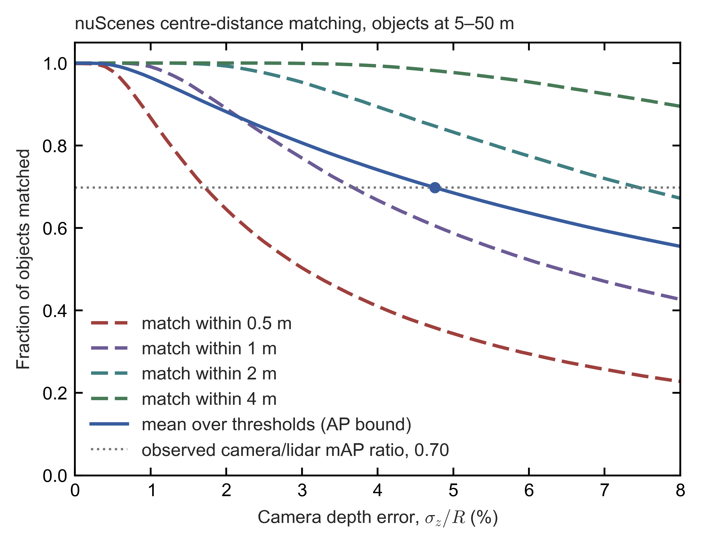

*Figure E11.1.*
- *Model:* fraction of objects matched within each nuScenes centre-distance threshold, and their mean $\bar m$ (Eq. \eqref{eq:matched-fraction}; an upper bound on the AP ratio that localization alone allows), against camera depth error as a fraction of range.
- *Assumptions:* objects uniform over 5–50 m, 0.15 m lateral error, 0.1 m error floor, otherwise perfect detection and classification.
- *Dotted line:* the observed camera/lidar mAP ratio (BEVFormer / CenterPoint, BEVFusion Table I).
- *Script:* `build/figures/nuscenes_matching_localization.py` [E].

**The partial-lidar results expose the camera pathway directly.**
- With lidar restricted to the front ±60°, the fused model scores **20.2 mAP**. That is ≈30% of its clean 66.9 ($20.2/66.9\approx0.30$), close to what the front third of objects alone would give (±60° is 120° of 360°). If objects were spread evenly in azimuth and those in the front third were detected at clean accuracy, the score would be about $66.9\times120/360\approx22.3$ mAP.
- The observed 20.2 mAP falls slightly short of that, so across the 240° seen only by cameras the model detected essentially nothing. **Its camera pathway cannot operate on its own, even where the images are perfectly good.**
- With lidar thinned to **4 beams**, it still scores **41.2 mAP**: even very sparse range samples supply the depth anchors (a few points of known distance) the network depends on.

**What this does and does not show.**
- **It shows** that, within ≈50 m and for 3D box localization, lidar supplies most of the score-relevant information.
- **It also shows** that **default fusion training produces a single point of failure**. A lidar fault means near-total perception loss unless graceful degradation (continued operation at reduced capability after a sensor fails) is designed and trained in (MetaBEV, MEFormer, Grace-BEV). That is a safety-engineering finding in its own right (§E5).
- **It does not show** that cameras matter less overall:
  - The metric ignores what only cameras provide: signal state, signs, lane paint, brake lights and turn signals.
  - nuScenes' ≈28k training keyframes (700 training scenes × 40 keyframes, annotated at 2 Hz over 20 s) are a small-data regime that penalizes data-hungry learned depth (finding 5; §E11.2). A keyframe is a frame with human-annotated 3D boxes.
  - Beyond 50 m the camera deficit grows rather than shrinks (20.5 vs 58.4 AP on the Waymo Open dataset in 2022, §E3).

**The same pattern may exist at the planning level.** An *end-to-end planner* is a single network that maps sensor input directly to the car's planned trajectory. NAVSIM is a public benchmark that scores such planners on real driving logs; its PDMS is a composite score of the planned trajectory's safety, progress and comfort. On NAVSIM, adding lidar to an end-to-end planner moves PDMS only from 83.8 to 84.0 (§E3). This could mean that the benchmark does not stress the cases where lidar matters, or that the planner under-uses the extra modality as detectors under-use cameras. Public data cannot separate the two [E].

### E11.2 Does needing lidar shrink the training set?

A learned driving system improves with the amount of training data, so the camera-only camp argues that requiring lidar leaves fewer usable recordings. The claim comes in four versions of very different strength. In my judgement the pretraining version (c) is the strongest, and the training-signal version (d) actually favours lidar. The answer bears on whether camera-only developers hold a lasting data advantage, or only a temporary one outside China.

**(a) Fleet-size version: only lidar-equipped cars produce paired data.** "Paired" data are synchronized camera and lidar recordings of the same scene, which a fused network needs for training.
- **Outside China this is true.** Few Western production cars carry lidar (§B5), so paired corpora (collections of recordings) come mainly from robotaxi and test fleets.
- **In China it is weak.**
  - Huawei reported **more than one million lidars shipped** and 1 million vehicles equipped with ADS (Huawei's driver-assistance system) by July 2025 [T, KrASIA, Sep 2025], **1.7 million** ADS vehicles by April 2026 [P, Huawei, 23 Apr 2026] and more than 2 million by 8 Sep 2026 (§E1) [T, Tencent News, 8 Sep 2026]. Not all trims (equipment versions of a model) carry lidar (ADS SE does not) [T].
  - Li Auto was reported in 2025 to be making lidar standard on its new models [T].
- **The leaders have the fleet hours.** Waymo's scaling study used **500,000 hours** of Waymo's own driving data, logged by its lidar-equipped fleet (§E1) [P, Baniodeh et al., 2025; §E8]. The leaders' lidar-equipped fleets therefore log $10^5$–$10^6$+ hours [E], and fleet size is probably not the binding constraint for them.
- **But fleet hours are not a retained paired corpus.** Waymo's study trained motion-forecasting and planning models (which predict how other road users will move and choose the car's own path) on encoded scene representations, compact summaries of each scene produced by earlier networks, not raw paired sensor streams [P, Baniodeh et al., 2025]. How much synchronized raw camera–lidar data the leaders retain is not public.

**(b) Uniformity version: configuration churn fragments the corpus.** The cost is real but manageable, and it falls mainly on **validation** rather than on data volume.
- Line counts (the number of laser scan lines, or beams, in the vertical direction) moved from 128 to 192, 520, 896 and, from 2026, 2,160 within a few model years, often with supplier changes (§E10.2) [P/T; spec sheets in §C3b]. Each change introduces a beam-induced *domain gap*: the new sensor's point pattern differs from the one the network was trained on, and accuracy drops until the network is adapted. Camera fleets are more uniform.
- A mitigation exists. The TU Graz beam-density study (2025) found that training on *denser* data generalized better across 32–128 beams when detection is scored at the loose 0.4 IoU threshold (§C10.6(i)), and that halving or doubling the beam count at test time (for example from 128 to 64 beams, or from 32 to 64) widened the domain gap by at most about 3 percentage points at the strict 0.7 threshold, against about 12 points for a fourfold change [I, arXiv 2503.15087, Eq. \eqref{eq:thermal-ifov}, Tables 7–8]. The domain gap is the shortfall in vehicle AP (PV-RCNN++) expressed as a percentage of the AP of the same detector trained on the target data, so the 3 points are a change in a relative gap, not mAP points.

**(c) Pretraining version: in my judgement the strongest.** *Pretraining* means first training a network on a very large generic dataset and then fine-tuning it on the task at hand.
- Camera and video encoders inherit **internet-scale pretraining** (images, video, vision–language), and vision–language–action (VLA) driving models start from vision–language models (VLMs). A VLM is a network trained on images paired with text; a VLA model extends it to output driving actions.
- There is **no internet-scale lidar corpus**. Lidar encoders must be learned from driving data alone, and lidar tokens do not map naturally onto what a pretrained VLM has learned. (A *token* is the unit of input a transformer processes, such as an image patch or a piece of a word (§E10.1). A pretrained VLM has learned what image-patch and word tokens mean, but lidar tokens fall outside that learned vocabulary. A *tokenizer* is the front end that cuts raw input into tokens.)
- Xpeng's stated rationale for dropping lidar is exactly this: its VLA is trained mainly on 10–30 s customer video clips, and lidar data "can't be absorbed" by that training [T, CnEVPost, Jul 2024].
- In May 2026 Xpeng added that cameras carry more information per second and that long-range lidar needs high transmit power [T, CnEVPost]. For comparison, §C4c (subsection 1, IEC 60825-1) finds that eye-safety limits are not an established automotive-compliance barrier for long-range lidar.
- **Counter-examples:**
  - Li Auto's MindVLA fuses lidar early through a 3D encoder [T].
  - Huawei's WEWA architecture (§E10.1) pairs a cloud "world engine" (WE) with a vehicle-side "world action" (WA) model [P, Huawei ADS page], and the WA model deliberately skips the language layer, mapping multimodal perception directly to actions [T, KrASIA, Sep 2025].
  - **Pixel-aligned RGB-D sensors** (Hesai Picasso, Huawei Limera; §F5), which deliver colour (RGB) and depth (D) for the same pixel grid, make lidar look like an extra image channel. That is a practical way to fit lidar into image-pretrained tokenizers, and it may be one of the reasons for "camera-like" lidar resolution (§C10.6) [E].

**(d) Training-signal version: this one favours lidar.**
- Even if the run-time model is camera-only, a lidar-equipped subset raises **label quality** for the whole fleet (§E8; §E10.1, role 4). It does so in three ways:
  - *auto-labels*, 3D boxes generated offline by large models rather than drawn by human annotators;
  - *occupancy ground truth*, a 3D map of which small volumes of space are occupied, used as a training target;
  - *depth supervision*, in which lidar distances serve as the training target for the camera network's depth estimate.

  Used this way, lidar enlarges the *usefully labelled* camera dataset rather than shrinking it.
- **Mixed fleets can be combined.** With modality dropout (randomly blanking a sensor during training, §E11.1), camera-only clips train the camera path and paired clips train both, provided the mixture is designed deliberately (the Grace-BEV ablation, §E11.1 finding 2).

**The missing experiment.**
- Data-scaling studies measure how performance grows as training data increases; the fitted relation is often called a *scaling law* and its plot a *scaling curve*. Such studies exist. NVIDIA researchers trained end-to-end driving on **16 to 8,192 hours** and found continued gains in open- and closed-loop metrics (Naumann et al., CVPRW 2025) [I]. Open-loop metrics compare the model's planned path with what the human driver did in a recording; closed-loop metrics let the model drive in simulation, where its own actions shape what happens next. Waymo used 500k hours [P].
- **None publishes paired scaling curves** for camera-only vs camera+lidar on the same data with matched compute.
- **My hypothesis** [E]: lidar raises the **intercept** of the curve (the performance already reached with little data) more than its **slope** (the gain as data grows), because it is sample-efficient (it needs fewer examples to learn geometry) and supplies geometry for free. Its advantage would then be largest at small data and would narrow with scale, though not necessarily vanish, especially for rare, dark or geometrically unusual cases.
- That is the crux of the Tesla/Xpeng vs Waymo/Huawei disagreement, and it is **publicly unmeasured**.

### E11.3 The compute–power–range triangle

This subsection asks what lidar costs in on-board computing, electrical power and vehicle range, and whether those costs are linked. The answer is that lidar is not the expensive part: sparse lidar processing can even save compute at long range, while the real costs are very high lidar point rates, the network links they need, and running two perception stacks side by side. For an electric vehicle (EV) this matters because every watt of computing shortens driving range.

Four distinct couplings are often conflated:
- perception range drives compute;
- accuracy is bought with compute;
- sensor resolution drives data bandwidth, which drives compute;
- optical power sets detection range, and compute power costs driving range.

**1. Perception range → compute.** For long-range 3D geometry, lidar can be the cheaper modality per metre of range; camera cost is dominated by backbones and lifting (converting 2D image features into 3D, explained below).
- **Dense BEV grids grow with the square of range.** A *dense* grid stores and processes every cell of a square bird's-eye-view map centred on the car, whether or not anything is there. Its cell count is

  $$N_{\rm cell}=\left(\frac{2R_{\rm grid}}{\Delta_{\rm cell}}\right)^{2} \label{eq:bev-grid-cells}$$

  where $R_{\rm grid}$ is the perception range the grid covers (it extends $\pm R_{\rm grid}$ in each direction) and $\Delta_{\rm cell}$ is the side of one cell. With $\Delta_{\rm cell}=0.4$ m, $R_{\rm grid}=50$ m gives $(2\times50/0.4)^2=250^2=62{,}500$ cells and $R_{\rm grid}=200$ m gives $(2\times200/0.4)^2=1000^2=10^6$ cells, **16×** more ($10^6/62{,}500=16$) [E].
- The authors of FSD, a fully sparse lidar detector (Fan et al., NeurIPS 2022; not to be confused with Tesla's Full Self-Driving, also FSD, in §E12), state that dense detectors' cost is quadratic in perception range. FSD is **2.4× faster** than its dense counterpart on the 200 m range of Argoverse 2, a public driving dataset [I].
- **Lidar is naturally sparse.** A *voxel* is a small cube (or, in BEV, a column) of space; a sparse method computes only on voxels that contain points. Work therefore scales with *occupied* voxels. At long range these grow much more slowly than area, because far points are sparse.
- **That advantage survives only if fusion stays sparse.** BEVFusion flattens lidar features into a dense BEV map (180 × 180 cells of 0.6 m for ±54 m on nuScenes). By Eq. \eqref{eq:bev-grid-cells}, the same grid at ±200 m has about $667^2\approx4.4\times10^5$ cells ($400\ {\rm m}/0.6\ {\rm m}\approx667$ per side), about 14× more ($4.4\times10^5/180^2\approx13.7$), so dense-BEV fusion inherits the quadratic cost. Long-range designs therefore use sparse detectors (FSD) or sparse queries (Far3D, SparseFusion), which place a limited set of object queries only where objects may be [E].
- **Camera-to-3D lifting is heavy.** A camera network does not know each pixel's depth, so lifting spreads each image feature along its viewing ray over a set of candidate distances (*depth bins*). The result fills the camera's viewing pyramid (its *frustum*) with features. The number of frustum features is the number of cameras × feature-map pixels × depth bins, and at fixed depth resolution the number of depth bins grows with range.
  - In BEVFusion, the camera-to-BEV pooling step (summing the frustum features into BEV cells) originally took **more than 500 ms** on an RTX 3090 (a desktop graphics processor, GPU), against about 100 ms for the rest of the model. Custom kernels (hand-optimized GPU routines) cut it to 12 ms [I].
  - Long-range camera detectors avoid dense grids by using sparse 2D-to-3D queries (e.g. Far3D) [I].

**2. Accuracy per unit compute (a snapshot, not a law).** In the 2022 generation, lidar-only CenterPoint reached in 81 ms an accuracy that camera-only models had not yet reached. The table gives BEVFusion's Table I, measured on one RTX 3090 [I]. "L" is lidar and "C" camera. GMACs are billions of multiply–accumulate operations (one multiplication plus one addition, the basic arithmetic step of a neural network) per inference, i.e. per processed frame. Latency is the time to process one frame.

| Model | Modality | Val mAP | GMACs | Latency |
|---|---|---:|---:|---:|
| PointPillars | L | 52.3 | 65.5 | 34.4 ms |
| CenterPoint | L | 59.6 | 153.5 | 80.7 ms |
| BEVFormer | C | 41.6 | not listed | not listed |
| TransFusion | C+L | 67.5 | 485.8 | 156.6 ms |
| BEVFusion | C+L | 68.5 | 253.2 | 119.2 ms |

- Relative to lidar-only CenterPoint, BEVFusion costs about +65% MACs ($253.2/153.5\approx1.65$) and +48% latency ($119.2/80.7\approx1.48$) for about +9 mAP ($68.5-59.6=8.9$). Most of that gain, $64.7-59.6=5.1$ of the 8.9 mAP, comes from BEVFusion's stronger lidar branch; cameras add the remaining ≈3.8 mAP ($68.5-64.7=3.8$). The lidar-only figure of 64.7 mAP is from Fusion4CA's Table I (§E11.1), so this split combines two sources.
- Camera-only models have since closed much of the accuracy gap, mainly by scaling backbones, input resolution and temporal fusion (combining several past frames), i.e. by **spending compute** [U: matched GMAC figures for current camera-only leaders not compiled here].
- The production-relevant metric is watts, or joules per inference, per *validated* capability. It is not public for any stack. TOPS/W (tera-operations, $10^{12}$ operations, per second per watt) measures chip efficiency, not delivered capability.

**3. Sensor resolution → bandwidth → compute.** High-line lidars need multi-gigabit links, and voxelization (binning points into voxels) caps the density a network can use.
- The raw data rate of a lidar is

  $$r_{\rm data}=\dot N_{\rm pt}\times n_{\rm byte}\times 8\ {\rm bit/byte} \label{eq:lidar-data-rate}$$

  where $\dot N_{\rm pt}$ is the point rate (points per second; Mpts/s means millions of points per second) and $n_{\rm byte}$ the number of bytes per point. A *decoded host point* is a point as the central computer stores it, with Cartesian position (xyz), intensity and time stamp. A *polar sensor packet* is the lidar's compact native format, which sends range and beam indices instead of xyz.
- A 2,160-line lidar at 25–40 Mpts/s produces **2.4–5.1 Gbit/s** at 12–16 bytes per decoded host point (xyz, intensity, time). A 128-line unit such as the Hesai AT128, at 1.54 Mpts/s with single returns (§C3b) and twice that with dual returns, produces about 0.15–0.39 Gbit/s. Compact polar sensor packets (≈4–6 bytes per return) give about 0.8–1.9 and 0.05–0.15 Gbit/s respectively [E]. Each figure follows from Eq. \eqref{eq:lidar-data-rate}: for example $25\times10^{6}\ {\rm s^{-1}}\times12\times8\approx2.4$ Gbit/s, $40\times10^{6}\times16\times8\approx5.1$ Gbit/s, $1.54\times10^{6}\times12\times8\approx0.15$ Gbit/s, $3.07\times10^{6}\times16\times8\approx0.39$ Gbit/s, and $3.07\times10^{6}\times6\times8\approx0.15$ Gbit/s.
- Single-pair automotive Ethernet (the in-car network standard carried on one twisted wire pair) runs at 1 Gbit/s (1000BASE-T1) or 2.5/5/10 Gbit/s (IEEE 802.3ch). A 128-line unit fits comfortably in 1000BASE-T1. A 2,160-line unit needs a multi-gigabit link in all but its most compact format (only the polar stream at 25 Mpts/s and 4 bytes per return, $25\times10^{6}\times4\times8=0.8$ Gbit/s, would just fit 1000BASE-T1), plus a switch port and matching SoC ingest (the input capacity of the central system-on-chip processor), so link class and harness (the vehicle wiring) are part of lidar's integration cost, not only its watts [E].
- BEV voxelization caps the useful density. The spacing between neighbouring lidar points at range $R$ is $R\,\delta\theta$, where $\delta\theta$ is the angular step in radians. For angular steps finer than about 0.05°, at ranges under 150 m, neighbouring points lie less than 0.13 m apart, so most extra points fall into the same 0.1–0.2 m voxel: a 0.05° step ($0.873\times10^{-3}$ rad) spans only $150\times0.873\times10^{-3}\approx0.13$ m at 150 m (§C10.6(f)). Using them requires finer voxels, whose cost grows with the square (BEV) or cube (3D) of the inverse voxel size.
- The practical levers are therefore **on-sensor**: echo selection (sending only the most useful of several returns per laser shot), compression and region of interest (ROI) output, i.e. full density only where it is needed.

**4. Compute → power → EV range, and sensor power → detection range.** Compute power draws on EV range; optical power per point sets detection range.
- **Compute power:**
  - NVIDIA's Jetson AGX Orin is rated at 15–60 W and Jetson AGX Thor at 40–130 W [P]. Automotive DRIVE variants and complete domain controllers (the boxes that hold the driving computer with its memory, networking and power supply) differ.
  - By §E9's arithmetic, a 150 W incremental load costs about **0.7%** of range at 100 km/h and **2.4%** at 30 km/h. The share is larger at low speed because a constant electrical load draws energy per unit time, so the slower the car, the more of that energy is spent per kilometre driven. Lin et al. estimate for a Chevrolet Bolt that a computer with one CPU and three GPUs at full load cuts range by about 6%, and the whole system by about 11.5% once storage and the air conditioning that removes its heat are counted (about 77 W of cooling per 100 W of load) [I, Lin et al., ASPLOS 2018, Fig. 2].
  - MIT's fleet-scale analysis considers a scenario in which about 95% of vehicles are autonomous (AVs). There, per-vehicle compute must stay below about **1.2 kW** for AV-fleet computing emissions to remain below 2018 data-centre emissions in 90% of modeled scenarios. For 2050 emissions to equal 2018 data-centre emissions under business-as-usual decarbonization, hardware efficiency must double about every **1.1 years** if workloads double every three years [I, Sudhakar et al., IEEE Micro 2023].
- **Sensor power:** assume clear air, a fixed receiver and a fixed detection threshold. For an extended target that fills the whole beam footprint (the beam's cross-section at the target), the received energy falls as $E_{\rm pt}/R^2$, where $E_{\rm pt}$ is the optical energy sent toward one point. For a target smaller than the footprint, it intercepts a share of the beam that also falls as $1/R^2$, so the received energy falls as $E_{\rm pt}/R^4$. Setting the received energy at the maximum detection range $R_{\max}$ equal to the fixed threshold gives

  $$R_{\max}\propto\sqrt{E_{\rm pt}}\quad\text{(beam-filling target)},\qquad R_{\max}\propto E_{\rm pt}^{1/4}\quad\text{(target smaller than the footprint)} \label{eq:range-energy-target-size}$$

  (§C6, §E9). By Eq. \eqref{eq:range-energy-target-size}, for the extended, beam-filling target in clear air, $E_{\rm pt}\propto R_{\max}^2$, so doubling range at a fixed point rate needs about **4×** ($2^2$) the optical energy per point.
  - For a target smaller than the footprint, $E_{\rm pt}\propto R_{\max}^4$, so doubling needs about 16× ($2^4$).
  - Atmospheric loss makes both worse.
  - This is a sensor-side cost, not a compute-side one.

**Synthesis** [E]:
- **For EV range, one lidar (6–20 W) is negligible; the compute stack is what becomes material.** It does so from about 150 W at urban speeds (≈2.4% of range at 30 km/h, §E9), at several hundred watts on highways, or when two stacks run in parallel (fused primary plus guardian, an independent second stack that monitors the first). Awake idle hours, when the computer runs while the car is stationary, add energy with no distance.
- **The tighter coupling at speed is latency.** End-to-end latency is the time from sensor capture to a control command; during it the vehicle travels $v\,t_{\rm lat}$, for speed $v$ (m/s) and latency $t_{\rm lat}$ (s). At 36 m/s (about 130 km/h), 100 ms of end-to-end latency is $36\times0.1=3.6$ m; 100 ms is the processing budget Lin et al. set for an autonomous-driving system, to be met at 10 or more frames per second and judged on tail latency, the 99th or 99.99th percentile of processing time [I, Lin et al., ASPLOS 2018, §2.4]. Larger models and higher point rates buy perception quality at the expense of reaction distance, unless the compute grows too.
- **Lidar is not inherently a compute burden.** For long-range 3D geometry it can *reduce* compute, because sparse methods scale with points rather than area. What does add compute is very high point rates (§C10.6) and dual-stack redundancy architectures.

### E11.4 My judgement

This subsection draws the three threads (training, data and compute) into one verdict on the camera-only camp's arguments.

- **The training interference that camera-only developers describe is real and documented, but it is not inherent to fusion.** Standard fused detectors become lidar-dependent: 0 mAP without lidar, and only about +4 mAP from cameras (the +3.8 mAP of §E11.1). Balanced, reliability-gated training removes the collapse at little or no cost in clean accuracy, but the no-lidar fallback (33–41 mAP) stays far below the fused score (68–71 mAP) (§E11.1, findings 2–3). The evidence supports camera-only developers' concern for naive fusion, which under-trains the camera, but does not show that fusion must degrade performance.
- **Data.** In China the binding constraints are not fleet size but three others: image-dominated internet-scale pretraining, configuration churn (frequent changes of lidar model), and per-configuration validation (re-proving safety for each sensor set). Outside China, fleet size also binds. Lidar's value as a **label source** partly offsets all of these.
- **Compute.** Lidar is not the expensive part. The costs to watch are 2k-line point rates (the multi-gigabit data streams of 2,160-line units, §E11.3) and dual-stack redundancy.
- **Tests that would settle it:**
  - paired scaling curves (camera-only vs camera+lidar) on the same fleet data at matched compute;
  - rare-event recall and closed-loop outcomes, not just nuScenes-style mAP;
  - camera-only fallback accuracy of the fused production model, compared with the operator's own dedicated camera-only model.

Additional sources for §E11: [Huang et al., "Modality Competition", ICML 2022](https://proceedings.mlr.press/v162/huang22e.html); [Wang, Tran & Feiszli, CVPR 2020](https://openaccess.thecvf.com/content_CVPR_2020/papers/Wang_What_Makes_Training_Multi-Modal_Classification_Networks_Hard_CVPR_2020_paper.pdf); [Peng et al., OGM-GE, CVPR 2022](https://openaccess.thecvf.com/content/CVPR2022/papers/Peng_Balanced_Multimodal_Learning_via_On-the-Fly_Gradient_Modulation_CVPR_2022_paper.pdf); [BEVFusion, Liu et al.](https://arxiv.org/abs/2205.13542); [FSD, Fan et al., NeurIPS 2022](https://arxiv.org/abs/2207.10035); [Naumann et al., "Data Scaling Laws for End-to-End Autonomous Driving", CVPRW 2025](https://arxiv.org/abs/2504.04338); [Sudhakar, Sze & Karaman, "Data Centers on Wheels", IEEE Micro 2023](https://ieeexplore.ieee.org/document/9942310/); [Lin et al., ASPLOS 2018](https://dl.acm.org/doi/10.1145/3173162.3173191); [Xpeng pure-vision rationale, CnEVPost, Jul 2024](https://cnevpost.com/2024/07/09/exclusive-xpeng-f57-to-ditch-lidar-move-to-tesla-like-pure-vision/) and [May 2026](https://cnevpost.com/2026/05/21/xpeng-defends-pure-vision-strategy-says-lidar-no-longer-necessary/); [Huawei's Jin Yuzhi interview, KrASIA](https://kr-asia.com/nothing-is-free-huaweis-richard-jin-on-assisted-driving-and-the-path-to-level-4-autonomy); [Huawei ADS fleet, Apr 2026](https://english.news18a.com/news/english_251292.html); [NVIDIA Jetson Thor](https://www.nvidia.com/en-us/autonomous-machines/embedded-systems/jetson-thor/); [NVIDIA Jetson Orin](https://www.nvidia.com/en-us/autonomous-machines/embedded-systems/jetson-orin/).

## E12. Camera-only trucking: Tesla's Semi, its stated self-driving timelines, and the 250–400 m problem

This section asks whether a heavy truck can drive itself on cameras alone, the approach Tesla has chosen for its Semi. In short, supervised camera-only assistance (a human driver still monitors and takes over) is plausible, but driverless camera-only trucking faces open problems, above all night reach: an unlit obstacle beyond headlight range is invisible to a camera (§E12.3, §E12.4). The question matters for the lidar market because a working camera-only truck would undercut FMCW lidar (frequency-modulated continuous-wave lidar, which measures each point's range and radial velocity at once) in its strongest application (§F6).

Heavy trucks are FMCW's strongest case (§F6): an 80,000 lb (36,300 kg) truck at 105 km/h needs 166–257 m to stop, so it must detect hazards far beyond that distance. Tesla is the one large carmaker entering Class 8 trucking (the heaviest US truck weight class, which includes tractor-trailers) with a **camera-only** stack and publicly stated self-driving timelines. This section sets those statements against what has shipped, reads the NHTSA (US National Highway Traffic Safety Administration) crash evidence on the camera stack, and works out what cameras can and cannot measure at truck-relevant ranges.

### E12.1 Stated timelines and delivery

Volume production began in 2026; the 2017 unveiling had given 2019. No date has been given for driverless operation. In the table, FSD (Full Self-Driving) is Tesla's most capable driving software. "FSD (Supervised)" is the version that requires an attentive driver ready to take over; "unsupervised" or "driverless" operation means no human driver is needed.

| When | Promise or statement | What has happened |
|---|---|---|
| Nov 2017 (unveiling) | Production "begins in 2019". \$150k (300 mi) and \$180k (500 mi). Enhanced Autopilot standard (lane keeping, automatic emergency braking, forward-collision warning). A **"convoy" mode**, with trucks following a human-driven lead truck, pitched as cheaper per mile than rail [S, Wikipedia; T, TechCrunch 2017] | Pilot deliveries began in Dec 2022 (PepsiCo); at that event Tesla said nothing about Autopilot or FSD on the Semi [T, Electrek 2022]. **Volume production began in 2026** at a dedicated Nevada plant rated at 50,000 trucks a year [T, Electrek; electrive]. Prices are ≈\$260k (325 mi) and ≈\$290k (500 mi) [T]. No convoy product exists |
| Jul 2026 (Q2 earnings call) | "We expect to get self-driving working on the Tesla Semi probably around the end of this year or early next year." Semi autonomy is "taking a bit of a backseat for the next six months or so." FSD "will definitely be working next year and in time for the scale-up to high production" [T, Electrek; The Driven; Not a Tesla App] | Framed first as **FSD (Supervised)** to reduce driver fatigue, then unsupervised operation to address the driver shortage. No date for driverless operation |
| Sep 2026 | Volume-production launch; deliveries to PepsiCo, DHL, US Foods, ABF, Einride, IMC Logistics and WattEV [T] | The redesigned Semi reportedly carries **10 external cameras plus a cabin camera**; no radar or lidar has been reported [T]. Electric steering "lays the groundwork for future autonomy" [T]. The long-range forward camera on Tesla's current hardware is rated to **250 m** [T] |
| Earlier self-driving timelines | — | Electrek counts about ten self-driving deadlines since 2013, and says every one that has come due was missed [T]. Tesla's unsupervised robotaxi (driverless taxi) service runs at small scale in a few Texas and Florida metros (§E1, §F7) |

**Every driverless-truck programme uses lidar:** Aurora (in-house FMCW), Daimler/Torc (Aeva FMCW), Kodiak, PlusAI and Waabi [T, HDT 2026; §B4]. The camera-first alternatives aimed at trucks are **wide-baseline stereo**. Stereo cameras measure distance from the small shift (*disparity*) between the images of two cameras a known distance apart (the *baseline*); spacing the cameras widely, for example across a truck cab, makes the shift larger and the distance more precise (Eq. \eqref{eq:stereo-depth-error}, §E2).
- NODAR claims depth beyond 1,000 m, a 10 cm object at 150 m and an overturned motorcycle at 350 m [P, vendor claim];
- Light's Clarity, whose patents and part of whose team John Deere acquired in 2022, claimed to see any 3D structure in the road at distances from 10 cm to 1 km, a span of range rather than an object size [T, The Robot Report, 27 Oct 2020 and 19 May 2022].

Both are passive (they emit no light and rely on ambient light or headlights) and share the night-time limit discussed below.

### E12.2 What NHTSA's open investigation of the camera stack reports so far

NHTSA is investigating whether FSD detects camera degradation and warns the driver in time. The cited crashes occurred at short range in poor visibility, not at the edge of long-range reach. This matters for a camera-only truck because the same failure, at a truck's mass and stopping distance, would be far more dangerous.

**How a US defect investigation works.** NHTSA's Office of Defects Investigation (ODI) handles suspected safety defects in stages:
- a *preliminary evaluation* (PE) gathers initial data from the manufacturer and complaints;
- an *engineering analysis* (EA) is the deeper second stage, with detailed technical requests and testing;
- an EA ends either in *closure* or in a *recall*, a formal campaign in which the manufacturer remedies the defect, either voluntarily or at NHTSA's demand.

ODI publishes a short *resume* (summary) when it opens each stage, and sends *information requests* (IRs), formal letters listing what the manufacturer must supply.

NHTSA opened **Engineering Analysis EA26002** on 18 Mar 2026, upgrading preliminary evaluation PE24031. It covers an estimated **3,203,754** FSD-equipped Model S/X/3/Y and Cybertrucks from model years 2016–2026 [P, resume from NHTSA's Office of Defects Investigation (ODI), both pages read].

**Information Request EA26002-01**, sent by ODI on 2 Jul 2026 with a response due on 12 Aug 2026:
- It seeks all internal communications, technical documentation and test records behind a document titled "Radar Saves Us". Tesla had submitted that document in its PE24031 response, and ODI says it "appears particularly relevant to related design changes to the degradation detection system".
- It also asks for monthly mileage by driving mode since 1 Jul 2024, and for the data behind Tesla's internal "regressions" metric [P].
- No recall or closure had appeared by 3 Oct 2026 [P, NHTSA recall data and ODI file]. NHTSA extended most of Tesla's answers to 23 Sep 2026 and the crash-by-crash question (Q9, which asks whether "Vision Failsafe Ranker" and "Direct Photon Count Capability" were installed) to 18 Nov 2026. Tesla filed its answers with requests for confidential treatment of each whole document, and the file holds no entry for the "Radar Saves Us" question (Q4) [P, ODI file] ([IR letter](https://static.nhtsa.gov/odi/inv/2026/INIM-EA26002-14414.pdf)).

**Subject.** "Failure of the FSD's degradation detection system, when encountering reduced roadway visibility conditions, to detect a degraded state and to warn the driver appropriately." The degradation detection system is the software that is meant to recognize when the cameras' view is impaired (by glare, fog or dirt, for example) and to alert the driver.

**Findings in the resume** [P]:
- **Counts.** Nine incidents: two from Tesla and seven from Standing General Order (SGO) reports or media. The SGO is NHTSA's standing order requiring manufacturers to report crashes in which a driver-assistance or automated-driving system was engaged. Two incidents involved injuries and one a fatality.
- **What failed.** "In the crashes that ODI has reviewed, the system did not detect common roadway conditions that impaired camera visibility and/or provide alerts when camera performance had deteriorated until immediately before the crash."
- **Lead vehicles** (the vehicle ahead in the same lane). "Review of Tesla's responses revealed **additional crashes** that occurred in similar environments… In each of these crashes, FSD also **lost track of or never detected a lead vehicle in its path**." This refers to those additional crashes, not necessarily to all nine.
- **Tesla's update and its timing.** Tesla began developing an update to the degradation detector on 28 Jun 2024, the day after it filed the SGO report of the Nov 2023 fatal crash. ODI does not know when it was deployed or to which vehicles.
- **Tesla's own assessment.** Tesla's post-incident analysis suggested the update "may have affected 3 of the 9 incidents".
- **Possible under-reporting.** Tesla described "internal data and labeling limitations" that prevented uniform identification of crashes with the system engaged. ODI believes this "could have led to under-reporting".
- **Six more incidents.** ODI will also analyse six recent potentially related incidents.

**The crashes themselves**, from the structured fields of NHTSA's public SGO files (the 2021–25 archive plus the current file). Tesla marks every narrative (the free-text crash description) as confidential business information, which NHTSA withholds from publication, so only these fields are available [P]:

| SGO report | Date, place (time as filed, in UTC) | Road | Weather field | Struck | Tesla speed | Injury |
|---|---|---|---|---|---|---|
| 13781-8004 | Nov 2023, Rimrock AZ | Highway | Clear | **Pedestrian** | 55 mph | **Fatal** |
| 13781-7181 | Jan 2024, Nipton CA | Highway | Other | **Stopped** passenger car | 53 mph | Unknown |
| 13781-7381 | Mar 2024, Red Mills VA (19:19) | Highway | Cloudy | **Stopped** passenger car | 47 mph | Unknown |
| 13781-7767 | May 2024, Collinsville OH | Rural road | Cloudy, **fog/smoke** | Fixed object | 28 mph | Minor |
| 13781-7964 | Jun 2024, Fullerton CA (07:03) | Street | Cloudy | **Stopped first-responder vehicle** | 37 mph | None reported |
| 13781-8977 | Oct 2024, Issaquah WA (20:40) | Highway | Clear | SUV | **67 mph** | Unknown |
| 13781-9267 | Nov 2024, Stockton CA | Highway | Clear | **First-responder vehicle** | 37 mph | Unknown |
| *Six recent incidents under analysis* | | | | | | |
| 13781-11937 | Oct 2025, Barrington IL (03:23) | Highway, traffic incident | Clear | **Stopped first-responder vehicle** | 43 mph | Unknown |
| 13781-13211 | Nov 2025, Sunol CA (00:36) | Highway | Clear | SUV | 42 mph | Unknown |
| 13781-13569 | Dec 2025, Seattle WA | Intersection | Cloudy, **fog/haze** | **Stopped** passenger car | 28 mph | Unknown |
| 13781-13633 | Jan 2026, Kansas City MO | Intersection | Clear | Passenger car | 42 mph | Unknown |
| 13781-13693 | Jan 2026, Claremore OK | Unknown | Unknown | Unknown | 63 mph | Unknown |
| 13781-13788 | Jan 2026, Bentonville VA (21:49) | Unknown | Unknown | Unknown | 36 mph | Unknown |

**Reading the pattern** [E]:
- **"Clear" does not mean good visibility.** The SGO weather field has no glare category, so sun-glare crashes appear as "Clear" or "Other". The ODI resume names glare and airborne obscurants as the conditions. Tesla files its SGO times in UTC (coordinated universal time), not local time: in the 2021–25 archive, the lighting field of 97% of the 1,563 Tesla reports that give a time and a lighting condition agrees with that time read as UTC, against 49% read as local time, whereas the 217 such reports from all other companies agree with local time (93%) and not with UTC (50%) [E: mid-month solar elevation at each state's centre]. The Rimrock record (13781-8004) shows the effect. It gives only the month, November 2023, with 00:03 and the lighting "Dawn / Dusk"; the ODI resume dates the fatal crash to 28 Nov 2023, and the Arizona Department of Public Safety placed it just after 5 p.m. on 27 Nov [P; T, AP via CBS News, 18 Oct 2024]. Both fit a crash at 17:03 on 27 Nov, because Arizona keeps UTC−7 all year and 17:03 there is 00:03 UTC on 28 Nov [E]. The time is therefore omitted from the table, and the other times shown are as filed; in local time they are 14:19 or 15:19 (Red Mills), 00:03 (Fullerton), 13:40 (Issaquah), 22:23 the previous evening (Barrington), 16:36 or 17:36 the previous afternoon (Sunol) and 16:49 (Bentonville) [E].
- **The recurring pattern is a stopped vehicle or scene** struck at **28–53 mph** (28–67 mph across all listed crashes), several at night, dawn or dusk in local time, some in fog.
- **These are short-range crashes.** At 28–67 mph a car needs only ≈20–90 m to stop. The estimate assumes a 1 s reaction time and 0.8 g braking [E], where $g=9.81$ m/s² is the acceleration of gravity, so the braking deceleration is $a_{\rm b}=0.8g\approx7.85$ m/s². The stopping distance is the distance covered during the reaction time plus the braking distance, $d_{\rm stop}=v\,t_{\rm r}+v^2/(2a_{\rm b})$ (Eq. \eqref{eq:stopping-distance}, §A6.1), where $v$ is the initial speed (m/s), $t_{\rm r}$ the reaction time (s) and $a_{\rm b}$ the constant braking deceleration (m/s²). It gives $12.5+12.5^2/(2\times7.85)\approx22$ m at 28 mph (12.5 m/s) and $30.0+30.0^2/(2\times7.85)\approx87$ m at 67 mph (30.0 m/s). The problem is therefore detecting degraded visibility and warning at tens of metres, not reach at 300 m.
- **For a truck the same failure is worse.** At the same speed, an 80,000 lb truck needs **2–3× a car's stopping distance** and carries ≈20× its kinetic energy. At 105 km/h (29.2 m/s) Eq. \eqref{eq:stopping-distance} gives the car above $29.2+29.2^2/(2\times7.85)\approx83$ m, against the truck's 166–257 m ($166/83\approx2.0$, $257/83\approx3.1$). (The truck figure, from §F6, assumes a 1.5 s perception–reaction time and an average deceleration of 3.5 m/s² in the best case down to 2.0 m/s² in the worst, for a loaded truck.) At equal speed kinetic energy, $\tfrac12 mv^2$ for mass $m$, scales with mass, and 80,000 lb (36,300 kg) is about 20 times an assumed 1,800 kg car.

### E12.3 Physics: what each sensor delivers at 150–400 m

This subsection asks what each sensor can actually measure about a stalled car far ahead of a truck at highway speed, and whether it can do so in time for the truck to stop. The critical call is whether an object ahead is stopped in the lane (brake now) or moving with traffic (no action), and it has to be made while the truck can still stop. In daylight a camera can make the critical stationary-versus-moving call at 300 m. At night, and for absolute range, it cannot.

**Scenario and assumptions** (all from the companion script `truck_long_range_sensing.py` unless stated; each is an assumption, not a measurement):
- *Truck:* 80,000 lb at 105 km/h, i.e. $v=105/3.6=29.2$ m/s. Its stopping distance $d_{\rm stop}$ is 166–257 m, from Eq. \eqref{eq:stopping-distance} with a perception–reaction time $t_{\rm r}$ = 1.5 s and an average braking deceleration $a_{\rm b}$ of 3.5 m/s² (best case, 166 m) to 2.0 m/s² (worst case, 257 m) (§F6).
- *Hazard:* a stalled passenger car in the truck's lane, $W$ = 1.8 m wide and $H$ = 1.5 m high, in a 3.7 m lane. The alternative the sensor must rule out is a car moving with traffic at 25 m/s.
- *Mono camera* (a single camera): the angle one pixel subtends, its IFOV (instantaneous field of view), is taken as 0.25 mrad or 0.45 mrad (two cases, written 0.25–0.45 mrad below). It runs at $f_{\rm frame}$ = 36 frames per second (fps), and the car's measured image width jitters randomly by $\sigma_w$ = 0.3 px (pixels) from frame to frame; this is the "edge noise" from locating the car's edges in each frame. The camera is mounted at height $h_{\rm cam}$ = 2.75 m on the truck. Detection and tracking are assumed clean and in daylight, so the camera results are a best case.
- *Stereo pair:* baseline 1.5 m, telephoto pixels of 0.1 mrad, disparity noise 0.2 px.
- *Lidar:* angular grid of 0.1° or 0.05° in both directions, range noise ≈5 cm, an assumed value [E] above the ideal ≈0.3 cm of §C0 subsection 1.1 and the 2–4 cm measured outdoors for the AS-DT1 (§C5a).
- *Radar:* 1° beam.
- Flat road, clear air, no occlusion by other traffic.

If the car is lower contrast, the road is not flat or the image edges are noisier, the camera numbers below get worse; they do not get better.

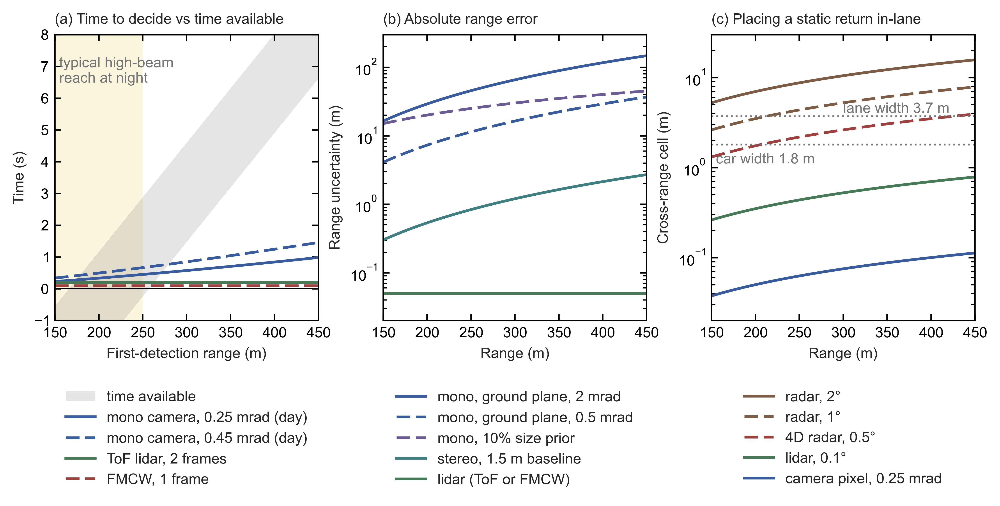

*Figure E12.1.*
- *Scenario:* truck at 29.2 m/s, stopping distance 166–257 m, stalled 1.8 m-wide car in lane.
- *(a)* Time available if the hazard is first detected at range $R$, $t_{\rm avail}=(R-d_{\rm stop})/v$ (grey band; Eq. \eqref{eq:decision-time}), against the time each sensor needs to call "stationary" rather than "moving with traffic". For a mono camera this uses image expansion alone, i.e. the time to contact $t_{\rm c}=\varphi/\dot\varphi$, where $\varphi$ is the car's angular width in the image and $\dot\varphi$ its rate of growth. It assumes 0.3 px edge noise at 36 fps (an optimistic daylight bound; Eq. \eqref{eq:stationary-call-time}). The yellow band marks typical high-beam reach at night.
- *(b)* Absolute range error: mono ground plane $\delta R\approx R^2\delta\alpha/h_{\rm cam}$ (Eq. \eqref{eq:monocular-ground-range}; $h_{\rm cam}=2.75$ m camera height, $\delta\alpha$ the pitch or road-grade error); a 10% size prior ($\delta R=0.1R$, range inferred from an assumed car size known to ±10%); stereo $\delta R=R^2\sigma_d\,{\rm IFOV}_{\rm st}/b_{\rm st}$ (Eq. \eqref{eq:stereo-depth-error}; $\sigma_d$ disparity noise, ${\rm IFOV}_{\rm st}$ the stereo pixel angle, $b_{\rm st}$ baseline); lidar ≈5 cm.
- *(c)* Cross-range cell (beam or pixel angle × $R$, Eq. \eqref{eq:radar-cross-range-cell}) against lane and car widths.
- *Script:* `build/figures/truck_long_range_sensing.py`, which also writes `truck_long_range_sensing_tables.txt`.
- All values [E].

| Quantity | 250 m | 300 m | 400 m |
|---|---|---|---|
| Decision time available (worst- to best-case stopping distance) | −0.2 to 2.9 s | **1.5 to 4.6 s** | 4.9 to 8.0 s |
| Mono camera: pixels across the car (0.25–0.45 mrad) | 16–29 | 13–24 | 10–18 |
| Mono camera: time to call stationary vs moving (daylight) | 0.45–0.66 s | **0.57–0.85 s** | 0.84–1.24 s |
| Mono camera: absolute range error (0.5–2 mrad pitch or road grade) | ±11–45 m | **±16–65 m** | ±29–116 m |
| Mono camera: absolute range error (10% size prior) | ±25 m | ±30 m | ±40 m |
| Stereo, 1.5 m baseline, 0.2 px: range error | ±0.8 m | ±1.2 m | ±2.1 m |
| Lidar, 0.1° / 0.05° grid: points on the car | 14 / 57 | 10 / 39 | 6 / 22 |
| Radar, 1° beam: cross-range cell (lane 3.7 m) | 4.4 m | **5.2 m** | 7.0 m |

A negative decision time (−0.2 s at 250 m in the worst case) means the hazard was first detected inside the truck's stopping distance, so the truck cannot stop in time at all.

*How the numbers are derived* [E] (companion script `truck_long_range_sensing.py`; truck speed $v=105/3.6=29.2$ m/s; car 1.8 m wide and 1.5 m high; other assumptions as listed above the figure).

*Decision time available.* If the hazard is first detected at range $R$ and the truck needs $d_{\rm stop}$ to stop, the time left to decide before braking must begin is

$$t_{\rm avail}=\frac{R-d_{\rm stop}}{v} \label{eq:decision-time}$$

At 300 m, $(300-257)/29.2\approx1.5$ s in the worst case and $(300-166)/29.2\approx4.6$ s in the best.

*Pixels across the car.* A car of width $W$ at range $R$ subtends the angle $W/R$ (radians), so its image width in pixels is

$$w=\frac{W}{R\,{\rm IFOV}} \label{eq:pixels-across-car}$$

At 300 m, $1.8/(300\times0.45\times10^{-3})\approx13$ and $1.8/(300\times0.25\times10^{-3})=24$.

*Time to call stationary.* A camera cannot measure the car's range directly, but it can measure how fast the car's image grows (the *looming rate*). If the gap closes at the closing speed $v_{\rm c}$ (the rate at which the distance between truck and car shrinks), differentiating Eq. \eqref{eq:pixels-across-car} with $\dot R=-v_{\rm c}$ gives the growth rate of the image width,

$$\dot w=\frac{w\,v_{\rm c}}{R},\qquad t_{\rm c}=\frac{w}{\dot w}=\frac{R}{v_{\rm c}} \label{eq:image-growth-rate}$$

where $t_{\rm c}$ is the time to contact (equal to $\varphi/\dot\varphi$ in the figure caption, since the angular width is $\varphi=w\,{\rm IFOV}$). A stopped car closes at the full 29.2 m/s; a car moving with traffic at 25 m/s closes at only $29.2-25=4.2$ m/s. The two cases therefore differ in growth rate by

$$\Delta\dot w=\frac{w\times25\ {\rm m/s}}{R} \label{eq:growth-rate-difference}$$

The camera estimates $\dot w$ as the slope of a straight-line fit to the measured width over an observation time $T_{\rm obs}$, i.e. over $f_{\rm frame}T_{\rm obs}$ frames. With per-frame edge noise $\sigma_w$ (the random error in each frame's measured width, in pixels), the standard deviation of the fitted slope is

$$\sigma_{\dot w}=\sigma_w\sqrt{\frac{12}{f_{\rm frame}T_{\rm obs}^{3}}} \label{eq:slope-fit-noise}$$

This is the standard least-squares result for evenly spaced samples. The factor 12 comes from the variance of times spread uniformly over the window, $T_{\rm obs}^2/12$. Requiring the two hypotheses to be separated by five standard deviations, $\Delta\dot w=5\sigma_{\dot w}$ (the script's criterion, strict enough to make false calls rare), inserting Eq. \eqref{eq:growth-rate-difference} and Eq. \eqref{eq:slope-fit-noise}, and solving for $T_{\rm obs}$ gives the time needed to call the car stationary:

$$T_{\rm obs}=\left(\frac{5\sigma_w}{\Delta\dot w}\right)^{2/3}\left(\frac{12}{f_{\rm frame}}\right)^{1/3} \label{eq:stationary-call-time}$$

With $\sigma_w=0.3$ px and $f_{\rm frame}=36$ fps, $5\sigma_w=5\times0.3=1.5$ px. At 300 m with 0.25 mrad pixels, $w=24$ px and $\Delta\dot w=24\times25/300=2.0$ px/s, so $T_{\rm obs}=(1.5/2.0)^{2/3}\times(12/36)^{1/3}\approx0.83\times0.69\approx0.57$ s; with 0.45 mrad pixels, $w=13.3$ px and $T_{\rm obs}\approx0.85$ s.

*Mono range error.* A single camera can estimate range from where the car's contact point with the road appears in the image. On a flat road the camera looks down at that point by the *depression angle* $\alpha\approx h_{\rm cam}/R$ (small-angle approximation). An error $\delta\alpha$ in that angle, caused by an error in the assumed camera pitch or road grade (the slope of the road), then shifts the inferred range by $\delta R\approx R^{2}\,\delta\alpha/h_{\rm cam}$ (Eq. \eqref{eq:monocular-ground-range} of §E2, with $R$ for $Z$ and $h_{\rm cam}$ for $h$). Here $h_{\rm cam}=2.75$ m and $\delta\alpha$ = 0.5–2 mrad [E]. This range of $\delta\alpha$ is a residual error: it assumes that pitch and grade are estimated online to that accuracy. An uncompensated pitch or grade change of 0.1–0.5° (1.7–8.7 mrad, §E2) would give errors up to about 4× those of the 2 mrad case ($8.7/2\approx4.4$). At 300 m, $300^2\times0.5\times10^{-3}/2.75\approx16$ m and $300^2\times2\times10^{-3}/2.75\approx65$ m. This linearized error is symmetric; for the largest case, 2 mrad at 400 m, the exact ground-plane error is about +164 m / −90 m, because 2 mrad is not small against the $2.75/400\approx6.9$ mrad depression angle.

*Size prior.* A single camera can also infer range from the car's apparent width. The car subtends $\varphi=W/R$, so $R=W/\varphi$, and if $W$ is known only to ±10% the inferred range carries the same fractional error, $\delta R/R=\delta W/W=0.1$. That gives ±25 m at 250 m, ±30 m at 300 m and ±40 m at 400 m (Figure E12.1(b)), comparable to the ground-plane error of Eq. \eqref{eq:monocular-ground-range}. The error in measuring $\varphi$ itself is neglected: at 300 m, 0.3 px of edge noise on a 13–24 px image is about 1–2% per frame.

*Stereo.* A stereo pair with baseline $b_{\rm st}$ measures range from the disparity, the angular shift between the two images. A disparity error of $\sigma_d$ pixels, each of angle ${\rm IFOV}_{\rm st}$, gives $\delta R=R^{2}\,\sigma_d\,{\rm IFOV}_{\rm st}/b_{\rm st}$, Eq. \eqref{eq:stereo-depth-error} of §E2 with $R$ for $Z$, $\delta R$ for $\sigma_Z$, $f=1/{\rm IFOV}_{\rm st}$ pixels per radian and $b=b_{\rm st}$. Here ${\rm IFOV}_{\rm st}=0.1$ mrad for the telephoto stereo pixel (the script's assumption, finer than the mono camera's 0.25–0.45 mrad), $\sigma_d=0.2$ px and $b_{\rm st}=1.5$ m; at 300 m, $300^2\times0.2\times10^{-4}/1.5=1.2$ m. §E2's wide-baseline case (1.2 m, 140 µrad pixels, 0.25 px) gives 4.7 m at 400 m, against 2.1 m with the inputs here. With the mono camera's 0.25–0.45 mrad pixels instead, the stereo error at 300 m would be $300^2\times0.2\times0.25\times10^{-3}/1.5=3.0$ m to $300^2\times0.2\times0.45\times10^{-3}/1.5=5.4$ m, still well below the ground-plane error. Both errors grow as $R^2$ because each reads range from an angle that shrinks as $1/R$: the depression angle $\alpha\approx h_{\rm cam}/R$ for the mono camera, and the disparity angle $b_{\rm st}/R$ for stereo. Differentiating $\alpha=h_{\rm cam}/R$ gives $|\delta R|=R^2\,\delta\alpha/h_{\rm cam}$, and the same step for stereo gives $R^2/b_{\rm st}$ times the disparity-angle error. Stereo does far better only because its angular error, $\sigma_d\,{\rm IFOV}_{\rm st}=0.2\times0.1=0.02$ mrad, is much smaller than the mono camera's pitch or grade error $\delta\alpha$ of 0.5–2 mrad.

*Lidar points on the car.* A lidar with angular step $\delta\theta$ (in radians) in both directions places points $R\,\delta\theta$ apart at range $R$ (the point-spacing relation of §C0 subsection 2.1), so the number of points on a $W\times H$ car is

$$N_{\rm pts}=\frac{W}{R\,\delta\theta}\times\frac{H}{R\,\delta\theta} \label{eq:points-on-car}$$

At 300 m a 0.1° step spans $300\times1.745\times10^{-3}\approx0.52$ m, so $(1.8/0.52)\times(1.5/0.52)\approx3.4\times2.9\approx10$ points; halving the step to 0.05° gives four times as many, 39.

*Radar cross-range cell.* A radar with beamwidth $\theta_{\rm beam}$ cannot tell apart objects closer together across the road than its cross-range cell, the footprint relation $R\theta$ of §C0 subsection 2.1:

$$\Delta x=R\,\theta_{\rm beam} \label{eq:radar-cross-range-cell}$$

With $\theta_{\rm beam}=1°=0.01745$ rad, $R\theta_{\rm beam}=300\times0.01745\approx5.2$ m.

**What this means** [E]:
1. **In daylight a camera can make the stationary-versus-moving call at 300 m.** It needs ≈0.6–0.9 s (Eq. \eqref{eq:stationary-call-time}), inside the ≈1.5 s worst-case margin (Eq. \eqref{eq:decision-time}). Image expansion gives time-to-contact without absolute range (Eq. \eqref{eq:image-growth-rate}), which is how camera-only AEB (automatic emergency braking) works. A truck's camera also sits ≈2× higher than a car's (2.75 m here against 1.5 m in §E2), and since $\delta R\propto1/h_{\rm cam}$ in Eq. \eqref{eq:monocular-ground-range}, that roughly halves ground-plane range error ($1.5/2.75\approx0.55$). The figure assumes clean detection and sub-pixel tracking, so this is a best case.
2. **Absolute range at 300 m is poor** (±16–65 m). That does not block emergency braking, but it weakens planning of a controlled stop or lane change. Wide-baseline stereo removes most of this error; a narrow camera cluster on one windscreen does not, because its baseline $b_{\rm st}$ is small (Eq. \eqref{eq:stereo-depth-error}).
3. **Night is the main limit for camera-only trucking.** Low beams reach the road at ≈50–100 m and high beams at ≈150–250 m (§A6). If an unlit hazard is first seen only when it enters high-beam reach, Eq. \eqref{eq:decision-time} leaves between $t_{\rm avail}=(150-257)/29.2\approx-3.7$ s (at 150 m, worst case) and $(250-166)/29.2\approx2.9$ s (at 250 m, best case). At 150 m the truck cannot stop even in the best case ($(150-166)/29.2\approx-0.5$ s), and at 250 m it cannot stop in the worst case ($(250-257)/29.2\approx-0.2$ s), even before any time is spent on the stationary-versus-moving call (0.45–0.66 s at 250 m in daylight, table above). An unlit stalled vehicle, debris or an overturned trailer at 300 m is invisible to any visible-light camera, mono or stereo. Lidar and FMCW illuminate their own targets and are unaffected by darkness. Glare, low sun, fog and spray, the EA26002 conditions, degrade cameras at every range. Much long-haul freight also moves at night.
4. **Placing a static return in-lane needs angular resolution, not Doppler.** A *static return* is an echo from an object that is not moving relative to the road. Radar's ≈5 m cell at 300 m (Eq. \eqref{eq:radar-cross-range-cell}) is wider than the 3.7 m lane, so radar cannot tell a car in the lane from a sign or guardrail beside it; that is why radar-only systems discount static returns. Cameras and lidar resolve it easily. FMCW's per-point Doppler (the radial velocity read from each echo's frequency shift) adds instant motion state, not static-object discrimination (§F6).
5. **Small debris** (15–30 cm) spans 1–6 pixels, and 0–1 lidar points on the 0.1° grid (up to ≈3 on the 0.05° grid), at 200–300 m. For an object of size $s$, the pixel count follows Eq. \eqref{eq:pixels-across-car} as $s/(R\,{\rm IFOV})$, from $0.15/(300\times0.45\times10^{-3})\approx1.1$ to $0.30/(200\times0.25\times10^{-3})=6$. The point count for a square object follows Eq. \eqref{eq:points-on-car} as $(s/R\,\delta\theta)^2$: at most $(0.30/0.35)^2\approx0.7$ on the 0.1° grid at 200 m (where the point spacing is $R\,\delta\theta\approx0.35$ m), and $(0.30/0.175)^2\approx3$ on the 0.05° grid. No sensor solves it well at that range.

### E12.4 Assessment

This subsection combines the stated timelines, the crash evidence and the physics into a verdict and a set of probabilities. The verdict separates supervised assistance, which the physics supports, from driverless operation, which it does not yet support.

- **Supervised truck assistance, with a human as fallback, is plausible camera-only.** The physics supports daylight long-range detection, and the driver covers night and degraded visibility. The issue raised by EA26002 is that the system must *know* when its cameras are degraded and hand over in time; that is the potential defect NHTSA is investigating.
- **Driverless camera-only trucking faces four open problems:**
  - night reach beyond headlights;
  - degraded-visibility detection;
  - range accuracy at 300 m;
  - a rare-event safety case at 80,000 lb. A *safety case* is the structured, evidence-backed argument that a system is acceptably safe, which a driverless operator must make to regulators, insurers and customers.

  Public information does not show that an announced Tesla product resolves them. The credible camera-first path for trucks would add wide-baseline stereo for daytime range and, for night and weather, thermal (infrared) cameras or an imaging radar whose cross-range cell at 300 m is narrower than the lane, which needs a beam below ≈0.7° ($3.7/300\approx0.012$ rad; point 4 of §E12.3). Tesla's Model S/X already carry an HD radar (a high-resolution imaging radar) that is reportedly unused (§E1, §E2) [I/T].
- **For the FMCW thesis** (the case, made in §F6, that heavy trucks are FMCW lidar's strongest market):
  - A supervised Tesla Semi does not compete with driverless FMCW programmes; it competes with driver-assistance packages.
  - The thesis would be threatened by **driverless, night-time, camera-only freight operation with an accepted safety case**.

**Probabilities (my judgement)** [E]:

| Outcome | By | Probability |
|---|---|---|
| FSD (Supervised) available on customer Semis | end-2027 | ≈50–60% |
| Tesla Semi in driverless commercial freight service on US highways | end-2028 | ≈5% |
| Same | end-2030 | ≈15–20% |
| Tesla adds radar or other active sensing to the Semi before driverless operation | if driverless is attempted | ≈40–50% |

**Signposts:**
- **Tesla:** FSD shipping on the Semi, and whether it is supervised; any Semi sensor change; Tesla night-time operation.
- **Regulator:** the EA26002 outcome (closure or recall); the six new incidents.
- **Benchmarks and alternatives:** Aurora's night-time driverless operation with FMCW as the benchmark; wide-baseline stereo design wins (selection by a truck maker for a production programme) in trucking.

Sources: [NHTSA ODI resume, EA26002](https://static.nhtsa.gov/odi/inv/2026/INOA-EA26002-10023.pdf); [NHTSA SGO ADAS incident reports, current file](https://static.nhtsa.gov/odi/ffdd/sgo-2021-01/SGO-2021-01_Incident_Reports_ADAS.csv); [NHTSA SGO ADAS incident reports, 2021–25 archive](https://static.nhtsa.gov/odi/ffdd/sgo-2021-01/Archive-2021-2025/SGO-2021-01_Incident_Reports_ADAS.csv); [Electrek, EA26002 upgrade, 19 Mar 2026](https://electrek.co/2026/03/19/nhtsa-upgrades-tesla-fsd-visibility-investigation-3-2-million-vehicles/); [Electrek, Semi volume-production launch, 25 Sep 2026](https://electrek.co/2026/09/25/tesla-semi-volume-production-launch-nevada-factory/); [electrive, Semi series deliveries, 25 Sep 2026](https://www.electrive.com/2026/09/25/tesla-begins-series-deliveries-of-the-semi/); [Electrek, Semi self-driving timeline, 27 Jul 2026](https://electrek.co/2026/07/27/musk-tesla-semi-self-driving-year-truckers-jobs-safe/); [The Driven, FSD on the Semi, 25 Jul 2026](https://thedriven.io/2026/07/25/tesla-to-have-fsd-working-in-semi-electric-trucks-by-early-next-year-says-musk/); [Not a Tesla App, FSD coming to the Semi](https://www.notateslaapp.com/news/4485/tesla-confirms-fsd-is-coming-to-the-tesla-semi); [Wikipedia, Tesla Semi](https://en.wikipedia.org/wiki/Tesla_Semi); [TechCrunch, Semi convoy capability, 16 Nov 2017](https://techcrunch.com/2017/11/16/tesla-semi-has-the-technical-capability-to-convoy-today/); [Electrek, Semi pilot deliveries, 3 Dec 2022](https://electrek.co/2022/12/03/tesla-semi-no-word-equipped-autopilot-full-self-driving/); [TeslaHubs, redesigned Semi's cameras](https://teslahubs.com/blogs/tips/first-look-inside-the-new-tesla-semi-10-cameras-new-window-design-and-other-changes-video); [shop4tesla, HW4 cameras](https://www.shop4tesla.com/en/blogs/news/tesla-hw4-neue-kameras-neue-kameraplatze-und-verbesserte-rechenleistung); [HDT/Trucking Info, cameras for a self-driving Semi](https://www.truckinginfo.com/articles/tesla-wants-a-self-driving-semi-are-cameras-enough); [NODAR press release, Business Wire, 15 Jan 2026](https://www.businesswire.com/news/home/20260115818618/en/NODAR-Launches-Software-Only-Products-Bringing-Long-Range-3D-Perception-to-Any-Camera-Platform); [The Robot Report, Light's Clarity launch](https://www.therobotreport.com/clarity-perception-platform-autonomous-vehicles-light-launches/).

---

# Part F — Projections

This Part turns the evidence of Parts A–E into dated forecasts, mostly for 2026–2030. It covers thermal night vision (§F1), lidar in China (§F2) and in Western passenger cars (§F3), robotaxi and truck lidar outside China (§F4), the 2030 technology mix (§F5), FMCW lidar (§F6), camera-only versus multimodal driving (§F7), and the events that would move these forecasts most (§F8). The inputs come from earlier Parts: installation counts and vehicle programmes from Part B, sensor physics from Part C, supply-chain and policy risks from Part D, and the camera-only evidence from Part E. Each step cites the section it draws on and restates what it needs, so the Part can be read on its own. Part G then re-examines the strongest verdicts behind these forecasts.

**How to read the calls.** Each forecast is headed **Call**. It says what is forecast, for when, and with what confidence; the bullets beneath give what drives it. Probabilities are my subjective estimates. "Confidence" reflects how strongly the evidence supports each call. A *base case* is the outcome I consider most likely if current trends continue; it is not an average over scenarios. Figures tagged [E] are my own estimates or calculations, and their arithmetic is shown next to them.

## F1. Thermal night vision

This section forecasts factory-fitted thermal (far-infrared) night-vision cameras, which see the heat emitted by pedestrians and animals rather than reflected light. The call is that they remain a niche to 2030. Their growth comes mainly from China, and it stays slow because thermal does one job and competes for the same budget as lidar and ever-better cameras.

**Call: 2030 base case of 200–400k OEM thermal systems per year, still below 0.5% of global production, with China more than half. Confidence: medium.** In words: I expect carmakers to fit 200,000–400,000 thermal cameras a year at the factory ("OEM" systems, as opposed to aftermarket add-ons) by 2030, with more than half of them in China. The confidence is medium because the starting volumes are fairly well bounded (80–130k a year, below), while the growth rate depends on Chinese module prices and on the content and timing of night-time test protocols. Even the 400k upper end stays below 0.5% as long as global light-vehicle production exceeds $4\times10^{5}/0.005=8\times10^{7}$ a year; at roughly 90 M a year (the ≈60 M outside China used in §F3 plus an assumed ≈30 M in China) it is $4\times10^{5}/9\times10^{7}\approx0.44\%$ [E].

**Where it starts: about 80–130k per year in total** [E]. The total is the sum of the two lines below, $50+25=75$ thousand to $100+30=130$ thousand, rounded to about 80–130k:
- Magna (ex-Veoneer/Autoliv, the dominant supplier of factory thermal systems): about 50–100k per year. Its cumulative milestones (more than 500k in 2019, "nearly 1 M" in 2021, "over 1.2 M" in 2024) imply about 60–70k per year in 2021–24. The cumulative count grew by about $1.2\ {\rm M}-1.0\ {\rm M}=0.2$ M between Feb 2021 and May 2024 (§B5), and $0.2\ {\rm M}/3.25\ {\rm yr}\approx62{,}000$ a year, or ≈68k if "nearly 1 M" means 0.98 M.
- China: about 25–30k per year (19k in Jan–Sep 2025). Annualizing the nine-month figure gives $19{,}000\times12/9\approx25{,}000$. The 30k upper end assumes a stronger fourth quarter in a market growing several-fold a year.

**Why it grows, but only slowly:**
- **China** is the growth engine. Raytron-class thermal modules (640×512 pixels at 12 µm in today's cars, with Raytron's first 8 µm automotive module shown in 2026, §A4) are getting cheaper, and thermal is moving from a display for the driver to an **input to automatic emergency braking (AEB)** (Zeekr 9X).
- The industry report's projection of 146k in China by 2030 implies about 40% growth per year [E]. The growth rate here is the compound annual growth rate (CAGR), the constant yearly rate that turns a starting volume into an end volume:

  $$ {\rm CAGR}=\left(\frac{V_{\rm end}}{V_{\rm start}}\right)^{1/n}-1 \label{eq:volume-cagr}$$

  where $V_{\rm start}$ and $V_{\rm end}$ are the annual volumes at the start and end, and $n$ is the number of years between them (here $n=5$, from 2025 to 2030). From this report's 2025 base of 25–30k, the five-year growth factor $V_{\rm end}/V_{\rm start}$ is $146/25\approx5.8$ to $146/30\approx4.9$, so Eq. \eqref{eq:volume-cagr} gives $(146/25)^{1/5}-1\approx42\%$ to $(146/30)^{1/5}-1\approx37\%$. (Treating the nine-month 19k as a full-year base would give $(146/19)^{1/5}-1\approx50\%$.) I have not adopted that projection, because lidar already covers night obstacle detection in Chinese flagships, so thermal competes for the same budget line.
- **The West** grows mainly through Magna's 5th generation on the existing premium users (BMW, Audi, Porsche, GM/Cadillac, VW), plus possibly a handful of AEB programmes that fuse thermal with camera and radar and are aimed at night pedestrian tests.

**Why it stays niche:**
- It is a single-function sensor, and it must sit exposed in the grille because glass is opaque in the 8–14 µm thermal band (§A3).
- AEB built on cameras and radar keeps improving at night, especially where adaptive driving beam (ADB, headlamps that shade other road users while keeping high beam elsewhere) is legal (§A6).
- In China, lidar takes the "extra sensor" slot.

**Near-standard (more than 10% of new cars) in any major market by 2030: probability <10%.**

**Upside triggers**, each of which would raise that figure:
1. **Test protocols on which camera+radar systems demonstrably fall short.** Relevant protocols are the darkness and low-beam pedestrian scenarios of FMVSS 127 (the US Federal Motor Vehicle Safety Standard that makes pedestrian AEB mandatory), low-light testing by Euro NCAP (the European New Car Assessment Programme, a consumer safety rating) for vulnerable road users (VRUs: pedestrians and cyclists), and the adverse-weather and night two-wheeler scenarios of C-NCAP 2027 (China's equivalent rating). A rated pedestrian scenario beyond the low-beam cutoff with oncoming glare would strengthen thermal's case. This report has not established that such a scenario exists in these protocols, or that thermal would be the cheapest way to pass it.
2. **Module cost below about \$100–150 at automotive grade**, which would come from Chinese 8 µm detectors and chalcogenide optics (infrared-transmitting glass lenses that replace germanium).
3. **ASIL-B thermal AEB becoming a Chinese flagship standard feature** rather than a Zeekr-only differentiator. (ASIL-B is a mid-level Automotive Safety Integrity Level under ISO 26262, the functional-safety standard for road vehicles.)

**Downside risks:**
1. **FMVSS 127 slipping to about 2031.** The US Department of Transportation (DOT) announced an extension rulemaking in Mar 2026 while the industry lawsuit is on hold. That removes the nearest US forcing function.
2. **HDR camera progress.** High-dynamic-range (HDR) sensors with 140 dB of dynamic range, plus better image signal processors (ISPs) and AI perception, keep shrinking the night gap.
3. **Lidar ubiquity in China**, which removes the need for a separate night sensor.
4. **Germanium supply shocks** that raise Western optics costs. Chinese makers buy optics domestically.
5. **Wider ADB adoption.** An easing of the strict US ADB rule would lift camera-AEB performance at night.

## F2. Lidar in China

China is the world's largest lidar market, so this section sets the scale for the rest of the Part. The calls are about 5–6 M units in 2026 and about 10–15 M a year by 2030, with Hesai and Huawei leading. What drives them is price: lidar has fallen to mass-market levels, and new Chinese safety regulations raise performance bars without naming a sensor, which can make lidar a comparatively cheap way to buy safety margin [E].

**Call 1: 2026 installations of about 5–6 M (all mounting positions), about 25–30% of new-energy vehicles (NEVs). Confidence: medium-high.** In words: I expect 5–6 million lidars to be fitted to new cars in China in 2026, counting front, roof, side and in-cabin units, which is about 25–30% of new-energy vehicles (NEVs: battery-electric, plug-in hybrid and range-extended cars). Confidence is medium-high because installation data already cover the first half of 2026 and agree with company guidance.

**Basis:**
- **Volume.** 2025 was 3.21 M. Q1 2026 was about 985k, and May 2026 alone was 447k, so the run-rate (the annual volume implied by extrapolating a recent period) is already about 5 M+ per year [E: May annualizes to $447{,}000\times12\approx5.4$ M, while Q1 annualizes to $985{,}000\times4\approx3.9$ M, so the rate rose through the first half].
- **Penetration**, the share of new cars fitted with at least one lidar, crossed 21% in May 2026.
- **Company guidance (a company's own published forecast) and run-rates agree:**
  - Hesai targets 3.0–3.5 M units in 2026, including robotics.
  - RoboSense shipped 437k ADAS units and Seyond 451k in H1 2026.
  - Huawei holds roughly a third of the market.

**Call 2: by 2030, about 50–60% of new passenger cars at ¥100k and above carry at least one lidar; about 10–15 M units per year including blind-spot units; main-lidar average selling price (ASP) about \$120–170. Confidence: medium.** In words: by 2030 I expect a lidar on half or more of Chinese cars priced at ¥100k and above. Counting the short-range blind-spot units that cover a car's sides and corners, that is 10–15 million lidars a year. The main (forward, long-range) lidar would then sell for about \$120–170 on average. Confidence is medium because the direction is clear, but the end point depends on how strong the vision-only camp stays (below).

*How the unit figure follows* [E]: units are cars sold at ¥100k and above, times penetration, times lidars per car. Both ends of the 10–15 M range correspond to about 15.5 M new passenger cars a year at ¥100k and above in 2030; that car count is implied by the range, not stated or sourced separately in the report. With the 1.3–1.6 lidars per car given below, $15.5\ {\rm M}\times0.50\times1.3\approx10$ M and $15.5\ {\rm M}\times0.60\times1.6\approx15$ M.

**Why it keeps rising:**
- **Price has crossed the mass-market threshold.**
  - Main lidars cost about ¥800–1,300.
  - BYD offers lidar on every model for ¥12,000.
  - Leapmotor sells a lidar trim at ¥85,900, and the GAC-Toyota bZ3X one from ¥109,800.
  - Li Auto and Xiaomi now fit it as standard.
- **Regulation raises the bar without naming sensors.** (The SAE levels used here: at L2 the system steers and brakes while the driver supervises; at L3 the car drives within a defined domain and the driver takes over on request; at L4 no driver is needed within the domain.)
  - GB 47955 (the mandatory L2 standard, effective Jan 2027) adds track and road tests, driver-monitoring lockouts and verification of navigate-on-autopilot (NOA, assisted driving that follows a navigation route) functions.
  - GB 44721 (L3/L4, effective Jul 2027) requires systems to be "at least as safe as a competent and attentive driver".
  - C-NCAP 2027 (China's consumer safety rating) adds adverse-weather (rain/fog) simulations and a night two-wheeler scenario. How much any one sensor benefits depends on the test design.
  - Lidar may be a comparatively cheap safety margin for passing these [E], and it is a visible marketing feature.
- **Multi-lidar configurations raise units per car.** The average is about 1.3–1.6 [E]; the Aito M9 carries 6 (1 main, 1 in-cabin, 4 solid-state).

**Why it could stall below 50%**, with penetration plateauing around 35–45% if these forces dominate:
- A strong vision-only camp (carmakers whose assisted driving uses cameras, usually with radar, but no lidar): Xpeng, Tesla's supervised driving in China, BYD God's Eye C, and VW–Xpeng models.
- The price war squeezes bill-of-materials budgets (the parts cost per car) on cars below ¥150k.
- Post-2025 restrictions by the Ministry of Industry and Information Technology (MIIT) on "smart driving" marketing damp the feature race.

**ASP path.** Blended revenue per unit (a supplier's total lidar revenue divided by all units shipped, mixing long-range and cheaper units) fell from about ¥4.1k (Hesai, 2024) to about ¥1.37k (Q2 2026). The 2024 figure divides Hesai's 2024 revenue of about RMB 2.08 B [P, Hesai FY2024 results, 10 Mar 2025] by its 501,889 units (§B1): $2.08\times10^{9}/5.02\times10^{5}\approx4{,}140$ [E]. The Q2 2026 figure is the §B1 estimate. I assume price cuts slow to about 10–15% per year once main lidars reach about \$150, and that high-line "digital" units (1,080+ lines, i.e. scan lines across the vertical field) partly offset the decline.

**Call 3: market structure. Confidence: medium.** This call describes who wins rather than how many units ship.
- Hesai and Huawei lead long-range.
- RoboSense and Seyond face share and margin pressure but still grow in volume (§G4). Some suppliers may consolidate or shift toward robotics (lawn mowers, humanoids) and exports.
- The vision-only share holds at about 20–30% of the ADAS-equipped market (ADAS: advanced driver-assistance systems).
- Regulation stays sensor-agnostic, i.e. it sets performance targets without requiring any particular sensor.
- Western joint-venture brands (the Chinese joint ventures of Toyota, VW, Nissan, GM and others) become some of the largest lidar buyers in China (§B6).

## F3. Lidar in Western passenger cars

This section forecasts lidar in passenger cars sold outside China. Western passenger-car lidar is weak in 2026. Announced programmes point to a 2027–28 restart, tied to "eyes-off" L3 driving (SAE level 3: the car drives itself in a defined domain, such as a motorway, and the driver may look away but must take over on request). US and EU policy on Chinese lidar are the swing factors, because Chinese suppliers set the low price that any mass-market Western lidar would need.

**Call 1: 2026 may be a trough, possibly below 100k units in cars sold outside China. Confidence: low.** In words: 2026 may be the low point before a recovery, perhaps with fewer than 100,000 lidars fitted to cars sold outside China. Confidence is low because no complete installation series exists outside China, and Chinese-brand exports are unmeasured (below).

**Basis:** the main Western programmes have pulled back.
- Volvo removed lidar as standard from Apr 2026 and later discontinued its lidar functions.
- BMW dropped Personal Pilot L3 with the Apr 2026 7 Series facelift.
- Mercedes paused Drive Pilot, and the 2027 S-Class/EQS list no lidar.
- Stellantis shelved its L3 in Aug 2025.

**What remains:** Lucid's DreamDrive Pro, small Japanese volumes (Lexus, Honda) and Chinese-brand exports (§B5).

**Uncertainty:** Chinese-brand exports are unmeasured, including "parallel exports" of zero-mileage lidar cars to Russia, Central Asia and the Middle East.

**Call 2: announced programmes target a 2027–28 restart tied to eyes-off L3 and "L4-ready" platforms.** "L4-ready" means hardware designed so that it could later support L4 driving (no driver needed within the domain). Read the table as a pipeline: it deliberately mixes programme stages. A nomination (a carmaker's selection of a supplier for a future model), signed award or development vehicle is weaker evidence than a delivered car with its lidar-dependent function activated.

| Programme | Lidar | Timing | What could go wrong |
|---|---|---|---|
| Rivian R2 Gen 3 | 1 forward, supplier undisclosed | From end-2026 | Supplier geopolitics; Rivian's CEO has said the realistic low-cost options are Chinese |
| Nissan next-gen ProPILOT (with Wayve) | 1 roof-mounted | FY2027, Japan first | Nissan's financial restructuring; supplier (possibly MicroVision via Luminar) unconfirmed |
| Mercedes next L3 (up to 130 km/h) | Hesai (Picasso family) | "Within 2–3 years" | The previous L3 (Drive Pilot) was paused |
| GM Escalade IQ eyes-off | Undisclosed | "As early as 2028" | Low-volume flagship |
| Aeva (FMCW) with an unnamed top-10 European OEM, L3 | Aeva Atlas Ultra | Start of production (SOP) 2028 | Same L3 economics; Aeva's balance sheet |
| Ford eyes-off BlueCruise | Lidar planned per Field's Reuters interview; supplier and configuration undisclosed | 2028 target | Doug Field was announced in April 2026 as departing the following month; implementation still unproven |
| NVIDIA Hyperion 10 "L4-ready" platforms (Mercedes, Stellantis, Lucid, Nissan) | 1 lidar in the reference design | 2027+ | Carmakers may de-content to cameras and radar for consumer versions |

**Call 3: by 2030, about 1–3% of Western new cars carry lidar (about 0.6–2 M units per year on about 60 M non-China light vehicles). Confidence: low-medium.** In words: by 2030 I expect one to three in every hundred new cars sold outside China to carry a lidar. Confidence is low-medium because the figure rests on option take rates and export volumes that are not yet measured. At one lidar per equipped car, the unit range is $0.01\times60\ {\rm M}=0.6$ M to $0.03\times60\ {\rm M}=1.8$ M, rounded to 2 M [E].

**Why this range:**
- **Low end:** eyes-off L3 stays a premium option with 10–20% take rates (the share of buyers who choose the option) on a few flagship lines.
- **High end:** L3 becomes a mainstream highway option (Mercedes at 130 km/h, GM, the Hyperion-based platforms, Rivian's volume R2), and Western lidar average selling prices (ASPs) fall toward \$300–500 even without Chinese suppliers.

**What would push it higher:**
- L3 regulation harmonizing, such as UN R157 (the UN regulation for automated lane keeping, now allowing 130 km/h) and US state frameworks.
- Insurers or regulators crediting lidar in ratings.
- Robotaxi-derived hardware trickling down.

**What would push it lower:**
- L2++ hands-free systems satisfying most buyers at €1–4k. (L2++ is supervised assistance that allows hands off the wheel while the driver keeps watching the road; examples are BMW Motorway Assistant, MB.DRIVE ASSIST PRO, Super Cruise and FSD Supervised.)
- Another round of L3 cancellations.

**Swing factor 1, US policy. A civilian-vehicle ban on Chinese lidar enacted by end-2028: subjective probability about 50–60%, low confidence.** This is a scenario judgement, not a forecast derived from a bill-passage model or legislative base rate (the historical share of comparable bills that became law).

**Why that high:** the political direction is consistent and bipartisan.
- S.4429 (Connected Vehicle Security Act) passed the Senate Commerce Committee unanimously on 22 Jul 2026.
- The SAFE LiDAR Act has House Select Committee backing.
- Hesai and RoboSense are both on the US Department of Defense (DoD) 1260H list of Chinese military companies, whose §805 *products* ban (a ban on DoD buying their products) starts 30 Jun 2027.
- Idaho National Laboratory (INL) is testing Chinese lidar for vulnerabilities.
- The most likely vehicle is a **future National Defense Authorization Act (NDAA)** or a standalone bill after the Nov 2026 midterms. The FY2025 NDAA already carried the DoD lidar ban in §164.

**Why not higher:**
- US robotaxi and autonomous-vehicle (AV) companies that rely on Hesai (Zoox, Motional, Kodiak, Waabi, Aurora's near-range units) are likely to seek exemptions or long phase-ins.
- Rivian and Lucid want low-cost lidar.
- A US–China trade arrangement could slow measures that count as sanctions.
- The Bureau of Industry and Security (BIS) deliberately **excluded lidar** from the Jan 2025 connected-vehicle rule, which suggests that some agencies see it as lower-risk than connectivity or automated-driving-system software.

**If enacted:**
- **Form:** a phase-in by model year, similar to the connected-vehicle rule. An ownership test, which treats a supplier as Chinese when Chinese entities own more than a threshold share (like S.4429's >15% / >25% ownership thresholds), would exclude Hesai's Thailand plant and US joint ventures built on Chinese lidar technology.
- **Prices:** Western lidar ASPs would stay about 2–3× Chinese levels.
- **Non-Chinese suppliers that could gain orders:** Innoviz, Valeo, Aeva, Ouster, MicroVision (ex-Luminar), LG Innotek, Koito/Cepton, possibly Aumovio.
- **Costs:** Rivian, Lucid and the robotaxi fleets would need to requalify suppliers (repeat the testing and approval that a new supplier needs), and US lidar penetration would grow more slowly than Europe's.

**Swing factor 2, European policy. An EU-level ban on Chinese automotive lidar by 2028: subjective probability about 15%, low confidence.**

**Why low:**
- **No EU instrument is aimed at automotive components, and I found no EU-level measure aimed at lidar.** The EU's tools so far are tariffs (countervailing, i.e. anti-subsidy, duties on Chinese battery EVs since Oct 2024) and horizontal cybersecurity rules applied at type approval (UNECE R155/R156 on cybersecurity and software updates). "Horizontal" means the rules apply to all vehicle systems alike; type approval is the certification a vehicle type needs before sale.
- **European carmakers are the main buyers of Chinese lidar.** Mercedes' next L3 uses Hesai for Europe and China, and an unnamed "top-tier European automaker" (VW Group is the likely candidate [E]) ordered more than 1 M Hesai ATX units for its China joint-venture brands. The industry would likely oppose a ban.
- **Retaliation risk is high.** European carmakers depend heavily on China sales and on Chinese battery and rare-earth supply chains.

**Why not negligible:**
- A US ban would create transatlantic pressure to align.
- A security incident involving vehicle sensors, or results from INL-type testing, could change the politics.
- The EU's economic-security agenda keeps "de-risking" critical technologies on the table.

**The more likely European outcome is "the Hesai-in-Mercedes template"**, named after Mercedes' choice of Hesai for its next L3. It lets European carmakers keep Chinese cost and performance while managing security and tariff exposure. It has four parts:
1. Chinese-designed lidar hardware,
2. made outside China (Hesai's Thailand plant),
3. integrated by a European carmaker under its own software and cybersecurity process (R155/R156),
4. supplied into both European and Chinese programmes.

Japan and Korea look similar: no restrictions, and Toyota and Nissan already buy Chinese lidar for their China joint ventures.

## F4. Robotaxi and truck lidar outside China

Outside China, robotaxi and truck lidar is a market of tens to hundreds of thousands of units a year. Its size depends on whether fleet ramps (the planned build-up of driverless fleets) keep slipping, as they have so far. It matters beyond its unit count because each vehicle carries 4–9 lidars, several of them expensive long-range units, so by value this small fleet market is about as large as Western passenger-car lidar.

**Call 1: 2027 consumption of about 60–120k units. Confidence: low.** In words: I expect 60,000–120,000 lidars to be fitted to new robotaxis and driverless trucks outside China in 2027. Confidence is low because the figure starts from company plans, and such plans have historically slipped (below).

**Basis:** company plans, at 4–9 lidars per vehicle.

| Operator | 2027 vehicles | Lidars per vehicle | Notes |
|---|---|---|---|
| Waymo | 8–20k | 4 | Mesa factory claims "tens of thousands" of vehicles per year at full capacity; Hyundai Ioniq 5 deliveries start in Q4 2026 |
| Zoox | 1–2.5k | 8 | *Forbes*-reported count, not a company specification; NHTSA (US road-safety regulator) exemption capped at 2,500 per year |
| VW/Mobileye | 1–5k | 9 | |
| Nuro/Lucid/Uber | about 1–6k | about 6 | |

*How the numbers are derived* [E]:
- Lidars per operator are vehicles times lidars per vehicle. Waymo gives $8{,}000\times4=32{,}000$ to $20{,}000\times4=80{,}000$; Zoox $1{,}000\times8=8{,}000$ to $2{,}500\times8=20{,}000$; VW/Mobileye $1{,}000\times9=9{,}000$ to $5{,}000\times9=45{,}000$; Nuro/Lucid/Uber $1{,}000\times6=6{,}000$ to $6{,}000\times6=36{,}000$.
- In thousands, the four rows sum to $32+8+9+6=55$ at the low end and $80+20+45+36=181$ at the high end. Waymo is 44–58% of that ($80/181$ and $32/55$), consistent with "about half" (§B4, §G1).
- The plan-based total of 70–225k quoted below therefore includes about $70-55=15$ thousand to $225-181=44$ thousand for the operators listed after the table (Chinese operators abroad and trucks), an allowance the report does not itemize.
- The 60–120k call discounts that total by judgement: by about 15% at the low end ($60/70\approx0.86$) and about 45% at the high end ($120/225\approx0.53$).

Also counted: **Chinese operators abroad** (WeRide, Pony and Baidu in the Middle East and Europe) and **trucks** (Aurora's Roush line at about 1,000 per year from Oct 2026; Kodiak; Daimler/Torc from 2027).

Not counted: **China's driverless delivery vans** (§B4a), which may add ≈55–220k lidars in 2026, mostly robotics-class units [E].

The plan-based total is about 70–225k. I discount it because autonomous-vehicle (AV) ramps have historically slipped: Tesla had stated a target of about 500 cars by end-2025 and had about 30 by tracker counts; Zoox had about 100 robotaxis, under an exemption capped at 2,500 a year.

**Call 2: 2030 consumption in two scenarios. Confidence: low.** I give two scenarios rather than one base case, because the outcome turns on a single question, whether fleet plans are met, and the record so far argues against it.
- **Scaling plans hold: about 200–500k per year.** That needs Waymo at tens of thousands of vehicles per year, Uber's NVIDIA-platform fleet (target up to 100k vehicles from 2027), and VW/Mobileye and Zoox scaling on schedule.
- **Ramps keep slipping, the historical pattern: about 100–200k per year.**

**Value vs units.** AV lidar costs more per unit, so by value it roughly matches Western passenger-car lidar.
- Roof long-range units cost several thousand dollars; perimeter units (short-range units around the vehicle's body) cost hundreds [E].
- In 2026–28, AV lidar outside China (about \$40–120 M, including Waymo's captive units at cost) is **about the same size by value** as Western passenger-car lidar (about \$40–150 M). "Captive" means made in-house for the company's own vehicles rather than bought on the open market. AV lidar pulls ahead if the Western L3 restart slips, so a flat claim that it will "exceed passenger-car lidar by value" is too confident.
- **Suppliers:** Waymo stays captive; **Hesai is the default merchant supplier (one that sells to any customer) for other robotaxis**, with competition in specific slots and a dated US policy risk (§G1).

## F5. Technology mix, 2030 (global automotive units)

This section asks which lidar technologies the 2030 units will use. Pulsed 905/940 nm dToF is expected to take most 2030 automotive lidar units; 1550 nm ToF and FMCW are expected to stay small by units, and newer beam-steering architectures are low-probability bets. The reason is cost: 905/940 nm light is detected by ordinary silicon, so these sensors ride the cost curve of silicon chips.

The routes, briefly:
- **dToF** (direct time of flight; ToF for short) fires short laser pulses and times each echo; range is half the round-trip time multiplied by the speed of light.
- **905/940 nm** are near-infrared wavelengths that silicon detectors can see: SiPMs (silicon photomultipliers) or SPAD arrays (single-photon avalanche diodes), often built as a SPAD-SoC, a system on chip that puts the detector array and its timing electronics on one die. The emitters are often VCSEL arrays (vertical-cavity surface-emitting lasers).
- **1550 nm ToF** uses a longer, more eye-safe wavelength that needs costlier InGaAs detectors and fiber lasers.
- **FMCW** (frequency-modulated continuous wave) sweeps the laser frequency and mixes the echo with a copy of the outgoing light, measuring range and radial velocity together.

**Denominator** [E]. Total automotive lidar in 2030 is about 11–18 M units per year: China 10–15 M (§F2), Western passenger cars 0.6–2 M (§F3), robotaxis and trucks 0.1–0.5 M (§F4). Summing the low and high ends gives $10+0.6+0.1=10.7\approx11$ M and $15+2+0.5=17.5\approx18$ M. Robotics lidar and China's delivery vans (§B4a) are excluded.

**Unit share by route:**

| Route | 2030 unit share | Reasoning |
|---|---|---|
| 905/940 nm dToF (Si SiPM / SPAD-SoC) | **85–92%** | Every leading Chinese supplier is on this route. It rides silicon scaling (SPAD-SoCs, VCSEL arrays) and already sells at about \$200. Split by architecture below |
| 1550 nm ToF | 1–3% | Seyond Falcon (NIO), trucks (Seyond K24, Benewake, Leishen), MicroVision's ex-Luminar Iris/Halo, AEye in defense. It shrinks because of its 2–3× cost and higher power. **Upside:** a high-end L3 revival where eye-safe range (Seyond K3 at 450 m @10%) is a selling point |
| FMCW | **0.1–0.5%** (about **10–90k units** of 11–18 M); larger by value | Aurora (thousands of trucks per year × 1–3 FirstLight units), Daimler/Torc from 2027 (thousands), Bendix L2+ trucks, Aeva's European L3 from 2028 (a premium option: tens of thousands at most), LuminWave's Chinese truck programmes. These are programme-based assumptions, not booked 2030 shipments. Reaching 1%+ needs FMCW on a mainstream passenger L3/L2++ platform |

*How the numbers are derived* [E]:
- The shares are judgements. The one computed entry is the FMCW unit count, share times the denominator above: $0.001\times11\ {\rm M}=11{,}000$ (rounded to 10k) and $0.005\times18\ {\rm M}=90{,}000$.
- "450 m @10%" means a range of 450 m on a target that reflects 10% of the light, the usual benchmark for a dark object. SiPM, SPAD-SoC and VCSEL are defined at the head of this section.

**Within the dToF route:**
- Long-range one-axis scanned units: about 50%. These sweep one axis mechanically (usually horizontally, with a rotating or oscillating mirror) and cover the other axis with a column of emitters and detectors.
- Short-range flash/e-scan units: 30–40%. Flash units illuminate the whole field at once; e-scan units steer electronically by firing emitter groups in turn. Flagships add 2–4 blind-spot units per car, and robotaxis add perimeter units.
- MEMS (micro-electro-mechanical mirror) scanners: below 5%. RoboSense calls the MX its last MEMS generation; Innoviz continues in Western and robotaxi niches.
- **940 nm may gain share** through narrower VCSEL filters, detector advances and system optimization. The simple +17.5% single-pulse eye-safety calculation alone is too small and conditional to determine adoption (§C4, §C4c). That calculation uses the wavelength correction factor $C_4$ of IEC 60825-1, the laser eye-safety standard. $C_4$ raises the permitted exposure as the wavelength $\lambda$ (in nm) increases between 700 and 1,400 nm:

  $$C_4=10^{0.002(\lambda-700)},\qquad \frac{C_4(940)}{C_4(905)}=10^{0.002\times35}\approx1.175 \label{eq:c4-940-905-ratio}$$

  so by Eq. \eqref{eq:c4-940-905-ratio} a 940 nm pulse may carry about 17.5% more energy than a 905 nm pulse under the same single-pulse limit.

**Parking caution (§B7):** the 30–40% short-range share is a share *within projected lidar units*. It is not a forecast that lidar takes 30–40% of parking-assistance sensors or vehicles. Ultrasound, cameras and near-field radar compete for that much larger function.

**Newer architectures: probability of automotive series production by 2030:**

| Architecture and milestone | Probability | Reasoning |
|---|---|---|
| OPA in automotive series production | **10–15%** | No series programme exists; OPA companies have suffered heavy attrition (Quanergy filed for Chapter 11 in 2022), and Analog Photonics has no announced production award. Not zero, because LuminWave claims a 2026 truck SOP for an on-chip-antenna FMCW design (unverified). Voyant Helium is a switched FPA and belongs with FPAs (§C10.4). Hard problems remain: the second axis (100+ nm tuning), phase calibration over temperature, ≤3 dB loss and receive aperture. Element count per axis (≈510–880 for 0.1°, §C10.2) is no longer the barrier |
| LC-metasurface (Lumotive-type) automotive short- or mid-range (≤100 m) unit | **20–25%** | Already in industrial production (Hokuyo YLM-10LX, 10 m at 10%). A 180°×140° ToF reference design at ≤50 m exists (with Adaps; Namuga Stella-180 samples later in 2026), and short range (≤50 m) suits it. **Automotive risk:** liquid-crystal response slows sharply at −40 °C, and qualification from −40 to +105 °C is demanding |
| Fully solid-state long-range (≥200 m @10% over ≥100° H) in series | **15–20%** (subjective) | Current products face a receiver-aperture, silicon-area and cost trade-off (§C6): selected solid-state sensors sit at $R^2\cdot$FOV about $10^7$ vs about $10^8$ for selected scanned units. The metric is not a physical bound. Possible routes: a large-aperture non-mechanical receive steerer, tiling narrow-field modules, or smaller high-PDE SPADs on stitched or three-layer stacks |

Terms in the table:
- An **OPA** (optical phased array) steers a beam with no moving parts by setting the optical phase across an array of on-chip emitters. It usually steers the second axis by tuning the laser wavelength, hence the "100+ nm tuning". An **FPA** (focal-plane array) instead switches between fixed emitters or receivers behind a lens. An **SOP** is a start of production.
- An **LC-metasurface** is a reflective chip whose liquid-crystal layer steers light by changing its local phase.
- **$R^2\cdot$FOV** is a figure of merit for comparing receivers: the square of the range on a 10%-reflective target, in m², times the field of view (FOV), in deg². Larger is better.
- **PDE** (photon detection efficiency) is the probability that an arriving photon is detected. **Stitched** chips join several lithography exposure fields (reticles) into one die larger than a single field; **three-layer stacks** bond three chip layers vertically, so readout circuits sit beneath the SPADs instead of beside them.

**Further expectations:**
- **SPAD-SoC line counts face increasing trade-offs beyond about 2–4k effective lines.** A single-exposure field constrains some pixel-grouping choices, but smaller pitch, reticle stitching, tiling and optics can extend the count (§C6). Picasso's two-chip 4,320-line design does not identify which constraint drove it. At fixed laser power and frame rate, more independent range points mean less energy per point. Under the report's extended-target model, range then scales approximately as $N_{\rm pt}^{-1/2}$ unless aperture, PDE or power also improve:

  $$E_{\rm pt}=\frac{P}{N_{\rm pt}\,f_{\rm frame}},\qquad R_{\max}\propto\sqrt{E_{\rm pt}}\propto N_{\rm pt}^{-1/2} \label{eq:energy-per-point-budget}$$

  Here $P$ is the average laser power (W), $N_{\rm pt}$ the number of independent range points per frame, $f_{\rm frame}$ the frame rate (frames per second), $E_{\rm pt}$ the laser energy per point (J) and $R_{\max}$ the maximum detection range. The received signal goes as $E_{\rm pt}/R^2$, so at a fixed detection threshold $R_{\max}\propto\sqrt{E_{\rm pt}}$, and by Eq. \eqref{eq:energy-per-point-budget} doubling the points cuts range by $1/\sqrt2\approx0.71$. The model assumes an extended target (one larger than the beam footprint, so the echo falls as $1/R^2$ and no faster), clear air, and a fixed receive aperture, PDE and detection threshold. In engineering terms, a lidar that doubles its point count on the same laser and optics gives up about 30% of its range.
- **Competition moves away from "lines"** toward:
  - **small-object detection metrics** (for example a 13×17 cm box at 150 m);
  - **RGB-D fusion on chip** (a colour image plus depth from one sensor; Hesai Picasso; Huawei Limera's coaxial lidar-camera);
  - **behind-glass or in-cabin mounting** (Hesai ET25 and ETX; Huawei's in-cabin lidar);
  - **cost per car**, as multi-lidar configurations spread.
- **Sony remains the merchant SPAD supplier** (one that sells its chips to any lidar maker) for non-Chinese and tier-2 (smaller, second-rank) Chinese makers. The top Chinese makers move to in-house chips (RoboSense Phoenix, Hesai Picasso) in 2026–27. Where those are fabbed (manufactured in a semiconductor foundry) is the open strategic question, because it decides whether a foundry chokepoint exists (§C5, §D6).

## F6. FMCW specifically

This section is written for a researcher working on FMCW (frequency-modulated continuous-wave) lidar. FMCW sweeps the laser frequency in a linear "chirp" and mixes the echo with a copy of the outgoing light, the local oscillator (LO); the resulting beat frequency gives range, and its Doppler shift gives the target's radial velocity. The question is where those properties are worth FMCW's higher cost. The answer depends on how far ahead the vehicle must see and whether a human is the fallback.

**My view.** FMCW's differentiators are per-point radial velocity, intrinsic rejection of sunlight and other lidars, and long range. Long range is not free: at 200 m FMCW needs ≈4.2× more useful optical energy per point than 940 nm time-of-flight (ToF) lidar with single-photon avalanche diode (SPAD) receivers ($0.303\ \mu{\rm J}/72\ {\rm nJ}$), and its laser, left on through the round trips, emits ≈5.3× more ($0.384\ \mu{\rm J}/72\ {\rm nJ}$; §C7a subsection 2(a)). The gap narrows with distance because FMCW's energy grows only in proportion to range when the aperture is matched to it. Its reach rests on the large 1,550 nm eye-safety allowance, which 1,550 nm ToF also enjoys (§C7a subsection 2(a); §C7b subsections 1(f) and 3a(b)). The value of these differentiators depends on the use case: decisive for heavy trucks, useful for L3 (SAE level 3, where the car drives itself in a defined domain and the driver takes over on request) at 130 km/h, nice to have for L2++ (supervised hands-free assistance, where the driver remains the fallback).

**Heavy trucks: decisive.** An 80,000 lb truck at 105 km/h needs about 166–257 m to stop, so perception at 250–400+ m matters. The stopping range is reproduced by the standard reaction-plus-braking distance $d=v\,t_{\rm r}+v^2/(2a_{\rm b})$ of Eq. \eqref{eq:stopping-distance} (§A6.1), where $d$ is the stopping distance (m), $v$ the initial speed (m/s), $t_{\rm r}$ the perception–reaction time (s) before braking starts, and $a_{\rm b}$ the average braking deceleration (m/s²), taken as constant on a level road. With $v=29.2$ m/s (105 km/h), $t_{\rm r}=1.5$ s (as in §A6.1) and an assumed average deceleration $a_{\rm b}$ of 3.5 m/s² (≈0.36 $g$, where $g=9.81$ m/s² is the acceleration of gravity) down to 2.0 m/s² (≈0.2 $g$) for a loaded truck, Eq. \eqref{eq:stopping-distance} gives $29.2\times1.5+29.2^2/(2\times3.5)=43.8+121.8\approx166$ m and $43.8+29.2^2/(2\times2.0)=43.8+213.2\approx257$ m [E]. Three capabilities matter at that range, and only one of them is Doppler:
- **Angular resolution.** Any lidar can locate a static return precisely enough to place it in the lane and above the road surface. That, not Doppler, separates a stalled vehicle from overpasses, signs and roadside clutter, because all static points share the same ego-motion Doppler (the shift caused by the truck's own speed). Radar's ≈1° beam spans ≈5 m at 300 m ($300\ {\rm m}\times1^\circ\times\pi/180\approx5.2$ m, wider than a 3.7 m lane), which is why radar automatic emergency braking (AEB) has long discounted static returns.
- **Sensitivity.** The sensor must detect dark, low-reflectivity targets beyond 300 m.
- **Instantaneous motion state.** Per-point radial velocity confirms "static" against "slow-moving" in one frame and flags hard-braking traffic without frame differencing (comparing positions across successive frames).

Two leading driverless-truck programmes chose FMCW for long range (Aurora in-house, Daimler/Torc with Aeva). A camera-only truck is not blind to this case in daylight: image expansion alone (the growth of an object's image as the truck closes on it) can call stationary-versus-moving at 300 m within ≈0.6–0.9 s (0.57–0.85 s in the §E12 table, which models image expansion with 0.3 px edge noise at 36 fps). At night, however, an unlit object beyond headlight reach is invisible to it [E]. Tesla's camera-only Semi and its stated self-driving timelines are assessed in §E12.

**L3 at 130 km/h: useful.** Stopping takes about 150 m (149 m in the §A6.1 table). That figure is Eq. \eqref{eq:stopping-distance} with $v=36.1$ m/s (130 km/h), the same 1.5 s reaction time and a car's firm dry-road stop at $a_{\rm b}=0.7g$, as in §A6.1: $36.1\times1.5+36.1^2/(2\times0.7\times9.81)=54.2+94.9\approx149$ m. At that range a per-point velocity spares the tracker the frames it needs to estimate motion, which helps prediction and lowers latency. The advantage is real but not unique: long-range ToF plus radar Doppler can cover much of it.

**L2++: nice to have.** ToF keeps raising the bar on price and performance. Hesai's ATX sells for ≈\$200 at 3.84 Mpts/s (million points per second) [P/T], RoboSense's 2,160-beam EM4 reaches 41 Mpts/s [P] (§C7a subsection 1), and the SPAD photon detection efficiency (PDE, the probability that an arriving photon is detected) is 37% in the §C7a model, with 45% claimed for RoboSense's Phoenix chip [P, unverified] (§C5). The human remains the fallback, so FMCW's advantages do not pay for its cost.

**What would change this:**
1. **Coherent FPAs or massively parallel PIC receivers at about \$300–500.** A coherent FPA is a focal-plane array of coherent receivers; a PIC is a photonic integrated circuit. FMCW's point rate is limited by dwell time per point per channel: it is about $N_{\rm ch}/T_{\rm dwell}$ (Eq. \eqref{eq:fmcw-point-rate}), where $N_{\rm ch}$ is the number of parallel coherent channels and $T_{\rm dwell}$ the time one channel must stay on a point: an up-chirp and a down-chirp plus the round trip that each loses, $T_{\rm dwell}=T_{\rm int}+2\tau=12.67$ µs in the §C7a model at 200 m. At that dwell 10–25 Mpts/s needs $N_{\rm ch}=\dot N T_{\rm dwell}=127$–317 channels, i.e. 507–1,267 receivers (§C7a subsection 2(d)). Hundreds of parallel LO-matched channels on one PIC (Voyant's Helium direction) would offset the dwell-time penalty. Channel count leaves the fixed-power trade $n_{\rm mode}f_{\rm fp}=K$ (Eq. \eqref{eq:mode-footprint-budget}, §C10.3a) unchanged. In that trade, $n_{\rm mode}$ is the mean number of signal photoelectrons per sample collected in the selected spatial mode, $f_{\rm fp}$ the nominal footprint fraction (the share of the field of view covered by beam footprints in a frame, capped at one), and $K$ a constant set by laser power, receive efficiency, target reflectance, range, wavelength, field of view and frame rate. More channels therefore buy speed, not more photons per point at a given coverage. Better beam steering alone does not remove the per-channel cost (§C7b).
2. **A safety-case advantage from instantaneous Doppler at L3 or L4** (SAE level 4: driverless within a defined operating domain). For example, regulators or insurers might credit shorter perception latency, or radar-lidar association errors (mismatching which radar return belongs to which lidar object) might show up as a failure mode in incident data.
3. **Measurable mutual interference for ToF.** With about 20%+ penetration (share of new cars with lidar) and several lidars per car in China, pulse collisions rise. ToF coding and randomization (pulse codes and random timing that let a sensor reject other sensors' pulses) cope today, but a documented failure mode would favour coherent detection, which rejects light that does not match its own LO in frequency and spatial mode, although not absolutely, since FMCW interference modes exist (§C7, Benefits).

**Research leverage points:**
- **Receive-side, large-aperture non-mechanical steering.** It benefits both ToF (it removes the étendue penalty of staring arrays, §C6) and FMCW (it removes mechanical scanning of a single-mode receiver). Étendue is the product of aperture area and accepted solid angle, which passive optics cannot increase; a staring array must accept its whole field at once, so for a given detector area its collecting aperture is small.
- **Integrated narrow-linewidth, linear-chirp lasers with SOAs** (semiconductor optical amplifiers), on platforms such as silicon nitride (SiN), thin-film lithium niobate (TFLN) or III-V-on-Si. The linewidth requirement comes from the coherent loss of Eqs. \eqref{eq:coherent-fraction}–\eqref{eq:linewidth-requirement}: holding it to 1–3 dB at 300 m needs $\Delta\nu\approx18$–55 kHz (§C7b subsection 2(e)). The coherence-length rule of thumb, that the coherence length exceed the round trip, allows about 160 kHz at 300 m but marks the edge of detectability, not a design point. With the coherence length $L_c=c/(\pi\Delta\nu)$ of Eq. \eqref{eq:coherence-length} (§C3a), the rule $L_c\ge2R$ gives $\Delta\nu\lesssim c/(2\pi R)$, where $c$ is the speed of light, $\Delta\nu$ the laser linewidth (full width at half maximum, Hz), assuming a Lorentzian line shape, and $R$ the range; at 300 m, $2R=600$ m and $\Delta\nu\lesssim3\times10^{8}/(\pi\times600)\approx1.6\times10^{5}$ Hz (§C0 subsection 1.3). At that linewidth only $e^{-2}\approx14\%$ of the beat stays in the coherent fast-Fourier-transform (FFT) peak, an 8.7 dB loss. Chirp linearity drives range precision. Doing this at automotive cost is the core FMCW bill-of-materials problem.
- **Speckle diversity on chip.** Single-mode coherent detection sees Rayleigh fading. A rough target returns a random speckle pattern; a single-mode receiver samples one speckle, whose intensity is exponentially distributed (Rayleigh-distributed amplitude), so some samples fade deeply. Polarization, wavelength or spatial diversity averages several independent speckles, which raises detection probability without extra laser power. The §C7a model already assumes four looks per point (two polarizations × two spatial modes), and each look needs its own receiver, so the research value lies in cheap on-chip diversity (§C0 subsection 4.3, §C7b subsection 3).
- **Low-power, high-rate coherent receiver ASICs** (application-specific integrated circuits). Each channel digitizes 100–400 MHz of beat signal, using the beat-frequency relation $f_b=2BR/(cT_c)$ of Eq. \eqref{eq:fmcw-beat-frequency} (§C7; §C0 subsection 1.3), where $f_b$ is the beat frequency from range alone, $B$ the chirp bandwidth (Hz), $T_c$ the chirp duration (s), $R$ the range and $c$ the speed of light. For a 1 GHz sweep in 10 µs, it gives 200 MHz at 300 m. A radial velocity of ±50 m/s adds up to 65 MHz of Doppler shift ($2v_r/\lambda$ with radial velocity $v_r$ and wavelength $\lambda\approx1.55$ µm). Each of a channel's four receivers must therefore sample at ≈1.2 GS/s (gigasamples per second) for 5 µs chirps at 300 m (§C7a subsection 2(c)), so ADC (analog-to-digital converter) and DSP (digital signal processing) energy per channel sets how many channels fit in a sensor drawing 10–15 W, whose upper end is the ≤15 W of the parity target (§C7b subsection 5). In the §C7a central 2026 model one channel's four receivers draw ≈0.18 W ($E_{\rm rx}/T_{\rm dwell}=2.34\ \mu{\rm J}/12.67\ \mu{\rm s}$). After the 3 W overhead a 10–15 W sensor therefore holds ≈38–65 channels even if its light were free ($(10-3)/0.184$ to $(15-3)/0.184$), i.e. 3.0–5.1 Mpts/s, and supports only 1.4–2.4 Mpts/s once the light is paid for ($7\ {\rm W}/4.90\ \mu{\rm J}$ to $12\ {\rm W}/4.90\ \mu{\rm J}$) [E].

**What to watch:**
- **Aurora's truck count against its 200-by-year-end target:** the first test of FMCW at fleet scale.
- **Aeva–Daimler 2027 launch:** the first truck-OEM series FMCW programme (OEM: original equipment manufacturer, here the truck maker).
- **Aeva's European OEM SOP (start of production) in 2028:** the first passenger-car FMCW programme.
- **LuminWave's truck SOP:** whether Chinese FMCW reaches production.
- **Any Hesai or RoboSense FMCW announcement.** Hesai holds FMCW, optical phased array (OPA) and metasurface patents; a product announcement would signal that the ToF leaders see a need.

## F7. Camera-only vs multimodal

This section asks whether camera-only driving (cameras alone, as at Tesla) or multimodal driving (cameras fused with lidar and radar, as at Waymo) will carry the driverless market over the next few years. Lidar-based fleets likely keep most driverless miles through 2028, and regulation likely stays sensor-agnostic (setting performance targets without requiring a particular sensor). The main uncertainty is how fast Tesla's camera-only fleet scales.

**Call 1: lidar-based fleets keep more than 85% of global driverless miles through 2028. Probability about 80%.** In words: through 2028, I expect more than 85 of every 100 miles driven with no human driver to be driven by fleets that use lidar. The probability is high because the lidar-based fleets' lead is already in the hundreds of millions of miles a year; the call fails only if Tesla's fleet grows far faster than it has.
- **Waymo** alone drives about 4 M+ miles a week, roughly 200 M a year ($4\ {\rm M}\times52\approx208$ M), and is growing. Baidu, Pony, WeRide and Zoox add to that.
- **Tesla** had about 1 M cumulative unsupervised miles (miles with no safety driver or monitor aboard) by Sep 2026. A 10× annual growth scenario is **not sufficient by itself** to project 2028 annual miles from that *cumulative* figure. The projection also needs a current annual run rate (miles now being driven per year) and a fleet-utilization assumption (how many miles each car drives in service per year).
- **Main risk to this call: Tesla scaling far faster than it has so far.** Waymo's reported weekly mileage already annualizes to hundreds of millions of miles, so only a large, sustained Tesla fleet ramp would change the share materially. For example, 10k+ concurrent unsupervised cars at about 30k miles per car per year would be about 300 M miles a year ($10^{4}\times3\times10^{4}=3\times10^{8}$) and could take 25–35% of the total. Tesla's share of driverless miles is then

  $$\text{Tesla share}=\frac{300}{300+m_{\rm lidar}} \label{eq:tesla-mile-share}$$

  where 300 is Tesla's assumed annual driverless mileage and $m_{\rm lidar}$ the lidar-based fleets' annual driverless mileage, both in millions of miles. By Eq. \eqref{eq:tesla-mile-share}, the 25–35% range corresponds to $m_{\rm lidar}\approx900$ M ($300/1{,}200=25\%$) down to $m_{\rm lidar}\approx560$ M ($300/860\approx35\%$), about 2.7–4.3 times Waymo's current ≈208 M a year [E].

**Call 2: Tesla operates thousands of unsupervised camera-only vehicles concurrently by end-2027. Probability about 50%.** In words: it is a coin toss whether Tesla will have thousands of driverless cars in service at the same time by the end of 2027. The evidence cuts both ways: it has the factory and capital, but it missed its stated end-2025 fleet target.
- **For:**
  - Cybercab production has started, with a claimed installed capacity above 125k per year.
  - Texas registrations reached about 546 by 26 Sep 2026.
  - Tesla has the capital and the manufacturing capacity.
- **Against:**
  - End-2025 fleet target: about 500 cars stated, against about 30 on trackers (crowdsourced counts of Tesla's robotaxi fleet).
  - The active unsupervised fleet was about 85–200 per trackers in late Aug 2026 (≈300 across Texas and Florida by late Sep, Appendix 1), with Austin's 7-day average at 8 on 22 Sep.
  - Open probes by NHTSA (the US National Highway Traffic Safety Administration): EA26002 on reduced visibility, including the "Radar Saves Us" document request; PE25012 on traffic violations; the Cybercab Federal Motor Vehicle Safety Standard (FMVSS) audit. (EA and PE are NHTSA's Engineering Analysis and Preliminary Evaluation stages of a defect investigation.)
- **Independent evidence that it is as safe as Waymo in a matched operating domain is unlikely before 2028.** A matched operating domain means the same kinds of roads, speeds, weather and times of day. RAND-style arithmetic (the statistics of how many miles are needed to compare rare crash rates with confidence) needs on the order of $10^8$ miles for injury-crash comparisons and billions for fatalities. Tesla's unsupervised mileage is two orders of magnitude short (about $10^{6}$ cumulative miles against the $10^{8}$ needed, a factor of 100), and crash narratives were redacted until May 2026.

**Call 3: no major jurisdiction mandates lidar by 2030. Subjective probability about 90%.** In words: I expect no major market to legally require lidar by 2030, because the relevant rules specify performance rather than hardware.
- **As of this report, L3 itself carries no lidar mandate.**
  - [SAE J3016, September 2026 edition](https://saemobilus.sae.org/standards/j3016_202609-taxonomy-definitions-terms-related-driving-automation-systems-road-motor-vehicles) classifies the driving function and the roles of system and human. SAE explicitly says this taxonomy is not a safety standard.
  - [UN Regulation 157, §7.1](https://eur-lex.europa.eu/legal-content/EN/TXT/?uri=CELEX:42021X0389) requires a sensing system to determine the driving environment and traffic dynamics within specified detection limits. It names no required camera, radar or lidar modality.
  - An individual approval may still depend on the specific design and operating domain the manufacturer submits.
- **Performance-based rules** **may favour additional sensing in some designs**, especially for eyes-off operation, because they demand robust performance under difficult conditions. Examples are the darkness tests of FMVSS 127 (the US pedestrian-AEB rule), UN R157 (automated lane keeping, i.e. L3) and R171 (supervised driver-control assistance), and the "competent driver" baseline of China's GB 44721.
  - None of the cited provisions mandates lidar.
  - FMVSS 127's specified tests do not establish a 73 km/h dark pedestrian-avoidance scenario (§A4).
  - No matched cost study here shows lidar plus radar is the cheapest compliant design.

**Call 4: more than 90% of driverless trucks use lidar plus radar through 2030. Confidence: high.** In words: nearly all driverless trucks will keep lidar and radar. Confidence is high because every current programme already does, and the physics of stopping a heavy truck leaves little alternative.
- Every driverless truck programme uses lidar: Aurora, Kodiak, Torc/Daimler, Waabi, PlusAI, Gatik, Bot Auto.
- The physics (166–257 m stopping distances, lane assignment at 300 m; §F6) leaves camera-only designs little room.

## F8. Key signposts (next 12–18 months)

These events would move this Part's calls most. They are signposts, not forecasts: each names an observable outcome in the next 12–18 months and the call it would test. The right-hand column says what each outcome would move.

| # | Signpost | Why it matters / what it would move |
|---|---|---|
| 1 | **NHTSA EA26002** (Tesla reduced visibility, including the "Radar Saves Us" supporting-material request in information request EA26002-01 of 2 Jul 2026, response due 12 Aug 2026, later extended to 23 Sep and, for the crash-by-crash answers, 18 Nov 2026; answers filed as confidential; no recall or closure by 3 Oct 2026) and the **Cybercab FMVSS audit** (answers due 30 Sep 2026) | An adverse finding about degraded-visibility detection or warning would weaken confidence in Tesla's current design and operating limits. A closure would resolve that investigated defect question. Neither outcome alone proves whether camera-only driving is generally viable |
| 2 | **Waymo's 1 M rides-per-week target**, and Insurance Institute for Highway Safety (IIHS) or insurer follow-up studies | Confirms whether lidar-based L4 keeps scaling with independently verified safety (§F7 call 1), and whether the Austin +4% anomaly in the IIHS data persists |
| 3 | **US Senate floor vote on S.4429** (on the Senate calendar since 22 Sep 2026); the **Hesai 1260H remand**; the **30 Jun 2027** DoD products ban | Directly moves the US-ban probability (§F3 swing factor 1), Hesai's position with US robotaxis (§G1), and Western supplier prospects |
| 4 | **China's export-control suspensions: Ga/Ge/Sb to 27 Nov 2026; rare-earth package to 10 Jan 2027 under the extended arrangement** (APEC Shenzhen, 18–19 Nov, in between) | A lapse would reinstate the Ga/Ge/Sb ban to the US and the extraterritorial rare-earth rule, affecting Western supplies of VCSEL/EEL substrates, magnets and germanium optics (§D2) |
| 5 | **The FMVSS 127 two-year extension rulemaking** | Sets when US night pedestrian-AEB tests bite: a key trigger for thermal (§F1) and a softer one for lidar |
| 6 | **Aurora reaching 200 driverless trucks**; the **Aeva–Daimler SOP**; the **Rivian R2 Gen 3 lidar supplier**; **GM's lidar supplier** | Tests FMCW at fleet scale (§F6), and shows whether Western passenger-car lidar lands with Western or Chinese suppliers (§F3) |
| 7 | **Teardowns of mass-production RoboSense Phoenix and Hesai Picasso** (foundry, node, pitch) | Shows how far Chinese SPAD-SoCs are independent designs, and whether a foundry chokepoint exists (§C5, §D6) |
| 8 | **Lidar take rates on Western-brand China joint-venture models** (Toyota bZ series, VW ID.UNYX, Nissan, Buick/Cadillac) | Shows whether Western brands follow Chinese buyers to lidar, or can win with vision-only partners such as the Xpeng stack (§B6) |
| 9 | **Matched software-version tests across new cities, weather and rare hazards**, plus disclosure of fleet-learning data rights | Tests whether a claimed data advantage transfers outside familiar roads, and whether it stays with the OEM, software supplier or sensor supplier. Look for closed-loop results, interventions, regressions and exposure-adjusted outcomes, not raw miles alone (§E8) |

Notes on the table:
- **Row 3:** the "Hesai 1260H remand" is the D.C. Circuit's Aug 2026 decision sending Hesai's 1260H listing (on the US Department of Defense list of Chinese military companies) back to DoD for reconsideration; Hesai stays on the list meanwhile (§D3).
- **Row 4:** Ga/Ge/Sb are gallium, germanium and antimony. They feed the substrates of VCSELs and EELs (edge-emitting lasers) and germanium infrared optics, while the rare-earth package matters for magnets. APEC is the Asia-Pacific Economic Cooperation summit.
- **Row 8:** a take rate is the share of buyers who choose an option.
- **Row 9:** closed-loop results come from tests in which the vehicle's own actions affect what it sees next; exposure-adjusted outcomes divide events by miles or hours driven in comparable conditions.

---

# Part G — Editorial judgements, re-examined

Several conclusions in this report compress a lot of evidence into a short verdict. This part re-examines the strongest of them. For each it gives what the verdict means, what supports it, what cuts against it, and a fair statement that the evidence can carry. §G1–§G5 test verdicts about the lidar industry: Hesai's position, the thinness of the Western supplier base, Luminar's failure and several shorter judgements. §G6 asks whether lidar will become a commercial success outside China, and §G7 draws lessons from the 2013–2026 business press. The Part leans on the market facts of Part B, the technology of Part C, the policy record of Part D and the forecasts of Part F, and cites each where it is used.

## G1. "Hesai is the default merchant lidar supplier for robotaxis and trucks"

This section tests whether Hesai, China's largest lidar maker, is the default supplier to robotaxi and driverless-truck fleets outside China. The answer is yes for long-range and 360° robotaxi lidar outside Waymo, but not across the board, and its durability depends on US policy. It matters because the supplier that holds this market captures much of the value of robotaxi growth (§F4).

A blunter form of the same verdict: "the merchant AV market is Hesai's to lose". "Merchant" means selling to any customer, as opposed to "captive" lidar made in-house for a company's own vehicles; AV means autonomous vehicle.

**Meaning.** Outside Waymo, Hesai is the default supplier, and the main threat to it is policy, not a competitor. Waymo is captive and uses about half of all robotaxi and truck lidar outside China (§B4; 32–80k of the 55–181k in the §F4 table's 2027 rows).

**For:**
- **Share:** about 61% of robotaxi lidar in 2024 (Yole, a market-research firm).
- **Customers:** Zoox, Motional (exclusive short-range), Kodiak, Waabi, Aurora's near-range units, Baidu, Pony (4 AT128 per car), DiDi and Momenta. There is also a \$40 M sole-supplier order from an unnamed "leading U.S. robotaxi company".
- **Platform:** primary lidar partner for NVIDIA DRIVE Hyperion 10, the reference design (a ready-made computer-and-sensor specification that carmakers can adopt) behind Uber's plan for up to 100k vehicles.
- **Scale:** about 1.6 M units in 2025, a 41.8% gross margin (revenue minus the direct cost of the goods sold, as a share of revenue), profitable, and more than 4 M units of capacity in 2026. No Western merchant supplier is within an order of magnitude on volume: Hesai's 1.62 M is about 65 times Ouster's more than 25k sensors in FY25 ($1.62\times10^{6}/2.5\times10^{4}\approx65$) and about 80 times Valeo's historic ≈20k a year (§B3, §B5).

**Against:**
- **Competitors hold specific slots:**
  - **Innoviz won Mobileye Drive:** 9 lidars per VW ID. Buzz, with a claimed programme life of about 150k units. It is the largest non-Chinese merchant AV win, and it is not Hesai.
  - **RoboSense** took WeRide's Gen-8 robotaxi and claims about 90% of leading L4 (fully driverless within a domain) fleets use its E-platform blind-spot units, the short-range units that cover a vehicle's sides and corners.
  - **Long-range truck lidar is going to FMCW:** Aurora in-house, Aeva for Daimler/Torc (with Innoviz for short range).
  - **Ouster** supplies Motional's long-range unit and May Mobility.
- **US policy risk is dated and concrete (§F3 swing factor 1):** the 1260H §805 *products* ban from 30 Jun 2027 (DoD procurement only; 1260H is the US Department of Defense list of Chinese military companies); S.4429 cleared Senate Commerce unanimously; Idaho National Laboratory (INL) is testing Chinese lidar. Zoox, Kodiak, Waabi and Aurora would all face requalification, i.e. repeating the testing and approval of a new supplier.

**Fair statement.** Hesai is the default for long-range and 360° robotaxi lidar outside Waymo. It is not dominant in blind-spot units, in Mobileye's ecosystem, or in long-range truck lidar, and its US position depends on policy. Confidence: medium on today's position, low on how long it lasts.

## G2. "The Western lidar base is thin"

This section asks how much of the Western (non-Chinese) automotive lidar industry is left after the 2016–2026 boom and bust. The answer is a brutal shakeout with a few real but small survivors. It matters because any Western policy that excludes Chinese lidar would have to rely on these survivors.

**Meaning.** Most of the 2020–22 Western automotive lidar cohort has failed, sold cheaply, or become marginal, and its IP is consolidating into a few buyers.

**For:**
- **Failures:** Quanergy (listed Feb 2022 at about \$1.4 B implied; Chapter 11 bankruptcy protection in Dec 2022); Ibeo (insolvent 2022); Argo AI with its Princeton Lightwave lidar (shut down 2022); Scantinel (insolvent 2025); Baraja (75% layoffs, patents for sale).
- **Sales far below peak valuation:** Luminar's lidar business sold for \$33 M (its market value reached ≈\$13.5 B at the peak close of \$41.80 on 8 Dec 2020 [E, §C3a]); Velodyne merged with Ouster; Koito took Cepton private (bought all its listed shares) at \$3.17 per share.
- **Tier-1 exits** (Tier 1: a supplier selling directly to carmakers): Bosch (2023), Continental HRL131 (2023), Mobileye's in-house FMCW (2024).
- **Small revenue or share-price pressure:** AEye \$233k (FY25); MicroVision about \$1 M per quarter; Innoviz approved a reverse split (merging shares to lift the share price, typically to keep a stock-exchange listing).
- **IP consolidation:** MicroVision took the intellectual property (IP) of Ibeo, Luminar and Scantinel; Hesai took Fastree3D.

**Against:**
- **Real, growing survivors:** Ouster (\$169 M in FY25, up about 50%, mostly industrial); Valeo (>€1 B in SCALA orders); Innoviz (guiding, i.e. forecasting, \$67–73 M for 2026); Aeva (Daimler, a European OEM L3 programme, and LG Innotek as an investor).
- **Healthy captive lidar:** Waymo and Aurora FirstLight.
- **Policy scenario:** a US ban on Chinese lidar would reserve the US market for non-Chinese suppliers and could help them recover if they can add capacity and qualify in time.

**Root causes, my reading:**
- Valuations from the special-purpose acquisition company (SPAC) era assumed L4 by about 2025. (A SPAC is a listed shell company that takes a private firm public by merging with it; many lidar start-ups listed this way in 2020–22. L4 means no driver is needed within a defined domain.)
- Western lidar was tied to eyes-off L3 programmes (the car drives in a defined domain and the driver may look away) that were narrow, expensive, and then cancelled.
- OEM programmes have long lead times and low volumes.
- Chinese prices collapsed to about \$200, backed by a 3 M+ unit home market.
- For 1550 nm players, the cost structure was higher from the start.

**Fair statement.** "A brutal shakeout: most of the 2020–22 cohort has failed, been sold cheaply, or become marginal, and IP is consolidating. The survivors are real but small (non-Chinese suppliers are about 5% of automotive units, the complement of the Chinese suppliers' ≈95% of 2025 passenger-car units in §B1)." Confidence: high on the shakeout, medium on its permanence, since the policy wildcard remains.

## G3. "Luminar failed on program economics, not optics"

This section asks why Luminar, the US maker of 1550 nm automotive lidar that reached series production with Volvo, still failed. The answer is mainly programme economics and execution: its carmaker programmes bought far fewer sensors than planned, and its optics were not the problem. "Program economics" means whether the car programmes a supplier wins sell enough equipped cars to repay its development and production costs.

**For.** Luminar's bankruptcy disclosure centres on Volvo's volume collapse: 1.1 M lifetime sensors expected, fewer than 10 k bought, and a 90% cut in Sept 2025. It also cites debt and OEM software-integration delays. Volvo's lidar functions were never activated.

**Against:**
- Mercedes ended the Iris deal (Iris is Luminar's long-range sensor) because Luminar "failed to meet ambitious requirements", and Volvo cited Luminar's "failure to meet contractual obligations". Both customer statements concern delivery against requirements, alongside demand.
- The 1550 nm fiber-laser plus InGaAs route is itself an optics-driven cost structure, about 2–3× the 905 nm route (KrASIA's summary of Seyond's prospectus, §C4).

**Fair statement.** It failed mainly on programme economics and execution. Its 1550 nm cost structure contributed, but raw sensor performance was not the problem.

## G4. Other judgements

Each of the remaining short verdicts holds only with a qualification. The table gives the section where each verdict appears, its basis, what cuts against it and my assessment; terms are explained below the table.

| Judgement (section) | Basis | What cuts against it | Assessment |
|---|---|---|---|
| RoboSense and Seyond "squeezed" (§F2) | Q1 2026 China share: Hesai 34.9%, Huawei 32.3%, Seyond 16.8%, RoboSense 11.0%. RoboSense ASP −52%; robotics volume exceeded ADAS in Q1 2026 but not in Q2 (§B8). Seyond gross margin about 8%, NIO-dependent | Both are growing in volume. Seyond's Q2 2026 shipments surged. RoboSense has a >9 M backlog and Toyota/Nissan joint-venture orders | Fair on margin and share pressure, not on volume decline; the main text uses this softer reading |
| "2026 is a trough" for Western lidar (§0, §F3) | Mercedes and BMW L3 exits and Volvo's lidar exit; programmes target 2027–28 | Unmeasured Chinese exports; Rivian ramp; no complete non-China installation series | Plausible, not observed; low confidence |
| "Commercial, not a sensor-physics verdict" (§B2) | OEMs cite demand, cost and profitability; Mercedes still says lidar compensates for camera limits | Lidar-free L2++ succeeding is itself a verdict that supervised driving doesn't need lidar | Half right; the main text states both |
| "One-axis scanner is the cheapest optical multiplexer" (§C6) | $R_{10\%}^2\cdot$FOV: solid-state about $10^7$ vs scanned about $10^8$ m²·deg²; every long-range digital lidar keeps one moving axis | MEMS, flash, stitched and smaller-pitch SPADs keep improving | A statement about today's economics; a sound engineering judgement, not a law |
| "The missing component is large-aperture receive-side steering" (§C6) | Receiver étendue and silicon-area arithmetic | Alternatives: tiling, smaller-pitch high-PDE SPADs, coherent FPAs. The binding constraint may be cost, not physics | Useful research hypothesis; only one of several routes |
| "FMCW is nice-to-have for L2++" (§F6) | \$200 ToF at 25–40 Mpts/s; Mobileye's exit citing ToF cost-downs | Aeva's European L3 win; mutual interference may become measurable as Chinese penetration passes 20% with several lidars per car | Opinion. It would be wrong if interference or instantaneous Doppler becomes safety-case critical |

Terms in the table:
- **$R_{10\%}^2\cdot$FOV** is a receiver figure of merit: the square of the range on a 10%-reflective target, in m², times the field of view, in deg². It compares how much range and coverage a design delivers; it is not a physical limit.
- A **one-axis scanner** sweeps one direction mechanically and covers the other with a column of emitters and detectors; it multiplexes, i.e. shares, one receive aperture and one detector column across many directions.
- **Receive-side steering** points the receiver's small field of view where the laser is, so a large collecting aperture can be kept; **étendue** is the product of aperture area and accepted solid angle, which passive optics cannot increase.
- **Tiling** places several narrow-field modules side by side; **coherent FPAs** are focal-plane arrays of coherent (FMCW) receivers.
- **ASP** is average selling price, and **ADAS** advanced driver-assistance systems. **L2++** is supervised hands-free assistance in which the driver keeps watching the road; **L3** lets the driver look away within a defined domain.
- **Mpts/s** is million points per second. **Penetration** is the share of new cars with lidar. **Safety-case critical** means needed in the formal argument that a system is safe enough to deploy.

## G5. How these judgements should be read

Short verdicts are useful for thinking, but they hide uncertainty. This section says how much weight each kind of verdict can bear. Across this report the pattern is consistent:
- statements about the **present** (market shares, programme exits, failures) are well supported;
- statements about **durability** (who keeps winning) depend mainly on **US policy** and on whether **eyes-off L3** returns in 2027–28;
- **engineering judgements** (one-axis scanning, receive-side steering, the value of FMCW) describe current economics and could change with a single device breakthrough.

## G6. Will lidar become a hit outside China?

This section asks whether lidar will become a commercial success in vehicles sold outside China, and what "success" should mean there. It weighs the evidence by use case, from supervised driver assistance to driverless fleets, because lidar's value differs sharply between them. The answer matters for every non-Chinese supplier and for Western carmakers deciding whether to follow Chinese buyers.

The driving-automation levels used below are the SAE levels. At L2 the system steers and brakes while the driver supervises; L2/L2++ systems of this kind can be hands-free, but the driver must keep watching the road. At L3 ("eyes-off") the car drives within a defined domain and the driver takes over on request. At L4 no driver is needed within the domain. ADAS means advanced driver-assistance systems, AEB automatic emergency braking, and OEM (original equipment manufacturer) the carmaker.

**My answer: yes as a consequential sensor category, probably no as a China-style passenger-car default by 2030 [E].**
- **Which market.** The distinction is between vehicles *sold outside China*, including Chinese-brand exports, and Western brands' *China-built* vehicles. The latter may buy millions of lidars through joint-venture programmes without showing that buyers in Europe or North America want the same hardware.
- **What counts as a hit.** A “hit” need not mean 10% of all passenger cars. A durable, activated feature on several vehicle lines plus a growing driverless and trucking market would be commercially meaningful, though still far from the ubiquity of cameras and radar.
- **Confidence.** I put more confidence in the ordering of use cases below than in §F3's 1–3% penetration estimate (share of new cars with lidar), which rests on unmeasured take rates (the share of buyers who choose an option) and export volumes.

**A commercial objection, largely shared here: lidar's marginal value is hard to observe.** "Marginal value" is what lidar adds on top of an otherwise equal camera and radar system.
- Lidar can improve some difficult perception cases without being *necessary* for a specified ADAS feature or worth its full installed cost.
- Its strongest possible safety contribution may occur in rare night, glare, stationary-obstacle or low-contrast situations. A customer cannot observe the collision that did not happen, and event counts may be too small to give an affordable, clean statistical comparison. [RAND's rare-event analysis](https://www.rand.org/pubs/research_reports/RR1478.html) explains the mileage problem for severe autonomous-driving outcomes; it does not imply that component value is unmeasurable.
- A field comparison between a lidar-equipped vendor and a camera/radar vendor mixes hardware with software maturity, training data, driver monitoring, operating domain and intervention policy. Even a favorable whole-system crash result cannot assign the improvement to lidar.
- A convincing marginal test would compare **the same vehicle and task**, with and without lidar, after serious development and retraining of *both* stacks. It would report night-hazard misses, false braking, feature availability and lifecycle cost. That is demanding and seldom public.

**The benefit can still become marketable through repeatable scenario performance**, rather than by waiting for a fatality-rate claim.
- **Ratings.** The Insurance Institute for Highway Safety (IIHS) is a US insurer-funded testing body. [IIHS tests nighttime pedestrian AEB](https://www.iihs.org/ratings/about-our-tests/front-crash-prevention-pedestrian), and [its claims research](https://www.iihs.org/research-areas/pedestrians-and-bicyclists) found a nighttime gap in earlier systems. If lidar improves the tested outcomes at an acceptable false-alarm rate, an OEM can value the rating, compliance margin, insurance or liability exposure even when a buyer does not ask for a lidar by name. Yet a camera/radar system may also pass these tests, and the scenarios cover only a fraction of real driving.
- **Eyes-off L3.** L3 is a *visible* customer proposition: expanded eyes-off time can be demonstrated directly. However, **L3 certification does not require lidar**, so the feature is not automatically a commercial argument for the sensor. Lidar's incremental contribution still needs to be shown against alternatives.
- **China.** China's large installed base demonstrates OEM adoption under its prices, competition and feature expectations. It does not establish the same willingness to pay or the same marginal safety benefit outside China.

| Outside-China use case | My call | Why, and what limits the inference |
|---|---|---|
| **Supervised L2/L2++ passenger cars** | **Selective, not broadly standard.** This is the weakest commercial case for an onboard lidar. | The driver remains the fallback, and cameras and radar already support widely sold hands-free assistance. Mercedes' 2026 MB.DRIVE ASSIST PRO uses cameras, radar and ultrasonics without listing lidar [P]. GM reports nearly 750,000 Super Cruise-equipped vehicles; Super Cruise uses lidar to make maps rather than installing it on each customer car [P]. This shows what OEMs can sell without onboard lidar, not that lidar could never improve a rare hazard. Nissan's planned lidar-equipped ProPILOT is a direct counterexperiment. Rivian plans lidar in future R2s and explicitly values its geometric training data; the incremental customer-facing function remains unspecified [P]. Strong take rates for activated lidar-dependent assistance on either programme would change this row. |
| **Parking and low-speed maneuvering** | **A narrower opening than its unit potential suggests.** | Ultrasound and cameras already provide simple warnings and driver-view parking. Tesla sells a camera-only version, and Rivian says R2's dual-mode corner radars replace ultrasound [P]. A short-range lidar must show better obstacle coverage or lower total installed cost at the same feature scope, not merely 3D point density or a longer maximum range. Unattended valet parking, robotaxi docking or a sensor shared with broader ADAS could justify more expense. See §B7.1 [P/E]. |
| **Eyes-off L3 passenger cars** | **A plausible route to a meaningful consumer foothold, conditional on programme economics.** | Four separate bets on directly measured range and sensor diversity when the driver may look away: GM explicitly plans lidar/radar/camera fusion for the 2028 Escalade IQ [P]; Mercedes selected Hesai for future Europe/China L3 models [P]; Mobileye's Chauffeur product lists a front lidar [P]; and Aeva has a production award for an unnamed European OEM's L3 platform [P]. These announcements show neither that the programmes will ship at scale nor that they beat an alternative sensing design. Mercedes' earlier L3 pause and Volvo's installed-but-unused EX90 lidar show how a sensor can win the design and lose the product. **Commercial test:** an activated, useful eyes-off feature at a price and operating scope buyers accept, with evidence that lidar adds enough value to justify its own cost. |
| **Robotaxis and driverless trucks** | **Strongest and most durable lidar demand, but fewer vehicles than the passenger market.** | Waymo's current driver uses lidar, radar and cameras; Aurora's deployed truck platform uses long-range FMCW lidar [P]. High utilization (many paid service hours per vehicle per day) can spread sensor and cleaning costs over many service miles, and driverless operation raises the value of independent ranging and fault detection. The IIHS result for Waymo supports its *whole system* in the studied cities, not the causal necessity of lidar [I]. These fleets could make lidar a healthy supplier business even if passenger-car penetration stays low. Captive Waymo hardware, however, means unit growth need not accrue to a merchant supplier. |

**Why I expect a foothold rather than a takeover.** Lidar's technical advantage—direct range, useful night geometry and a different failure mode from passive vision—matters most when the automation must continue safely without an attentive human. It can also supply geometric labels for camera training (§E8). But OEMs buy a *feature*, not a range sensor:
- **Costs above the sensor price:** cleaning, calibration, packaging, fault monitoring, redundancy, validation, software maintenance and customer support.
- **Energy (§E9):** a single efficient lidar's direct draw is modest, while a larger computer, cooling requirement or always-on fleet stack can impose a larger range and operating-cost penalty.
- **Competing sensors:** a better camera model or imaging radar can reduce lidar's marginal benefit in a specific supervised domain.

Falling Chinese unit prices help but do not remove those costs. A credible route into ordinary L2 cars is the ratings route above: a repeatable improvement in night hazard detection or AEB *without excessive false braking*, rewarded by ratings, insurers or warranty economics. No matched safety-and-total-cost study here resolves that trade.

**Architecture is a second bet.** If lidar succeeds in passenger cars outside China, I expect qualified, lower-cost pulsed dToF (direct time-of-flight) units to take most of those installations, whether their silicon receiver uses SiPM (silicon photomultiplier) or SPAD-array (single-photon avalanche diode) readout. FMCW's range and direct radial velocity look more compelling in trucks and some premium eyes-off programmes than in ordinary L2. Better SPAD arrays, stitched dies or integrated FMCW transmitters could lower cost or improve coverage, but none creates a customer-valued driving feature by itself. The reticle discussion in §C6–C7 (the size limit of one chip-lithography exposure field) constrains particular chip layouts; it does not set the ceiling on lidar adoption.

**Software changes who captures the value.** A rich driving-data and validation loop can make either architecture better. Lidar may simplify some perception and safety-case evidence, but it adds sensor-specific failure modes and examples to validate. A hardware supplier shipping millions of units does not automatically own the training clips, labels, simulation, update path or customer relationship. I therefore expect more durable profit in systems that combine sensors with validated behavior, and in suppliers with hard-to-replace manufacturing and integration competence, than in higher laser-line counts alone. This is an inference from §E8, not a measured margin forecast.

**Geography and policy matter, but do not decide the physics.**
- Europe looks likelier than the US to put Chinese-cost lidar in a Western-brand passenger car soon, as Mercedes' Hesai award illustrates; GM and Rivian are important US counterexamples.
- A US restriction on Chinese-origin or Chinese-owned lidar could slow consumer cost reduction or reallocate orders to other suppliers. It would not by itself show that lidar is unneeded.
- The success of Chinese-brand lidar cars exported abroad would count toward outside-China installations without proving that incumbent Western OEMs had embraced the same design.

**What would change my call.** By 2028–29, look for:
- actual deliveries and activation of GM's, Mercedes', Rivian's, Nissan's and Aeva's nominated programmes;
- repeat orders across *high-volume* models;
- disclosed option take rates and feature use;
- matched, retrained camera/radar versus lidar-fusion tests on night hazards, false braking and lifecycle cost (the marginal test above).

Several more Volvo-style deactivations or L3 cancellations would move me down. Strong, exposure-adjusted driverless results (crash or incident rates per mile in comparable conditions) from a camera/radar-only fleet in a comparable operating domain would weaken the argument that lidar is the practical default for L4, although it would not erase lidar's current fleet foothold. This call is about likely purchasing behavior under today's systems and institutions, not a claim that autonomous driving is physically impossible without lidar.

## G7. Judgements from the contemporary press record, 2013–2026

This section asks what the business press of 2013–2026, read in date order, teaches about forecasting this industry. The short answer: incumbents' next products arrived, bold forecasts mostly did not, and the barrier to Western lidar moved from price to demand. That matters for how much weight to give today's announced programmes, including those behind the forecasts of Part F.

These judgements come from 43 press articles taken in date order (FT, WSJ, NYT, The Economist, Nikkei Asia, The Washington Post), listed with links in Appendix 2. The report's owner and searches chose the sample, so it is a convenience sample (whatever was at hand, not a random or complete one) and the rates below are indicative. Each follows the format of G1–G3: meaning, evidence for, evidence against, and a fair statement with a confidence level.

### G7.1 "Specific forecasts mostly failed; the ones that came true were incumbents' next products"

**Meaning.** Among dated claims tied to a named company or programme, the ones that came true were the next product of a company already shipping (an incumbent), with a customer and a date. Claims that needed a new architecture, a start-up's volume or a consumer-autonomy date missed. Market-level direction (price, total volume) came out right, but for other beneficiaries.

**For:**
- **Two of about sixteen named claims in §C3c's scorecard came true:**
  - Velodyne's planned 16-laser unit "for about \$10,000 or less" (WSJ, 21 Jul 2014); the VLP-16 sold at ≈\$8,000.
  - Valeo–Ibeo's automotive scanner for Audi. The same article says they had missed their 2014 target and reset it to 2016; it reached the A8 in 2017.
- **New architectures missed:** MIT's "\$10" phased-array chip (2016, an optical phased array that steers light without moving parts); Infineon's MEMS (micro-mirror) lidar at "less than \$250", in vehicles within "three years or so" (Economist, 24 Dec 2016); Aeva's chip lidar on the 2022 ID. Buzz (FT, 11 Dec 2019).
- **Start-up volumes missed:** Luminar's 10,000-unit batch "later this year" (FT, 13 Apr 2017); Velodyne's >1 M a year by 2018 (§C3c); the Velodyne investor presentation projecting "more than \$680m in 2024" (FT, 16 Jun 2021).
- **Consumer-autonomy dates missed:** Ford's car without steering wheel or pedals "in the next five years" and Nissan's fully autonomous car among 10 models in five years (WSJ, 16 Aug 2016); Volvo's third of vehicles self-driving by 2025 (FT, 14 Jun 2018); Volvo–Uber's robotaxis.
- **Market level, roughly right, for others:** Hall's "a few hundred dollars" after "\$1 billion in a production line in Asia" (WSJ, 24 Jun 2013); the Economist's "few hundred dollars" (1 Mar 2018); Woodside's 4.7 M units in 2025 (FT, 11 Dec 2019). All three arrived through Chinese suppliers selling into supervised L2+ (driver assistance that the driver must supervise; §B1).

**Against:**
- The sample is small and hand-picked, and several outcomes are partial (§C3c scores them as such).
- Bold claims are more likely to be reported; conservative forecasts that went unreported may have done better.

**Fair statement.** In this record the reliable forecasts were incumbents' next products on existing programmes; forecasts that depended on a new architecture, a start-up's volume or a consumer-autonomy date failed almost without exception. Applied to today's pipeline, expect most of these to slip one to three years or shrink:
- GM's Escalade IQ "as early as 2028" and Ford's 2028 L3;
- Mercedes' next L3 with Hesai and Aeva's European L3 (2028);
- Nissan's next ProPILOT with Wayve (FY2027) and Stellantis–Wayve (from 2028);
- Rivian–Uber's 10,000 R2 robotaxis (from 2028).

Confidence: medium.

### G7.2 "The hurdle moved from price to demand"

**Meaning.** Price no longer holds back lidar in Western cars. The missing piece is a paid, activated feature that needs it.

**For:**
- **2013–14:** the HDL-64E (Velodyne's 64-laser spinning lidar) cost "\$75,000 to \$85,000" (WSJ, 24 Jun 2013), and advanced lidar "between \$30,000 and \$85,000 apiece" (WSJ, 21 Jul 2014, "Laser Eyes Pose Price Hurdle for Driverless Cars").
- **2025:** Hesai "slashed prices from thousands of dollars five years ago to about \$200" (Economist, 13 Mar 2025); US-made lidars that cost around \$100,000 are "now little more than \$1,000" (Economist, 24 Nov 2025).
- **Yet in 2025–26** Volvo made lidar optional and discontinued the EX90's lidar functions, Mercedes paused Drive Pilot and its 2027 US S-Class and EQS list no lidar, and BMW dropped L3 with the 7 Series facelift (§B2). Mercedes' new L2++ uses no lidar (§G6).

**Against:**
- Price still matters at the margin for mass L2+: China's adoption followed prices down to ¥800–1,300 (§F2).
- Western premium brands may return with eyes-off L3 in 2027–28.

**Fair statement.** Once a lidar costs a few hundred dollars, Western adoption is set by feature economics (whether a feature that needs lidar, such as eyes-off L3, better ratings or lower liability, earns more than it costs), not by sensor price. Price announcements are weak signposts; activations and option take rates are strong ones. Confidence: medium-high.

### G7.3 "Differentiation was a financing strategy; convergence won the product race"

**Meaning.** The Western cohort raised money on distinct architectures; the Chinese leaders converged on one and competed on manufacturing.

**For:**
- **Western bets (§C3a):** 1,550 nm fibre (Luminar), silicon-photonic FMCW (Aeva), optical phased arrays (Quanergy), flexure scanning (Cepton), agile MEMS (AEye), wavelength steering (Baraja), 2-D MEMS (Innoviz), spinning heads (Velodyne, Ouster). In brief: FMCW is coherent frequency-swept ranging; a phased array steers light electronically; flexure scanning moves optics on flexible hinges; agile MEMS points a micro-mirror at chosen regions; wavelength steering changes the laser wavelength so that a grating or prism redirects the beam; a spinning head rotates the whole sensor.
- **Valuations rewarded the distinct architectures:** Quanergy \$1.4 B, AEye \$1.52 B, Cepton \$1.77 B, Aeva ≈\$2.1 B at their SPAC deals (§C3a); Velodyne's SPAC-era presentation projected more than \$680 M of revenue for 2024 (FT, 16 Jun 2021).
- **Chinese convergence (§C2, §C4d):** 905/940 nm, laser columns (a vertical line of emitters fired in turn), SiPM then SPAD receivers (silicon photomultipliers, then single-photon avalanche diode arrays), and one slow mechanical axis. RoboSense left MEMS for the one-axis EM4; Seyond moved from 1,550 nm polygon units to 9xx-nm Robin units, 71% of its Q2 2026 shipments.
- **Convergence shares suppliers and qualification work** (the automotive testing and approval each component needs): a Sony-geometry SPAD in Huawei's 192-line unit, Lumentum VCSELs (vertical-cavity surface-emitting lasers) in AT128, common GaN (gallium-nitride) laser drivers (§C3, §C4d, §D1a).

**Against:**
- Hindsight. Luminar's 1,550 nm bet reached series production and failed on programme economics (§G3), and Innoviz's MEMS won BMW and Mobileye.
- Chinese suppliers also had a large home market and intense OEM price pressure, conditions that Western start-ups did not have.

**Fair statement.** In a cost-down component market, a dozen incompatible architectures split Western engineering, supply chains and qualification effort, while convergence let Chinese suppliers share components and ride volume. Distinctive technology helped raise capital more than it helped win programmes. Confidence: medium-high.

### G7.4 "Velodyne's pricing opened the door"

**Meaning.** The incumbent's premium pricing left the low end to entrants, who then scaled in their home market.

**For:**
- **WSJ, 24 Jun 2013:** Hall predicted that "\$1 billion in a production line in Asia" would bring prices "to the level of a camera, a few hundred dollars", but said he would not make cheaper sensors "until I believe the market is two or three years away from developing".
- **FT, 16 Jun 2021:** Velodyne made "more than \$180m" in 2017, "largely from one-off sales to research teams", at a weighted average of "nearly \$18,000" per sensor; by 2019 revenue had fallen by "more than 40 per cent". In 2018 it accused Hesai, "a Chinese rival that also received funding from Baidu", of reverse engineering, and later settled for licensing and royalty fees.
- **Baidu backed both:** it invested in Velodyne alongside Ford in 2016 (WSJ, 16 Aug 2016) and funded Hesai (FT, 16 Jun 2021).
- **Carmakers and Tier-1s (suppliers selling directly to carmakers) asked for cheap lidar early:**
  - Valeo and Ibeo were working "to mass-produce automotive lidars for Audi and others for less than \$1,000" (WSJ, 21 Jul 2014);
  - Ford and Baidu's investment aimed to bring Velodyne's sensors to "between \$300 and \$500 a unit, inexpensive enough for mass adoption" (WSJ, 16 Aug 2016);
  - Infineon's under-\$250 MEMS lidar had prototypes at Delphi and ZF (Economist, 24 Dec 2016);
  - VW said that once lidar was cheap, "the argument falls away" (FT, 11 Dec 2019).
- **Small real markets existed too:** Continental's three-beam city-braking lidar, standard in Volvos from 2008 (§C3c); AV test fleets buying about 10,000 sensors in 2017 (§C3c); and, a different class of device, cheap laser distance sensors in robot vacuums (§B8).
- **Chinese mass production began in 2022:** Hesai AT128 on Li Auto's L9, RoboSense M1 on Xpeng's G9 (§C3, §C4d). The low-price route that Hall described was realised by Chinese manufacturers.

**Against:**
- **Velodyne's caution had some basis.** Stated demand was not committed volume. Western series programmes stayed few, small and tied to L3 (the A8, the EX90, the 7 Series; §G7.6). Committed, high-volume demand for long-range automotive lidar, with start-of-production dates, arrived only with the Chinese L2+ programmes that reached series production from 2022, and Chinese suppliers priced to win it.
- Factors not measured here may also have contributed; the Velodyne–Hesai dispute ended in a licensing settlement.

**Fair statement.** A disruption pattern with a twist. (In the classic disruption pattern, an incumbent's high-end pricing leaves the low end to entrants, who then scale up and move upmarket.) Carmakers and Tier-1s asked for cheap lidar from 2014–16, but those requests turned into committed volume first in China, where entrants who had learned on cheaper units priced to win them. Velodyne harvested research budgets meanwhile, and the price collapse Hall predicted came from other manufacturers. Confidence: medium.

### G7.5 "Robotaxi economics turn on supervision, vehicle cost and utilization, not lidar; breakeven is unproven"

**Meaning.** Lidar's price barely moves robotaxi cost. The costs that do move it have not yet been shown to fall far enough for breakeven.

Some business terms used here:
- **Unit economics** is the profit or loss on each unit of service, here each paid mile.
- **Cost per paid mile** is the fleet's total cost divided by the miles driven with a paying rider. Miles without a rider (driving to the next pickup, to a depot or to charge) earn nothing but still cost money.
- **Utilization** is how intensively a vehicle is used: service hours per day, and the paid share of its miles.
- The **supervision ratio** is the number of driverless vehicles that one remote agent (a remote operator who monitors and assists them) looks after.
- **Breakeven** is the point where revenue per paid mile covers cost per paid mile.

**For:**
- **Forecast against estimate.** 2023 forecasts of robotaxi running costs ran \$0.42–0.75 a mile (FT, 12 Jul 2023). In 2025 BCG (Boston Consulting Group) estimated \$7–9 a mile to operate, against \$2–3 for human ride-hailing and \$1 for personal cars. "All robotaxi services currently lose money, including Waymo", and McKinsey expects a decade to get below \$2 (Economist, 24 Nov 2025).
- **The Economist's cost drivers:** vehicles at \$130,000–200,000; owning and managing the fleet (cleaning, fuel, maintenance, parking); human supervisors.
- **A toy decomposition** [E] splits the cost of a paid mile into three parts: the vehicle, other fleet costs and remote supervision. Its fixed inputs, all assumptions, are a 5-year vehicle life, 60,000 vehicle-miles a year, 16 service hours a day and \$50 an hour per remote agent. The table varies the other three inputs (vehicle price, supervision ratio and paid share) across early, mid and mature cases; the model itself is Eq. \eqref{eq:robotaxi-cost-per-mile} below the table.

| Case | Vehicle + kit | Vehicles per remote agent | Paid share of miles | Cost per paid mile | Of which supervision |
|---|---|---|---|---|---|
| Early | \$165k | 2 | 60% | ≈\$7.6 | ≈\$4.1 |
| Early | \$165k | 5 | 60% | ≈\$5.2 | ≈\$1.6 |
| Mid | \$100k | 10 | 65% | ≈\$3.0 | ≈\$0.75 |
| Mature | \$70k | 10 | 70% | ≈\$2.1 | ≈\$0.70 |
| Mature | \$70k | 30 | 70% | ≈\$1.6 | ≈\$0.23 |

The model behind the table is

$$C_{\rm paid}=\frac{C_{\rm veh}/(Y\,m_{\rm yr})+C_{\rm oth}}{s}+C_{\rm sup},\qquad C_{\rm sup}=\frac{(w/n)\,\tau_{\rm svc}\times365}{m_{\rm yr}\,s} \label{eq:robotaxi-cost-per-mile}$$

where:
- $C_{\rm paid}$ is the cost per paid mile (USD), the table's "Cost per paid mile" column;
- $C_{\rm veh}$ is the purchase price of the vehicle plus its sensor and computer kit (USD), the "Vehicle + kit" column;
- $Y$ = 5 years is the vehicle life and $m_{\rm yr}$ = 60,000 the vehicle-miles driven per year, so $Y\,m_{\rm yr}$ = 300,000 life miles;
- $C_{\rm oth}$ is all other fleet cost per vehicle-mile (the Economist's cleaning, fuel, maintenance and parking), which the table does not list but its totals imply (third bullet below);
- $s$ is the paid share of miles, the "Paid share of miles" column;
- $w$ = \$50 an hour is the cost of one remote agent, $n$ the supervision ratio (the "Vehicles per remote agent" column) and $\tau_{\rm svc}$ = 16 the service hours per day;
- $C_{\rm sup}$ is the supervision cost per paid mile, the "Of which supervision" column.

The model assumes that the vehicle price is spread evenly over its life miles, with no financing cost or resale value, and that remote agents are paid only during service hours. It has no separate terms for insurance or corporate R&D.

*How the numbers are derived* [E]:
- *Vehicle cost per paid mile*, the $C_{\rm veh}/(Y\,m_{\rm yr}s)$ part of Eq. \eqref{eq:robotaxi-cost-per-mile}, spreads the vehicle-and-kit price over its life mileage, $5\times60{,}000=300{,}000$ vehicle-miles, and divides by the paid share $s$. The early \$165k is the midpoint of the Economist's \$130,000–200,000. Early: \$165,000 over 300,000 miles is \$0.55 per vehicle-mile, or \$0.55/0.60 ≈ \$0.92 per paid mile; mature: \$70,000/300,000 ≈ \$0.23 per vehicle-mile.
- *Of which supervision*, $C_{\rm sup}$: one agent at \$50 an hour watches $n$ vehicles for 16 service hours a day, so each vehicle carries $(50/n)\times16\times365$ dollars a year over 60,000 miles, divided by $s$ per paid mile. Early with $n=2$: \$25 × 5,840 / 60,000 ≈ \$2.43 per vehicle-mile, and \$2.43/0.60 ≈ \$4.06 ≈ \$4.1 per paid mile. The same formula gives \$1.62 for $n=5$, \$0.75 for the mid row ($n=10$, $s=0.65$), and \$0.70 and \$0.23 for the mature rows ($n=10$ and 30, $s=0.70$).
- *Cost per paid mile*, $C_{\rm paid}$, needs a third input that the list above does not state: other fleet costs $C_{\rm oth}$ (the Economist's cleaning, fuel, maintenance and parking). The totals imply about \$1.6 per vehicle-mile in the early rows, \$1.1 in the mid row and \$0.75 in the mature rows. With those values, total = (vehicle + other)/$s$ + supervision, i.e. Eq. \eqref{eq:robotaxi-cost-per-mile}, reproduces every row to within about 3%: early with $n=2$, (\$0.55 + \$1.6)/0.60 + \$4.06 ≈ \$7.6; mature with $n=30$, (\$0.23 + \$0.75)/0.70 + \$0.23 ≈ \$1.6.

- **What the toy shows.** It reproduces BCG's range only with intensive remote supervision (the early row with 2 vehicles per agent); no operator publishes that ratio [U]. Four lidars at ≈\$1,000 cost ≈2 cents per paid mile: ≈0.3% of the early cost and ≈1% of the mature one. (\$4,000 over 300,000 miles is 1.3 cents per vehicle-mile, or 2.2 cents per paid mile at 60% paid and 1.9 cents at 70%; \$0.022/\$7.6 ≈ 0.3%, and \$0.019/\$1.6–2.1 ≈ 0.9–1.2%.) Even a \$20,000 suite would be ≈6% at maturity (\$20,000/300,000/0.70 ≈ \$0.095 per paid mile, 6% of \$1.6).

**Against:**
- Every input is an assumption. BCG's breakdown is not published, nor whether it includes corporate R&D [U].
- **"Never breaks even" is a live possibility:**
  - long-tail events (rare, unusual situations that need a human's help) could keep supervision ratios low;
  - regulators could require in-vehicle monitors (Tesla's service still carries one; Economist, 24 Nov 2025);
  - liability costs could rise after incidents (Cruise in 2023; the Waymo school drop-off incident, WaPo, Jan 2026).
- Human ride-hail prices can also fall, since drivers' earnings flex.

**Fair statement.** At \$7–9 a mile against a \$2–3 market price, today's robotaxis would, on BCG's estimate, lose money on each paid mile; at that cost they could not break even. Breakeven needs roughly \$70–100k vehicles, 10–30 or more vehicles per remote agent and 65–70% paid miles, and no operator has yet shown that. Lidar is not the lever: under 1% of today's cost and about 1–6% at maturity (about 1% for four \$1,000 lidars, about 6% for a \$20k sensor suite).

**A contrast from China (§B4a).** Driverless delivery vans claim what robotaxis have not: Zelos says it breaks even excluding R&D, at RMB 2,000–3,000 a month per vehicle [T, KrASIA]. The levers are the ones in the toy above. The vehicle costs RMB 20–70k, and the operating domain (≤45 km/h, fixed routes, cargo only) lets remote staff supervise many vehicles and makes a stop at the kerb an acceptable failure. That shows the levers work in a simpler domain; it does not show that robotaxis will follow.

A corollary: excluding Chinese lidar from US robotaxis would cost requalification time (§G1: the time to test and approve a new supplier), not unit economics. Excluding it from consumer cars would, until other suppliers reach similar costs, remove the ≈\$200 price point that a Western mass-market lidar would likely need. Confidence: high on lidar's share, low on the breakeven date.

### G7.6 "L3 has failed twice as a lidar demand driver"

**Meaning.** Two waves of L3 programmes produced almost no lidar volume. (L3, "eyes-off" driving: the car drives itself within a defined domain and the driver takes over on request.) Treat the third as an option, i.e. a possibility worth watching rather than a volume forecast, until take-rate evidence (the share of buyers who pay for the feature) appears.

**For:**
- **Wave 1:** the Economist called the Audi A8 "the first car to achieve level 3" (1 Mar 2018). Its L3 was never activated, i.e. never switched on for customers (§B2).
- **Wave 2:** Honda Legend (100 lease units, 2021); Mercedes Drive Pilot, paused in Jan 2026, with no lidar in its 2027 US S-Class and EQS; BMW's 7 Series L3, dropped in Apr 2026 (§B2). Take rates were never published (Appendix 1). Volvo's "intent" to fit lidar to "all future models" (FT, 21 Sep 2022) ended with the EX90's lidar functions discontinued.
- **Wave 3 (2027–28):** GM's Escalade IQ, Mercedes' next L3 with Hesai, Ford, and Aeva's European L3 (§B2).

**Against:**
- Each wave has a clearer legal footing: UN R157 now allows 130 km/h, and China's GB 44721 applies from Jul 2027 (§F2).
- China may eventually carry L3 volume regardless of Western demand, but not yet. Its first L3 permits (MIIT, 15 Dec 2025) cover two models in pilot operation on designated roads: Changan's Deepal SL03 in single-lane congestion up to 50 km/h in Chongqing, and BAIC's Arcfox Alpha S up to 80 km/h in Beijing [T, CnEVPost, 15 Dec 2025]. The binding L3/L4 safety standard, GB 44721, takes effect only in Jul 2027 (§B6, §F2), so Chinese L3 volume is also a 2027–28 story.

**Fair statement.** Two of two earlier Western L3 waves produced no meaningful lidar volume, and China's L3 market stays in pilots until GB 44721 takes effect in Jul 2027. Until priced take rates or activated eyes-off miles are published, in either market, treat the third wave as an option, not a volume forecast. Confidence: medium.

### G7.7 "English-language business press lagged the Chinese market by one to two years, and framed it as security"

**Meaning.** A reader of the general business press alone would have learned of China's lidar lead a year or two after it formed, and mostly as a security story. The lesson is about sources: for this industry, company filings and teardowns are faster guides than newspapers.

**For:**
- **China appears first as capital:** "China Is Investing in Velodyne Automated Car Sensor Technology" (WSJ, 24 Jun 2013); the Pentagon's warning about Chinese money in US start-ups, naming Velodyne and Quanergy (NYT, 22 Mar and 7 Apr 2017).
- **Then as security:** the WSJ's account of Hesai in the US–China trade dispute (31 Oct 2023); the WSJ's report that Chinese firms on US lists were adopting American names (29 May 2024); the short-seller report (an investor betting on a share-price fall and publishing criticism; FT, 19 Mar 2025).
- **The market fact arrives in 2023.** Chinese suppliers led robotaxi lidar by 2021–22 and entered mass passenger-car production in 2022. The sampled press first reports the lead in 2023:
  - Nikkei Asia (c. 2023): Chinese firms control "more than half of the global market", with Yole's 47% share for Hesai in 2022;
  - the WSJ (31 Oct 2023), in an article on US–China trade measures: Hesai "supplies 67% of the robotaxi industry".
- **Meanwhile,** the sampled 2021–22 FT and WSJ coverage was about Velodyne's SPAC feud, its Amazon warrant (a right granted to Amazon to buy Velodyne shares), imaging radar as "the hot new technology" and Volvo's lidar plan.

**Against:**
- The sample may simply have missed 2021–22 Western articles on Chinese lidar.
- Trade press, not sampled here, covered Chinese programme wins earlier.

**Fair statement.** For this industry, English-language primary sources from Chinese firms led the general business press: Hesai's 20-F (the annual report a foreign company files with the US Securities and Exchange Commission) and quarterly releases, RoboSense's HKEX (Hong Kong Stock Exchange) reports, teardowns (Yole, TechInsights) and installation data. Weight them above press coverage. Being in English, they also avoid the availability problem with Chinese-language sources. Confidence: medium.

### G7.8 "Design wins are moving from carmakers to AI-driver platforms"

**Meaning.** Carmakers increasingly buy an "AI driver" (a supplier's complete driving software, sold with a matching computer and sensor specification) whose reference design fixes the sensor suite, so lidar vendors must win the platform as well as the carmaker. A design win is a supplier's selection for a future vehicle programme.

**For:**
- **Stellantis** will use Wayve's "AI driver" across its brands from 2028. The vehicles for sale "will sport 10 cameras and five radars", while the Stellantis and Nissan robotaxis on Wayve's driver "include lidar in the sensor suite". Wayve raised \$1.5 B at an \$8.6 B valuation, including from Stellantis, Mercedes-Benz and Nissan (WSJ, 28 Jun 2026).
- **Nissan** applies Wayve's technology to ProPilot for consumer L2 and to Tokyo robotaxis with Uber (FT, 25 Mar 2026).
- **Other reference designs:** NVIDIA's Hyperion 10 with Hesai as primary lidar, and Mobileye Drive with Innoviz (§G1). Einride will build its next truck driver on Hyperion (WSJ, 21 Sep 2026).

**Against:**
- The same platform can go either way. Momenta runs lidar programmes at the Toyota, Nissan, VW and Audi joint ventures, yet Mercedes' Momenta-based China L2++ has none (§B2, §B6).
- The largest carmakers still choose sensors themselves or with Tier-1s, and platform designs change each generation.

**Fair statement.** Design wins are shifting toward a handful of AI-driver and compute platforms whose reference designs shape, but do not always dictate, the sensor suite. Wayve's split is the clearest sign of the segmentation seen across this report: no lidar in consumer L2++, lidar in robotaxis. Its sensor policy may be the biggest single swing factor for Western L2++ lidar demand. Confidence: medium.

**A policy corollary (G7.4, G7.5).** In 2017 US concern centred on Chinese money in US start-ups (NYT, 7 Apr 2017). The relevant know-how developed through markets and factories. Product bans can protect a defence and industrial niche, where Western survivors have already turned (lidar's "second act" in shipyards, wind turbines and robots; NYT, 7 May 2026). Bans alone do not create automotive-scale demand for these suppliers.

---

# Appendix 1 — Open items and unverified points

This appendix lists what the report could not establish or verify. Each item says what is unknown and why it matters, naming the section that depends on it. Items are grouped by topic.

**Companies and failed technology bets**
- **TetraVue's price and LeddarTech's IP.** TetraVue's patents and related assets went to nLIGHT under a court-approved 2020 asset purchase agreement (§C3a), but the price is in paid court documents (the agreement and the sale motion and order). What happened to LeddarTech's patents (112 granted) and its LeddarVision software after the Jun 2025 bankruptcy is unknown: no transfer had been recorded at the USPTO by 3 Oct 2026, and the patents remain under the secured lenders' recorded security interests. Both gaps leave the record of failed Western lidar companies in §C3a incomplete.
- **Peak market prices.** The share counts behind Aeva's and Luminar's peak values are from filings, but the peak prices come from market-data services, and Luminar's \$47.80 intraday high only from a search summary (§C3a, §G2).
- **光勺's registry record.** 映讯芯光 is an operating laser and optical-engine supplier (§C3a). 光勺 shows as existing in registry aggregators but has no dated news after Mar 2022; its record in China's official enterprise register and both firms' patents are unchecked. This bears on the size of the Chinese FMCW base (§D7).
- **What the failed companies bet on.** Parts of the failed companies' technology bets are undisclosed (§C3a subsection 3): which designs Strobe's and OURS's shipped hardware used (patents show a two-axis MEMS mirror at 1,530–1,560 nm for Strobe, and, for OURS, switched coherent pixels with wavelength-tuned fine steering, at a wavelength no document states); the slow-axis mechanism of Baraja's Spectrum HD (its 2021 white paper describes a rotating diffractive element, a later patent application counter-rotating prisms) and the outcome of Baraja's 2025 IP sale (no transfer out of Baraja had been recorded at the USPTO by 3 Oct 2026); Scantinel's channel count (256 in one trade summary, not confirmed by a primary source), laser and tuning range; Bosch's architecture; and Ibeo's SPAD supplier. Without them, §C3a cannot say which technical choices, if any, contributed to each failure.
- **Insight LiDAR and Oryx.** The stated reason for Insight LiDAR's Chapter 11 filing is in the first-day declaration and the disclosure statements, which are paid court documents (D. Colo. 24-13141); the petition itself gives none, and the case was still open in Oct 2026. Oryx's attempt to sell itself before closing rests on its CEO's own account; whether its IP was sold after the closure, as one Israeli trade report's headline suggests, is unknown. Both bear on why the coherent and novel-steering start-ups failed (§C3a).
- **Pointcloud's Tier 1.** The customer (a supplier that sells directly to carmakers) is unnamed: the "first major Tier 1 commercial contract win" of Q1 2022 appears in the company's Jun 2025 deck but not in its Jun 2024 deck. No Swiss public funding was found in ARAMIS or the SNSF datasets (§C3a). The customer matters for how much commercial pull this coherent developer had.
- **European funding and exits.** No EIC Fund investment in VoxelSensors or Hybrid Lidar is public (§C3a), but German stock-corporation shareholders are not published and VoxelSensors' 2026 financing is unannounced, so neither can be excluded. How much of Scantinel's €740,474 POV.OS grant was paid before its insolvency is unknown. For Fastree3D, Hesai's filings show a cash purchase booked wholly as patent rights, with no earn-out, later payment or goodwill (§C3a subsection 2); how the price was split among Fastree3D's shareholders (preferences, i.e. which investors are paid first) and whether individual engineers moved to Hesai in China are unknown. The last point matters for how much SPAD know-how Hesai acquired (§C5).
- **Hesai's Thailand plant.** Its capacity, jobs and Board of Investment terms are unpublished, and how the leased "Galileo" factory, the BOI-promoted project at Rojana Industrial Park (Ayutthaya) and the land Hesai bought in Chachoengsao Province relate to each other is undisclosed (§D4). Production is guided for "early 2027". The plant is central to the "Hesai-in-Mercedes template" for supplying Europe, and to whether an ownership-based US ban would reach it (§F3, §D5).
- **Aeva's European OEM.** No source names it. Aeva describes it as a "global Top 10" European OEM that already has a limited L3 system with ToF lidar on the road, and its 10-K (Mar 2026) says no definitive volume production agreement had been signed [P]. Hesai's May 2026 Mercedes L3 contract for Europe and China makes Mercedes unlikely though not impossible, and BMW fits the descriptors [E, low confidence]. Knowing it would show how large the first passenger-car FMCW programme could be (§F3, §F6).

**Robotics, industrial and consumer markets**
- **Robot lidar by type.** Neither leading supplier reports lidar units by robot type in its filings. The split in §B8 (about two-thirds to three-quarters of the two leaders' 2025 robotics lidars in mowers) rests on management remarks on results calls; humanoid, AMR (autonomous mobile robot), cleaning-robot and robotaxi units are not reported.
- **Robotics revenue.** RoboSense disclosed robotics-and-other revenue for 2025 (RMB 709.8 M) and for each 2025 quarter, but for 2026 only that robotics was "nearly half" of product revenue. Hesai has never disclosed robotics revenue; the only figure is a market-research estimate of ≈\$90 M for 2024 in its Hong Kong prospectus. The value of robotics to the two leaders in 2026 can therefore be bounded but not measured (§B8).
- **China's delivery vans (§B4a).** Lidars per van are known for the main models (one to four; two on the current Zelos lines) [P/T]. Unknown: van lidar units by supplier (Hesai's 200,000-unit Zelos award is a nomination, not shipments); vehicles per remote operator; a collision rate per kilometre (only distances are published: Zelos 160 M km by Jul 2026, Neolix more than 100 M km by Mar 2026); whether GB 44721-2026, which applies to vehicles with L3 or L4 systems from 1 Jul 2027, will bind vans that run under municipal pilot rules; and, for the US, whether any van exceeds the 10,000 lb limit of the connected-vehicle rule and whether BIS counts a driverless delivery service as a "commercial service" under 15 CFR 791.304 (its examples are robotaxi and rideshare). These set the lidar volume the vans add (§F4 leaves it out) and test the supervision economics that §G7.5 contrasts with robotaxis.
- **Delivery robots outside China (§B4a subsection 4).** Serve's one Ouster lidar per robot is confirmed [P]. Unknown: Gatik's current lidar supplier (a search summary names Luminar and Hesai [S]); Japan's count of notified delivery robots (no national tally found); Japan's parcel volume for fiscal 2025 (fiscal 2024: 5.03 B, MLIT, Japan's transport ministry); and whether today's Hakobo still carries its 2020 pair of 3D and 2D lidar, and which lidar DeliRo uses. The first three would size this market outside China.
- **ToF camera and sensor shares (§B8).** Supplier shares from a primary or independent source are missing; no maker reports ToF revenue or units by product, and only market-research figures exist. The positions of the leading depth-sensor suppliers therefore rest on market-research estimates.
- **ToF and robotics-lidar prices (§B8).** Unknown: OEM volume prices for ST's VD55H1 (one distributor lists ≈\$10.5 in 500-unit lots [S]) and Sony's IMX611 (only a ¥1,000 sample price is published [P]), and robotics-lidar prices by robot type, which neither Hesai nor RoboSense discloses. Revenue per unit bounds them: RoboSense's robotics lidars brought in ≈RMB 2,300 each in 2025 and ≈RMB 1,570 in Q4 2025, a quarter dominated by mower shipments [P/E]. Prices are needed to turn robotics unit counts into market value.
- **Sony AS-DT1 (§C5a).** Unknown: which SPAD sensor it uses; a real price (it sells at an open price through distributors [P]); its typical power (≈350 mW in announcement specifications relayed by trade press [T], against a 2.5 W maximum); the reflectivity behind its 20 m outdoor figure, which Sony's Japanese release gives at 100,000 lux without a reflectivity; and the IMX611's maximum histogram window (the span of arrival times its timing histogram records, which limits range). They decide how Sony's compact lidar compares with Chinese robotics units.
- **Robot vacuums.** Mostly answered by the Camsense and LDROBOT Hong Kong filings (§B8): about 80% of robot vacuums produced in 2025 carried lidar, triangulation units included [MR, CIC data in Camsense's prospectus], about 19 M units against IDC's 24.12 M vacuum shipments [E]; Camsense shipped 9.31 M triangulation and 1.16 M dToF units in 2025, and LDROBOT more than 4 M dToF units across all robot types [P]. Unknown: retail data (AVC, paid), Slamtec's and 3irobotix's lidar units, in-house lidar volumes at Roborock, Ecovacs and others, and how LDROBOT's units divide among robot types.
- **Foreign-brand lidar in China (§B6).** Known: VW's 192-line units are RoboSense's [T]; the Toyota bZ7 is a Hesai design win [P]; Hesai's unnamed European OEM is probably VW Group, which Hesai's Q2 2026 results name for a China-JV design win [P/E]; and the facelifted Nissan N7 offers lidar on two of six versions and the Buick Electra E7 on two of three [T]. Unknown: lidar-trim shares of sales for any JV model whose lidar is optional (one unsourced post claims that 82% of FAW-VW ID. AURA T6 pre-orders chose a lidar version [U]); the N7 and E7 lidar suppliers; and whether Honda's China models offer lidar (Beijing Hyundai's IONIQ V launched without it [S]). These would show whether Western brands follow Chinese buyers to lidar (§F8, signpost 8).
- **Industrial-lidar market size.** An industrial-lidar and safety-scanner market size from a primary or independent source is missing. SICK (2025 sales €1.85 B, +6.5%) reports no product split [P]; market-research figures for safety laser scanners span ≈\$0.32 B to ≈\$1.04 B for 2025 [MR/S]; Vanjee's lidar business earned RMB 141 M on 73,801 units [P]; and CIC, in Hesai's Hong Kong prospectus, puts lidar revenue outside passenger-car ADAS (robots, robotaxis and industrial 3D lidar) at ≈\$0.6 B for 2024, excluding safety laser scanners [MR]. The spread limits any estimate of lidar's industrial market (§B8).

**Passenger-car take rates and exports**
- **Take-rate data.** Mercedes and BMW never published the take rates (share of buyers choosing the option) of Drive Pilot and Personal Pilot, and a 2026 Bundestag research-service paper, citing the KBA (Germany's Federal Motor Transport Authority), confirms that the number of cars carrying either approved Level 3 system is not publicly known and that registration data do not record the option [P/I]. NHTSA's crash files show seven Drive Pilot-related crashes in California in 2022–25, six of them involving test drivers [P]. On Lucid cars lidar comes only with DreamDrive Pro [P], whose take rate is unpublished. Cadillac's historical night-vision figures (§A1) rest on contemporaneous *Automotive News* reports (15 Nov 2004, reproduced by *Automotive News Europe*), not on GM's unit records. Take rates are the missing evidence behind §F3's 1–3% call and §G7.6's treatment of L3 as an option.
- **Chinese-brand lidar exports outside China.** A channel-by-channel estimate gives about 20–75k lidar cars in 2025 (central about 40k), half of them Li Auto (§B5). Still unknown: the brand and trim mix of China's 2025 zero-mileage exports, official overseas volumes by model for Zeekr, Aito, Avatr and Denza, the lidar fitment and take rate of export trims, and 2026 registrations outside Europe. This remains the largest uncertainty in §B5, and one reason §F3's 2026 trough call has low confidence.

**Parking and near-field sensing**
- **Parking sensors (§B7).** Unknown: a global installation series and matched system prices for parking lidar; Hesai's FTX minimum range (no Hesai document gives it, and a trade page's 0.05 m is unconfirmed [U]); the automotive E1's point rate and passenger-car programmes; PULSE's automotive customer and start of production (the 2027 target is Frost & Sullivan's); whether any of Aumovio's awarded parking projects is radar-only; the supplier and minimum distance of the R2's corner radars; who supplies the L9's UWB radar; and a matched miss-rate comparison of radar, UWB or lidar against ultrasound. These decide whether lidar ever takes the parking function from ultrasound (§B7.1).

**Undisclosed suppliers and sensor counts**

These gaps matter for two reasons. The Western pipeline in §F3 and the robotaxi and truck counts in §F4 multiply vehicles by lidars per vehicle. And a programme's supplier decides whether a US ban on Chinese lidar would touch it (§F3, swing factor 1).
- **Rivian:** the supplier is unconfirmed. The R2's third-generation platform carries one front-facing long-range lidar [P], and RoboSense's Hong Kong results report an unnamed North American electric-pickup start-up among its design wins, which Rivian would match, though RoboSense names no customer [P/E]. Rivian's Mar 2026 denial answered a different RoboSense customer description, one RoboSense places in the Chinese domestic market, so it does not exclude RoboSense (§B2, note 6) [E].
- **GM:** the vendor is undisclosed. GM's launch image shows one forward-facing lidar in a pod at the top centre of the windshield [P]; whether flush-mounted units also exist cannot be judged from the images.
- **Nissan:** one roof lidar is confirmed for next-generation ProPILOT, with 11 cameras and 5 radars [P]. Japanese trade press identifies the Sep 2025 prototypes' lidar as a Luminar unit [T], and Nissan entities appear on the service list of Luminar's Chapter 11 case [P]; Luminar's lidar business passed to MicroVision in Feb 2026. The production supplier for FY2027 is unknown.
- **Lucid–Nuro–Uber robotaxi (Gravity):** a reporter counted eight lidars (four long-range, four short-range) and 16 cameras on the CES 2026 show car [T]; the companies decline to confirm a count, and the suppliers are not disclosed. Nuro's own solid-state lidar sits in the front apron [T].
- **Ford:** the L3 lidar supplier, count and production configuration are unknown. The lidar plan itself is confirmed by a Field interview, and lidar does not appear in Ford's SEC filings for 2025–26 [P].
- **Zoox:** no primary source gives lidar counts or models. Zoox filed its sensor layout and per-sensor coverage with NHTSA as confidential appendices, and the 2026 exemption grant lists sensor types only [P]; *Forbes*'s 8 lidars, 18 cameras, 10 radars, 4 thermal cameras and 8 microphones is the count used in §F4 [T]. Unknown: which Hesai model or models the robotaxi carries, and where the eight lidars sit.
- **Aurora:** the current (2025–26) lidar count per truck is not in the releases or filings found. Its second hardware generation, built by Fabrinet, entered service on 22 Jul 2026 with a FirstLight lidar detecting objects at 1,000 m, and a third generation built by Aumovio follows in H2 2027 [P]; the filings list lidars among single-source parts but give no count, and that Hesai supplies near-range units rests on trade reports, not filings. It feeds the truck and FMCW unit estimates in §F4 and §F5.
- **Autonomous trucking (§B4):** PACCAR-built trucks in Aurora's network still carried an observer in May 2026, and PACCAR's chief executive said in Jul 2026 that it had no plans to take the driver out [T]; their number is undisclosed. FMCSA registrations, which are self-reported and count all trucks, not only automated ones, give Aurora 109 power units (Mar 2026), Gatik 70 (Feb 2025), PlusAI 40, Kodiak 30, Bot Auto 16 and Waabi 12 [P]. Kodiak's sixth-generation truck carried four lidars in two mirror-mounted sensor pods, and its filings place single-source suppliers in China, the EU and Mexico without naming a lidar maker [T/P]; photos of Waabi's Volvo VNL show at least four lidars [T]. The lidar suppliers of Gatik, Waabi and Bot Auto are unknown.
- **Gatik, Avride, May and PlusAI:** the current vehicle-level supplier mixes of Gatik and Avride are unknown (Avride's Ioniq 5 robotaxis carry 13 cameras plus lidar and radar [T]). May's end-2025 Sienna carries roof, forward, fender and rear lidars, but May names no suppliers, and neither Aeva nor Ouster has mentioned May since 2023 [P]; the maker of each unit and the next-generation vehicle's suite are unknown. PlusAI designs no sensors: the truck makers that integrate its software (TRATON, IVECO, Hyundai) choose and buy the lidars, and none names a vendor for its 2025–26 trucks [P]. Its 2023 Luminar arrangement combined a *PlusDrive* exclusivity agreement with a separate \$10 M investment [P].
- **Mercedes S-Class robotaxi (Abu Dhabi, with Momenta and Lumo):** it uses "LiDAR, radar and cameras" with a roof lidar visible [T/S]; the count and supplier are not disclosed. Lumo is a subsidiary of K2, which holds a UAE federal licence to operate autonomous vehicles [T]. Hesai's Mercedes L3 win is a different programme.

**Sensor and chip specifications**
- **Hesai Picasso:** shown on 17 Apr 2026 as Hesai's fifth-generation SPAD-SoC, combining colour and ToF pixels with 2,160 lines per chip and a PDE (photon detection efficiency) above 40% at an unstated wavelength [P]; by Aug 2026 the Picasso-equipped ETX was still in customer validation [P]. A 2026 Hesai patent describes a filtered depth array suited to 905, 940 or 1,550 nm beside an RGB SPAD array [T]. The PDE wavelength, pixel pitch and process node are unknown; they decide how its SPAD-SoC compares with Sony's parts (§C5).
- **Huawei 896-line:** Huawei confirms two receiving units of different focal lengths, wide-angle and telephoto [P]; trade press adds one transmitter feeding two SPAD receivers [T], and media disagree on how the 896 lines divide between the paths. Its wavelength, emitter, detector supplier and scanner are unknown, so its technology route cannot be placed with confidence (§C3).
- **Foundries:** only one is publicly named for a Chinese SPAD-SoC: Tower's 65 nm stacked BSI process for Fortsense's merchant FL6031 [P] (§C5). None is named for the lidar makers' in-house chips. Hesai's Hong Kong prospectus lists an unnamed "world leader in specialty foundry" among its five largest suppliers in 2023 and an unnamed SPAD dToF sensor-chip specialist in 2024, and says its chips were mainly outsourced overseas [P]; RoboSense's prospectus names no foundry [P]; and XMC (武汉新芯) holds granted SPAD patents [P]. Whether a foundry chokepoint exists therefore stays open (§C5, §D6, §F8 signpost 7). The ATX SiPM vendor is in the paywalled TechInsights DDT-2505-806.
- **Sony IMX479:** its power is not given in the press release, the product page, the VLSI 2025 and JSSC 2026 abstracts or the trade-press interview with its lead designer; the only published Sony figure is 1,192 mW for the ISSCC 2021 development chip (§C5a). Without it, Sony's newest automotive SPAD sensor cannot be compared on power with the Chinese in-house chips (§C5).
- **Hesai ATX figures.** The ATX S01 user manual (A07, May 2026) gives 10 W, 355 g and 1.74 M points/s single return, while the product page used in §C3b gives 8 W and 3.84 Mpts/s; which variant or return mode each set describes is unreconciled (§C3b, §E9).
- **Aeva sensor wattage:** it is not in Aeva releases, filings or the distributor datasheet, which states passive cooling. Aeva's own 2026 dataset paper gives about 0.85 M points per second delivered per Aeries II sensor, against the 4 M raw points per second headline [P/E], but no power. Power is one input to the FMCW-versus-ToF comparison (§C7a).
- **Sony and Yonsei papers:** Sony's ISSCC 2021 paper 7.3 is covered in §C5a. The VLSI 2025 T1-2 and C27-2 papers, the JSSC 2026 paper and Yonsei's VLSI 2025 T5-4 are closed access, and only their abstracts are public. The T1-2 full text would show whether a 905 nm figure or a reflector accompanies its 42.5% at 940 nm, and the JSSC paper probably holds the IMX479's power.
- **Sony's SWIR Ge-SPAD sensor (§C4c subsection 4).** The ISSCC 2026 programme gives 400 × 300 pixels, 26 mW and 30 frames/s for AR/VR; its wavelength, PDE, dark count and range are in the paywalled paper.
- **Coherent and other long-range units.** Unknown: Aeva and Aurora gen-2 points/s, power and production scanners (Aurora states more than 450 m for today's FirstLight and 1 km for the next generation, built around a fibre-free multi-chip engine with in-house SOAs [P]); Valeo SCALA 3 variants and detector; and Waymo's lidar wavelength (court reporting describes a doped-fibre laser in its 2017-era lidar [T]). The InnovizTwo production datasheet qualifies its detector as a discrete optoelectronic part (AEC-Q101/Q102), separately from its ASIC, which points to a SiPM or APD array rather than a SPAD-SoC [P/E]. These gaps limit the route-by-route comparisons of §C3 and §C4.
- **FMCW (§C7b):** the 2026 coherent arrays read 16 (imec) or up to 128 (Pointcloud) receivers in parallel through off-chip converters, and neither reports electrical power per channel [P], so no published chip approaches 256 receivers at ≤5 mW each. No SOA (semiconductor optical amplifier) wall-plug efficiency at 105 °C has been published; scaling the hottest published anchors (20% at 75 °C at 1,310 nm; Aeva's 20% at 50 °C at 1,550 nm) gives roughly 16–17% and 8–14% at 105 °C [E]. Both set how many FMCW channels fit a sensor's power budget.
- **Mechanical scanners (§C4d).** A teardown and a company statement settle part of this: Seyond Falcon uses a five-facet polygon and four beams (≈4,560 rpm) [I/E]; RoboSense M1 has one laser per module, with Hamamatsu SiPMs by the teardown (an unsourced onsemi claim conflicts) [I/U]; InnovizOne steers four lasers with one large MEMS mirror [P]; and Cepton's patents give near-equal 200/210 Hz axes [P]. Unknown: Falcon's galvo frequency; the M1 and InnovizOne mirror frequencies and InnovizTwo's beam count; Cepton's production frequencies and qualification data; the ATX mirror's facet count and speed; the breakpoints of the ISO 16750-3:2023 body profiles (China's adoption of the standard, still in drafting, will publish them); and Brosens' 1972 original. These set the scanner speed and vibration limits computed in §C4d.
- **Zeekr 9X blind-spot lidar (§B7.1).** The four near-field units are Zeekr's own design [T], each with one Fortsense FL6031 SPAD-SoC as receiver; Fortsense relays a 150° × 112° field of view and 15 m of range [P, company]. ("Fushi" in one trade article is Fortsense's Chinese name, 阜时.) Unknown: their minimum range, point rate and emitter supplier (the same article names Ruixi VCSELs [U]).
- **Receive front ends (§C4b).** No teardown or filing used in this report shows a discrete op-amp TIA (OPA855 or OPA856 class) in a production automotive lidar, but most of the teardown summaries found do not name the receive amplifier at all. The receive electronics of InnovizOne (onsemi SiPM), Valeo SCALA 3, Seyond Falcon and Aeva's sensors were not found (for the Falcon, Innovusion's patents describe a fibre-fed APD receiver, §C4b, and TechInsights' paywalled teardown DDT-2208-806 of the Falcon Kinetic would name its parts), and Hesai and Luminar publish no transimpedance, noise or power per channel for their in-house front ends. For Argo AI's short-wave-infrared SPAD lidar only "above 1,400 nm" is public for the wavelength, and its aperture, filter and daylight count rates are unpublished (§C4c subsection 3). The detector type (linear APD, SiPM or SPAD) of LeiShen's 1,550 nm LS series, Benewake's 1,550 nm units, Waymo's lidars and SICK's multiScan industrial scanners was not found in any document or teardown.
- **Thermal pixel pitch (§A4).** The NETD figures that compare Teledyne FLIR's 8 µm Boson SX8 (≤35 mK industrial, ≤45 mK professional grade) with its 12 µm Boson 640 (<40 and <50 mK) come from reseller pages. FLIR's own Boson SX8 datasheet could not be opened, and a FLIR brochure gives different Boson values. Measured NETD and thermal time constants of 8 µm and 12 µm cores at the same f-number, frame rate and temperature would show whether smaller pixels cost sensitivity or motion sharpness in a car. The range ratios of §A4 rest on a figure of merit built for a human observer at a display (Holst and Driggers 2012), not on a test with an automotive classifier. The pixel pitch of the thermal cameras in the Bao 8, the M-Hero models and the L380 is not published; of the Chinese production cameras, only the Zeekr 9X's Horus 640D is documented, at 12 µm.
- **Thermal detector packages (§A4).** No teardown cited here shows whether the detectors in the Bao 8, LEVC L380, M-Hero and Zeekr 9X cameras are wafer-level or ceramic packaged, although both of their suppliers make wafer-level-packaged detectors. No independent current figure gives the package's share of the detector cost, and the vacuum life of these packages under automotive temperature cycling over 15 years is not documented in the sources read.

**Night vision beyond thermal (§A7)**
- **Automotive SPAD cameras.** Canon has not published the pixel pitch, power, temperature range, AEC-Q qualification or price of its 2.1-megapixel automotive SPAD sensor, and its 2031 production target comes from trade press. AUMOVIO has published nothing on the SPAD imaging it presented at AutoSens Europe 2026; the claim of an A-sample rests on a partner's social-media post, and the sensor supplier is unknown. These decide whether a SPAD camera can matter for the night pedestrian-AEB rules of 2029 and later (§A4).
- **Chip temperature at night.** No published measurement gives the chip temperature of a windshield camera at night. It sets both CMOS dark current and SPAD dark counts, and with them the photon-counting gain of §A7.2.
- **Gated and SWIR imaging.** BrightWay names no carmaker for its claimed serial production, no TriEye series programme is public, and whether coated windshields pass 1,375 nm light is not documented (§A7.5).
- **TriEye's sensor and illuminator (§A7.5).** Unknown: which patented pixel route the TES200 uses (Tower's description, back-illuminated diodes joined pixel by pixel in a wafer stack, fits the bonded germanium-on-insulator route); its read noise, which sets how many gates a frame can accumulate before the dark-current noise exceeds it; the pulse energy, duration and repetition rate of its UltraBlaze illuminator; how much water vapour absorbs 1,375 nm light over a 100–200 m path; SEDAR's depth accuracy; and any funding after the Nov 2021 round or any series programme, automotive or military.
- **Export classification.** No published classification places a SPAD image sensor under ECCN 6A002.a.3.g or outside it (§A7.6).
- **Fortsense's receiver performance (§C4b, §C5).** Fortsense has published no PDE at 905 or 940 nm and no measured blooming halo, crosstalk fraction or dynamic range for its two-dimensional addressing, and its unit volumes are unaudited.

**Regulation, standards and investigations**
- **China's export controls:** MOFCOM (China's Ministry of Commerce) confirmed on 28 Sep 2026 that the Kuala Lumpur arrangement runs to 10 Jan 2027 but named no measures, and no announcement extending the Ga/Ge/Sb (gallium, germanium, antimony) suspension of Announcement 72 beyond 27 Nov 2026 had appeared by 3 Oct [P]. A lapse would affect the supply of laser substrates and germanium optics to Western makers (§D2, §F8 signpost 4).
- **NHTSA EA26002:** the investigation is open with no recall. Tesla's answers were filed with requests for confidential treatment, and NHTSA extended the crash-by-crash question to 18 Nov 2026 [P]. It bears on confidence in Tesla's camera-only design (§F7, §F8 signpost 1).
- **Headlight regulation figures (§A6):** these are resolved for the UN R48 summed reference-value limit of 100 (nominally 430,000 cd) and the UN R149 215,000 cd individual maximum. The exact measured aggregate interpretation depends on the R48 amendment series and rounded reference marks. One matched comparison of actual beams exists, AAA's 2019 test of EU and US versions of two premium cars (§A6); a market-weighted comparison is still missing.
- **IEC 60825-1 (the laser eye-safety standard):** the $C_4$ wavelength coefficient and the conditional long-exposure comparison are checked; the AM1.5G values (the standard solar spectrum, used for sunlight background) match the official ASTM G173-03 file, and the silicon absorption values follow Green 2008. A nanosecond-pulse comparison that mixed editions of the standard is not used. Product-specific Class 1 calculations cannot be made from public documents: the Hesai ATX S01 and Seyond Falcon K1 manuals state the class but not the pulse energy, pulse duration, repetition rate or exit-beam size. All [E] calculations are order-of-magnitude, with stated assumptions.
- **Camera damage by lidar (§C4c subsection 1).** No laboratory analysis of the cameras in the reported cases was published. At 1,550 nm only cumulative thresholds have been measured (Bi et al., 2,500 to $2\times10^6$ pulses per site); the single-pulse threshold, which governs moving cameras, is unknown. The pulse energies of Seyond's Falcon and Luminar's Iris are not public, the 1,550 nm transmission of the damaged phones' infrared-cut filters was not reported, and the estimate ignores any attenuation by the windshield in front of a car camera. The estimate's 2 µJ per pulse is therefore an assumption, and for the single-shot regime it can state only the threshold factor at which damage would begin at each distance, not a damage distance.

**Public research funding (§D8)**
- **Channels not counted.** EU: the EDF's 2025–2026 work programmes, most of its project factsheets and the amounts of its 2021 and 2023 lidar-related projects were not read; national programmes and IPCEIs are outside the count; and EU policy documents (Recommendation 2023/2113 on critical technologies, the Automotive Action Plan COM(2025) 95, the Cybersecurity Act revision) were not checked for lidar. US: the research lines in the Army, Navy and Air Force budget books (their sites blocked downloading), DIU, classified work and subawards are not counted, and NASA's TechPort gives project counts but no amounts. Defence and counter-drone sensing are the most plausible sources of a larger Western uptick, so the "flat" reading of §D8 holds for civil research grants, SBIR and the traced federal and EDF channels.
- **Search coverage.** The EU count leaves out depth-sensing projects that name neither lidar nor any ranging term, and undercounts atmospheric projects that name lidar only in attached reports; the US SBIR count excludes 285 awards that mention rangefinders, Geiger-mode arrays, OPAs or depth sensing without a lidar term, and the USAspending keyword search recovers only about half of the SBIR money identified from SBIR.gov, so its non-SBIR totals are lower bounds. Neither selection was checked award by award.

**Contested or second-hand figures**
- **Tesla's active unsupervised fleet size** is uncertain. Registrations (546 in Texas on 26 Sep 2026) are an upper bound; by 22 Sep a tracker had seen 179 of the Texas vehicles on the road within 30 days, and 8 carrying Austin riders in the previous week [T]. The number matters for §F7's calls on Tesla's fleet.
- **Yole's technology split** (rotating mirror 66% and MEMS 32% of 2024E passenger-car volumes, where 2024E is Yole's estimate for 2024; 905/940 nm ≈90%) comes from search extracts of the page for Yole's *LiDAR for Automotive 2024*, not from the full report. The 2025 edition's free material gives direction (MEMS declining; one-axis rotating mirror and flash rising) but no percentages [S]. It is a reference point for the technology shares in §C2 and §F5.
- **Wood et al. headlight figures (§A6).** The 2005 *Human Factors* abstract confirms 5% recognition of black-clad pedestrians under low beams with glare and a mean recognition distance of 0.0 m for older drivers [I]. Unknown: whether the full texts of Wood, Tyrrell & Carberry (2003, 2005) contain the 40% recognition rate without glare, the 59 → 94 m gain from low to high beam and the 3.5× for dark clothing that §A6 cites [U].

# Appendix 2 — Selected sources

**Press articles (paywalled).** Each title links to the publisher's page.
- WSJ: "China Is Investing in Velodyne Automated Car Sensor Technology" (24 Jun 2013); ["Ford Developing Fully Driverless Car"](https://www.wsj.com/articles/ford-baidu-lead-investment-in-autonomous-car-sensor-maker-velodyne-1471352564) (16 Aug 2016); ["The Robots Are Coming. Welcome Them"](https://www.wsj.com/articles/the-robots-are-coming-welcome-them-1471907751) (Andy Kessler, opinion, 22 Aug 2016); ["For Self-Driving Cars, the Hot New Technology Is… Radar"](https://www.wsj.com/articles/for-self-driving-cars-the-hot-new-technology-is-radar-11632542430) (Christopher Mims, 25 Sep 2021); ["This Time, the Hype Around Self-Driving Cars Feels Real"](https://www.wsj.com/tech/this-time-the-hype-around-self-driving-cars-feels-real-e37f2e7f) (Tim Higgins, 22 Mar 2026); ["Wayve Is Challenging Tesla and Waymo in the Race to Automate Driving"](https://www.wsj.com/business/autos/wayve-self-driving-technology-2e917ebd) (28 Jun 2026); ["Laser Eyes Pose Price Hurdle for Driverless Cars"](https://www.wsj.com/articles/laser-eyes-pose-price-hurdle-for-driverless-cars-1405969441) (21 Jul 2014); ["Supplier of Laser Sensors for Driverless Cars Expects to Double Sales"](https://www.wsj.com/articles/biggest-supplier-of-laser-sensors-for-driverless-cars-expects-to-double-sales-1460742568) (15 Apr 2016); ["Ford's Argo Buys Laser System Firm as It Boosts Driverless Car Development"](https://www.wsj.com/articles/fords-argo-buys-laser-system-firm-as-it-boosts-driverless-car-development-1509116400) (27 Oct 2017); ["Sensor Maker Velodyne Lidar's Shares Surge After Amazon Investment"](https://www.wsj.com/articles/sensor-maker-velodyne-lidars-shares-surge-after-amazon-investment-11644281275) (7 Feb 2022); ["Chinese Laser Sensor Maker Targeted as Tech Trade War Spreads"](https://www.wsj.com/tech/the-latest-tech-caught-in-the-u-s-china-trade-war-lasers-64d582c0) (31 Oct 2023); ["Blacklisted Chinese Companies Rebrand as American to Dodge Crackdown"](https://www.wsj.com/politics/national-security/url-chinese-companies-rebrand-us-8a0c3872) (29 May 2024); "Self-Driving Technology Maker Luminar Files Bankruptcy" (15 Dec 2025); "Tesla Faces Expanded U.S. Probe Over Self-Driving Performance in Poor Weather" (19 Mar 2026); ["Tesla Cybercabs Hit Austin Streets in Expansion of Robotaxi Service"](https://www.wsj.com/business/autos/tesla-cybercabs-hit-austin-streets-in-expansion-of-robotaxi-service-e9845a55) (3 Sep 2026); ["The Key to Autonomous Driving? An Impossibly Perfect Map"](https://www.wsj.com/articles/the-key-to-autonomous-driving-an-impossibly-perfect-map-1539259260) (Christopher Mims, 11 Oct 2018); "Nvidia to Provide AI Tech for Einride Autonomous Trucks" (21 Sep 2026).
- FT: "Silicon Valley engineer launches driverless car sensor start-up" (13 Apr 2017); "Volvo invests in sensor start-up as part of self-driving push" (14 Jun 2018); "Volkswagen invests in Aeva self-driving vision start-up" (11 Dec 2019); ["Volvo plans to install laser sensors on all new cars to increase safety"](https://www.ft.com/content/585ce908-d2ba-418e-97af-f4a93e900ec8) (21 Sep 2022); "Robotaxis: cost per mile calculations could drive plans off course" (12 Jul 2023); "China's Hesai denies short-seller claims on revenues and military ties" (19 Mar 2025); "Brothers-in-law at war: family feud at Velodyne illuminates Spac pitfalls" (16 Jun 2021); "Carmakers play down advanced driving functions after Beijing crackdown" (24 Apr 2025); ["Chinese regulators seek to slow rollout of self-driving features in cars"](https://www.ft.com/content/cf72f1c1-7495-461f-8c1c-790016fad647) (Jun 2025); "Self-driving will not make Nissan a commodity, says CEO" (25 Mar 2026).
- NYT: ["China Bets on Sensitive U.S. Start-Ups, Worrying the Pentagon"](https://www.nytimes.com/2017/03/22/technology/china-defense-start-ups.html) (22 Mar 2017); ["China Tech Investment Flying Under the Radar, Pentagon Warns"](https://www.nytimes.com/2017/04/07/business/china-defense-start-ups-pentagon-technology.html) (7 Apr 2017); ["Fatal Crash in China Puts Assisted Driving Tech Under Scrutiny"](https://www.nytimes.com/2025/04/01/business/xiaomi-driverless-electric-car-china.html) (1 Apr 2025); "Why It's Nearly Impossible to Build a Robot Without China" (11 Jun 2026); ["Driverless Big Rigs Are Coming to American Highways, and Soon"](https://www.nytimes.com/2026/03/17/business/self-driving-semi-trucks-texas-us.html) (17 Mar 2026); "After Stumbles, Technology Meant for Self-Driving Cars Finds a Second Act" (7 May 2026).
- The Economist: ["A breakthrough in miniaturising lidars for autonomous driving"](https://www.economist.com/science-and-technology/2016/12/24/a-breakthrough-in-miniaturising-lidars-for-autonomous-driving) (24 Dec 2016); "Autonomous-vehicle technology is advancing ever faster" (special report, 1 Mar 2018); ["China's super-smart Tesla-killers"](https://www.economist.com/china/2025/03/13/chinas-super-smart-tesla-killers) (13 Mar 2025); "The secret fuel powering China's self-driving cars" (16 Oct 2025); "The self-driving taxi revolution begins at last" (24 Nov 2025); ["BYD is losing its spark"](https://www.economist.com/business/2026/06/03/byd-is-losing-its-spark) (3 Jun 2026).
- Nikkei Asia: ["Toyota invests in Chinese self-driving partner Momenta"](https://asia.nikkei.com/business/automobiles/toyota-invests-in-chinese-self-driving-partner-momenta) (20 Mar 2021); ["France's Valeo testing Level 4 self-driving technology in Japan"](https://asia.nikkei.com/business/automobiles/france-s-valeo-testing-level-4-self-driving-technology-in-japan); ["China extends lead in lidar tech crucial to self-driving cars"](https://asia.nikkei.com/business/automobiles/china-extends-lead-in-lidar-tech-crucial-to-self-driving-cars); ["China lidar maker Hesai looks to prove Musk wrong with \$200 model"](https://asia.nikkei.com/business/automobiles/china-lidar-maker-hesai-looks-to-prove-musk-wrong-with-200-model) (2025); ["Toyota's China EV push leaves Japanese suppliers in the cold"](https://asia.nikkei.com/business/automobiles/electric-vehicles/toyota-s-china-ev-push-leaves-japanese-suppliers-in-the-cold) (2026).
- Washington Post: ["Waymo robotaxi hits child at school drop-off, triggering safety inquiry"](https://www.washingtonpost.com/technology/2026/01/29/waymo-autonomous-vehicle-crash/) (Jan 2026).

**Thermal night vision**
- Automotive night vision (overview): https://en.wikipedia.org/wiki/Automotive_night_vision
- Magna thermal sensing: https://www.magna.com/stories/blog/2024/magna-tech-spotlight--thermal-sensing-system
- China infrared night vision report 2025: https://finance.yahoo.com/news/china-global-automotive-infrared-night-114200997.html
- Raytron–Zeekr thermal AEB (Horus 640D module; 13 Nov 2025): https://www.prnewswire.co.uk/news-releases/raytron-partners-with-zeekr-to-launch-the-worlds-first-thermal-aeb-302614080.html
- Raytron, customers including the Bao 8, Yangwang U8, Zeekr 9X and LEVC L380 (Automotive World, 20 Oct 2025): https://www.automotiveworld.com/news/geely-deploys-automotive-thermal-imaging-on-levc-l380-to-reduce-night-collisions/
- Raytron, Horus 640D with a 12 µm 640×512 detector (DiDi R2 robotaxi; Automotive World, 17 Mar 2026): https://www.automotiveworld.com/news/didi-r2-robotaxi-integrates-raytron-thermal-imaging-sensor/
- Raytron at Auto China 2026 (Horus640-EN on an 8 µm detector; 14 May 2026): https://www.adnkronos.com/immediapress/eng/advancing-intelligent-driving-raytron-highlights-infrared-innovations-at-auto-china-2026_aXiH3plKdPvstGz433b6g
- China Securities Journal on M-Hero and Xuanyuan IDrive (28 Aug and 5 Sep 2022): https://cs.com.cn/ssgs/gsxw/202208/t20220828_6294225.html ; https://cs.com.cn/qc/202209/t20220905_6296064.html
- Guide Infrared investor Q&A on passenger-car design wins (10jqka, 3 Aug 2026): https://news.10jqka.com.cn/20260803/c678626991.shtml
- Engineering.com, "Infrared Innovation: Developing an Affordable & Portable MWIR Infrared Imaging Solution" (Isaac Maw, 31 Jan 2019; wafer-level packaging of the Boson microbolometers): https://www.engineering.com/?p=37559
- Research and Markets, teardown of Autoliv's third-generation night-vision camera with FLIR's ISC0901 (24 Jul 2017): https://www.prnewswire.co.uk/news-releases/complete-teardown-analysis-autolivs-3rd-generation-automotive-night-vision-camera-with-flirs-isc0901-636312173.html
- Vision Systems Design, FLIR Boson in Veoneer's fourth-generation thermal system (5 Nov 2019): https://www.vision-systems.com/cameras-accessories/article/14071400/flir-systems-and-veoneer-partner-on-thermal-sensing-camera-deployment-on-autonomous-vehicles ; Teledyne FLIR, Veoneer night vision on the 2021 Cadillac Escalade: https://www.oem.flir.com/about/news/flir-technology-used-in-new-night-vision-system-from-veoneer/
- Gasgoo Awards 2022 entry, Xuanyuan IDrive thermal system (23 Sep 2022): https://autonews.gasgoo.com/articles/news/gasgoo-awards-2022-applicant-thermal-imaging-evadible-system-from-xuanyuan-idrive-70021336
- Huaxin Securities, Raytron IPO report (Jun 2019; ceramic and wafer-level packages, pp. 3 and 9): https://pdf.dfcfw.com/pdf/H3_AP201906171335317312_1.pdf
- EDN Asia, Raytron OHLE6081 wafer-level-packaged 8 µm detector (8 May 2026): https://www.ednasia.com/?p=36010
- Fraunhofer IZM, wafer-level packaging for low-cost infrared cameras (14 Sep 2023): https://blog.izm.fraunhofer.de/?p=3816
- CEA-Leti, pixel-wise thin-film vacuum packaging (SPIE 8541, 85410D): https://biomedicaloptics.spiedigitallibrary.org/conference-proceedings-of-spie/8541/85410D/320-x-240-uncooled-IRFPA-with-pixel-wise-thin-film/10.1117/12.974846.full
- Packaging cost statements: Yole via Photonics.com, https://www.photonics.com/Article.aspx?AID=44911 ; Teledyne DALSA microbolometers, https://www.teledynevisionsolutions.com/products/microbolometers/
- Valeo–Teledyne FLIR: https://www.valeo.com/en/valeo-and-teledyne-flir-announce-agreement-and-first-contract-for-thermal-imaging-for-automotive-safety-systems/
- optics.org, thermal \$7 B / automotive \$285 M: https://optics.org/news/16/8/44
- IIHS, pedestrian AEB at night: https://www.iihs.org/news/detail/pedestrian-crash-avoidance-systems-cut-crashes--but-not-in-the-dark
- FMVSS 127 status (Nelson Mullins, Apr 2026): https://www.nelsonmullins.com/insights/blogs/driving-forward-developments-in-transportation-law-and-innovation/all/the-road-ahead-for-fmvss-127-whither-the-automatic-emergency-braking-mandate
- FMVSS 127 proposed extension entry (federal regulatory agenda): https://mobile.reginfo.gov/public/do/eAgendaViewRule?RIN=2127-AM69&pubId=202510
- Euro NCAP 2026 changes (official): https://www.euroncap.com/press-media/euro-ncap-announces-2026-protocol-changes-to-tackle-modern-driving-risks/
- C-NCAP 2027 English summary (official): https://www.c-ncap.org.cn/article-detail/2051922917171687426?type=2
- USGS germanium 2026: https://pubs.usgs.gov/periodicals/mcs2026/mcs2026-germanium.pdf
- NHTSA, Traffic Safety Facts: Pedestrians, 2024 Data (DOT HS 813 818; 7,080 deaths, 76% in the dark): https://crashstats.nhtsa.dot.gov/Api/Public/ViewPublication/813818
- NHTSA FARS 2024 national data files (pedestrian deaths by light condition, area and road type): https://static.nhtsa.gov/nhtsa/downloads/FARS/2024/National/FARS2024NationalCSV.zip
- New Atlas, BMW Night Vision with thermal imaging (about US\$2,500 option, 23 Aug 2006): https://newatlas.com/bmw-incorporates-thermal-imaging-into-newly-available-night-vision-driver-assistance-system/6044/
- D.C. Circuit, *Alliance for Automotive Innovation v. DOT*, No. 25-1026 (FMVSS 127 petition; abeyance orders), RECAP docket: https://www.courtlistener.com/docket/69556046/alliance-for-automotive-innovation-v-dot/
- Raytron, company milestones (8 µm 1920×1080 detector, 2021; 6 µm 640×512 detector, 2024): https://en.raytrontek.com/about/about-us.htm
- Guide Infrared, CIOE 2024 products (FLEXB608, 640×512 at 8 µm): https://www.guide-infrared.com/companynews/217.html
- LightPath BlackDiamond BD6 datasheet ($\mathrm{As_{40}Se_{60}}$, germanium-free) and BD-2 datasheet (28% Ge): https://refractiveindex.info/download/data/2023/50415_Lightpath_BD6_Datasheet.pdf ; https://refractiveindex.info/download/data/2013/BD-2.pdf
- Holst, G. C. and Driggers, R. G., "Small detectors in infrared system design", *Opt. Eng.* 51(9), 096401 (2012), read in full (Secs. 1–9; Eqs. 1–13; Figs. 1–19; Table 1): https://doi.org/10.1117/1.OE.51.9.096401
- Teledyne FLIR, Boson SX8 announcement (Business Wire, 8 Jun 2026): https://www.businesswire.com/news/home/20260608942461/en/Teledyne-FLIR-OEM-Launches-Boson-SX8-the-First-NDAA-Compliant-8-m-SXGA-LWIR-Thermal-Camera-Module ; product page: https://oem.flir.com/bosonsx8
- Reseller specification listings with NETD by grade: Boson SX8, https://groupgets.com/products/flir-boson-sx8 ; Boson 640, https://infraredcameras.com/products/boson-640

**Lidar market and Western programmes**
- Hesai/Yole 2025 shares: https://www.hesaitech.com/hesai-secures-no-1-in-long-range-adas-lidar-shipments-in-2025-by-yole-group/
- optics.org, Yole 2024: https://optics.org/news/16/7/2
- optics.org, Yole trims forecast: https://optics.org/news/15/6/25
- Gasgoo, "Is LiDAR no longer necessary?": https://autonews.gasgoo.com/articles/market-industry/is-lidar-no-longer-necessary-in-the-automotive-sector-2057737516554313729
- TechInsights, market consolidates on China: https://www.techinsights.com/blog/insight-automotive-lidar-market-consolidates-china
- Hesai FY2025 results: https://investor.hesaitech.com/news-releases/news-release-details/hesai-group-reports-fourth-quarter-and-full-year-2025-unaudited
- Hesai–Mercedes L3: https://www.hesaitech.com/hesai-announced-as-strategic-lidar-partner-and-confirmed-supplier-for-mercedes-benz-l3-enabled-models/
- Volvo drops lidar (Electrek, Jul 2026): https://electrek.co/2026/07/29/volvo-drops-lidar-ex90-es90-compensation/
- Luminar Chapter 11 / asset sales (8-K): https://www.sec.gov/Archives/edgar/data/1758057/000114036126003737/ef20064774_8k.htm
- Mercedes Drive Pilot paused (The Verge): https://www.theverge.com/transportation/860935/mercedes-drive-pilot-level-3-scrapped
- 2027 S-Class US release: https://media.mbusa.com/news/the-new-mercedes-benz-s-class-refined-in-every-detail
- BMW drops L3 (bmwblog): https://www.bmwblog.com/2026/03/17/bmw-explains-why-dropping-level-3-self-driving-tech/
- Stellantis shelves L3 (electrive): https://www.electrive.com/2025/08/29/stellantis-probably-stops-development-of-level-3-driver-assistance-system/
- GM eyes-off 2028: https://news.gm.com/home.detail.html/Pages/news/us/en/2025/oct/1022-AI-GM-launch-eyes-off-driving-conversational-AI.html
- Rivian Q2 2026 letter: https://www.sec.gov/Archives/edgar/data/0001874178/000187417826000053/ex-9922q26rivianearnings.htm
- Nissan–Wayve: https://wayve.ai/press/nissan-wayve-sign-definitive-agreements/
- Innoviz Q2 2026 (6-K): https://www.sec.gov/Archives/edgar/data/0001835654/000117891326003861/exhibit_99-1.htm
- Huawei, 2026 Qiankun technology conference (more than 1.7 M ADS vehicles; 10 B km by 19 Apr 2026): https://auto.huawei.com/cn/news/2026/2026-04-23-jishu
- Huawei, August 2026 safety report (14.71 B km of assisted driving): https://auto.huawei.com/cn/ads/safety-and-data-report/202608
- Tencent News, Jin Yuzhi announces more than 2 M ADS installations (8 Sep 2026): https://news.qq.com/rain/a/20260908A05SBC00
- Hesai, ATX "best-selling long-range lidar in the ADAS segment" and the Yole 43% share (May 2026): https://www.prnewswire.com/news-releases/hesai-secures-design-win-from-another-top-european-oem-adding-1-million-unit-order-302777712.html
- GGAI (高工智能汽车研究院), passenger-car lidar fitment in cars and units, 2022–2025: https://www.sohu.com/a/650045051_121136454 ; https://www.sohu.com/a/773626453_121136454 ; https://www.sohu.com/a/872160040_121136454 ; https://news.qq.com/rain/a/20260317A0627W00 ; https://k.sina.com.cn/article_7857141524_1d452771401902a7gg.html
- ResearchInChina (佐思汽研), 2022–2024 lidar installations (1.529 M in 2024, 6.0%): https://www.eefocus.com/article/1819136.html
- Ministry of Public Security, vehicle fleet at end-2024, end-2025 and 30 Jun 2026 (via gov.cn and Xinhua): https://www.gov.cn/lianbo/bumen/202501/content_6999762.htm ; https://www.gov.cn/lianbo/202601/content_7056115.htm ; https://www.news.cn/politics/20260714/6dc71608fee14901a0b25a9351078267/c.html
- Walkers, Seyond's listing on the Hong Kong main board through a de-SPAC merger with TechStar Acquisition (10 Dec 2025): https://www.walkersglobal.com/en/About-us/News/2025/12/Advising-Seyond-on-successful-HKEX-listing-through-de-SPAC-transaction-with-TechStar ; PEdaily (投资界), Seyond listed on 10 Dec 2025 as 02665.HK: https://news.pedaily.cn/20251210/119920.shtml

**Robotaxi and trucks**
- Waymo fleet data (TechCrunch, Sep 2026): https://techcrunch.com/2026/09/24/waymo-is-scaling-fast-heres-what-the-fleet-data-shows/
- Waymo 6th-gen driver: https://waymo.com/blog/2024/08/meet-the-6th-generation-waymo-driver/
- Hesai \$40 M US robotaxi order: https://www.hesaitech.com/hesai-signs-new-40-million-lidar-contract-with-leading-u-s-robotaxi-company/
- Aurora Q2 2026 letter: https://www.sec.gov/Archives/edgar/data/1828108/000182810826000075/aurora26q2shareholderlet.htm
- Kodiak Q2 2026: https://www.sec.gov/Archives/edgar/data/0001853138/000162828026054331/kodiakai-q2202663026xearni.htm
- Zoox paid service: https://techcrunch.com/2026/07/30/zoox-clears-final-federal-hurdle-to-launch-paid-robotaxi-service/
- Aurora Q4 2025 shareholder letter, 10 driverless trucks in December 2025 (8-K, 11 Feb 2026): https://www.sec.gov/Archives/edgar/data/1828108/000182810826000014/finalaurora25q4sharehold.htm
- CNBC, Aurora driverless ride and fleet of 20 trucks (22 Sep 2026): https://www.cnbc.com/2026/09/22/aurora-autonomous-semi-ride.html
- Cruise Part 573 Safety Recall Report 23E-029 (articulated-bus collision, 23 Mar 2023): https://static.nhtsa.gov/odi/rcl/2023/RCLRPT-23E029-4270.PDF
- Cummings, "What Self-Driving Cars Tell Us About AI Risks", *IEEE Spectrum* (30 Jul 2023): https://spectrum.ieee.org/self-driving-cars-2662494269
- NHTSA Standing General Order crash reports, ADS incidents (current file and 2021–2025 archive): https://static.nhtsa.gov/odi/ffdd/sgo-2021-01/SGO-2021-01_Incident_Reports_ADS.csv ; https://static.nhtsa.gov/odi/ffdd/sgo-2021-01/Archive-2021-2025/SGO-2021-01_Incident_Reports_ADS.csv

**FMCW and beam steering**
- ASML DUV exposure field (26×33 mm): https://www.asml.com/products/duv-lithography-systems/twinscan-nxt-1965ci
- imec photonic reticle stitching: https://www.imec-int.com/en/articles/interfacing-silicon-photonics-high-density-co-packaged-optics
- Poulton et al., 8,192-element coherent OPA, *IEEE JSTQE* (2022): https://doi.org/10.1109/JSTQE.2022.3187707
- Zhang et al., 128×128 focal-plane switch array, *Nature* (2022): https://doi.org/10.1038/s41586-022-04415-8
- Aeva European OEM win: https://www.aeva.com/press/aeva-wins-exclusive-global-production-contract-from-top-european-passenger-oem/
- Aeva–Daimler C-samples: https://www.aeva.com/press/aeva-delivers-atlas-c-samples-to-daimler-truck-for-autonomous-truck-production-program/
- Aurora photonic engine: https://aurora.tech/newsroom/inside-auroras-photonic-engine-engineering-lidar-for-automotive-scale
- Mobileye ends lidar development: https://ir.mobileye.com/news-releases/news-release-details/mobileye-end-internal-lidar-development
- Analog Photonics OPA (IEEE Spectrum): https://spectrum.ieee.org/lidar-on-a-chip
- Voyant Helium: https://www.businesswire.com/news/home/20251216762450/en/
- Lumotive–Hokuyo: https://lumotive.com/press-releases/lumotive-and-hokuyo-announce-commercial-release-of-worlds-first-3d-lidar-sensor-with-true-solid-state-beam-steering/
- LuminWave integrated chip: https://luminwave.com.cn/fully-integrated-silicon-optical-chip/
- Yole on FMCW timing: https://www.edge-ai-vision.com/2024/06/automotive-lidar-deployment-ramps-up-in-2024/
- Bianconi, Ribes-Pleguezuelo & Silvestri, requirements for integrated FMCW lidar laser sources (1 ms linewidths, RMS chirp nonlinearity), *Nat. Commun.* 16, 6739 (2025), with Author Correction (2026): https://doi.org/10.1038/s41467-025-62027-y
- Siddharth et al., Pockels extended-DBR (E-DBR) laser on thin-film LN, *Nat. Photonics* 19, 709 (2025) (preprint): https://arxiv.org/abs/2408.01743
- Voloshin et al., piezo-tunable SiN self-injection-locked laser (3 Hz intrinsic linewidth), *Optica* (2025) (preprint): https://arxiv.org/abs/2411.19264
- Honda Xcelerator Ventures, investment in SiLC (10 Sep 2024): https://xcelerator.hondainnovations.com/honda-xcelerator-ventures-is-excited-to-announce-our-new-partnership-with-silc-technologies/
- Aeva Q4 2025 earnings call, automated final-assembly line for 100,000 systems a year (transcript, 26 Feb 2026): https://www.fool.com/earnings/call-transcripts/2026/02/26/aeva-aeva-q4-2025-earnings-call-transcript/
- Aeva Q2 2026 earnings call, production started on the Jabil North America line (transcript, 12 Aug 2026): https://www.fool.com/earnings/call-transcripts/2026/08/12/aeva-aeva-q2-2026-earnings-call-transcript/
- Aeva–Daimler Truck series-production selection, Daimler ramp by 2027 (9 Jan 2024): https://www.aeva.com/press/daimler-truck-and-torc-robotics-select-aeva-to-supply-advanced-4d-lidar-technology-for-series-production-autonomous-trucks/
- Tower Semiconductor–LightIC silicon-photonics collaboration (5 Jan 2026): https://towersemi.com/2026/01/05/01052026/
- LuminWave heavy-truck L2+ series nomination (8 Jul 2025): https://luminwave.com.cn/heavy-duty-truck-autonomous-driving-project/
- AeroDIODE 1550LD-5/-6 narrow-linewidth DFB datasheets (<50 kHz by the phase-noise method at 1 MHz; PN_A75, PN_A79, rev. 04/26): https://shop.laserdiodesource.com/wp-content/uploads/2025/04/1550-nm-laser-diode-Model-5-20-mW-Datasheet.pdf ; https://shop.laserdiodesource.com/wp-content/uploads/2025/04/1550-nm-laser-diode-Model-6-40-mW-Datasheet.pdf
- Mobileye, CES 2021 "Under the Hood" live blog (Shashua: FMCW lidar PIC with 184 vertical lines scanned by optics): https://www.mobileye.com/news/ces-2021-under-the-hood-with-prof-amnon-shashua/
- Wang *et al.* (SUSTech and RoboSense), integrated FMCW photonic engine, *Moore and More* (2025): https://link.springer.com/article/10.1007/s44275-025-00030-7

**Technology routes and SPAD**
- Experimental CMOS image-sensor reticle stitching (2016): https://doi.org/10.1587/elex.13.20160441
- Sony IMX459: https://www.sony-semicon.com/en/news/2021/2021090601.html
- Sony IMX479: https://www.sony-semicon.com/en/news/2025/2025061001.html
- Kumagai et al., ISSCC 2021: doi:10.1109/ISSCC42613.2021.9365961
- Hirose *et al.* (Panasonic), 250 m direct ToF with a 688 × 384 vertical-avalanche-photodiode image sensor, *Sensors* 18, 3642 (2018): https://doi.org/10.3390/s18113642
- Villa et al., *Sensors* 21, 3839 (2021): https://www.mdpi.com/1424-8220/21/11/3839
- NE Times, 26-teardown summary: https://www.ne-time.cn/web/article/37421
- TechInsights, Huawei 192-line: https://www.techinsights.com/blog/deep-dive-teardown-huawei-192-line-lidar-l306-lidar-sensor
- TechInsights, RoboSense E1: https://www.techinsights.com/blog/robosense-rs-lidar-e1-solid-state-blind-spot-lidar-standard-floorplan-analysis
- TechInsights, RoboSense EM4: https://www.techinsights.com/blog/robosense-em4-long-range-digital-lidar-device-essentials-plus
- EE Times / Yole, Hesai AT128 teardown: https://www.eetimes.com/whats-in-the-box-hesai-at128-lidar-for-li-auto-l9-at-a-glance/
- Hesai Picasso / ETX: https://www.hesaitech.com/hesai-unveils-picasso-6d-full-color-spad-soc-next-gen-etx-and-innovations-in-spatial-intelligence-and-physical-ai/
- RoboSense Eocene: https://www.robosense.ai/en/news-show-1978
- Opsys ALTOS: https://www.opsys-tech.com/altos-industrial-lidar
- Seyond Falcon K2 datasheet: https://www.seyond.cn/wp-content/uploads/2025/03/Seyond_Falcon-K2-LiDAR_Datasheet_EN_Public_V2.2.0.pdf
- 汽车之心 (Autobit), Huawei 192-line lidar D3 launched 26 Dec 2023 (21 Jun 2024): https://www.autobit.xyz/news/3986.html
- Excelitas C30902EH Si APD datasheet ($k_{\rm eff}=0.02$, gain 150): https://www.excelitas.com/file-download/download/public/91501?filename=C30902EH_Si_APD_Datasheet.pdf
- Excelitas C30645/C30662 InGaAs APD datasheet (usable gain 10–20): https://www.excelitas.com/file-download/download/public/61766?filename=Excelitas_C30645_Series_InGaAs_APD_Datasheet.pdf
- Campbell *et al.*, recent advances in APDs, *IEEE JSTQE* (2004): https://coldren.ece.ucsb.edu/sites/default/files/publications/campbelljstqejuly04.pdf
- Martyniuk *et al.*, infrared APDs review, *Light Sci. Appl.* (2023): https://www.nature.com/articles/s41377-023-01259-3
- Rae and Mellot (ST), 64-zone SPAD ranging device, ISSW 2018 slides: https://imagesensors.org/wp-content/uploads/2019/05/Bruce_Rae.pdf
- Bonanno (Yole), smartphone laser-autofocus teardown and costing, ISSW 2024: https://www.imagesensors.org/Past%20Workshops/2024%20ISSW/Papers/R06.1.pdf
- Seibersdorf Laboratories, white papers on IEC 60825-1:2014 (Class 3B cap above 1,310 nm) and on EN 60825-1 A11: https://www.seibersdorf-laboratories.at/fileadmin/user_upload/docs/le/las/publ/whitepaper_iec-60825-1.pdf ; https://www.seibersdorf-laboratories.at/fileadmin/user_upload/docs/le/las/publ/whitepaper_a11_to_en_60825-1.pdf
- Duthon, Colomb and Bernardin, fog extinction against wavelength, *Appl. Sci.* (2019): https://www.mdpi.com/2076-3417/9/14/2843
- Seyond Falcon K1 user manual V2.1.2 (30 W, 1.75 kg): https://www.seyond.com/wp-content/uploads/2024/12/Seyond-Falcon-K1-LiDAR_User-Manual_V2.1.2_EN_PublicRH_20240314.pdf
- Seyond Falcon K3 product page (Chinese; 900 m maximum, 450 m at 10%, 20 W): https://www.seyond.cn/falcon-k3-2/
- Beer *et al.*, Fraunhofer IMS SPAD lidar sensor (2% PDE at 905 nm), *Sensors* (2018): https://pmc.ncbi.nlm.nih.gov/articles/PMC6308528/
- onsemi ArrayRDM-0112A20 (16% PDE at 905 nm): https://mm.digikey.com/Volume0/opasdata/d220001/medias/docus/6325/ARRAYRDM-0112A20-QFN.pdf
- onsemi J-Series SiPM datasheet: https://www.farnell.com/datasheets/2704145.pdf
- Na *et al.*, review of germanium-silicon SPADs, Proc. SPIE 13448 (2025): https://arxiv.org/pdf/2605.07343
- Na *et al.*, room-temperature Ge-Si SPAD (Artilux), *Nature* (2024): https://doi.org/10.1038/s41586-024-07076-x
- Bian *et al.* (GlobalFoundries), Ge-on-Si PIN photodiodes, OFC 2025 Th3E.6: https://opg.optica.org/abstract.cfm?URI=OFC-2025-Th3E.6
- Wang *et al.* (Fudan University, Zhangjiang Laboratory, Innolight), ultra-thin Ge photodiode, OFC 2025 M4K.2: https://opg.optica.org/abstract.cfm?uri=OFC-2025-M4K.2
- Chen *et al.*, Ge p-i-n dark current, *J. Appl. Phys.* (2016), author copy: https://www.photonics.intec.ugent.be/download/pub_3746.pdf
- Hale and Querry, optical constants of water (1973): https://doi.org/10.1364/AO.12.000555
- Kou, Labrie and Chylek, refractive indices of water and ice (1993): https://doi.org/10.1364/AO.32.003531
- KrASIA (36Kr), Seyond's SPAC listing and the 1,550 nm cost (Oct 2025): https://kr-asia.com/lidar-maker-seyond-pursues-spac-listing-after-losing-ground-to-rivals
- Yole, Automotive LiDAR 2023 conference deck (wavelength and light-source shares): https://medias.yolegroup.com/uploads/2023/12/automotive-lidar_boulay_yole_intelligence_v2.pdf
- RoboSense M3 at CES 2024 (940 nm, 50–70% cheaper than 1,550 nm): https://en.prnasia.com/releases/global/robosense-announces-new-m-platform-lidar-sensors-at-ces-2024-433294.shtml
- Hesai ATX_S01 user manual A07 (20 May 2026; 116 channels = 64 normal + 52 super-resolution; 1-D rotating mirror; 10 Hz): https://www.hesaitech.com/wp-content/uploads/2026/05/ATX_S01_User_Manual_A07-en-260520.pdf
- Hesai, Fermi C500 and 256-line ATX (24 Nov 2025; flagship configuration, deliveries from April 2026): https://www.hesaitech.com/cn/news/1384
- TechInsights, partial ATX teardown (Electronics360, 29 Aug 2025): https://electronics360.globalspec.com/article/22673/techinsights-teardown-hesai-atx-lidar
- RoboSense RS-LiDAR-M1 user guide (rev. 1.7, Dec 2021; 10 Hz, ≈750,000 pts/s): https://cdn.robosense.cn/20211220200638_20760.pdf
- RoboSense M1 launch release (2 Jan 2020; 125 beams, 15 Hz for the pre-series unit): http://www.thomas-pr.com/robosense/robosensem1releaseces2020.html
- RoboSense GAZE release (29 Jun 2021; 10 Hz to 20 Hz, ROI 0.2° to 0.1°): https://www.businesswire.com/news/home/20210629005665/en/
- RoboSense M1 Plus store page (10 Hz; 787,500 pts/s): https://store.robosense.ai/products/m1-plus
- Sony IMX560-AAMV flyer Ver. 1.1 (Apr 2026; DCR and dead time "average per SPAD"): https://www.sony-semicon.com/files/62/flyer_industry/IMX560-AAMV_Flyer.pdf
- Sony AS-DT1 spec sheet (Feb–Apr 2026, via Aegis Electronic Group; five modes): https://aegis-elec.com/mwdownloads/download/link/id/7568
- Sony AS-DT1 User's Guide (tentative, Oct 2025–Jan 2026; mode descriptions; 1,000 lx indoor and 40,000 lx outdoor test conditions): https://aegis-elec.com/mwdownloads/download/link/id/7523
- Hesai F-1/A (2 Feb 2023; v1.0/v1.5 ASICs in production, v2.0/v3.0 in development, v4.0 planned): https://www.sec.gov/Archives/edgar/data/1861737/000110465923009861/tm2120356-22_f1a.htm
- ResearchInChina, Automotive LiDAR Industry Report 2023, free excerpt (Hesai V1.0–V4.0 chip slide, p. 6): http://www.researchinchina.com/UpLoads/ArticleFreePartPath/20231103150900.pdf
- Hesai ATX launch (22 Apr 2024; 4th-generation platform): https://www.hesaitech.com/hesai-launches-new-ultra-wide-fov-long-range-atx-lidar/
- Hesai ATX product page ("256 (Highest Supported Channels)", 230 m, 3.84 Mpts/s, 8 W): https://www.hesaitech.com/product/atx/
- Innovusion (Seyond), US 11,789,128 B2, fibre-based transmitter and receiver channels (priority 1 Mar 2021; claims 1–26, Figs. 12–17): https://patents.google.com/patent/US11789128B2/en
- Innovusion (Seyond), US 11,789,132 B2, bias compensation for lidar APD receivers (priority 9 Apr 2018; claims 1–25): https://patents.google.com/patent/US11789132B2/en
- TechInsights, deep-dive teardown DDT-2208-806 of the Innovusion Falcon Kinetic (product page; the report is paywalled): https://www.techinsights.com/products/ddt-2208-806
- Benewake, Horn-X2 Pro datasheet BP-DS-62 A01 (24 Jun 2022; 1,550 nm, 300 m at 10% under 100 klx): https://en.benewake.com/uploadfiles/2024/05/20240509111033695.pdf
- LSLiDAR (LeiShen), LS series 1,550 nm launch release (PR Newswire, 23 Aug 2022; syndicated copy): https://technode.global/prnasia/lslidars-image-grade-1550nm-lidar-ls-series-is-now-available-for-automotive-oems-taking-vehicle-safety-to-a-new-height/

**Software, data and ADAS validation**
- Baniodeh et al., Waymo motion scaling study (2025): https://arxiv.org/abs/2506.08228
- Xu et al., Waymo long-tail vision-driving dataset (2025): https://arxiv.org/abs/2510.26125
- Waymo Driver–Simulator–Critic description: https://waymo.com/blog/2025/12/demonstrably-safe-ai-for-autonomous-driving/
- Waymo deployment-readiness process: https://waymo.com/blog/2025/06/safe-to-deploy/
- Tesla fleet-learning privacy notice: https://www.tesla.com/legal/privacy
- Tesla FSD (Supervised) safety-report methodology: https://www.tesla.com/VehicleSafetyReport
- Mobileye REM: https://www.mobileye.com/technology/rem/
- Wayve AI-500 supervised test: https://wayve.ai/thinking/ai-500-roadshow-500-cities/
- Nguyen et al., Open X-AV (CVPRW 2025): https://storage.googleapis.com/waymo-uploads/files/research/2025%20Technical%20Reports/2025%20WOD%20E2E%20Driving%20Challenge%20-%202nd%20Place%20-%20DiffusionLTF.pdf
- Camera-only detector trained with lidar teacher (Waymo 3D Camera-Only Challenge report): https://storage.googleapis.com/waymo-uploads/files/research/3DCam/3DCam_CMKD.pdf
- Waymo Open Dataset terms (research, noncommercial): https://waymo.com/open/terms/
- NTSB Uber Tempe investigation (detection versus response): https://www.ntsb.gov/investigations/AccidentReports/Reports/HAR1903.pdf
- Ushr, lidar-built HD map implemented in Cadillac Super Cruise (18 Oct 2017): https://www.prnewswire.com/news-releases/ushr-powers-hd-map-data-for-cadillac-super-cruise-300538822.html
- Brown *et al.*, AV sensing and compute load on a chassis dynamometer, IEEE ITSC 2023 (OSTI accepted manuscript): https://www.osti.gov/servlets/purl/2311313
- Kia, 2015 Soul EV overview (27 kWh, 360 V pack): https://www.kiamedia.com/us/en/media/pressreleases/9382/2015-soul-ev-overview
- Lin *et al.*, architectural implications of autonomous driving (100 ms tail-latency budget; compute, storage and cooling cost in range), ASPLOS 2018: https://dl.acm.org/doi/10.1145/3173162.3173191
- KrASIA (36Kr), interview with Huawei's Jin Yuzhi on WA and Level 4 (12 Sep 2025): https://kr-asia.com/nothing-is-free-huaweis-richard-jin-on-assisted-driving-and-the-path-to-level-4-autonomy

**Supply chain and geopolitics**
- Hesai 2025 annual report (20-F; geography and supplier disclosures): https://www.sec.gov/Archives/edgar/data/1861737/000110465926048025/hsai-20251231x20f.htm
- Hesai FY2025 results exhibit (separate 6-K): https://www.sec.gov/Archives/edgar/data/0001861737/000110465926048075/tm2612222d1_ex99-1.pdf
- Mobileye 2024 10-K (FMCW wind-down and about 90 affected staff): https://www.sec.gov/Archives/edgar/data/1910139/000141057825000127/mbly-20241228x10k.htm
- FMVSS 127 current codified text, including dark-test matrix: https://www.govinfo.gov/link/cfr/49/571?link-type=pdf&sectionnum=127&year=mostrecent
- BIS connected-vehicle final rule and lidar-scope rationale: https://public-inspection.federalregister.gov/2025-00592.pdf
- ams OSRAM 2025 report: https://ams-osram.com/documents/d/ams-osram/ams-osram-en-management-report-and-group-financial-statement-2025
- AXT permits (Semiconductor Today): https://www.semiconductor-today.com/news_items/2026/mar/axt-090326.shtml
- D.C. Circuit, Hesai v. DoD (No. 25-5256): https://media.cadc.uscourts.gov/opinions/docs/2026/08/25-5256-2188737.pdf
- DoD 1260H list (Jun 2026): https://media.defense.gov/2026/Jun/08/2003945537/-1/-1/1/ENTITIES-IDENTIFIED-AS-CHINESE-MILITARY-COMPANIES-OPERATING-IN-THE-UNITED-STATES-IN-ACCORDANCE-WITH-SECTION-1260H.PDF
- BIS connected-vehicle rule (Gibson Dunn): https://www.gibsondunn.com/bis-connected-vehicles-rule-effective-as-of-march-17-2025/
- SAFE LiDAR Act: https://chinaselectcommittee.house.gov/media/press-releases/moolenaar-cosponsors-the-safe-lidar-act
- Connected Vehicle Security Act advances: https://www.slotkin.senate.gov/2026/07/22/slotkin-moreno-bill-to-protect-national-economic-security-from-chinese-vehicles-advances-unanimously/
- China export-control suspensions (Pillsbury): https://www.pillsburylaw.com/en/news-and-insights/china-suspends-export-controls-certain-critical-minerals-related-items.html
- USTR 2026 forced-labor Section 301 action and exemptions: https://www.ustr.gov/about/policy-offices/press-office/fact-sheets/2026/july/fact-sheet-ustr-section-301-action-response-failure-60-economies-ban-imports-produced-forced-labor
- INL probes Chinese lidar: https://techcrunch.com/2026/08/21/us-government-lab-is-probing-chinese-lidar-for-security-vulnerabilities/
- 国科光芯 B+ round and use of proceeds (瑞财经 via Tencent News, 3 Sep 2026): https://news.qq.com/rain/a/20260903A09R9000
- BigGo Finance, InP substrate prices (Apr 2026): https://finance.biggo.com/news/xsiIxJ0Bh5an-7GhIww3
- Reuters via MINING.COM, InP export controls and the 6-inch price (Jun 2026): https://www.mining.com/web/chinas-control-over-indium-phosphide-exports-threatens-ai-data-centre-rollout/

**Camera-only vs multimodal**
- Waymo Safety Impact: https://waymo.com/safety/impact/
- IIHS Waymo study (Jul 2026): https://www.iihs.org/news/detail/waymos-driverless-cars-crash-less-often-than-people
- IIHS Waymo study abstract and method: https://www.iihs.org/research-areas/bibliography/ref/2374
- NHTSA EA26002: https://static.nhtsa.gov/odi/inv/2026/INOA-EA26002-10023.pdf
- NHTSA EA26002 information request, including "Radar Saves Us": https://static.nhtsa.gov/odi/inv/2026/INIM-EA26002-14414.pdf
- Tesla robotaxi fleet (Electrek, Sep 2026): https://electrek.co/2026/09/22/tesla-robotaxi-active-fleet-austin-crashes-8-vehicles/
- Tesla 1 M unsupervised miles: https://electrek.co/2026/09/03/tesla-announces-1-million-unsupervised-miles-driven-by-robotaxi/
- Koopman on Tesla safety data: https://philkoopman.substack.com/p/new-tesla-fsd-safety-data
- Mobileye safety architecture: https://static.mobileye.com/website/us/corporate/files/SDS_Safety_Architecture.pdf
- Xpeng "lidar no longer necessary": https://cnevpost.com/2026/05/21/xpeng-defends-pure-vision-strategy-says-lidar-no-longer-necessary/
- NVIDIA Hyperion 10: https://nvidianews.nvidia.com/news/nvidia-uber-robotaxi
- LET-3D-AP (Waymo): https://arxiv.org/abs/2206.07705
- Far3D: https://arxiv.org/abs/2308.09616
- Bijelic et al., lidar in fog: https://arxiv.org/abs/1912.03251
- K-Radar: https://arxiv.org/abs/2206.08171
- RAND RR-1478: https://www.rand.org/pubs/research_reports/RR1478.html
- NTSB HAR-19/03: https://www.ntsb.gov/investigations/AccidentReports/Reports/HAR1903.pdf
- RSS paper: https://arxiv.org/abs/1708.06374
- AP via CBS News, Rimrock fatal crash, Arizona DPS date and time (18 Oct 2024): https://www.cbsnews.com/news/tesla-fsd-self-driving-autopilot-elon-musk/
- NHTSA SGO ADAS incident reports, 2021–25 archive (time, lighting and weather fields): https://static.nhtsa.gov/odi/ffdd/sgo-2021-01/Archive-2021-2025/SGO-2021-01_Incident_Reports_ADAS.csv
- The Robot Report, Light's Clarity launch (10 cm to 1 km depth range claim, 27 Oct 2020): https://www.therobotreport.com/clarity-perception-platform-autonomous-vehicles-light-launches/
- The Robot Report, John Deere acquires Light's perception patents and team (19 May 2022): https://www.therobotreport.com/john-deere-acquires-light-camera-based-perception-platform/
- ResearchInChina, Automotive 4D Radar Industry Research Report 2025, summary (basic-imaging-radar prices, installations): http://www.researchinchina.com/Htmls/Report/2025/78124.html
- Zhang *et al.*, Dual Radar dataset, *Sci. Data* 12, 439 (2025), Tables 2 and 4 (open access): https://pmc.ncbi.nlm.nih.gov/articles/PMC11907064/
- RoboSense RS-Ruby Lite users' manual, Table 1 (80 channels, 0.2° at 10 Hz, 1.44 M points/s): https://cdn.robotshop.com/media/u/utr/rb-utr-07/pdf/robosense-rs-rubylite-laser-rangefinder-230-m-user-guide.pdf

**Headlights (§A6)**
- UN R48, 2021 official text, §6.1.9.1–2 (aggregate intensity and reference-value wording): https://eur-lex.europa.eu/legal-content/EN/TXT/PDF/?uri=CELEX%3A42021X1718
- UN R48, adopted 2025 Supplement 1 to the 09 series, §6.1.9.1 (reference value at most 100): https://documents.un.org/access.nsf/get?DS=ECE%2FTRANS%2FWP.29%2F2025%2F36&Lang=E&Open=
- UNECE March 2025 amendment-status register (lists WP.29/2025/36, as amended, for R48): https://unece.org/sites/default/files/2025-07/ECE-TRANS-WP.29-343-Rev.33-Add.2-Rev.1e.pdf
- UNECE 2024 R48 amendment rationale (rounding can make summed peaks exceed 430,000 cd): https://unece.org/sites/default/files/2024-03/ECE-TRANS-WP.29-GRE-2024-05e.pdf
- UN R149, 2021 official text, §5.1.3.5–6 (215,000 cd per lamp and reference mark): https://eur-lex.europa.eu/legal-content/EN/TXT/?uri=CELEX%3A42021X1720
- IIHS headlight rating rationale (aim tolerance, 5 lux metric, high-beam use): https://www.iihs.org/media/9b0f599a-7a50-4bc4-b8d2-1cf6b52a128a/VSGFZg/Ratings/Protocols/current/headlight_rationale_supporting_work.pdf
- IIHS headlight test protocol v3: https://www.iihs.org/media/0e823704-32d1-4500-b095-15d064d824a7/ZJciYw/
- IIHS, good headlight ratings linked to lower crash rates: https://www.iihs.org/news/detail/good-iihs-headlight-ratings-linked-to-lower-crash-rates
- UMTRI, real-world use of high-beam headlamps (Mefford et al.): https://deepblue.lib.umich.edu/handle/2027.42/58716
- Wood, Tyrrell & Carberry 2005, *Human Factors*: https://doi.org/10.1518/001872005774859980
- Wood, Tyrrell & Carberry 2003, "Pedestrian visibility at night: effects of pedestrian clothing, driver age, and headlamp beam setting", TRB 82nd Annual Meeting (author copy): https://www.researchgate.net/publication/228414781_Pedestrian_visibility_at_night_Effects_of_pedestrian_clothing_driver_age_and_headlamp_beam_setting
- NHTSA ADB final rule (Feb 2022): https://www.federalregister.gov/documents/2022/02/22/2022-02451/federal-motor-vehicle-safety-standards-lamps-reflective-devices-and-associated-equipment-adaptive
- NHTSA denial of ADB petitions (Dec 2024): https://www.govinfo.gov/content/pkg/FR-2024-12-30/html/2024-31141.htm
- Rivian the only US ADB (CarBuzz): https://carbuzz.com/only-car-brand-full-adaptive-driving-beam-headlights-america-rivian/
- FMVSS 108, 75,000 cd upper-beam maximum: https://www.federalregister.gov/documents/2009/08/24/E9-20258/federal-motor-vehicle-safety-standard-no-108-lamps-reflective-devices-and-associated-equipment
- ECE-R123 B50L 50–350 cd (Scientific Reports 2026): https://www.nature.com/articles/s41598-026-44526-0
- BMW Laserlight, 600 m high beam: https://www.press.bmwgroup.com/global/article/detail/T0165849EN/bmw-laser-light-goes-into-series-production-the-bmw-i8-is-the-first-production-vehicle-to-feature-the-innovative-light-technology?language=en
- IIHS on headlight glare and crashes (2025): https://www.repairerdrivennews.com/2025/10/20/iihs-study-says-crashes-havent-increased-due-to-headlight-glare/
- FMVSS 108 codified text, S3 and S9.4.1.6.4.5 (ADB transition zone at most 1.0°): https://www.govinfo.gov/link/cfr/49/571?link-type=pdf&sectionnum=108&year=mostrecent
- UN R112, 2014 official text, §6.2.4 passing-beam table (B50L at most 350 cd; 50R and 75R at least 10,100 cd for class B): https://eur-lex.europa.eu/legal-content/EN/TXT/PDF/?uri=uriserv:OJ.L_.2014.250.01.0067.01.ENG
- Audi, Matrix LED headlights (A8, end of 2013; 25 high-beam LEDs per lamp; 1 Jul 2013): https://www.automotiveworld.com/news/leading-the-way-in-lighting-technology-the-new-audi-matrix-led-headlights/
- Autocar Professional, Mercedes Multibeam LED headlamps on the CLS (17 Jun 2014): https://www.autocarpro.in/news-international/mercedes-benz-debuts-multi-beam-led-headlamp-tech-cls-5835

**Western brands in China (§B6)**
- CarNewsChina, VW Group China sales 2025: https://carnewschina.com/2026/01/13/volkswagen-groups-sales-declined-by-8-y-o-y-in-china-as-the-top-selling-foreign-auto-brand-in-2025/
- Automotive World, VW loses share, falls behind Geely and BYD: https://www.automotiveworld.com/topics/oems/vw-loses-share-in-china-falls-behind-geely-and-byd/
- Autocar Pro (Reuters), Jan–Feb 2026 rankings: https://www.autocarpro.in/news/byd-falls-to-fourth-and-volkswagen-reclaims-top-spot-in-china-sales-reuters-reports-131650
- VW Group Annual Report 2025, deliveries: https://annualreport2025.volkswagen-group.com/group-management-report/business-development/deliveries.html
- CarNewsChina, Toyota bZ3X launch (RoboSense lidar, Momenta): https://carnewschina.com/2025/03/07/all-electric-toyota-bz3x-suv-launched-for-15100-usd-its-65-chinese/
- Electrek, bZ3X top-selling JV EV: https://electrek.co/2026/05/07/toyotas-15k-electric-suv-chinas-top-selling-joint-venture-ev-7-months/
- CnEVPost, Hesai to supply Toyota JV: https://cnevpost.com/2025/08/15/hesai-to-supply-lidars-toyota-china/
- CnEVPost, VW ID. UNYX 08 and the Xpeng partnership: https://cnevpost.com/2026/04/16/vw-launches-id-unyx-08-china-xpeng-partnership/
- Gasgoo, joint-venture NEVs gaining momentum (Sep 2026): https://autonews.gasgoo.com/articles/ev/joint-venture-nevs-are-gaining-momentum-in-china-2102381343702196225
- France 24, "joint venture in reverse": https://www.france24.com/en/live-news/20260427-joint-venture-in-reverse-foreign-carmakers-seek-edge-with-china-partners
- 36Kr, Chengdu Auto Show preview (JV lidar models): https://eu.36kr.com/en/p/3946674996336265

**Chip-size limits, interference and fusion (§C8, §C9, §E10)**
- Zhang, Kwon, Henriksson, Luo & Wu, "A large-scale MEMS-based silicon photonics LiDAR", *Nature* 603, 253 (2022): https://www.nature.com/articles/s41586-022-04415-8 (open access: https://ncbi.nlm.nih.gov/pmc/articles/PMC8907073)
- Settembrini *et al.* (Pointcloud GmbH), "A large-scale coherent 4D imaging sensor", *Nature* (2026): https://pmc.ncbi.nlm.nih.gov/articles/PMC12979198/
- Rogers *et al.*, "A universal 3D imaging sensor on a silicon photonics platform", *Nature* 590, 256 (2021): https://www.nature.com/articles/s41586-021-03259-y
- Poulton *et al.*, "Coherent LiDAR with an 8,192-element optical phased array and driving laser", IEEE JSTQE (2022): https://ieeexplore.ieee.org/document/9813367/
- Stitching of CMOS image sensors (experimental study): https://www.jstage.jst.go.jp/article/elex/13/15/13_13.20160441/_article
- ALICE ITS3 stitched sensor (MOSS): https://arxiv.org/pdf/2510.11463
- Cross-PRF coding for automotive lidar interference mitigation: http://gxygdjs.xml-journal.net/en/article/id/169b86b9-1831-403f-ac57-f42f62687a3c
- Mutual interference potential of scanning lidar (SPIE 11005): https://www.spiedigitallibrary.org/conference-proceedings-of-spie/11005/110050I/Mutual-interference-potential-and-impact-of-scanning-lidar-according-to/10.1117/12.2518643.full
- Kim, Eom, Choi & Park, "Mutual interference on mobile pulsed scanning LIDAR", *IEMEK J. Embed. Sys. Appl.* 12(1), 43–62 (2017), Tables 1, 3 and 4: https://doi.org/10.14372/IEMEK.2017.12.1.43
- SICK, LMS511-10100 PRO data sheet (190° field, 0.2–80 m working range, 11.9 mrad divergence): https://www.sick.com/media/pdf/1/41/941/dataSheet_LMS511-10100-PRO_1046135_en.pdf
- Popko, "Signal interactions between lidar scanners", MS thesis, Georgia Institute of Technology (2019), Table 8 and §7.2: http://hdl.handle.net/1853/62690
- Hesai, GB/T 45500-2025 national lidar standard: https://www.hesaitech.com/hesai-leads-development-of-chinas-first-national-automotive-lidar-standard/
- BEVFusion (MIT): https://arxiv.org/abs/2205.13542
- MetaBEV (ICCV 2023): https://arxiv.org/abs/2304.09801
- LiDAR Distillation, beam-induced domain gap (ECCV 2022): https://arxiv.org/abs/2203.14956
- Li Auto MindVLA (Gasgoo): https://autonews.gasgoo.com/icv/70036319.html
- Huawei Qiankun ADS 4 (KrASIA): https://kr-asia.com/huaweis-qiankun-4-0-targets-level-3-driving-autonomy-with-radar-and-ai-upgrades
- Momenta R6 flywheel model: https://www.momenta.cn/en/article/304.html ; https://www.momenta.ai/en/article/234.html
- Momenta Mpilot P "5V5R" and Mpilot X "12V5R + Lidar (Optional)" configurations (NDS Association conference, 8 Jun 2021, slide 10): https://nds-association.org/wp-content/uploads/2021/06/20210608-NDSConf-02a_NewMember_MOMENTA.pdf
- Zhang *et al.*, Grace-BEV, BEV detection under sensor failures (arXiv 2605.30983, 2026): https://arxiv.org/abs/2605.30983
- Cha *et al.*, MEFormer, modality-agnostic decoding and modality ensemble (arXiv 2407.19156): https://arxiv.org/abs/2407.19156
- Luo *et al.*, Fusion4CA, camera auxiliary supervision for BEVFusion (arXiv 2603.05305, 2026): https://arxiv.org/abs/2603.05305
- BEVFusion (MIT) released code and training configurations (20-epoch lidar-only stage, 6-epoch camera + lidar stage): https://github.com/mit-han-lab/bevfusion
- Huawei ADS page, WEWA cloud world engine and vehicle-side world action model: https://auto.huawei.com/en/ads

**OPA, FPA, LC metasurface and resolution value (§C10)**

*OPA devices, reviews and receive-side analysis*
- Xu *et al.*, "Progress and prospects for LiDAR-oriented optical phased arrays", *npj Nanophotonics* 2, 14 (2025): https://www.nature.com/articles/s44310-025-00059-4
- Hsu *et al.*, review of OPAs for automotive lidar, IEEE JSTQE 27 (2021), author version: https://wrap.warwick.ac.uk/id/eprint/142989/
- Poulton *et al.*, 512-element OPA lidar, JSTQE 2019 (author preprint): https://www.analogphotonics.com/wp-content/uploads/2021/08/8.pdf
- Poulton *et al.*, 8,192-element OPA, CLEO 2020: https://www.analogphotonics.com/wp-content/uploads/2021/08/2_CLEO_AP_2020.pdf
- Moss *et al.*, 9,216-element OPA with 2,048-channel DAC, VLSI 2023: https://ieeexplore.ieee.org/document/10185161/
- Liu, Meng & Hu, 1,000-channel 180° OPA (preprint): https://arxiv.org/abs/2508.19977
- Qiu *et al.*, ultra-sparse aperiodic OPA, *Laser Photonics Rev.* 2024: https://backend.orbit.dtu.dk/ws/files/367013442/Laser_Photonics_Reviews_-_2024_-_Qiu_-_Ultra_Sparse_Aperiodic_Silicon_Optical_Phased_Array_Using_High_Performance.pdf
- Wang H. *et al.*, 4,096-element 3D-integrated Si–SiN OPA, *Opto-Electronic Technology* 2026: https://castjournals.cast.org.cn/joweb/oet/EN/1279513148289953798
- Chen B. *et al.*, 160° Vernier OPA lidar (preprint of LPR 2024): https://arxiv.org/abs/2401.04335
- Prost *et al.* (imec), biaxial OPA-Tx/FPA-Rx lidar, *Nat. Commun.* 2026: https://www.nature.com/articles/s41467-026-77490-4
- Yue *et al.*, bias-stable lithium-tantalate OPA (preprint): https://arxiv.org/abs/2603.22811
- Piggott *et al.* (Waymo), coherent-lidar headwinds and link model (preprint, 2025): https://arxiv.org/abs/2502.09736
- Goodman, *Speckle Phenomena in Optics: Theory and Applications* (Roberts & Company, 2007), §4.6.1, mean and variance of integrated speckle (degrees of freedom of an aperture-integrated speckle field); second edition, SPIE Press 2020: https://doi.org/10.1117/3.2548484
- Harris *et al.*, compact thermo-optic Si phase shifter (61.6 µm, 24.77 mW/π, 130 kHz), *Opt. Express* 22, 10487 (2014): https://doi.org/10.1364/OE.22.010487 (open access; arXiv: https://arxiv.org/abs/1410.3616)
- Li Y. *et al.* (Jilin University), 128-channel SiN-on-SOI OPA, 140° field, 100 m FMCW ranging on a 90% scatter plate, *Photon. Res.* 9, 2511 (2021): https://opg.optica.org/prj/fulltext.cfm?uri=prj-9-12-2511
- Zhang L. *et al.* (Jilin University and CIOMP), 64-channel SiN-on-SOI OPA, 109 m FMCW ranging on a 90% reflector with a lens in front of the chip, *Opt. Express* 30, 5008 (2022): https://opg.optica.org/oe/fulltext.cfm?uri=oe-30-4-5008
- Prost *et al.* (imec), transparent peer review file (target material, 2026): https://media.springernature.com/original/springer-static/esm/art%3A10.1038%2Fs41467-026-77490-4/MediaObjects/41467_2026_77490_MOESM2_ESM.pdf
- Yang *et al.*, "Phase coherence length in silicon photonic platform", *Opt. Express* 23, 16890 (2015): https://opg.optica.org/oe/fulltext.cfm?uri=oe-23-13-16890
- Rizzo *et al.*, fabrication-robust SOI devices (width sensitivity of Si strips), *Opt. Lett.* 48, 215 (2023), preprint: https://arxiv.org/abs/2205.11481
- Fatemi, Khachaturian & Hajimiri, 128-element nonuniform sparse 2-D OPA, *IEEE JSSC* 54, 1200 (2019): https://ieeexplore.ieee.org/document/8649827
- Wang Y. *et al.*, 160 × 160 MEMS 2D optical phased array, *Optica* 6, 557 (2019): https://opg.optica.org/optica/fulltext.cfm?uri=optica-6-5-557
- Guglielmon *et al.* (Analog Photonics), "Optical phased array super-cell beyond the reticle limit", CLEO 2023, STh5C.5 (abstract): https://opg.optica.org/abstract.cfm?uri=CLEO_SI-2023-STh5C.5

*Analog Photonics datasheets and the Quanergy record*
- Analog Photonics FS-4S / SR-1S / RAY-H1 / FSOC-B1 / OPA-B1 datasheets (Rev A, June–July 2025): https://www.analogphotonics.com/wp-content/uploads/2025/07/LiDAR-FS-4S-RevA.pdf ; https://www.analogphotonics.com/wp-content/uploads/2025/07/LiDAR-SR-1S-RevA.pdf ; https://www.analogphotonics.com/wp-content/uploads/2025/06/Laser-RAY-H1-RevA.pdf ; https://www.analogphotonics.com/wp-content/uploads/2025/06/FSOC-B1-RevA.pdf ; https://www.analogphotonics.com/wp-content/uploads/2025/06/OPA-B1-RevA.pdf
- Analog Photonics company-authored IEEE Spectrum article (2023): https://spectrum.ieee.org/lidar-on-a-chip
- Quanergy S3-2 datasheet (2018, distributor copy): https://sitekcaspian.com/static/documents/S3-2NSI-H60%20DataSheet.pdf ; ROLISI asset sale 8-K: https://www.sec.gov/Archives/edgar/data/1794621/000119312523024954/d406802d8k.htm
- Litra LT-V01 press coverage (claims only): https://www.163.com/dy/article/L1CIOP7L0547AC8M.html

*Focal-plane arrays and FMCW products*
- Metalens FPA (NYCU / Hon Hai, preprint): https://arxiv.org/abs/2603.26654
- Voyant Helium announcement: https://voyantphotonics.com/news/1075/
- Scantinel white paper (Oct 2024): https://scantinel.com/wp-content/uploads/2024/11/Scantinel_Whitepaper_202410.pdf
- Aeva patent US 11,372,105 B1: https://patents.google.com/patent/US11372105B1/en ; Aeva Atlas: https://www.aeva.com/atlas/
- LightIC Lark / FR60: https://en.lightic.tech/lark.html ; https://en.lightic.tech/fr60.html
- LuminWave F-series: https://docs.luminwave.com.cn/f-series/
- Voyant blog, "Science Fiction to Forklifts in < 2 Years" (P. Stern, Feb 2023; 2D monostatic antenna array, 4 × 80 demonstration, production version of just over 5,000 antennas): https://voyantphotonics.com/news/448/
- Voyant, "Silicon Photonics Switching" white paper (S. Miller, Aug 2026; lidar switch fabric aimed at datacenter optical circuit switching): https://voyantphotonics.com/wp-content/uploads/2026/08/Silicon-Photonics-Switching-Empowering-AI-Physical-Virtual-World-Voyant-Photonics.pdf

*Lumotive LC metasurface*
- US 11,005,186 B2, "Tunable liquid crystal metasurfaces": https://patents.google.com/patent/US11005186B2/en
- Akselrod, "Metasurface beam steering enables solid-state, high-performance lidar", *Laser Focus World* (2019): https://www.laserfocusworld.com/optics/article/14036818/metasurface-beam-steering-enables-solid-state-high-performance-lidar
- Lumotive LM10 and technology pages: https://lumotive.com/products/lm10/ ; https://lumotive.com/technology/
- Hokuyo YLM-10LX spec sheet: https://www.hokuyo-usa.com/application/files/9717/4008/4485/YLM-10LX_Specifications_C-42-04575.pdf
- LM10 + Adaps 180° dToF (Apr 2026): https://www.prnewswire.com/news-releases/lumotives-lcm-optical-semiconductor-platform-enables-first-solid-state-180-dtof-lidar-at-30-fps-302737763.html
- SkyWater production qualification: https://www.skywatertechnology.com/skywater-and-lumotive-announce-qualification-and-production-start-for-worlds-first-commercially-available-optical-beamforming-chip/
- Namuga Stella-2 releases (debut May 2025; CES 2026, Nov 2025) and Stella 120/180 brochure (Apr 2026): https://namuga.com/eng/invest/news_view.php?v_seqno=254 ; https://namuga.com/eng/invest/news_view.php?v_seqno=307 ; https://namuga.com/down/NAMUGA_ProductIntro.pdf

*Resolution value, regulations and datasets*
- Griesbacher & Fruhwirth-Reisinger, beam density study: https://arxiv.org/abs/2503.15087
- LiDAR-CS benchmark (ICRA 2024): https://arxiv.org/abs/2301.12515
- Richter *et al.*, domain gap in lidar detection: https://arxiv.org/abs/2204.10024
- Argoverse 2 long-range detection (Khoche *et al.*): https://arxiv.org/abs/2310.04800 ; Far3Det: https://arxiv.org/abs/2211.13858
- Dai *et al.*, angular resolution needed at 200 m, *Sensors* 2022: https://www.mdpi.com/1424-8220/22/19/7532
- Hesai ETX page (spec table vs body text): https://www.hesaitech.com/product/etx/ ; RoboSense EM4: https://www.robosense.ai/en/IncrementalComponents/EM4 ; Seyond Falcon K2 datasheet: https://www.seyond.com/wp-content/uploads/2025/06/Falcon-K2_Automotive_EN_250418-1.pdf ; InnovizTwo production datasheet: https://levelfivesupplies.com/wp-content/uploads/2023/08/InnovizTwo-GMSL-Series-Production-Datasheet_v3.1-1.pdf
- UN R157 01 series (ECE/TRANS/WP.29/2022/59/Rev.1): https://documents.un.org/api/symbol/access?s=ECE/TRANS/WP.29/2022/59/REV.1&l=en&t=pdf
- GB 47955 draft (MIIT, Sept 2025): https://wap.miit.gov.cn/jgsj/zbys/qcgy/art/2025/art_b4c467db98344caaaed2ff97b56cc3dd.html
- Euro NCAP Assisted Driving protocol v1.1: https://cdn.euroncap.com/cars/assets/euro_ncap_protocol_assisted_driving_v11_a6bfe1b5f2.pdf
- AAA Foundation, road-debris crashes 2018–2023: https://aaafoundation.org/research/the-safety-impact-of-road-debris-updated-prevalences-of-crashes-injuries-and-deaths-in-the-united-states-2018-2023/

**Fastree3D history (§C3a subsection 2; §C5)**
- Hesai, Fastree3D acquisition / FTX (27 Feb 2025): https://www.hesaitech.com/hesai-strengthens-patent-portfolio-with-swiss-ip-acquisition-advancing-next-gen-solid-state-lidar-ftx-to-drive-robotics-revolution/
- Laser Focus World, founder interview (Oct 2021): https://www.laserfocusworld.com/executive-forum/article/14210746/founder-of-fastree3d-advances-flash-lidar-by-combining-a-fast-detector-with-readout-electronics-for-3d-imaging
- Fastree3D "About us": https://www.fastree3d.com/about-us/
- Inno-Forum Lausanne interview (Dec 2020): https://lausanne.inno-forum.org/innovator-of-the-month-interview-with-fastree3d/
- Venturelab profile: https://www.venturelab.swiss/Fastree3d
- Crunchbase: https://www.crunchbase.com/organization/fastree3d
- Hesai FY2023 20-F (acquisition, patent rights, assumed loan): https://www.sec.gov/Archives/edgar/data/1861737/000110465924051452/hsai-20231231x20f.htm
- Hesai 2025 annual report (subsidiary list; 6-K exhibit 99.1): https://www.sec.gov/Archives/edgar/data/1861737/000110465926048075/tm2612222d1_ex99-1.pdf
- Vaud commercial register, Fastree3D SA (CHE-291.330.490): https://prestations.vd.ch/pub/101266/extract?lang=FR&companyOfsUid=CHE-291.330.490
- CORDIS F3D-Fastsight-PoC: https://cordis.europa.eu/project/id/816417 ; SECREDAS: https://cordis.europa.eu/project/id/783119
- NWO/STW L3SPAD 13916: https://www.nwo.nl/en/projects/13916
- Fastree3D patents (USPTO data): https://patents.justia.com/assignee/fastree3d-s-a
- Florin, EPIC talk (Apr 2022): https://epic-photonics.com/wp-content/uploads/2021/12/Claude-Florin-Fastree3D.pdf
- Edoardo Charbon (bio): https://en.wikipedia.org/wiki/Edoardo_Charbon
- Knowmade, Hesai lidar patent landscape (Nov 2025): https://www.knowmade.com/technology-news/semiconductor-news/sensing-imaging-news/from-competitor-to-leader-hesai-in-lidar-patent-landscape/
- SOGC (FOSC) notices for Fastree3D SA, 2013–2024 (founding 12 Jul 2013; six set-offs of claims, 2014–20; addresses 2017 and 2024): https://www.shab.ch/shabforms/servlet/Search?EID=7&DOCID=974895 ; full texts from 2016 in the Zefix record: https://www.zefix.admin.ch/ZefixREST/api/v1/firm/1146596.json
- Federal Reserve H.10, daily rates 11–15 Dec 2023 (CHF 0.8688, CNY 7.1179 per US\$ on 15 Dec) and 25–29 Dec 2023: https://www.federalreserve.gov/releases/h10/20231218/ ; https://www.federalreserve.gov/releases/h10/20240102/
- EPFL, the science park renamed EPFL Innovation Park in 2014 (29 Aug 2018): https://actu.epfl.ch/news/epfl-fostering-innovation-for-25-years
- Hesai Hong Kong listing document, accountants' report (Sep 2025; subsidiary table, Fastree3D SA "September 2013"): https://www1.hkexnews.hk/listedco/listconews/sehk/2025/0916/11842018/sehk25083100407.pdf

**Additional verification sources**
- IEC 60825-1:2014 publisher page (notes revised pulsed Class 1 AELs): https://webstore.iec.ch/en/publication/3587
- TCVN 12670-1:2020, national adoption of IEC 60825-1:2014, Tables 3 and 9 (accessible text): https://dulieuphapluat.vn/van-ban/cong-nghiep-van-ban/tieu-chuan-quoc-gia-tcvn-12670-12020-iec-60825-12014-ve-an-toan-san-pham-laser-phan-1-phan-loai-thiet-bi-va-cac-yeu-cau-1159510.html
- Historic IEC 60825-1:2007 single-pulse Table 3 expression, as reproduced in the Russian national adaptation (the 2007 edition's expression, not the 2014 AEL): https://meganorm.ru/Data2/1/4293816/4293816772.htm
- Ford, 2026 L3 target and in-house compute: https://www.fromtheroad.ford.com/us/en/articles/2026/ford-affordable-smart-vehicle-technology-strategy
- Ford, Latitude AI founded with about 550 former Argo employees: https://media.ford.com/content/fordmedia/feu/de/en/news/2023/03/02/ford-establishes-latitude-ai-to-develop-future-automated-driving.html
- Reuters interview with Doug Field, L3 lidar plan and option pricing: https://www.investing.com/news/stock-market-news/ford-to-offer-its-first-eyesoff-driverassistance-system-in-2028-4436054
- Ford, 15 Apr 2026 reorganization and Field departure the following month: https://www.fromtheroad.ford.com/us/en/articles/2026/ford-establishes-product-creation-industrialization-organization
- Zoox, sensor modalities: https://zoox.com/know-your-ride
- *Forbes*, Zoox counts from launch coverage/interview (10 Sep 2025): https://www.forbes.com/sites/alanohnsman/2025/09/10/waymo-finally-gets-robotaxi-competition-as-amazons-zoox-launches-in-las-vegas/
- Hesai, Zoox lidar partnership: https://www.hesaitech.com/announcing-our-partnership-with-zoox/
- *Automotive News Europe* (15 Nov 2004), Cadillac Night Vision sales, republished by *Autoweek*: https://www.autoweek.com/news/a2091756/cadillac-drops-night-vision-deville-no-new-system-planned/
- Aeva, May Mobility exclusive production long-range lidar agreement (2023): https://www.aeva.com/press/may-mobility-selects-aeva-as-exclusive-production-supplier-of-long-range-lidar/
- Ouster, May Mobility OS1 and Alpha Prime configuration (2023): https://investors.ouster.com/news-releases/news-release-details/ouster-announces-expansion-supply-agreements-may-mobility
- Aeva, Plus long-range FMCW selection (2021): https://www.aeva.com/press/plus-selects-aeva-4d-lidar-for-the-volume-production-of-autonomous-trucks/
- Ouster, Plus digital lidar selection (2021): https://investors.ouster.com/news-releases/news-release-details/plus-selects-ousters-digital-lidar-sensors-support-global
- Luminar, Plus agreement in 2023 SEC filing: https://investors.luminartech.com/sec-filings/all-sec-filings/content/0001628280-23-028281/0001628280-23-028281.pdf
- InnovizTwo product white paper (905 nm; detector type not disclosed): https://innoviz.tech/wp-content/uploads/Designing-a-Level-3-LiDAR-for-Highway-Driving_6Jan22-2.pdf
- onsemi, Innoviz**One** SiPM partnership (does not establish InnovizTwo detector): https://www.onsemi.com/company/newsroom/blog/automotive/behind-onsemi-and-innoviz-s-collaboration-on-lidar-to-enable-autonomy-on-the-road
- Valeo engineering presentation (MathWorks Automotive Conference 2024), product-evolution slide: SCALA 1/2 APD and SCALA 3 Platform SPAD receiver, with 12.9 M points/s at 20 fps: https://www.mathworks.com/content/dam/mathworks/mathworks-dot-com/company/events/conferences/automotive-conference-stuttgart/2024/emea-mac-2024-valeo-lidar.pdf
- Waymo 2016 patent, with 905 nm as an example emitter: https://patents.google.com/patent/US9368936B1/en
- Seyond Robin E1X datasheet (940 nm): https://www.seyond.com/wp-content/uploads/2025/03/Robin-E1X-LiDAR-C-sample_Datasheet_EN_Public_V3.0.0-2.pdf
- Seyond Robin E1X product page (internally inconsistent 250 m / 300 m maximum entries): https://seyond.com/products/robin-e/
- Seyond Robin E1X user manual: https://www.seyond.com/wp-content/uploads/2025/03/Seyond-Robin-E1X_LiDAR_User-Manual_EN_V1.3.1_20250114.pdf
- Hesai ETX product page (300 m spec table): https://www.hesaitech.com/product/etx/
- Hesai ETX at IAA 2025 (400 m, 800 channels): https://www.hesaitech.com/hesai-showcases-next-gen-high-performance-lidars-at-iaa-mobility-2025-mass-production-expected-in-2026/
- Gasgoo, Picasso (2,160 lines per chip; 4,320 lines = 2 chips): https://autonews.gasgoo.com/articles/market-industry/hesai-unveils-picasso-spad-chip-lidar-enters-6d-full-color-era-2046161208086880257
- Huawei 896-line launch: https://auto.huawei.com/cn/news/2026/2026-3-4-lidar
- Sina (896-line wide/tele FOV): https://finance.sina.com.cn/cj/2026-03-06/doc-inhpzkwq2593695.shtml
- Sohu / 雪岭飞花, Huawei 192-line teardown notes: https://www.sohu.com/a/770979130_468661
- RoboSense Eocene PR (28 nm, hybrid bonding): https://www.prnewswire.com/news-releases/robosense-unveiled-eocene-spad-soc-architecture-and-chipsets-phoenix-and-peacock-ushering-the-lidar-industry-into-the-image-grade-era-of-high-definition-3d-perception-302748401.html
- RoboSense–Adaps litigation background: https://www.tmtpost.com/7820009.html
- Hesai ATX teardown summary (MyDrivers): https://news.mydrivers.com/1/1049/1049493.htm
- Nikkei Asia, RoboSense Southeast Asia plant: https://asia.nikkei.com/business/technology/chinese-lidar-maker-building-first-overseas-plant-in-southeast-asia
- Hesai CES 2026 capacity and Thailand plant: https://www.hesaitech.com/hesai-announces-plan-to-double-annual-lidar-production-capacity-at-ces-2026/
- Volvo EX90 production statistics (Volvo Owners Club): https://www.volvoclub.org.uk/history/ex90_stats_search.shtml
- Fortune, Mercedes Drive Pilot in California (Apr 2024): https://fortune.com/2024/04/18/mercedes-self-driving-autonomous-cars-california-nevada-level-3-drive-pilot
- JESMB, Drive Pilot unit numbers vs system cost: https://jesmb.de/31483/
- heise, BMW drops Level 3: https://www.heise.de/news/Autonomes-Fahren-BMW-streicht-Level-3-aus-7er-Reihe-11186428.html
- optics.org, Hesai–Mercedes Level 3: https://optics.org/news/hesai-sees-level-3-lidar-shift-with-mercedes-benz
- Teslarati, Tesla unsupervised fleet (Aug 2026): https://www.teslarati.com/tesla-surges-robotaxi-fleet-ahead-of-cybercab-launch-event/
- ChargePort robotaxi tracker: https://thechargeport.com/robotaxi-tracker
- Nissan next-gen ProPILOT (1 lidar): https://global.nissannews.com/en/releases/next-gen-propilot-technology
- Nikkei xTech, Nissan 2022 demo with Luminar: https://xtech.nikkei.com/atcl/nxt/column/18/01537/00353/
- MicroVision Q4 2025 call: https://www.fool.com/earnings/call-transcripts/2026/03/04/microvision-mvis-q4-2025-earnings-transcript/
- NVIDIA blog, Lucid Gravity sensor suite: https://blogs.nvidia.com/blog/lucid-gravity-suv-nvidia-drive/
- Aurora 2022 business update (9 lidars): https://www.sec.gov/Archives/edgar/data/1828108/000182810822000041/businessupdatepresentati.htm
- Reuters exclusive, Rivian lidar (via Investing.com): https://www.investing.com/news/stock-market-news/exclusiverivian-mulls-making-its-own-lidar-sensors-possibly-in-partnership-with-chinese-firms-4661573
- FLIR/Veoneer night-vision milestones: https://oem.flir.com/about/news/flir-technology-used-in-new-night-vision-system-from-veoneer/
- InnovizOne series-production datasheet (Apr 2023; Eagle and Falcon configurations, native and pixel-summation ranges at 20 klx): https://levelfivesupplies.com/wp-content/uploads/2023/08/InnovizOne-Series-Production-Datasheet-18.04.2023.pdf

**Rivian lidar supplier (update)**
- InsideEVs, Rivian may build its own lidar in the US: https://insideevs.com/news/795006/rivian-r2-lidar-us-build-ceo/
- EV, Rivian denies RoboSense is its R2 supplier: https://eletric-vehicles.com/rivian/rivian-denies-robosense-is-its-lidar-supplier-for-the-r2/
- EV, undisclosed supplier points to RoboSense: https://eletric-vehicles.com/rivian/rivians-undisclosed-self-driving-lidar-supplier-points-to-chinas-robosense/
- Rivian Forums (Reuters), "no plans today" for in-house lidar: https://www.rivianforums.com/forum/threads/rivian-has-no-plans-today-to-bring-lidar-development-in-house.59792/

**Adoption outside China (§G6)**
- Mercedes-Benz, MB.DRIVE ASSIST PRO sensor suite (supervised L2): https://group.mercedes-benz.com/technology/autonomous-driving/driving/mb-drive-assist-pro.html
- GM, Super Cruise installed fleet and hands-free miles: https://news.gm.com/home.detail.html/Pages/topic/us/en/2026/apr/0428-super-cruise.html
- GM, planned lidar/radar/camera eyes-off fusion for Escalade IQ: https://news.gm.com/home.detail.html/Pages/news/us/en/2025/oct/1022-AI-GM-launch-eyes-off-driving-conversational-AI.html
- Rivian, future R2 lidar and Autonomy+ plan: https://rivian.com/stories/rivian-autonomy-ai-day
- Nissan–Wayve, lidar-equipped next ProPILOT plan: https://wayve.ai/press/nissan-wayve-sign-definitive-agreements/
- Mobileye product lineup, Chauffeur front lidar: https://www.mobileye.com/products/
- Aeva, European L3 production award (targeted 2028 start): https://investors.aeva.com/news-releases/news-release-details/aeva-wins-exclusive-global-production-contract-top-european
- Waymo, 6th-generation Driver with lidar, radar and cameras: https://www.waymo.com/blog/2026/02/ro-on-6th-gen-waymo-driver/
- Aurora 2026 Q2 shareholder letter, FirstLight FMCW lidar in commercial truck kit: https://ir.aurora.tech/sec-filings/all-sec-filings/content/0001828108-26-000075/aurora26q2shareholderlet.htm
- IIHS, Waymo whole-system crash comparison (about 50 M driverless miles): https://www.iihs.org/news/detail/waymos-driverless-cars-crash-less-often-than-people

**Camera damage by lidar (§C4c)**
- Bi et al., Failure mechanisms of a silicon-based CMOS image sensor irradiated by a 1550 nm nanosecond laser, Optics Express 32(3), 4709–4719 (2024; Hesai; Sony IMX415; Figs. 2–8): https://doi.org/10.1364/OE.515728
- Théberge et al., Damage thresholds of silicon-based cameras for in-band and out-of-band laser expositions, Applied Optics 61(10), 2473–2482 (2022; continuous light at 532, 1,072 and 1,970 nm; Table 2): https://doi.org/10.1364/AO.450317
- Westgate & James, Visible-band nanosecond pulsed laser damage thresholds of silicon 2D imaging arrays, Sensors 22(7), 2526 (2022; optical gain, BSI robustness, five-pulse damage, Table 3): https://doi.org/10.3390/s22072526
- Qian, Peng & Xu, Damage mechanism of back-illuminated CMOS image sensor irradiated by pulsed laser, Chinese Optics 18(2), 256–265 (2025; Sony IMX178; single pulses; Table 3): https://doi.org/10.37188/CO.2024-0139
- Ars Technica, CES 2019 camera damaged by AEye's lidar, with AEye's and Blackmore's statements (11 Jan 2019): https://arstechnica.com/cars/2019/01/man-says-ces-lidars-laser-was-so-powerful-it-wrecked-his-1998-camera/
- ifanr, phone camera damaged filming the Falcon lidar of a NIO ES7 (16 Feb 2023): https://www.ifanr.com/1535696
- HiEV via 36Kr, further NIO phone-camera cases (17 Mar 2023): https://www.36kr.com/p/2175234507616520
- The Drive, Volvo EX90 lidar and phone cameras, with Volvo's statements (12 May 2025): https://www.thedrive.com/news/volvo-ex90s-lidar-sensor-will-fry-your-phones-camera
- Lumispot, 1550 nm pulse-mode fibre laser for lidar (1.4 kW, 3 ns, 500 kHz, 2 W): https://lumispot-tech.com/1550nm-pulsed-fiber-laser-product
